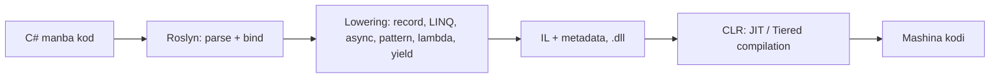

# 01. C# tilini chuqur bilish

> **Bir jumlada:** C# ning "qulay" sintaksisi (record, LINQ, async, pattern matching) ortida kompilyator o'z kodini generatsiya qiladi; Middle dasturchi aynan shu generatsiya qilingan kodni tasavvur qila olishi kerak.
> **Nega Middle uchun:** Junior `record` va `IQueryable` ni ishlatadi, Middle esa `with` nusxalashda qaysi metod chaqirilishini, `Where` ning qachon SQL ga, qachon xotiraga ketishini va `Span<T>` ni nega `async` ichida ushlab bo'lmasligini tushuntiradi. Suhbatlarda aynan shu "ichida nima bo'ladi" savollari beriladi.
> **O'qish vaqti:** ~45 daqiqa

## Mundarija

- [1. Muammo va yechim](#1-muammo-va-yechim)
- [2. Qanday ishlaydi](#2-qanday-ishlaydi)
- [3. Asosiy tushunchalar](#3-asosiy-tushunchalar)
  - [3.1 Generics va constraints](#31-generics-va-constraints)
  - [3.2 Variance: kovariantlik va kontravariantlik](#32-variance-kovariantlik-va-kontravariantlik)
  - [3.3 Delegates, lambda va closure](#33-delegates-lambda-va-closure)
  - [3.4 Events](#34-events)
  - [3.5 LINQ va deferred execution](#35-linq-va-deferred-execution)
  - [3.6 IEnumerable vs IQueryable va expression tree](#36-ienumerable-vs-iqueryable-va-expression-tree)
  - [3.7 Records](#37-records)
  - [3.8 Pattern matching](#38-pattern-matching)
  - [3.9 Nullable reference types](#39-nullable-reference-types)
  - [3.10 Span\<T\> va Memory\<T\>](#310-spant-va-memoryt)
  - [3.11 Source generators](#311-source-generators)
  - [3.12 Boxing](#312-boxing)
  - [3.13 C# 13 va 14 yangiliklari](#313-c-13-va-14-yangiliklari)
- [4. Amaliy misol](#4-amaliy-misol)
- [5. Tipik xatolar va anti-patternlar](#5-tipik-xatolar-va-anti-patternlar)
- [6. Best practices checklist](#6-best-practices-checklist)
- [7. Suhbat savollari va javoblar](#7-suhbat-savollari-va-javoblar)
- [8. Qo'shimcha manbalar](#8-qoshimcha-manbalar)

## 1. Muammo va yechim

Real holat: omborxona tizimida "Buyurtmalar" sahifasi 500 ta yozuv bilan 9 soniyada ochilardi. Kod shunday edi:

```csharp
// OrderService.cs (muammoli variant)
public async Task<List<OrderDto>> GetPaidAsync(CancellationToken ct)
{
    var orders = await _db.Orders.ToListAsync(ct);           // butun jadval xotiraga
    return orders
        .Where(o => o.Status == OrderStatus.Paid)             // filter C# da
        .Select(o => new OrderDto(o.Id, o.Total))
        .ToList();
}
```

Jadvalda 400 000 yozuv bor edi. `ToListAsync` hammasini yuklab, keyin `Where` xotirada ishladi. Dasturchi `Where` ni "LINQ" deb bildi, lekin LINQ ikki xil: `IEnumerable<T>` ustidagi `Enumerable.Where` delegate qabul qiladi va xotirada ishlaydi, `IQueryable<T>` ustidagi `Queryable.Where` esa expression tree qabul qiladi va EF Core uni SQL `WHERE` ga tarjima qiladi. `ToListAsync` ni `Select` dan keyinga ko'chirish so'rovni 40 millisekundga tushirdi.

Shunga o'xshash holatlar: `record` ichida `List<T>` bo'lgani uchun ikki "teng" obyekt teng chiqmaydi; `string?` qo'ygan dasturchi runtime'da `NullReferenceException` kutmaydi, lekin oladi; `Span<T>` ni `async` metodga qo'ygan kod kompilyatsiya bo'lmaydi; `struct` ni `interface` orqali chaqirish har safar heap allocation qiladi.

Yechim bitta: tilning har bir qulayligi uchun "kompilyator buni nimaga aylantiradi?" degan savolga javob berish. Shu bob aynan shu javoblarni beradi.

## 2. Qanday ishlaydi

C# kompilyatori (Roslyn) ikki bosqichda ishlaydi: avval sintaksis daraxti va semantik model quriladi, keyin **lowering** (pasaytirish) bosqichida yuqori darajali konstruksiyalar oddiy konstruksiyalarga aylanadi, va shundan keyingina IL (Intermediate Language) chiqariladi. IL ni runtime'dagi JIT (Just-In-Time kompilyator) mashina kodiga aylantiradi.



Lowering bosqichida nima bo'ladi (bu bobda har biri alohida ochiladi):

| Siz yozasiz | Kompilyator generatsiya qiladi |
|---|---|
| `record Money(decimal Amount, string Currency)` | `IEquatable<Money>` sinf, `Equals`, `GetHashCode`, `ToString`, `PrintMembers`, `<Clone>$`, copy constructor, `Deconstruct`, `==`/`!=` |
| `m with { Amount = 5 }` | `var tmp = m.<Clone>$(); tmp.Amount = 5;` |
| `x => x.Total > 100` (delegate) | Yashirin sinf `<>c` ichida statik metod, yoki capture bo'lsa `<>c__DisplayClass` instansi |
| `x => x.Total > 100` (`Expression<Func<...>>`) | `Expression.Lambda(Expression.GreaterThan(Expression.Property(...), Expression.Constant(100)), ...)` chaqiruvlari zanjiri |
| `yield return` | `IEnumerable<T>` va `IEnumerator<T>` ni amalga oshiruvchi state machine sinfi |
| `switch` ifodasi patternlar bilan | `isinst` tekshiruvlar zanjiri yoki jump table (DAG) |
| `event Action X;` | Private delegate maydon + `add`/`remove` accessor (`Interlocked.CompareExchange` sikli) |
| `string?` | Oddiy `string` + metadata'da `[Nullable(2)]` atributi; runtime'da farq yo'q |
| `lock (obj)` | `Monitor.Enter`/`Monitor.Exit` `try/finally` ichida (C# 13 da `Lock` tipi uchun `EnterScope()`) |

Generatsiya qilingan kodni ko'rish usullari: [sharplab.io](https://sharplab.io) (C# → lowered C# yoki IL), `ILSpy`, `dotnet-ildasm`. Suhbatga tayyorlanishda sharplab'da record va async metodni ochib ko'ring: 10 daqiqa kuzatuv o'nlab sahifa o'qishdan ko'proq beradi.

## 3. Asosiy tushunchalar

### 3.1 Generics va constraints

- **Ta'rif:** Generics tip parametri bilan yoziladigan sinf/metod (`Repository<TEntity>`). Constraint (cheklov) `where` orqali tip parametridan nimani talab qilishni bildiradi.
- **Nega kerak:** Takrorlanmas, tip-xavfsiz kod. Runtime'da CLR generic kodni qanday instansiyalashi performance'ga ta'sir qiladi: value type uchun har bir `T` (`List<int>`, `List<decimal>`) alohida mashina kodi JIT qilinadi, reference type'lar uchun esa bitta umumiy kod (`__Canon` deb ataladigan ichki tip) bo'lishadi. Shuning uchun `List<int>` boxing qilmaydi va tez.

```csharp
// Constraint turlari
public sealed class EntityCache<TKey, TEntity>
    where TKey : notnull                       // Dictionary kaliti null bo'lmasin
    where TEntity : class, IEntity<TKey>, new() // reference type, interface, parametrsiz ctor
{
    private readonly Dictionary<TKey, TEntity> _items = new();

    public TEntity GetOrCreate(TKey key)
    {
        if (_items.TryGetValue(key, out var found)) return found;
        var created = new TEntity { Id = key };  // new() constraint tufayli mumkin
        _items[key] = created;
        return created;
    }
}

// Static abstract members (generic math, .NET 7+): INumber<T> ustida algoritm
public static T SumTotals<T>(IEnumerable<T> values) where T : INumber<T>
{
    var sum = T.Zero;                     // interface'dagi static abstract a'zo
    foreach (var v in values) sum += v;   // operator + ham interface orqali
    return sum;
}
```

Constraintlar ro'yxati: `class`, `struct`, `notnull`, `unmanaged`, `new()`, bazaviy sinf, interface, `where T : U` (tip parametrlari o'rtasida), `allows ref struct` (C# 13, `Span<T>` ni generic argument qilish uchun).

- **Tipik xato:** `where T : IComparable` (non-generic) ishlatib `T` ni `object` ga boxing qilish. `IComparable<T>` ishlating: JIT `constrained.` IL prefiksi bilan boxing'siz chaqiradi.

### 3.2 Variance: kovariantlik va kontravariantlik

- **Ta'rif:** Variance generic interface/delegate'ni tip ierarxiyasi bo'ylab almashtirish qoidasi. `out T` (kovariant): `IEnumerable<Order>` ni `IEnumerable<object>` sifatida ishlatish mumkin. `in T` (kontravariant): `Action<object>` ni `Action<Order>` sifatida ishlatish mumkin.
- **Nega kerak:** `IReadOnlyList<PaidOrder>` ni `IReadOnlyList<Order>` kutgan metodga nusxalashsiz berish.

```csharp
IEnumerable<PaidOrder> paid = GetPaid();
IEnumerable<Order> all = paid;          // OK: IEnumerable<out T>

Action<Order> logOrder = o => Console.WriteLine(o.Id);
Action<PaidOrder> logPaid = logOrder;   // OK: Action<in T>, PaidOrder : Order

List<PaidOrder> list = new();
// List<Order> bad = list;              // XATO: List<T> invariant (yozish ham mumkin bo'lgani uchun)
```

Qoida: variance faqat interface va delegate'larda, faqat reference type'lar uchun ishlaydi (`IEnumerable<int>` ni `IEnumerable<object>` ga keltirib bo'lmaydi, chunki `int` boxing talab qiladi). Massivlar tarixan kovariant (`object[] arr = new string[2]`), bu xavfli: `arr[0] = 1;` runtime'da `ArrayTypeMismatchException` beradi.

- **Tipik xato:** Metoddan `List<T>` qaytarib, so'ng `IEnumerable<Base>` kerak bo'lganda `.Cast<Base>()` yoki `ToList()` bilan nusxalash. `IReadOnlyList<out T>` qaytarsangiz, nusxalash kerak emas.

### 3.3 Delegates, lambda va closure

- **Ta'rif:** Delegate metodga tip-xavfsiz havola. `Func<T,TResult>`, `Action<T>`, `Predicate<T>` tayyor umumiy delegate'lar. Lambda delegate yaratishning qisqa sintaksisi.
- **Nega kerak:** Strategy, callback, LINQ, event. Ichida nima borligini bilish allocation va xato ovlashda kerak.

Kompilyator `delegate void OrderHandler(Order o);` uchun `MulticastDelegate` dan meros olgan `sealed class OrderHandler` yaratadi, ichida `Invoke`, `BeginInvoke`, `EndInvoke`. Lambda uchun esa:

```csharp
decimal min = 100m;
Func<Order, bool> f1 = o => o.Total > 100m;   // capture yo'q
Func<Order, bool> f2 = o => o.Total > min;    // 'min' capture qilinadi

// Kompilyator taxminan shunday generatsiya qiladi:
// f1 uchun: static sinf <>c, metod <Method>b__0_0, delegate bir marta yaratilib kesh qilinadi.
// f2 uchun:
sealed class DisplayClass0_0            // "closure" (yopilma)
{
    public decimal min;                  // local o'zgaruvchi maydonga aylandi (heap'da!)
    public bool Lambda(Order o) => o.Total > min;
}
// har chaqiruvda: var c = new DisplayClass0_0 { min = 100m }; f2 = new Func<Order,bool>(c.Lambda);
```

Muhim oqibatlar: capture qilingan local heap'ga ko'chadi va lambda yashar ekan, u ham yashaydi (leak manbai); capture qilingan o'zgaruvchi *havola* bo'yicha ulashiladi, nusxa emas. `static` lambda (`static o => ...`, C# 9) capture'ni kompilyator darajasida taqiqlaydi.

- **Tipik xato:** `for` siklida `i` ni capture qilish: barcha lambdalar bitta `i` ga ishora qiladi va sikl tugagach bir xil qiymatni ko'radi. `foreach` da C# 5 dan beri har iteratsiyada yangi o'zgaruvchi, muammo yo'q.

### 3.4 Events

- **Ta'rif:** Event delegate maydon ustidagi inkapsulyatsiya: tashqaridan faqat `+=` va `-=` mumkin, `Invoke` va `= null` faqat e'lon qilgan sinf ichida.
- **Nega kerak:** Observer bir yo'nalishli xavfsiz tarzda.

```csharp
public sealed class StockMonitor
{
    public event EventHandler<StockLowEventArgs>? StockLow;
    // Kompilyator generatsiya qiladi:
    // private EventHandler<StockLowEventArgs>? _stockLow;
    // add { lock-free sikl: Interlocked.CompareExchange(ref _stockLow, Delegate.Combine(old, value), old) }
    // remove { xuddi shunday Delegate.Remove bilan }

    private void Check(StockItem item)
    {
        if (item.Quantity < item.Threshold)
            StockLow?.Invoke(this, new StockLowEventArgs(item.Sku));
        // "?." nusxaga chaqiradi: boshqa thread shu paytda -= qilsa ham NullReference bo'lmaydi
    }
}

public sealed record StockLowEventArgs(string Sku);
```

Multicast delegate'da obunachilar ketma-ket chaqiriladi; bittasi exception tashlasa qolganlari chaqirilmaydi. Qaytariladigan qiymat faqat oxirgi obunachiniki.

- **Tipik xato:** Static yoki singleton obyektning eventiga scoped obyekt obuna bo'lib, `-=` qilmaslik: scoped obyekt GC ga ketmaydi (3-bobda batafsil).

### 3.5 LINQ va deferred execution

- **Ta'rif:** LINQ bu `IEnumerable<T>`/`IQueryable<T>` ustidagi extension metodlar zanjiri. Deferred execution (kechiktirilgan bajarilish): `Where`, `Select`, `OrderBy` so'rovni *tasvirlaydi*, bajarmaydi; bajarilish `foreach`, `ToList()`, `Count()`, `First()` kabi "terminal" operatsiyada boshlanadi.
- **Nega kerak:** Pipeline'ni kompozitsiya qilish va keraksiz ishni qilmaslik. Ammo bu ko'p xatoning manbai.

`Enumerable.Where` ichida `yield return` bor. `yield` uchun kompilyator state machine sinf yaratadi:

```csharp
static IEnumerable<Order> Expensive(IEnumerable<Order> src)
{
    foreach (var o in src)
        if (o.Total > 1_000_000m) yield return o;
}

// Lowered (soddalashtirilgan):
sealed class ExpensiveIterator : IEnumerable<Order>, IEnumerator<Order>
{
    int state; Order current; IEnumerable<Order> src; IEnumerator<Order> inner;
    public IEnumerator<Order> GetEnumerator() => /* birinchi marta, o'sha thread'da: this; aks holda yangi nusxa */;
    public bool MoveNext()
    {
        switch (state)
        {
            case 0: inner = src.GetEnumerator(); state = 1; goto case 1;
            case 1:
                while (inner.MoveNext())
                {
                    var o = inner.Current;
                    if (o.Total > 1_000_000m) { current = o; return true; }   // "pauza"
                }
                return false;
        }
        return false;
    }
    public Order Current => current;
}
```

Har `MoveNext` bitta element uchun ishlaydi. Shuning uchun ikki marta `foreach` qilsangiz, butun pipeline ikki marta bajariladi (DB bo'lsa, ikki SQL so'rov).

- **Tipik xato:** `var q = db.Orders.Where(...); var count = q.Count(); var list = q.ToList();` ikkita SQL so'rov. Yoki `IEnumerable<T>` ni metoddan qaytarib, `DbContext` dispose bo'lgandan keyin enumerate qilish: `ObjectDisposedException`.

### 3.6 IEnumerable vs IQueryable va expression tree

- **Ta'rif:** `Enumerable.Where(IEnumerable<T>, Func<T,bool>)` delegate (kompilyatsiya qilingan kod) oladi. `Queryable.Where(IQueryable<T>, Expression<Func<T,bool>>)` expression tree (kodning *ma'lumot sifatidagi* daraxti) oladi. Expression tree'ni provider (EF Core) o'qib, SQL ga tarjima qiladi.
- **Nega kerak:** Filter bazada bajarilishi uchun.

Siz `Expression<Func<Order,bool>> e = o => o.Total > 100;` yozganingizda kompilyator *delegate emas*, quyidagini generatsiya qiladi:

```csharp
ParameterExpression o = Expression.Parameter(typeof(Order), "o");
Expression<Func<Order, bool>> e = Expression.Lambda<Func<Order, bool>>(
    Expression.GreaterThan(
        Expression.Property(o, typeof(Order).GetProperty("Total")!),
        Expression.Convert(Expression.Constant(100, typeof(int)), typeof(decimal))),
    o);
```

EF Core pipeline'i (soddalashtirilgan): `Queryable.Where` chaqiruvi `MethodCallExpression` sifatida `IQueryable.Expression` ga qo'shiladi → enumerate qilinganda `EntityQueryProvider.Execute` → **parameter extraction** (closure'dagi `min` o'zgaruvchisi `@__min_0` SQL parametriga aylanadi, shuning uchun query plan keshlanadi) → **compiled query cache** (daraxt tuzilishi kalit; ikkinchi marta tarjima yo'q) → `QueryableMethodTranslatingExpressionVisitor` daraxtni `SelectExpression` ga → `QuerySqlGenerator` SQL matnga:

```sql
SELECT o."Id", o."Total", o."Status"
FROM "Orders" AS o
WHERE o."Total" > @__min_0
```

Tarjima qilib bo'lmaydigan narsa (o'z metodingiz, `ToString("N2")`, local funksiya) `InvalidOperationException: The LINQ expression ... could not be translated` beradi; EF Core 3+ yashirin client evaluation qilmaydi, faqat oxirgi `Select` proyeksiyasida ruxsat beradi.

```csharp
// SQL ga tarjima: Where/OrderBy/Select hammasi bazada
var dtos = await db.Orders
    .Where(o => o.Status == OrderStatus.Paid && o.Total > min)
    .OrderByDescending(o => o.CreatedAt)
    .Select(o => new OrderDto(o.Id, o.Total))
    .ToListAsync(ct);

// AsEnumerable() dan keyin hammasi xotirada: SELECT * keyin C#
var bad = db.Orders.AsEnumerable().Where(o => IsVip(o)).ToList();
```

- **Tipik xato:** Repository'dan `IEnumerable<Order>` qaytarib, uni `IQueryable` deb o'ylash: `repo.GetAll().Where(...)` butun jadvalni yuklaydi. Yoki aksincha, `IQueryable` ni controller'ga chiqarib, "leaky abstraction" qilish.

### 3.7 Records

- **Ta'rif:** `record` (yoki `record class`) value-based equality, `with` nusxalash va `ToString` ni kompilyator generatsiya qiladigan reference type. `record struct` value type varianti.
- **Nega kerak:** DTO, value object (Money, Address), event payload: "ikki obyekt bir xil ma'lumotga ega bo'lsa teng".

```csharp
public record Money(decimal Amount, string Currency);
```

Kompilyator generatsiya qiladigan a'zolar (sharplab'da tekshirilgan tartib):

```csharp
public class Money : IEquatable<Money>
{
    public decimal Amount { get; init; }
    public string Currency { get; init; }
    public Money(decimal Amount, string Currency) { this.Amount = Amount; this.Currency = Currency; }

    protected virtual Type EqualityContract => typeof(Money);   // meros zanjirida tipni solishtirish uchun

    public virtual bool Equals(Money? other) =>
        (object)this == other ||
        (other is not null
         && EqualityContract == other.EqualityContract
         && EqualityComparer<decimal>.Default.Equals(Amount, other.Amount)
         && EqualityComparer<string>.Default.Equals(Currency, other.Currency));
    public override bool Equals(object? obj) => Equals(obj as Money);
    public override int GetHashCode() =>
        (EqualityComparer<Type>.Default.GetHashCode(EqualityContract) * -1521134295
         + EqualityComparer<decimal>.Default.GetHashCode(Amount)) * -1521134295
         + EqualityComparer<string>.Default.GetHashCode(Currency);
    public static bool operator ==(Money? l, Money? r) => (object?)l == r || (l?.Equals(r) ?? false);
    public static bool operator !=(Money? l, Money? r) => !(l == r);

    public override string ToString()
    {
        var sb = new StringBuilder().Append("Money").Append(" { ");
        if (PrintMembers(sb)) sb.Append(' ');
        return sb.Append('}').ToString();          // "Money { Amount = 10, Currency = UZS }"
    }
    protected virtual bool PrintMembers(StringBuilder b)
    {
        b.Append("Amount = ").Append(Amount).Append(", Currency = ").Append(Currency);
        return true;
    }

    protected Money(Money original) { Amount = original.Amount; Currency = original.Currency; }  // copy ctor
    public virtual Money <Clone>$() => new Money(this);                                          // 'with' uchun
    public void Deconstruct(out decimal Amount, out string Currency) { Amount = this.Amount; Currency = this.Currency; }
}
```

`with` ifodasi: `var m2 = m with { Amount = 20 };` → `var tmp = m.<Clone>$(); tmp.Amount = 20; var m2 = tmp;`. `init` setter aynan shu yerda chaqiriladi, shuning uchun `with` `init` talab qiladi. Meros bo'lsa `<Clone>$` virtual, shuning uchun `Money` o'zgaruvchisida `PremiumMoney` yotsa ham to'g'ri tip nusxalanadi.

`record struct Point(int X, int Y)`: `EqualityContract` yo'q, maydonlar to'g'ridan-to'g'ri solishtiriladi, xususiyatlar default `set` (immutable kerak bo'lsa `readonly record struct`).

- **Tipik xato:** Record ichida `List<string> Tags` bo'lsa, `Equals` `EqualityComparer<List<string>>.Default` orqali *havola* solishtiradi: bir xil elementlarga ega ikki ro'yxat teng emas. Value object'da `ImmutableArray<T>` yoki qo'lda `Equals` override kerak. Ikkinchi xato: EF Core entity sifatida `record` ishlatish, `with` yangi instansiya yaratadi, change tracker uni "yangi entity" deb biladi.

### 3.8 Pattern matching

- **Ta'rif:** Qiymatni shaklga (tip, xususiyat, konstanta, ro'yxat) mos tekshirish va shu zahoti dekonstruksiya qilish: `is`, `switch` ifoda, `switch` operator.
- **Nega kerak:** Domain qoidalarini `if (x != null && x is Order o && o.Status == ...)` zanjiridan ko'ra o'qiladigan shaklda yozish; kompilyator to'liqlikni (exhaustiveness) tekshiradi.

```csharp
public static decimal DeliveryFee(Order order) => order switch
{
    { Status: OrderStatus.Cancelled } => 0m,                               // property pattern
    { Total: >= 1_000_000m, Customer.Tier: CustomerTier.Gold } => 0m,      // relational + extended property
    { Items: [] } => throw new InvalidOperationException("Bo'sh buyurtma"), // list pattern
    { Items: [_, _, ..] , Region: "Toshkent" or "Toshkent viloyati" } => 15_000m, // list + logical
    Order(var total, _) when total > 500_000m => 20_000m,                  // positional (Deconstruct) + guard
    not null => 30_000m,
    null => throw new ArgumentNullException(nameof(order)),
};
```

Lowering: kompilyator patternlarni **qaror DAG** (decision directed acyclic graph) ga yig'adi: bir xil tekshiruvlar (masalan `order is null`) bir marta bajariladi, konstanta `switch` lar jump table bo'ladi, tip tekshiruvlari `isinst` ga aylanadi. Natija qo'lda yozilgan `if` zanjiridan sekin emas. To'liq bo'lmagan `switch` ifoda uchun CS8509 ogohlantirish, runtime'da mos kelmasa `SwitchExpressionException`.

- **Tipik xato:** `enum` ustida `switch` ifodasida `_ => throw` yozmaslik: yangi enum qiymati qo'shilganda kompilyator ogohlantiradi, lekin `_` bo'lsa jim o'tadi. Ikkala yondashuvning ham bahosi bor: `_` siz ogohlantirish, `_` bilan "default" xatti-harakat. Domain'da birinchisi xavfsizroq.

### 3.9 Nullable reference types

- **Ta'rif:** NRT (`<Nullable>enable</Nullable>`) kompilyatorga `string` "hech qachon null emas", `string?` "null bo'lishi mumkin" degan niyatni bildiradi. Bu *faqat compile-time* flow analysis: runtime'da `string?` va `string` bitta tip, metadata'da `[Nullable(2)]`/`[Nullable(1)]` atributi bilan farqlanadi.
- **Nega kerak:** `NullReferenceException` ni production'dan kompilyatsiya vaqtiga ko'chirish.

```csharp
public sealed class Customer
{
    public required string Name { get; init; }      // required: CS8618 siz, chaqiruvchi to'ldirishi shart
    public string? Phone { get; init; }
    public Address? Address { get; init; }
}

public static bool TryFindCity(Customer c, [NotNullWhen(true)] out string? city)
{
    city = c.Address?.City;
    return city is not null;      // kompilyator: true qaytsa city null emas
}

// Foydalanish
if (TryFindCity(customer, out var city))
    Console.WriteLine(city.Length);   // ogohlantirish yo'q: NotNullWhen(true) ishladi
```

Foydali atributlar: `[NotNullWhen(bool)]`, `[MaybeNullWhen(bool)]`, `[NotNull]`, `[MemberNotNull(nameof(X))]` (init metodlarda), `[DoesNotReturn]` (throw helper). `ArgumentNullException.ThrowIfNull(x)` ham post-condition sifatida tanilgan.

Chegaralar: deserializatsiya (`JsonSerializer`), EF Core materializatsiya, reflection va `default(T)` NRT ni chetlab o'tadi. Shuning uchun API chegarasida (`[ApiController]` model binding, `required` + validation) haqiqiy tekshiruv kerak. EF Core navigatsiya uchun `= null!;` yoki `required` ishlatiladi: `null!` "men bilaman, EF to'ldiradi" degani.

- **Tipik xato:** `!` ("null-forgiving") operatorini ogohlantirishni o'chirish uchun hamma joyga qo'yish. `!` kompilyatorni aldaydi, runtime'ni emas. Har `!` uchun sabab izohi bo'lsin yoki tekshiruvga almashtiring.

### 3.10 Span\<T\> va Memory\<T\>

- **Ta'rif:** `Span<T>` xotira bo'lagiga (massiv, `stackalloc`, unmanaged, string) allocation'siz "oyna": ichida `ref T` ko'rsatkich va uzunlik. `ref struct` bo'lgani uchun faqat stack'da yashaydi. `Memory<T>` esa oddiy struct, massiv/`MemoryManager` ga havola saqlaydi, heap'da yotishi va `async` dan o'tishi mumkin; `.Span` orqali `Span<T>` beradi.
- **Nega kerak:** Parsing, buffer bilan ishlash, satr bo'laklarini `Substring` (allocation) siz olish.

```csharp
// "+998901234567" dan operator kodini allocation'siz olish
public static bool TryGetOperatorCode(ReadOnlySpan<char> phone, out int code)
{
    code = 0;
    if (phone.Length != 13 || !phone.StartsWith("+998")) return false;
    return int.TryParse(phone.Slice(4, 2), out code);   // Slice: yangi string yo'q
}

// Fayl/socket'dan o'qish: async metodga Span bermaydi, Memory beradi
public static async Task<int> ReadHeaderAsync(Stream s, CancellationToken ct)
{
    byte[] rented = ArrayPool<byte>.Shared.Rent(64);
    try
    {
        int n = await s.ReadAsync(rented.AsMemory(0, 64), ct);  // Memory<byte> await'dan o'tadi
        return BinaryPrimitives.ReadInt32LittleEndian(rented.AsSpan(0, 4)); // await'dan keyin Span olish mumkin
    }
    finally { ArrayPool<byte>.Shared.Return(rented); }
}
```

`ref struct` cheklovlari: class/struct maydoni bo'la olmaydi (heap'ga chiqmasin), boxing yo'q, lambda capture yo'q, `await`/`yield` chegarasidan o'ta olmaydi (C# 13 dan `async` metod ichida local sifatida bo'lishi mumkin, lekin `await` dan oldin ishi tugashi shart), generic argument bo'la olmaydi (`allows ref struct` constraint bo'lmasa). Sabab: async state machine heap'da (3-bob), `Span` esa stack freymiga bog'langan; GC uning ichidagi `ref` ni ko'chira oladi, lekin stack dan tashqarida kuzata olmaydi.

- **Tipik xato:** `ReadOnlySpan<char>` ni `Dictionary<string, T>` da kalit sifatida ishlatish uchun `.ToString()` qilish (allocation qaytdi). .NET 9+ da `Dictionary<string,T>.GetAlternateLookup<ReadOnlySpan<char>>()` buni allocation'siz hal qiladi.

### 3.11 Source generators

- **Ta'rif:** Source generator kompilyatsiya vaqtida sizning kodingizni o'qib, qo'shimcha C# fayl generatsiya qiladigan Roslyn komponenti (`IIncrementalGenerator`). Reflection'ni runtime'dan compile-time'ga ko'chiradi.
- **Nega kerak:** Startup tezligi, NativeAOT/trimming mosligi, allocation kamayishi.

```csharp
// 1. System.Text.Json: reflection'siz serializer
[JsonSerializable(typeof(OrderDto))]
[JsonSerializable(typeof(List<OrderDto>))]
internal partial class AppJsonContext : JsonSerializerContext;
// Foydalanish: JsonSerializer.Serialize(dto, AppJsonContext.Default.OrderDto)

// 2. Regex: pattern compile vaqtida DFA/kodga aylanadi
public static partial class Phone
{
    [GeneratedRegex(@"^\+998\d{9}$")]
    public static partial Regex Uzbek();
}

// 3. Logging: ILogger.LogInformation("...{OrderId}", id) boxing va parse'siz
public static partial class OrderLog
{
    [LoggerMessage(Level = LogLevel.Information, Message = "Buyurtma {OrderId} to'landi: {Amount} UZS")]
    public static partial void Paid(ILogger logger, long orderId, decimal amount);
}
```

Boshqa muhim generatorlar: ASP.NET Core Minimal API `RequestDelegateGenerator` (`<PublishAot>` yoki `<EnableRequestDelegateGenerator>` da yoqiladi), konfiguratsiya binder generatori (`<EnableConfigurationBindingGenerator>`), `[OptionsValidator]`, `[LibraryImport]` (P/Invoke), EF Core compiled model (`dotnet ef dbcontext optimize`). Generatsiya qilingan fayllarni ko'rish: `<EmitCompilerGeneratedFiles>true</EmitCompilerGeneratedFiles>`, `obj/.../generated/`.

- **Tipik xato:** `partial` ni unutish yoki generatorni `PackageReference` da `OutputItemType="Analyzer"` siz ulash. Yana: `JsonSerializerContext` ga tip qo'shishni unutib, runtime'da "metadata for type not found" olish.

### 3.12 Boxing

- **Ta'rif:** Boxing value type'ni (`int`, `struct`, `enum`) heap'dagi `object` konteyneriga o'rash (IL `box`); unboxing teskarisi (`unbox.any`). Har boxing allocation + keyinchalik GC ishi.
- **Nega kerak:** Yashirin boxing hot path'da gen0 GC sonini oshiradi va p99 latency'ga ta'sir qiladi.

Yashirin boxing manbalari:

```csharp
struct Sku(string Code) { public string Code = Code; }

object o = 42;                                  // ochiq boxing
IComparable c = 42;                             // interface'ga cast: boxing
string s = string.Format("{0}", 42);            // params object[]: boxing
var list = new ArrayList { 42 };                // non-generic kolleksiya
Enum e = OrderStatus.Paid;                      // enum -> Enum (bazaviy sinf)

var sku = new Sku("A1");
bool eq = sku.Equals(new Sku("A1"));            // IEquatable<Sku> yo'q: ValueType.Equals(object) -> boxing + reflection
IEnumerable<int> nums = new List<int> { 1, 2 };
foreach (var n in nums) { }                      // List<int>.Enumerator (struct) interface orqali: boxing
```

Boxing bo'lmaydigan holatlar: `$"{42}"` (.NET 6+ `DefaultInterpolatedStringHandler.AppendFormatted<T>` generic), `List<int>`, generic metodda `where T : IComparable<T>` (`constrained.` prefiks), `foreach` to'g'ridan-to'g'ri `List<int>` ustida (struct enumerator inline). Tekshirish: BenchmarkDotNet `[MemoryDiagnoser]` yoki `dotnet-counters` da `gen-0-gc-count`.

- **Tipik xato:** `struct` ni `Dictionary` kaliti qilib, `IEquatable<T>` va `GetHashCode` yozmaslik: har lookup boxing + reflection. `record struct` ikkalasini generatsiya qiladi.

### 3.13 C# 13 va 14 yangiliklari

Middle darajada bilish kerak bo'lgan (hammasi .NET 10 SDK da tayyor):

```csharp
// C# 13: params har qanday kolleksiya, Span bilan allocation'siz
static decimal Sum(params ReadOnlySpan<decimal> values) { decimal s = 0; foreach (var v in values) s += v; return s; }
var total = Sum(10m, 20m, 30m);                 // massiv yaratilmaydi

// C# 13: System.Threading.Lock (2-bobda batafsil)
private readonly Lock _gate = new();
void Update() { lock (_gate) { /* Monitor emas, Lock.EnterScope() */ } }

// C# 14: extension members (metod, property, static a'zo)
public static class OrderExtensions
{
    extension(IEnumerable<Order> orders)
    {
        public decimal TotalSum => orders.Sum(o => o.Total);      // extension property
        public IEnumerable<Order> Paid() => orders.Where(o => o.Status == OrderStatus.Paid);
    }
}
var sum = orders.Paid().TotalSum;

// C# 14: field keyword, backing field'ni qo'lda e'lon qilmasdan
public string Name { get => field; set => field = value?.Trim() ?? throw new ArgumentNullException(nameof(value)); }

// C# 14: null-conditional assignment
customer?.Address = newAddress;                 // customer null bo'lsa o'ng tomon hisoblanmaydi ham
```

C# 14 shuningdek `nameof(List<>)` (unbound generic), `Span<T>`/`ReadOnlySpan<T>` ga birinchi darajali implicit konversiyalar, lambda parametrida tipsiz modifikator (`(ref x) => ...`) va partial constructor/event qo'shdi.

## 4. Amaliy misol

Vazifa: tenantlar (mijoz kompaniyalar) bo'yicha buyurtmalar hisobotini qaytaruvchi so'rov qatlami. Talablar: filter bazada bajarilsin, filter shartlari qayta ishlatilsin, DTO value semantikaga ega bo'lsin, telefon raqami allocation'siz tekshirilsin.

```csharp
// Domain/Order.cs
public enum OrderStatus { New, Paid, Shipped, Cancelled }

public sealed class Order
{
    public long Id { get; private set; }
    public Guid TenantId { get; private set; }
    public OrderStatus Status { get; private set; }
    public decimal Total { get; private set; }
    public DateTimeOffset CreatedAt { get; private set; }
    public required Customer Customer { get; init; }
    public List<OrderLine> Lines { get; } = new();
}

// Application/Orders/OrderSummary.cs
// record: value equality (test'da Assert.Equal ishlaydi), ToString (log'da o'qiladi), with (nusxa)
public sealed record OrderSummary(long Id, decimal Total, OrderStatus Status, string CustomerName);

// Application/Orders/OrderFilters.cs
// Expression<Func<..>> qaytaradi, Func emas: EF Core SQL ga tarjima qila olishi uchun
public static class OrderFilters
{
    public static Expression<Func<Order, bool>> ForTenant(Guid tenantId) =>
        o => o.TenantId == tenantId;                 // tenantId closure: SQL parametri @__tenantId_0

    public static Expression<Func<Order, bool>> WithStatus(OrderStatus status) =>
        o => o.Status == status;

    public static Expression<Func<Order, bool>> MinTotal(decimal min) =>
        o => o.Total >= min;
}

// Application/Orders/GetOrderSummaries.cs
public sealed class GetOrderSummaries(AppDbContext db)
{
    public async Task<IReadOnlyList<OrderSummary>> HandleAsync(
        Guid tenantId, OrderStatus? status, decimal? minTotal, CancellationToken ct)
    {
        IQueryable<Order> q = db.Orders.AsNoTracking()       // faqat o'qiymiz: change tracker kerak emas
            .Where(OrderFilters.ForTenant(tenantId));

        // Shartli kompozitsiya: har bir Where SQL WHERE ... AND ... ga qo'shiladi, hali bajarilmaydi
        if (status is { } s) q = q.Where(OrderFilters.WithStatus(s));
        if (minTotal is { } m) q = q.Where(OrderFilters.MinTotal(m));

        // Select proyeksiya: SQL faqat 4 ustun qaytaradi, Customer uchun JOIN generatsiya qilinadi
        return await q
            .OrderByDescending(o => o.CreatedAt)
            .Select(o => new OrderSummary(o.Id, o.Total, o.Status, o.Customer.Name))
            .ToListAsync(ct);                                 // bajarilish aynan shu yerda
    }
}
```

EF Core generatsiya qiladigan SQL (PostgreSQL, status va minTotal berilganda):

```sql
SELECT o."Id", o."Total", o."Status", c."Name"
FROM "Orders" AS o
INNER JOIN "Customers" AS c ON o."CustomerId" = c."Id"
WHERE o."TenantId" = @__tenantId_0 AND o."Status" = @__s_1 AND o."Total" >= @__m_2
ORDER BY o."CreatedAt" DESC
```

Nega aynan shunday:

- `OrderFilters` `Expression<Func<>>` qaytaradi; `Func<>` qaytarsa `q.Where(func)` `Enumerable.Where` ga overload resolution qiladi va butun jadval yuklanadi. Bu bitta harf farqi bilan 1000x performance farqi.
- `status is { } s` nullable'dan qiymatni "property pattern" bilan oladi; `status.HasValue` + `.Value` dan qisqa va `s` ni non-nullable qiladi.
- `OrderSummary` `record`: test'larda `Assert.Equal(expected, actual)` strukturaviy ishlaydi; `ToString` log'da `OrderSummary { Id = 5, Total = ... }` beradi.
- `IReadOnlyList<T>` qaytariladi, `IQueryable` emas: so'rov qatlami tashqarisida hech kim bazaga qo'shimcha `Where` qo'sha olmaydi (abstraksiya oqmaydi).

Telefon tekshiruvi (3.10 dagi `TryGetOperatorCode`) ni validation'da ishlatish: `Customer.Phone` string, `TryGetOperatorCode(phone.AsSpan(), out _)` hech qanday yangi string yaratmaydi; 100 000 mijozni import qilganda farq o'nlab megabayt allocation.

## 5. Tipik xatolar va anti-patternlar

**1. `Func` qabul qiladigan "generic repository"**

```csharp
// ❌
public IEnumerable<T> Find(Func<T, bool> predicate) => _db.Set<T>().Where(predicate);
```
`Where(Func)` `Enumerable.Where` ni tanlaydi: `DbSet<T>` `IEnumerable<T>` sifatida enumerate qilinadi, butun jadval yuklanadi, filter xotirada. Oqibat: xotira va vaqt jadval hajmiga proporsional.
```csharp
// ✅
public Task<List<T>> FindAsync(Expression<Func<T, bool>> predicate, CancellationToken ct) =>
    _db.Set<T>().Where(predicate).ToListAsync(ct);
```

**2. Ko'p marta enumerate**

```csharp
// ❌
var paid = db.Orders.Where(o => o.Status == OrderStatus.Paid);
if (paid.Any()) { var count = paid.Count(); var list = paid.ToList(); }   // 3 ta SQL so'rov
```
Deferred execution: har terminal operatsiya pipeline'ni qaytadan bajaradi.
```csharp
// ✅
var list = await db.Orders.Where(o => o.Status == OrderStatus.Paid).ToListAsync(ct);
if (list.Count > 0) { ... }   // bir marta bazaga
```

**3. Record ichida mutable kolleksiya**

```csharp
// ❌
public record Cart(List<string> Skus);
new Cart(["a"]) == new Cart(["a"])   // false: List<T> havola bo'yicha solishtiriladi
```
```csharp
// ✅
public record Cart(ImmutableArray<string> Skus)
{
    public bool Equals(Cart? other) => other is not null && Skus.SequenceEqual(other.Skus);
    public override int GetHashCode() { var h = new HashCode(); foreach (var s in Skus) h.Add(s); return h.ToHashCode(); }
}
```

**4. `!` bilan NRT ni o'chirish**

```csharp
// ❌
var customer = await db.Customers.FindAsync(id);
return customer!.Name;        // null bo'lsa NullReferenceException, lekin "warning yo'q"
```
```csharp
// ✅
var customer = await db.Customers.FindAsync([id], ct)
    ?? throw new NotFoundException($"Customer {id}");
return customer.Name;
```

**5. Struct kalitda `IEquatable<T>` yo'q**

```csharp
// ❌
public struct Sku { public string Code; }
var stock = new Dictionary<Sku, int>();        // har lookup: GetHashCode reflection, Equals boxing
```
```csharp
// ✅
public readonly record struct Sku(string Code); // IEquatable<Sku>, GetHashCode, == generatsiya qilinadi
```

**6. Closure'da sikl o'zgaruvchisi**

```csharp
// ❌
var tasks = new List<Task>();
for (int i = 0; i < 3; i++) tasks.Add(Task.Run(() => Process(i)));   // hammasi i == 3 ni ko'radi
```
```csharp
// ✅
for (int i = 0; i < 3; i++) { int local = i; tasks.Add(Task.Run(() => Process(local))); }
// yoki foreach (var i in Enumerable.Range(0, 3)): foreach har iteratsiyada yangi o'zgaruvchi
```

**7. Event'dan obunani o'chirmaslik**

```csharp
// ❌
public sealed class OrderPage(StockMonitor monitor)   // monitor singleton
{
    public void Init() => monitor.StockLow += OnStockLow;   // OrderPage endi hech qachon GC bo'lmaydi
}
```
```csharp
// ✅
public sealed class OrderPage(StockMonitor monitor) : IDisposable
{
    public void Init() => monitor.StockLow += OnStockLow;
    public void Dispose() => monitor.StockLow -= OnStockLow;
}
```

**8. Expression'da tarjima qilinmaydigan metod**

```csharp
// ❌
db.Orders.Where(o => IsVip(o.Customer))      // InvalidOperationException: could not be translated
```
```csharp
// ✅  Shartni expression sifatida yozing yoki bazadagi ustunga asoslang
db.Orders.Where(o => o.Customer.Tier == CustomerTier.Gold && o.Customer.OrdersCount > 10)
```

## 6. Best practices checklist

- [ ] Repository/so'rov qatlami `Expression<Func<T,bool>>` qabul qiladi, `Func` emas: filter SQL ga tarjima qilinishi uchun.
- [ ] Metoddan `IQueryable<T>` tashqariga chiqmaydi, `IReadOnlyList<T>`/DTO qaytadi: so'rov qayerda bajarilishini bitta joy nazorat qiladi.
- [ ] LINQ pipeline bir marta enumerate qilinadi (`ToListAsync` keyin ishlash): har terminal operatsiya qayta bajarilishini oldini oladi.
- [ ] DTO, value object va event payload uchun `record` (yoki `readonly record struct`): value equality va `ToString` bepul.
- [ ] Record'ga mutable kolleksiya qo'yilmaydi yoki `Equals` qo'lda yoziladi: generatsiya qilingan `Equals` havola solishtiradi.
- [ ] EF Core entity `class`, `record` emas: change tracker instansiya identikligiga tayanadi.
- [ ] `<Nullable>enable</Nullable>` + `<TreatWarningsAsErrors>`; `!` faqat izoh bilan: ogohlantirish qolsa NRT ma'nosini yo'qotadi.
- [ ] API chegarasida (`required`, validation) haqiqiy null tekshiruv: deserializatsiya NRT ni ko'rmaydi.
- [ ] `switch` ifodasi domain enum'larida `_` siz yoziladi yoki `_ => throw`: yangi holat qo'shilganda kompilyator aytsin.
- [ ] Struct kalit/element uchun `readonly record struct` yoki `IEquatable<T>` + `GetHashCode`: boxing va reflection'siz.
- [ ] Hot path'da parsing `ReadOnlySpan<char>` bilan, `Substring`/`Split` siz: allocation yo'q.
- [ ] `async` chegarasidan `Memory<T>` o'tadi, `Span<T>` faqat ichida: `ref struct` heap'ga chiqa olmaydi.
- [ ] JSON, Regex, Logging uchun source generator: startup, allocation va AOT uchun.
- [ ] Singleton event'iga obuna bo'lgan obyekt `Dispose` da `-=` qiladi: aks holda leak.
- [ ] Capture qilmaydigan lambda `static` bilan belgilanadi: tasodifiy closure allocation'ni kompilyator ushlaydi.

## 7. Suhbat savollari va javoblar

**1. `IEnumerable<T>` va `IQueryable<T>` farqi nimada?**
`IQueryable<T>` `IEnumerable<T>` dan meros oladi, lekin ustiga `Expression` va `Provider` qo'shadi. `Enumerable.Where` delegate (`Func<T,bool>`) oladi va ishni xotirada, C# kodida bajaradi. `Queryable.Where` `Expression<Func<T,bool>>` oladi: kompilyator lambda'ni kod emas, daraxt sifatida generatsiya qiladi, va provider (EF Core) daraxtni SQL ga tarjima qiladi. Tuzoq: `AsEnumerable()` yoki `IEnumerable` tipidagi o'zgaruvchiga o'tkazilgan zahoti keyingi `Where` xotirada ishlaydi; `DbSet` ustida `Func` bilan `Where` chaqirsangiz ham overload resolution `Enumerable.Where` ni tanlaydi.

**2. `record` va `class` farqi nimada, kompilyator nima generatsiya qiladi?**
`record` reference type, lekin kompilyator `IEquatable<T>`, `Equals(object)`, `GetHashCode`, `==`/`!=`, `ToString`/`PrintMembers`, `EqualityContract`, copy constructor, `<Clone>$` va positional bo'lsa `Deconstruct` generatsiya qiladi. `with` ifodasi `<Clone>$` ni chaqirib, keyin `init` setter orqali maydonlarni o'zgartiradi. `Equals` har xususiyatni `EqualityComparer<T>.Default` bilan solishtiradi, shuning uchun kolleksiya xususiyat havola bo'yicha tekshiriladi. `class` da bularning hech biri yo'q: reference equality.

**3. Deferred execution nima va qanday xatoga olib keladi?**
`Where`/`Select` kabi operatorlar `yield` asosidagi iterator qaytaradi: hech narsa bajarilmaydi, faqat pipeline tasvirlanadi. Bajarilish `foreach`, `ToList`, `Count`, `First` da boshlanadi va har safar qaytadan. Xatolar: bitta so'rovni `Any()` + `Count()` + `ToList()` bilan uch marta bazaga yuborish; `IEnumerable<T>` ni `DbContext` dispose bo'lgach enumerate qilish (`ObjectDisposedException`); closure'dagi o'zgaruvchini pipeline yaratilgandan keyin o'zgartirish, natija kutilmagan bo'ladi.

**4. `Span<T>` ni `async` metodda nega ishlatib bo'lmaydi?**
`Span<T>` `ref struct`: ichida `ref T` bor va stack'dan tashqariga chiqa olmaydi. `async` metod state machine'ga aylanadi, uning local'lari `await` dan o'tishi uchun heap'dagi (yoki boxing qilingan struct) maydonlarga ko'chadi. `Span` heap'da yotolmaydi, chunki GC heap obyekti ichidagi ichki ko'rsatkichni kuzatishi va xotira ko'chirilganda yangilashi mumkin emas. C# 13 dan `async` ichida `Span` local bo'lishi mumkin, lekin `await` dan oldin ishlatilib bo'lgan bo'lishi shart. Async I/O uchun `Memory<T>` ishlatiladi, u oddiy struct va heap'ga chiqa oladi.

**5. Boxing nima va qayerda yashirin bo'ladi?**
Value type'ni `object` yoki interface tipiga keltirganda runtime heap'da konteyner yaratib qiymatni ko'chiradi, bu boxing. Yashirin joylar: `string.Format` ga struct berish (`params object[]`), struct'ni interface orqali chaqirish, `ArrayList`/`Hashtable`, `IEquatable<T>` siz struct'ning `Equals`, `IEnumerable<T>` tipidagi o'zgaruvchi ustida `foreach` (struct enumerator boxing bo'ladi), enum'ni `Enum` ga keltirish. Generic kodda `where T : IInterface` boxing qilmaydi: JIT `constrained.` prefiks bilan to'g'ridan-to'g'ri chaqiradi. `$""` interpolatsiya .NET 6 dan boxing qilmaydi.

**6. Kovariantlik va kontravariantlik qachon kerak va qayerda ishlamaydi?**
`out T` tipni faqat *qaytaradigan* interface'larda (`IEnumerable<out T>`, `IReadOnlyList<out T>`): `IEnumerable<Order>` ni `IEnumerable<object>` sifatida uzatish mumkin. `in T` tipni faqat *qabul qiladigan* joylarda (`Action<in T>`, `IComparer<in T>`): `IComparer<object>` `IComparer<Order>` o'rnida ishlaydi. Ishlamaydi: sinflarda (`List<T>` invariant, chunki yozish ham mumkin), value type'larda (`IEnumerable<int>` → `IEnumerable<object>` boxing talab qilgani uchun yo'q). Massivlar istisno: tarixan kovariant va `ArrayTypeMismatchException` bilan xavfli.

**7. Lambda closure nima, qachon allocation bo'ladi?**
Lambda tashqi local o'zgaruvchini ishlatsa, kompilyator "display class" yaratadi: local shu sinfning maydoniga aylanadi va lambda shu instansiya metodiga aylanadi. Har safar lambda yaratilganda display class allocation bo'ladi va lambda yashar ekan, capture qilingan hamma narsa yashaydi (`DbContext` ni capture qilsangiz, u ham). Capture bo'lmasa delegate statik maydonda keshlanadi, allocation bir marta. `static` lambda capture'ni taqiqlaydi. Tuzoq: `this` ni capture (instance a'zoga murojaat) ham closure.

**8. NRT runtime'da nima qiladi?**
Hech narsa. `string?` va `string` bitta tip; kompilyator metadata'ga `[Nullable]` atributlarini yozadi va flow analysis bilan ogohlantiradi. Runtime tekshiruv yo'q, shuning uchun deserializatsiya, reflection, EF materializatsiya, `default(T)` orqali `null` kelishi mumkin. Tuzoq: `!` operatori faqat kompilyatorni tinchlantiradi. Haqiqiy himoya: API chegarasida validation, `required`, `ArgumentNullException.ThrowIfNull`.

**9. Expression tree'dan EF Core qanday SQL yasaydi?**
`Queryable.Where(source, expr)` daraxtga `MethodCallExpression` tuguni qo'shadi. Enumerate paytida provider daraxtni oladi: avval closure o'zgaruvchilarini parametrlarga ajratadi (`@__min_0`), shu holda daraxt tuzilishi bo'yicha compiled query cache'dan tayyor delegate qidiradi; topilmasa visitor'lar daraxtni `SelectExpression` ga (SQL ning ichki modeli) tarjima qiladi, `QuerySqlGenerator` matnga aylantiradi, natija keshlanadi. Tarjima qilinmaydigan tugun (sizning metodingiz) `InvalidOperationException` beradi; oxirgi `Select` proyeksiyasidagi ifodalar client'da hisoblanishi mumkin.

**10. Source generator va reflection'ni qachon tanlaysiz?**
Reflection runtime'da tip metadata'sini o'qiydi: moslashuvchan, lekin sekin (birinchi chaqiruv, delegate keshlash), trimming/AOT bilan mos kelmaydi. Source generator compile vaqtida kod yozadi: tez, AOT-safe, xatolar build'da chiqadi. Standart holatlar: JSON (`JsonSerializerContext`), Regex, `LoggerMessage`, Minimal API, Options validation. Reflection faqat tiplar compile vaqtida noma'lum bo'lganda (plugin tizimi) qoladi.

**11. `record struct` va `readonly record struct` farqi?**
`record struct` da positional xususiyatlar `get; set;` (mutable), `readonly record struct` da `get; init;` va struct `readonly` (defensive copy yo'q, `in` parametr bilan samarali). Ikkalasi ham `IEquatable<T>`, `GetHashCode`, `==` va `ToString` generatsiya qiladi, lekin `EqualityContract` va copy constructor yo'q (meros yo'q). Value object uchun `readonly record struct`, DTO uchun `record class` (null bo'lishi mumkin, meros, kattaroq).

**12. Pattern matching `switch` ifodasini kompilyator qanday bajaradi, sekin emasmi?**
Kompilyator barcha patternlarni bitta qaror DAG ga yig'adi: bir xil tekshiruv (masalan `is null`, tip tekshiruvi) bir marta bajariladi, konstanta tekshiruvlar jump table ga, tip tekshiruvlari `isinst` ga aylanadi. Natija qo'lda yozilgan `if/else` dan sekin emas, ko'pincha tezroq (ortiqcha tekshiruvlar olib tashlanadi). Positional pattern `Deconstruct` metodini chaqiradi, bu virtual chaqiruv bo'lishi mumkin. Tuzoq: `when` guard'lar DAG optimizatsiyasini cheklaydi, chunki ular ixtiyoriy kod.

## 8. Qo'shimcha manbalar

- [C# language reference (learn.microsoft.com)](https://learn.microsoft.com/dotnet/csharp/language-reference/)
- [What's new in C# 14](https://learn.microsoft.com/dotnet/csharp/whats-new/csharp-14)
- [What's new in C# 13](https://learn.microsoft.com/dotnet/csharp/whats-new/csharp-13)
- [Records (C# reference)](https://learn.microsoft.com/dotnet/csharp/language-reference/builtin-types/record)
- [Pattern matching](https://learn.microsoft.com/dotnet/csharp/fundamentals/functional/pattern-matching)
- [Nullable reference types](https://learn.microsoft.com/dotnet/csharp/nullable-references)
- [Memory\<T\> and Span\<T\> usage guidelines](https://learn.microsoft.com/dotnet/standard/memory-and-spans/memory-t-usage-guidelines)
- [Expression trees](https://learn.microsoft.com/dotnet/csharp/advanced-topics/expression-trees/)
- [EF Core: How queries work](https://learn.microsoft.com/ef/core/querying/how-query-works)
- [Source generators overview](https://learn.microsoft.com/dotnet/csharp/roslyn-sdk/source-generators-overview)
- [Covariance and contravariance in generics](https://learn.microsoft.com/dotnet/standard/generics/covariance-and-contravariance)
- [SharpLab: lowered C# va IL ni ko'rish](https://sharplab.io)
- Stephen Toub, ["Performance Improvements in .NET"](https://devblogs.microsoft.com/dotnet/) seriyasi (har yil, boxing/Span/LINQ ichki tafsilotlari bilan)
