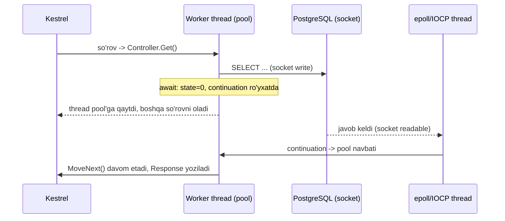
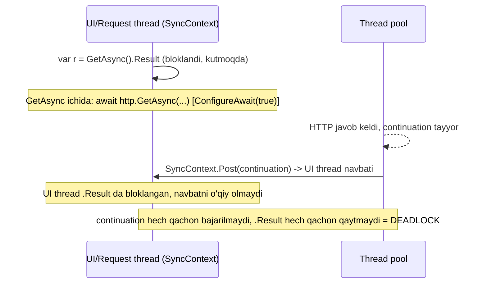
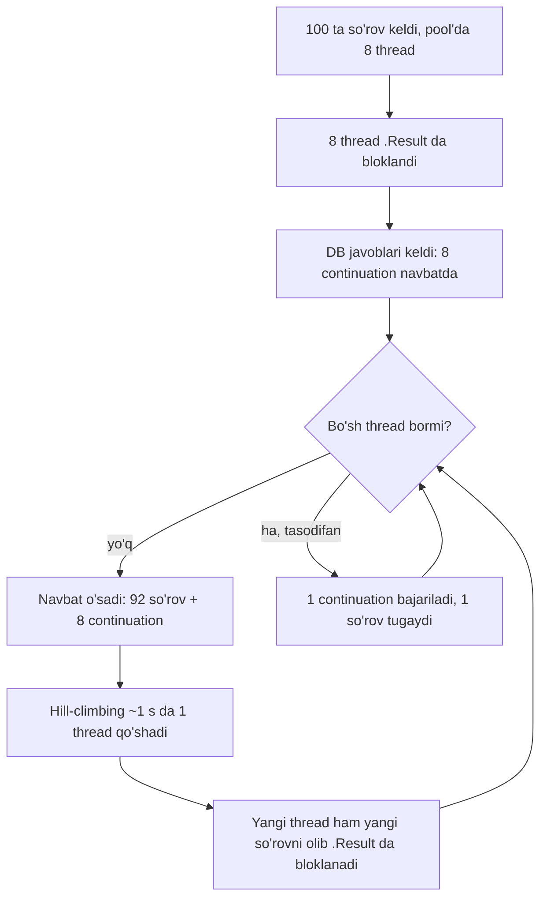

# 02. Async/await va multithreading

> **Bir jumlada:** `await` thread'ni bloklamaydi, metodni state machine'ga bo'lib, davomini keyinroq boshqa (yoki o'sha) thread'da bajaradi; bu mexanizmni noto'g'ri ishlatish (`.Result`, `async void`, `lock` ichida `await`) butun servisni "qotiradi".
> **Nega Middle uchun:** ASP.NET Core har so'rovga thread *ajratmaydi*, thread pool'dan vaqtincha oladi. Thread pool 32 ta thread bilan 10 000 so'rovga xizmat qilishi mumkin, agar hech kim uni bloklamasa. Suhbatda eng ko'p so'raladigan va production'da eng ko'p "qotish" keltiradigan mavzu.
> **O'qish vaqti:** ~50 daqiqa

## Mundarija

- [1. Muammo va yechim](#1-muammo-va-yechim)
- [2. Qanday ishlaydi](#2-qanday-ishlaydi)
  - [2.1 State machine lowering](#21-state-machine-lowering)
  - [2.2 Thread pool va I/O completion](#22-thread-pool-va-io-completion)
  - [2.3 Deadlock diagrammasi](#23-deadlock-diagrammasi)
  - [2.4 Starvation diagrammasi](#24-starvation-diagrammasi)
- [3. Asosiy tushunchalar](#3-asosiy-tushunchalar)
  - [3.1 Task vs Thread](#31-task-vs-thread)
  - [3.2 Sync-over-async](#32-sync-over-async)
  - [3.3 ConfigureAwait](#33-configureawait)
  - [3.4 CancellationToken](#34-cancellationtoken)
  - [3.5 IAsyncEnumerable\<T\>](#35-iasyncenumerablet)
  - [3.6 Channel\<T\>](#36-channelt)
  - [3.7 SemaphoreSlim va Lock (C# 13)](#37-semaphoreslim-va-lock-c-13)
  - [3.8 Parallel.ForEachAsync va Task.WhenAll](#38-parallelforeachasync-va-taskwhenall)
  - [3.9 ValueTask](#39-valuetask)
  - [3.10 async void](#310-async-void)
  - [3.11 Exception'lar async kodda](#311-exceptionlar-async-kodda)
- [4. Amaliy misol](#4-amaliy-misol)
- [5. Tipik xatolar va anti-patternlar](#5-tipik-xatolar-va-anti-patternlar)
- [6. Best practices checklist](#6-best-practices-checklist)
- [7. Suhbat savollari va javoblar](#7-suhbat-savollari-va-javoblar)
- [8. Qo'shimcha manbalar](#8-qoshimcha-manbalar)

## 1. Muammo va yechim

Real holat: to'lov servisi kuniga 2-3 marta "qotib" qolardi. CPU 5%, xotira normal, lekin `/health` ham javob bermaydi, 30 soniyadan keyin Kubernetes pod'ni qayta ishga tushiradi. `dotnet-counters` ko'rsatdi: `threadpool-queue-length` 400 dan oshgan, `threadpool-thread-count` sekin, soniyasiga bittadan o'sadi. Kod:

```csharp
// PaymentController.cs (muammoli)
[HttpPost("confirm")]
public IActionResult Confirm(ConfirmRequest req)
{
    var payment = _paymentService.GetAsync(req.Id).Result;      // sync-over-async
    _gateway.ConfirmAsync(payment).Wait();                       // yana
    return Ok();
}
```

Har so'rov thread pool thread'ini olib, `.Result` da *bloklaydi*. `GetAsync` ichidagi `await` tugagach, davomi uchun yana thread pool'dan thread kerak. Hamma thread'lar `.Result` da kutib turibdi, davomini bajaradigan thread yo'q. Navbat o'sadi, pool har ~1 soniyada bitta yangi thread qo'shadi (bu ataylab sekin, aks holda ming thread yaratiladi), yuk ko'payganda yetib bo'lmaydi. Bu **thread pool starvation** (och qolish).

Yechim: `async Task<IActionResult>` va "async all the way" (boshidan oxirigacha async). Thread `await` paytida pool'ga qaytadi, 32 thread minglab so'rovga xizmat qiladi. Lekin "async all the way" uchun `await` ichida nima bo'lishini bilish kerak, aks holda `async void`, `lock` + `await`, `Task.Run` har joyda kabi yangi muammolar keladi.

## 2. Qanday ishlaydi

### 2.1 State machine lowering

`async` metodni kompilyator **state machine** (holat mashinasi) ga aylantiradi: metod tanasi `MoveNext()` ga ko'chadi, har `await` holat raqami bo'ladi, local'lar maydonlarga ko'tariladi (hoisting).

```csharp
public async Task<decimal> GetBalanceAsync(long customerId, CancellationToken ct)
{
    var customer = await _db.Customers.FindAsync([customerId], ct);
    var rate = await _rates.GetAsync(customer!.Currency, ct);
    return customer.Balance * rate;
}
```

Kompilyator generatsiya qiladigan kod (soddalashtirilgan, Release rejimida `struct`):

```csharp
[AsyncStateMachine(typeof(GetBalanceStateMachine))]
public Task<decimal> GetBalanceAsync(long customerId, CancellationToken ct)
{
    var sm = new GetBalanceStateMachine
    {
        <>t__builder = AsyncTaskMethodBuilder<decimal>.Create(),
        <>4__this = this, customerId = customerId, ct = ct,
        <>1__state = -1,
    };
    sm.<>t__builder.Start(ref sm);        // MoveNext ni SINXRON chaqiradi, birinchi await'gacha
    return sm.<>t__builder.Task;
}

struct GetBalanceStateMachine : IAsyncStateMachine
{
    public int <>1__state;
    public AsyncTaskMethodBuilder<decimal> <>t__builder;
    public OrderService <>4__this; public long customerId; public CancellationToken ct;
    private Customer <customer>5__1;                       // local -> maydon
    private ValueTaskAwaiter<Customer?> <>u__1;            // awaiter ham saqlanadi
    private TaskAwaiter<decimal> <>u__2;

    public void MoveNext()
    {
        decimal result;
        try
        {
            switch (<>1__state)
            {
                case 0: goto Resume0;
                case 1: goto Resume1;
            }
            var aw1 = <>4__this._db.Customers.FindAsync([customerId], ct).GetAwaiter();
            if (!aw1.IsCompleted)                          // hali tayyor emas: "pauza"
            {
                <>1__state = 0; <>u__1 = aw1;
                <>t__builder.AwaitUnsafeOnCompleted(ref aw1, ref this);  // continuation ro'yxatga, struct heap'ga box
                return;                                    // THREAD BO'SHAYDI
            }
        Resume0:
            aw1 = <>u__1; <>1__state = -1;
            <customer>5__1 = aw1.GetResult();              // exception bo'lsa shu yerda rethrow
            var aw2 = <>4__this._rates.GetAsync(<customer>5__1.Currency, ct).GetAwaiter();
            if (!aw2.IsCompleted) { <>1__state = 1; <>u__2 = aw2; <>t__builder.AwaitUnsafeOnCompleted(ref aw2, ref this); return; }
        Resume1:
            aw2 = <>u__2; <>1__state = -1;
            result = <customer>5__1.Balance * aw2.GetResult();
        }
        catch (Exception ex)
        {
            <>1__state = -2; <>t__builder.SetException(ex);   // Task faulted bo'ladi, throw EMAS
            return;
        }
        <>1__state = -2; <>t__builder.SetResult(result);
    }
}
```

Muhim nuqtalar:

1. Birinchi `await` gacha kod **sinxron, chaqiruvchi thread'da** bajariladi. Agar awaited Task allaqachon tugagan bo'lsa (`IsCompleted == true`, masalan cache hit), `await` umuman "pauza" qilmaydi, allocation ham yo'q. Shuning uchun `async` metodning narxi "har doim thread switch" emas.
2. Birinchi tugamagan `await` da struct state machine heap'ga **box** qilinadi (`AsyncStateMachineBox`), bu async metodning asosiy allocation'i. Shu sabab `Span<T>` state machine'da yashay olmaydi (1-bob).
3. `AwaitUnsafeOnCompleted` awaited Task'ga continuation (davom) ro'yxatga oladi va `ExecutionContext` ni (AsyncLocal qiymatlari, masalan tenant id) saqlaydi. `ConfigureAwait(true)` bo'lsa `SynchronizationContext.Current` ham saqlanadi.
4. Task tugaganda continuation chaqiriladi: SynchronizationContext bo'lsa unga `Post`, bo'lmasa thread pool'ga queue, yoki Task'ni tugatgan thread'da inline.
5. Exception metoddan "chiqmaydi", Task ichiga yoziladi. `await` qilgan tomonda `GetResult()` uni `ExceptionDispatchInfo` bilan asl stack'ni saqlab qayta tashlaydi.

### 2.2 Thread pool va I/O completion

Thread pool bu runtime'ning worker thread'lar to'plami (`ThreadPool`). ASP.NET Core (Kestrel) so'rovni qabul qilib, uni thread pool'ga work item sifatida qo'yadi. Minimal thread soni = mantiqiy CPU yadrolari soni (`ThreadPool.GetMinThreads`). Barcha thread'lar band va navbat bo'sh emas bo'lsa, **hill-climbing** algoritmi throughput'ni o'lchab sekin thread qo'shadi; starvation aniqlanganda ham injeksiya taxminan soniyada 1-2 thread (.NET 6+ `Task.Wait` bloklashini aniqlab tezroq qo'shadi, lekin baribir sekin).

I/O (socket, fayl, DB) uchun thread *kutib o'tirmaydi*: Linux'da `epoll`, Windows'da IOCP orqali OS tayyor bo'lganda runtime'ga signal beradi, maxsus I/O thread Task'ni "tugadi" deb belgilaydi va continuation'ni thread pool navbatiga qo'yadi.



### 2.3 Deadlock diagrammasi

Klassik deadlock `SynchronizationContext` bor muhitda (WinForms, WPF, eski ASP.NET Framework, Blazor Server'ning ba'zi holatlari). ASP.NET Core'da `SynchronizationContext` yo'q, shuning uchun aynan bu deadlock bo'lmaydi, lekin starvation bo'ladi (2.4).



Ikki yechim: chaqiruvchi tomonda `await` (to'g'ri), yoki kutubxona tomonda `ConfigureAwait(false)` (continuation SyncContext'ga emas, pool'ga ketadi). Ikkinchisi kutubxona muallifi uchun majburiy odat, chunki chaqiruvchi qanday muhitda ekanini bilmaydi.

### 2.4 Starvation diagrammasi

ASP.NET Core'da `.Result` deadlock emas, "sekin o'lim" beradi:



Belgilari: CPU past, `threadpool-queue-length` o'sadi, `threadpool-thread-count` sekin o'sadi, latency sekundlarga chiqadi, `/health` ham javob bermaydi. `ThreadPool.SetMinThreads(200, 200)` vaqtincha yordam beradi, lekin kasallikni emas, simptomni davolaydi.

## 3. Asosiy tushunchalar

### 3.1 Task vs Thread

- **Ta'rif:** `Thread` OS darajasidagi ijro oqimi (1 MB stack, yaratish qimmat). `Task` "kelajakda tugaydigan ish" obyekti: natija, holat (`RanToCompletion`, `Faulted`, `Canceled`) va continuation ro'yxati. Task thread *emas*: I/O Task hech qanday thread'ni band qilmaydi.
- **Nega kerak:** Thread sonini so'rov soniga emas, CPU yadro soniga bog'lash.

```csharp
// I/O-bound: thread band bo'lmaydi
Task<Order?> t1 = _db.Orders.FirstOrDefaultAsync(o => o.Id == id, ct);

// CPU-bound: thread pool thread'ini band qiladi (hisob-kitob)
Task<byte[]> t2 = Task.Run(() => GeneratePdf(order), ct);

// Allaqachon tugagan Task: allocation'siz
Task<int> t3 = Task.FromResult(0);
```

- **Tipik xato:** `Task.Run` ni "tezlashtirish uchun" I/O atrofiga o'rash: thread pool'dan thread olib, u ham `await` da bo'shaydi, foyda yo'q, qo'shimcha allocation va context switch bor. ASP.NET Core'da `Task.Run` faqat uzoq CPU ishini so'rov thread'idan chiqarish uchun, u ham ehtiyot bilan (bu baribir o'sha pool).

### 3.2 Sync-over-async

- **Ta'rif:** Async metodni `.Result`, `.Wait()`, `.GetAwaiter().GetResult()` bilan sinxron kutish.
- **Nega yomon:** Thread bloklanadi (2.3, 2.4). `.Result`/`.Wait()` exception'ni `AggregateException` ga o'raydi; `GetAwaiter().GetResult()` o'ramaydi, lekin baribir bloklaydi.

```csharp
// ❌ Barchasi bloklaydi
var a = GetAsync().Result;
GetAsync().Wait();
var b = GetAsync().GetAwaiter().GetResult();

// ✅ Tugagan Task'dan .Result xavfsiz (bloklamaydi)
var ta = GetA(ct); var tb = GetB(ct);
await Task.WhenAll(ta, tb);
var (a2, b2) = (ta.Result, tb.Result);
```

Qachon muqarrar: `Main` (C# 7.1 dan `async Task Main` bor), konstruktor (factory metod yoki `IHostedService.StartAsync` ishlating), `IDisposable.Dispose` (`IAsyncDisposable`), eski interface (`IValidator.Validate`). Bunday joylarda `Task.Run(() => ...).GetAwaiter().GetResult()` SyncContext deadlock'dan saqlaydi, starvation'dan emas.

- **Tipik xato:** `Parallel.ForEach(items, item => DoAsync(item).Wait())`. `Parallel.ForEachAsync` ishlating (3.8).

### 3.3 ConfigureAwait

- **Ta'rif:** `await task.ConfigureAwait(false)` continuation'ni `SynchronizationContext`/`TaskScheduler` ga qaytarmaslikni bildiradi: davom istalgan pool thread'ida bajariladi.
- **Nega kerak:** Kutubxona kodida deadlock'dan himoya va kichik performance (context'ga `Post` qilish yo'q).

```csharp
// Kutubxona (NuGet paket, umumiy infra) kodi:
public async Task<Rate> GetRateAsync(string ccy, CancellationToken ct)
{
    using var resp = await _http.GetAsync($"rates/{ccy}", ct).ConfigureAwait(false);
    return await resp.Content.ReadFromJsonAsync<Rate>(ct).ConfigureAwait(false) ?? throw new InvalidOperationException();
}

// .NET 8+: ConfigureAwaitOptions
await task.ConfigureAwait(ConfigureAwaitOptions.SuppressThrowing);  // exception tashlamaydi, task.Exception ni o'zingiz tekshirasiz
await task.ConfigureAwait(ConfigureAwaitOptions.ForceYielding);     // tugagan bo'lsa ham thread pool'ga qaytadi
```

ASP.NET Core ilova kodida `SynchronizationContext` yo'q, shuning uchun `ConfigureAwait(false)` natijani o'zgartirmaydi. Kutubxona kodida yozing (chaqiruvchi WPF bo'lishi mumkin), ilova kodida shart emas. `HttpContext` `AsyncLocal` orqali `ExecutionContext` da yuradi, `ConfigureAwait(false)` uni yo'qotmaydi.

- **Tipik xato:** `ConfigureAwait(false)` ni "tezlashtirish" deb ilova kodiga hamma joyga qo'yish va code review'da shovqin yaratish. Yoki aksincha, kutubxona kodida unutish va WPF/eski ASP.NET'da chaqirganda deadlock.

### 3.4 CancellationToken

- **Ta'rif:** Kooperativ bekor qilish: `CancellationTokenSource` tokenni "bekor qilindi" holatiga o'tkazadi, async operatsiyalar tokenni tekshirib `OperationCanceledException` tashlaydi. "Kooperativ" degani: kod o'zi tekshirmasa, hech narsa to'xtamaydi.
- **Nega kerak:** Mijoz brauzerni yopdi, so'rov 30 soniyadan oshdi, pod to'xtatilmoqda: davom etayotgan DB so'rovi va HTTP chaqiruvlar resursni bekorga yeydi.

```csharp
[HttpGet("{id}")]
public async Task<ActionResult<OrderDto>> Get(long id, CancellationToken ct)   // ct = HttpContext.RequestAborted
{
    // Timeout + so'rov bekor qilinishi birlashtirilgan token
    using var timeout = CancellationTokenSource.CreateLinkedTokenSource(ct);
    timeout.CancelAfter(TimeSpan.FromSeconds(5));

    var order = await _orders.GetAsync(id, timeout.Token);          // EF Core ct ni DB komandaga uzatadi
    return order is null ? NotFound() : Ok(order);
}

// Uzoq CPU siklida qo'lda tekshirish
foreach (var line in lines)
{
    ct.ThrowIfCancellationRequested();
    Recalculate(line);
}

// Timeout faqat kutish uchun (operatsiya o'zi davom etadi!)
var result = await _gateway.ConfirmAsync(p, ct).WaitAsync(TimeSpan.FromSeconds(3), ct);
```

`OperationCanceledException` va uning subklassi `TaskCanceledException`: ikkalasini ham `catch (OperationCanceledException)` ushlaydi. ASP.NET Core bekor qilingan so'rovda bu exception'ni 499/`RequestAborted` sifatida qayd qiladi. Background ishda `BackgroundService.ExecuteAsync(CancellationToken stoppingToken)` host to'xtaganda bekor qilinadi (`HostOptions.ShutdownTimeout` default 30 s, .NET 8 dan). `CancellationTokenSource.CancelAsync()` (.NET 8) callback'larni kutish uchun.

- **Tipik xato:** Tokenni qabul qilib, ichkariga uzatmaslik (`_db.SaveChangesAsync()` tokensiz). Yoki `ct.Register(...)` qaytargan `CancellationTokenRegistration` ni dispose qilmaslik: uzoq umrli token (masalan `ApplicationStopping`) ga obuna qolib ketadi, leak.

### 3.5 IAsyncEnumerable\<T\>

- **Ta'rif:** Asinxron oqim: har element `await` bilan keladi (`await foreach`). Kompilyator `yield return` bilan `IAsyncEnumerable<T>`/`IAsyncEnumerator<T>` state machine generatsiya qiladi (ichida `ManualResetValueTaskSourceCore`).
- **Nega kerak:** 1 million yozuvni `ToListAsync` qilmasdan, bittalab qayta ishlash; HTTP javobni stream qilish.

```csharp
public async IAsyncEnumerable<OrderExportRow> ExportAsync(
    Guid tenantId, [EnumeratorCancellation] CancellationToken ct = default)
{
    // EF Core: AsAsyncEnumerable server-side cursor'dan bittalab o'qiydi (butun natija xotiraga kelmaydi)
    await foreach (var o in _db.Orders.AsNoTracking()
                       .Where(o => o.TenantId == tenantId)
                       .AsAsyncEnumerable().WithCancellation(ct))
    {
        yield return new OrderExportRow(o.Id, o.Total);
    }
}

// Minimal API: javob chunked JSON massiv sifatida stream qilinadi
app.MapGet("/export/{tenantId:guid}", (Guid tenantId, Exporter ex, CancellationToken ct) => ex.ExportAsync(tenantId, ct));
```

`[EnumeratorCancellation]` `WithCancellation(ct)` orqali berilgan tokenni metod parametriga bog'laydi. .NET 10 da `System.Linq.AsyncEnumerable` (`Where`, `Select`, `ToListAsync` kabi operatorlar `IAsyncEnumerable<T>` ustida) BCL ga kirdi; EF Core'ning o'z `ToListAsync` i `IQueryable` ustida, ikkalasini aralashtirmang.

- **Tipik xato:** `IAsyncEnumerable` ni `DbContext` scope'i tugagandan keyin enumerate qilish; yoki `await foreach` ichida har element uchun `SaveChangesAsync` (N ta round-trip).

### 3.6 Channel\<T\>

- **Ta'rif:** `System.Threading.Channels.Channel<T>` thread-safe async producer/consumer navbati: `Writer.WriteAsync` va `Reader.ReadAllAsync`. Bounded (chegaralangan) varianti backpressure beradi: navbat to'lsa yozuvchi kutadi.
- **Nega kerak:** HTTP so'rovdan og'ir ishni (SMS yuborish, PDF, webhook) `BackgroundService` ga uzatish, in-process navbat.

```csharp
public sealed class SmsQueue
{
    private readonly Channel<SmsMessage> _ch = Channel.CreateBounded<SmsMessage>(
        new BoundedChannelOptions(1_000)
        {
            FullMode = BoundedChannelFullMode.Wait,   // to'lsa WriteAsync kutadi (backpressure)
            SingleReader = true,                      // bitta consumer: ichki lock'siz tez yo'l
            SingleWriter = false,
        });

    public ValueTask EnqueueAsync(SmsMessage m, CancellationToken ct) => _ch.Writer.WriteAsync(m, ct);
    public IAsyncEnumerable<SmsMessage> ReadAllAsync(CancellationToken ct) => _ch.Reader.ReadAllAsync(ct);
    public void Complete() => _ch.Writer.Complete();
}

public sealed class SmsSender(SmsQueue queue, IEskizClient eskiz, ILogger<SmsSender> log) : BackgroundService
{
    protected override async Task ExecuteAsync(CancellationToken stoppingToken)
    {
        await foreach (var m in queue.ReadAllAsync(stoppingToken))
        {
            try { await eskiz.SendAsync(m, stoppingToken); }
            catch (Exception ex) when (ex is not OperationCanceledException)
            { log.LogError(ex, "SMS yuborilmadi: {Phone}", m.Phone); }   // bitta xato sikl to'xtatmasin
        }
    }
}
```

`FullMode` variantlari: `Wait`, `DropOldest`, `DropNewest`, `DropWrite`. `Unbounded` kanal xotira chegarasi yo'q: producer tez, consumer sekin bo'lsa OOM. Pod o'chganda kanaldagi xabarlar yo'qoladi; kafolat kerak bo'lsa tashqi broker (RabbitMQ, Kafka) yoki DB outbox.

- **Tipik xato:** `ExecuteAsync` ichida `catch` siz sikl: birinchi exception `BackgroundService` ni jim o'ldiradi (.NET 6+ da `BackgroundServiceExceptionBehavior.StopHost` default: butun host to'xtaydi).

### 3.7 SemaphoreSlim va Lock (C# 13)

- **Ta'rif:** `lock` (`Monitor`) sinxron kritik seksiya; ichida `await` bo'la olmaydi (CS1996), chunki `Monitor` thread'ga bog'langan, continuation esa boshqa thread'da bo'lishi mumkin. `SemaphoreSlim(1,1)` "async lock": `WaitAsync` bloklamaydi. C# 13 / .NET 9 `System.Threading.Lock` tipi `Monitor` dan tezroq va aniq tipli.
- **Nega kerak:** Parallel so'rovlar bitta resursni (cache yangilash, token refresh) bir vaqtda o'zgartirmasligi uchun.

```csharp
public sealed class TokenProvider(IAuthClient auth)
{
    private readonly SemaphoreSlim _gate = new(1, 1);
    private string? _token; private DateTimeOffset _expires;

    public async ValueTask<string> GetAsync(CancellationToken ct)
    {
        if (_token is not null && _expires > DateTimeOffset.UtcNow.AddMinutes(1)) return _token; // tez yo'l, lock'siz

        await _gate.WaitAsync(ct);          // async kutish: thread bloklanmaydi
        try
        {
            if (_token is not null && _expires > DateTimeOffset.UtcNow.AddMinutes(1)) return _token; // double-check
            (_token, _expires) = await auth.RefreshAsync(ct);
            return _token;
        }
        finally { _gate.Release(); }        // har doim, aks holda keyingi hamma abadiy kutadi
    }
}

// C# 13 Lock: sinxron, qisqa kritik seksiya (await yo'q)
public sealed class Counter
{
    private readonly Lock _lock = new();
    private int _value;
    public int Increment()
    {
        lock (_lock) { return ++_value; }   // lowering: using (_lock.EnterScope()) { ... }
    }
}
```

`Lock` ni `object` tipidagi o'zgaruvchiga joylasangiz, kompilyator CS9216 ogohlantiradi: `Monitor` yo'liga tushib qoladi. Oddiy counter uchun `Interlocked.Increment`, lug'at uchun `ConcurrentDictionary` lock'dan afzal. `SemaphoreSlim(N, N)` concurrency chegarasi (masalan tashqi API ga 10 parallel so'rov) sifatida ham ishlatiladi.

- **Tipik xato:** `SemaphoreSlim.Wait()` (sinxron) ni async kodda ishlatish, yoki `Release()` ni `finally` dan tashqarida qoldirish.

### 3.8 Parallel.ForEachAsync va Task.WhenAll

- **Ta'rif:** `Task.WhenAll` bir nechta Task'ni bir vaqtda boshlab hammasini kutadi (parallellik chegarasi yo'q). `Parallel.ForEachAsync` kolleksiya ustida async ishni `MaxDegreeOfParallelism` chegarasi bilan bajaradi.
- **Nega kerak:** 3-5 ta mustaqil I/O ni ketma-ket emas, parallel qilish; 10 000 elementni esa chegaralangan parallellik bilan qayta ishlash.

```csharp
// Kichik, aniq son: WhenAll
var customerTask = _customers.GetAsync(id, ct);
var ordersTask   = _orders.ListAsync(id, ct);
var limitTask    = _credit.GetLimitAsync(id, ct);
await Task.WhenAll(customerTask, ordersTask, limitTask);
var dto = new CustomerCard(customerTask.Result, ordersTask.Result, limitTask.Result);

// Katta kolleksiya: chegaralangan parallellik
await Parallel.ForEachAsync(skus, new ParallelOptions { MaxDegreeOfParallelism = 8, CancellationToken = ct },
    async (sku, token) =>
    {
        var stock = await _warehouse.GetStockAsync(sku, token);   // 8 tadan ko'p bir vaqtda bo'lmaydi
        await _cache.SetAsync(sku, stock, token);
    });
```

DbContext thread-safe *emas*: `WhenAll` ichida bitta `DbContext` bilan ikki so'rov `InvalidOperationException: A second operation was started on this context` beradi. Parallel DB ishida har task uchun `IDbContextFactory<T>.CreateDbContextAsync()`.

- **Tipik xato:** `items.Select(i => ProcessAsync(i))` ni `WhenAll` ga berib 50 000 HTTP so'rovni bir vaqtda ochish: socket, tashqi API rate limit, xotira. Chegaralang.

### 3.9 ValueTask

- **Ta'rif:** `ValueTask<T>` struct: ichida yoki tayyor `T`, yoki `Task<T>`, yoki `IValueTaskSource<T>` (qayta ishlatiladigan obyekt). Natija sinxron tayyor bo'lganda heap allocation yo'q.
- **Nega kerak:** Hot path'da ko'pincha sinxron tugaydigan metod (cache hit, buffer'da ma'lumot bor): `Task<T>` har chaqiruvda allocation, `ValueTask<T>` yo'q.

```csharp
public ValueTask<Rate> GetRateAsync(string ccy, CancellationToken ct)
{
    if (_cache.TryGetValue(ccy, out var rate))
        return ValueTask.FromResult(rate);          // allocation yo'q (90% hol)
    return new ValueTask<Rate>(LoadAndCacheAsync(ccy, ct));   // sekin yo'l: Task o'raladi
}
```

Qoidalar: faqat **bir marta** `await` qilinadi; saqlab qo'yilmaydi; `.Result` faqat `IsCompletedSuccessfully` bo'lsa; bir nechta joyda kerak bo'lsa `.AsTask()` yoki `.Preserve()`. Sabab: `IValueTaskSource` asosidagi ValueTask tugagach obyekt pool'ga qaytadi va ikkinchi `await` boshqa operatsiyaning natijasini o'qishi mumkin. Public API'da default `Task<T>`; `ValueTask<T>` o'lchab isbotlangan hot path uchun.

- **Tipik xato:** `var vt = GetRateAsync(...); await vt; await vt;` yoki `Task.WhenAll(valueTasks)` (ValueTask'ni avval `AsTask()` qilish kerak).

### 3.10 async void

- **Ta'rif:** Task qaytarmaydigan async metod. Chaqiruvchi uni kuta olmaydi, exception'i Task'ga emas, `SynchronizationContext` ga yoki thread pool'ga tushadi: ASP.NET Core'da **process crash**.
- **Nega mavjud:** Faqat event handler imzosi (`void Button_Click(object, EventArgs)`) uchun.

```csharp
// ❌ Yashirin async void: Action<T> kutgan joyga async lambda
orders.ForEach(async o => await _sender.SendAsync(o, ct));   // List<T>.ForEach(Action<T>): exception = crash, kutilmaydi
timer.Elapsed += async (s, e) => await Tick();                 // event handler: bu yerda async void muqarrar, try/catch shart

// ✅
foreach (var o in orders) await _sender.SendAsync(o, ct);
// yoki
await Task.WhenAll(orders.Select(o => _sender.SendAsync(o, ct)));
```

Analyzer: `Microsoft.VisualStudio.Threading.Analyzers` (VSTHRD100 async void, VSTHRD002 sync-over-async), `Meziantou.Analyzer` (MA0040 CancellationToken uzatilmagan).

### 3.11 Exception'lar async kodda

- **Ta'rif:** Async metodda exception Task ichida saqlanadi (`Faulted`). `await` birinchi exception'ni qayta tashlaydi. `.Result`/`.Wait()` `AggregateException` beradi. `Task.WhenAll` da `await` faqat **birinchi** exception'ni tashlaydi, qolganlari `task.Exception.InnerExceptions` da.
- **Nega kerak:** Parallel ishda 3 tadan 2 tasi xato bo'lsa, hammasini log'ga yozish kerak.

```csharp
var tasks = batches.Select(b => ProcessBatchAsync(b, ct)).ToList();
try { await Task.WhenAll(tasks); }
catch
{
    foreach (var t in tasks.Where(t => t.IsFaulted))
        _log.LogError(t.Exception!.GetBaseException(), "Batch xato");  // hammasini ko'ramiz
    throw;
}

// .NET 9+: tugash tartibida qayta ishlash
await foreach (var finished in Task.WhenEach(tasks).WithCancellation(ct))
    Handle(finished);   // finished tugagan Task, .Result xavfsiz (IsFaulted tekshiring)
```

Unutilgan Task (`_ = DoAsync();` yoki chaqirib `await` qilmaslik, "fire and forget") exception'ni yutib yuboradi: `TaskScheduler.UnobservedTaskException` faqat GC paytida ishga tushadi. Fire-and-forget kerak bo'lsa `BackgroundService` + Channel (3.6).

## 4. Amaliy misol

Vazifa: Payme to'lov tizimidan webhook keladi (`/payments/callback`). Webhook'ga 2 soniyada javob berish shart, lekin tasdiqlash (buyurtma holati, ombor rezervi, mijozga SMS) 5-10 soniya olishi mumkin. Yechim: webhook faqat Channel'ga yozadi va `202 Accepted` qaytaradi; `BackgroundService` chegaralangan parallellik, timeout va cancellation bilan qayta ishlaydi.

```csharp
// Payments/PaymentCallback.cs
public sealed record PaymentCallback(string ProviderTxId, long OrderId, decimal Amount, DateTimeOffset At);

// Payments/PaymentQueue.cs
public sealed class PaymentQueue
{
    private readonly Channel<PaymentCallback> _channel = Channel.CreateBounded<PaymentCallback>(
        new BoundedChannelOptions(5_000) { FullMode = BoundedChannelFullMode.Wait, SingleReader = true });

    public ChannelWriter<PaymentCallback> Writer => _channel.Writer;
    public ChannelReader<PaymentCallback> Reader => _channel.Reader;
}

// Payments/PaymentCallbackEndpoint.cs
public static class PaymentCallbackEndpoint
{
    public static void Map(IEndpointRouteBuilder app) =>
        app.MapPost("/payments/callback", async (PaymentCallback cb, PaymentQueue queue, CancellationToken ct) =>
        {
            // WriteAsync: navbat to'la bo'lsa kutadi (backpressure). ct = so'rov bekor bo'lsa kutishni to'xtatadi.
            // Payme 2 s kutadi; navbat 5000 ga to'lgan bo'lsa 503 qaytargan ma'qul: WaitToWriteAsync + timeout.
            using var timeout = CancellationTokenSource.CreateLinkedTokenSource(ct);
            timeout.CancelAfter(TimeSpan.FromSeconds(1));
            try
            {
                await queue.Writer.WriteAsync(cb, timeout.Token);
                return Results.Accepted();
            }
            catch (OperationCanceledException) when (!ct.IsCancellationRequested)
            {
                return Results.StatusCode(StatusCodes.Status503ServiceUnavailable);  // provayder keyinroq qayta yuboradi
            }
        });
}

// Payments/PaymentProcessor.cs
public sealed class PaymentProcessor(
    PaymentQueue queue,
    IServiceScopeFactory scopes,          // BackgroundService singleton; DbContext scoped: har xabar uchun scope
    ILogger<PaymentProcessor> log) : BackgroundService
{
    private readonly SemaphoreSlim _parallelism = new(4, 4);   // bir vaqtda 4 ta tasdiqlash (DB pool va SMS limitga mos)

    protected override async Task ExecuteAsync(CancellationToken stoppingToken)
    {
        var inFlight = new List<Task>();
        await foreach (var cb in queue.Reader.ReadAllAsync(stoppingToken))
        {
            await _parallelism.WaitAsync(stoppingToken);        // 5-chi xabar 4 tasidan biri tugaguncha kutadi
            inFlight.Add(ProcessOneAsync(cb, stoppingToken));
            inFlight.RemoveAll(t => t.IsCompleted);             // ro'yxat o'smasin
        }
        await Task.WhenAll(inFlight);                           // shutdown: boshlanganlarni tugatamiz (ShutdownTimeout ichida)
    }

    private async Task ProcessOneAsync(PaymentCallback cb, CancellationToken stoppingToken)
    {
        try
        {
            // Har xabar uchun 15 s: tashqi tizim osilsa bitta slot abadiy band bo'lmasin
            using var cts = CancellationTokenSource.CreateLinkedTokenSource(stoppingToken);
            cts.CancelAfter(TimeSpan.FromSeconds(15));
            var ct = cts.Token;

            await using var scope = scopes.CreateAsyncScope();
            var db = scope.ServiceProvider.GetRequiredService<AppDbContext>();
            var sms = scope.ServiceProvider.GetRequiredService<ISmsSender>();

            var order = await db.Orders.Include(o => o.Customer)
                .FirstOrDefaultAsync(o => o.Id == cb.OrderId, ct);
            if (order is null) { log.LogWarning("Buyurtma topilmadi: {OrderId}", cb.OrderId); return; }
            if (order.Status == OrderStatus.Paid) return;       // idempotentlik: Payme bir xabarni 2 marta yuborishi mumkin

            order.MarkPaid(cb.ProviderTxId, cb.Amount, cb.At);  // domain qoidalari (summa mosligi) ichida
            await db.SaveChangesAsync(ct);                      // DB birinchi: SMS ketmasa ham to'lov saqlangan

            // SMS: mustaqil, xatosi to'lovni bekor qilmaydi
            try { await sms.SendAsync(order.Customer.Phone, $"Buyurtma #{order.Id} to'landi", ct); }
            catch (Exception ex) when (ex is not OperationCanceledException)
            { log.LogWarning(ex, "SMS yuborilmadi: {OrderId}", order.Id); }
        }
        catch (OperationCanceledException) when (stoppingToken.IsCancellationRequested)
        {
            log.LogInformation("Shutdown: {OrderId} qayta ishlanmadi", cb.OrderId);   // provayder qayta yuboradi
        }
        catch (Exception ex)
        {
            log.LogError(ex, "To'lov tasdiqlanmadi: {OrderId}", cb.OrderId);   // sikl davom etadi
        }
        finally { _parallelism.Release(); }
    }
}

// Program.cs
builder.Services.AddSingleton<PaymentQueue>();
builder.Services.AddHostedService<PaymentProcessor>();
```

Nega aynan shunday:

- Endpoint `async` va hech qayerda bloklamaydi: Payme 2 soniya ichida `202` oladi, thread pool bo'sh qoladi.
- Bounded channel + `WriteAsync` timeout: xotira chegaralangan, navbat to'lsa 503 (Payme retry qiladi), OOM yo'q.
- `SemaphoreSlim(4,4)`: `Parallel.ForEachAsync` o'rniga, chunki manba cheksiz oqim (`ReadAllAsync`), va biz "o'qish"ni "qayta ishlash"dan ajratmoqchimiz.
- Har xabar uchun `CreateAsyncScope`: `BackgroundService` singleton, `DbContext` scoped; singleton'da scoped ushlab turish captive dependency (3-bob leak manbai).
- Ikki token: `stoppingToken` (host to'xtamoqda) va per-message timeout; `catch ... when` orqali ikkisi ajratiladi.
- Idempotentlik (`Status == Paid` tekshiruvi): webhook'lar kamida bir marta yetkaziladi, ikki marta emas kafolati yo'q.

## 5. Tipik xatolar va anti-patternlar

**1. Sync-over-async controller'da**

```csharp
// ❌
public IActionResult Get(long id) => Ok(_svc.GetAsync(id).Result);
```
Thread bloklanadi, yuk ostida starvation (2.4), exception `AggregateException` ga o'raladi.
```csharp
// ✅
public async Task<IActionResult> Get(long id, CancellationToken ct) => Ok(await _svc.GetAsync(id, ct));
```

**2. `lock` ichida `await` o'rniga `.Result`**

```csharp
// ❌  CS1996 ni chetlab o'tish uchun
lock (_sync) { _token = _auth.RefreshAsync().Result; }
```
Lock ushlagan thread bloklanadi; refresh'ning continuation'i boshqa thread'da lock'ni kutsa, deadlock.
```csharp
// ✅  SemaphoreSlim (3.7 dagi TokenProvider)
await _gate.WaitAsync(ct); try { _token = await _auth.RefreshAsync(ct); } finally { _gate.Release(); }
```

**3. Fire-and-forget**

```csharp
// ❌
_ = _email.SendAsync(order);     // exception yo'qoladi, pod o'chsa ish yo'qoladi, DbContext scope tugagan bo'lishi mumkin
```
```csharp
// ✅
await _queue.Writer.WriteAsync(new EmailJob(order.Id), ct);   // BackgroundService qayta ishlaydi, log qiladi
```

**4. `async` da `return Task` siz `await` ni tashlab yuborish (`using` ichida)**

```csharp
// ❌
public Task<Order?> GetAsync(long id)
{
    using var scope = _scopes.CreateScope();
    return scope.ServiceProvider.GetRequiredService<AppDbContext>().Orders.FindAsync(id).AsTask();
}   // scope shu yerda dispose bo'ladi, FindAsync hali ishlamoqda -> ObjectDisposedException
```
```csharp
// ✅
public async Task<Order?> GetAsync(long id, CancellationToken ct)
{
    await using var scope = _scopes.CreateAsyncScope();
    return await scope.ServiceProvider.GetRequiredService<AppDbContext>().Orders.FindAsync([id], ct);
}
```

**5. Bitta DbContext bilan parallel so'rovlar**

```csharp
// ❌
await Task.WhenAll(_db.Orders.CountAsync(ct), _db.Customers.CountAsync(ct));   // InvalidOperationException
```
```csharp
// ✅  Ketma-ket (DB round-trip baribir bitta ulanish), yoki IDbContextFactory bilan ikkita context
var orders = await _db.Orders.CountAsync(ct);
var customers = await _db.Customers.CountAsync(ct);
```

**6. CancellationToken uzatilmagan**

```csharp
// ❌
public async Task<List<Order>> ListAsync(CancellationToken ct) => await _db.Orders.ToListAsync();  // ct yo'qoldi
```
Mijoz uzilganda DB so'rovi oxirigacha ishlaydi, connection pool band.
```csharp
// ✅
public Task<List<Order>> ListAsync(CancellationToken ct) => _db.Orders.ToListAsync(ct);
```

**7. `Task.Run` ASP.NET Core'da "parallellik" uchun**

```csharp
// ❌
var result = await Task.Run(() => _db.Orders.ToListAsync());   // pool thread'ini olib, darhol await'da bo'shatadi: foyda yo'q
```
```csharp
// ✅
var result = await _db.Orders.ToListAsync(ct);
```

**8. `Timer` callback'ida async ish**

```csharp
// ❌
_timer = new Timer(async _ => await SyncAsync(), null, 0, 60_000);   // async void, overlap, exception crash
```
```csharp
// ✅
protected override async Task ExecuteAsync(CancellationToken st)
{
    using var timer = new PeriodicTimer(TimeSpan.FromMinutes(1));
    while (await timer.WaitForNextTickAsync(st))
        try { await SyncAsync(st); } catch (Exception ex) when (ex is not OperationCanceledException) { _log.LogError(ex, "Sync"); }
}
```

## 6. Best practices checklist

- [ ] Controller/endpoint/handler'dan DB/HTTP gacha "async all the way": bitta `.Result` butun zanjirni bloklaydi.
- [ ] Har async metod `CancellationToken` qabul qiladi va ichkariga uzatadi: bekor qilingan so'rov resursni band qilmasin.
- [ ] `async void` faqat event handler'da, u ham `try/catch` bilan: aks holda exception process'ni o'ldiradi.
- [ ] `lock` ichida `await` yo'q, async kritik seksiya uchun `SemaphoreSlim`: `Monitor` thread'ga bog'langan.
- [ ] Qisqa sinxron kritik seksiya uchun `Lock` (C# 13), counter uchun `Interlocked`, lug'at uchun `ConcurrentDictionary`.
- [ ] Kutubxona kodida `ConfigureAwait(false)`, ilova kodida shart emas: chaqiruvchi muhit noma'lum.
- [ ] Parallel I/O chegaralangan (`Parallel.ForEachAsync` yoki `SemaphoreSlim`): cheksiz `WhenAll` socket va tashqi limitlarni buzadi.
- [ ] Bitta `DbContext` bir vaqtda bitta operatsiya: parallel kerak bo'lsa `IDbContextFactory`.
- [ ] Background ish `BackgroundService` + `Channel<T>` orqali, `_ = Task` emas: exception, shutdown va scope nazoratda.
- [ ] `BackgroundService.ExecuteAsync` siklida `catch`: bitta xato host'ni to'xtatmasin.
- [ ] `ValueTask` faqat o'lchangan hot path'da va bir marta `await`: ikkinchi `await` noto'g'ri natija beradi.
- [ ] `using` ichida `return Task` emas, `return await`: dispose Task tugashidan oldin bo'lmasin.
- [ ] Tashqi chaqiruvlarga timeout (`CancelAfter` yoki `WaitAsync`): osilgan tashqi tizim sizning thread/slot'ingizni abadiy ushlamasin.
- [ ] `dotnet-counters` da `threadpool-queue-length` va `threadpool-thread-count` dashboard'da: starvation CPU'da ko'rinmaydi.
- [ ] `Microsoft.VisualStudio.Threading.Analyzers` yoki `Meziantou.Analyzer` ulangan: async void va sync-over-async build'da ushlanadi.

## 7. Suhbat savollari va javoblar

**1. `await` paytida thread nima qiladi?**
Agar awaited Task tugamagan bo'lsa, state machine holatni saqlaydi, continuation'ni Task'ga ro'yxatga oladi va `MoveNext` `return` qiladi: thread pool'ga qaytib boshqa ishni oladi. Task tugaganda (I/O thread signal beradi) continuation thread pool navbatiga tushadi va bo'sh thread `MoveNext` ni davom ettiradi. Tuzoq: Task allaqachon tugagan bo'lsa `await` umuman "pauza" qilmaydi, sinxron davom etadi; va `await` dan oldingi kod har doim chaqiruvchi thread'da sinxron bajariladi.

**2. Thread pool starvation qanday yuz beradi va qanday aniqlaysiz?**
Thread'lar `.Result`/`.Wait()`/`lock` da bloklanib, continuation'larni bajaradigan thread qolmaydi; pool yangi thread'ni sekin (taxminan soniyada 1-2 ta) qo'shadi, yuk ostida yetib bo'lmaydi. Belgilar: CPU past, latency sekundlarda, `/health` ham javob bermaydi. Aniqlash: `dotnet-counters monitor --counters System.Runtime` da `threadpool-queue-length` uzluksiz o'sishi, `threadpool-thread-count` sekin o'sishi; `dotnet-dump` + `clrstack -all` da ko'p thread `Monitor.Wait`/`Task.Wait` da. Yechim: sync-over-async'ni topib async qilish; `SetMinThreads` faqat vaqtincha.

**3. ASP.NET Core'da `.Result` deadlock beradimi?**
Klassik deadlock bermaydi, chunki `SynchronizationContext` yo'q: continuation istalgan pool thread'ida bajarilishi mumkin. Lekin starvation beradi (2-savol) va yuk ostida bu amalda "qotish" bo'lib ko'rinadi. WPF/WinForms/eski ASP.NET'da esa haqiqiy deadlock: continuation bloklangan thread'ga `Post` qilinadi. Tuzoq: "ASP.NET Core'da `.Result` xavfsiz" deyish noto'g'ri.

**4. `ConfigureAwait(false)` nima qiladi va ASP.NET Core'da kerakmi?**
Continuation'ni ushlangan `SynchronizationContext`/`TaskScheduler` ga qaytarmaslikni bildiradi. Kutubxona kodida majburiy odat: chaqiruvchi UI muhitida bo'lsa deadlock'dan saqlaydi va kichik overhead'ni olib tashlaydi. ASP.NET Core ilova kodida context yo'q, natija o'zgarmaydi, yozish shart emas. `HttpContext` yo'qolmaydi, u `AsyncLocal`/`ExecutionContext` orqali yuradi, `ConfigureAwait` unga tegmaydi.

**5. `async void` qachon ishlatiladi va nega xavfli?**
Faqat event handler imzosi majburlaganda. Task qaytarmagani uchun chaqiruvchi kuta olmaydi, tugaganini bilmaydi, exception'i Task'ga emas, `SynchronizationContext` ga, u bo'lmasa thread pool'ga "unhandled" sifatida tushadi va process o'ladi. Tuzoq: `Action<T>` kutgan joyga berilgan async lambda (`List.ForEach(async x => ...)`) ham async void.

**6. `Task.Run` ni ASP.NET Core'da ishlatish kerakmi?**
Odatda yo'q. I/O uchun foydasiz: pool thread'ini olib, `await` da bo'shatadi. CPU-og'ir ish (PDF, hisob) so'rov thread'ida bajarilsa ham o'sha pool thread'i band, `Task.Run` ga ko'chirsa ham boshqa pool thread'i band, farq faqat so'rov thread'i "boshqa ish" qila olishida, bu ASP.NET Core'da ma'nosiz. Haqiqiy yechim: uzoq CPU ishni `Channel` + `BackgroundService` ga, yoki alohida servisga chiqarish.

**7. `ValueTask` qachon va qanday qoidalar bilan?**
Natija ko'p hollarda sinxron tayyor bo'lganda (cache, buffer) va metod hot path'da chaqirilganda: `Task<T>` har safar heap allocation, `ValueTask<T>` tayyor natijada allocation'siz. Qoidalar: bir marta `await`, saqlamaslik, `.Result` faqat `IsCompletedSuccessfully` da, kerak bo'lsa `AsTask()`. Sabab: `IValueTaskSource` pool'ga qaytadi va ikkinchi o'qish boshqa operatsiya natijasini berishi mumkin. Public API da default `Task`.

**8. `Channel<T>` va `ConcurrentQueue<T>` farqi?**
`ConcurrentQueue` thread-safe navbat, lekin "element kelguncha kutish" mexanizmi yo'q (polling kerak). `Channel` async `ReadAsync`/`ReadAllAsync` beradi: consumer thread band qilmay kutadi; bounded variant producer'ni to'lganda kutishga majbur qiladi (backpressure); `Complete()` bilan oqim tugashini bildirish mumkin. Enterprise'da in-process ish navbati uchun `Channel` standart, lekin pod o'chganda ma'lumot yo'qoladi, kafolat uchun broker/outbox kerak.

**9. State machine qachon heap'ga chiqadi, `async` metod narxi qancha?**
Release'da state machine struct; metod chaqirilganda stack'da yaratiladi. Agar barcha `await` lar tugagan Task'ga duch kelsa, hech narsa heap'ga chiqmaydi, faqat natija uchun `Task<T>` (ko'p hollarda keshlangan: `Task.FromResult(true)`, kichik int'lar). Birinchi tugamagan `await` da builder struct'ni bitta `AsyncStateMachineBox` obyektiga ko'chiradi va keyingi `await` lar o'sha box'ni qayta ishlatadi. Shuning uchun "har await allocation" noto'g'ri; "har async metod maksimal bitta box + Task" to'g'ri.

**10. `CancellationToken` bilan `OperationCanceledException` ni qanday ushlash kerak?**
`catch (OperationCanceledException) when (ct.IsCancellationRequested)`: faqat *bizning* token sababli bekor bo'lganini ushlaymiz, boshqa sabab (ichki timeout) ko'tariladi. `TaskCanceledException` uning subklassi, alohida catch kerak emas. ASP.NET Core so'rov bekor bo'lganda bu exception'ni log'da xato emas, "request aborted" sifatida ko'rsatadi. Tuzoq: `catch (Exception)` ichida cancellation'ni ham ushlab, uni "xato" deb log qilish va retry qilish.

**11. `lock` ichida nega `await` mumkin emas va nima qilish kerak?**
`Monitor.Enter` lock'ni *thread*ga biriktiradi; `await` dan keyin continuation boshqa thread'da bo'lishi mumkin va `Monitor.Exit` boshqa thread'dan chaqirilsa `SynchronizationLockException`. Kompilyator CS1996 bilan taqiqlaydi. Yechim: `SemaphoreSlim(1,1).WaitAsync` + `try/finally Release`, u thread'ga bog'lanmagan. Kritik seksiyada `await` yo'q bo'lsa oddiy `lock`/`Lock` yetarli va tezroq.

**12. `Parallel.ForEachAsync` va `Task.WhenAll` qachon qaysi biri?**
`WhenAll` aniq, kichik sonli, bir-biriga bog'liq bo'lmagan operatsiyalar uchun (3 ta so'rovni parallel). `Parallel.ForEachAsync` katta kolleksiya ustida `MaxDegreeOfParallelism` bilan: bir vaqtda N tadan ko'p bo'lmaydi, exception'larni yig'adi, cancellation'ni qo'llaydi. Tuzoq: `WhenAll` ga `Select(ProcessAsync)` bilan 10 000 Task berish, hammasi bir vaqtda boshlanadi; va ikkalasida ham bitta `DbContext` ni bo'lishish mumkin emas.

## 8. Qo'shimcha manbalar

- [Asynchronous programming with async and await (learn.microsoft.com)](https://learn.microsoft.com/dotnet/csharp/asynchronous-programming/)
- [Task asynchronous programming model: ichki mexanizm](https://learn.microsoft.com/dotnet/csharp/asynchronous-programming/task-asynchronous-programming-model)
- [ASP.NET Core performance best practices (async bo'limi)](https://learn.microsoft.com/aspnet/core/performance/performance-best-practices)
- [Managed threading: thread pool](https://learn.microsoft.com/dotnet/standard/threading/the-managed-thread-pool)
- [System.Threading.Channels](https://learn.microsoft.com/dotnet/core/extensions/channels)
- [Cancellation in managed threads](https://learn.microsoft.com/dotnet/standard/threading/cancellation-in-managed-threads)
- [Lock class (System.Threading.Lock)](https://learn.microsoft.com/dotnet/api/system.threading.lock)
- [Diagnosing thread pool starvation (dotnet-counters, dotnet-dump)](https://learn.microsoft.com/dotnet/core/diagnostics/debug-threadpool-starvation)
- Stephen Toub, ["How Async/Await Really Works in C#"](https://devblogs.microsoft.com/dotnet/how-async-await-really-works/)
- Stephen Toub, ["Understanding the Whys, Whats, and Whens of ValueTask"](https://devblogs.microsoft.com/dotnet/understanding-the-whys-whats-and-whens-of-valuetask/)
- Stephen Cleary, ["Don't Block on Async Code"](https://blog.stephencleary.com/2012/07/dont-block-on-async-code.html)
- David Fowler, ["AspNetCoreDiagnosticScenarios: Async guidance"](https://github.com/davidfowl/AspNetCoreDiagnosticScenarios/blob/master/AsyncGuidance.md)
