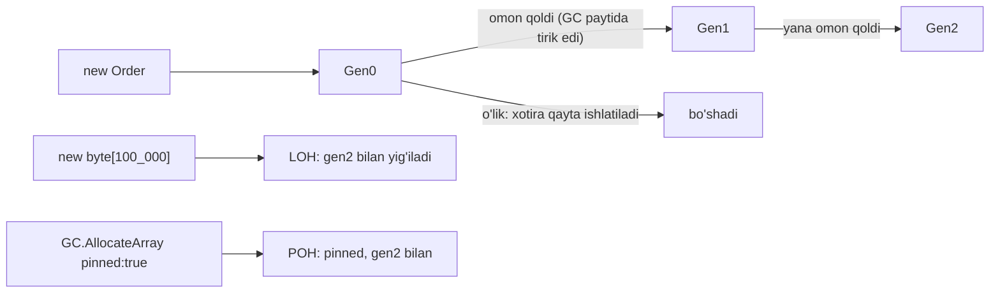

# 03. Memory va GC

> **Bir jumlada:** .NET xotirani siz uchun boshqaradi, lekin "qancha allocation", "qaysi avlodda", "kim ushlab turibdi" degan savollarga javob bera olmasangiz, servis haftadan keyin OOMKilled bo'ladi yoki p99 latency GC pauzalariga ketadi.
> **Nega Middle uchun:** Junior "GC bor, o'zi tozalaydi" deb biladi. Middle leak'ni `dotnet-gcdump` bilan topadi, konteyner limitini GC sozlamasiga bog'laydi, `ArrayPool` va `Span` bilan allocation'ni kamaytiradi va `struct`/`class` tanlovini sabab bilan asoslaydi.
> **O'qish vaqti:** ~45 daqiqa

## Mundarija

- [1. Muammo va yechim](#1-muammo-va-yechim)
- [2. Qanday ishlaydi](#2-qanday-ishlaydi)
  - [2.1 Stack va heap](#21-stack-va-heap)
  - [2.2 GC avlodlari va yig'ish jarayoni](#22-gc-avlodlari-va-yigish-jarayoni)
  - [2.3 LOH va POH](#23-loh-va-poh)
  - [2.4 Workstation vs Server GC, DATAS](#24-workstation-vs-server-gc-datas)
  - [2.5 Konteyner limitlari](#25-konteyner-limitlari)
- [3. Asosiy tushunchalar](#3-asosiy-tushunchalar)
  - [3.1 IDisposable va dispose pattern](#31-idisposable-va-dispose-pattern)
  - [3.2 IAsyncDisposable](#32-iasyncdisposable)
  - [3.3 Finalizer va SafeHandle](#33-finalizer-va-safehandle)
  - [3.4 Leak manbalari](#34-leak-manbalari)
  - [3.5 ArrayPool\<T\> va MemoryPool\<T\>](#35-arraypoolt-va-memorypoolt)
  - [3.6 stackalloc](#36-stackalloc)
  - [3.7 String va interning](#37-string-va-interning)
  - [3.8 struct vs class tanlovi](#38-struct-vs-class-tanlovi)
  - [3.9 Diagnostika asboblari](#39-diagnostika-asboblari)
- [4. Amaliy misol](#4-amaliy-misol)
- [5. Tipik xatolar va anti-patternlar](#5-tipik-xatolar-va-anti-patternlar)
- [6. Best practices checklist](#6-best-practices-checklist)
- [7. Suhbat savollari va javoblar](#7-suhbat-savollari-va-javoblar)
- [8. Qo'shimcha manbalar](#8-qoshimcha-manbalar)

## 1. Muammo va yechim

Real holat: hisobot servisi Kubernetes'da 512 MB limit bilan ishlaydi. Deploy'dan keyin 3-4 kun ichida xotira 480 MB ga chiqadi va pod `OOMKilled` bo'ladi. Grafana'da xotira to'g'ri chiziq bo'lib o'sadi, GC gen2 soni ham o'sadi, lekin xotira tushmaydi. Demak, GC ishlayapti, lekin obyektlar *tirik*: kimdir ularni ushlab turibdi.

`dotnet-gcdump collect` + Visual Studio'da ochish 10 daqiqada javob berdi: 180 000 ta `ReportRow` obyekti, hammasining root'i `ReportCache` singleton'idagi `Dictionary<Guid, List<ReportRow>>`. Kod:

```csharp
public sealed class ReportCache          // singleton
{
    private readonly Dictionary<Guid, List<ReportRow>> _byTenant = new();
    public void Store(Guid tenantId, List<ReportRow> rows) => _byTenant[tenantId] = rows;  // hech qachon o'chirilmaydi
}
```

Dasturchi "cache" deb `Dictionary` ishlatgan, eviction (chiqarib tashlash) yo'q. Har tenant har kuni yangi hisobot yaratadi, eski ro'yxat *almashtiriladi*, lekin tenantlar soni o'sadi va har ro'yxat 2-5 MB. Yechim: `IMemoryCache` `SizeLimit` va `AbsoluteExpiration` bilan.

Ikkinchi holat o'sha servisda: Excel eksport har safar `new byte[2_000_000]` yaratadi. Bu LOH (Large Object Heap) ga tushadi, LOH faqat gen2 bilan yig'iladi va default compact qilinmaydi: fragmentatsiya, xotira "ishlatilmayotgan lekin bo'shatilmagan". `ArrayPool<byte>.Shared` bilan bufer qayta ishlatiladi, LOH allocation nolga tushadi.

## 2. Qanday ishlaydi

### 2.1 Stack va heap

Har thread'ning o'z **stack**'i bor (default ~1 MB; Linux'da asosiy thread uchun OS limiti, pool thread'lari uchun runtime sozlaydi): metod freymlari, local value type'lar, havolalar (pointer'lar). Metod qaytganda freym avtomatik o'chadi, GC aralashmaydi. **Heap** (managed heap) GC boshqaradigan umumiy xotira: har `new Class()`, massiv, string, boxing shu yerda.

Qoida "struct stack'da, class heap'da" to'liq emas. To'g'risi: **value type qiymati o'z konteynerida yotadi**. Local struct stack'da; class ichidagi struct maydoni o'sha class obyekti ichida, heap'da; `List<Point>` ichidagi `Point`lar ro'yxatning massivida, heap'da; closure capture qilingan struct display class'da, heap'da; boxing qilingan struct alohida heap obyektida.

```csharp
public readonly record struct Money(decimal Amount, string Currency);   // 16 + 8 = 24 bayt (+ padding)

public sealed class Order
{
    public Money Total { get; init; }        // Money Order obyekti ICHIDA (inline), alohida allocation emas
    public List<Money> Payments { get; } = new();   // Money'lar List'ning T[] massivida inline
}

void Demo()
{
    Money local = new(100m, "UZS");           // stack freymida
    object boxed = local;                     // heap: 24 bayt qiymat + 16 bayt obyekt header/MethodTable (x64)
}
```

Heap obyektining narxi: 16 bayt sarlavha (object header 8 + MethodTable pointer 8, x64), minimal obyekt 24 bayt. `string` = 20 bayt + 2 bayt/belgi (UTF-16). 1 000 000 ta `new Order()` = kamida 24 MB + maydonlar.

### 2.2 GC avlodlari va yig'ish jarayoni

.NET GC **generational** (avlodli), **mark-sweep-compact** (belgilash, supurish, zichlash), **tracing** (root'lardan izlaydi). Gipoteza: ko'p obyektlar qisqa yashaydi (so'rov DTO'lari), uzoq yashaganlar yana uzoq yashaydi (singleton, cache).

| Avlod | Nima yotadi | Yig'ish chastotasi va narxi |
|---|---|---|
| Gen0 | Yangi obyektlar | Juda tez-tez (budjet to'lganda, odatda bir necha MB; L3 cache hajmiga bog'liq), odatda < 1 ms |
| Gen1 | Gen0 dan omon qolganlar (bufer avlod) | Kamroq, arzon |
| Gen2 | Uzoq umrli obyektlar + LOH + POH | Kam, qimmat (butun heap), background rejimda ko'p qismi parallel |



Yig'ish bosqichlari (gen0 misolida):

1. **Suspend**: barcha managed thread'lar xavfsiz nuqtada (GC safe point) to'xtatiladi. Bu "stop-the-world" pauza.
2. **Mark**: root'lardan (stack'dagi havolalar, static maydonlar, GC handle'lar, finalizer navbati) boshlab tirik obyektlar grafi belgilanadi. Gen0 yig'ishda gen2 obyektlari to'liq skan qilinmaydi: **card table** (write barrier yordamida "eski obyekt yangi obyektga havola yozdi" belgisi) orqali faqat o'zgargan qismlar ko'riladi. Shuning uchun gen0 tez.
3. **Plan/Sweep/Compact**: o'lik obyektlar xotirasi bo'shatiladi; tiriklar zichlanadi (ko'chiriladi) va havolalar yangilanadi. Zichlash tufayli allocation "pointer bump" (ko'rsatkichni surish) darajasida tez.
4. **Promote**: omon qolganlar keyingi avlodga.

.NET 7 dan GC xotirani **regions** (kichik hududlar) bilan boshqaradi, eski "segment" o'rniga; bu avlodlar orasida xotirani moslashuvchan taqsimlaydi. **Background GC**: gen2 belgilash ilova ishlayotgan paytda parallel thread'da boradi, pauza faqat qisqa boshlanish/tugash fazalarida. Gen0/gen1 har doim "blocking" (to'xtatib), lekin qisqa.

GC qachon ishga tushadi: gen0 budjeti to'lganda (asosiy), OS xotira bosimi signalida (`low memory notification`), `GC.Collect()` chaqirilganda (ishlatmang), `GCHeapHardLimit` ga yaqinlashganda.

### 2.3 LOH va POH

**LOH (Large Object Heap)**: 85 000 baytdan katta obyektlar (amalda massivlar: `byte[85_000+]`, `string` 42 500+ belgi, `List<T>` ning ichki massivi o'sganda). LOH gen2 ning qismi: faqat gen2 GC'da yig'iladi va **default compact qilinmaydi** (katta obyektni ko'chirish qimmat). Natija: bo'shagan joylar "teshik" bo'lib qoladi (fragmentatsiya), yangi katta obyekt sig'masa heap o'sadi. Compact qilish: `GCSettings.LargeObjectHeapCompactionMode = GCLargeObjectHeapCompactionMode.CompactOnce;` keyingi gen2 da; chegarani `GCLOHThreshold` bilan oshirish mumkin.

**POH (Pinned Object Heap, .NET 5+)**: `GC.AllocateArray<T>(n, pinned: true)` bilan yaratilgan, ko'chirilmaydigan obyektlar (native I/O buferlari). Pinning oddiy heap'da fragmentatsiya keltiradi, POH buni ajratadi. Kestrel/Socket ichida ishlatiladi; ilova kodida kamdan-kam.

### 2.4 Workstation vs Server GC, DATAS

| | Workstation | Server |
|---|---|---|
| Heap | Bitta | Har mantiqiy CPU uchun alohida heap + GC thread |
| Maqsad | Interaktiv, kam xotira | Throughput, ko'p yadro |
| Pauza | Qisqa, bitta thread yig'adi | GC thread'lar parallel yig'adi, lekin barcha heap'lar birga |
| Xotira | Kam | Ko'p (har heap o'z gen0 budjeti bilan) |
| Default | Konsol, kutubxona, 1 CPU | ASP.NET Core (`Microsoft.NET.Sdk.Web`), > 1 CPU |

Sozlash: `<ServerGarbageCollection>true</ServerGarbageCollection>`, `<ConcurrentGarbageCollection>true</ConcurrentGarbageCollection>` (csproj) yoki `runtimeconfig.json` da `System.GC.Server`, yoki `DOTNET_gcServer=1` env.

**DATAS** (Dynamic Adaptation To Application Sizes, .NET 8 da opt-in, .NET 9+ da Server GC uchun default): heap sonini yuk asosida dinamik o'zgartiradi (1 dan boshlab), shuning uchun 16 yadroli hostdagi kam yuklangan servis 16 ta katta heap bilan xotirani band qilmaydi. O'chirish: `<GarbageCollectionAdaptationMode>0</GarbageCollectionAdaptationMode>`. Server GC bo'yicha eski "ASP.NET Core konteynerda juda ko'p xotira yeydi" maslahatlari DATAS bilan asosan eskirgan, lekin o'lchab ko'ring.

### 2.5 Konteyner limitlari

Runtime cgroup limitlarini o'qiydi. Default **GC heap hard limit = konteyner xotira limitining 75%** (`DOTNET_GCHeapHardLimitPercent` bilan o'zgartiriladi, qiymat hex: `0x4B` = 75). Qolgan 25% non-GC xotira uchun: JIT kod, thread stack'lari, native kutubxonalar (`libSqlite`, OpenSSL), GC o'zining ma'lumotlari. Ikki xil "xotira tugadi":

- `OutOfMemoryException`: GC heap hard limit'ga yetdi, managed exception, ilova ushlashi mumkin (odatda ma'nosiz).
- `OOMKilled` (exit code 137): Linux kernel butun process RSS limitdan oshdi deb o'ldirdi, exception yo'q, log yo'q. Buni faqat `kubectl describe pod` ko'rsatadi.

Kubernetes'da `requests.memory` va `limits.memory` teng qo'yish barqaror. CPU limiti 1 dan kam bo'lsa runtime 1 CPU deb biladi va Server GC Workstation'ga tushadi (`DOTNET_PROCESSOR_COUNT` bilan boshqarish mumkin). `GCConserveMemory` (0-9) GC'ga xotirani tejashni, zichlashni ko'proq qilishni buyuradi.

```json
// runtimeconfig.template.json (loyiha papkasida): deploy'siz GC sozlamalari
{
  "configProperties": {
    "System.GC.Server": true,
    "System.GC.Concurrent": true,
    "System.GC.HeapHardLimitPercent": 70,
    "System.GC.ConserveMemory": 3
  }
}
```

## 3. Asosiy tushunchalar

### 3.1 IDisposable va dispose pattern

- **Ta'rif:** GC faqat managed xotirani biladi. Fayl deskriptori, socket, DB ulanishi, native handle, OS mutex'lar GC uchun ko'rinmas: `IDisposable.Dispose()` ularni *deterministik* (aniq vaqtda) bo'shatadi. `using` bu `try/finally { Dispose(); }` ning qisqartmasi.
- **Nega kerak:** DB connection pool 100 ta ulanishga ega; `Dispose` siz 100 so'rovdan keyin pool tugaydi, GC esa "keyinroq" tozalaydi.

```csharp
// Oddiy holat: faqat managed IDisposable maydonlar bor -> finalizer KERAK EMAS
public sealed class ExcelExporter : IDisposable
{
    private readonly MemoryStream _buffer = new();
    private bool _disposed;

    public void Dispose()
    {
        if (_disposed) return;      // idempotent: ikki marta chaqirish xavfsiz
        _disposed = true;
        _buffer.Dispose();
    }
}

// To'liq pattern: faqat to'g'ridan-to'g'ri unmanaged resurs (IntPtr) bo'lsa. Odatda SafeHandle bilan almashtiriladi.
public class NativeBuffer : IDisposable
{
    private IntPtr _ptr;
    public void Dispose() { Dispose(true); GC.SuppressFinalize(this); }   // finalizer navbatidan chiqar
    protected virtual void Dispose(bool disposing)
    {
        if (_ptr == IntPtr.Zero) return;
        if (disposing) { /* managed maydonlarni dispose */ }
        Marshal.FreeHGlobal(_ptr); _ptr = IntPtr.Zero;
    }
    ~NativeBuffer() => Dispose(false);     // faqat xavfsizlik to'ri, Dispose chaqirilmaganda
}
```

`sealed` sinfda `Dispose(bool)` virtual pattern kerak emas. DI konteyner `Dispose` ni o'zi chaqiradi: scoped obyektlar scope tugaganda, singleton'lar host to'xtaganda. Siz `new` qilgan narsani siz `Dispose` qilasiz.

- **Tipik xato:** `HttpClient` ni har so'rovda `new` + `using`: xotira leak emas, socket `TIME_WAIT` da qoladi (port exhaustion). `IHttpClientFactory` ishlating.

### 3.2 IAsyncDisposable

- **Ta'rif:** `ValueTask DisposeAsync()`: tozalash I/O talab qilganda (buferni flush qilish, DB tranzaksiyani yopish). `await using` bu `try/finally { await DisposeAsync(); }`.
- **Nega kerak:** `Stream.Dispose()` ichida `Flush` sinxron I/O, async kontekstda thread bloklaydi. `DbContext`, `IServiceScope` (`CreateAsyncScope`), `Stream`, `IAsyncEnumerator` async dispose'ga ega.

```csharp
public sealed class OrderExportSession(AppDbContext db, Stream output) : IAsyncDisposable
{
    private readonly StreamWriter _writer = new(output, leaveOpen: true);

    public async Task WriteAsync(CancellationToken ct)
    {
        await foreach (var o in db.Orders.AsNoTracking().AsAsyncEnumerable().WithCancellation(ct))
            await _writer.WriteLineAsync($"{o.Id};{o.Total}".AsMemory(), ct);
    }

    public async ValueTask DisposeAsync()
    {
        await _writer.DisposeAsync();     // FlushAsync + yopish, thread bloklanmaydi
        await db.DisposeAsync();
    }
}

// Foydalanish
await using var session = new OrderExportSession(db, response.Body);
await session.WriteAsync(ct);
```

Agar sinf ikkalasini ham amalga oshirsa, `Dispose()` sinxron variantni, `DisposeAsync()` asinxron variantni bajaradi va ikkalasi idempotent bo'ladi; `await using` mavjud bo'lsa `DisposeAsync` ni afzal ko'radi.

- **Tipik xato:** `IAsyncDisposable` obyektni oddiy `using` bilan ishlatish: kompilyatsiya xatosi emas (agar `IDisposable` ham bo'lsa), lekin sinxron `Dispose` chaqiriladi va DI scope'da `Dispose` ichida `DisposeAsync` kutish `InvalidOperationException` bo'lishi mumkin ("...implements IAsyncDisposable but not IDisposable").

### 3.3 Finalizer va SafeHandle

- **Ta'rif:** Finalizer (`~Type()`) GC obyektni o'lik deb topganda, maxsus finalizer thread'da chaqiriladigan metod. Finalizer'li obyekt birinchi GC'da bo'shamaydi: f-reachable navbatga tushadi, finalizer ishlaydi, keyingi GC'da bo'shaydi (kamida gen1 gacha ko'tariladi).
- **Nega deyarli kerak emas:** Deterministik emas, qimmat, tartib kafolati yo'q, exception process'ni o'ldiradi. `SafeHandle` (va uning subklasslari `SafeFileHandle`, `SafeSocketHandle`) native handle'ni o'z finalizer'i bilan o'raydi: sizga finalizer yozish kerak emas.

```csharp
// P/Invoke bilan native handle: SafeHandle ishlatiladi, ~Finalizer yozilmaydi
public sealed class SmartCardHandle : SafeHandleZeroOrMinusOneIsInvalid
{
    public SmartCardHandle() : base(ownsHandle: true) { }
    protected override bool ReleaseHandle() => NativeMethods.SCardDisconnect(handle) == 0;
}
```

- **Tipik xato:** "Xavfsizlik uchun" har IDisposable sinfga finalizer qo'shish: har obyekt ikki GC siklini kutadi va finalizer thread'ni band qiladi.

### 3.4 Leak manbalari

- **Ta'rif:** Managed "leak" bu GC *bo'shata olmaydigan*, lekin ilova uchun *kerak bo'lmagan* obyektlar: kimdir (root) ularga havola ushlab turibdi. GC root: static maydon, tirik thread stack'i, GC handle, finalizer navbati, timer navbati.
- **Nega kerak:** Haftalab ishlaydigan servisda 1 KB/so'rov leak = kuniga yuzlab MB.

Eng ko'p uchraydiganlar:

```csharp
// 1. Static event: obunachi hech qachon o'lmaydi
public static event Action<Order>? OrderCreated;          // static root -> delegate -> obunachi obyekt

// 2. Chegarasiz cache
private static readonly Dictionary<long, Customer> _cache = new();   // faqat o'sadi

// 3. Captive dependency: singleton scoped'ni ushlab turadi
public sealed class ReportService(AppDbContext db) { }      // ReportService singleton bo'lsa, DbContext ham "abadiy" va change tracker o'saveradi
services.AddSingleton<ReportService>();                     // DI validate scopes dev'da buni ushlaydi (ValidateScopes)

// 4. Timer va CancellationTokenRegistration
var timer = new System.Threading.Timer(Tick, null, 0, 1000);  // Dispose qilinmasa, timer navbati Tick (va this) ni ushlaydi
var reg = appLifetime.ApplicationStopping.Register(OnStop);   // reg.Dispose() yo'q: uzoq umrli token obunani ushlaydi

// 5. Uzoq umrli DbContext: har tracked entity change tracker'da qoladi
// BackgroundService ichida bitta DbContext bilan 1 000 000 yozuvni qayta ishlash -> 1 000 000 tracked entity

// 6. Closure capture: lambda cache'da saqlansa, u capture qilgan hamma narsa ham
_memoryCache.Set(key, () => BuildReport(hugeContext));     // hugeContext cache yashar ekan tirik

// 7. ILogger.BeginScope / Activity dispose qilinmagan: AsyncLocal zanjiri o'sadi
```

- **Tipik xato:** `IMemoryCache` ni `SizeLimit` siz ishlatish (u ham chegarasiz). `MemoryCacheOptions { SizeLimit = 10_000 }` + har `Set` da `.SetSize(n)`.

### 3.5 ArrayPool\<T\> va MemoryPool\<T\>

- **Ta'rif:** `ArrayPool<T>.Shared` massivlar hovuzi: `Rent(n)` kamida `n` uzunlikdagi (odatda 2 ning darajasiga yaxlitlangan, kattaroq) massiv beradi, `Return(arr)` qaytaradi. `MemoryPool<T>` `IMemoryOwner<T>` qaytaradi, `Dispose` bilan qaytariladi.
- **Nega kerak:** Har so'rovda 64 KB+ bufer yaratish gen0 bosimi va LOH allocation; pool bilan allocation bir marta.

```csharp
public async Task<string> ComputeFileHashAsync(Stream file, CancellationToken ct)
{
    byte[] buffer = ArrayPool<byte>.Shared.Rent(81_920);    // >= 81920, LOH ga tushmaydi (pool'da bor bo'lsa)
    try
    {
        using var sha = IncrementalHash.CreateHash(HashAlgorithmName.SHA256);
        int read;
        while ((read = await file.ReadAsync(buffer.AsMemory(0, buffer.Length), ct)) > 0)
            sha.AppendData(buffer, 0, read);                // faqat o'qilgan qismi! buffer.Length emas
        return Convert.ToHexString(sha.GetHashAndReset());
    }
    finally
    {
        ArrayPool<byte>.Shared.Return(buffer, clearArray: false);   // maxfiy ma'lumot bo'lsa clearArray: true
    }
}
```

Qoidalar: `Rent` qilingan massiv uzunligi so'ralganidan katta, shuning uchun har doim `AsSpan(0, n)` bilan ishlang; `Return` dan keyin massivga tegmang (boshqa thread olgan bo'lishi mumkin); qaytarmasangiz leak emas, lekin pool foydasiz; `Shared` pool 1 GB gacha massivlarni ham beradi, lekin juda katta massivlarni saqlamaydi. HTTP javoblar uchun `RecyclableMemoryStream` (Microsoft.IO) `MemoryStream` ning pool'langan varianti.

- **Tipik xato:** Rent qilingan massivni `return buffer;` bilan tashqariga chiqarish va kim qaytarishini noaniq qoldirish; yoki `buffer.Length` ni ma'lumot uzunligi deb olish.

### 3.6 stackalloc

- **Ta'rif:** `stackalloc` stack'da massiv ajratadi; `Span<T>` ga o'rab `unsafe` siz ishlatiladi. Metod qaytganda avtomatik yo'qoladi, GC bilan ishi yo'q.
- **Nega kerak:** Kichik, qisqa umrli buferlar (hash, formatlash, parse) uchun nol allocation.

```csharp
public static string FormatAmount(decimal amount)
{
    Span<char> buf = stackalloc char[32];                         // 64 bayt stack'da
    return amount.TryFormat(buf, out int written, "N2", CultureInfo.GetCultureInfo("uz-UZ"))
        ? new string(buf[..written])                               // bitta allocation: natija string
        : amount.ToString("N2");
}

// Hajm noma'lum bo'lsa: kichik -> stack, katta -> pool
public static int CountDigits(ReadOnlySpan<byte> utf8)
{
    byte[]? rented = null;
    Span<byte> work = utf8.Length <= 512 ? stackalloc byte[512] : (rented = ArrayPool<byte>.Shared.Rent(utf8.Length));
    try { /* work bilan ishlash */ return 0; }
    finally { if (rented is not null) ArrayPool<byte>.Shared.Return(rented); }
}
```

Qoidalar: 1 KB dan kichik (stack ~1 MB, rekursiya va chuqur call stack'ni unutmang); **siklda `stackalloc` qilmang** (stack metod tugaguncha bo'shamaydi, har iteratsiya qo'shiladi, `StackOverflowException` ni ushlab bo'lmaydi); `[SkipLocalsInit]` bilan nolga to'ldirishni o'chirish mumkin (ma'lumotni o'zingiz to'ldirsangiz).

### 3.7 String va interning

- **Ta'rif:** `string` immutable (o'zgarmas) reference type: har `Replace`, `ToUpper`, `+` yangi string yaratadi. **Interning**: bir xil mazmunli string'larni bitta instansiyada saqlash. Kompilyator literal'larni avtomatik intern qiladi (`"Paid"` ikki joyda bitta obyekt); `string.Intern(s)` runtime'da qo'lda.
- **Nega immutable:** Thread-safe ulashish, hash kaliti sifatida xavfsizlik (mazmun o'zgarmasa hash o'zgarmaydi), interning imkoni, security (path tekshirilgandan keyin o'zgarmaydi).

```csharp
string a = "Paid", b = "Paid";
ReferenceEquals(a, b);                       // true: literal'lar intern pool'da
string c = new string(['P','a','i','d']);
ReferenceEquals(a, c);                       // false, lekin a == c true (qiymat solishtiruv)
ReferenceEquals(a, string.Intern(c));        // true

// Siklda birlashtirish: O(n^2) allocation
string csv = ""; foreach (var o in orders) csv += o.Id + ";";      // ❌ har iteratsiya yangi string
var sb = new StringBuilder(orders.Count * 12); foreach (var o in orders) sb.Append(o.Id).Append(';');   // ✅
string joined = string.Join(';', orders.Select(o => o.Id));          // ✅ bitta allocation (ichida oldindan hisoblaydi)
```

Interning qachon kerak: DB'dan millionlab qator o'qiganda bir xil qiymatli ustun (`Status`, `Region`) har qatorda alohida string; `string.Intern` yoki o'z `Dictionary<string,string>` pool'i xotirani 10x kamaytiradi. Lekin intern pool'dan string hech qachon chiqmaydi: foydalanuvchi kiritgan ixtiyoriy matnni intern qilmang. Ko'p hollarda to'g'ri yechim `enum` yoki `FrozenDictionary`.

- **Tipik xato:** `string.Format`/`+` bilan log yozish: `_log.LogDebug("Order " + id)` string har doim yaratiladi, Debug o'chiq bo'lsa ham. `_log.LogDebug("Order {Id}", id)` yoki `[LoggerMessage]` kechiktiradi.

### 3.8 struct vs class tanlovi

- **Ta'rif:** `struct` value type: nusxalanadi, inline yotadi, meros yo'q, default `null` emas. `class` reference type: heap, havola nusxalanadi, polimorfizm.
- **Nega kerak:** `List<Point>` 1 000 000 element: struct bo'lsa bitta massiv 8 MB, class bo'lsa 1 000 000 obyekt (24+ MB) + massiv + GC har birini kuzatadi.

Struct tanlash mezonlari (hammasi birga): kichik (16 bayt atrofida, 24-32 chegara), immutable, qisqa umrli, boxing bo'lmaydi (interface orqali ishlatilmaydi), value semantika mantiqan to'g'ri (Money, Point, DateRange, Id wrapper).

```csharp
// readonly: defensive copy yo'q (kompilyator readonly bo'lmagan struct'ni 'in' orqali uzatganda nusxa oladi)
public readonly record struct OrderId(long Value)
{
    public static OrderId New() => new(IdGen.Next());
    public override string ToString() => Value.ToString();
}

// Katta struct'ni qiymat bo'yicha uzatish: har chaqiruvda 64 bayt nusxa
public readonly struct Dimensions { public readonly double L, W, H, Weight, Volume, Density, Tare, Gross; }
static double Cost(in Dimensions d) => d.Volume * 0.5;      // 'in': havola bo'yicha, nusxasiz; readonly struct bo'lgani uchun defensive copy ham yo'q
```

`class` qachon: identity muhim (entity), mutable holat, meros/polimorfizm, katta ma'lumot, interface orqali ishlatiladi, `null` ma'noli.

- **Tipik xato:** Mutable struct: `list[0].X = 5` kompilyatsiya bo'lmaydi (nusxani o'zgartiradi), `foreach` ichida o'zgartirish ta'sir qilmaydi, `readonly` maydon struct'ning metodini chaqirganda defensive copy.

### 3.9 Diagnostika asboblari

- **Ta'rif:** `dotnet-counters` (real vaqtda metrikalar), `dotnet-gcdump` (heap snapshot: tiplar bo'yicha son/hajm va root yo'llari), `dotnet-dump` (to'liq process dump + SOS buyruqlari), `dotnet-trace` (CPU/allocation trace), PerfView (Windows, chuqur), Visual Studio Diagnostic Tools.
- **Nega kerak:** Leak'ni taxmin bilan emas, root yo'li bilan topish.

```bash
# Konteyner ichida (asboblar image'ga qo'shilgan yoki dotnet-monitor sidecar)
dotnet-counters monitor --process-id 1 --counters System.Runtime
#  gc-heap-size, gen-0-gc-count, gen-1-gc-count, gen-2-gc-count, loh-size, poh-size,
#  alloc-rate (bayt/s), time-in-gc (%), threadpool-queue-length

dotnet-gcdump collect -p 1 -o /tmp/app.gcdump       # qisqa pauza, kichik fayl: tiplar + root'lar
dotnet-gcdump report /tmp/app.gcdump | head -40      # tiplar bo'yicha hajm (VS'da ochsa root yo'li ham)

dotnet-dump collect -p 1 -o /tmp/app.dmp             # to'liq dump (xotira hajmida fayl)
dotnet-dump analyze /tmp/app.dmp
> dumpheap -stat                 # tip -> son -> jami bayt, oxirida eng katta
> dumpheap -mt 00007f1a2b3c4d50  # shu tipning barcha obyektlari (manzillar)
> gcroot 00007f1b00112233        # kim ushlab turibdi: root -> ... -> obyekt zanjiri
> eeheap -gc                     # avlodlar va LOH hajmi
> dumpobj 00007f1b00112233       # obyekt maydonlari
```

.NET 8+ da `System.Runtime` metrikalar `Meter` orqali ham mavjud (`dotnet.gc.collections`, `dotnet.gc.heap.total_allocated`, `dotnet.process.memory.working_set`), OpenTelemetry bilan Prometheus/Grafana'ga chiqadi. Production'da doimiy monitoring uchun shu, muammo paytida `gcdump`.

- **Tipik xato:** Working set (RSS) o'sishini ko'rib "leak" deyish. GC xotirani OS ga darhol qaytarmaydi; `gc-heap-size` va gen2 dan keyingi hajm muhim. Leak = gen2 GC'dan keyin ham tirik obyektlar hajmi monoton o'sishi.

## 4. Amaliy misol

Vazifa: 1-bo'limdagi hisobot servisini tuzatish. Uch o'zgarish: (1) chegaralangan cache, (2) eksportda LOH allocation yo'q, (3) katta hajmli qayta ishlashda `DbContext` ni qisqa tutish. Keyin natijani `dotnet-counters` bilan tasdiqlash.

```csharp
// Reports/ReportCache.cs: Dictionary o'rniga IMemoryCache, hajm va muddat bilan
public sealed class ReportCache(IMemoryCache cache)
{
    public IReadOnlyList<ReportRow>? Get(Guid tenantId) =>
        cache.TryGetValue(Key(tenantId), out IReadOnlyList<ReportRow>? rows) ? rows : null;

    public void Store(Guid tenantId, IReadOnlyList<ReportRow> rows) =>
        cache.Set(Key(tenantId), rows, new MemoryCacheEntryOptions
        {
            Size = rows.Count,                                   // SizeLimit birligi: qatorlar soni
            AbsoluteExpirationRelativeToNow = TimeSpan.FromHours(6),
            SlidingExpiration = TimeSpan.FromHours(1),
        });

    private static string Key(Guid t) => $"report:{t}";
}
// Program.cs
builder.Services.AddMemoryCache(o => o.SizeLimit = 500_000);    // jami 500k qator (taxminan 50 MB), oshsa eng eski chiqariladi

// Reports/ExcelExportService.cs: LOH'siz eksport
public sealed class ExcelExportService(IDbContextFactory<AppDbContext> dbFactory, RecyclableMemoryStreamManager streams)
{
    public async Task WriteAsync(Guid tenantId, Stream destination, CancellationToken ct)
    {
        // RecyclableMemoryStream: ichida pool'langan bloklar, 2 MB massiv o'rniga 128 KB bloklar zanjiri -> LOH yo'q
        await using var ms = streams.GetStream("excel-export");
        await using var workbook = new ExcelWriter(ms);          // (tasavvur qilingan writer, haqiqiy: ClosedXML/OpenXml)

        // Qisqa umrli DbContext: eksport tugagach change tracker bilan birga yo'qoladi
        await using var db = await dbFactory.CreateDbContextAsync(ct);
        await foreach (var row in db.ReportRows.AsNoTracking()           // AsNoTracking: tracked entity yo'q
                           .Where(r => r.TenantId == tenantId)
                           .AsAsyncEnumerable().WithCancellation(ct))
        {
            workbook.AppendRow(row.Date, row.Sku, row.Quantity, row.Amount);   // 100 000 qator xotiraga yig'ilmaydi
        }
        await workbook.FlushAsync(ct);

        ms.Position = 0;
        await ms.CopyToAsync(destination, ct);                   // CopyToAsync ichida ArrayPool buferi
    }
}
// Program.cs
builder.Services.AddSingleton<RecyclableMemoryStreamManager>();
builder.Services.AddDbContextFactory<AppDbContext>(o => o.UseNpgsql(cs));
```

Nega aynan shunday:

- `IMemoryCache` + `SizeLimit`: cache endi root bo'lsa ham chegaralangan; eviction LRU'ga yaqin (compaction `CompactionPercentage` bilan). `Dictionary` "cache" aslida leak edi.
- `RecyclableMemoryStream`: `MemoryStream` ichki massivi 2x o'sib, 85 KB dan oshgach har o'sishda yangi LOH massiv (256 KB, 512 KB, 1 MB, 2 MB...) yaratadi; recyclable variant bloklarni pool'dan oladi va qaytaradi.
- `IDbContextFactory` + `AsNoTracking` + `AsAsyncEnumerable`: 100 000 qator xotiraga yig'ilmaydi, change tracker bo'sh, context eksport bilan birga dispose.

Tasdiqlash (deploy'dan oldin va keyin):

```bash
dotnet-counters monitor -p $(pgrep -f ReportService) --counters System.Runtime --refresh-interval 5
# Oldin: loh-size 180 MB va o'sadi, gen-2-gc-count 10 daqiqada 40, gc-heap-size tushmaydi
# Keyin: loh-size < 5 MB barqaror, gen-2-gc-count 10 daqiqada 2, gc-heap-size 80-120 MB oralig'ida tebranadi
```

Yuk testi 24 soat: `gc-heap-size` gen2 dan keyin bir xil darajaga qaytsa, leak yo'q. Agar hali ham o'ssa, `dotnet-gcdump collect` ikki marta (1 soat farq bilan) va tiplar farqini solishtirish.

## 5. Tipik xatolar va anti-patternlar

**1. `GC.Collect()` "xotirani tozalash" uchun**

```csharp
// ❌
GC.Collect(); GC.WaitForPendingFinalizers();   // har hisobotdan keyin
```
To'liq blocking gen2 GC, barcha thread'lar to'xtaydi, GC'ning o'z statistikasi (budjetlar) buziladi. Leak bo'lsa baribir tozalanmaydi.
```csharp
// ✅  Hech narsa: GC o'zi hal qiladi. Katta batch'dan keyin haqiqatan kerak bo'lsa (kamdan-kam):
GCSettings.LargeObjectHeapCompactionMode = GCLargeObjectHeapCompactionMode.CompactOnce;   // keyingi gen2 da
```

**2. Singleton ichida scoped (captive dependency)**

```csharp
// ❌
services.AddSingleton<PriceCalculator>();           // PriceCalculator(AppDbContext db)
```
DbContext abadiy yashaydi, change tracker o'sadi, thread-safe emas, ulanish band.
```csharp
// ✅
services.AddScoped<PriceCalculator>();
// yoki singleton bo'lsa: PriceCalculator(IDbContextFactory<AppDbContext> f) va har operatsiyada CreateDbContext
```

**3. `MemoryStream` + `ToArray` katta fayl uchun**

```csharp
// ❌
using var ms = new MemoryStream(); await file.CopyToAsync(ms); var bytes = ms.ToArray();   // LOH x2 (ichki massiv + nusxa)
```
```csharp
// ✅  Stream'ni to'g'ridan-to'g'ri oqizing
await file.CopyToAsync(response.Body, ct);
// yoki RecyclableMemoryStream + ms.GetReadOnlySequence()
```

**4. Static event obunasi**

```csharp
// ❌
public sealed class OrderPage { public OrderPage() => Events.OrderCreated += OnCreated; }   // har sahifa abadiy
```
```csharp
// ✅  IDisposable da -=; yoki static event o'rniga scoped mediator/IObservable
public sealed class OrderPage : IDisposable
{
    public OrderPage() => Events.OrderCreated += OnCreated;
    public void Dispose() => Events.OrderCreated -= OnCreated;
}
```

**5. Hot path'da LINQ zanjiri allocation**

```csharp
// ❌  Har so'rovda: 3 iterator + closure + List
var total = order.Lines.Where(l => l.Active).Select(l => l.Price * l.Qty).Sum();
```
```csharp
// ✅  (faqat o'lchab isbotlangan hot path uchun; oddiy kodda LINQ qoladi)
decimal total = 0;
foreach (var l in order.Lines) if (l.Active) total += l.Price * l.Qty;
```

**6. Mutable struct**

```csharp
// ❌
public struct Range { public int Start, End; public void Shift(int d) { Start += d; End += d; } }
var list = new List<Range> { new() };
list[0].Shift(5);          // CS1612: nusxani o'zgartirib bo'lmaydi
foreach (var r in list) r.Shift(5);   // nusxa o'zgaradi, list o'zgarmaydi
```
```csharp
// ✅
public readonly record struct Range(int Start, int End) { public Range Shift(int d) => new(Start + d, End + d); }
list[0] = list[0].Shift(5);
```

**7. `IMemoryCache` chegarasiz**

```csharp
// ❌
services.AddMemoryCache();  _cache.Set(key, hugeObject);    // SizeLimit yo'q = faqat muddat bilan chiqadi, muddat ham yo'q
```
```csharp
// ✅
services.AddMemoryCache(o => o.SizeLimit = 100_000);
_cache.Set(key, value, new MemoryCacheEntryOptions { Size = 1, AbsoluteExpirationRelativeToNow = TimeSpan.FromMinutes(10) });
```

**8. `Dispose` ni unutish (`using` siz `DbConnection`, `Stream`, `HttpResponseMessage`)**

```csharp
// ❌
var resp = await _http.GetAsync(url, ct);
var json = await resp.Content.ReadAsStringAsync(ct);   // resp dispose yo'q: connection pool'ga kech qaytadi
```
```csharp
// ✅
using var resp = await _http.GetAsync(url, HttpCompletionOption.ResponseHeadersRead, ct);
var json = await resp.Content.ReadAsStringAsync(ct);
```

## 6. Best practices checklist

- [ ] Har `IDisposable`/`IAsyncDisposable` `using`/`await using` bilan yoki DI konteyner tomonidan dispose qilinadi: connection pool va socket'lar GC ni kutmasin.
- [ ] Singleton hech qachon scoped xizmatni maydon sifatida ushlamaydi (`ValidateScopes`/`ValidateOnBuild` dev'da yoqilgan): captive dependency leak va thread-safety buzilishi.
- [ ] Cache faqat `IMemoryCache`/`HybridCache` `SizeLimit` + expiration bilan, `Dictionary` emas: chegarasiz cache = leak.
- [ ] Static/singleton event'ga obuna `Dispose` da bekor qilinadi: static root obunachini abadiy ushlaydi.
- [ ] `Timer`, `CancellationTokenRegistration`, `IDisposable` scope'lar dispose qilinadi: ular root.
- [ ] Katta/uzoq batch'larda `DbContext` qisqa umrli (`IDbContextFactory`) va `AsNoTracking`: change tracker o'smasin.
- [ ] 85 KB dan katta buferlar `ArrayPool<T>.Shared` yoki `RecyclableMemoryStream` dan: LOH allocation va fragmentatsiya yo'q.
- [ ] `Rent` qilingan massiv `AsSpan(0, n)` bilan ishlatiladi va `finally` da `Return`: pool massivi so'ralganidan katta.
- [ ] `stackalloc` faqat kichik (< 1 KB) va siklda emas: stack metod tugaguncha bo'shamaydi.
- [ ] Siklda string birlashtirish `StringBuilder`/`string.Join`/`string.Create` bilan: `+` O(n²) allocation.
- [ ] `struct` faqat kichik, immutable (`readonly record struct`), boxing bo'lmaydigan tiplar uchun: aks holda `class` arzonroq.
- [ ] `GC.Collect()` production kodida yo'q: GC statistikasini buzadi va to'liq pauza beradi.
- [ ] Konteynerda `limits.memory` qo'yilgan va GC heap hard limit (default 75%) + non-GC xotira hisobga olingan: OOMKilled log'siz o'ldiradi.
- [ ] `gc-heap-size`, `gen-2-gc-count`, `loh-size`, `time-in-gc` dashboard'da: RSS emas, gen2 dan keyingi heap hajmi leak ko'rsatkichi.
- [ ] Leak shubhasida ikki `gcdump` (vaqt farqi bilan) solishtiriladi va `gcroot` bilan root topiladi: taxmin emas, dalil.

## 7. Suhbat savollari va javoblar

**1. GC qachon ishga tushadi?**
Asosan gen0 allocation budjeti to'lganda (budjet dinamik, L3 cache va omon qolish darajasiga bog'liq, odatda bir necha MB dan o'nlab MB gacha). Shuningdek: OS kam xotira signalida, `GCHeapHardLimit` ga yaqinlashganda, `GC.Collect()` da, LOH budjeti to'lganda (bu gen2 ni keltiradi). Tuzoq: "xotira bo'shaganda" emas, "allocation bo'lganda" ishlaydi: allocation qilmaydigan ilovada GC hech qachon ishlamaydi, shuning uchun bo'sh turgan servisning RSS'i tushmasligi normal.

**2. Memory leak'ni qanday topasiz?**
Avval tasdiqlash: `dotnet-counters` da `gc-heap-size` gen2 GC'dan keyin ham monoton o'sadimi (RSS emas). Keyin `dotnet-gcdump collect` ikki marta (masalan 30 daqiqa farq bilan), tiplar bo'yicha son/hajm farqini ko'rish: qaysi tip o'sgan. So'ng o'sha tipning obyektlari uchun root yo'lini (`gcroot` dotnet-dump'da yoki VS'ning "Paths to root") ko'rish: static maydon, event, cache, timer. Odatiy javoblar: static event, chegarasiz cache, captive dependency, uzoq umrli DbContext. Tuzoq: `GC.Collect()` qo'shib "tuzatish" yoki `SetMinThreads` kabi simptom davolash.

**3. `struct` qachon `class` dan afzal?**
Kichik (16 bayt atrofida), immutable, qisqa umrli, ko'p yaratiladigan va boxing bo'lmaydigan qiymatlar: Money, koordinata, Id wrapper, DateRange. Foyda: heap allocation yo'q, massivda inline (cache-friendly), GC kuzatmaydi. Zarar: katta struct'ni nusxalash qimmat, interface orqali ishlatilsa boxing, mutable bo'lsa chalkash semantika. `readonly record struct` default tanlov. Entity, polimorfizm, mutable holat uchun `class`.

**4. `string` nega immutable va interning nima?**
Immutable: thread'lar o'rtasida nusxasiz ulashish xavfsiz, `Dictionary` kaliti sifatida hash o'zgarmaydi, xavfsizlik (tekshirilgan path keyin o'zgarmaydi), runtime optimizatsiyalari (interning, substring span). Interning: bir xil mazmunli string'lar uchun bitta instansiya; kompilyator literal'larni avtomatik intern qiladi, `string.Intern` runtime'da. Tuzoq: intern pool'dan string chiqmaydi, foydalanuvchi ma'lumotini intern qilish leak; `==` qiymat solishtiradi, `ReferenceEquals` faqat intern'da true.

**5. LOH nima va nega muammo?**
85 000 baytdan katta obyektlar uchun alohida heap; faqat gen2 bilan yig'iladi va default zichlanmaydi (ko'chirish qimmat). Oqibat: tez-tez katta massiv yaratish gen2 GC'ni tezlashtiradi (qimmat pauza) va fragmentatsiya tufayli xotira ishlatilmasa ham band. Yechim: `ArrayPool`, `RecyclableMemoryStream`, stream'lab qayta ishlash; kerak bo'lsa `CompactOnce`. Tuzoq: `MemoryStream` ichki massivi 2x o'sib LOH ga ketadi, `List<T>` ham katta bo'lganda.

**6. Server va Workstation GC farqi, konteynerda qaysi biri?**
Server GC har mantiqiy CPU uchun alohida heap va GC thread: throughput yuqori, xotira ko'proq; ASP.NET Core default. Workstation bitta heap, kam xotira. Konteynerda: CPU limiti 1 bo'lsa Server GC avtomatik Workstation'ga tushadi; .NET 9+ da DATAS Server GC heap sonini yukka qarab moslaydi, shuning uchun "kichik konteynerda Workstation" maslahati eskirdi, lekin o'lchash kerak. Heap hard limit default konteyner limitining 75%; qolgani native xotira.

**7. `IDisposable` va finalizer farqi, finalizer qachon kerak?**
`Dispose` deterministik, siz chaqirasiz (`using`), resurs darhol bo'shaydi. Finalizer GC obyektni o'lik topganda, noma'lum vaqtda, finalizer thread'da; obyekt qo'shimcha GC siklini kutadi. Finalizer faqat to'g'ridan-to'g'ri unmanaged resurs (IntPtr) ushlagan sinfda xavfsizlik to'ri sifatida kerak, va u ham `SafeHandle` bilan almashtiriladi. Managed `IDisposable` maydonlarga ega sinfda finalizer yozish xato: foyda yo'q, narx bor.

**8. `ArrayPool<T>.Shared.Rent(100)` nima qaytaradi va qanday xatolar bo'ladi?**
Kamida 100 elementli massiv, amalda 128 (2 ning darajasi): shuning uchun `Length` ni ma'lumot uzunligi deb olish xato, har doim `AsSpan(0, n)`. Massiv tozalanmagan bo'lishi mumkin (oldingi foydalanuvchi ma'lumoti), maxfiy ma'lumot bo'lsa `Return(arr, clearArray: true)`. `Return` dan keyin ishlatish race condition. Qaytarmaslik leak emas (GC yig'adi), lekin pool foydasi yo'qoladi. Tuzoq: Rent qilingan massivni `Memory<T>` sifatida uzoq saqlash yoki qaytarish mas'uliyatini noaniq qoldirish.

**9. `Span<T>` va `stackalloc` xotirada qayerda, nega allocation'siz?**
`stackalloc` joriy metod stack freymida joy ajratadi, GC ishtirok etmaydi, metod qaytganda avtomatik bo'shaydi. `Span<T>` shu joyga (yoki massiv/string bo'lagiga) `ref` + uzunlik; `ref struct` bo'lgani uchun o'zi ham stack'da. Hech qanday heap obyekt yaratilmaydi. Chegaralar: stack ~1 MB, `stackalloc` siklda yig'iladi, `Span` async/lambda/maydonga chiqa olmaydi.

**10. GC pauzasi p99 latency'ga ta'sir qilmoqda, nima qilasiz?**
Avval o'lchash: `time-in-gc`, `gen-2-gc-count`, `dotnet-trace` bilan GC event'lari (qaysi avlod, qancha). Gen2 ko'p bo'lsa: LOH allocation (pool), uzoq umrli obyektlar ko'payishi (cache hajmi), finalizer'lar. Gen0 juda tez-tez bo'lsa: allocation rate (`alloc-rate`), hot path'da LINQ/closure/boxing/string. Keyin: Server GC + Concurrent yoqilganligini tekshirish, `GCSettings.LatencyMode = SustainedLowLatency` (gen2 blocking'ni kamaytiradi, xotira ko'proq). Tuzoq: `GC.Collect` yoki `GCLatencyMode.LowLatency` ni uzoq muddat yoqish.

**11. Konteyner 512 MB limit bilan OOMKilled bo'ldi, lekin `gc-heap-size` 300 MB edi. Nega?**
Process xotirasi GC heap'dan iborat emas: JIT kod, assembly'lar (mmap), thread stack'lar (har thread ~1 MB zahira, ko'p thread bo'lsa katta), native kutubxonalar (OpenSSL, libgdiplus, SQLite), GC bookkeeping, `ArrayPool`/`MemoryPool` native buferlari, Kestrel pinned buferlar. Default heap limit 75% = 384 MB, qolgan 128 MB native uchun yetmasligi mumkin. Diagnostika: `/proc/1/status` da `VmRSS`, `dotnet-counters` da `working-set` vs `gc-heap-size` farqi; thread sonini (`threadpool-thread-count`) tekshirish. Yechim: `GCHeapHardLimitPercent` ni pasaytirish yoki limitni oshirish, thread sonini kamaytirish.

**12. `record` ni EF entity sifatida ishlatish xotira nuqtai nazaridan muammomi?**
Xotira emas, semantika muammosi: `with` yangi instansiya yaratadi, change tracker esa instansiya identikligi bilan ishlaydi, shuning uchun o'zgarish kuzatilmaydi yoki ikki tracked instansiya konflikt beradi. Value equality ham entity uchun noto'g'ri (ikki xil `Order` bir xil maydonlarga ega bo'lishi mumkin). Entity `class`, DTO/value object `record`. Tuzoq: "record = immutable = xavfsiz" deb hamma joyga qo'llash.

## 8. Qo'shimcha manbalar

- [Fundamentals of garbage collection (learn.microsoft.com)](https://learn.microsoft.com/dotnet/standard/garbage-collection/fundamentals)
- [Workstation and server garbage collection](https://learn.microsoft.com/dotnet/standard/garbage-collection/workstation-server-gc)
- [Runtime configuration options for GC (HeapHardLimit, ConserveMemory, DATAS)](https://learn.microsoft.com/dotnet/core/runtime-config/garbage-collector)
- [The large object heap](https://learn.microsoft.com/dotnet/standard/garbage-collection/large-object-heap)
- [Implement a Dispose method](https://learn.microsoft.com/dotnet/standard/garbage-collection/implementing-dispose)
- [Implement a DisposeAsync method](https://learn.microsoft.com/dotnet/standard/garbage-collection/implementing-disposeasync)
- [Debug a memory leak in .NET (dotnet-counters, dotnet-gcdump, dotnet-dump)](https://learn.microsoft.com/dotnet/core/diagnostics/debug-memory-leak)
- [ArrayPool\<T\> class](https://learn.microsoft.com/dotnet/api/system.buffers.arraypool-1)
- [Choosing between class and struct (Framework Design Guidelines)](https://learn.microsoft.com/dotnet/standard/design-guidelines/choosing-between-class-and-struct)
- [Microsoft.IO.RecyclableMemoryStream](https://github.com/microsoft/Microsoft.IO.RecyclableMemoryStream)
- Maoni Stephens (GC muallifi), [GC blog](https://maoni0.medium.com/) va ["Garbage Collector Design" (BOTR)](https://github.com/dotnet/runtime/blob/main/docs/design/coreclr/botr/garbage-collection.md)
- Konrad Kokosa, "Pro .NET Memory Management" (kitob, 2-nashr)
