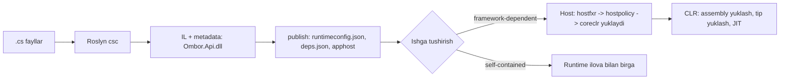
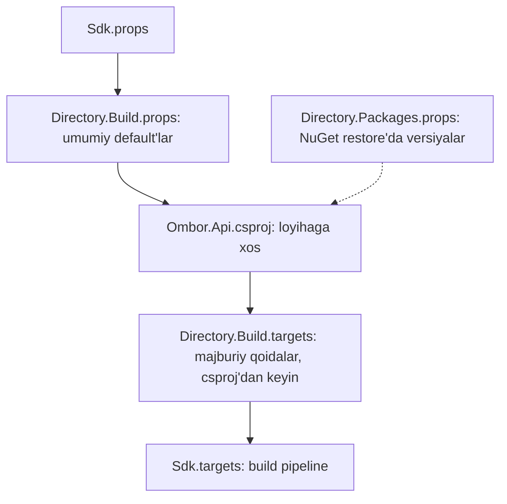

# 04. Runtime, SDK va loyiha tuzilmasi

> **Bir jumlada:** Kod IL ga, IL JIT orqali mashina kodiga aylanadi (yoki oldindan, ReadyToRun/NativeAOT bilan); 30-100 loyihali enterprise solution'da SDK versiyasi, paket versiyalari va build sozlamalari bitta joydan boshqariladi.
> **Nega Middle uchun:** Junior `dotnet new webapi` qiladi va csproj'ga tegmaydi. Middle `global.json` nega kerakligini, `Directory.Packages.props` paket konfliktlarini qanday yo'qotishini, tiered compilation birinchi so'rovni nega sekin qilishini va NativeAOT qachon mantiqli ekanini tushuntiradi, chunki CI/CD, konteyner hajmi va startup vaqti uning mas'uliyatiga kiradi.
> **O'qish vaqti:** ~40 daqiqa

## Mundarija

- [1. Muammo va yechim](#1-muammo-va-yechim)
- [2. Qanday ishlaydi](#2-qanday-ishlaydi)
  - [2.1 Build: manba koddan assembly'gacha](#21-build-manba-koddan-assemblygacha)
  - [2.2 CLR, JIT va tiered compilation](#22-clr-jit-va-tiered-compilation)
  - [2.3 Dynamic PGO](#23-dynamic-pgo)
  - [2.4 ReadyToRun va NativeAOT](#24-readytorun-va-nativeaot)
  - [2.5 MSBuild: props va targets qanday yuklanadi](#25-msbuild-props-va-targets-qanday-yuklanadi)
- [3. Asosiy tushunchalar](#3-asosiy-tushunchalar)
  - [3.1 LTS va STS siyosati](#31-lts-va-sts-siyosati)
  - [3.2 global.json](#32-globaljson)
  - [3.3 Directory.Build.props va .targets](#33-directorybuildprops-va-targets)
  - [3.4 Central Package Management](#34-central-package-management)
  - [3.5 TargetFramework va multi-targeting](#35-targetframework-va-multi-targeting)
  - [3.6 dotnet CLI](#36-dotnet-cli)
  - [3.7 Solution tuzilmasi](#37-solution-tuzilmasi)
  - [3.8 Analyzers va EditorConfig](#38-analyzers-va-editorconfig)
  - [3.9 Publish rejimlari va konteyner](#39-publish-rejimlari-va-konteyner)
- [4. Amaliy misol](#4-amaliy-misol)
- [5. Tipik xatolar va anti-patternlar](#5-tipik-xatolar-va-anti-patternlar)
- [6. Best practices checklist](#6-best-practices-checklist)
- [7. Suhbat savollari va javoblar](#7-suhbat-savollari-va-javoblar)
- [8. Qo'shimcha manbalar](#8-qoshimcha-manbalar)

## 1. Muammo va yechim

Real holat: ombor tizimi 42 loyihali solution. Uch muammo bir haftada:

1. Yangi dasturchi `dotnet build` qildi, 200 ta xato: uning mashinasida .NET 9 SDK, loyiha C# 14 (`extension` bloklari) ishlatadi. Jamoada "menda ishlayapti" bahsi. Sabab: `global.json` yo'q, har kim o'z SDK'si bilan build qiladi.
2. `Ombor.Api` `Microsoft.EntityFrameworkCore` 10.0.1 ga, `Ombor.Infrastructure` 10.0.0 ga ishora qiladi. NuGet NU1605 ogohlantirishlarini chiqaradi, runtime'da `MissingMethodException`. 42 csproj'da versiyani qo'lda sinxronlash hech kimning ishi emas edi.
3. Production'da deploy'dan keyingi birinchi 30 soniyada p99 latency 2 soniya, keyin 80 ms. Kubernetes readiness probe shu paytda pod'ni "tayyor" deb yukni yuboradi. Sabab: tiered compilation, "sovuq" metodlar Tier0 da, JIT hali optimallashtirmagan.

Yechimlar: `global.json` SDK versiyasini qotiradi; `Directory.Packages.props` 42 csproj'dan versiyalarni bitta faylga yig'adi; `PublishReadyToRun` startup'da JIT ishini kamaytiradi va readiness probe'ga warm-up endpoint qo'shiladi. Hammasi uchun runtime va MSBuild qanday ishlashini bilish kerak.

## 2. Qanday ishlaydi

### 2.1 Build: manba koddan assembly'gacha



`dotnet build` MSBuild'ni ishga tushiradi; MSBuild SDK (`Microsoft.NET.Sdk`) ichidagi `.props`/`.targets` fayllar `Compile` item'larini yig'adi (default: papkadagi barcha `*.cs`), `PackageReference` lar uchun NuGet restore qiladi (`obj/project.assets.json`), Roslyn'ni chaqiradi. Natija `bin/Debug/net10.0/Ombor.Api.dll` (IL), `.pdb` (debug simvollar), `.deps.json` (bog'liqliklar grafi), `.runtimeconfig.json` (qaysi runtime, GC sozlamalari).

### 2.2 CLR, JIT va tiered compilation

CLR (CoreCLR) runtime: assembly'larni yuklaydi, tiplarni yaratadi (MethodTable), xotirani boshqaradi (GC, 3-bob), exception'larni tarqatadi, va IL ni mashina kodiga **JIT** (RyuJIT) bilan aylantiradi. JIT har metodni *birinchi chaqiruvda* kompilyatsiya qiladi, shuning uchun "sovuq start" sekin.

**Tiered compilation** (.NET Core 3.0+, default yoqilgan) ikki bosqich:

| Tier | Qachon | Sifat | Maqsad |
|---|---|---|---|
| Tier0 | Birinchi chaqiruv | Tez JIT, optimizatsiya yo'q (inlining yo'q) | Startup tezligi |
| Tier1 | Metod 30 marta chaqirilgach + 100 ms "tinch" davr | To'liq optimizatsiya, background thread'da | Steady-state tezligi |

Mexanizm: Tier0 kodga call counter qo'yiladi; chegaraga yetgan metodlar navbatga tushadi; background thread ularni Tier1 ga qayta JIT qiladi va metod jadvalidagi ko'rsatkichni almashtiradi (keyingi chaqiruvlar yangi kodga). Sikl ichida "qolib ketgan" metodlar uchun **OSR** (On-Stack Replacement, .NET 7+): bajarilayotgan metod o'rtasida optimallashtirilgan kodga o'tadi. Framework kutubxonalari ReadyToRun (2.4) kodi bilan keladi, ular ham "Tier0 o'rnida" ishlatilib, hot bo'lsa Tier1 ga rejit qilinadi.

Sozlash (odatda tegilmaydi): `<TieredCompilation>false</TieredCompilation>` (hammasi darhol full-opt: startup sekin, benchmark uchun), `DOTNET_TieredCompilation=0`, `DOTNET_TC_CallCountThreshold`, `<TieredCompilationQuickJitForLoops>`.

### 2.3 Dynamic PGO

PGO (Profile-Guided Optimization): JIT metodni *qanday ishlatilayotgani* haqida ma'lumot yig'ib, shunga mos optimallashtiradi. .NET 8 dan **Dynamic PGO** default yoqilgan: Tier0 → **Tier0-instrumented** (hisoblagichlar: qaysi `if` shoxi ko'p, interface chaqiruvda qaysi konkret tip ko'p, qaysi sikl issiq) → Tier1 shu profil bilan.

Asosiy natija: **guarded devirtualization**. `IPaymentProvider.PayAsync` chaqiruvi 95% `PaymeProvider` ga ketsa, JIT `if (provider is PaymeProvider p) p.PayAsync() /*inline*/ else interface call` generatsiya qiladi. Shu tufayli LINQ, `IEnumerable<T>`, DI orqali interface'lar deyarli virtual chaqiruv narxisiz ishlaydi. Boshqalari: issiq/sovuq blok joylashuvi, loop cloning, `static readonly` qiymatlarni konstanta sifatida ishlatish.

Praktik xulosa: "interface sekin, shuning uchun konkret tip ishlataman" degan argument .NET 8+ da deyarli noto'g'ri; o'lchab ko'ring (BenchmarkDotNet). O'chirish: `<TieredPGO>false</TieredPGO>`.

### 2.4 ReadyToRun va NativeAOT

| | JIT (default) | ReadyToRun (R2R) | NativeAOT |
|---|---|---|---|
| Kompilyatsiya | Runtime'da | Build'da IL + oldindan native kod (ikkalasi dll ichida) | Build'da faqat native, IL yo'q |
| Startup | Sekin (JIT) | Tez (JIT kam) | Eng tez (ms) |
| Steady-state | Eng yaxshi (Tier1 + PGO) | Yaxshi (hot metodlar rejit) | Yaxshi, lekin dynamic PGO yo'q |
| Hajm | Kichik dll + runtime | Katta dll (2-3x) | Bitta native fayl, trimmed (10-30 MB) |
| Reflection | To'liq | To'liq | Cheklangan (trimming), `Reflection.Emit` yo'q |
| Platforma | Har qanday | RID talab qiladi | RID + native toolchain (clang) |
| Qachon | Default | Konteyner/serverless, startup muhim | CLI, serverless, sidecar, minimal konteyner |

```xml
<!-- R2R: startup JIT ishini kamaytiradi, hot metodlar baribir Tier1 ga rejit qilinadi -->
<PropertyGroup>
  <PublishReadyToRun>true</PublishReadyToRun>
  <RuntimeIdentifier>linux-x64</RuntimeIdentifier>
</PropertyGroup>

<!-- NativeAOT -->
<PropertyGroup>
  <PublishAot>true</PublishAot>
  <InvariantGlobalization>true</InvariantGlobalization>   <!-- ICU kerak emas: kichik image -->
</PropertyGroup>
```

NativeAOT cheklovlari ASP.NET Core'da: `WebApplication.CreateSlimBuilder`, Minimal API (source generator orqali), `JsonSerializerContext`, gRPC ishlaydi; MVC/Razor Pages to'liq mos emas (reflection); EF Core compiled model + precompiled queries bilan tajribaviy. Trimming ogohlantirishlari (`IL2026`, `IL3050`) build'da chiqadi: kutubxona `<IsAotCompatible>true</IsAotCompatible>` deb belgilansa, uni ishonch bilan ishlatish mumkin.

### 2.5 MSBuild: props va targets qanday yuklanadi

csproj deklarativ MSBuild fayli. `Sdk="Microsoft.NET.Sdk.Web"` atributi ikki yashirin import qo'shadi: boshida `Sdk.props`, oxirida `Sdk.targets`. `Sdk.props` ichida `Microsoft.Common.props` **`Directory.Build.props`** ni qidiradi: loyiha papkasidan yuqoriga qarab birinchi topilganini import qiladi (faqat bittasini). `Sdk.targets` oxirida xuddi shunday **`Directory.Build.targets`**. Tartib muhim: `.props` da yozilgan property'ni csproj override qiladi; `.targets` da yozilgan property csproj'ni override qiladi.



## 3. Asosiy tushunchalar

### 3.1 LTS va STS siyosati

- **Ta'rif:** Har noyabrda yangi .NET. Juft versiyalar **LTS** (Long Term Support, 3 yil), toq versiyalar **STS** (Standard Term Support, .NET 9 dan boshlab 24 oy). Patch'lar har oy ("Patch Tuesday").
- **Nega kerak:** Enterprise servis 2-3 yil yashaydi; STS tanlasangiz yiliga migratsiya majburiy.

| Versiya | Tur | Chiqdi | Support tugaydi | Holat (2026-oktabr) |
|---|---|---|---|---|
| .NET 8 | LTS | 2023-noyabr | 2026-noyabr | Oxirgi oy, migratsiya qilinishi shart |
| .NET 9 | STS | 2024-noyabr | 2026-noyabr | Oxirgi oy |
| .NET 10 | LTS | 2025-noyabr | 2028-noyabr | Yangi loyihalar uchun default |
| .NET 11 | STS | 2026-noyabr (hozir RC2, go-live) | 2028-noyabr | GA'dan keyin faqat aniq sabab bilan |

Qoida: enterprise'da LTS → LTS (8 → 10 → 12). STS faqat yangi xususiyat juda kerak bo'lsa va yillik migratsiya byudjeti bo'lsa. Runtime patch'larni avtomatik olish uchun konteyner base image'ni (`mcr.microsoft.com/dotnet/aspnet:10.0`) muntazam qayta build qiling.

- **Tipik xato:** Kutubxona loyihasini `net10.0` ga qotirish: uni `net8.0` ilovada ishlatib bo'lmaydi; umumiy kutubxona `netstandard2.0` yoki multi-target (3.5).

### 3.2 global.json

- **Ta'rif:** Repository ildizidagi fayl: qaysi SDK versiyasi `dotnet` buyruqlarini bajarishini belgilaydi. SDK = kompilyator + MSBuild + NuGet + CLI; runtime (ilova ishlaydigan) alohida.
- **Nega kerak:** Jamoa va CI bir xil SDK bilan build qilsin; yangi SDK yangi analyzer/kompilyator xatti-harakatini keltirishi mumkin.

```json
{
  "sdk": {
    "version": "10.0.100",
    "rollForward": "latestFeature",
    "allowPrerelease": false
  }
}
```

`rollForward` qiymatlari: `patch` (faqat patch), `feature` (10.0.1xx ichida eng yangi), `minor`, `major`, `latestPatch`, `latestFeature` (10.0.xxx ichida eng yangi, tavsiya), `latestMajor`, `disable` (aynan shu). SDK versiya formati `10.0.1xx`: `1` feature band, `xx` patch. `dotnet --list-sdks` o'rnatilganlarni ko'rsatadi; mos SDK yo'q bo'lsa `dotnet` xato beradi, bu "menda ishlayapti" ni yo'qotadi.

- **Tipik xato:** `"version": "10.0.100"` + `rollForward` yo'q (default `latestPatch`... amalda `latestFeature` ga yaqin, lekin aniq yozish yaxshi) va CI image'da 10.0.101 bo'lganda chalkashlik; yoki `allowPrerelease: true` production repo'da.

### 3.3 Directory.Build.props va .targets

- **Ta'rif:** Papka daraxtidagi barcha loyihalarga avtomatik import qilinadigan MSBuild fayllari. `.props` loyihadan *oldin* (default'lar), `.targets` loyihadan *keyin* (majburiy qoidalar, custom target'lar).
- **Nega kerak:** `Nullable`, `LangVersion`, `TreatWarningsAsErrors`, kompaniya nomi, versiya 42 csproj'da emas, bitta joyda.

```xml
<!-- /Directory.Build.props (repo ildizi) -->
<Project>
  <PropertyGroup>
    <TargetFramework>net10.0</TargetFramework>
    <LangVersion>14.0</LangVersion>
    <Nullable>enable</Nullable>
    <ImplicitUsings>enable</ImplicitUsings>
    <TreatWarningsAsErrors>true</TreatWarningsAsErrors>
    <WarningsNotAsErrors>CS1591</WarningsNotAsErrors>      <!-- XML doc yo'qligi xato emas -->
    <AnalysisLevel>latest-recommended</AnalysisLevel>
    <EnforceCodeStyleInBuild>true</EnforceCodeStyleInBuild>
    <Deterministic>true</Deterministic>
    <ContinuousIntegrationBuild Condition="'$(CI)' == 'true'">true</ContinuousIntegrationBuild>
    <UseArtifactsOutput>true</UseArtifactsOutput>            <!-- bin/obj o'rniga /artifacts/ -->
    <Company>Ombor LLC</Company>
    <Authors>Ombor Platform Team</Authors>
    <InvariantGlobalization>false</InvariantGlobalization>   <!-- uz-UZ formatlash kerak -->
  </PropertyGroup>
</Project>

<!-- /tests/Directory.Build.props: test loyihalari uchun override, ildizdagini zanjirlab -->
<Project>
  <Import Project="$([MSBuild]::GetPathOfFileAbove('Directory.Build.props', '$(MSBuildThisFileDirectory)../'))" />
  <PropertyGroup>
    <IsPackable>false</IsPackable>
    <IsTestProject>true</IsTestProject>
    <NoWarn>$(NoWarn);CA1707</NoWarn>                        <!-- test nomlarida pastki chiziq mumkin -->
  </PropertyGroup>
  <ItemGroup>
    <PackageReference Include="xunit.v3" />
    <PackageReference Include="Microsoft.NET.Test.Sdk" />
    <PackageReference Include="FluentAssertions" />
  </ItemGroup>
</Project>
```

MSBuild faqat *birinchi* topilgan `Directory.Build.props` ni import qiladi (yuqoriga qarab qidirish to'xtaydi). Shuning uchun `tests/Directory.Build.props` ildizdagini `GetPathOfFileAbove` bilan o'zi import qilishi kerak, aks holda ildiz sozlamalari test'larga yetmaydi.

- **Tipik xato:** `TargetFramework` ni `.props` ga qo'yib, keyin multi-target kutubxonada `TargetFrameworks` (ko'plik) yozish: ikkalasi birga bo'lsa xato. Kutubxona csproj'ida `<TargetFramework />` ni bo'shatib, `TargetFrameworks` yozing.

### 3.4 Central Package Management

- **Ta'rif:** CPM: `Directory.Packages.props` da `PackageVersion` lar, csproj'da `PackageReference` versiyasiz. NuGet restore versiyani markaziy fayldan oladi.
- **Nega kerak:** 42 loyihada bir xil EF Core versiyasi; yangilash bitta qatorda; transitive konfliktlar (NU1605, NU1608) yo'qoladi.

```xml
<!-- /Directory.Packages.props -->
<Project>
  <PropertyGroup>
    <ManagePackageVersionsCentrally>true</ManagePackageVersionsCentrally>
    <CentralPackageTransitivePinningEnabled>true</CentralPackageTransitivePinningEnabled> <!-- transitive ham shu versiyaga -->
    <NuGetAudit>true</NuGetAudit>
    <NuGetAuditMode>all</NuGetAuditMode>                     <!-- transitive paketlar ham CVE tekshiruvi -->
    <NuGetAuditLevel>moderate</NuGetAuditLevel>
  </PropertyGroup>

  <ItemGroup>
    <PackageVersion Include="Microsoft.EntityFrameworkCore" Version="10.0.1" />
    <PackageVersion Include="Npgsql.EntityFrameworkCore.PostgreSQL" Version="10.0.0" />
    <PackageVersion Include="Microsoft.Extensions.Caching.Hybrid" Version="10.0.0" />
    <PackageVersion Include="xunit.v3" Version="3.1.0" />
    <PackageVersion Include="Microsoft.NET.Test.Sdk" Version="18.0.0" />
    <PackageVersion Include="FluentAssertions" Version="7.2.0" />
  </ItemGroup>

  <ItemGroup>
    <!-- Barcha loyihalarga avtomatik: analyzer'lar, SourceLink -->
    <GlobalPackageReference Include="Meziantou.Analyzer" Version="2.0.210" />
    <GlobalPackageReference Include="Microsoft.SourceLink.GitHub" Version="8.0.0" />
  </ItemGroup>
</Project>
```

```xml
<!-- src/Ombor.Infrastructure/Ombor.Infrastructure.csproj: versiya YO'Q -->
<ItemGroup>
  <PackageReference Include="Microsoft.EntityFrameworkCore" />
  <PackageReference Include="Npgsql.EntityFrameworkCore.PostgreSQL" />
  <PackageReference Include="Some.Legacy.Package" VersionOverride="1.2.3" />  <!-- istisno, ochiq yozilgan -->
</ItemGroup>
```

Yuqoridagi paket versiyalari misol: haqiqiy raqamlarni `dotnet package search` yoki nuget.org dan oling. `dotnet list package --outdated` eskirganlarni, `dotnet list package --vulnerable` zaifliklarni ko'rsatadi.

- **Tipik xato:** CPM yoqib, bitta csproj'da `Version="..."` qoldirish: NU1008 xato. Yoki `VersionOverride` ni "tez tuzatish" uchun ko'paytirib yuborish; `CentralPackageVersionOverrideEnabled=false` bilan taqiqlash mumkin.

### 3.5 TargetFramework va multi-targeting

- **Ta'rif:** `TargetFramework` (TFM) qaysi API yuzasiga kompilyatsiya qilinadi: `net10.0`, `net8.0`, `netstandard2.0`. `TargetFrameworks` (ko'plik) bir csproj'dan bir nechta assembly build qiladi.
- **Nega kerak:** Ichki NuGet kutubxona ham .NET 8, ham .NET 10 ilovalarda ishlashi; yangi API'ni faqat bor joyda ishlatish.

```xml
<PropertyGroup>
  <TargetFramework />                                   <!-- Directory.Build.props dagini bekor qilamiz -->
  <TargetFrameworks>net8.0;net10.0</TargetFrameworks>
</PropertyGroup>

<ItemGroup Condition="'$(TargetFramework)' == 'net8.0'">
  <PackageReference Include="System.Threading.Channels" />  <!-- faqat eski TFM uchun kerak bo'lsa -->
</ItemGroup>
```

```csharp
public static string Normalize(string phone)
{
#if NET10_0_OR_GREATER
    return phone.AsSpan().Trim().ToString();          // yangi API bo'lsa
#else
    return phone.Trim();
#endif
}
```

Preprocessor simvollar avtomatik: `NET10_0`, `NET10_0_OR_GREATER`, `NET8_0_OR_GREATER`, `NETSTANDARD2_0`. `netstandard2.0` eng keng moslik (.NET Framework 4.6.1+ ham), lekin `Span`, `IAsyncEnumerable` kabi ko'p API yo'q (`System.Memory`, `Microsoft.Bcl.AsyncInterfaces` paketlari bilan qisman).

- **Tipik xato:** Ilovani (Api) multi-target qilish: ilova bitta TFM'da ishlaydi; multi-target faqat kutubxonalar uchun.

### 3.6 dotnet CLI

- **Ta'rif:** `dotnet` buyrug'i: SDK buyruqlari (`new`, `build`, `test`, `publish`, `pack`, `tool`, `format`), host buyruqlari (`dotnet app.dll`), va global/local tools.
- **Nega kerak:** CI/CD skriptlari, Dockerfile, lokal avtomatizatsiya IDE'siz.

```bash
# Solution va loyihalar
dotnet new sln -n Ombor                             # SDK 9.0.200+ da .slnx (XML) formatini ham qo'llaydi: dotnet sln migrate
dotnet new classlib -n Ombor.Domain -o src/Ombor.Domain
dotnet new webapi -n Ombor.Api -o src/Ombor.Api --use-minimal-apis
dotnet sln add src/Ombor.Domain src/Ombor.Api
dotnet add src/Ombor.Api reference src/Ombor.Domain
dotnet add src/Ombor.Infrastructure package Microsoft.EntityFrameworkCore   # CPM bo'lsa Packages.props ga yozadi

# Build / test
dotnet restore --locked-mode                        # packages.lock.json bilan mos kelmasa xato (CI uchun)
dotnet build -c Release --no-restore -warnaserror
dotnet test -c Release --no-build --collect:"XPlat Code Coverage" --results-directory artifacts/test-results
dotnet format --verify-no-changes                   # .editorconfig ga mos emasmi: CI xato

# Publish
dotnet publish src/Ombor.Api -c Release -r linux-x64 --self-contained false -o artifacts/publish
dotnet publish src/Ombor.Api -c Release /t:PublishContainer   # SDK container: Dockerfile'siz OCI image

# Local tools: versiya repo'da, jamoa bir xil
dotnet new tool-manifest                            # .config/dotnet-tools.json
dotnet tool install dotnet-ef                       # manifestga yoziladi
dotnet tool restore                                 # CI/yangi mashina
dotnet ef migrations add AddWarehouseZone --project src/Ombor.Infrastructure --startup-project src/Ombor.Api

# Diagnostika (global tools)
dotnet tool install -g dotnet-counters dotnet-dump dotnet-gcdump dotnet-trace

# .NET 10: fayl asosidagi ilova, csproj'siz skript
dotnet run scripts/seed.cs                          # fayl boshida: #:package Npgsql@9.0.3
```

- **Tipik xato:** CI'da `dotnet build` so'ng `dotnet test` (ikkinchisi qayta build qiladi, vaqt 2x). `--no-build`/`--no-restore` ishlating.

### 3.7 Solution tuzilmasi

- **Ta'rif:** Papkalar va loyihalar joylashuvi konvensiyasi. Standart: `src/` (ishlab chiqarish kodi), `tests/`, `build/` yoki `eng/` (skriptlar, Dockerfile, CI), `docs/`, ildizda konfiguratsiya fayllari.
- **Nega kerak:** Yangi dasturchi 5 daqiqada topadi; `Directory.Build.props` lar papka bo'yicha ishlaydi; CI yo'llari barqaror.

```
Ombor/
├── global.json                      # SDK versiyasi
├── Directory.Build.props            # umumiy build sozlamalari
├── Directory.Build.targets          # umumiy custom target'lar (kamdan-kam)
├── Directory.Packages.props         # CPM: paket versiyalari
├── nuget.config                     # paket manbalari (ichki feed), packageSourceMapping
├── .editorconfig                    # kod uslubi + analyzer severity
├── .config/dotnet-tools.json        # local tools (dotnet-ef, ...)
├── Ombor.slnx                       # solution (yoki .sln)
├── README.md
├── src/
│   ├── Ombor.Domain/                # entity, value object, domain xizmatlar; bog'liqlik yo'q
│   ├── Ombor.Application/           # use case'lar, interface'lar (IOrderRepository), DTO
│   ├── Ombor.Infrastructure/        # EF Core, tashqi API (Payme, Eskiz), fayl, email
│   ├── Ombor.Api/                   # ASP.NET Core host: endpoint, middleware, DI tarkibi
│   └── Ombor.Contracts/             # (ixtiyoriy) tashqi mijozlar uchun DTO, netstandard2.0
├── tests/
│   ├── Directory.Build.props        # test'larga xos (IsPackable=false, xunit)
│   ├── Ombor.Domain.Tests/          # unit: tez, DB yo'q
│   ├── Ombor.Application.Tests/     # unit + fake'lar
│   ├── Ombor.Api.IntegrationTests/  # WebApplicationFactory + Testcontainers (PostgreSQL)
│   └── Ombor.ArchitectureTests/     # NetArchTest: Domain Infrastructure'ga ishora qilmasin
├── build/
│   ├── Dockerfile
│   └── ci/                          # pipeline yaml'lar yoki ularga havola
└── artifacts/                       # UseArtifactsOutput: bin/obj/publish shu yerda, .gitignore'da
```

Loyihalar orasidagi bog'liqlik yo'nalishi: `Api → Application → Domain`, `Infrastructure → Application` (interface'larni amalga oshiradi), `Api → Infrastructure` (faqat DI ro'yxatga olish uchun). `Domain` hech narsaga ishora qilmaydi. Buni arxitektura testi bilan qotiring.

- **Tipik xato:** 40 ta mikro-loyiha ("har papka alohida csproj"): build 3x sekin, bog'liqlik grafi chalkash. Loyiha chegarasi = alohida deploy yoki alohida bog'liqlik qoidasi bo'lgandagina.

### 3.8 Analyzers va EditorConfig

- **Ta'rif:** Roslyn analyzer kompilyatsiya paytida kodni tekshirib diagnostika (xato/ogohlantirish) beradi. .NET SDK'da `Microsoft.CodeAnalysis.NetAnalyzers` (CAxxxx) o'rnatilgan; IDE uslub qoidalari (IDExxxx) `.editorconfig` da; uchinchi tomon: Meziantou, SonarAnalyzer, Roslynator, VS Threading, StyleCop.
- **Nega kerak:** Code review'da "CancellationToken uzating", "ConfigureAwait", "dispose qilinmagan" kabi izohlarni mashina yozsin; sifat deploy'dan oldin ushlansin.

```ini
# /.editorconfig
root = true

[*]
indent_style = space
end_of_line = lf
insert_final_newline = true
charset = utf-8

[*.cs]
indent_size = 4
csharp_style_namespace_declarations = file_scoped:warning
csharp_style_var_for_built_in_types = false:suggestion
csharp_prefer_braces = true:silent
dotnet_sort_system_directives_first = true

# Analyzer severity: build'da xato bo'lsin
dotnet_diagnostic.CA2007.severity = none          # ConfigureAwait: ASP.NET Core ilovasida kerak emas (kutubxonada warning qiling)
dotnet_diagnostic.CA1062.severity = none          # public arg null tekshiruvi: NRT bor
dotnet_diagnostic.CA2016.severity = error         # CancellationToken uzatilmagan
dotnet_diagnostic.CA1848.severity = warning       # LoggerMessage source generator ishlating
dotnet_diagnostic.CA2000.severity = warning       # IDisposable dispose qilinmagan
dotnet_diagnostic.MA0004.severity = none          # Meziantou ConfigureAwait (ilova)
dotnet_diagnostic.MA0040.severity = error         # Meziantou: CancellationToken mavjud, uzatilmagan
dotnet_diagnostic.IDE0005.severity = warning      # keraksiz using (EnforceCodeStyleInBuild bilan ishlaydi)

[*.{csproj,props,targets}]
indent_size = 2

[*.{json,yml,yaml}]
indent_size = 2
```

`AnalysisLevel`: `latest-recommended` (tavsiya etilgan to'plam), `latest-all` (hammasi, shovqinli), `10.0` (qotirilgan). `EnforceCodeStyleInBuild=true` IDE qoidalarini `dotnet build` da ham tekshiradi (aks holda faqat IDE'da). `BannedApiAnalyzers` + `BannedSymbols.txt` bilan `DateTime.Now` (UTC o'rniga), `Thread.Sleep`, `Task.Result` ni taqiqlash mumkin.

- **Tipik xato:** `TreatWarningsAsErrors` ni legacy loyihaga birdan yoqish (5000 xato) yoki `NoWarn` ga hamma narsani tashlash. Bosqichma-bosqich: avval `AnalysisLevel` past, keyin qoidalar birma-bir.

### 3.9 Publish rejimlari va konteyner

- **Ta'rif:** **Framework-dependent** (default): faqat ilova dll'lari, runtime hostda (`aspnet` image). **Self-contained**: runtime ilova bilan, hostda .NET kerak emas, hajm +70 MB. **Trimmed** (`PublishTrimmed`): ishlatilmagan IL olib tashlanadi, reflection ogohlantirishlari. **Single-file**: bitta exe.
- **Nega kerak:** Konteyner hajmi, startup, xavfsizlik yangilanishlari (framework-dependent'da base image yangilansa runtime patch olinadi).

```dockerfile
# build/Dockerfile: multi-stage, layer cache uchun restore alohida
FROM mcr.microsoft.com/dotnet/sdk:10.0 AS build
WORKDIR /src
COPY global.json Directory.Build.props Directory.Packages.props nuget.config ./
COPY src/Ombor.Api/Ombor.Api.csproj src/Ombor.Api/
COPY src/Ombor.Application/Ombor.Application.csproj src/Ombor.Application/
COPY src/Ombor.Domain/Ombor.Domain.csproj src/Ombor.Domain/
COPY src/Ombor.Infrastructure/Ombor.Infrastructure.csproj src/Ombor.Infrastructure/
RUN dotnet restore src/Ombor.Api/Ombor.Api.csproj          # faqat csproj o'zgarganda qayta ishlaydi
COPY src/ src/
RUN dotnet publish src/Ombor.Api/Ombor.Api.csproj -c Release -o /app --no-restore \
    -p:PublishReadyToRun=true -r linux-x64 --self-contained false

FROM mcr.microsoft.com/dotnet/aspnet:10.0-noble-chiseled AS runtime   # chiseled: shell yo'q, root yo'q, ~110 MB
WORKDIR /app
COPY --from=build /app .
ENV ASPNETCORE_HTTP_PORTS=8080 DOTNET_gcServer=1
USER $APP_UID
ENTRYPOINT ["dotnet", "Ombor.Api.dll"]
```

`chiseled` image'da `dotnet-counters` kabi asboblar yo'q; diagnostika uchun `dotnet-monitor` sidecar yoki debug image varianti. Alpine (`-alpine`) `musl` va ICU'siz: `InvariantGlobalization=true` kerak yoki `icu-libs` qo'shish.

- **Tipik xato:** `dotnet publish` ni `COPY . .` dan keyin bitta qatlamda qilish: har commit'da to'liq restore, CI 5 daqiqa o'rniga 1 daqiqa bo'lishi mumkin edi.

## 4. Amaliy misol

Vazifa: 1-bo'limdagi uch muammoni hal qiluvchi repo konfiguratsiyasi va startup latency uchun warm-up. Quyida fayllar to'plami va ularning sababi.

```json
// global.json
{ "sdk": { "version": "10.0.100", "rollForward": "latestFeature", "allowPrerelease": false } }
```

```xml
<!-- src/Ombor.Api/Ombor.Api.csproj: faqat loyihaga xos narsalar; qolgani Directory.Build.props da -->
<Project Sdk="Microsoft.NET.Sdk.Web">
  <PropertyGroup>
    <UserSecretsId>ombor-api</UserSecretsId>
    <ServerGarbageCollection>true</ServerGarbageCollection>
    <TieredPGO>true</TieredPGO>
    <PublishReadyToRun>true</PublishReadyToRun>
    <RuntimeIdentifier>linux-x64</RuntimeIdentifier>
    <EnableRequestDelegateGenerator>true</EnableRequestDelegateGenerator>  <!-- Minimal API: reflection'siz, startup tez -->
    <GenerateDocumentationFile>true</GenerateDocumentationFile>           <!-- OpenAPI uchun -->
  </PropertyGroup>
  <ItemGroup>
    <ProjectReference Include="../Ombor.Application/Ombor.Application.csproj" />
    <ProjectReference Include="../Ombor.Infrastructure/Ombor.Infrastructure.csproj" />
  </ItemGroup>
  <ItemGroup>
    <PackageReference Include="Microsoft.AspNetCore.OpenApi" />
    <PackageReference Include="OpenTelemetry.Extensions.Hosting" />
  </ItemGroup>
</Project>
```

```csharp
// src/Ombor.Api/Startup/WarmUp.cs
// Muammo 3: Tier0 kod va EF Core model qurilishi birinchi so'rovda. Readiness probe warm-up tugaguncha "tayyor emas" desin.
public sealed class WarmUpHealthCheck : IHealthCheck
{
    public static volatile bool Done;
    public Task<HealthCheckResult> CheckHealthAsync(HealthCheckContext context, CancellationToken ct = default) =>
        Task.FromResult(Done ? HealthCheckResult.Healthy() : HealthCheckResult.Unhealthy("warming up"));
}

public sealed class WarmUpService(IServiceScopeFactory scopes, ILogger<WarmUpService> log) : BackgroundService
{
    protected override async Task ExecuteAsync(CancellationToken stoppingToken)
    {
        var sw = Stopwatch.StartNew();
        await using var scope = scopes.CreateAsyncScope();
        var db = scope.ServiceProvider.GetRequiredService<AppDbContext>();

        // EF Core: model qurish + eng ko'p ishlatiladigan so'rovlarni compiled query cache'ga yuklash
        _ = await db.Orders.AsNoTracking().Where(o => o.Id == 0).FirstOrDefaultAsync(stoppingToken);
        _ = await db.StockItems.AsNoTracking().Where(s => s.Sku == "").AnyAsync(stoppingToken);

        // JSON kontekstini va serializer'ni "uyg'otish"
        _ = JsonSerializer.Serialize(new OrderDto(0, 0, OrderStatus.New, ""), AppJsonContext.Default.OrderDto);

        WarmUpHealthCheck.Done = true;
        log.LogInformation("Warm-up {Elapsed} ms", sw.ElapsedMilliseconds);
    }
}

// Program.cs
builder.Services.AddHealthChecks()
    .AddCheck<WarmUpHealthCheck>("warmup", tags: ["ready"])
    .AddNpgSql(connectionString, tags: ["ready"]);
builder.Services.AddHostedService<WarmUpService>();
app.MapHealthChecks("/health/ready", new HealthCheckOptions { Predicate = c => c.Tags.Contains("ready") });
app.MapHealthChecks("/health/live", new HealthCheckOptions { Predicate = _ => false });
```

```yaml
# CI (GitHub Actions / GitLab CI mantiqi, qisqartirilgan)
steps:
  - run: dotnet --version                          # global.json tufayli 10.0.1xx bo'lishi shart
  - run: dotnet tool restore
  - run: dotnet restore --locked-mode              # packages.lock.json: supply-chain barqarorligi
  - run: dotnet build -c Release --no-restore -warnaserror
  - run: dotnet format --verify-no-changes --no-restore
  - run: dotnet test -c Release --no-build --collect:"XPlat Code Coverage"
  - run: dotnet publish src/Ombor.Api -c Release --no-build /t:PublishContainer -p:ContainerImageTag=${GIT_SHA}
```

Nega aynan shunday:

- `global.json` `latestFeature`: patch'lar avtomatik (xavfsizlik), lekin 10.0.2xx (yangi feature band) ochiq qaror bilan.
- Versiyalar faqat `Directory.Packages.props` da: muammo 2 yo'qoladi, `CentralPackageTransitivePinningEnabled` transitive konfliktlarni ham hal qiladi.
- `PublishReadyToRun` + `EnableRequestDelegateGenerator` + warm-up: muammo 3. R2R JIT ishini kamaytiradi, lekin EF model qurilishi va Tier1 rejit baribir bor; warm-up readiness'ni ushlab turadi va Kubernetes yukni faqat tayyor pod'ga yuboradi.
- `--locked-mode`: `packages.lock.json` (`RestorePackagesWithLockFile=true`) bilan CI va lokal bir xil paket grafini oladi; ba'zi jamoalar lock faylsiz CPM'ga tayanadi, bu ham qabul qilinadi.
- `/t:PublishContainer`: Dockerfile'siz OCI image, base image va tag MSBuild property'larida; murakkab holatlarda (native paketlar) 3.9 dagi Dockerfile.

## 5. Tipik xatolar va anti-patternlar

**1. `global.json` yo'q**

```
❌  Repo ildizida global.json yo'q; dasturchi A: SDK 9.0.305, dasturchi B: SDK 10.0.100, CI: 10.0.101
```
Bir xil kod har joyda har xil build; C# 14 sintaksisi A da xato.
```json
✅  { "sdk": { "version": "10.0.100", "rollForward": "latestFeature" } }
```

**2. Har csproj'da takrorlangan sozlamalar**

```xml
❌  <!-- 42 ta csproj'da: --> <Nullable>enable</Nullable><LangVersion>14</LangVersion><TreatWarningsAsErrors>true</TreatWarningsAsErrors>
```
Bittasida unutilsa, o'sha loyiha boshqa qoidalar bilan yashaydi.
```xml
✅  <!-- Directory.Build.props da bir marta; csproj faqat loyihaga xos -->
```

**3. Paket versiyalari tarqoq**

```xml
❌  Api: <PackageReference Include="Serilog" Version="4.2.0" />   Infrastructure: Version="4.0.1"
```
NU1605 downgrade ogohlantirish, runtime'da `MissingMethodException` yoki `FileLoadException`.
```xml
✅  Directory.Packages.props: <PackageVersion Include="Serilog" Version="4.2.0" />; csproj'larda versiyasiz
```

**4. Kutubxonani eng yangi TFM'ga qotirish**

```xml
❌  <!-- Ombor.Contracts (tashqi mijozlar uchun) --> <TargetFramework>net10.0</TargetFramework>
```
.NET 8 dagi mijoz ishlatolmaydi.
```xml
✅  <TargetFrameworks>netstandard2.0;net8.0;net10.0</TargetFrameworks>
```

**5. NativeAOT'ni reflection'ga tayangan ilovaga "startup uchun" qo'llash**

```xml
❌  <PublishAot>true</PublishAot>  <!-- MVC + AutoMapper + Newtonsoft.Json + reflection-based validator -->
```
Yuzlab IL2026/IL3050 ogohlantirish, runtime'da `MissingMetadataException`.
```xml
✅  <PublishReadyToRun>true</PublishReadyToRun>  <!-- startup 2-3x tez, hech narsa buzilmaydi -->
<!-- NativeAOT: yangi, Minimal API + STJ source-gen + AOT-compatible kutubxonalar bilan boshlangan servis uchun -->
```

**6. Dockerfile'da bitta qatlam**

```dockerfile
❌  COPY . . 
    RUN dotnet publish -c Release -o /app
```
Har commit to'liq restore (minutlar), cache yo'q.
```dockerfile
✅  COPY *.props *.json nuget.config ./  +  COPY **/*.csproj  →  RUN dotnet restore  →  COPY src/  →  RUN dotnet publish --no-restore
```

**7. `TreatWarningsAsErrors` siz, `NoWarn` bilan to'la**

```xml
❌  <NoWarn>CS8600;CS8602;CS8618;CA2007;CA1062;CA2016;CS1998</NoWarn>
```
NRT va async ogohlantirishlari o'chirilgan: analyzer bor, foydasi yo'q.
```xml
✅  <TreatWarningsAsErrors>true</TreatWarningsAsErrors> + .editorconfig da har qoida uchun ochiq qaror va sabab izohi
```

**8. `dotnet test` va `dotnet build` ni ikki marta**

```bash
❌  dotnet build -c Release && dotnet test -c Release        # test yana build qiladi
```
```bash
✅  dotnet build -c Release && dotnet test -c Release --no-build
```

## 6. Best practices checklist

- [ ] Repo ildizida `global.json` (`rollForward: latestFeature`): jamoa va CI bir xil SDK.
- [ ] `Directory.Build.props` da `Nullable`, `LangVersion`, `TreatWarningsAsErrors`, `AnalysisLevel`, `Deterministic`: sozlamalar bitta joyda.
- [ ] `Directory.Packages.props` (CPM) + `CentralPackageTransitivePinningEnabled`: versiya konflikti yo'q.
- [ ] `NuGetAudit` yoqilgan va `dotnet list package --vulnerable` CI'da: zaif paket build'da ushlanadi.
- [ ] `nuget.config` da `packageSourceMapping`: ichki paket nomi public feed'dan "o'g'irlanmasin" (dependency confusion).
- [ ] Ilova LTS'da (.NET 10), kutubxonalar multi-target yoki `netstandard2.0`: 3 yillik support va keng moslik.
- [ ] `src/`, `tests/`, `build/` tuzilmasi va `UseArtifactsOutput`: yangi dasturchi topadi, CI yo'llari barqaror.
- [ ] Bog'liqlik yo'nalishi (`Domain` hech kimga ishora qilmaydi) arxitektura testi bilan qotirilgan: qoida review'ga emas, build'ga bog'liq.
- [ ] `.editorconfig` da har o'chirilgan qoida uchun sabab izohi: `NoWarn` dump'i emas, ongli qaror.
- [ ] `dotnet format --verify-no-changes` CI'da: uslub bahslari review'da emas.
- [ ] Local tools manifest (`.config/dotnet-tools.json`): `dotnet-ef` versiyasi hamma uchun bir xil.
- [ ] CI'da `--no-restore`/`--no-build` va Dockerfile'da restore alohida qatlam: build vaqti 2-5x kam.
- [ ] Konteyner: `aspnet:10.0-noble-chiseled` yoki `-alpine` + `InvariantGlobalization` qarori: hajm va xavfsizlik.
- [ ] `PublishReadyToRun` + warm-up + readiness probe: deploy paytida p99 sakramasin.
- [ ] NativeAOT faqat AOT uchun loyihalangan servisda (Minimal API, source-gen JSON): reflection'li ilovada emas.

## 7. Suhbat savollari va javoblar

**1. Tiered compilation nima va nega birinchi so'rovlar sekin?**
JIT metodni avval Tier0 da (tez, optimizatsiyasiz) kompilyatsiya qiladi; 30 chaqiruvdan va qisqa tinch davrdan keyin background thread'da Tier1 ga (to'liq optimizatsiya, Dynamic PGO profili bilan) qayta kompilyatsiya qilib almashtiradi. Birinchi so'rovlar: assembly yuklash + Tier0 JIT + EF model qurish, shuning uchun sekin. Yechimlar: `PublishReadyToRun` (oldindan native kod), warm-up + readiness probe, `TieredCompilation` ni o'chirmaslik (startup yanada sekinlashadi). Tuzoq: "Tier0 sekin, demak o'chiraman" deyish; Tier0 aynan startup uchun.

**2. ReadyToRun va NativeAOT farqi, qachon qaysi biri?**
R2R: dll ichida IL ham, oldindan kompilyatsiya qilingan native kod ham; runtime JIT'siz boshlaydi, hot metodlarni keyin Tier1 ga rejit qiladi; hech qanday cheklov yo'q, faqat dll kattaroq. NativeAOT: IL yo'q, JIT yo'q, bitta native fayl, trimming majburiy, reflection cheklangan, `Reflection.Emit`/dynamic yo'q, dynamic PGO yo'q. R2R: har qanday ASP.NET Core servisga xavfsiz startup yaxshilash. NativeAOT: CLI, serverless (cold start), minimal konteyner, va faqat AOT-compatible stack (Minimal API, STJ source-gen, gRPC) bilan.

**3. `global.json` nega kerak, u runtime versiyasini ham qotiradimi?**
Faqat SDK (build asboblari) versiyasini; ilova ishlaydigan runtime `TargetFramework` va `runtimeconfig.json` (`rollForward` o'z qoidasi bilan) orqali. Maqsad: jamoa, CI va build server bir xil kompilyator/MSBuild/NuGet bilan ishlashi; SDK yangilanishi yangi analyzer yoki kompilyator o'zgarishini keltirishi mumkin. `rollForward: latestFeature` patch'larni avtomatik oladi, feature band'ni esa ochiq qaror qiladi.

**4. Directory.Build.props va Directory.Packages.props farqi?**
`Directory.Build.props` MSBuild property/item'lar: TFM, Nullable, analyzer sozlamalari, kompaniya nomi; har loyihaga avtomatik import, faqat eng yaqin topilgani (zanjirlash qo'lda). `Directory.Packages.props` NuGet Central Package Management: `PackageVersion` ro'yxati, csproj'da `PackageReference` versiyasiz; `GlobalPackageReference` barcha loyihalarga paket (analyzer) qo'shadi; `VersionOverride` istisno. Birinchisi "qanday build qilish", ikkinchisi "qaysi paket versiyasi".

**5. LTS va STS, enterprise'da qaysi birini tanlaysiz?**
Juft versiyalar LTS 3 yil, toq STS 24 oy (.NET 9 dan). Enterprise'da LTS → LTS: migratsiya har 2 yilda, support 3 yil, overlap 1 yil. STS faqat aniq xususiyat kerak bo'lsa va yillik migratsiya byudjeti bo'lsa. 2026-oktabrda: .NET 8 va 9 noyabrda tugaydi, .NET 10 LTS 2028 gacha, .NET 11 preview. Tuzoq: "STS = beta" emas, u to'liq production-ready, faqat qisqa support.

**6. Dynamic PGO nima beradi?**
Tier0-instrumented bosqichda JIT shoxlanish ehtimolliklari, interface/virtual chaqiruvlarda konkret tiplar va issiq sikllarni hisoblaydi; Tier1 shu profil asosida guarded devirtualization (interface chaqiruvni `if (x is Konkret)` + inline ga aylantirish), issiq kodni zich joylashtirish, sikl klonlash qiladi. Natija: DI orqali interface, LINQ, `IEnumerable<T>` deyarli konkret tip tezligida. .NET 8 dan default yoqilgan. Tuzoq: NativeAOT'da dynamic PGO yo'q (static PGO bor), shuning uchun AOT steady-state ba'zan JIT'dan sekin.

**7. Multi-targeting qanday ishlaydi va qachon kerak?**
`TargetFrameworks=net8.0;net10.0` bir csproj'dan ikki assembly build qiladi (`bin/.../net8.0/`, `net10.0/`), NuGet paketda ikkala `lib/` papka bo'ladi va iste'molchi o'ziga mosini oladi. Kod farqi `#if NET10_0_OR_GREATER` va `Condition` li `ItemGroup` lar bilan. Kerak: ichki NuGet kutubxonalar, SDK'lar, turli versiyadagi ilovalarga ulashiladigan kod. Kerak emas: ilovalar (bitta TFM). Tuzoq: `Directory.Build.props` dagi `TargetFramework` bilan konflikt, csproj'da `<TargetFramework />` bo'shatish.

**8. Analyzer'larni legacy loyihaga qanday kiritasiz?**
Birdan `TreatWarningsAsErrors` emas. Bosqichlar: (1) `AnalysisLevel=latest-recommended` ogohlantirish sifatida, hisobot; (2) eng qimmatli qoidalarni (CA2016 CancellationToken, CA2000 Dispose, MA0040) `error` ga, qolganini `suggestion`; (3) yangi kod uchun `.editorconfig` papka bo'yicha qattiqroq (yangi modul papkasida alohida `.editorconfig`); (4) `dotnet format` bilan avtomatik tuzatiladiganlarni bitta commit'da; (5) oxirida `TreatWarningsAsErrors`. `NoWarn` ga tashlash emas, har qoida uchun qaror.

**9. Framework-dependent va self-contained publish farqi, konteynerda qaysi biri?**
Framework-dependent: faqat ilova dll'lari, runtime `aspnet` base image'da; image kichik, runtime patch'lar base image yangilanishi bilan keladi. Self-contained: runtime ilova bilan (+70 MB), hostda .NET kerak emas, patch uchun ilovani qayta build qilish shart. Konteynerda odatda framework-dependent + rasmiy `aspnet` image; self-contained faqat trimming/single-file/AOT bilan (u yerda runtime baribir ichida). Tuzoq: self-contained + `PublishTrimmed` ni reflection'li ilovaga qo'llash.

**10. `dotnet publish` nima chiqaradi va `runtimeconfig.json` nima?**
Publish papkasi: `App.dll` (IL), bog'liq dll'lar, `App.deps.json` (bog'liqliklar grafi va versiyalari, host shu bo'yicha yuklaydi), `App.runtimeconfig.json` (qaysi framework va versiya, `rollForward`, GC/threading sozlamalari: `System.GC.Server`, `System.GC.HeapHardLimitPercent`), `App` apphost (native executable, `dotnet App.dll` o'rniga `./App`). `runtimeconfig.template.json` orqali build'da sozlamalar qo'shiladi; env `DOTNET_*` o'zgaruvchilari ularni override qiladi.

**11. Konteyner uchun base image qanday tanlaysiz?**
`mcr.microsoft.com/dotnet/aspnet:10.0` (Debian, universal), `-noble-chiseled` (Ubuntu, shell va package manager yo'q, root emas, hujum yuzasi kichik, ~110 MB), `-alpine` (eng kichik, musl, ICU yo'q → `InvariantGlobalization` yoki `icu-libs`). Enterprise default: chiseled; diagnostika uchun `dotnet-monitor` sidecar. `sdk` image faqat build bosqichida. Tuzoq: production'da `sdk` image bilan ishga tushirish (katta, keraksiz asboblar).

**12. Solution'da loyihalarni qanday bo'lasiz, 40 ta loyiha ko'pmi?**
Loyiha chegarasi texnik sabab bilan: alohida deploy birligi, alohida bog'liqlik qoidasi (Domain hech narsaga ishora qilmasin), alohida paket, yoki build parallelligi. Papka = loyiha emas: ichki modullarni namespace bilan ajratish arzon, loyiha bilan qimmat (build vaqti, csproj shovqini). Tipik enterprise servis: Domain, Application, Infrastructure, Api + 3-4 test loyihasi. 40 ta loyiha modulli monolitda (har modul uchun 3-4 ta) mumkin, lekin bog'liqlik grafi arxitektura testi bilan nazoratda bo'lishi shart.

## 8. Qo'shimcha manbalar

- [.NET support policy (LTS/STS)](https://dotnet.microsoft.com/platform/support/policy/dotnet-core)
- [global.json overview](https://learn.microsoft.com/dotnet/core/tools/global-json)
- [Customize your build (Directory.Build.props/targets)](https://learn.microsoft.com/visualstudio/msbuild/customize-your-build)
- [Central Package Management](https://learn.microsoft.com/nuget/consume-packages/central-package-management)
- [Target frameworks in SDK-style projects](https://learn.microsoft.com/dotnet/standard/frameworks)
- [Tiered compilation and runtime configuration](https://learn.microsoft.com/dotnet/core/runtime-config/compilation)
- [ReadyToRun compilation](https://learn.microsoft.com/dotnet/core/deploying/ready-to-run)
- [Native AOT deployment](https://learn.microsoft.com/dotnet/core/deploying/native-aot/)
- [ASP.NET Core support for Native AOT](https://learn.microsoft.com/aspnet/core/fundamentals/native-aot)
- [Code analysis in .NET (analyzers, AnalysisLevel)](https://learn.microsoft.com/dotnet/fundamentals/code-analysis/overview)
- [.NET CLI reference](https://learn.microsoft.com/dotnet/core/tools/)
- [Containerize a .NET app with dotnet publish](https://learn.microsoft.com/dotnet/core/containers/sdk-publish)
- [Artifacts output layout](https://learn.microsoft.com/dotnet/core/sdk/artifacts-output)
- Andy Ayers, ["Dynamic PGO in .NET 8"](https://devblogs.microsoft.com/dotnet/performance-improvements-in-net-8/#dynamic-pgo) (Stephen Toub'ning performance posti ichida)
