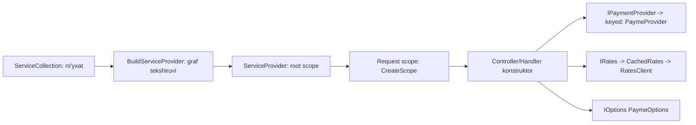

# 05. OOP, SOLID va dizayn patternlar

> **Bir jumlada:** SOLID va patternlar kodni o'zgarishga arzon qilish vositasi; Middle dasturchi pattern nomini emas, u qaysi o'zgarishni arzonlashtirishini va qachon ortiqcha ekanini biladi.
> **Nega Middle uchun:** Junior "Repository kerak, chunki Clean Architecture'da shunday" deydi. Middle "EF Core `DbContext` o'zi Unit of Work, `DbSet` o'zi repository, ustiga generic repository qo'yish abstraksiyani oqizadi, lekin domain-maxsus repository aggregate uchun mantiqli" deb asoslaydi. Suhbatda "EF ustiga Repository yozasizmi?" savoli deyarli har doim beriladi.
> **O'qish vaqti:** ~50 daqiqa

## Mundarija

- [1. Muammo va yechim](#1-muammo-va-yechim)
- [2. Qanday ishlaydi](#2-qanday-ishlaydi)
- [3. Asosiy tushunchalar](#3-asosiy-tushunchalar)
  - [3.1 SRP: Single Responsibility](#31-srp-single-responsibility)
  - [3.2 OCP: Open/Closed](#32-ocp-openclosed)
  - [3.3 LSP: Liskov Substitution](#33-lsp-liskov-substitution)
  - [3.4 ISP: Interface Segregation](#34-isp-interface-segregation)
  - [3.5 DIP: Dependency Inversion](#35-dip-dependency-inversion)
  - [3.6 Repository, Unit of Work va EF Core](#36-repository-unit-of-work-va-ef-core)
  - [3.7 Strategy va keyed services](#37-strategy-va-keyed-services)
  - [3.8 Decorator va DI](#38-decorator-va-di)
  - [3.9 Factory](#39-factory)
  - [3.10 Mediator va handler'lar](#310-mediator-va-handlerlar)
  - [3.11 Specification](#311-specification)
  - [3.12 Options pattern](#312-options-pattern)
  - [3.13 Composition over inheritance](#313-composition-over-inheritance)
  - [3.14 Anemic vs rich domain model](#314-anemic-vs-rich-domain-model)
- [4. Amaliy misol](#4-amaliy-misol)
- [5. Tipik xatolar va anti-patternlar](#5-tipik-xatolar-va-anti-patternlar)
- [6. Best practices checklist](#6-best-practices-checklist)
- [7. Suhbat savollari va javoblar](#7-suhbat-savollari-va-javoblar)
- [8. Qo'shimcha manbalar](#8-qoshimcha-manbalar)

## 1. Muammo va yechim

Real holat: `OrderService.cs` 2 400 qator. Ichida: validatsiya, narx hisoblash, chegirma, ombor rezervi, Payme/Click/naqd to'lov (`switch (paymentType)`), SMS, email, PDF chek, audit log. Yangi to'lov provayderi (Uzum) qo'shish 11 joyda `switch` ga `case` qo'shish degani; bitta unit test yozish uchun 14 ta mock kerak; ikki dasturchi bir vaqtda o'zgartirsa har safar merge konflikt.

Bu "God service": barcha o'zgarish sabablari bitta sinfda. SOLID aynan shu holatga qarshi: har sinf bitta sabab bilan o'zgaradi (SRP), yangi provayder yangi sinf bilan qo'shiladi, mavjud kod tegilmaydi (OCP), provayderlar bir-birini almashtira oladi (LSP), mijoz faqat kerakli interface'ni ko'radi (ISP), biznes logika konkret SMS/DB sinflariga emas, abstraksiyaga bog'lanadi (DIP).

Ikkinchi tomoni: o'sha jamoa keyin "hammasini pattern bilan" qilib, 5 ta CRUD jadval uchun `IGenericRepository<T>`, `IUnitOfWork`, `IOrderServiceFactory`, `OrderCreatedEventHandlerDecorator` yozdi. 20 fayl o'qimasdan bitta `INSERT` ni topib bo'lmaydi. Pattern ham o'z narxiga ega: har abstraksiya o'qish va o'zgartirish xarajati. Middle ikkala chegarani biladi.

## 2. Qanday ishlaydi

Barcha patternlarning .NET dagi "mexanizmi" bitta narsaga tayanadi: **DI konteyner** (`Microsoft.Extensions.DependencyInjection`) interface'ni konkret tipga, lifetime (umr) bilan bog'laydi va konstruktorga uzatadi. Patternlar shu bog'lashni turli shaklda tashkil qilish usullari.



Lifetime'lar: `Singleton` (bitta instansiya, host umri), `Scoped` (HTTP so'rov yoki qo'lda `CreateScope` davomida bitta), `Transient` (har so'rovda yangi). Qoida: uzoq umrli qisqa umrlini ushlab turmaydi (captive dependency); dev'da `ValidateScopes=true` buni ushlaydi.

Konteyner konstruktor parametrlarini reflection bilan o'qiydi, har tip uchun factory delegate yaratib keshlaydi (birinchi resolve sekin, keyingilar tez). `ActivatorUtilities.CreateInstance` konteyner bilmaydigan tipni ham qurishi mumkin. Keyed services (.NET 8+) bitta interface uchun bir nechta amalga oshirishni kalit bilan ajratadi.

Patternlar DI nuqtai nazaridan:

| Pattern | DI'da ko'rinishi |
|---|---|
| Strategy | Bitta interface, bir nechta ro'yxat (keyed yoki `IEnumerable<T>`) |
| Decorator | Interface'ga o'ralgan amalga oshirish: `IRates -> CachedRates(inner: RatesClient)` |
| Factory | `Func<T>`, `IServiceProvider` ichidagi factory sinf, keyed resolve |
| Mediator | `IRequestHandler<TRequest,TResponse>` lar ro'yxatga olinadi, dispatcher tip bo'yicha topadi |
| Options | `IOptions<T>`/`IOptionsSnapshot<T>`/`IOptionsMonitor<T>` konfiguratsiyadan bog'lanadi |
| Repository | `IOrderRepository -> EfOrderRepository(AppDbContext)` scoped |

## 3. Asosiy tushunchalar

### 3.1 SRP: Single Responsibility

- **Ta'rif:** Sinf bitta o'zgarish sababiga ega bo'lsin. "Bitta ish" emas, "bitta aktyor/sabab": to'lov qoidasi o'zgarsa boshqa, SMS matni o'zgarsa boshqa sinf.
- **Nega kerak:** Kichik sinf test qilinadi, parallel o'zgartiriladi, nomi nima qilishini aytadi.

```csharp
// ❌ Buzilgan: uch xil sabab bilan o'zgaradi
public sealed class OrderService(AppDbContext db, SmtpClient smtp)
{
    public async Task PlaceAsync(PlaceOrderRequest req, CancellationToken ct)
    {
        if (req.Lines.Count == 0) throw new ValidationException("Bo'sh");          // validatsiya qoidasi
        var total = req.Lines.Sum(l => l.Price * l.Qty) * (req.IsVip ? 0.9m : 1m); // narx siyosati
        db.Orders.Add(new Order { Total = total });                                   // persistence
        await db.SaveChangesAsync(ct);
        await smtp.SendMailAsync(new MailMessage("shop@x.uz", req.Email, "Buyurtma", $"Jami {total}"), ct); // bildirishnoma
    }
}

// ✅ Tuzatilgan: har sabab o'z joyida; PlaceOrderHandler faqat ketma-ketlikni boshqaradi
public sealed class PlaceOrderHandler(
    IValidator<PlaceOrderRequest> validator, PricingPolicy pricing, IOrderRepository orders, IOrderNotifier notifier)
{
    public async Task<long> HandleAsync(PlaceOrderRequest req, CancellationToken ct)
    {
        await validator.ValidateAndThrowAsync(req, ct);
        var order = Order.Create(req.CustomerId, req.Lines, pricing);   // domain + siyosat
        await orders.AddAsync(order, ct);
        await orders.SaveChangesAsync(ct);
        await notifier.OrderPlacedAsync(order, ct);
        return order.Id;
    }
}
```

- **Tipik xato:** SRP ni "har metod alohida sinf" deb tushunib, 200 ta 10 qatorli sinf yaratish. O'lchov: "bu sinf qaysi talab o'zgarganda o'zgaradi?" javobi bitta bo'lsin.

### 3.2 OCP: Open/Closed

- **Ta'rif:** Kengaytirishga ochiq, o'zgartirishga yopiq: yangi xatti-harakat yangi kod qo'shish bilan keladi, mavjud test qilingan kod tegilmaydi.
- **Nega kerak:** `switch` ga `case` qo'shish mavjud kodni qayta test qilishni talab qiladi va merge konfliktlar manbai.

```csharp
// ❌ Har yangi provayder shu switch'ni (va yana 10 ta shunga o'xshashini) o'zgartiradi
public Task PayAsync(Order o, string provider, CancellationToken ct) => provider switch
{
    "payme" => _payme.CreateInvoiceAsync(o.Id, o.Total, ct),
    "click" => _click.PrepareAsync(o.Id, (long)(o.Total * 100), ct),
    _ => throw new NotSupportedException(provider),
};

// ✅ Yangi provayder = yangi sinf + bitta ro'yxat qatori (3.7 Strategy)
public interface IPaymentProvider
{
    string Code { get; }
    Task<PaymentIntent> CreateAsync(Order order, CancellationToken ct);
}
public sealed class UzumProvider(HttpClient http) : IPaymentProvider { public string Code => "uzum"; /* ... */ }
```

- **Tipik xato:** OCP ni "hech qachon mavjud kodni o'zgartirmaslik" deb tushunish; u faqat *kutilayotgan* o'zgarish o'qi (yangi provayder, yangi chegirma turi) uchun. Kutilmagan o'zgarish uchun oldindan abstraksiya qurish YAGNI.

### 3.3 LSP: Liskov Substitution

- **Ta'rif:** Subtip bazaviy tip o'rnida ishlatilganda dastur xatti-harakati buzilmasin: pre-condition'lar kuchaymasin, post-condition'lar zaiflashmasin, kutilmagan exception bo'lmasin.
- **Nega kerak:** Interface orqali ishlaydigan kod (DI, polimorfizm) har bir amalga oshirishga ishonishi kerak.

```csharp
// ❌ Buzilgan: IRepository "o'chirish mumkin" deb va'da beradi, ReadOnly esa tashlaydi
public sealed class ReadOnlyOrderRepository : IOrderRepository
{
    public Task DeleteAsync(Order o, CancellationToken ct) => throw new NotSupportedException();  // chaqiruvchi buni kutmaydi
}
// BCL'dagi klassik misol: ReadOnlyCollection<T> ICollection<T>.Add da NotSupportedException tashlaydi, IsReadOnly bilan "ogohlantiradi".

// ❌ Square : Rectangle: Width setter Height ni ham o'zgartiradi, Rectangle bilan ishlaydigan kod buziladi
// ✅ Tuzatilgan: va'dani interface darajasida ajratish (3.4 ISP bilan birga)
public interface IOrderReader { Task<Order?> FindAsync(long id, CancellationToken ct); }
public interface IOrderWriter : IOrderReader { Task AddAsync(Order o, CancellationToken ct); Task DeleteAsync(Order o, CancellationToken ct); }
```

- **Tipik xato:** "Meros = kod qayta ishlatish" deb, is-a munosabati yo'q joyda meros olish (`CustomerRepository : OrderRepository` chunki "ko'p metodlar o'xshash").

### 3.4 ISP: Interface Segregation

- **Ta'rif:** Mijoz ishlatmaydigan metodlarga bog'lanmasin: katta interface o'rniga bir nechta kichik, rolga qarab.
- **Nega kerak:** 15 metodli interface'ni test uchun mock qilish og'ir; LSP buzilishiga (ba'zi metodlar `NotSupported`) olib keladi; o'zgarish barcha amalga oshiruvchilarga tarqaladi.

```csharp
// ❌
public interface IOrderRepository
{
    Task<Order?> FindAsync(long id, CancellationToken ct);
    Task<List<Order>> ListByCustomerAsync(long customerId, CancellationToken ct);
    Task AddAsync(Order o, CancellationToken ct);
    Task DeleteAsync(Order o, CancellationToken ct);
    Task<byte[]> ExportToExcelAsync(long customerId, CancellationToken ct);     // bu repository ishi emas
    Task SendReminderAsync(long id, CancellationToken ct);                     // bu ham
    IQueryable<Order> Query();                                                 // abstraksiya oqadi
}

// ✅ Rolga qarab: handler faqat kerakli interface'ni oladi
public interface IOrderReader { Task<Order?> FindAsync(long id, CancellationToken ct); }
public interface IOrderWriter { Task AddAsync(Order o, CancellationToken ct); }
public sealed class ShipOrderHandler(IOrderReader reader, IOrderWriter writer, IStockReserver stock) { /* ... */ }
```

- **Tipik xato:** Har sinf uchun bitta "I + sinf nomi" interface (`IOrderService` faqat `OrderService` uchun): bu ISP emas, test uchun mock qulayligi; ba'zan kerak, lekin "rol" emas, "ko'zgu".

### 3.5 DIP: Dependency Inversion

- **Ta'rif:** Yuqori darajali modul (biznes logika) past darajali modulga (SMTP, EF, HTTP) emas, abstraksiyaga bog'lanadi; abstraksiya yuqori darajali modulga tegishli (interface `Application` qatlamida, amalga oshirish `Infrastructure` da).
- **Nega kerak:** Biznes logika infra'siz test qilinadi; infra almashtiriladi (Eskiz → Play Mobile) biznes kodga tegmasdan.

```csharp
// ❌ Application Infrastructure'ga bog'liq: new SmtpClient, konkret EF context
public sealed class OrderNotifier
{
    public async Task NotifyAsync(Order o) { using var smtp = new SmtpClient("mail.x.uz"); /* ... */ }
}

// ✅ Interface Application'da, amalga oshirish Infrastructure'da, DI bog'laydi
// Application/Notifications/IOrderNotifier.cs
public interface IOrderNotifier { Task OrderPlacedAsync(Order order, CancellationToken ct); }
// Infrastructure/Notifications/EskizSmsNotifier.cs
public sealed class EskizSmsNotifier(IEskizClient eskiz, IOptions<SmsOptions> opt) : IOrderNotifier { /* ... */ }
// Api/Program.cs
builder.Services.AddScoped<IOrderNotifier, EskizSmsNotifier>();
```

DIP ≠ "har sinfga interface". `PricingPolicy` kabi sof domain sinfi (I/O yo'q, deterministik) uchun interface kerak emas: uni to'g'ridan-to'g'ri test qilish mumkin. Interface I/O chegarasida (DB, HTTP, vaqt `TimeProvider`, fayl, random) kerak.

- **Tipik xato:** Interface'ni `Infrastructure` da e'lon qilib, `Application` ni `Infrastructure` ga ishora qildirish: bog'liqlik yo'nalishi teskari, "inversion" yo'q.

### 3.6 Repository, Unit of Work va EF Core

- **Ta'rif:** Repository: aggregate'larni kolleksiyadek olish/saqlash abstraksiyasi. Unit of Work: bir nechta o'zgarishni bitta tranzaksiyada commit qilish. EF Core'da `DbContext` = UoW (change tracker + `SaveChangesAsync` = bitta tranzaksiya), `DbSet<T>` = repository (`Add`, `Find`, LINQ).
- **Nega savol:** EF ustiga yana Repository qo'yish ikki marta abstraksiya; lekin domain qatlamini EF'dan ajratish ham qiymatga ega. Javob kontekstga bog'liq.

Qachon repository **kerak emas**:
- CRUD va o'qish (CQRS query tomoni): handler `AppDbContext` ni to'g'ridan-to'g'ri oladi, `Select` proyeksiya, `AsNoTracking`. Repository `IQueryable` qaytarsa abstraksiya oqadi; qaytarmasa har so'rov uchun metod yozasiz (`GetPaidOrdersWithCustomerSortedByDate...`).
- Test uchun: EF Core'ni in-memory provider bilan emas, Testcontainers (haqiqiy PostgreSQL) bilan test qilish ishonchliroq; repository'ni mock qilish SQL tarjimasi xatolarini yashiradi.

Qachon **kerak**:
- Rich domain, aggregate root (3.14): `IOrderRepository.GetAsync(id)` aggregate'ni to'liq (`Include` lari bilan) yuklaydi, `Add` qiladi; domain `Application` da EF tiplarini ko'rmaydi.
- Murakkab, qayta ishlatiladigan yuklash qoidalari bitta joyda (`Include`, filter, tenant).
- Bir nechta saqlash manbasi (EF + legacy stored procedure).

```csharp
// Domain-maxsus repository: IQueryable yo'q, aggregate darajasida
public interface IOrderRepository
{
    Task<Order?> GetAsync(OrderId id, CancellationToken ct);          // Lines bilan to'liq
    Task AddAsync(Order order, CancellationToken ct);
    Task SaveChangesAsync(CancellationToken ct);                        // UoW: DbContext.SaveChangesAsync
}

public sealed class EfOrderRepository(AppDbContext db) : IOrderRepository
{
    public Task<Order?> GetAsync(OrderId id, CancellationToken ct) =>
        db.Orders.Include(o => o.Lines).FirstOrDefaultAsync(o => o.Id == id, ct);
    public async Task AddAsync(Order order, CancellationToken ct) => await db.Orders.AddAsync(order, ct);
    public Task SaveChangesAsync(CancellationToken ct) => db.SaveChangesAsync(ct);
}

// Query tomoni: repository yo'q, DbContext to'g'ridan-to'g'ri, DTO proyeksiya
public sealed class GetOrderListHandler(AppDbContext db)
{
    public Task<List<OrderListItem>> HandleAsync(Guid tenantId, CancellationToken ct) =>
        db.Orders.AsNoTracking().Where(o => o.TenantId == tenantId)
          .Select(o => new OrderListItem(o.Id, o.Total, o.Customer.Name)).ToListAsync(ct);
}
```

Alohida `IUnitOfWork` interface: bir nechta repository bitta `DbContext` ni (scoped) bo'lishganda `SaveChanges` ni kim chaqiradi degan savolga javob. Oddiy yechim: `SaveChangesAsync` repository'da emas, `IUnitOfWork` (DbContext'ni o'rovchi yupqa interface) da, handler oxirida bir marta chaqiriladi. Tranzaksiya kerak bo'lsa `db.Database.BeginTransactionAsync` yoki `TransactionScope` (async flow bilan).

- **Tipik xato:** `IGenericRepository<T>` + `IQueryable<T> GetAll()`: EF'ning barcha imkoniyati oqadi, test'da mock bo'lmaydi, lekin "abstraksiya bor" illuziyasi. Yoki `SaveChangesAsync` ni har repository metodida chaqirish: UoW yo'qoladi, yarim saqlangan holat.

### 3.7 Strategy va keyed services

- **Ta'rif:** Bir xil interface'ning bir nechta amalga oshirishi, runtime'da tanlanadi. .NET 8+ keyed services: `AddKeyedScoped<IPaymentProvider, PaymeProvider>("payme")`, `[FromKeyedServices("payme")]`, `GetRequiredKeyedService<T>(key)`.
- **Nega kerak:** OCP (3.2): yangi provayder = yangi sinf.

```csharp
builder.Services.AddKeyedScoped<IPaymentProvider, PaymeProvider>("payme");
builder.Services.AddKeyedScoped<IPaymentProvider, ClickProvider>("click");
builder.Services.AddKeyedScoped<IPaymentProvider, UzumProvider>("uzum");

// Kalit runtime'da (foydalanuvchi tanlovi): IServiceProvider orqali
public sealed class CheckoutHandler(IServiceProvider sp, IOrderRepository orders)
{
    public async Task<PaymentIntent> HandleAsync(long orderId, string provider, CancellationToken ct)
    {
        var order = await orders.GetAsync(new OrderId(orderId), ct) ?? throw new NotFoundException();
        var strategy = sp.GetKeyedService<IPaymentProvider>(provider)       // null -> noma'lum provayder
            ?? throw new ValidationException($"Noma'lum to'lov usuli: {provider}");
        return await strategy.CreateAsync(order, ct);
    }
}

// Kalit compile-time'da ma'lum: atribut bilan
public sealed class PaymeWebhookHandler([FromKeyedServices("payme")] IPaymentProvider payme) { }
```

`IServiceProvider` ni handler'ga inject qilish Service Locator hidi (5-bo'lim); runtime kalit bo'yicha strategy tanlashda qabul qilingan istisno, tozaroq varianti 4-bo'limdagi `PaymentProviderResolver` kabi yupqa factory. Ro'yxat kichik bo'lsa keyed'siz alternativa: `IEnumerable<IPaymentProvider>` inject qilib `Code` bo'yicha qidirish.

- **Tipik xato:** Strategy'lar orasida umumiy kod uchun `abstract class BasePaymentProvider` da 15 ta virtual metod (3.13).

### 3.8 Decorator va DI

- **Ta'rif:** Interface'ni o'sha interface'ni amalga oshiruvchi sinf bilan o'rash: caching, logging, retry, metrics qo'shiladi, asl sinf o'zgarmaydi.
- **Nega kerak:** Cross-cutting (kesib o'tuvchi) narsalar biznes sinfiga kirmaydi (SRP + OCP).

```csharp
public interface IRates { Task<decimal> GetAsync(string ccy, CancellationToken ct); }

public sealed class CbuRatesClient(HttpClient http) : IRates { /* cbu.uz API */ }

public sealed class CachedRates(IRates inner, HybridCache cache) : IRates
{
    public async Task<decimal> GetAsync(string ccy, CancellationToken ct) =>
        await cache.GetOrCreateAsync(
            $"rate:{ccy}",
            async token => await inner.GetAsync(ccy, token),
            new HybridCacheEntryOptions { Expiration = TimeSpan.FromMinutes(30) },
            cancellationToken: ct);
}

public sealed class LoggedRates(IRates inner, ILogger<LoggedRates> log) : IRates
{
    public async Task<decimal> GetAsync(string ccy, CancellationToken ct)
    {
        var sw = Stopwatch.StartNew();
        try { return await inner.GetAsync(ccy, ct); }
        finally { log.LogDebug("Rate {Ccy} {Ms} ms", ccy, sw.ElapsedMilliseconds); }
    }
}

// Ro'yxatdan o'tkazish, qo'lda (Microsoft DI'da Decorate yo'q): tashqaridan ichkariga
builder.Services.AddHttpClient<CbuRatesClient>(c => c.BaseAddress = new Uri("https://cbu.uz/"));
builder.Services.AddScoped<IRates>(sp =>
    new LoggedRates(
        new CachedRates(sp.GetRequiredService<CbuRatesClient>(), sp.GetRequiredService<HybridCache>()),
        sp.GetRequiredService<ILogger<LoggedRates>>()));

// Scrutor bilan: tartib muhim, oxirgi Decorate eng tashqi
builder.Services.AddScoped<IRates, CbuRatesClient>();
builder.Services.Decorate<IRates, CachedRates>();
builder.Services.Decorate<IRates, LoggedRates>();
```

Interceptor'lar (Castle DynamicProxy) o'rniga decorator ochiq va AOT-mos. Retry/timeout uchun `Microsoft.Extensions.Http.Resilience` (Polly) `AddStandardResilienceHandler` HttpClient darajasida decorator vazifasini bajaradi.

- **Tipik xato:** Decorator'ni `AddScoped<IRates, CachedRates>()` deb to'g'ridan-to'g'ri ro'yxatga olish: `inner` parametri uchun `IRates` o'zini resolve qilib, cheksiz rekursiya yoki `CachedRates(CachedRates(...))`.

### 3.9 Factory

- **Ta'rif:** Obyekt yaratish mantiqini (qaysi tip, qanday parametr) chaqiruvchidan ajratish. DI'da: `Func<T>` (transient'ni kech yaratish), factory sinf, `IDbContextFactory<T>`, `IHttpClientFactory`, `ActivatorUtilities`.
- **Nega kerak:** Runtime ma'lumot asosida yaratish (tenant konfiguratsiyasi), qimmat obyektni faqat kerak bo'lganda yaratish, singleton ichida scoped yaratish.

```csharp
// Tenant'ga qarab DbContext: connection string runtime'da
public sealed class TenantDbContextFactory(ITenantProvider tenant, IOptions<TenantsOptions> tenants) : IDbContextFactory<AppDbContext>
{
    public AppDbContext CreateDbContext()
    {
        var cs = tenants.Value.ConnectionStrings[tenant.CurrentId];
        var options = new DbContextOptionsBuilder<AppDbContext>().UseNpgsql(cs).Options;
        return new AppDbContext(options);
    }
}
```

Boshqa tayyor factory'lar: `IServiceScopeFactory` (singleton ichida scoped xizmat uchun scope yaratish), `IHttpClientFactory`, `ActivatorUtilities.CreateInstance<T>(sp, extraArg)` (konteyner bilmaydigan parametr bilan yaratish).

- **Tipik xato:** Har sinf uchun `IXFactory` + `XFactory` yozish; DI konteyner o'zi factory, oddiy holatda konstruktor inyeksiyasi yetarli.

### 3.10 Mediator va handler'lar

- **Ta'rif:** Mediator: so'rov (`Command`/`Query`) obyektini mos handler'ga yo'naltiruvchi dispatcher; controller handler'ni bilmaydi. MediatR eng mashhur kutubxona, lekin 2025 dan tijoriy litsenziyaga o'tdi (katta kompaniyalar uchun pullik; kichik jamoalar/ochiq manba uchun bepul darajasi bor).
- **Nega kerak va nega yo'q:** Foyda: pipeline behavior'lar (validation, logging, tranzaksiya) bir joyda, controller yupqa. Narx: bilvosita chaqiruv ("F12 ishlamaydi"), reflection/registratsiya, litsenziya. Alternativalar: handler'ni to'g'ridan-to'g'ri inject qilish (eng oddiy), o'z yupqa dispatcher'ingiz, source-generator asosidagi `Mediator` (martinothamar), Wolverine.

```csharp
// Kutubxonasiz: handler to'g'ridan-to'g'ri, pipeline behavior'lar decorator sifatida
public interface ICommandHandler<in TCommand, TResult> { Task<TResult> HandleAsync(TCommand command, CancellationToken ct); }

public sealed record PlaceOrderCommand(long CustomerId, IReadOnlyList<LineDto> Lines);
public sealed class PlaceOrderHandler(...) : ICommandHandler<PlaceOrderCommand, long> { /* 3.1 dagi */ }

// Cross-cutting: validation decorator, generic, barcha handler'larga
public sealed class ValidatingHandler<TCommand, TResult>(
    ICommandHandler<TCommand, TResult> inner, IValidator<TCommand> validator) : ICommandHandler<TCommand, TResult>
{
    public async Task<TResult> HandleAsync(TCommand command, CancellationToken ct)
    {
        await validator.ValidateAndThrowAsync(command, ct);
        return await inner.HandleAsync(command, ct);
    }
}

// Ro'yxat (Scrutor bilan qisqa; qo'lda ham mumkin)
builder.Services.Scan(s => s.FromAssemblyOf<PlaceOrderHandler>()
    .AddClasses(c => c.AssignableTo(typeof(ICommandHandler<,>))).AsImplementedInterfaces().WithScopedLifetime());
builder.Services.Decorate(typeof(ICommandHandler<,>), typeof(ValidatingHandler<,>));

// Endpoint: handler'ni to'g'ridan-to'g'ri oladi, mediator yo'q
app.MapPost("/orders", async (PlaceOrderCommand cmd, ICommandHandler<PlaceOrderCommand, long> h, CancellationToken ct) =>
    Results.Created($"/orders/{await h.HandleAsync(cmd, ct)}", null));
```

Agar MediatR ishlatilsa: litsenziya shartlarini tekshiring, `IPipelineBehavior<,>` bilan validation/logging/transaction, `INotification` uchun domain event tarqatish (lekin in-process, kafolatsiz).

- **Tipik xato:** Mediator orqali handler'dan handler chaqirish (`_mediator.Send` ichida `_mediator.Send`): bilvosita zanjir, tranzaksiya chegarasi noaniq. Handler boshqa handler'ni emas, domain xizmatini chaqirsin.

### 3.11 Specification

- **Ta'rif:** Qayta ishlatiladigan so'rov sharti obyekt sifatida: `Expression<Func<T,bool>>` ni nomlab, birlashtirib (`And`/`Or`) va EF Core'ga uzatib bo'ladi.
- **Nega kerak:** "Faol, to'langan, shu tenant'ga tegishli buyurtmalar" sharti 7 joyda takrorlanmasin; domain qoidasi (nima "kechikkan buyurtma") bitta joyda va test qilinadi.

```csharp
public abstract class Specification<T>
{
    public abstract Expression<Func<T, bool>> ToExpression();
    public bool IsSatisfiedBy(T entity) => ToExpression().Compile()(entity);   // xotirada (domain test uchun; hot path'da keshlang)

    public Specification<T> And(Specification<T> other) => new AndSpecification<T>(this, other);
}

public sealed class OverdueOrders(TimeProvider clock) : Specification<Order>
{
    public override Expression<Func<Order, bool>> ToExpression()
    {
        var limit = clock.GetUtcNow().AddDays(-3);                       // closure -> SQL parametri
        return o => o.Status == OrderStatus.Paid && o.ShippedAt == null && o.PaidAt < limit;
    }
}

public sealed class ForTenant(Guid tenantId) : Specification<Order>
{
    public override Expression<Func<Order, bool>> ToExpression() => o => o.TenantId == tenantId;
}

// Ikki expression'ni birlashtirish: parametrlarni bitta qilish kerak (ExpressionVisitor)
internal sealed class AndSpecification<T>(Specification<T> left, Specification<T> right) : Specification<T>
{
    public override Expression<Func<T, bool>> ToExpression()
    {
        var l = left.ToExpression(); var r = right.ToExpression();
        var p = Expression.Parameter(typeof(T), "x");
        var body = Expression.AndAlso(new ReplaceParameter(l.Parameters[0], p).Visit(l.Body),
                                      new ReplaceParameter(r.Parameters[0], p).Visit(r.Body));
        return Expression.Lambda<Func<T, bool>>(body, p);
    }
    private sealed class ReplaceParameter(ParameterExpression from, ParameterExpression to) : ExpressionVisitor
    {
        protected override Expression VisitParameter(ParameterExpression node) => node == from ? to : base.VisitParameter(node);
    }
}

// Foydalanish: SQL WHERE ga tarjima qilinadi
var spec = new OverdueOrders(clock).And(new ForTenant(tenantId));
var overdue = await db.Orders.Where(spec.ToExpression()).ToListAsync(ct);
```

`Ardalis.Specification` kutubxonasi `Include`, `OrderBy`, paging'ni ham spec ichiga oladi. Oddiy holatda `OrderFilters.Overdue(clock)` kabi `Expression` qaytaruvchi statik metodlar (1-bob) yetarli; Specification sinfi `IsSatisfiedBy` (domain'da xotirada tekshirish) ham kerak bo'lganda.

- **Tipik xato:** Specification ichida tarjima qilinmaydigan C# metod (`IsOverdue()` instance metodi): EF `could not be translated`.

### 3.12 Options pattern

- **Ta'rif:** Konfiguratsiyani (`appsettings.json`, env, Key Vault) kuchli tipli sinfga bog'lash: `IOptions<T>` (singleton, bir marta), `IOptionsSnapshot<T>` (scoped, har so'rovda qayta o'qiladi), `IOptionsMonitor<T>` (singleton, o'zgarishni kuzatadi, `OnChange`).
- **Nega kerak:** `IConfiguration["Payme:MerchantId"]` string kalit, xato runtime'da; Options tipli, validatsiya startup'da.

```csharp
public sealed class PaymeOptions
{
    public const string Section = "Payme";
    [Required, Url] public string BaseUrl { get; init; } = "";
    [Required, MinLength(8)] public string MerchantId { get; init; } = "";
    [Required] public string SecretKey { get; init; } = "";
    [Range(1, 120)] public int TimeoutSeconds { get; init; } = 15;
}

// Program.cs: bog'lash + validatsiya + startup'da tekshirish (noto'g'ri config bilan pod ko'tarilmaydi)
builder.Services.AddOptions<PaymeOptions>()
    .BindConfiguration(PaymeOptions.Section)
    .ValidateDataAnnotations()
    .Validate(o => o.SecretKey.Length >= 16, "Payme:SecretKey kamida 16 belgi")
    .ValidateOnStart();

// Foydalanish: singleton'da IOptions yoki IOptionsMonitor; scoped'da IOptionsSnapshot (reload kerak bo'lsa)
public sealed class PaymeProvider(HttpClient http, IOptions<PaymeOptions> opt) : IPaymentProvider
{
    private readonly PaymeOptions _o = opt.Value;
}
```

`[OptionsValidator]` source generator (`Microsoft.Extensions.Options.DataAnnotations`) reflection'siz validator generatsiya qiladi (AOT). Maxfiy qiymatlar `appsettings.json` da emas: User Secrets (dev), env/Key Vault (prod).

- **Tipik xato:** Singleton'ga `IOptionsSnapshot<T>` inject qilish (scoped, captive dependency xatosi); yoki `IOptionsMonitor.CurrentValue` ni konstruktorda bir marta o'qib, o'zgarishni yo'qotish.

### 3.13 Composition over inheritance

- **Ta'rif:** Xatti-harakatni meros zanjiri (`BaseService → OrderService → VipOrderService`) emas, kichik komponentlarni birlashtirish (`OrderService(IPricing, IStockReserver, INotifier)`) orqali qurish.
- **Nega kerak:** Meros "is-a" va eng kuchli bog'lanish: bazaviy sinf o'zgarsa barcha vorislar; vorislar bazaviy sinfning ichki holatiga tayanadi (fragile base class); C# da bitta meros, ikki o'qda variatsiya (to'lov x yetkazib berish) kombinatorik portlash beradi.

```csharp
// ❌ Meros: 2 to'lov x 3 yetkazib berish = 6 subklass, har biri bazaviy "sehr"ga bog'liq
public abstract class BaseOrderProcessor   // template method: Reserve/Pay/Ship virtual
{
    public async Task ProcessAsync(Order o) { await ReserveAsync(o); await PayAsync(o); await ShipAsync(o); }
    protected abstract Task PayAsync(Order o); protected abstract Task ShipAsync(Order o); protected virtual Task ReserveAsync(Order o) => Task.CompletedTask;
}
public sealed class PaymeCourierProcessor : BaseOrderProcessor { /* PayAsync -> Payme, ShipAsync -> kuryer */ }

// ✅ Kompozitsiya: har o'q alohida strategy, kombinatsiya DI/runtime'da
public sealed class OrderProcessor(IStockReserver stock, IPaymentProvider payment, IDeliveryMethod delivery)
{
    public async Task ProcessAsync(Order o, CancellationToken ct)
    {
        await stock.ReserveAsync(o, ct);
        await payment.CreateAsync(o, ct);
        await delivery.ScheduleAsync(o, ct);
    }
}
```

Meros qachon to'g'ri: haqiqiy is-a va bazaviy sinf barqaror abstraksiya (`Exception`, `Stream`, `DbContext`, `BackgroundService`). Umumiy kod uchun: extension metodlar, statik yordamchi, yoki alohida komponent. C# 14 extension members (1-bob) kompozitsiyani yanada qulaylashtiradi. `sealed` default: meros ochiq qaror bilan.

- **Tipik xato:** `BaseController`, `BaseService`, `BaseRepository` ga "umumiy" narsalarni yig'ish: 2 yildan keyin 800 qatorli bazaviy sinf, hech kim nima ishlatilayotganini bilmaydi.

### 3.14 Anemic vs rich domain model

- **Ta'rif:** Anemic: entity faqat public getter/setter'lar, barcha qoidalar service'da. Rich: entity o'z invariantlarini (buzilmasligi kerak bo'lgan qoidalar) o'zi himoya qiladi, holat o'zgarishi faqat metodlar orqali.
- **Nega kerak:** Anemic modelda "to'langan buyurtmani o'zgartirish mumkin emas" qoidasi 5 ta service'da takrorlanadi yoki unutiladi; rich modelda `Order` ni noto'g'ri holatga keltirib bo'lmaydi.

```csharp
// ❌ Anemic: har kim har narsani qila oladi
public class Order { public OrderStatus Status { get; set; } public List<OrderLine> Lines { get; set; } = new(); public decimal Total { get; set; } }
// OrderService: if (order.Status != Paid) throw ...; order.Status = Shipped;  (va yana 4 joyda shunga o'xshash)

// ✅ Rich: invariantlar ichkarida, EF Core private setter va backing field bilan ishlaydi
public sealed class Order
{
    private readonly List<OrderLine> _lines = new();
    public OrderId Id { get; private set; }
    public OrderStatus Status { get; private set; }
    public Money Total { get; private set; }
    public DateTimeOffset? PaidAt { get; private set; }
    public IReadOnlyList<OrderLine> Lines => _lines;                 // tashqaridan Add yo'q

    private Order() { }                                               // EF Core uchun

    public static Order Create(CustomerId customer, IEnumerable<(Sku sku, int qty, Money price)> lines, PricingPolicy pricing)
    {
        var order = new Order { Id = OrderId.New(), Status = OrderStatus.New };
        foreach (var (sku, qty, price) in lines) order.AddLine(sku, qty, price);
        if (order._lines.Count == 0) throw new DomainException("Buyurtmada kamida bitta qator bo'lishi kerak");
        order.Total = pricing.Apply(order);
        return order;
    }

    public void AddLine(Sku sku, int qty, Money price)
    {
        if (Status != OrderStatus.New) throw new DomainException($"{Status} holatidagi buyurtmaga qator qo'shib bo'lmaydi");
        if (qty <= 0) throw new DomainException("Miqdor musbat bo'lishi kerak");
        _lines.Add(new OrderLine(sku, qty, price));
    }

    public void MarkPaid(string providerTxId, Money amount, DateTimeOffset at)
    {
        if (Status == OrderStatus.Paid) return;                       // idempotent
        if (Status != OrderStatus.New) throw new DomainException($"{Status} holatida to'lab bo'lmaydi");
        if (amount != Total) throw new DomainException($"Summa mos emas: {amount} != {Total}");
        Status = OrderStatus.Paid; PaidAt = at;
    }
}
```

EF Core konfiguratsiyasi: `builder.Navigation(o => o.Lines).HasField("_lines")` yoki `UsePropertyAccessMode(PropertyAccessMode.Field)`; private setter'lar materializatsiyada ishlaydi. Qachon anemic yetarli: oddiy CRUD (ma'lumotnoma jadvallari, sozlamalar), qoida deyarli yo'q. Rich model narxi: entity'ni to'liq yuklash kerak (aggregate), partial update qiyinroq.

- **Tipik xato:** Rich model qilib, keyin `order.Status = Shipped` ni ruxsat beradigan `internal set` qoldirish; yoki domain'ga `DbContext`/HTTP chaqiruv kiritish (domain faqat xotirada ishlaydi).

## 4. Amaliy misol

Vazifa: 1-bo'limdagi `OrderService` ni qayta tuzish. Checkout oqimi: buyurtma yaratish → to'lov provayderi tanlash → to'lov intent → mijozga bildirishnoma. Talablar: yangi provayder qo'shish bitta sinf, kurslar keshlanadi, konfiguratsiya validatsiyalanadi, domain invariantlar entity'da, handler kutubxonasiz.

```csharp
// Application/Checkout/StartCheckoutCommand.cs
public sealed record StartCheckoutCommand(long CustomerId, string Provider, string Currency, IReadOnlyList<LineDto> Lines);
public sealed record LineDto(string Sku, int Qty);
public sealed record CheckoutResult(long OrderId, string PaymentUrl);

// Application/Checkout/StartCheckoutHandler.cs
public sealed class StartCheckoutHandler(
    IProductCatalog catalog,              // narxlar (Infrastructure: EF)
    IRates rates,                         // decorator zanjiri: Logged -> Cached -> Cbu
    PricingPolicy pricing,                // sof domain xizmat, interface'siz
    IOrderRepository orders,              // aggregate repository
    IUnitOfWork uow,
    PaymentProviderResolver providers,    // Strategy tanlash (keyed services ustida yupqa factory)
    IOrderNotifier notifier)
    : ICommandHandler<StartCheckoutCommand, CheckoutResult>
{
    public async Task<CheckoutResult> HandleAsync(StartCheckoutCommand cmd, CancellationToken ct)
    {
        // 1. Narxlarni olish: UZS'da saqlanadi, mijoz valyutasiga kurs orqali
        var prices = await catalog.GetPricesAsync(cmd.Lines.Select(l => new Sku(l.Sku)), ct);
        var rate = cmd.Currency == "UZS" ? 1m : await rates.GetAsync(cmd.Currency, ct);

        // 2. Domain: Order.Create invariantlarni tekshiradi (bo'sh buyurtma, musbat miqdor)
        var order = Order.Create(
            new CustomerId(cmd.CustomerId),
            cmd.Lines.Select(l => (new Sku(l.Sku), l.Qty, prices[new Sku(l.Sku)].Convert(rate, cmd.Currency))),
            pricing);

        // 3. Saqlash: repository + UoW; tranzaksiya SaveChanges ichida
        await orders.AddAsync(order, ct);
        await uow.SaveChangesAsync(ct);

        // 4. Strategy: provayder kodi runtime'da; noma'lum bo'lsa ValidationException (400)
        var provider = providers.Get(cmd.Provider);
        var intent = await provider.CreateAsync(order, ct);

        // 5. Bildirishnoma: mustaqil, xatosi checkout'ni buzmaydi (handler emas, notifier o'zi retry/log qiladi)
        await notifier.OrderPlacedAsync(order, ct);
        return new CheckoutResult(order.Id.Value, intent.RedirectUrl);
    }
}

// Application/Payments/PaymentProviderResolver.cs
public sealed class PaymentProviderResolver(IServiceProvider sp)
{
    public IPaymentProvider Get(string code) =>
        sp.GetKeyedService<IPaymentProvider>(code.ToLowerInvariant())
        ?? throw new ValidationException($"To'lov usuli qo'llab-quvvatlanmaydi: {code}");
}

// Infrastructure/Payments/PaymeProvider.cs
public sealed class PaymeProvider(HttpClient http, IOptions<PaymeOptions> opt) : IPaymentProvider
{
    public string Code => "payme";
    public async Task<PaymentIntent> CreateAsync(Order order, CancellationToken ct)
    {
        var o = opt.Value;
        var amountTiyin = (long)(order.Total.Amount * 100);
        var resp = await http.PostAsJsonAsync("api/receipts/create",
            new { merchant = o.MerchantId, amount = amountTiyin, order_id = order.Id.Value }, ct);
        resp.EnsureSuccessStatusCode();
        var body = await resp.Content.ReadFromJsonAsync<PaymeReceipt>(ct) ?? throw new PaymentException("Bo'sh javob");
        return new PaymentIntent(body.ReceiptId, $"{o.BaseUrl}/checkout/{body.ReceiptId}");
    }
}

// Api/Program.cs: tarkib
builder.Services.AddOptions<PaymeOptions>().BindConfiguration(PaymeOptions.Section).ValidateDataAnnotations().ValidateOnStart();
builder.Services.AddHttpClient<PaymeProvider>((sp, c) =>
    c.BaseAddress = new Uri(sp.GetRequiredService<IOptions<PaymeOptions>>().Value.BaseUrl))
    .AddStandardResilienceHandler();                                  // retry/timeout/circuit breaker: decorator HttpClient darajasida
builder.Services.AddKeyedScoped<IPaymentProvider>("payme", (sp, _) => sp.GetRequiredService<PaymeProvider>());
builder.Services.AddKeyedScoped<IPaymentProvider, ClickProvider>("click");
builder.Services.AddScoped<PaymentProviderResolver>();

builder.Services.AddHttpClient<CbuRatesClient>(c => c.BaseAddress = new Uri("https://cbu.uz/"));
builder.Services.AddHybridCache();
builder.Services.AddScoped<IRates>(sp => new LoggedRates(
    new CachedRates(sp.GetRequiredService<CbuRatesClient>(), sp.GetRequiredService<HybridCache>()),
    sp.GetRequiredService<ILogger<LoggedRates>>()));

builder.Services.AddScoped<IOrderRepository, EfOrderRepository>();
builder.Services.AddScoped<IUnitOfWork>(sp => sp.GetRequiredService<AppDbContext>());   // DbContext IUnitOfWork ni amalga oshiradi
builder.Services.AddSingleton<PricingPolicy>();                                           // holatsiz, sof
builder.Services.AddScoped<IOrderNotifier, EskizSmsNotifier>();
builder.Services.AddScoped<ICommandHandler<StartCheckoutCommand, CheckoutResult>, StartCheckoutHandler>();
builder.Services.Decorate(typeof(ICommandHandler<,>), typeof(ValidatingHandler<,>));    // Scrutor

app.MapPost("/checkout", async (StartCheckoutCommand cmd, ICommandHandler<StartCheckoutCommand, CheckoutResult> h, CancellationToken ct)
    => Results.Ok(await h.HandleAsync(cmd, ct)));
```

Nega aynan shunday:

- Yangi provayder (Uzum): `UzumProvider` sinfi + bitta `AddKeyedScoped` qatori. `StartCheckoutHandler` va testlari o'zgarmaydi (OCP).
- `PricingPolicy` interface'siz: I/O yo'q, test to'g'ridan-to'g'ri; DIP I/O chegarasi uchun, hamma narsa uchun emas.
- `IOrderRepository` bor, chunki `Order` aggregate (Lines bilan yuklanadi, invariantlar ichkarida); o'qish so'rovlari (ro'yxatlar) esa `AppDbContext` dan to'g'ridan-to'g'ri proyeksiya qiladi.
- `IUnitOfWork` `DbContext` ning o'zi: alohida sinf emas, `AppDbContext : DbContext, IUnitOfWork` va interface'da faqat `SaveChangesAsync`.
- Decorator'lar qo'lda: zanjir ko'rinadi, "sehr" yo'q; 5+ decorator bo'lsa Scrutor.
- `ValidateOnStart`: noto'g'ri `Payme:SecretKey` bilan pod ko'tarilmaydi, birinchi to'lovda emas.
- Handler `ValidatingHandler` bilan o'raladi: validatsiya handler kodida yo'q, lekin har handler uchun avtomatik.

## 5. Tipik xatolar va anti-patternlar

**1. Generic repository `IQueryable` bilan**

```csharp
// ❌
public interface IRepository<T> { IQueryable<T> GetAll(); void Add(T e); Task SaveAsync(); }
```
Abstraksiya hech narsani yashirmaydi (EF imkoniyatlari oqadi), test'da mock qilib bo'lmaydi (IQueryable provider), `SaveAsync` har repository'da UoW ni buzadi.
```csharp
// ✅  O'qish: DbContext + proyeksiya; yozish: aggregate repository (3.6)
```

**2. Service Locator**

```csharp
// ❌
public sealed class OrderService(IServiceProvider sp)
{
    public Task Ship(long id) => sp.GetRequiredService<IStockReserver>().ReserveAsync(id);   // bog'liqlik yashirin
}
```
Konstruktor imzosi bog'liqliklarni ko'rsatmaydi, graf validatsiyasi ishlamaydi, test'da nima kerakligi noma'lum.
```csharp
// ✅
public sealed class OrderService(IStockReserver stock) { }
// Istisno: runtime kalit bo'yicha strategy tanlash (yupqa resolver sinfida, 3.7)
```

**3. Captive dependency**

```csharp
// ❌
builder.Services.AddSingleton<PriceCache>();        // PriceCache(AppDbContext db): scoped ichida singleton
```
Dev'da `ValidateScopes` xato beradi; prod'da (validatsiya o'chiq) bitta DbContext abadiy, thread-safe emas.
```csharp
// ✅
builder.Services.AddSingleton<PriceCache>();        // PriceCache(IDbContextFactory<AppDbContext> f)
```

**4. Interface har sinfga, amalga oshirish bitta**

```csharp
// ❌  IPricingPolicy, IOrderIdGenerator, IDiscountCalculator: hammasi sof hisob, bitta amalga oshirish, hech qachon almashmaydi
```
Fayl soni 2x, navigatsiya qiyin, hech narsa yutilmaydi.
```csharp
// ✅  Sof domain sinflari konkret; interface I/O chegarasida (DB, HTTP, vaqt, fayl)
```

**5. God service va "Manager/Helper/Util" nomlari**

```csharp
// ❌  OrderManager, OrderHelper, CommonUtils: nom nima qilishini aytmaydi, hamma narsa shu yerga yig'iladi
```
```csharp
// ✅  Use case nomi: StartCheckoutHandler, ReserveStockHandler, CancelOrderHandler; domain xizmat: PricingPolicy
```

**6. Domain'da infrastruktura**

```csharp
// ❌
public sealed class Order { public async Task PayAsync(IPaymeClient payme) { await payme.CreateAsync(...); Status = Paid; } }
```
Domain tashqi tizimga bog'liq, test uchun HTTP mock, tranzaksiya chegarasi noaniq.
```csharp
// ✅  Domain faqat holat va qoidalar (MarkPaid); I/O handler'da (4-bo'lim)
```

## 6. Best practices checklist

- [ ] Har sinf uchun "qaysi talab o'zgarsa bu o'zgaradi?" savoliga bitta javob: SRP.
- [ ] Kutilayotgan variatsiya o'qi (provayder, yetkazib berish usuli) Strategy + keyed services bilan: yangi variant = yangi sinf, mavjud kod tegilmaydi.
- [ ] Interface'lar rolga qarab kichik va I/O chegarasida; sof domain sinflari interface'siz: mock kerak bo'lgan joyda abstraksiya, boshqa joyda emas.
- [ ] Interface `Application`/`Domain` da, amalga oshirish `Infrastructure` da; bog'liqlik yo'nalishi arxitektura testi bilan qotirilgan.
- [ ] O'qish so'rovlari `DbContext` + `Select` proyeksiya + `AsNoTracking`; yozish aggregate repository orqali: `IQueryable` hech qachon abstraksiyadan chiqmaydi.
- [ ] `SaveChangesAsync` handler oxirida bir marta (`IUnitOfWork`), repository metodlarida emas: bitta tranzaksiya chegarasi.
- [ ] Cross-cutting (cache, log, retry, validation) decorator yoki pipeline sifatida, biznes sinf ichida emas.
- [ ] Decorator ro'yxati qo'lda (`sp => new Outer(new Inner(...))`) yoki Scrutor `Decorate`; to'g'ridan-to'g'ri `AddScoped<I, Decorator>` emas.
- [ ] Lifetime qoidasi: singleton scoped'ni ushlamaydi; `ValidateScopes`/`ValidateOnBuild` dev va CI'da yoqilgan.
- [ ] `IServiceProvider` inyeksiyasi faqat yupqa resolver/factory sinfida: Service Locator biznes kodda yo'q.
- [ ] Konfiguratsiya `AddOptions<T>().BindConfiguration().ValidateDataAnnotations().ValidateOnStart()`: noto'g'ri config bilan pod ko'tarilmaydi.
- [ ] Entity invariantlarini o'zi himoya qiladi (private setter, factory metod, holat o'tish metodlari); anemic faqat qoidasiz CRUD'da.
- [ ] Domain'da I/O yo'q (HTTP, DB, vaqt `TimeProvider` orqali beriladi): domain testlari millisekundlarda.
- [ ] Sinflar default `sealed`, meros faqat barqaror abstraksiyadan (`BackgroundService`, `Exception`): kompozitsiya default.
- [ ] Mediator kutubxonasi tanlanganda litsenziya va "F12" narxi baholangan; handler'ni to'g'ridan-to'g'ri inject qilish default variant.

## 7. Suhbat savollari va javoblar

**1. EF Core ustiga Repository yozasizmi? Nega?**
Kontekstga qarab. `DbContext` o'zi UoW va `DbSet` repository, shuning uchun generic `IRepository<T>` qo'shimcha qiymat bermaydi va `IQueryable` qaytarsa abstraksiya oqadi, qaytarmasa har so'rov uchun metod yoziladi. O'qish tomonida (ro'yxatlar, hisobotlar) `DbContext` to'g'ridan-to'g'ri, `Select` proyeksiya bilan. Yozish tomonida, agar rich domain va aggregate bo'lsa, domain-maxsus `IOrderRepository` (`GetAsync` to'liq aggregate, `AddAsync`) mantiqli: domain EF'ni ko'rmaydi, yuklash qoidalari bir joyda. Testlash argumenti zaif: repository mock SQL tarjima xatolarini yashiradi, Testcontainers bilan haqiqiy DB ishonchliroq. Tuzoq: "Clean Architecture shunday deydi" javobi.

**2. LSP buzilishiga real misol?**
`Square : Rectangle` klassik: `Width` setter `Height` ni ham o'zgartiradi, `Rectangle` bilan ishlaydigan kod (`r.Width = 2; r.Height = 3; Assert(Area == 6)`) buziladi. .NET'da: `ReadOnlyCollection<T>` `ICollection<T>.Add` da `NotSupportedException`; `ReadOnlyRepository.Delete` tashlaydigan override; `Stream` subklassi `CanSeek=true` deb `Seek` da exception. Belgilar: override'da `NotSupportedException`, `if (x is ConcreteType)` tekshiruvlar chaqiruvchi kodda, pre-condition kuchaytirish (bazaviy `null` qabul qiladi, voris tashlaydi). Yechim: interface'ni rolga qarab bo'lish (ISP) va is-a bo'lmasa meros emas, kompozitsiya.

**3. Decorator'ni DI'da qanday ro'yxatdan o'tkazasiz?**
Microsoft DI'da `Decorate` yo'q, uch yo'l: (1) qo'lda factory: `AddScoped<IRates>(sp => new CachedRates(sp.GetRequiredService<CbuRatesClient>(), ...))`, ichki sinf konkret tip sifatida alohida ro'yxatda; (2) Scrutor `services.Decorate<IRates, CachedRates>()`, oxirgi `Decorate` eng tashqi; (3) generic decorator `Decorate(typeof(IHandler<,>), typeof(Validating<,>))` barcha handler'larga. Tuzoq: `AddScoped<IRates, CachedRates>()` deb ro'yxatga olish, `inner` o'ziga resolve bo'lib rekursiya. Lifetime: decorator ichki sinfdan uzoqroq yashamasin.

**4. Anemic domain model yomonmi?**
Qoidasiz CRUD (ma'lumotnoma, sozlamalar) uchun yetarli va soddaroq. Murakkab biznes qoidalari (holat o'tishlari, summa mosligi, limitlar) bo'lsa anemic model qoidalarni service'larga tarqatadi, takrorlanadi va unutiladi; rich model invariantlarni entity ichida bitta joyda ushlaydi va noto'g'ri holatni imkonsiz qiladi. EF Core private setter, backing field va factory metod bilan ishlaydi. Tuzoq: rich model deb hamma narsani entity'ga tiqish (I/O, boshqa aggregate'ga murojaat); domain faqat xotirada, I/O handler'da.

**5. Strategy'ni .NET'da qanday amalga oshirasiz va provayderni runtime'da qanday tanlaysiz?**
Bitta interface, bir nechta amalga oshirish, keyed services (`AddKeyedScoped<IPaymentProvider, PaymeProvider>("payme")`) bilan ro'yxat. Compile-time kalit: `[FromKeyedServices("payme")]`; runtime kalit (foydalanuvchi tanlovi): yupqa resolver `sp.GetKeyedService<IPaymentProvider>(code)` null bo'lsa 400. Alternativa: `IEnumerable<IPaymentProvider>` + `Code` xususiyati bo'yicha qidirish. Tuzoq: `switch` ni service ichida qoldirish (OCP buziladi) yoki strategy'lar uchun chuqur bazaviy sinf.

**6. SRP ni qanday o'lchaysiz, "bitta ish" nima?**
"Bitta ish" emas, "bitta o'zgarish sababi / bitta aktyor": narx siyosati (moliya), SMS matni (marketing), DB sxemasi (infra) har xil odamlar talabi bilan o'zgaradi, shuning uchun har xil sinfda. Belgilar: sinf nomi "va" bilan tasvirlanadi (`OrderService` "yaratadi va to'laydi va xabar yuboradi"), konstruktorda 8+ bog'liqlik, test uchun 10 mock, merge konfliktlar. Tuzoq: "har metod alohida sinf" ekstremizmi; 300 qatorli handler ham SRP bo'lishi mumkin, agar bitta use case bo'lsa.

**7. Options pattern'da `IOptions`, `IOptionsSnapshot`, `IOptionsMonitor` farqi?**
`IOptions<T>` singleton, bir marta o'qiladi, reload yo'q, eng arzon; singleton xizmatlarda. `IOptionsSnapshot<T>` scoped, har so'rovda qayta hisoblanadi (reloadOnChange bilan yangi qiymat), singleton'ga inject qilib bo'lmaydi. `IOptionsMonitor<T>` singleton, `CurrentValue` har doim yangi, `OnChange` callback; uzoq umrli xizmatlarda reload kerak bo'lsa. `ValidateOnStart` noto'g'ri config bilan ishga tushmaslikni ta'minlaydi. Tuzoq: `IOptionsMonitor.CurrentValue` ni konstruktorda maydonga saqlab reload'ni yo'qotish.

**8. Composition over inheritance: meros qachon to'g'ri?**
Meros haqiqiy is-a va bazaviy sinf barqaror, kengaytirish uchun loyihalangan bo'lganda: `BackgroundService`, `Exception`, `DbContext`, `ControllerBase`, `Stream`. O'z kodingizda "umumiy kod" uchun meros odatda noto'g'ri: fragile base class (bazaviy o'zgarsa vorislar sinadi), bitta meros o'qi (to'lov x yetkazib berish kombinatorika), vorislar bazaviy ichki holatga tayanadi. Kompozitsiya: har o'q alohida komponent, DI bilan birlashtiriladi, test alohida. Default `sealed`, meros ochiq qaror. Tuzoq: `BaseService<T>` 800 qatorga o'sishi.

**9. Mediator pattern kerakmi, MediatR'siz nima qilasiz?**
Mediator controller'ni handler'dan ajratadi va pipeline behavior'larni (validation, logging, tranzaksiya) markazlashtiradi; narxi bilvosita chaqiruv va kutubxona bog'liqligi, MediatR 2025 dan tijoriy. Kutubxonasiz: `ICommandHandler<TCommand, TResult>` interface, handler'ni endpoint'ga to'g'ridan-to'g'ri inject qilish, cross-cutting generic decorator (`ValidatingHandler<,>`) bilan. Bu "F12 ishlaydi", AOT-mos, litsenziyasiz. Mediator haqiqatan kerak bo'lsa: source-generator asosidagi `Mediator` yoki Wolverine (messaging ham kerak bo'lsa). Tuzoq: handler ichidan `Send` bilan boshqa handler chaqirish.

**10. Service Locator nega anti-pattern, `IServiceProvider` ni qachon inject qilish mumkin?**
`IServiceProvider` inyeksiyasi bog'liqliklarni konstruktor imzosidan yashiradi: nima kerakligi kodni o'qimasdan noma'lum, konteyner grafni validatsiya qila olmaydi, test'da to'liq konteyner kerak. Ruxsat etilgan holatlar: yupqa factory/resolver (runtime kalit bo'yicha strategy), singleton ichida scope yaratish (`IServiceScopeFactory`, aslida bu ham factory), framework integratsiya kodi. Biznes handler'da hech qachon.

**11. Specification pattern va oddiy `Expression` qaytaruvchi metod farqi?**
Ikkalasi ham `Expression<Func<T,bool>>` beradi va EF SQL ga tarjima qiladi. Specification sinf: nomlangan, `And`/`Or` bilan birlashtiriladigan (ExpressionVisitor parametrlarni bitta qiladi), `IsSatisfiedBy` bilan xotirada ham tekshiriladigan domain qoidasi (masalan "kechikkan buyurtma" ham so'rovda, ham domain'da). Oddiy static metod (`OrderFilters.Overdue(clock)`) ko'p holatda yetarli va soddaroq. Ardalis.Specification `Include`/`OrderBy`/paging'ni ham spec'ga oladi. Tuzoq: spec ichida tarjima qilinmaydigan metod.

## 8. Qo'shimcha manbalar

- [Dependency injection in .NET (learn.microsoft.com)](https://learn.microsoft.com/dotnet/core/extensions/dependency-injection)
- [Dependency injection guidelines (captive dependency, lifetimes)](https://learn.microsoft.com/dotnet/core/extensions/dependency-injection-guidelines)
- [Keyed services in ASP.NET Core](https://learn.microsoft.com/aspnet/core/fundamentals/dependency-injection#keyed-services)
- [Options pattern in .NET](https://learn.microsoft.com/dotnet/core/extensions/options)
- [HybridCache library](https://learn.microsoft.com/aspnet/core/performance/caching/hybrid)
- [EF Core: DbContext lifetime, configuration, and initialization](https://learn.microsoft.com/ef/core/dbcontext-configuration/)
- [EF Core: Backing fields va private setters](https://learn.microsoft.com/ef/core/modeling/backing-field)
- [Design the infrastructure persistence layer (Repository, UoW, EF Core)](https://learn.microsoft.com/dotnet/architecture/microservices/microservice-ddd-cqrs-patterns/infrastructure-persistence-layer-design)
- [Scrutor (assembly scanning va Decorate)](https://github.com/khellang/Scrutor)
- [Ardalis.Specification](https://github.com/ardalis/Specification)
- [MediatR litsenziya haqida (loyiha README va LICENSE)](https://github.com/LuckyPennySoftware/MediatR)
- Robert C. Martin, "Clean Architecture" (SOLID boblari); Eric Evans, "Domain-Driven Design" (aggregate, repository ta'riflari)
- Vladimir Khorikov, ["Unit Testing: Principles, Practices, and Patterns"](https://enterprisecraftsmanship.com/) (repository mock vs haqiqiy DB bahsi)
