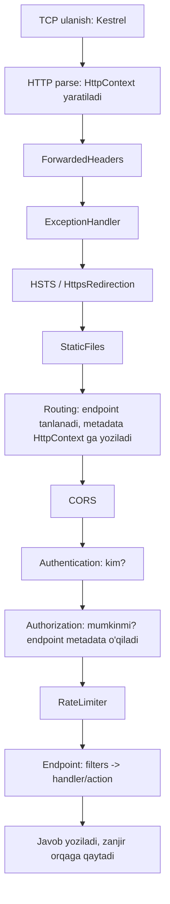

# 06. ASP.NET Core ichki tuzilishi

> **Bir jumlada:** HTTP so'rov Kestrel'dan kirib, middleware zanjiridan o'tib, routing orqali endpoint'ga yetadi va natija xuddi shu zanjir orqali qaytadi; har bir bosqichda nima bo'lishini bilgan dasturchi auth, xato va cache'ni to'g'ri joyga qo'yadi.
> **Nega Middle uchun:** Middleware tartibidagi bitta xato (masalan, `UseAuthorization` `UseRouting`dan oldin) production'da 401 o'rniga 500, yoki umuman tekshiruvsiz o'tib ketadigan endpoint beradi. Buni test bilan emas, mexanizmni tushunib oldini olish kerak.
> **O'qish vaqti:** ~35 daqiqa

## Mundarija

- [1. Muammo va yechim](#1-muammo-va-yechim)
- [2. Qanday ishlaydi](#2-qanday-ishlaydi)
- [3. Asosiy tushunchalar](#3-asosiy-tushunchalar)
- [4. Amaliy misol](#4-amaliy-misol)
- [5. Tipik xatolar va anti-patternlar](#5-tipik-xatolar-va-anti-patternlar)
- [6. Best practices checklist](#6-best-practices-checklist)
- [7. Suhbat savollari va javoblar](#7-suhbat-savollari-va-javoblar)
- [8. Qo'shimcha manbalar](#8-qoshimcha-manbalar)

## 1. Muammo va yechim

Ombor tizimida (Warehouse API) quyidagi holat bo'lgan: nginx orqasida ishlaydigan ilova login'dan keyin `Set-Cookie` ni `Secure` belgisisiz yuborar, OAuth redirect'lar `http://` manziliga ketar, va rate limiting barcha mijozlarni bitta IP (nginx'ning ichki IP'si) deb hisoblab 10 so'rovdan keyin hammani bloklar edi. Uchala muammoning sababi bitta: ilova o'zini to'g'ridan-to'g'ri internetga chiqqan deb hisoblar, proxy'dan kelgan `X-Forwarded-*` sarlavhalarini o'qimas edi.

Ikkinchi holat: buyurtma servisida `app.UseAuthorization()` `app.UseRouting()`dan oldin yozilgan. Development'da ishlagan (chunki `WebApplication` kerakli middleware'larni o'zi qo'shib qo'yadi), lekin boshqa jamoa `UseRouting`ni qo'lda qo'shganda `[Authorize]` atributi bo'lgan endpoint'lar umuman tekshiruvsiz ochilib qolgan.

Uchinchi holat: Kubernetes pod'i rolling update paytida o'chirilganda 2-3 ta to'lov so'rovi yarmida uzilib qolar, mijoz pulidan yechilgan, lekin buyurtma statusi yangilanmagan. Sabab: `BackgroundService` `StoppingToken`ni e'tiborsiz qoldirgan va host `ShutdownTimeout`dan keyin jarayonni majburan o'ldirgan.

Yechim bitta: so'rovning to'liq yo'lini (server → middleware → routing → endpoint → javob) va host'ning hayot siklini (build → start → run → stop) bilish. Bu bob aynan shu yo'lni ochib beradi.

## 2. Qanday ishlaydi

### 2.1 Host hayot sikli

`WebApplication.CreateBuilder(args)` quyidagilarni bajaradi:

1. `HostApplicationBuilder` yaratadi: konfiguratsiya provider'lari (appsettings, env var, command line), logging (Console, Debug, EventSource), `IHostEnvironment`.
2. Kestrel'ni `IServer` sifatida ro'yxatga oladi, `IIS` integratsiyasini (Windows'da) sozlaydi.
3. Routing (`AddRoutingCore`), `IHttpContextFactory`, `IProblemDetailsService` kabi minimal servislarni qo'shadi.
4. `builder.Services`ni (`IServiceCollection`) ochiq qoldiradi: siz bu yerga servislarni qo'shasiz.

`builder.Build()`:

1. `IServiceCollection`dan `ServiceProvider` quradi (Development'da `ValidateScopes` va `ValidateOnBuild` yoqilgan).
2. `WebApplication` obyektini qaytaradi. U bir vaqtning o'zida `IHost` (hayot sikli), `IApplicationBuilder` (middleware qo'shish) va `IEndpointRouteBuilder` (endpoint'larni map qilish).

`app.Run()`:

1. Middleware zanjirini bitta `RequestDelegate`ga kompilyatsiya qiladi (quyida).
2. `IHostedService`larni ro'yxatga olingan tartibda ishga tushiradi. Kestrel ham `GenericWebHostService` nomli hosted service, u **eng oxirida** ro'yxatga olinadi, shuning uchun sizning `BackgroundService`laringiz server portni ochishidan oldin ishga tushadi.
3. `IHostApplicationLifetime.ApplicationStarted` tokenini ishga tushiradi.
4. SIGTERM / Ctrl+C kutadi. Signal kelganda `ApplicationStopping` → `StopAsync` (teskari tartibda) → `ApplicationStopped`.

### 2.2 Middleware zanjiri qanday quriladi

`app.Use(...)` chaqiruvlari `List<Func<RequestDelegate, RequestDelegate>>` ro'yxatiga qo'shiladi. `Build()` paytida ro'yxat **teskari** tartibda aylanib chiqiladi va har bir element keyingisini o'rab oladi:

```csharp
// ApplicationBuilder.Build() ning soddalashtirilgan ko'rinishi
RequestDelegate app = ctx => { ctx.Response.StatusCode = 404; return Task.CompletedTask; }; // oxirgi: 404
foreach (var component in _components.AsEnumerable().Reverse())
    app = component(app); // har biri "next"ni yopib oladi
return app;
```

Natija: bitta `RequestDelegate`, ichida matryoshka kabi ichma-ich yopilgan delegatlar. Kestrel har bir so'rov uchun `HttpContext` yaratadi va shu delegatni chaqiradi. Shuning uchun middleware tartibi faqat `Use` chaqiruvlari tartibi bilan belgilanadi va runtime'da o'zgarmaydi.

### 2.3 So'rov yo'li



Muhim nuqta: **routing** middleware endpoint'ni tanlaydi, lekin uni ishga tushirmaydi. U faqat `HttpContext`ga `Endpoint` obyektini yozadi (`ctx.SetEndpoint`). Undan keyingi barcha middleware'lar `ctx.GetEndpoint()?.Metadata` orqali bu endpoint haqida biladi: unda `[Authorize]` bormi, qaysi CORS policy, qaysi rate limit policy. Endpoint'ni haqiqatda ishga tushiradigan `EndpointMiddleware` zanjirning oxirida turadi. Shuning uchun `UseAuthorization` `UseRouting`dan keyin bo'lishi shart: aks holda u qaysi policy kerakligini bilmaydi va `InvalidOperationException` tashlaydi.

`WebApplication` qulaylik uchun quyidagilarni avtomatik qo'shadi: zanjir boshida `UseRouting` (agar siz qo'lda chaqirmagan bo'lsangiz), oxirida `UseEndpoints`, va `AddAuthentication`/`AddAuthorization` ro'yxatga olingan bo'lsa `UseAuthentication` + `UseAuthorization`. Development'da `UseDeveloperExceptionPage` ham. Bu "sehr" aynan 1-bo'limdagi ikkinchi muammoni keltirib chiqaradi: qo'lda `UseRouting` yozsangiz, avtomatik tartib o'chadi va hamma narsa sizning tartibingizga bog'liq bo'ladi.

### 2.4 Nega aynan shu tartib

| Middleware | Nega shu joyda |
|---|---|
| `UseForwardedHeaders` | Eng birinchi: `Request.Scheme`, `RemoteIpAddress`ni to'g'rilaydi, qolganlar shunga tayanadi |
| `UseExceptionHandler` | Keyingi barcha middleware xatolarini tutishi kerak, shuning uchun ularni o'rab turadi |
| `UseHsts`, `UseHttpsRedirection` | Scheme to'g'ri bo'lgandan keyin, statik fayllardan oldin (redirect arzon) |
| `UseStaticFiles` | Routing, auth'dan oldin: statik fayl uchun auth hisoblash isrof (agar fayllar ochiq bo'lsa) |
| `UseRouting` | Endpoint'ni tanlaydi; CORS, Auth, RateLimiter metadata'ga muhtoj |
| `UseCors` | Auth'dan oldin: preflight `OPTIONS` so'rovda token bo'lmaydi, u 401 olmasligi kerak |
| `UseAuthentication` | `HttpContext.User`ni to'ldiradi |
| `UseAuthorization` | `User` va endpoint policy'sini solishtiradi |
| `UseRateLimiter` | Agar policy foydalanuvchi ID bo'yicha bo'lsa, Authentication'dan keyin; IP bo'yicha bo'lsa oldinroq ham mumkin |
| `UseOutputCache` | Authorization'dan keyin, aks holda ruxsatsiz foydalanuvchi cache'dan javob oladi |
| `MapXxx` / `UseEndpoints` | Terminal: handler'ni ishga tushiradi |

### 2.5 Kestrel va reverse proxy

Kestrel: `System.IO.Pipelines` ustida qurilgan, cross-platform, HTTP/1.1, HTTP/2 va HTTP/3 (QUIC) ni qo'llaydi. Har bir ulanish uchun thread emas, `SocketAsyncEventArgs` va `IOQueue` bilan asinxron ishlaydi; shuning uchun 10 000 ochiq ulanish Kestrel uchun muammo emas, muammo sizning handler'laringiz thread'ni bloklasa boshlanadi.

Production'da Kestrel odatda nginx, YARP, Azure Application Gateway yoki Kubernetes Ingress orqasida turadi. Proxy TLS'ni tugatadi (TLS termination) va Kestrel'ga oddiy HTTP yuboradi. Natijada Kestrel ko'radi: `Scheme = http`, `RemoteIpAddress = 10.0.0.5` (proxy'ning IP'si). Proxy asl ma'lumotni `X-Forwarded-Proto`, `X-Forwarded-For`, `X-Forwarded-Host` sarlavhalarida yuboradi. `UseForwardedHeaders` shu sarlavhalarni o'qib `HttpContext`ni to'g'rilaydi.

Xavfsizlik: istalgan mijoz `X-Forwarded-For: 127.0.0.1` yuborishi mumkin. Shuning uchun middleware faqat `KnownProxies` yoki `KnownIPNetworks`da ko'rsatilgan manzillardan kelgan sarlavhalarga ishonadi. Hech narsa ko'rsatilmasa, faqat loopback'ga ishonadi. (.NET 10 da `KnownIPNetworks` `System.Net.IPNetwork` bilan ishlaydi; eski `KnownNetworks` va `Microsoft.AspNetCore.HttpOverrides.IPNetwork` obsolete.)

```csharp
builder.Services.Configure<ForwardedHeadersOptions>(o =>
{
    o.ForwardedHeaders = ForwardedHeaders.XForwardedFor | ForwardedHeaders.XForwardedProto;
    // Faqat ichki tarmoqdagi proxy'ga ishonamiz (Kubernetes pod tarmog'i)
    o.KnownIPNetworks.Clear();
    o.KnownProxies.Clear();
    o.KnownIPNetworks.Add(new System.Net.IPNetwork(IPAddress.Parse("10.0.0.0"), 8));
    // Bir nechta proxy ketma-ket bo'lsa (CDN -> ingress -> ilova)
    o.ForwardLimit = 2;
});
```

Kestrel limitlari ham shu yerda sozlanadi: `builder.WebHost.ConfigureKestrel(k => { k.Limits.MaxRequestBodySize = 10 * 1024 * 1024; k.AddServerHeader = false; })`. `Server: Kestrel` sarlavhasini o'chirish xavfsizlik skanerlari uchun odatiy talab.

## 3. Asosiy tushunchalar

### 3.1 RequestDelegate va HttpContext

- **Ta'rif:** `RequestDelegate` bu `Func<HttpContext, Task>`. `HttpContext` bitta so'rovning butun holati: `Request`, `Response`, `User`, `Items` (so'rov ichidagi lug'at), `RequestServices` (shu so'rovning DI scope'i), `RequestAborted` (mijoz uzilsa bekor bo'ladigan token).
- **Nega kerak:** Butun ASP.NET Core shu ikkita tip ustida qurilgan. Middleware, filter, handler hammasi `HttpContext` oladi.
- **Tipik xato:** `HttpContext`ni saqlab qo'yib so'rov tugagandan keyin ishlatish. Kestrel `HttpContext`ni pool'dan qayta ishlatadi (`DefaultHttpContext` reuse), so'rovdan keyin undagi ma'lumot boshqa so'rovniki bo'lib qoladi. Kerakli qiymatlarni (userId, traceId) so'rov ichida o'qib oling.

```csharp
app.Use(async (ctx, next) =>
{
    // RequestAborted: mijoz brauzerni yopsa token bekor bo'ladi
    ctx.Items["TenantId"] = ctx.Request.Headers["X-Tenant"].ToString();
    await next(ctx);
});
```

### 3.2 Custom middleware: uch usul

- **Ta'rif:** Middleware bu zanjirdagi bitta halqa: so'rovni oladi, biror ish qiladi, `next`ni chaqiradi (yoki chaqirmaydi, short-circuit), javob qaytgach yana ish qiladi.
- **Nega kerak:** Cross-cutting ishlar (correlation id, tenant aniqlash, so'rov logi, sarlavhalar) har bir endpoint'da takrorlanmasligi uchun.

**Inline** (kichik, bir martalik):

```csharp
app.Use(async (ctx, next) =>
{
    var sw = Stopwatch.StartNew();
    await next(ctx);
    // Javob yozilib bo'lgach: sarlavha qo'shib bo'lmaydi, faqat log
    app.Logger.LogInformation("{Method} {Path} -> {Status} {Ms}ms",
        ctx.Request.Method, ctx.Request.Path, ctx.Response.StatusCode, sw.ElapsedMilliseconds);
});
```

**Class-based (convention)**: konstruktor `RequestDelegate next` oladi, `InvokeAsync(HttpContext, ...)` metodi bor. Ilova ishga tushganda **bir marta** yaratiladi (singleton kabi). Scoped servis kerak bo'lsa, uni konstruktorga emas, `InvokeAsync` parametriga qo'shasiz: ASP.NET Core uni har so'rovda `ctx.RequestServices`dan oladi.

```csharp
public sealed class TenantMiddleware(RequestDelegate next, ILogger<TenantMiddleware> logger)
{
    // ITenantContext scoped: shuning uchun konstruktorda EMAS, metod parametrida
    public async Task InvokeAsync(HttpContext ctx, ITenantContext tenant)
    {
        if (!ctx.Request.Headers.TryGetValue("X-Tenant", out var value) || !Guid.TryParse(value, out var id))
        {
            ctx.Response.StatusCode = StatusCodes.Status400BadRequest;
            await ctx.Response.WriteAsJsonAsync(new { error = "X-Tenant sarlavhasi yo'q" });
            return; // short-circuit: next chaqirilmaydi
        }
        tenant.Set(id);
        logger.LogDebug("Tenant {TenantId}", id);
        await next(ctx);
    }
}
// Ro'yxatga olish:
app.UseMiddleware<TenantMiddleware>();
```

**Factory-based (`IMiddleware`)**: klass `IMiddleware` ni implement qiladi va DI'da ro'yxatga olinadi. Har so'rovda konteyner uni `RequestServices`dan oladi, shuning uchun scoped/transient bo'lishi mumkin va konstruktor injection to'liq ishlaydi. Narxi: har so'rovda allokatsiya.

```csharp
public sealed class AuditMiddleware(IAuditWriter audit) : IMiddleware
{
    public async Task InvokeAsync(HttpContext ctx, RequestDelegate next)
    {
        await next(ctx);
        await audit.WriteAsync(ctx.User.Identity?.Name, ctx.Request.Path, ctx.Response.StatusCode);
    }
}
builder.Services.AddScoped<AuditMiddleware>(); // ro'yxatga olish SHART, aks holda runtime xato
app.UseMiddleware<AuditMiddleware>();
```

- **Tipik xato:** convention middleware konstruktoriga `AppDbContext` (scoped) inject qilish. Natija: ilova ishga tushganda `InvalidOperationException: Cannot resolve scoped service from root provider` (ValidateScopes yoqilgan bo'lsa) yoki production'da bitta `DbContext` butun ilova davomida yashab, barcha so'rovlar o'rtasida ulashiladi.

### 3.3 Use, Run, Map, MapWhen

- `app.Use(...)`: keyingisini chaqiradi.
- `app.Run(...)`: terminal, `next` yo'q. Undan keyin qo'shilgan middleware hech qachon ishlamaydi.
- `app.Map("/health", branch => ...)`: path prefiksi mos kelsa, alohida shoxobcha zanjir. `MapWhen(predicate, ...)` ixtiyoriy shart bilan.
- `app.UseWhen(predicate, ...)`: shoxobcha, lekin oxirida asosiy zanjirga **qaytadi** (Map qaytmaydi).

```csharp
// Faqat /api ostida JWT, /internal uchun esa mTLS yoki IP tekshiruvi
app.UseWhen(ctx => ctx.Request.Path.StartsWithSegments("/internal"),
    branch => branch.UseMiddleware<InternalNetworkOnlyMiddleware>());
```

### 3.4 Endpoint routing va metadata

- **Ta'rif:** Endpoint bu `RequestDelegate` + `RoutePattern` + `EndpointMetadataCollection`. Metadata: endpoint'ga biriktirilgan har qanday obyekt (`AuthorizeAttribute`, `EnableCorsAttribute`, `EnableRateLimitingAttribute`, `ProducesResponseTypeMetadata`, sizniki).
- **Nega kerak:** Middleware'lar konkret handler'ni bilmaydi, lekin metadata'ni o'qiy oladi. Shu tufayli `RequireAuthorization("orders.read")` chaqiruvi `AuthorizationMiddleware`ga "bu endpoint uchun shu policy kerak" deb aytadi.

Route template imkoniyatlari: `{id:int}`, `{id:guid}`, `{code:length(3)}`, `{slug:regex(^[a-z0-9-]+$)}`, `{*path}` (catch-all), `{version:apiVersion}` (Asp.Versioning). Constraint mos kelmasa 404, 400 emas.

```csharp
var orders = app.MapGroup("/api/orders")
    .RequireAuthorization()                  // guruhdagi hammasiga
    .WithTags("Orders")
    .AddEndpointFilter<TenantRequiredFilter>();

orders.MapGet("/{id:guid}", GetOrder).WithName("GetOrder");
orders.MapPost("/", CreateOrder).RequireRateLimiting("write");

// Metadata'ni o'qish (o'z middleware'ingizda):
app.Use(async (ctx, next) =>
{
    var endpoint = ctx.GetEndpoint();
    var isPublic = endpoint?.Metadata.GetMetadata<IAllowAnonymous>() is not null;
    await next(ctx);
});
```

- **Tipik xato:** Ikki endpoint bir xil template bilan (`/orders/{id}` va `/orders/{code}`), constraint yo'q. Runtime'da `AmbiguousMatchException` 500 beradi. Yechim: `{id:guid}` va `{code:alpha}` kabi constraint yoki alohida prefiks.

### 3.5 Model binding

- **Ta'rif:** HTTP so'rovdagi xom ma'lumotni (route, query, header, body, form) handler parametrlariga aylantirish.
- **Minimal API qoidalari:** route'da nomi bor parametr → route; oddiy tip (int, string, Guid, DateOnly, `TryParse`si bor tip) → query; `HttpContext`, `CancellationToken`, `ClaimsPrincipal`, `Stream` → maxsus; DI'da ro'yxatga olingan tip → servis; qolgan murakkab tip → JSON body. Aniq ko'rsatish: `[FromRoute]`, `[FromQuery]`, `[FromHeader]`, `[FromBody]`, `[FromServices]`, `[FromForm]`, `[AsParameters]` (bir nechta parametrni bitta record'ga yig'ish).
- **Controllers (`[ApiController]`):** xuddi shu inference, qo'shimcha: binding xato bo'lsa avtomatik 400 `ValidationProblemDetails`.
- **Custom binding:** tipga `static bool TryParse(string, out T)` yoki `static ValueTask<T?> BindAsync(HttpContext, ParameterInfo)` qo'shsangiz, Minimal API uni ishlatadi.

```csharp
// "?period=2026-10" ko'rinishidagi query'ni domain tipga o'girish
public readonly record struct YearMonth(int Year, int Month)
{
    public static bool TryParse(string? s, IFormatProvider? _, out YearMonth result)
    {
        result = default;
        if (s is null || s.Length != 7 || !int.TryParse(s[..4], out var y) || !int.TryParse(s[5..], out var m))
            return false;
        result = new YearMonth(y, m);
        return true;
    }
}
app.MapGet("/reports/sales", (YearMonth period, ISalesReport report, CancellationToken ct)
    => report.BuildAsync(period, ct));
```

- **Tipik xato:** Minimal API'da `GET` handler'ga murakkab tip berib `[FromQuery]` qo'ymaslik: framework uni body'dan o'qishga urinadi, `GET` body'siz keladi, natija 400 yoki `InvalidOperationException`. `[AsParameters]` yoki alohida oddiy parametrlar ishlating.

### 3.6 Formatters va System.Text.Json sozlamalari

- **Ta'rif:** Formatter so'rov body'sini obyektga (input) va obyektni javobga (output) aylantiradi. Minimal API faqat JSON (System.Text.Json), Controllers'da `IInputFormatter`/`IOutputFormatter` ro'yxati (JSON, XML qo'shish mumkin, `Accept` sarlavhasi bo'yicha tanlanadi).
- **Nega sozlash kerak:** Default'lar: camelCase, `null`larni yozadi, enum'ni raqam qilib yozadi, case-insensitive o'qiydi. Enterprise API'da enum'ni matn sifatida, `null`larni tashlab, `DateOnly`ni ISO formatda chiqarish kerak.

```csharp
// Minimal API uchun
builder.Services.ConfigureHttpJsonOptions(o =>
{
    o.SerializerOptions.PropertyNamingPolicy = JsonNamingPolicy.CamelCase;
    o.SerializerOptions.DefaultIgnoreCondition = JsonIgnoreCondition.WhenWritingNull;
    o.SerializerOptions.Converters.Add(new JsonStringEnumConverter(JsonNamingPolicy.CamelCase));
    o.SerializerOptions.NumberHandling = JsonNumberHandling.Strict; // "123" stringni int ga qabul qilmaslik
});
// Controllers uchun alohida (ikkalasi mustaqil!)
builder.Services.AddControllers().AddJsonOptions(o =>
    o.JsonSerializerOptions.Converters.Add(new JsonStringEnumConverter(JsonNamingPolicy.CamelCase)));
```

- **Tipik xato:** `ConfigureHttpJsonOptions` sozlab, Controllers'da ham ishlaydi deb o'ylash. Ikkalasi alohida `JsonOptions` tipi (`Microsoft.AspNetCore.Http.Json.JsonOptions` va `Microsoft.AspNetCore.Mvc.JsonOptions`). Ikkalasi ham bo'lsa, ikkalasini ham sozlang.

### 3.7 Filters (MVC) va Endpoint filters (Minimal API)

- **Ta'rif:** Filter endpoint'ning "ichida" ishlaydi: routing bo'lgan, parametrlar bind qilingan, handler hali chaqirilmagan nuqtada. Middleware'dan farqi: u konkret action va uning argumentlarini ko'radi.
- **MVC filter turlari (tartibda):** Authorization filter → Resource filter → (model binding) → Action filter → (action) → Exception filter → Result filter. `IAsyncActionFilter` eng ko'p ishlatiladi: argumentlarni tekshirish, natijani o'zgartirish.
- **Endpoint filter:** bitta interfeys `IEndpointFilter`, `InvokeAsync(EndpointFilterInvocationContext ctx, EndpointFilterDelegate next)`. `ctx.Arguments` bu handler argumentlari ro'yxati. Zanjir: oxirgi qo'shilgan filter handler'ga eng yaqin.

```csharp
public sealed class ValidationFilter<T> : IEndpointFilter where T : class
{
    public async ValueTask<object?> InvokeAsync(EndpointFilterInvocationContext ctx, EndpointFilterDelegate next)
    {
        // Argumentlar ichidan T tipini topamiz (DTO)
        if (ctx.Arguments.OfType<T>().FirstOrDefault() is not { } dto)
            return await next(ctx);
        var validator = ctx.HttpContext.RequestServices.GetRequiredService<IValidator<T>>();
        var result = await validator.ValidateAsync(dto, ctx.HttpContext.RequestAborted);
        if (!result.IsValid)
            return TypedResults.ValidationProblem(result.ToDictionary()); // handler chaqirilmaydi
        return await next(ctx);
    }
}
orders.MapPost("/", CreateOrder).AddEndpointFilter<ValidationFilter<CreateOrderRequest>>();
```

Factory variant `AddEndpointFilterFactory((factoryCtx, next) => ...)` handler'ning `MethodInfo`sini ko'radi va filter'ni faqat kerakli endpoint'larga qo'llaydi (masalan, body parametri bo'lsa).

- **Tipik xato:** Auth tekshiruvini filter'ga qo'yish. Filter `UseAuthorization`dan keyin ishlaydi va faqat endpoint'ga tegishli; metadata orqali `RequireAuthorization` ishlatish to'g'ri, chunki u middleware darajasida, OpenAPI'da ham ko'rinadi.

### 3.8 Minimal API vs Controllers

| Mezon | Minimal API | Controllers |
|---|---|---|
| Kod hajmi | Kam: lambda yoki static metod | Ko'p: class, atributlar |
| Ishlash tezligi | Tezroq (kamroq allokatsiya, Request Delegate Generator source-gen) | Reflection asosida, biroz sekin |
| Native AOT | Qo'llaydi (RDG bilan) | Qo'llamaydi |
| Validatsiya | .NET 10: built-in `AddValidation()` (DataAnnotations, source-gen) | `[ApiController]` avtomatik 400 |
| Filters | `IEndpointFilter` (bitta turi) | Authorization/Resource/Action/Exception/Result |
| Model binding | Inference + `TryParse`/`BindAsync`; `[FromForm]` .NET 8+ | To'liq `IModelBinder` infratuzilmasi |
| Content negotiation | Faqat JSON (qo'lda boshqasini yozish mumkin) | `Accept` bo'yicha XML, custom formatter |
| Tuzilma | `MapGroup` + static class'lar bilan tartib saqlash sizga bog'liq | Controller = tabiiy guruhlash, katta jamoa uchun o'zi standart |
| Test | Handler static metod bo'lsa oddiy unit test; `WebApplicationFactory` ikkalasida ishlaydi | Controller'ni new qilib test qilish mumkin |
| Tanlov | Yangi servis, mikroservis, AOT, yuqori RPS | Katta monolit, mavjud MVC kod bazasi, ko'p formatter |

Ikkalasi bitta ilovada birga yashaydi (`MapControllers()` + `MapGet`). Yangi loyihada Minimal API + `MapGroup` + har bir modul uchun `static class XxxEndpoints { public static void Map(IEndpointRouteBuilder) }` strukturasi yetarli.

### 3.9 IHostedService va BackgroundService

- **Ta'rif:** `IHostedService`: `StartAsync`/`StopAsync`. Host ishga tushganda `StartAsync` chaqiriladi va **uning tugashini kutadi**; shuning uchun uzoq ish `StartAsync` ichida bo'lmasligi kerak. `BackgroundService` abstrakt klassi `StartAsync`da `ExecuteAsync(stoppingToken)`ni ishga tushiradi va kutmaydi (await qilmaydi, `Task`ni saqlab qo'yadi). `.NET 8+`da `IHostedLifecycleService` qo'shimcha nuqtalar beradi: `StartingAsync`, `StartedAsync`, `StoppingAsync`, `StoppedAsync`.
- **Nega kerak:** Outbox jo'natish, queue consumer, kesh isitish, eski ma'lumotlarni tozalash.
- **Tipik xato:** `ExecuteAsync` sinxron ravishda uzoq ishlasa (birinchi `await`gacha), host ishga tushishi bloklanadi, Kestrel port ochmaydi, health check 503. Birinchi qatorda `await Task.Yield()` yoki darhol `await` bo'lsin.
- **Ikkinchi xato:** `ExecuteAsync`dan exception chiqsa .NET 6+ da host **to'xtaydi** (`BackgroundServiceExceptionBehavior.StopHost`). Loop ichida try/catch bo'lishi shart.

### 3.10 Graceful shutdown

Jarayon SIGTERM olganda (Kubernetes `kubectl delete pod`, `docker stop`, systemd):

1. `IHostApplicationLifetime.ApplicationStopping` tokeni bekor qilinadi.
2. Host `IHostedService.StopAsync`ni **teskari** tartibda chaqiradi. Kestrel (`GenericWebHostService`) birinchi to'xtaydi: yangi ulanishlarni qabul qilmaydi, ochiq so'rovlarning tugashini kutadi.
3. `BackgroundService.StopAsync` `stoppingToken`ni bekor qiladi va `ExecuteAsync` task'ini kutadi.
4. Hammasi `HostOptions.ShutdownTimeout` (default 30 soniya, .NET 8 dan oldin 5 soniya) ichida tugashi kerak. Tugamasa, host kutishni to'xtatadi va jarayon chiqadi: yarim qolgan ish yo'qoladi.

Kubernetes'da `terminationGracePeriodSeconds` (default 30) `ShutdownTimeout`dan katta yoki teng bo'lishi kerak. Bundan tashqari, pod `Terminating` holatiga o'tgach Service'dan chiqariladi, lekin bu asinxron: 1-2 soniya davomida yangi so'rovlar kelishi mumkin. Shu sababli `preStop` hook'da `sleep 5` qo'yish odatiy amaliyot.

```csharp
builder.Services.Configure<HostOptions>(o =>
{
    o.ShutdownTimeout = TimeSpan.FromSeconds(25);          // K8s 30s dan kichik
    o.ServicesStartConcurrently = true;                      // .NET 8+: hosted service'lar parallel
    o.BackgroundServiceExceptionBehavior = BackgroundServiceExceptionBehavior.StopHost;
});
```

## 4. Amaliy misol

Buyurtma servisi: nginx orqasida, tenant sarlavhasi majburiy, correlation id, global xato handler, JWT, foydalanuvchi bo'yicha rate limit, va outbox'ni jo'natuvchi fon servis. Fayl: `Program.cs` va ikkita yordamchi klass.

```csharp
using System.Threading.RateLimiting;
using Microsoft.AspNetCore.HttpOverrides;

var builder = WebApplication.CreateBuilder(args);

// --- Servislar ---
builder.Services.AddProblemDetails(o => o.CustomizeProblemDetails = ctx =>
    ctx.ProblemDetails.Extensions["traceId"] = Activity.Current?.Id ?? ctx.HttpContext.TraceIdentifier);
builder.Services.AddExceptionHandler<GlobalExceptionHandler>(); // 10-bobda to'liq

builder.Services.AddAuthentication(JwtBearerDefaults.AuthenticationScheme).AddJwtBearer();
builder.Services.AddAuthorizationBuilder()
    .AddPolicy("orders.read", p => p.RequireClaim("scope", "orders.read"))
    .AddPolicy("orders.write", p => p.RequireClaim("scope", "orders.write"));

builder.Services.AddRateLimiter(o =>
{
    o.RejectionStatusCode = StatusCodes.Status429TooManyRequests;
    // Foydalanuvchi ID bo'yicha: shuning uchun UseRateLimiter Authentication'dan KEYIN
    o.AddPolicy("write", ctx => RateLimitPartition.GetTokenBucketLimiter(
        ctx.User.FindFirst("sub")?.Value ?? ctx.Connection.RemoteIpAddress?.ToString() ?? "anon",
        _ => new TokenBucketRateLimiterOptions
        {
            TokenLimit = 20, TokensPerPeriod = 20, ReplenishmentPeriod = TimeSpan.FromSeconds(10)
        }));
});

builder.Services.Configure<ForwardedHeadersOptions>(o =>
{
    o.ForwardedHeaders = ForwardedHeaders.XForwardedFor | ForwardedHeaders.XForwardedProto;
    o.KnownIPNetworks.Clear(); o.KnownProxies.Clear();
    o.KnownIPNetworks.Add(new System.Net.IPNetwork(IPAddress.Parse("10.0.0.0"), 8));
});
builder.WebHost.ConfigureKestrel(k => k.AddServerHeader = false);

builder.Services.AddScoped<ITenantContext, TenantContext>();
builder.Services.AddDbContext<OrdersDbContext>(/* ... */);
builder.Services.AddHostedService<OutboxDispatcher>();
builder.Services.AddOpenApi();

var app = builder.Build();

// --- Pipeline: tartib ataylab qo'lda yozilgan ---
app.UseForwardedHeaders();      // 1. Scheme va IP to'g'rilanadi
app.UseExceptionHandler();      // 2. Pastdagi hamma xatolarni tutadi, ProblemDetails qaytaradi
app.UseHsts();
app.UseHttpsRedirection();

app.Use(async (ctx, next) =>    // 3. Correlation id: kelgan bo'lsa qabul, bo'lmasa yaratamiz
{
    var cid = ctx.Request.Headers["X-Correlation-Id"].FirstOrDefault() ?? Guid.NewGuid().ToString("N");
    ctx.Response.Headers["X-Correlation-Id"] = cid;
    using (app.Logger.BeginScope(new Dictionary<string, object> { ["CorrelationId"] = cid }))
        await next(ctx);
});

app.UseRouting();               // 4. Endpoint tanlanadi, metadata ko'rinadi
app.UseAuthentication();        // 5. User to'ldiriladi
app.UseAuthorization();         // 6. Policy tekshiriladi
app.UseRateLimiter();           // 7. User ID bo'yicha, shuning uchun auth'dan keyin
app.UseMiddleware<TenantMiddleware>(); // 8. 3.2 dagi klass; /health uchun kerak emas, pastda ko'ring

app.MapHealthChecks("/health").AllowAnonymous();
app.MapOpenApi();

var orders = app.MapGroup("/api/orders").WithTags("Orders");

orders.MapGet("/{id:guid}", async (Guid id, OrdersDbContext db, ITenantContext tenant, CancellationToken ct) =>
    await db.Orders.AsNoTracking()
        .Where(o => o.TenantId == tenant.Id && o.Id == id)
        .Select(o => new OrderDto(o.Id, o.Number, o.Total, o.Status))
        .FirstOrDefaultAsync(ct) is { } dto
            ? Results.Ok(dto)
            : Results.NotFound())
    .RequireAuthorization("orders.read")
    .WithName("GetOrder");

orders.MapPost("/", async (CreateOrderRequest req, OrdersDbContext db, ITenantContext tenant, CancellationToken ct) =>
    {
        var order = Order.Create(tenant.Id, req.CustomerId, req.Lines);
        db.Orders.Add(order);
        db.OutboxMessages.Add(OutboxMessage.From(new OrderCreated(order.Id))); // bir tranzaksiyada
        await db.SaveChangesAsync(ct);
        return Results.CreatedAtRoute("GetOrder", new { id = order.Id }, new { order.Id });
    })
    .RequireAuthorization("orders.write")
    .RequireRateLimiting("write")
    .AddEndpointFilter<ValidationFilter<CreateOrderRequest>>();

app.Run();
```

`TenantMiddleware` `/health` uchun ham ishlaydi va 400 qaytaradi. Buni hal qilish: middleware ichida `ctx.GetEndpoint()?.Metadata.GetMetadata<IAllowAnonymous>() is not null` bo'lsa o'tkazib yuborish. Metadata aynan shu uchun bor.

Outbox jo'natuvchi fon servis, scope va graceful shutdown bilan:

```csharp
public sealed class OutboxDispatcher(IServiceScopeFactory scopes, ILogger<OutboxDispatcher> log) : BackgroundService
{
    protected override async Task ExecuteAsync(CancellationToken stoppingToken)
    {
        await Task.Yield(); // host ishga tushishini bloklamaslik
        using var timer = new PeriodicTimer(TimeSpan.FromSeconds(2));
        while (await timer.WaitForNextTickAsync(stoppingToken)) // stop'da false qaytaradi, exception emas
        {
            try
            {
                // BackgroundService singleton; DbContext scoped: har iteratsiyada yangi scope
                await using var scope = scopes.CreateAsyncScope();
                var db = scope.ServiceProvider.GetRequiredService<OrdersDbContext>();
                var bus = scope.ServiceProvider.GetRequiredService<IMessageBus>();

                var batch = await db.OutboxMessages.Where(m => m.SentAt == null)
                    .OrderBy(m => m.Id).Take(50).ToListAsync(stoppingToken);
                foreach (var msg in batch)
                {
                    // Bitta xabarni yarmida tashlab ketmaymiz: publish uchun token bermaymiz,
                    // lekin keyingi xabarga o'tishdan oldin tekshiramiz
                    await bus.PublishAsync(msg.Type, msg.Payload, CancellationToken.None);
                    msg.SentAt = DateTimeOffset.UtcNow;
                    await db.SaveChangesAsync(CancellationToken.None);
                    if (stoppingToken.IsCancellationRequested) break;
                }
            }
            catch (OperationCanceledException) when (stoppingToken.IsCancellationRequested) { break; }
            catch (Exception ex) { log.LogError(ex, "Outbox iteratsiyasi xato"); } // host to'xtamasin
        }
        log.LogInformation("OutboxDispatcher to'xtadi");
    }
}
```

Nega shunday: `PeriodicTimer` `Task.Delay`dan farqli ravishda drift bermaydi; `CreateAsyncScope` `IAsyncDisposable` servislarni to'g'ri yopadi; `CancellationToken.None` bitta xabarni atomik jo'natadi va faqat xabarlar orasida to'xtaydi, shu tufayli shutdown'da "jo'natildi, lekin belgilanmadi" holati bo'lmaydi.

## 5. Tipik xatolar va anti-patternlar

### 5.1 Authorization routing'dan oldin

```csharp
// ❌
app.UseAuthorization();
app.UseRouting();
```

Nega yomon: `AuthorizationMiddleware` endpoint metadata'sini o'qiydi; routing hali ishlamagan, endpoint `null`. Framework `InvalidOperationException: Endpoint ... contains authorization metadata, but a middleware was not found that supports authorization` tashlaydi, yoki eski versiyalarda jim o'tkazib yuboradi.

```csharp
// ✅
app.UseRouting();
app.UseAuthentication();
app.UseAuthorization();
```

### 5.2 Javob yozilgandan keyin sarlavha o'zgartirish

```csharp
// ❌
app.Use(async (ctx, next) =>
{
    await next(ctx);
    ctx.Response.Headers["X-Duration"] = "..."; // InvalidOperationException: Headers are read-only
});
```

Nega yomon: handler `Response.Body`ga yozishni boshlagan zahoti sarlavhalar mijozga ketgan. Keyin o'zgartirib bo'lmaydi.

```csharp
// ✅
app.Use(async (ctx, next) =>
{
    var sw = Stopwatch.StartNew();
    ctx.Response.OnStarting(() => { ctx.Response.Headers["X-Duration"] = sw.ElapsedMilliseconds.ToString(); return Task.CompletedTask; });
    await next(ctx);
});
```

### 5.3 Middleware'da sinxron I/O yoki `.Result`

```csharp
// ❌
var body = new StreamReader(ctx.Request.Body).ReadToEnd(); // Kestrel: sinxron o'qish taqiqlangan, InvalidOperationException
var user = userService.GetAsync(id).Result;                 // thread pool bloklanadi, yuklamada deadlock/starvation
```

```csharp
// ✅
ctx.Request.EnableBuffering(); // body'ni ikki marta o'qish kerak bo'lsa
var body = await new StreamReader(ctx.Request.Body, leaveOpen: true).ReadToEndAsync(ctx.RequestAborted);
ctx.Request.Body.Position = 0;
```

### 5.4 ForwardedHeaders'siz proxy orqasida

```csharp
// ❌ nginx orqasida, hech narsa sozlanmagan
app.UseHttpsRedirection(); // har so'rovni http deb ko'rib redirect: cheksiz redirect loop
```

```csharp
// ✅
app.UseForwardedHeaders(); // KnownIPNetworks sozlangan holda, eng birinchi
app.UseHttpsRedirection();
```

### 5.5 BackgroundService'da exception yutilmagan

```csharp
// ❌
protected override async Task ExecuteAsync(CancellationToken ct)
{
    while (!ct.IsCancellationRequested)
    {
        await ProcessAsync(ct); // bitta xato => butun host to'xtaydi (StopHost)
        await Task.Delay(1000, ct);
    }
}
```

```csharp
// ✅ try/catch loop ichida, OperationCanceledException alohida, xatoda backoff
while (!ct.IsCancellationRequested)
{
    try { await ProcessAsync(ct); }
    catch (OperationCanceledException) when (ct.IsCancellationRequested) { break; }
    catch (Exception ex) { log.LogError(ex, "Process xato"); await Task.Delay(5000, ct); }
}
```

### 5.6 Singleton middleware'da scoped servis

```csharp
// ❌
public sealed class AuditMiddleware(RequestDelegate next, AppDbContext db) { ... } // DbContext butun ilovaga bitta
```

```csharp
// ✅ InvokeAsync parametri yoki IMiddleware
public async Task InvokeAsync(HttpContext ctx, AppDbContext db) { ... }
```

### 5.7 Har so'rovda yangi Kestrel limitlarini o'ylamaslik

`MaxRequestBodySize` default 30 MB; fayl yuklash endpoint'ida `[RequestSizeLimit]` yoki `ctx.Features.Get<IHttpMaxRequestBodySizeFeature>()` bilan aniq cheklang. Katta body'ni `IFormFile` bilan xotiraga emas, `Request.Body` stream orqali to'g'ridan-to'g'ri blob'ga yozing.

## 6. Best practices checklist

- [ ] Middleware tartibini qo'lda va aniq yozing: avtomatik `UseRouting`/`UseAuthorization`ga tayanmang, chunki birinchi qo'lda qo'shilgan middleware avtomatik tartibni o'zgartiradi.
- [ ] Proxy orqasida `UseForwardedHeaders` eng birinchi va `KnownIPNetworks`/`KnownProxies` to'ldirilgan: aks holda IP spoofing va redirect loop.
- [ ] `UseExceptionHandler` + `AddProblemDetails` pipeline boshida: barcha xatolar bitta formatda chiqadi.
- [ ] Scoped servislarni convention middleware'ning `InvokeAsync` parametriga bering, konstruktorga emas: middleware singleton.
- [ ] `Response.OnStarting` orqali sarlavha qo'shing, `await next` dan keyin emas: body boshlangach sarlavha yopiq.
- [ ] Rate limiter policy'si foydalanuvchiga bog'liq bo'lsa `UseRateLimiter` `UseAuthentication`dan keyin: aks holda hamma `anon`.
- [ ] `CancellationToken`ni handler'dan DB va HTTP chaqiruvlarigacha uzating: mijoz uzilganda ish to'xtaydi.
- [ ] Minimal API'da `MapGroup` + static `Map` metodlari bilan modul bo'yicha guruhlang: `Program.cs` 100 qatordan oshmasin.
- [ ] `ConfigureHttpJsonOptions` va `AddJsonOptions` ikkalasini bir xil sozlang, agar ikkala uslub birga bo'lsa.
- [ ] `BackgroundService.ExecuteAsync` darhol `await` qilsin, loop ichida try/catch bo'lsin, scope har iteratsiyada yaratilsin.
- [ ] `ShutdownTimeout` < Kubernetes `terminationGracePeriodSeconds`, `preStop` da qisqa sleep: so'rovlar uzilmaydi.
- [ ] `AddServerHeader = false`, `MaxRequestBodySize` aniq: skaner topadigan ikki odatiy kamchilik yopiladi.
- [ ] `/health` va `/openapi` `AllowAnonymous`, lekin tashqi tarmoqqa chiqmasin (ingress qoidasi).

## 7. Suhbat savollari va javoblar

**1. `UseAuthentication` va `UseAuthorization` tartibi nega muhim?**
`UseAuthentication` so'rovdagi token/cookie'ni o'qib `HttpContext.User`ni to'ldiradi. `UseAuthorization` shu `User`ni endpoint metadata'sidagi policy bilan solishtiradi. Teskari tartibda `User` hali bo'sh bo'ladi va har bir himoyalangan endpoint 401 qaytaradi. Ikkalasi `UseRouting`dan keyin bo'lishi ham shart, chunki policy nomi endpoint metadata'sidan olinadi. Tuzoq: `WebApplication` bu ikkisini avtomatik qo'shadi, shuning uchun noto'g'ri tartib ba'zan "ishlab" turadi; `UseRouting` qo'lda yozilgan zahoti sehr o'chadi.

**2. Middleware va filter farqi?**
Middleware har bir so'rov uchun ishlaydi va `HttpContext` bilan ishlaydi; routing'dan oldin endpoint haqida hech narsa bilmaydi, keyin faqat metadata'ni ko'radi. Filter esa endpoint ichida: bind qilingan argumentlarni, action natijasini ko'radi va o'zgartira oladi. Qoida: cross-cutting (log, correlation, tenant, auth) middleware; argument va natijaga bog'liq ish (validatsiya, tranzaksiya, natijani o'rash) filter. Minimal API'da filter turi bitta (`IEndpointFilter`), MVC'da beshta.

**3. `app.Use` va `app.Run` farqi?**
`Use` keyingi delegatni (`next`) oladi va chaqirishi mumkin; `Run` terminal, `next` yo'q. `Run`dan keyin qo'shilgan hamma narsa o'lik kod. Qo'shimcha: `Use` ichida `next`ni chaqirmaslik ham short-circuit, masalan, 400 qaytarib to'xtash.

**4. BackgroundService ichida Scoped servis (DbContext) qanday olinadi?**
`BackgroundService` singleton, konstruktorga scoped inject qilib bo'lmaydi (captive dependency). `IServiceScopeFactory` inject qilinadi, har bir ish birligi uchun `CreateAsyncScope()` ochiladi, scope'dan `GetRequiredService<AppDbContext>()` olinadi va scope `await using` bilan yopiladi. Scope'ni butun servis davomida bitta qilib ochish ham xato: `DbContext` change tracker cheksiz o'sadi va bitta xato uni yaroqsiz holga keltiradi.

**5. Reverse proxy orqasida nimani sozlash shart va nega?**
`ForwardedHeadersOptions`: `XForwardedFor` va `XForwardedProto`, `KnownIPNetworks`/`KnownProxies` bilan. Busiz `Request.Scheme` `http` bo'ladi (HTTPS redirect loop, `Secure` cookie yo'q, OAuth redirect URI noto'g'ri), `RemoteIpAddress` proxy IP'si bo'ladi (rate limit va audit buziladi). Tuzoq: `KnownIPNetworks`ni tozalab hech narsa qo'shmaslik: endi hamma `X-Forwarded-For`ga ishoniladi, mijoz o'z IP'sini soxtalashtira oladi.

**6. Class-based middleware va `IMiddleware` farqi?**
Convention middleware ilova ishga tushganda bir marta yaratiladi, `RequestDelegate next` konstruktorda, scoped bog'liqliklar `InvokeAsync` parametrida keladi. `IMiddleware` DI'dan har so'rovda olinadi (factory), shuning uchun scoped bo'lishi va konstruktor injection to'liq ishlashi mumkin, lekin DI'da ro'yxatga olinishi shart va har so'rovda allokatsiya bor. Ko'p holatda convention yetarli.

**7. Graceful shutdown qanday ishlaydi va qayerda buziladi?**
SIGTERM → `ApplicationStopping` → hosted service'lar teskari tartibda `StopAsync`; Kestrel yangi ulanishlarni to'xtatib ochiq so'rovlarni kutadi; `BackgroundService` `stoppingToken`ni bekor qiladi. Hammasi `ShutdownTimeout` (30 s) ichida tugamasa, jarayon majburan chiqadi. Buziladigan joylar: token e'tiborsiz qoldirilgan loop, `Task.Delay` tokensiz, Kubernetes `terminationGracePeriodSeconds` kichikroq, pod Service'dan chiqarilguncha kelgan so'rovlar (`preStop` sleep bilan hal qilinadi).

**8. Endpoint routing'da "metadata" nima va unga kim muhtoj?**
Endpoint'ga biriktirilgan obyektlar to'plami: `AuthorizeAttribute`, CORS policy, rate limit policy, OpenAPI tavsifi, sizniki. Routing endpoint'ni tanlagach `HttpContext`ga yozadi; Authorization, CORS, RateLimiter, OutputCache middleware'lari shu metadata'ni o'qib qaror qiladi. Shuning uchun ular `UseRouting`dan keyin turadi va shuning uchun `RequireAuthorization` kabi chaqiruvlar handler kodini emas, metadata'ni o'zgartiradi.

**9. Minimal API'da model binding qanday qaror qiladi: query yoki body?**
Route template'da parametr nomi bo'lsa route; `TryParse`si bor oddiy tip bo'lsa query; `HttpContext`, `CancellationToken`, `ClaimsPrincipal` maxsus; DI'da ro'yxatga olingan tip servis; qolgan murakkab tip JSON body. Tuzoq: `GET`da murakkab tip body'dan kutiladi; `[AsParameters]` bilan query'ga yig'ish kerak. Yana bir tuzoq: DI'da ro'yxatga olingan DTO tipi body emas, servis deb olinadi.

**10. Kestrel ichki ulanishlarni qanday boshqaradi, nega "thread per request" emas?**
Kestrel `System.IO.Pipelines` va `SocketAsyncEventArgs` ustida: bir nechta I/O thread socket'larni asinxron o'qiydi, so'rovni parse qilib thread pool'ga `RequestDelegate`ni topshiradi. Handler `await` qilganda thread pool'ga qaytadi. Shuning uchun 1000 ta sekin DB so'rovi 1000 ta thread emas, 1000 ta kutayotgan state machine. Buziladigan joy: handler sinxron bloklasa (`.Result`, `Thread.Sleep`, sinxron I/O), thread pool starvation: yangi so'rovlar qabul qilinadi, lekin bajariladigan thread yo'q, latency portlab ketadi.

**11. Exception middleware pipeline'ning qayerida va nega?**
Eng boshida (ForwardedHeaders'dan keyin): u `try { await next } catch` shaklida ishlaydi, shuning uchun o'zidan keyingi hamma narsani o'rab turadi. Undan oldin qo'yilgan middleware xatolari tutilmaydi va Kestrel xom 500 qaytaradi. Javob allaqachon boshlangan bo'lsa (`Response.HasStarted`), handler hech narsa qila olmaydi, faqat log yozadi; shuning uchun katta javoblarni yozishdan oldin xato chiqishi mumkin bo'lgan ishlarni tugatish kerak.

## 8. Qo'shimcha manbalar

- ASP.NET Core middleware: https://learn.microsoft.com/aspnet/core/fundamentals/middleware/
- Middleware tartibi (rasmiy diagramma): https://learn.microsoft.com/aspnet/core/fundamentals/middleware/#middleware-order
- Custom middleware yozish: https://learn.microsoft.com/aspnet/core/fundamentals/middleware/write
- Factory-based middleware (`IMiddleware`): https://learn.microsoft.com/aspnet/core/fundamentals/middleware/extensibility
- Routing: https://learn.microsoft.com/aspnet/core/fundamentals/routing
- Kestrel: https://learn.microsoft.com/aspnet/core/fundamentals/servers/kestrel
- Proxy va load balancer sozlamalari: https://learn.microsoft.com/aspnet/core/host-and-deploy/proxy-load-balancer
- Minimal API parameter binding: https://learn.microsoft.com/aspnet/core/fundamentals/minimal-apis/parameter-binding
- Endpoint filters: https://learn.microsoft.com/aspnet/core/fundamentals/minimal-apis/min-api-filters
- MVC filters: https://learn.microsoft.com/aspnet/core/mvc/controllers/filters
- Hosted services va BackgroundService: https://learn.microsoft.com/aspnet/core/fundamentals/host/hosted-services
- Generic Host (lifetime, HostOptions): https://learn.microsoft.com/dotnet/core/extensions/generic-host
- Andrew Lock, "Understanding the ASP.NET Core middleware pipeline": https://andrewlock.net/series/
- David Fowler, ASP.NET Core diagnostics va async qo'llanma: https://github.com/davidfowl/AspNetCoreDiagnosticScenarios
