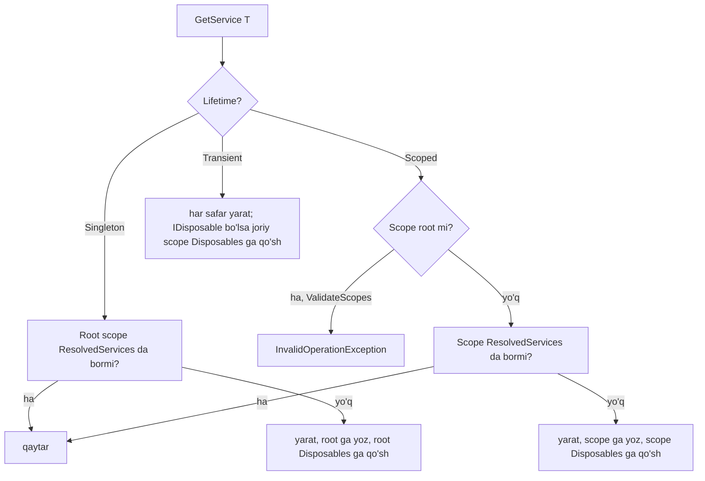

# 07. Dependency Injection

> **Bir jumlada:** DI konteyner obyektlarni kim, qachon va qancha vaqt yashashini boshqaradi; lifetime'ni noto'g'ri tanlash kompilyatsiya xatosi bermaydi, lekin production'da bir mijozning ma'lumoti boshqasiga ko'rinib qoladi.
> **Nega Middle uchun:** Junior `AddScoped` yozishni biladi. Middle konteyner scope'ni qanday yaratishini, nega `DbContext` singleton'ga kirsa buzilishini, `HttpClient`ni nega `new` qilmaslikni va `IOptionsMonitor` qachon kerakligini tushuntira oladi.
> **O'qish vaqti:** ~35 daqiqa

## Mundarija

- [1. Muammo va yechim](#1-muammo-va-yechim)
- [2. Qanday ishlaydi](#2-qanday-ishlaydi)
- [3. Asosiy tushunchalar](#3-asosiy-tushunchalar)
- [4. Amaliy misol](#4-amaliy-misol)
- [5. Tipik xatolar va anti-patternlar](#5-tipik-xatolar-va-anti-patternlar)
- [6. Best practices checklist](#6-best-practices-checklist)
- [7. Suhbat savollari va javoblar](#7-suhbat-savollari-va-javoblar)
- [8. Qo'shimcha manbalar](#8-qoshimcha-manbalar)

## 1. Muammo va yechim

To'lov servisida `PaymentNotifier` klassi singleton qilib ro'yxatga olingan, chunki u ichida kesh saqlaydi. Konstruktoriga `ICurrentUser` (scoped, HTTP so'rovdan `sub` claim'ini o'qiydi) inject qilingan. Production'da mijozlar "menga boshqa odamning to'lov tasdig'i keldi" deb shikoyat qila boshladi. Sabab: singleton birinchi so'rovda yaratilgan, o'sha so'rovning `ICurrentUser`ini "qamab" olgan (captive dependency), va keyingi barcha so'rovlar uchun o'sha birinchi foydalanuvchi deb ishlagan. Development'da buni `ValidateScopes` darhol tutgan bo'lardi, lekin jamoa `ValidateScopes`ni "sekinlashtiradi" deb o'chirib qo'ygan edi.

Ikkinchi holat: SMS yuborish servisi har chaqiruvda `new HttpClient()` qilgan. Ikki soatlik aksiya paytida server `SocketException: Only one usage of each socket address is normally permitted` bilan yiqildi. `netstat` 16 000 ta `TIME_WAIT` ulanish ko'rsatdi: `HttpClient` dispose qilinsa ham, OS socket'ni 2 daqiqa band ushlab turadi.

Uchinchi holat: `appsettings.json`dagi komissiya foizi o'zgartirilgan, ilova qayta ishga tushirilmagan, lekin yangi foiz ishlamayapti. Kod `IOptions<FeeOptions>` ishlatgan: u bir marta o'qiladi va umrbod saqlanadi.

Uchala holat bitta mavzuga tegishli: obyektning umrini kim boshqaradi va qanday. Shuni bilish uchun konteynerning ichiga qaraymiz.

## 2. Qanday ishlaydi

### 2.1 Ro'yxatdan obyektgacha

`builder.Services` bu `IServiceCollection`: oddiy `List<ServiceDescriptor>`. Har bir `ServiceDescriptor` uchta narsani saqlaydi: servis tipi (`IOrderRepository`), implementatsiya (tip, factory delegat yoki tayyor instance) va lifetime.

`BuildServiceProvider()` chaqirilganda (`WebApplication.Build()` ichida) `ServiceProvider` yaratiladi. U ichida:

- **`CallSiteFactory`**: har bir servis uchun "call site" daraxtini quradi: qaysi konstruktor, qaysi parametrlar, ular qanday yaratiladi. Konstruktor tanlash qoidasi: eng ko'p parametrli, barcha parametrlari konteynerdan topiladigan konstruktor; ikkita teng nomzod bo'lsa `InvalidOperationException`.
- **Root scope** (`ServiceProviderEngineScope`): singleton'lar shu yerda saqlanadi.
- **Engine**: call site daraxtini qanday bajarishni hal qiladi. Default `DynamicServiceProviderEngine`: servis birinchi ikki marta so'ralganda daraxtni interpretatsiya qiladi (`CallSiteRuntimeResolver`), uchinchidan boshlab fon thread'da expression tree'ni kompilyatsiya qilib (`ExpressionResolverBuilder`, ILEmit) tezkor delegat yaratadi. Shuning uchun birinchi so'rovlar sekinroq, keyingilari oddiy `new` tezligida.

### 2.2 Scope qanday yaratiladi

`IServiceScopeFactory.CreateScope()` yangi `ServiceProviderEngineScope` obyektini yaratadi. Uning ichida ikkita narsa bor:

- `ResolvedServices`: `Dictionary<ServiceCacheKey, object>`, shu scope ichida yaratilgan **scoped** obyektlar keshi.
- `Disposables`: `List<object>`, shu scope yaratgan va `IDisposable`/`IAsyncDisposable` bo'lgan obyektlar (scoped ham, transient ham).

Resolve algoritmi (soddalashtirilgan):



ASP.NET Core har HTTP so'rov uchun `RequestServicesContainerMiddleware` orqali scope ochadi (`HttpContext.RequestServices`) va so'rov tugagach `Dispose` qiladi. Shu tufayli "scoped = bitta so'rov davomida bitta". Konteyner HTTP haqida hech narsa bilmaydi: scope oddiy obyekt, uni `BackgroundService`da, test'da, console ilovada o'zingiz ochasiz.

Scope dispose qilinganda `Disposables` ro'yxati **teskari** tartibda dispose qilinadi (keyin yaratilgan oldin yopiladi). `IAsyncDisposable` obyekt sinxron `Dispose()` bilan yopilayotgan bo'lsa va `IDisposable`ni implement qilmasa, konteyner `InvalidOperationException` tashlaydi. Shuning uchun `CreateAsyncScope()` va `await using`.

### 2.3 ValidateScopes va ValidateOnBuild

`WebApplication.CreateBuilder` Development muhitida ikkalasini yoqadi:

- **`ValidateScopes`**: root provider'dan scoped servis so'ralsa xato; singleton call site'ida scoped bog'liqlik topilsa xato (`Cannot consume scoped service 'ICurrentUser' from singleton 'PaymentNotifier'`). Tekshiruv call site qurilganda, ya'ni birinchi resolve paytida.
- **`ValidateOnBuild`**: `BuildServiceProvider` paytida **barcha** descriptor'lar uchun call site quriladi: yetishmayotgan bog'liqlik, topilmagan konstruktor, captive dependency ilova ishga tushganda chiqadi, birinchi so'rovda emas. Factory delegat (`AddScoped(sp => ...)`) ichini tekshira olmaydi: u faqat chaqirilganda ko'rinadi.

Production'da ikkalasi o'chiq (ishga tushish tezligi uchun), shuning uchun Development'da ishlamagan narsa production'ga chiqmasligi kerak. Integratsion testda (`WebApplicationFactory`) ham Development muhiti bo'lsin.

## 3. Asosiy tushunchalar

### 3.1 Transient, Scoped, Singleton

- **Ta'rif:** Transient har so'ralganda yangi; Scoped scope davomida bitta; Singleton root provider davomida bitta.
- **Tanlash qoidasi:** Holatsiz (stateless) va arzon → Transient yoki Singleton (ikkalasi ham to'g'ri, Singleton kamroq allokatsiya). So'rovga bog'liq holat (`DbContext`, current user, tenant, unit of work) → Scoped. Qimmat, thread-safe va umumiy (kesh, `HttpClient` handler, konfiguratsiya, `IMemoryCache`) → Singleton.
- **Singleton thread-safe bo'lishi shart:** bir vaqtda yuzlab so'rov undan foydalanadi. Ichida `Dictionary` bo'lsa `ConcurrentDictionary`, `List` bo'lsa lock.

```csharp
builder.Services.AddSingleton<IClock, SystemClock>();                 // holatsiz
builder.Services.AddSingleton<IPriceCache, PriceCache>();             // ConcurrentDictionary ichida
builder.Services.AddScoped<ICurrentUser, HttpCurrentUser>();          // IHttpContextAccessor dan o'qiydi
builder.Services.AddDbContext<OrdersDbContext>(/* scoped by default */);
builder.Services.AddTransient<IOrderNumberGenerator, OrderNumberGenerator>(); // arzon, holatsiz
```

- **Tipik xato:** Transient `IDisposable` servisni singleton'dan `IServiceProvider.GetService` bilan olish: u root scope'ning `Disposables` ro'yxatiga qo'shiladi va ilova o'chguncha xotirada qoladi (memory leak). Transient disposable'larni faqat scope ichida oling.

### 3.2 Captive dependency

- **Ta'rif:** Uzoq yashaydigan obyekt (singleton) qisqa yashashi kerak bo'lgan obyektni (scoped/transient) konstruktorida ushlab qolishi.
- **Oqibat:** Scoped obyekt birinchi scope'niki bo'lib qoladi: `DbContext` change tracker cheksiz o'sadi, thread-safe emasligi sababli `InvalidOperationException: A second operation was started on this context` chiqadi; `ICurrentUser` noto'g'ri foydalanuvchini qaytaradi.
- **Yechim:** Singleton'ga `IServiceScopeFactory` bering va kerak bo'lganda scope oching; yoki singleton'ning o'zini scoped qiling (agar qimmat bo'lmasa); yoki scoped bo'lgan qismini ajratib, singleton'ga faqat holatsiz qismini qoldiring.

```csharp
// ❌ Captive: PaymentNotifier singleton, ICurrentUser scoped
public sealed class PaymentNotifier(ICurrentUser user, ISmsSender sms) { ... }

// ✅ Scope har chaqiruvda
public sealed class PaymentNotifier(IServiceScopeFactory scopes, ISmsSender sms)
{
    public async Task NotifyAsync(Guid paymentId, CancellationToken ct)
    {
        await using var scope = scopes.CreateAsyncScope();
        var db = scope.ServiceProvider.GetRequiredService<PaymentsDbContext>();
        var payment = await db.Payments.FindAsync([paymentId], ct);
        await sms.SendAsync(payment!.Phone, $"To'lov {payment.Amount} UZS qabul qilindi", ct);
    }
}
```

### 3.3 Keyed services

- **Ta'rif (.NET 8+):** bitta interfeys uchun bir nechta implementatsiyani kalit bilan ro'yxatga olish va kalit bo'yicha olish.
- **Nega kerak:** To'lov provayderlari (Payme, Click, Uzum), SMS shlyuzlari, bir nechta `DbContext` ulanishi. Avval buning uchun factory klass yoki `IEnumerable<T>` ichidan `First(x => x.Name == ...)` yozilardi.

```csharp
builder.Services.AddKeyedScoped<IPaymentProvider, PaymeProvider>("payme");
builder.Services.AddKeyedScoped<IPaymentProvider, ClickProvider>("click");

// Konstruktorda
public sealed class CheckoutService([FromKeyedServices("payme")] IPaymentProvider payme) { ... }

// Dinamik: kalit runtime'da keladi
public sealed class PaymentRouter(IServiceProvider sp)
{
    public IPaymentProvider Resolve(string method) =>
        sp.GetKeyedService<IPaymentProvider>(method)
        ?? throw new NotSupportedException($"To'lov usuli qo'llanmaydi: {method}");
}

// Minimal API handler parametrida ham ishlaydi
app.MapPost("/pay/{method}", (string method, PaymentRouter router, PayRequest req)
    => router.Resolve(method).PayAsync(req));
```

Ichki mexanizm: `ServiceDescriptor`da `ServiceKey` maydoni bor; `ServiceCacheKey` tip + kalit juftligidan iborat, shuning uchun `"payme"` va `"click"` alohida keshlanadi. `KeyedService.AnyKey` bilan ro'yxatga olinsa, istalgan kalit so'rovi shu implementatsiyaga tushadi, kalit `[ServiceKey]` atributli konstruktor parametriga uzatiladi.

- **Tipik xato:** `GetRequiredService<IPaymentProvider>()` (kalitsiz) chaqirish: keyed ro'yxatlar kalitsiz so'rovga javob bermaydi, `InvalidOperationException`.

### 3.4 TryAdd va IEnumerable\<T\>

- **`Add*`**: har chaqiruv yangi descriptor qo'shadi. `GetService<T>` **oxirgi** qo'shilganini qaytaradi; `GetServices<T>` / `IEnumerable<T>` **hammasini ro'yxat tartibida**.
- **`TryAdd*`**: shu servis tipi uchun descriptor bo'lsa, qo'shmaydi. Kutubxona mualliflari uchun: "foydalanuvchi o'zinikini bergan bo'lsa, menikini qo'shma".
- **`TryAddEnumerable`**: shu tip **va shu implementatsiya** juftligi bo'lmasa qo'shadi. `IEnumerable<T>` uchun dublikatni oldini oladi.
- **`Replace`, `RemoveAll`**: testda haqiqiy implementatsiyani fake bilan almashtirish.

```csharp
// Pipeline'ga o'xshash: barcha IOrderValidator'lar ketma-ket ishlaydi
builder.Services.TryAddEnumerable(ServiceDescriptor.Scoped<IOrderValidator, StockValidator>());
builder.Services.TryAddEnumerable(ServiceDescriptor.Scoped<IOrderValidator, CreditLimitValidator>());

public sealed class OrderService(IEnumerable<IOrderValidator> validators)
{
    public async Task<Result> PlaceAsync(Order order, CancellationToken ct)
    {
        foreach (var v in validators)           // ro'yxatga olish tartibida
            if (await v.ValidateAsync(order, ct) is { IsFailure: true } fail) return fail;
        // ...
        return Result.Success();
    }
}
```

- **Tipik xato:** `AddScoped<IOrderValidator, StockValidator>()`ni ikki marta chaqirish (masalan, ikkita extension metod orqali): `IEnumerable<IOrderValidator>`da `StockValidator` ikki marta ishlaydi. `TryAddEnumerable` buni oldini oladi.

### 3.5 Options pattern

- **Ta'rif:** Konfiguratsiya bo'limini strongly-typed klassga bog'lash va uni DI orqali olish. Uchta interfeys, uchta lifetime, uchta xulq.

| Interfeys | Lifetime | Qachon o'qiladi | Reload | Named options | Qayerda ishlatish |
|---|---|---|---|---|---|
| `IOptions<T>` | Singleton | Birinchi `.Value`da, bir marta | Yo'q | Yo'q (faqat default) | O'zgarmaydigan sozlama; singleton servislar |
| `IOptionsSnapshot<T>` | Scoped | Har scope'da birinchi `.Value`da | Ha (keyingi so'rovda) | `Get(name)` | So'rov davomida barqaror, lekin yangilanishi kerak bo'lgan sozlama |
| `IOptionsMonitor<T>` | Singleton | `.CurrentValue` har chaqiruvda keshdan, o'zgarganda qayta | Ha, darhol, `OnChange` callback | `Get(name)` | Singleton va `BackgroundService` ichida yangilanadigan sozlama |

Ichki mexanizm: `IOptionsMonitor<T>` `IOptionsChangeTokenSource<T>`larga (konfiguratsiya `reloadOnChange` tokeni) obuna bo'ladi; token ishga tushganda keshni tozalaydi va `OnChange` chaqiradi. `IOptionsSnapshot<T>` esa oddiy: scoped bo'lgani uchun har so'rovda yangi obyekt, `IOptionsMonitorCache` emas, `IOptionsFactory<T>` orqali qayta quriladi (Configure/PostConfigure delegatlari qayta ishlaydi).

```csharp
public sealed class SmsOptions
{
    public const string Section = "Sms";
    [Required] public string Sender { get; init; } = "";
    [Required, Url] public string BaseUrl { get; init; } = "";
    [Range(1, 60)] public int TimeoutSeconds { get; init; } = 5;
}

builder.Services.AddOptions<SmsOptions>()
    .BindConfiguration(SmsOptions.Section)
    .ValidateDataAnnotations()
    .Validate(o => !o.BaseUrl.StartsWith("http://") || builder.Environment.IsDevelopment(),
              "Production'da SMS BaseUrl https bo'lishi shart")
    .ValidateOnStart(); // ilova ishga tushganda tekshiriladi, birinchi so'rovda emas
```

`.NET 8+`da `[OptionsValidator]` source generator reflection'siz validator yaratadi (AOT uchun):

```csharp
[OptionsValidator]
public sealed partial class SmsOptionsValidator : IValidateOptions<SmsOptions>;
builder.Services.AddSingleton<IValidateOptions<SmsOptions>, SmsOptionsValidator>();
```

- **Tipik xato:** Scoped servisga `IOptionsMonitor<T>.CurrentValue`ni metod boshida va oxirida alohida o'qish: o'rtada fayl o'zgarsa, bitta so'rovda ikki xil qiymat. So'rov ichida bir marta o'qing yoki `IOptionsSnapshot` ishlating.

### 3.6 IHttpClientFactory

- **Muammo 1, socket exhaustion:** `HttpClient` dispose qilinganda ichidagi `HttpMessageHandler` yopiladi, lekin TCP socket OS tomonidan `TIME_WAIT` holatida 2 daqiqagacha (Linux'da 60 s) ushlab turiladi. Sekundiga 100 ta `new HttpClient()` → 6 000 ta `TIME_WAIT` → ephemeral port tugaydi.
- **Muammo 2, DNS:** bitta `static HttpClient` butun ilova davomida yashasa, uning handler'i ochiq ulanishlarni qayta ishlatadi va DNS o'zgarishini (masalan, blue-green deploy'da IP almashishi) ko'rmaydi.
- **Yechim:** `IHttpClientFactory` handler'larni pool'da saqlaydi. Har `CreateClient()` yangi, yengil `HttpClient` qaytaradi, lekin ichidagi `HttpMessageHandler` pool'dan olinadi. Handler `HandlerLifetime` (default 2 daqiqa) davomida yashaydi, keyin "expired" deb belgilanadi, yangi so'rovlar yangi handler oladi, eskisi ochiq so'rovlar tugagach dispose qilinadi. Shu bilan ham socket, ham DNS muammosi yechiladi.

```csharp
// Typed client: EskizClient transient, har resolve'da yangi HttpClient, handler pool'dan
builder.Services.AddHttpClient<IEskizClient, EskizClient>(c =>
    {
        c.BaseAddress = new Uri("https://notify.eskiz.uz");
        c.Timeout = TimeSpan.FromSeconds(10);
    })
    .SetHandlerLifetime(TimeSpan.FromMinutes(5))
    .AddHttpMessageHandler<EskizAuthHandler>()  // DelegatingHandler: token qo'shadi; transient ro'yxatga oling
    .AddStandardResilienceHandler();            // Microsoft.Extensions.Http.Resilience: retry, timeout, circuit breaker

builder.Services.AddTransient<EskizAuthHandler>();
```

Muhim: typed client **transient** ro'yxatga olinadi. Uni singleton'ga inject qilsangiz, bitta `HttpClient` abadiy yashaydi, handler rotation ishlamaydi va DNS muammosi qaytadi. Singleton'da `IHttpClientFactory`ning o'zini inject qilib, har chaqiruvda `CreateClient("eskiz")` qiling.

Alternativa (factory'siz, masalan, kutubxona ichida): `new HttpClient(new SocketsHttpHandler { PooledConnectionLifetime = TimeSpan.FromMinutes(2) })` ni static saqlash. `PooledConnectionLifetime` ulanishlarni vaqti-vaqti bilan yopib DNS muammosini hal qiladi.

- **Tipik xato:** `HttpClient.Timeout`ga ishonib, `CancellationToken` bermaslik: mijoz uzilganda tashqi chaqiruv davom etadi. Handler'ga `ct` uzating.

### 3.7 Dispose qoidalari

- Konteyner **o'zi yaratgan** `IDisposable`/`IAsyncDisposable` obyektlarni dispose qiladi: scoped va transient'ni scope tugaganda, singleton'ni provider dispose bo'lganda (host to'xtaganda).
- `AddSingleton(new RedisConnection(...))` kabi **tayyor instance** berilsa, konteyner uni dispose **qilmaydi**: siz yaratdingiz, siz yopasiz. `AddSingleton(sp => new RedisConnection(...))` factory bo'lsa, dispose qiladi.
- Servisni o'zingiz `Dispose()` qilmang: konteyner ikkinchi marta yopishga uradi (ko'p obyektlar bunga chidaydi, lekin kontrakt buziladi) va boshqa iste'molchilar yopiq obyekt oladi.
- `IAsyncDisposable` servis uchun scope'ni `CreateAsyncScope()` bilan oching.

```csharp
// ✅ Konteyner yopadi (factory)
builder.Services.AddSingleton<IConnectionMultiplexer>(_ => ConnectionMultiplexer.Connect(redisCs));
// ⚠ Konteyner YOPMAYDI (instance): ilova to'xtaganda o'zingiz yoping yoki factory ishlating
var mux = ConnectionMultiplexer.Connect(redisCs);
builder.Services.AddSingleton<IConnectionMultiplexer>(mux);
```

### 3.8 Uchinchi tomon konteynerlar: Autofac qachon kerak

Microsoft.Extensions.DependencyInjection ataylab minimal: konstruktor injection, uchta lifetime, keyed services, `IEnumerable<T>`. Quyidagilar yo'q va aksariyat loyihaga kerak emas:

| Imkoniyat | Built-in | Autofac | Yechim built-in bilan |
|---|---|---|---|
| Assembly scanning (`*Repository` hammasini ro'yxatga ol) | Yo'q | Ha | Scrutor kutubxonasi (`Scan(...)`) |
| Decorator | Yo'q | `RegisterDecorator` | Scrutor `Decorate<T, TDecorator>()` |
| Interceptor / AOP (Castle DynamicProxy) | Yo'q | Autofac.Extras.DynamicProxy | Source generator yoki middleware/filter |
| Property injection | Yo'q | Ha | Kerak emas: konstruktor injection |
| Child lifetime scope (tagged) | Faqat scope | Tagged scopes | `CreateScope` yetarli |
| Modullar | Extension metodlar | `Module` klassi | `IServiceCollection` extension |

Autofac tanlang, agar: katta legacy kod Autofac'ga bog'langan; interceptor'lar (audit, retry atributlari) butun kod bazasida ishlatilgan; plugin arxitektura, runtime'da assembly yuklash. Ulash: `builder.Host.UseServiceProviderFactory(new AutofacServiceProviderFactory())` va `builder.Host.ConfigureContainer<ContainerBuilder>(cb => cb.RegisterModule<DomainModule>())`. Shundan keyin `builder.Services`ga qo'shilganlar ham Autofac'ga ko'chiriladi.

Yangi loyihada built-in + Scrutor yetarli; ValidateScopes kabi tekshiruvlar, `[FromKeyedServices]`, Minimal API bilan integratsiya built-in'da eng mustahkam.

## 4. Amaliy misol

Buyurtma modulining DI ro'yxati va u ishlatadigan servislar. Maqsad: har bir lifetime tanlovi va scope boshqaruvi ko'rinsin.

```csharp
// Infrastructure/DependencyInjection.cs
public static class OrdersModule
{
    public static IServiceCollection AddOrdersModule(this IServiceCollection services, IConfiguration config)
    {
        // 1. DbContext scoped: so'rov = unit of work, thread-safe emas
        services.AddDbContext<OrdersDbContext>(o => o.UseNpgsql(config.GetConnectionString("Orders")));

        // 2. Current user scoped: HttpContext'dan o'qiydi, so'rovdan tashqarida ma'nosi yo'q
        services.AddHttpContextAccessor();
        services.AddScoped<ICurrentUser, HttpCurrentUser>();

        // 3. Narx keshi singleton: thread-safe ConcurrentDictionary, barcha so'rovlar ulashadi
        services.AddSingleton<IPriceCache, PriceCache>();

        // 4. Validatorlar: IEnumerable orqali, dublikatsiz
        services.TryAddEnumerable(ServiceDescriptor.Scoped<IOrderValidator, StockValidator>());
        services.TryAddEnumerable(ServiceDescriptor.Scoped<IOrderValidator, CreditLimitValidator>());

        // 5. To'lov provayderlari keyed
        services.AddKeyedScoped<IPaymentProvider, PaymeProvider>("payme");
        services.AddKeyedScoped<IPaymentProvider, ClickProvider>("click");

        // 6. Options: bind + validatsiya + startup'da tekshiruv
        services.AddOptions<OrderOptions>()
            .BindConfiguration("Orders")
            .ValidateDataAnnotations()
            .ValidateOnStart();

        // 7. Tashqi HTTP: typed client, resilience
        services.AddHttpClient<IWarehouseClient, WarehouseClient>(c =>
                c.BaseAddress = new Uri(config["Warehouse:BaseUrl"]!))
            .AddStandardResilienceHandler();

        // 8. Application servis scoped: DbContext va ICurrentUser'ga bog'liq
        services.AddScoped<OrderService>();

        // 9. Fon servis: singleton (hosted service'lar doim singleton)
        services.AddHostedService<AbandonedOrderCleaner>();
        return services;
    }
}
```

```csharp
// Application/OrderService.cs
public sealed class OrderService(
    OrdersDbContext db,
    ICurrentUser user,
    IEnumerable<IOrderValidator> validators,
    IServiceProvider sp,                       // keyed resolve uchun; umumiy "service locator" sifatida EMAS
    IOptionsSnapshot<OrderOptions> options,    // so'rov davomida barqaror, keyingi so'rovda yangilanadi
    IWarehouseClient warehouse,
    ILogger<OrderService> log)
{
    public async Task<Result<Guid>> PlaceAsync(PlaceOrderCommand cmd, CancellationToken ct)
    {
        var opts = options.Value;              // bir marta o'qiymiz
        if (cmd.Lines.Count > opts.MaxLinesPerOrder)
            return Error.Validation("order.too_many_lines", $"Maksimum {opts.MaxLinesPerOrder} qator");

        var order = Order.Create(user.TenantId, cmd.CustomerId, cmd.Lines);

        foreach (var v in validators)
            if (await v.ValidateAsync(order, ct) is { IsFailure: true } fail) return fail.Error;

        // Tashqi servis: factory handler'i, resilience bilan
        var reserved = await warehouse.ReserveAsync(order.Id, order.Lines, ct);
        if (!reserved) return Error.Conflict("stock.unavailable", "Omborda yetarli mahsulot yo'q");

        var provider = sp.GetRequiredKeyedService<IPaymentProvider>(cmd.PaymentMethod);
        var payment = await provider.CreateInvoiceAsync(order.Total, ct);
        order.AttachInvoice(payment.InvoiceId);

        db.Orders.Add(order);
        await db.SaveChangesAsync(ct);
        log.LogInformation("Buyurtma {OrderId} yaratildi, {Provider}", order.Id, cmd.PaymentMethod);
        return order.Id;
    }
}
```

```csharp
// Infrastructure/AbandonedOrderCleaner.cs: singleton ichida scoped
public sealed class AbandonedOrderCleaner(
    IServiceScopeFactory scopes,
    IOptionsMonitor<OrderOptions> options,     // singleton ichida: Monitor, Snapshot EMAS (Snapshot scoped)
    ILogger<AbandonedOrderCleaner> log) : BackgroundService
{
    protected override async Task ExecuteAsync(CancellationToken stoppingToken)
    {
        using var timer = new PeriodicTimer(TimeSpan.FromMinutes(5));
        while (await timer.WaitForNextTickAsync(stoppingToken))
        {
            try
            {
                var ttl = options.CurrentValue.AbandonedAfter;   // fayl o'zgarsa yangi qiymat
                await using var scope = scopes.CreateAsyncScope();
                var db = scope.ServiceProvider.GetRequiredService<OrdersDbContext>();
                var deleted = await db.Orders
                    .Where(o => o.Status == OrderStatus.Draft && o.CreatedAt < DateTimeOffset.UtcNow - ttl)
                    .ExecuteDeleteAsync(stoppingToken);
                if (deleted > 0) log.LogInformation("{Count} tashlab ketilgan buyurtma o'chirildi", deleted);
            }
            catch (OperationCanceledException) when (stoppingToken.IsCancellationRequested) { break; }
            catch (Exception ex) { log.LogError(ex, "Cleaner xato"); }
        }
    }
}
```

Nega `IServiceProvider` `OrderService`ga inject qilingan: keyed servisni runtime'dagi string bo'yicha olish uchun. Bu "service locator" anti-patternining chegarasidagi holat; uni alohida `PaymentProviderResolver` klassiga yashirish toza yechim. `OrderService` scoped bo'lgani uchun `sp` bu so'rovning scope'i (`RequestServices`), root emas: undan olingan `IPaymentProvider` so'rov tugaganda to'g'ri dispose qilinadi.

## 5. Tipik xatolar va anti-patternlar

### 5.1 Service locator

```csharp
// ❌ Bog'liqliklar yashirin, test qilish qiyin, ValidateOnBuild ko'rmaydi
public sealed class ReportService(IServiceProvider sp)
{
    public Task Build() => sp.GetRequiredService<OrdersDbContext>().Orders.ToListAsync();
}
```

Nega yomon: klassning nimaga muhtojligi konstruktordan ko'rinmaydi; captive dependency tekshiruvi ishlamaydi; unit testda butun konteyner qurish kerak.

```csharp
// ✅
public sealed class ReportService(OrdersDbContext db) { ... }
```

### 5.2 Root provider'dan scoped olish

```csharp
// ❌ Program.cs ichida
var app = builder.Build();
var db = app.Services.GetRequiredService<OrdersDbContext>(); // Dev: exception; Prod: root'da qolib ketadi
await db.Database.MigrateAsync();
```

```csharp
// ✅
using (var scope = app.Services.CreateScope())
{
    var db = scope.ServiceProvider.GetRequiredService<OrdersDbContext>();
    await db.Database.MigrateAsync();
}
```

### 5.3 `BuildServiceProvider()` ni `ConfigureServices` ichida chaqirish

```csharp
// ❌ Ikkinchi konteyner: singleton'lar ikki nusxa, disposable'lar hech qachon yopilmaydi
var sp = builder.Services.BuildServiceProvider();
var cfg = sp.GetRequiredService<IOptions<SmsOptions>>().Value;
builder.Services.AddSingleton(new SmsSender(cfg));
```

```csharp
// ✅ Factory delegat: haqiqiy provider ishga tushganda
builder.Services.AddSingleton<ISmsSender>(sp =>
    new SmsSender(sp.GetRequiredService<IOptions<SmsOptions>>().Value));
```

### 5.4 `new HttpClient()` har chaqiruvda yoki singleton'da

```csharp
// ❌ Socket exhaustion
using var client = new HttpClient();
// ❌ DNS o'zgarishini ko'rmaydi
private static readonly HttpClient Client = new();
```

```csharp
// ✅ Typed client transient servisda; singleton'da IHttpClientFactory.CreateClient
builder.Services.AddHttpClient<IEskizClient, EskizClient>();
```

### 5.5 Typed client'ni singleton'ga inject qilish

```csharp
// ❌ EskizClient transient, lekin NotificationHub singleton: HttpClient abadiy, handler aylanmaydi
builder.Services.AddSingleton<NotificationHub>(); // konstruktorida IEskizClient
```

```csharp
// ✅ NotificationHub'ga IHttpClientFactory, yoki NotificationHub'ni scoped/transient qilish
public sealed class NotificationHub(IHttpClientFactory factory)
{
    public Task SendAsync(...) => factory.CreateClient("eskiz").PostAsJsonAsync(...);
}
```

### 5.6 Scope'ni butun BackgroundService umriga ochish

```csharp
// ❌ Bitta DbContext soatlab yashaydi: change tracker o'sadi, xatodan keyin yaroqsiz
using var scope = scopes.CreateScope();
var db = scope.ServiceProvider.GetRequiredService<OrdersDbContext>();
while (!ct.IsCancellationRequested) { await Work(db); }
```

```csharp
// ✅ Har iteratsiyada yangi scope
while (!ct.IsCancellationRequested)
{
    await using var scope = scopes.CreateAsyncScope();
    await Work(scope.ServiceProvider.GetRequiredService<OrdersDbContext>());
}
```

### 5.7 `IOptionsSnapshot` singleton'da

```csharp
// ❌ Snapshot scoped, singleton ichida captive: ValidateScopes xato beradi
public sealed class PriceCache(IOptionsSnapshot<PricingOptions> o) { ... } // AddSingleton
```

```csharp
// ✅ Singleton'da IOptionsMonitor (yangilanishi kerak bo'lsa) yoki IOptions (kerak bo'lmasa)
public sealed class PriceCache(IOptionsMonitor<PricingOptions> o) { ... }
```

### 5.8 Konteynerga ro'yxatga olingan instance'ni o'zi dispose qilish

```csharp
// ❌ Ikki marta dispose: konteyner ham, siz ham
public sealed class OrderService(OrdersDbContext db) : IDisposable
{
    public void Dispose() => db.Dispose(); // db'ni konteyner yaratgan, u yopadi
}
```

Qoida: kim yaratgan bo'lsa, o'sha yopadi. Konteyner yaratgan bo'lsa, siz tegmaysiz.

## 6. Best practices checklist

- [ ] `ValidateScopes` va `ValidateOnBuild` Development va integratsion testda yoqiq: captive dependency ilova ishga tushganda chiqadi.
- [ ] Hosted service va boshqa singleton'lar scoped servisni faqat `IServiceScopeFactory` orqali, ish birligi uchun alohida scope'da oladi.
- [ ] `DbContext`, `ICurrentUser`, unit-of-work scoped; holatsiz servislar singleton; qolganlari uchun transient'ni default deb oling.
- [ ] Singleton ichidagi holat thread-safe (`ConcurrentDictionary`, immutable, lock): yuzlab so'rov bir vaqtda ishlatadi.
- [ ] `HttpClient` faqat `IHttpClientFactory` orqali; typed client transient iste'molchida, singleton'da `CreateClient`.
- [ ] Options uchun `AddOptions<T>().BindConfiguration().ValidateDataAnnotations().ValidateOnStart()` standart shablon: noto'g'ri sozlama ilovani ishga tushirmaydi.
- [ ] `IOptions` o'zgarmas sozlama uchun, `IOptionsSnapshot` scoped servisda, `IOptionsMonitor` singleton'da: lifetime mos kelsin.
- [ ] `IEnumerable<T>` orqali pipeline qurilganda `TryAddEnumerable` ishlating: dublikat ro'yxatlar oldini olinadi.
- [ ] Bitta interfeys, ko'p implementatsiya uchun keyed services; `IEnumerable` ichidan `First(x => x.Name == ...)` emas.
- [ ] `IServiceProvider`ni servis konstruktoriga inject qilmang; zarur bo'lsa (keyed resolve) alohida resolver klassiga yashiring.
- [ ] `BuildServiceProvider()`ni ro'yxatga olish paytida chaqirmang; qiymat kerak bo'lsa factory delegat yoki `IOptions`.
- [ ] Modul bo'yicha `AddXxxModule(this IServiceCollection)` extension metodlar: `Program.cs` ro'yxatdan iborat bo'lmasin.
- [ ] `CreateAsyncScope` + `await using`: `IAsyncDisposable` servislar (EF Core `DbContext`) to'g'ri yopiladi.
- [ ] Tayyor instance (`AddSingleton(obj)`) bergan bo'lsangiz, uni yopish sizning zimmangizda: `IHostApplicationLifetime.ApplicationStopped`da yoki factory'ga o'ting.

## 7. Suhbat savollari va javoblar

**1. `DbContext` nega Scoped?**
`DbContext` thread-safe emas va ichida change tracker (yuklangan entity'larning holati) saqlaydi. Scoped bo'lsa, har HTTP so'rov o'z `DbContext`ini oladi: bitta so'rov ichidagi barcha repository va servislar bir xil tracker bilan ishlaydi (unit of work), so'rov tugagach dispose bo'ladi, tracker tozalanadi. Singleton bo'lsa parallel so'rovlar bitta tracker'ni buzadi (`A second operation was started`), transient bo'lsa servislar orasida tracked entity ulashilmaydi va `SaveChanges` qismlarga bo'linib ketadi. Tuzoq: `AddDbContext` default scoped, lekin `AddDbContextPool` ham scoped, u faqat obyektni qayta ishlatadi.

**2. `IOptions`, `IOptionsSnapshot`, `IOptionsMonitor` farqi?**
`IOptions<T>` singleton, bir marta hisoblanadi, reload yo'q, named yo'q. `IOptionsSnapshot<T>` scoped, har scope'da qayta hisoblanadi, shuning uchun fayl o'zgarsa keyingi so'rovda yangi qiymat; named options bor. `IOptionsMonitor<T>` singleton, keshlaydi, change token ishga tushganda keshni tozalaydi va `OnChange` chaqiradi; named bor. Tuzoq: `IOptionsSnapshot`ni singleton'ga inject qilib bo'lmaydi (captive); `IOptionsMonitor.CurrentValue`ni so'rov davomida bir necha marta o'qisangiz, qiymat o'rtada o'zgarishi mumkin.

**3. Singleton'ga Scoped inject qilsangiz nima bo'ladi?**
Development'da (`ValidateScopes` yoqiq) birinchi resolve'da yoki `ValidateOnBuild` bilan ishga tushishda `InvalidOperationException: Cannot consume scoped service`. Production'da (tekshiruv o'chiq) singleton birinchi scope'dagi obyektni ushlab qoladi: `DbContext` abadiy yashaydi, change tracker o'sadi, parallel so'rovlar uni buzadi; `ICurrentUser` birinchi foydalanuvchini qaytaradi. Yechim: `IServiceScopeFactory` orqali scope ochish yoki lifetime'ni to'g'rilash.

**4. `HttpClient`ni static qilib saqlasa nima bo'ladi? Factory nima qiladi?**
Static `HttpClient` socket exhaustion'ni hal qiladi, lekin uning handler'i ulanishlarni cheksiz qayta ishlatadi va DNS o'zgarishini ko'rmaydi: servis boshqa IP'ga ko'chsa, eski IP'ga urishda davom etadi. `IHttpClientFactory` handler'larni pool'da saqlaydi va har 2 daqiqada (`HandlerLifetime`) yangisini yaratadi, eskisini ochiq so'rovlar tugagach yopadi. `HttpClient` obyekti esa yengil, har `CreateClient`da yangi. Alternativa: `SocketsHttpHandler.PooledConnectionLifetime` bilan static client.

**5. Konteyner konstruktorni qanday tanlaydi?**
Public konstruktorlar ichidan barcha parametrlari konteynerdan (yoki default qiymatdan) topiladigan, eng ko'p parametrli konstruktorni oladi. Ikkita konstruktor bir xil uzunlikda va ikkalasi ham to'ldiriladigan bo'lsa, `InvalidOperationException` (ambiguous). `[ActivatorUtilitiesConstructor]` atributi bilan aniq ko'rsatish mumkin. Tuzoq: ixtiyoriy parametr (`ILogger? log = null`) konteynerda topilmasa `null` beriladi, xato emas.

**6. Transient `IDisposable` servis qachon dispose qilinadi?**
U yaratilgan scope dispose bo'lganda. HTTP so'rovda bu so'rov oxiri. Agar uni root provider'dan (singleton ichidan `IServiceProvider.GetService`) olsangiz, root scope'ning `Disposables` ro'yxatiga tushadi va ilova to'xtaguncha yashaydi: har chaqiruvda yangi obyekt, hech biri bo'shamaydi, memory leak. Shuning uchun singleton'dan transient disposable'ni faqat o'zi ochgan scope ichida olish kerak.

**7. `TryAdd` va `Add` farqi, kutubxona muallifi sifatida qaysi birini ishlatasiz?**
`Add` har doim qo'shadi, oxirgisi `GetService`da g'olib. `TryAdd` shu tip uchun ro'yxat bo'lsa qo'shmaydi: kutubxona default'ni beradi, foydalanuvchi o'zinikini oldin qo'shsa, u saqlanadi. `IEnumerable<T>` uchun `TryAddEnumerable` tip+implementatsiya juftligi bo'yicha tekshiradi. Kutubxonada: `TryAdd` default'lar uchun, `TryAddEnumerable` kengaytiriladigan ro'yxatlar uchun, `Add` hech qachon (foydalanuvchining ro'yxatini bosib qo'yadi).

**8. Keyed services ichida kalit qanday saqlanadi, `GetService<T>` nima qaytaradi?**
`ServiceDescriptor.ServiceKey` maydoni va `ServiceCacheKey(tip, kalit)` orqali. Keyed ro'yxatlar kalitsiz `GetService<T>`ga ko'rinmaydi: `null` yoki `GetRequiredService`da exception. `KeyedService.AnyKey` bilan ro'yxatga olingan implementatsiya istalgan kalit so'roviga javob beradi va `[ServiceKey]` parametr orqali kalitni oladi. `IEnumerable<T>` ham faqat kalitsiz ro'yxatlarni beradi; barcha keyed'larni olish uchun `GetKeyedServices<T>(KeyedService.AnyKey)` (.NET 9+).

**9. Options validatsiyasi qachon ishlaydi, `ValidateOnStart` nima o'zgartiradi?**
Default'da validatsiya `IOptions<T>.Value` birinchi marta o'qilganda, ya'ni birinchi so'rovda ishlaydi va `OptionsValidationException` beradi. `ValidateOnStart` `IStartupValidator` ro'yxatga oladi; host ishga tushganda barcha shunday options'lar majburan hisoblanadi va xato bo'lsa ilova umuman ko'tarilmaydi. Bu deploy'da noto'g'ri sozlamani darhol ko'rsatadi, birinchi mijoz 500 olguncha kutmaydi.

**10. Qachon Autofac'ga o'tasiz?**
Faqat built-in konteynerda yo'q narsa haqiqatan kerak bo'lganda: Castle DynamicProxy interceptor'lari bilan AOP, plugin tizimi uchun runtime modullar, legacy kod. Scanning va decorator uchun Scrutor yetarli. Autofac qo'shish narxi: ikkinchi konteyner semantikasi (lifetime nomlari boshqacha: `InstancePerLifetimeScope`), `ValidateScopes` tekshiruvlari yo'q, jamoa ikki tizimni bilishi kerak.

**11. Scope'ni qo'lda yaratganda nimalarga e'tibor berasiz?**
Scope ish birligi (bitta xabar, bitta iteratsiya) uchun ochiladi va `await using` bilan yopiladi; `CreateAsyncScope` ishlatiladi, chunki `DbContext` `IAsyncDisposable`; scope'dan olingan obyektlar scope'dan tashqariga chiqarilmaydi (dispose bo'lgan `DbContext`ni ishlatish `ObjectDisposedException`); `IServiceScopeFactory` inject qilinadi, `IServiceProvider` emas (ikkalasi ishlaydi, lekin niyat aniqroq).

## 8. Qo'shimcha manbalar

- Dependency injection in .NET: https://learn.microsoft.com/dotnet/core/extensions/dependency-injection
- DI guidelines (captive dependency, dispose qoidalari): https://learn.microsoft.com/dotnet/core/extensions/dependency-injection-guidelines
- ASP.NET Core DI: https://learn.microsoft.com/aspnet/core/fundamentals/dependency-injection
- Keyed services: https://learn.microsoft.com/dotnet/core/extensions/dependency-injection#keyed-services
- Options pattern: https://learn.microsoft.com/dotnet/core/extensions/options
- Options validation (source generator): https://learn.microsoft.com/dotnet/core/extensions/options-validation-generator
- IHttpClientFactory: https://learn.microsoft.com/dotnet/core/extensions/httpclient-factory
- HttpClient guidelines (PooledConnectionLifetime): https://learn.microsoft.com/dotnet/fundamentals/networking/http/httpclient-guidelines
- Microsoft.Extensions.Http.Resilience: https://learn.microsoft.com/dotnet/core/resilience/http-resilience
- Scrutor: https://github.com/khellang/Scrutor
- Autofac va ASP.NET Core: https://autofac.readthedocs.io/en/latest/integration/aspnetcore.html
- Konteyner manba kodi (`ServiceProviderEngineScope`, `CallSiteFactory`): https://github.com/dotnet/runtime/tree/main/src/libraries/Microsoft.Extensions.DependencyInjection/src
