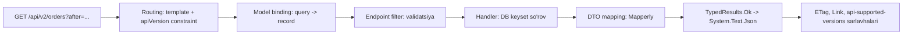

# 09. REST API dizayni

> **Bir jumlada:** API bu kontrakt: resurslar, HTTP fe'llari, status kodlar, xato formati, pagination va versiya siyosati bir marta to'g'ri tanlanadi, chunki frontend, mobil ilova va hamkorlar unga bog'lanib bo'lgach o'zgartirish qimmat.
> **Nega Middle uchun:** Junior endpoint yozadi. Middle "nega 409, 422 emas", "offset nega sekin", "POST'ni qanday idempotent qilamiz", "v2 chiqarganda v1 qachon o'chadi" savollariga javob beradi va API'ni bir necha yil yashaydigan qilib loyihalaydi.
> **O'qish vaqti:** ~40 daqiqa

## Mundarija

- [1. Muammo va yechim](#1-muammo-va-yechim)
- [2. Qanday ishlaydi](#2-qanday-ishlaydi)
- [3. Asosiy tushunchalar](#3-asosiy-tushunchalar)
- [4. Amaliy misol](#4-amaliy-misol)
- [5. Tipik xatolar va anti-patternlar](#5-tipik-xatolar-va-anti-patternlar)
- [6. Best practices checklist](#6-best-practices-checklist)
- [7. Suhbat savollari va javoblar](#7-suhbat-savollari-va-javoblar)
- [8. Qo'shimcha manbalar](#8-qoshimcha-manbalar)

## 1. Muammo va yechim

Buyurtma API'si `GET /orders?page=4000&size=50` so'roviga 9 soniyada javob berardi. Jadvalda 20 million qator; PostgreSQL `OFFSET 200000` uchun 200 050 qatorni o'qib, 200 000 tasini tashlab yuboradi. Mobil ilova "yana yuklash" tugmasida aynan shu so'rovni yuborar, foydalanuvchi pastga tushgani sari sekinlashar edi. Keyset pagination'ga o'tgach har sahifa 8 ms.

Ikkinchi holat: mobil ilova "To'lash" tugmasini bosdi, tarmoq uzildi, javob kelmadi, ilova qayta urindi. Server ikkita to'lov yaratdi. Mijoz 2 marta pul to'ladi. `POST /payments` idempotent emas edi, `Idempotency-Key` yo'q edi.

Uchinchi holat: hamkor integratsiyasida `customerName` maydoni `customer.fullName`ga ko'chirildi, "kichik refactoring". Uchta hamkor integratsiyasi bir kechada buzildi, chunki versiya yo'q, o'zgarish e'lon qilinmagan, hech kim bu maydonni kim ishlatishini bilmas edi.

To'rtinchi: har endpoint o'z xato formatini qaytarardi: biri `{ "error": "..." }`, boshqasi `{ "message": "...", "code": 5 }`, uchinchisi matn. Frontend'da xato ko'rsatish 400 qatorli `switch`.

Hammasi dizayn qarorlari: resurs modeli, status kodlar, standart xato formati (ProblemDetails), keyset pagination, idempotency key, versioning va breaking change siyosati. Shular bu bobda.

## 2. Qanday ishlaydi

### 2.1 REST kontrakt elementlari

REST (Representational State Transfer) bu HTTP semantikasidan to'liq foydalanish: resurs URL bilan identifikatsiya qilinadi, amal HTTP fe'li bilan, natija status kod bilan, format `Content-Type` bilan ifodalanadi. Mijoz bularni bilsa, har endpoint uchun alohida hujjat o'qimasdan ham xulqni taxmin qiladi: `GET` xavfsiz (holatni o'zgartirmaydi), `PUT`/`DELETE` idempotent (bir yoki ko'p marta chaqirish bir xil natija), `POST` ikkalasi ham emas.

Enterprise API'da bu "akademik" tushunchalar amaliy oqibat beradi: proxy va CDN `GET`ni keshlaydi, retry kutubxonalari `PUT`ni avtomatik qaytaradi lekin `POST`ni yo'q, brauzer `GET`ni prefetch qiladi. `GET /orders/123/cancel` yozsangiz, prefetch buyurtmani bekor qilishi mumkin.

### 2.2 ASP.NET Core'da so'rovdan javobgacha



`TypedResults.Ok(dto)` `IResult`ni qaytaradi; `ExecuteAsync(HttpContext)` paytida `IHttpJsonOptions`dagi sozlamalar bilan `JsonSerializer` ishlaydi va `Content-Type: application/json; charset=utf-8` qo'yadi. `TypedResults` (`Results`dan farqli) konkret tip qaytaradi (`Ok<OrderDto>`), shuning uchun OpenAPI generator javob tipini kod o'zgarishisiz biladi.

ProblemDetails: `AddProblemDetails()` `IProblemDetailsService`ni ro'yxatga oladi; `Results.Problem`, `Results.ValidationProblem`, `UseExceptionHandler` va `UseStatusCodePages` hammasi shu servis orqali `application/problem+json` yozadi.

## 3. Asosiy tushunchalar

### 3.1 Resurs modellash

- **Ta'rif:** URL otlardan (resurs) tuziladi, fe'l HTTP metodida. Ierarxiya egalikni bildiradi: `/orders/{id}/lines/{lineId}`. Kolleksiya ko'plikda: `/orders`, `/warehouses`.
- **Amal resurs emas:** `/orders/{id}/cancel` kabi "action" endpoint'lar REST'ga zid deb hisoblanadi, lekin amaliyotda holat o'tishi (state transition) uchun `POST /orders/{id}/cancel` yoki `POST /orders/{id}/cancellations` (bekor qilish hodisasi resurs sifatida) qabul qilingan. `PATCH /orders/{id} { "status": "cancelled" }` ham mumkin, lekin biznes qoidalar (kim, qachon bekor qila oladi) holat maydoni ortiga yashirinadi.
- **Chuqurlik:** 2-3 darajadan oshmasin. `/customers/{c}/orders/{o}/lines/{l}/discounts` o'rniga `/order-lines/{l}/discounts`.
- **Tipik xato:** `/getOrders`, `/createOrder`, `/orders/delete/5`. Fe'l URL'da: cache, retry, hujjat semantikasi yo'qoladi.

```text
GET    /api/v1/orders                  ro'yxat (pagination, filter)
POST   /api/v1/orders                  yaratish -> 201 + Location
GET    /api/v1/orders/{id}             bitta
PUT    /api/v1/orders/{id}             to'liq almashtirish (idempotent)
PATCH  /api/v1/orders/{id}             qisman (JSON Merge Patch)
DELETE /api/v1/orders/{id}             -> 204 (yoki 404)
POST   /api/v1/orders/{id}/cancel      holat o'tishi -> 200 yangi holat
GET    /api/v1/orders/{id}/lines       ichki kolleksiya
```

### 3.2 HTTP fe'llar va status kodlar

| Holat | Kod | Qachon | Body |
|---|---|---|---|
| O'qish muvaffaqiyatli | 200 OK | `GET`, `PATCH`/`PUT` natijani qaytarsa | Resurs |
| Yaratildi | 201 Created | `POST` yangi resurs | Yangi resurs yoki `{id}` + `Location` sarlavha |
| Qabul qilindi, keyin bajariladi | 202 Accepted | Uzoq ish (hisobot generatsiyasi) | Status URL |
| Muvaffaqiyat, body yo'q | 204 No Content | `DELETE`, body'siz `PUT` | Yo'q |
| O'zgarmagan | 304 Not Modified | `If-None-Match` mos kelsa | Yo'q |
| Noto'g'ri so'rov | 400 Bad Request | Sintaksis, bind xatosi, shakl validatsiyasi | ProblemDetails + `errors` |
| Kim ekani noma'lum | 401 Unauthorized | Token yo'q/yaroqsiz | `WWW-Authenticate` sarlavha |
| Kim ekani ma'lum, ruxsat yo'q | 403 Forbidden | Policy o'tmadi | ProblemDetails |
| Topilmadi | 404 Not Found | Resurs yo'q, yoki yashirish kerak (boshqa tenant) | ProblemDetails |
| Metod yo'q | 405 Method Not Allowed | Route bor, fe'l yo'q | `Allow` sarlavha |
| Konflikt | 409 Conflict | Unikal buzildi, holat o'tishi mumkin emas, concurrency | ProblemDetails |
| Shart bajarilmadi | 412 Precondition Failed | `If-Match` mos kelmadi | ProblemDetails |
| Semantik xato | 422 Unprocessable Content | Shakl to'g'ri, biznes qoida buzildi (balans yetmaydi) | ProblemDetails |
| Juda ko'p so'rov | 429 Too Many Requests | Rate limit | `Retry-After` |
| Server xatosi | 500 Internal Server Error | Kutilmagan exception | ProblemDetails + traceId, detail'siz |
| Tashqi servis | 502/503/504 | Upstream yo'q/timeout | `Retry-After` (503) |

400 va 422 chegarasi: 400 "so'rovni o'qiy olmadim yoki shakli noto'g'ri" (`quantity: "abc"`, `[Required]` yo'q), 422 "o'qidim, tushundim, lekin biznes qoidaga zid" (`quantity: 500`, omborda 3 ta). Ko'p jamoa ikkalasini 400 qiladi; muhimi, hujjatda yozilgan va izchil bo'lishi.

### 3.3 ProblemDetails (RFC 9457)

- **Ta'rif:** Xato javobining standart JSON shakli, `Content-Type: application/problem+json`. Maydonlar: `type` (xato turi URI, hujjatga havola), `title` (qisqa, o'zgarmas), `status`, `detail` (shu holat uchun izoh), `instance` (so'rov yo'li), va ixtiyoriy kengaytmalar (`errors`, `traceId`, `code`). RFC 9457 RFC 7807'ni almashtirgan (2023), farq asosan izohlarda, format bir xil.
- **Nega kerak:** Frontend bitta parser; `type` orqali mashina o'qiydigan xato turi (`https://api.wms.uz/problems/insufficient-stock`), `title` lokalizatsiyasiz, `detail` foydalanuvchiga.

```csharp
builder.Services.AddProblemDetails(o => o.CustomizeProblemDetails = ctx =>
{
    ctx.ProblemDetails.Instance = $"{ctx.HttpContext.Request.Method} {ctx.HttpContext.Request.Path}";
    ctx.ProblemDetails.Extensions["traceId"] = Activity.Current?.TraceId.ToString() ?? ctx.HttpContext.TraceIdentifier;
});

// Handler ichida
return TypedResults.Problem(
    type: "https://api.wms.uz/problems/insufficient-stock",
    title: "Omborda yetarli mahsulot yo'q",
    statusCode: StatusCodes.Status422UnprocessableEntity,
    detail: $"SKU {sku}: so'ralgan {requested}, mavjud {available}",
    extensions: new Dictionary<string, object?> { ["sku"] = sku, ["available"] = available });
```

Validatsiya xatolari uchun `HttpValidationProblemDetails`: `errors` lug'ati `{ "lines[0].quantity": ["1 dan katta bo'lishi kerak"] }`. `TypedResults.ValidationProblem(errors)` shu shaklni beradi.

- **Tipik xato:** `detail`ga exception xabari yoki stack trace yozish. 500 uchun `detail` umumiy, `traceId` orqali log'da qidiriladi (10-bob).

### 3.4 Versioning (Asp.Versioning)

- **Ta'rif:** Breaking change chiqarganda eski mijozlar ishlashda davom etishi uchun bir vaqtda bir nechta versiya. Paketlar: `Asp.Versioning.Http` (Minimal API), `Asp.Versioning.Mvc` + `Asp.Versioning.Mvc.ApiExplorer` (Controllers va OpenAPI).
- **Qayerda:** URL segment (`/api/v2/orders`, eng ko'rinadigan, cache'ga qulay), sarlavha (`X-Api-Version: 2`, URL toza), query (`?api-version=2`), media type (`Accept: application/json; v=2`). Enterprise'da URL segment: hamkor hujjatida va log'da darhol ko'rinadi.

```csharp
builder.Services.AddApiVersioning(o =>
{
    o.DefaultApiVersion = new ApiVersion(1, 0);
    o.AssumeDefaultVersionWhenUnspecified = true;   // eski mijozlar versiyasiz chaqirsa v1
    o.ReportApiVersions = true;                     // api-supported-versions, api-deprecated-versions sarlavhalari
    o.ApiVersionReader = ApiVersionReader.Combine(
        new UrlSegmentApiVersionReader(),
        new HeaderApiVersionReader("X-Api-Version"));
}).AddApiExplorer(o =>
{
    o.GroupNameFormat = "'v'VVV";                   // OpenAPI guruh nomi: v1, v2
    o.SubstituteApiVersionInUrl = true;
});

var versions = app.NewApiVersionSet()
    .HasDeprecatedApiVersion(new ApiVersion(1, 0))
    .HasApiVersion(new ApiVersion(2, 0))
    .ReportApiVersions()
    .Build();

var orders = app.MapGroup("/api/v{version:apiVersion}/orders").WithApiVersionSet(versions);
orders.MapGet("/", ListOrdersV1).MapToApiVersion(1, 0);
orders.MapGet("/", ListOrdersV2).MapToApiVersion(2, 0);
```

Deprecate qilingan versiya javobida `api-deprecated-versions: 1.0` sarlavhasi chiqadi; `Sunset` sarlavhasi (RFC 8594) uchun `o.Policies.Sunset(1.0).Effective(2027, 3, 31).Link("https://docs.wms.uz/api/v1-sunset").Title("v1 o'chiriladi")`.

- **Versiya granulyarligi:** butun API uchun bitta versiya (oddiy, hamkor uchun tushunarli) yoki resurs bo'yicha (`/orders` v2, `/customers` v1; moslashuvchan, lekin matritsa o'sadi). Ko'p loyihada butun API bo'yicha, major'lar kam (yiliga bir yoki kamroq).
- **Tipik xato:** Har kichik o'zgarish uchun yangi versiya. Qo'shimcha maydon, yangi endpoint, yangi ixtiyoriy parametr breaking emas, versiya kerak emas.

### 3.5 Pagination: offset vs keyset

- **Offset** (`?page=3&size=50` → `OFFSET 100 LIMIT 50`): oddiy, "N-sahifaga o'tish" mumkin, lekin DB `OFFSET`gacha bo'lgan qatorlarni o'qib tashlaydi (katta offset = sekin), va sahifalar orasida yangi qator qo'shilsa elementlar siljiydi (dublikat yoki o'tkazib yuborish).
- **Keyset** (cursor, `?after=<oxirgi kalit>&take=50` → `WHERE (created_at, id) < (?, ?) ORDER BY created_at DESC, id DESC LIMIT 50`): indeks bo'yicha to'g'ridan-to'g'ri o'tish, har sahifa bir xil tezlik, siljish yo'q. Kamchilik: "5-sahifa" yo'q, faqat keyingi/oldingi; tartiblash kaliti unikal bo'lishi shart (shuning uchun `id` qo'shiladi).

```csharp
public sealed record OrderPage(IReadOnlyList<OrderListItem> Items, string? NextCursor);

static async Task<Ok<OrderPage>> ListOrdersV2(
    [AsParameters] OrderListQuery q, OrdersDbContext db, ITenantContext tenant, CancellationToken ct)
{
    var take = Math.Clamp(q.Take ?? 50, 1, 200);
    var query = db.Orders.AsNoTracking().Where(o => o.TenantId == tenant.Id);

    // Cursor: base64("createdAtTicks:id"), mijoz uchun shaffof emas, biz uchun aniq
    if (Cursor.TryDecode(q.After, out var createdAt, out var id))
        query = query.Where(o => o.CreatedAt < createdAt || (o.CreatedAt == createdAt && o.Id < id));

    var rows = await query
        .OrderByDescending(o => o.CreatedAt).ThenByDescending(o => o.Id)
        .Take(take + 1)                                   // +1: keyingi sahifa bormi?
        .Select(o => new OrderListItem(o.Id, o.Number, o.CreatedAt, o.Total, o.Status))
        .ToListAsync(ct);

    var hasMore = rows.Count > take;
    var items = hasMore ? rows[..take] : rows;
    var next = hasMore ? Cursor.Encode(items[^1].CreatedAt, items[^1].Id) : null;
    return TypedResults.Ok(new OrderPage(items, next));
}
```

Indeks: `(tenant_id, created_at DESC, id DESC)`; shunda `WHERE` + `ORDER BY` + `LIMIT` bitta indeks skaniga tushadi. Umumiy soni (`totalCount`) kerak bo'lsa alohida `COUNT(*)` so'rovi; katta jadvalda uni taxminiy (`pg_class.reltuples`) yoki umuman bermaslik.

- **Tipik xato:** Keyset'da faqat `created_at` bo'yicha: ikki buyurtma bir xil vaqtda yaratilsa, biri o'tkazib yuboriladi. Tuple taqqoslash `(created_at, id)` shart.

### 3.6 Filtering va sorting

- Query parametrlari: `?status=paid&from=2026-10-01&to=2026-10-31&sort=-createdAt,number`. `-` prefiksi kamayish tartibi.
- **Whitelist shart:** `sort` qiymatini to'g'ridan-to'g'ri `OrderBy`ga dinamik berish (System.Linq.Dynamic.Core) mavjud bo'lmagan ustun uchun 500 va indeksiz ustun uchun full scan beradi. Ruxsat etilgan maydonlar lug'ati:

```csharp
static readonly Dictionary<string, Expression<Func<Order, object>>> SortFields = new(StringComparer.OrdinalIgnoreCase)
{
    ["createdAt"] = o => o.CreatedAt,
    ["number"] = o => o.Number,
    ["total"] = o => o.Total,
};

static IQueryable<Order> ApplySort(IQueryable<Order> q, string? sort)
{
    if (string.IsNullOrWhiteSpace(sort)) return q.OrderByDescending(o => o.CreatedAt).ThenByDescending(o => o.Id);
    IOrderedQueryable<Order>? ordered = null;
    foreach (var token in sort.Split(',', StringSplitOptions.RemoveEmptyEntries | StringSplitOptions.TrimEntries))
    {
        var desc = token.StartsWith('-');
        var field = desc ? token[1..] : token;
        if (!SortFields.TryGetValue(field, out var expr))
            throw new ValidationException($"sort: '{field}' bo'yicha tartiblash mumkin emas"); // 400 ga map qilinadi
        ordered = ordered is null
            ? (desc ? q.OrderByDescending(expr) : q.OrderBy(expr))
            : (desc ? ordered.ThenByDescending(expr) : ordered.ThenBy(expr));
    }
    return ordered!.ThenByDescending(o => o.Id); // keyset uchun unikal kalit
}
```

Murakkab filtrlash (OData, GraphQL) alohida qaror: OData `$filter` har qanday ustun bo'yicha so'rov beradi va DB'ni himoyasiz qoldiradi; enterprise'da aniq parametrlar afzal.

### 3.7 Idempotency key

- **Ta'rif:** Mijoz `POST`ga `Idempotency-Key: <uuid>` sarlavhasini qo'shadi; server shu kalit bilan birinchi javobni saqlaydi va takroriy so'rovga xuddi o'sha javobni qaytaradi, amalni qayta bajarmaydi. IETF draft `draft-ietf-httpapi-idempotency-key-header` shu sarlavhani standartlashtirmoqda (2026 holatiga hali draft).
- **Implementatsiya talablari:** (1) kalit + foydalanuvchi/tenant bo'yicha unikal; (2) birinchi so'rov hali bajarilayotganda ikkinchisi kelsa 409 yoki kutish; (3) bir xil kalit bilan boshqa body kelsa 422 (fingerprint solishtiriladi); (4) saqlash muddati (24 soat); (5) saqlash joyi DB jadval (tranzaksiya bilan birga) yoki Redis.

```csharp
public sealed class IdempotencyFilter(IDistributedCache cache) : IEndpointFilter
{
    public async ValueTask<object?> InvokeAsync(EndpointFilterInvocationContext ctx, EndpointFilterDelegate next)
    {
        var http = ctx.HttpContext;
        if (!http.Request.Headers.TryGetValue("Idempotency-Key", out var keyValues) || !Guid.TryParse(keyValues, out var key))
            return TypedResults.Problem(title: "Idempotency-Key sarlavhasi (UUID) shart", statusCode: 400);

        var user = http.User.FindFirst("sub")?.Value ?? "anon";
        var cacheKey = $"idem:{user}:{key}";

        // Body fingerprint: bir xil kalit, boshqa body = mijoz xatosi
        http.Request.EnableBuffering();
        var bodyHash = Convert.ToHexString(await SHA256.HashDataAsync(http.Request.Body, http.RequestAborted));
        http.Request.Body.Position = 0;

        var existing = await cache.GetStringAsync(cacheKey, http.RequestAborted);
        if (existing is not null)
        {
            var saved = JsonSerializer.Deserialize<SavedResponse>(existing)!;
            if (saved.BodyHash != bodyHash)
                return TypedResults.Problem(title: "Idempotency-Key boshqa so'rov uchun ishlatilgan", statusCode: 422);
            if (saved.Status == 0)
                return TypedResults.Problem(title: "So'rov hali bajarilmoqda", statusCode: 409);
            http.Response.Headers["Idempotent-Replayed"] = "true";
            return TypedResults.Content(saved.Body, "application/json", statusCode: saved.Status);
        }

        // "Bajarilmoqda" belgisi: parallel takror 409 oladi. Haqiqiy atomiklik uchun Redis SET NX yoki DB unikal indeks.
        await cache.SetStringAsync(cacheKey, JsonSerializer.Serialize(new SavedResponse(0, "", bodyHash)),
            new DistributedCacheEntryOptions { AbsoluteExpirationRelativeToNow = TimeSpan.FromMinutes(5) }, http.RequestAborted);

        var result = await next(ctx);

        // Natijani saqlash: IResult'ni ushlab olish uchun javobni buffer'ga yozamiz
        if (result is IValueHttpResult { Value: { } value } && result is IStatusCodeHttpResult { StatusCode: { } status })
        {
            var body = JsonSerializer.Serialize(value, value.GetType());
            await cache.SetStringAsync(cacheKey, JsonSerializer.Serialize(new SavedResponse(status, body, bodyHash)),
                new DistributedCacheEntryOptions { AbsoluteExpirationRelativeToNow = TimeSpan.FromHours(24) }, CancellationToken.None);
        }
        return result;
    }

    private sealed record SavedResponse(int Status, string Body, string BodyHash);
}

orders.MapPost("/", CreateOrder).AddEndpointFilter<IdempotencyFilter>();
```

`IDistributedCache` `GetString`/`SetString` o'rtasida race bor: ikki parallel so'rov ikkalasi ham `null` ko'rishi mumkin. Pul bilan bog'liq amalda buni DB jadvalida `(user_id, key)` unikal indeks bilan va amal bilan bir tranzaksiyada hal qiling; Redis bo'lsa `SET NX` (StackExchange.Redis `StringSetAsync(..., When.NotExists)`).

### 3.8 ETag va conditional requests

- **Ta'rif:** `ETag` javob sarlavhasi resurs versiyasini bildiradi. `GET` + `If-None-Match: "v7"` → o'zgarmagan bo'lsa 304 (body'siz, trafik tejaladi). `PUT` + `If-Match: "v7"` → boshqa kimdir o'zgartirgan bo'lsa 412 (optimistic concurrency, "oxirgi yozgan g'olib" muammosi yo'q).
- **ETag manbai:** EF Core `[Timestamp]`/`rowversion` yoki `xmin` (PostgreSQL), yoki `UpdatedAt` + `Version` ustuni; body hash ham mumkin (qimmatroq).

```csharp
orders.MapGet("/{id:guid}", async Task<Results<Ok<OrderDto>, NotFound, StatusCodeHttpResult>> (
    Guid id, HttpContext http, OrdersDbContext db, CancellationToken ct) =>
{
    var order = await db.Orders.AsNoTracking().FirstOrDefaultAsync(o => o.Id == id, ct);
    if (order is null) return TypedResults.NotFound();

    var etag = new EntityTagHeaderValue($"\"{order.Version}\"");
    var reqHeaders = http.Request.GetTypedHeaders();
    if (reqHeaders.IfNoneMatch.Any(t => t.Compare(etag, useStrongComparison: true)))
        return TypedResults.StatusCode(StatusCodes.Status304NotModified);

    http.Response.GetTypedHeaders().ETag = etag;
    return TypedResults.Ok(order.ToDto());
});

orders.MapPut("/{id:guid}", async Task<Results<Ok<OrderDto>, NotFound, ProblemHttpResult>> (
    Guid id, UpdateOrderRequest req, HttpContext http, OrdersDbContext db, CancellationToken ct) =>
{
    var order = await db.Orders.FirstOrDefaultAsync(o => o.Id == id, ct);
    if (order is null) return TypedResults.NotFound();

    var ifMatch = http.Request.GetTypedHeaders().IfMatch.FirstOrDefault();
    if (ifMatch is null)
        return TypedResults.Problem(title: "If-Match sarlavhasi shart", statusCode: 428); // Precondition Required
    if (ifMatch.Tag != $"\"{order.Version}\"")
        return TypedResults.Problem(title: "Resurs boshqa tomondan o'zgartirilgan", statusCode: 412);

    order.Apply(req);          // Version++ domain ichida
    await db.SaveChangesAsync(ct);
    http.Response.GetTypedHeaders().ETag = new EntityTagHeaderValue($"\"{order.Version}\"");
    return TypedResults.Ok(order.ToDto());
});
```

### 3.9 OpenAPI: .NET 10 built-in, Scalar, Swagger UI

- **Ta'rif:** `Microsoft.AspNetCore.OpenApi` (.NET 9+) hujjatni runtime'da generatsiya qiladi: `AddOpenApi()` + `MapOpenApi()` → `/openapi/v1.json`. .NET 10 da: OpenAPI 3.1 default (JSON Schema 2020-12), YAML (`/openapi/v1.yaml`), XML doc comment'lardan `summary`/`description` olish (source generator orqali, `<GenerateDocumentationFile>true</GenerateDocumentationFile>`), build vaqtida fayl generatsiya (`Microsoft.Extensions.ApiDescription.Server`).
- **Transformer'lar:** `AddDocumentTransformer` (sarlavha, server'lar, security scheme), `AddOperationTransformer` (har operatsiyaga, masalan, `Idempotency-Key` parametri qo'shish), `AddSchemaTransformer`.
- **UI:** Swashbuckle UI (`Swashbuckle.AspNetCore.SwaggerUI`, built-in hujjatga ulanadi) yoki Scalar (`Scalar.AspNetCore`, zamonaviy, kod misollari bilan). Faqat Development yoki autentifikatsiya ortida.

```csharp
builder.Services.AddOpenApi("v2", o =>
{
    o.AddDocumentTransformer((doc, ctx, ct) =>
    {
        doc.Info = new() { Title = "WMS Orders API", Version = "2.0", Description = "Buyurtma va ombor operatsiyalari" };
        return Task.CompletedTask;
    });
    o.AddDocumentTransformer<BearerSecuritySchemeTransformer>();
    o.AddOperationTransformer((op, ctx, ct) =>
    {
        if (ctx.Description.HttpMethod == "POST")
            (op.Parameters ??= []).Add(new() { Name = "Idempotency-Key", In = ParameterLocation.Header, Required = true });
        return Task.CompletedTask;
    });
});

if (app.Environment.IsDevelopment())
{
    app.MapOpenApi();                     // /openapi/v2.json
    app.MapScalarApiReference();          // /scalar/v2
}

// Endpoint metadata OpenAPI'ga tushadi:
orders.MapPost("/", CreateOrder)
    .WithName("CreateOrder")
    .WithSummary("Yangi buyurtma yaratish")
    .Produces<CreatedOrderResponse>(StatusCodes.Status201Created)
    .ProducesValidationProblem()
    .ProducesProblem(StatusCodes.Status409Conflict);
```

`TypedResults` va `Results<Ok<T>, NotFound>` qaytarish tipi bilan `Produces` chaqiruvlari kerak bo'lmaydi: generator tipdan o'qiydi.

### 3.10 DTO va mapping (Mapperly)

- **Nega DTO:** Domain/EF entity'ni to'g'ridan-to'g'ri qaytarish (1) ichki maydonlarni (narx hisoblash, tenant id) oshkor qiladi, (2) navigation property'lar tufayli siklik serialization yoki N+1, (3) entity o'zgarsa kontrakt o'zgaradi (breaking change bilmasdan). Over-posting: `PUT` body'da `IsPaid: true` kelsa va entity bind qilinsa, mijoz to'lovni "qilgan" bo'ladi.
- **Mapperly:** source generator (`Riok.Mapperly`), reflection'siz, kompilyatsiya vaqtida oddiy `new OrderDto { ... }` kodini yaratadi; xato (maydon mos kelmadi) build'da ogohlantirish sifatida chiqadi. AutoMapper 2025'dan tijoriy litsenziyaga o'tgan; Mapster alternativa, lekin reflection/IL emit.

```csharp
[Mapper]
public static partial class OrderMapper
{
    [MapProperty(nameof(Order.Customer.FullName), nameof(OrderDto.CustomerName))]
    [MapperIgnoreSource(nameof(Order.TenantId))]          // tashqariga chiqmaydi, aniq aytilgan
    public static partial OrderDto ToDto(this Order order);

    public static partial IQueryable<OrderListItem> ProjectToListItem(this IQueryable<Order> q); // EF Select'ga aylanadi
}
```

Generator chiqargan kodni `obj/` ichida ko'rish mumkin; `ProjectTo` versiyasi `Select(o => new OrderListItem(...))` expression'ini yaratadi, shuning uchun DB faqat kerakli ustunlarni o'qiydi.

### 3.11 Breaking change siyosati

**Breaking (yangi major yoki deprecate muddati kerak):** maydonni o'chirish yoki qayta nomlash; tipini o'zgartirish (`int` → `string`); ixtiyoriy parametrni majburiy qilish; validatsiyani qattiqlashtirish (avval 100 belgi, endi 50); status kodni o'zgartirish (400 → 422); URL o'zgartirish; enum qiymatini o'chirish; default tartibni o'zgartirish.

**Breaking emas:** yangi ixtiyoriy maydon javobda; yangi ixtiyoriy parametr; yangi endpoint; yangi enum qiymati (mijoz noma'lum qiymatga tayyor bo'lsa, hujjatda yozing); validatsiyani yumshatish.

Siyosat: (1) har breaking change yangi major versiyada; (2) eski versiya kamida N oy (odatda 6-12) deprecate holatda yashaydi, `api-deprecated-versions`, `Deprecation` (RFC 9745) va `Sunset` (RFC 8594) sarlavhalari bilan; (3) hamkorlar e-mail/changelog orqali xabardor; (4) deprecated versiya trafigi monitoring'da, nolga tushgach o'chiriladi; (5) consumer-driven contract test (Pact) yoki kamida OpenAPI diff (`oasdiff`) CI'da breaking change'ni avtomatik tutadi.

## 4. Amaliy misol

Buyurtma endpoint'lari moduli: v2, keyset, idempotent `POST`, ETag, ProblemDetails, Mapperly.

```csharp
public static class OrderEndpoints
{
    public static IEndpointRouteBuilder MapOrders(this IEndpointRouteBuilder app, ApiVersionSet versions)
    {
        var g = app.MapGroup("/api/v{version:apiVersion}/orders")
            .WithApiVersionSet(versions)
            .WithTags("Orders")
            .RequireAuthorization("orders.read")
            .AddEndpointFilter<TenantRequiredFilter>();

        g.MapGet("/", ListOrdersV2).MapToApiVersion(2, 0).WithName("ListOrders");
        g.MapGet("/{id:guid}", GetOrder).WithName("GetOrder");
        g.MapPost("/", CreateOrder)
            .RequireAuthorization("orders.write")
            .AddEndpointFilter<ValidationFilter<CreateOrderRequest>>()
            .AddEndpointFilter<IdempotencyFilter>()
            .WithName("CreateOrder")
            .WithSummary("Yangi buyurtma yaratish; Idempotency-Key shart");
        g.MapPost("/{id:guid}/cancel", CancelOrder).RequireAuthorization("orders.write").WithName("CancelOrder");
        return app;
    }

    // POST: 201 + Location, yoki 422 (biznes qoida), 409 (konflikt)
    static async Task<Results<CreatedAtRoute<CreatedOrderResponse>, ProblemHttpResult>> CreateOrder(
        CreateOrderRequest req, OrderService svc, HttpContext http, CancellationToken ct)
    {
        var result = await svc.PlaceAsync(req.ToCommand(), ct);
        if (result.IsFailure)
            return result.Error.ToProblem(http); // 10-bob: Error -> ProblemDetails mapping

        return TypedResults.CreatedAtRoute(
            new CreatedOrderResponse(result.Value),
            "GetOrder",
            new { version = "2", id = result.Value });
    }

    // Holat o'tishi: 200 yangi holat bilan; mumkin bo'lmasa 409
    static async Task<Results<Ok<OrderDto>, NotFound, ProblemHttpResult>> CancelOrder(
        Guid id, CancelOrderRequest req, OrdersDbContext db, IClock clock, CancellationToken ct)
    {
        var order = await db.Orders.Include(o => o.Lines).FirstOrDefaultAsync(o => o.Id == id, ct);
        if (order is null) return TypedResults.NotFound();

        if (!order.CanCancel(clock.UtcNow))
            return TypedResults.Problem(
                type: "https://api.wms.uz/problems/order-not-cancellable",
                title: "Buyurtmani bekor qilib bo'lmaydi",
                detail: $"Holat {order.Status}: faqat Draft yoki Paid (yuborilmagan) buyurtma bekor qilinadi",
                statusCode: StatusCodes.Status409Conflict);

        order.Cancel(req.Reason, clock.UtcNow);
        try
        {
            await db.SaveChangesAsync(ct);
        }
        catch (DbUpdateConcurrencyException)
        {
            // Parallel so'rov buyurtmani o'zgartirgan: mijoz qayta o'qib qayta urinsin
            return TypedResults.Problem(title: "Buyurtma parallel o'zgartirilgan, qayta yuklang", statusCode: 409);
        }
        return TypedResults.Ok(order.ToDto());
    }
}
```

Nega shunday: `Results<...>` union tipi OpenAPI'ga barcha javob variantlarini beradi va kompilyator faqat shu tiplarni qaytarishga majbur qiladi. `CreatedAtRoute` `Location: /api/v2/orders/{id}` sarlavhasini route nomidan quradi, URL qo'lda yozilmaydi. `CancelOrder` 409 uchun `type` URI beradi: frontend "bekor qilib bo'lmaydi" xabarini `title`dan emas, `type`dan taniydi, matn o'zgarsa ham ishlaydi. Concurrency xatosi 409 bilan, mijoz `GET` + qayta urinish qila oladi.

## 5. Tipik xatolar va anti-patternlar

### 5.1 Hamma narsa 200

```csharp
// ❌ { "success": false, "error": "not found" } 200 bilan
return Results.Ok(new { success = false, error = "not found" });
```

Nega yomon: proxy/CDN xatoni keshlaydi, monitoring 5xx/4xx ko'rmaydi, retry kutubxonalari muvaffaqiyat deb hisoblaydi, mijoz har javobda body'ni tekshirishi kerak.

```csharp
// ✅
return TypedResults.NotFound(); // yoki Problem(statusCode: 404)
```

### 5.2 Entity'ni to'g'ridan-to'g'ri qaytarish/qabul qilish

```csharp
// ❌ Order entity body'dan bind: mijoz TenantId, Total, Status yuborishi mumkin (over-posting)
app.MapPost("/orders", (Order order, OrdersDbContext db) => { db.Add(order); ... });
```

```csharp
// ✅ Request DTO faqat mijoz berishi mumkin bo'lgan maydonlar bilan; domain o'zi hisoblaydi
app.MapPost("/orders", (CreateOrderRequest req, OrderService svc) => svc.PlaceAsync(req.ToCommand()));
```

### 5.3 Offset pagination katta jadvalda

```csharp
// ❌ 20M qator, page=4000: OFFSET 200000, 9 soniya
db.Orders.OrderByDescending(o => o.CreatedAt).Skip((page - 1) * size).Take(size)
```

```csharp
// ✅ Keyset (3.5) va (created_at, id) indeks; UI'da "keyingi" tugma, sahifa raqamlari emas
```

### 5.4 `take` chegarasiz

```csharp
// ❌ ?take=1000000 -> OOM yoki DB bloklanadi
.Take(take)
```

```csharp
// ✅
var take = Math.Clamp(q.Take ?? 50, 1, 200);
```

### 5.5 Dinamik sort/filter whitelist'siz

```csharp
// ❌ System.Linq.Dynamic.Core: ?sort=Customer.PasswordHash ishlaydi; ?sort=NonExistent -> 500
q.OrderBy(sortParam)
```

```csharp
// ✅ 3.6 dagi lug'at; noma'lum maydon -> 400
```

### 5.6 `POST`ni idempotency'siz pul amallarida

```csharp
// ❌ Tarmoq uzilsa mijoz qayta yuboradi, ikki to'lov
app.MapPost("/payments", (PayRequest r, PaymentService s) => s.PayAsync(r));
```

```csharp
// ✅ Idempotency-Key majburiy, DB'da unikal (user, key), javob saqlanadi
app.MapPost("/payments", ...).AddEndpointFilter<IdempotencyFilter>();
```

### 5.7 Versioning'siz "kichik" o'zgarish

```csharp
// ❌ customerName -> customer.fullName, v1 ichida
```

Nega yomon: hamkorlar bir kechada buziladi, sababni topish ularning zimmasida.

```csharp
// ✅ Qo'shimcha sifatida: customer obyekti qo'shiladi, customerName qoladi (deprecated hujjatda), v3'da o'chadi
```

### 5.8 Swagger UI production'da ochiq

```csharp
// ❌ app.MapOpenApi(); app.MapScalarApiReference(); shartsiz
```

Nega yomon: ichki endpoint'lar, parametr nomlari, sxemalar hujumchi uchun xarita. Kerak bo'lsa autentifikatsiya ortida yoki faqat ichki tarmoqdan.

## 6. Best practices checklist

- [ ] URL otlardan, ko'plik, 3 darajadan chuqur emas; fe'l HTTP metodida: cache, retry va hujjat semantikasi saqlanadi.
- [ ] Status kodlar jadvalga mos va izchil (400 vs 422 qarori hujjatda): frontend bitta qoida bilan ishlaydi.
- [ ] Barcha xatolar `application/problem+json` (`AddProblemDetails`), `type` URI mashina uchun, `traceId` kengaytmasi: log bilan bog'lanadi.
- [ ] `TypedResults` va `Results<...>` union qaytarish tipi: OpenAPI aniq, kompilyator tekshiradi.
- [ ] Versiya URL segmentida, `Asp.Versioning`, `ReportApiVersions`, deprecate uchun `Sunset`: mijoz o'chirish muddatini sarlavhadan ko'radi.
- [ ] Ro'yxatlar keyset pagination, `take` `Clamp` bilan cheklangan, cursor shaffof bo'lmagan string: katta jadvalda barqaror tezlik.
- [ ] Sort/filter maydonlari whitelist'da, noma'lum maydon 400: indeksiz skan va 500 yo'q.
- [ ] Pul va yaratish amallarida `Idempotency-Key` majburiy, DB unikal indeks bilan: tarmoq retry ikki marta bajarmaydi.
- [ ] O'zgartiriladigan resurslarda `ETag` + `If-Match` (412), o'qishda `If-None-Match` (304): lost update yo'q, trafik tejaladi.
- [ ] Request va response DTO alohida, entity hech qachon bind qilinmaydi: over-posting va kontrakt sizib chiqishi yo'q.
- [ ] Mapping Mapperly (source generator): reflection yo'q, xato build'da.
- [ ] `201` da `Location` sarlavhasi `CreatedAtRoute` orqali: URL qo'lda yozilmaydi.
- [ ] OpenAPI hujjat CI'da generatsiya qilinadi va `oasdiff` bilan oldingi versiyaga solishtiriladi: breaking change PR'da ko'rinadi.
- [ ] Swagger/Scalar UI faqat Development yoki auth ortida: API xaritasi tashqariga chiqmaydi.
- [ ] Breaking change siyosati yozilgan (deprecate muddati, xabar berish kanali): hamkor kutilmagan buzilishga duch kelmaydi.

## 7. Suhbat savollari va javoblar

**1. 401 va 403 farqi?**
401: server mijoz kimligini aniqlay olmadi (token yo'q, muddati o'tgan, imzo noto'g'ri); javobda `WWW-Authenticate` bo'lishi kerak va mijoz autentifikatsiya qilib qayta urinishi mumkin. 403: kimligi ma'lum, lekin bu amalga ruxsati yo'q; qayta login yordam bermaydi. ASP.NET Core'da `UseAuthentication` muvaffaqiyatsiz bo'lsa va endpoint himoyalangan bo'lsa 401 (`Challenge`), policy o'tmasa 403 (`Forbid`). Tuzoq: resurs mavjudligini yashirish kerak bo'lganda (boshqa tenant'ning buyurtmasi) 403 emas, 404 qaytariladi.

**2. PUT va PATCH farqi?**
`PUT` resursni to'liq almashtiradi: body'da yo'q maydon default'ga tushadi, idempotent. `PATCH` qisman: faqat berilgan maydonlar o'zgaradi; format JSON Merge Patch (RFC 7396, oddiy obyekt, `null` o'chiradi) yoki JSON Patch (RFC 6902, operatsiyalar ro'yxati). `PATCH` o'z-o'zidan idempotent emas (masalan, `{"op":"add","path":"/lines/-"}`), lekin merge patch amalda idempotent. Tuzoq: `PATCH`da "maydon yo'q" va "maydon null" farqini C# DTO'da ifodalash: `Optional<T>` tipi yoki `JsonElement`; oddiy `string?` ikkisini ajrata olmaydi.

**3. Offset pagination katta jadvalda nega sekin?**
`OFFSET N` DB'ga N qatorni o'qib (indeks bo'yicha bo'lsa ham) tashlab yuborishni buyuradi; narx O(N + size). Sahifa 4000 bo'lsa, 200 000 qator o'qiladi. Qo'shimcha: sahifalar orasida yangi qator kirsa elementlar siljiydi, dublikat/o'tkazib yuborish. Keyset `WHERE (created_at, id) < (?, ?)` bilan indeksda to'g'ri joyga tushadi, O(size). Narxi: "N-sahifaga o'tish" yo'q, tartiblash kaliti unikal va indekslangan bo'lishi shart.

**4. Breaking change'ni qanday chiqarasiz?**
Yangi major versiya (`/v2`), eski versiya deprecate: `api-deprecated-versions`, `Deprecation` va `Sunset` sarlavhalari, hujjatda muddat, hamkorlarga xabar. Ikkalasi parallel yashaydi (odatda 6-12 oy), v1 trafigi monitoring'da; nolga yaqinlashgach o'chiriladi. Ichki kodda v1 handler'lari v2 servisini chaqirib eski shaklga map qiladi, biznes mantiq ikkilanmaydi. Tuzoq: breaking bo'lmagan o'zgarish uchun versiya ochmaslik; qo'shimcha maydon, yangi endpoint v1 ichida chiqadi.

**5. ProblemDetails nima, `type` va `title` farqi?**
RFC 9457 standart xato formati. `type` xato turining URI'si, mashina o'qiydi va hujjatga olib boradi (`.../problems/insufficient-stock`); `title` shu tur uchun o'zgarmas qisqa matn; `detail` aynan shu holat uchun izoh; `status` HTTP kod; `instance` so'rov; kengaytmalar (`errors`, `traceId`, `sku`). Frontend `type` bo'yicha tarmoqlanadi, matnlar lokalizatsiya qilinishi mumkin. ASP.NET Core'da `AddProblemDetails` + `Results.Problem`/`ValidationProblem`/`UseExceptionHandler` bitta formatni beradi.

**6. POST'ni idempotent qilish uchun nima kerak?**
Mijoz `Idempotency-Key` (UUID) yuboradi; server `(user, key)` bo'yicha birinchi javobni saqlaydi; takror kelsa saqlangan javob qaytadi, amal bajarilmaydi. Parallel takror uchun "bajarilmoqda" belgisi (409), boshqa body bilan bir xil kalit uchun 422, saqlash muddati 24 soat. Atomiklik: Redis `SET NX` yoki DB jadvalda unikal indeks, pul amalida amal bilan bir tranzaksiyada. Tuzoq: `IDistributedCache.Get` + `Set` race'ga ochiq; pul uchun yetarli emas.

**7. ETag qayerdan olinadi, `If-Match` nimani hal qiladi?**
`rowversion`/`xmin`/`Version` ustunidan: har yozuvda o'zgaradigan qiymat. `GET` javobida `ETag: "7"`; mijoz `PUT`da `If-Match: "7"` yuboradi; server joriy versiya boshqa bo'lsa 412 qaytaradi. Bu optimistic concurrency HTTP darajasida: ikki operator bir buyurtmani ochgan, biri saqlagan, ikkinchisining saqlashi birinchisini bosib qo'ymaydi. `If-None-Match` esa `GET`da 304 beradi, trafik va serializatsiya tejaladi. `428 Precondition Required` bilan `If-Match`ni majburiy qilish mumkin.

**8. Entity'ni to'g'ridan-to'g'ri qaytarsa nima bo'ladi?**
(1) Ichki maydonlar (`TenantId`, `CostPrice`, `PasswordHash`) oqadi; (2) navigation property'lar tufayli siklik serialization xatosi yoki lazy loading'da N+1; (3) entity refactoring kontraktni bilmasdan buzadi; (4) kirishda over-posting: mijoz `IsPaid=true` yuboradi. DTO + Mapperly: kontrakt alohida tip, kompilyator mapping'ni tekshiradi, `ProjectTo` bilan DB faqat kerakli ustunlarni o'qiydi.

**9. .NET 10 da OpenAPI uchun Swashbuckle kerakmi?**
Hujjat generatsiyasi uchun yo'q: `Microsoft.AspNetCore.OpenApi` built-in, OpenAPI 3.1, YAML, XML comment'lar, transformer'lar bor. Swashbuckle faqat UI (`SwaggerUI`) sifatida, yoki Scalar. Tuzoq: `Produces<T>` metadata'siz lambda handler `object` qaytarsa sxema bo'sh; `TypedResults` va `Results<...>` ishlating. OpenAPI 3.1 ba'zi eski client generator'larda qo'llanmaydi; `OpenApiVersion = OpenApiSpecVersion.OpenApi3_0` bilan qaytarish mumkin.

**10. 404 va 410, 409 va 422 qachon?**
410 Gone: resurs bor edi, ataylab o'chirilgan va qaytmaydi (deprecated endpoint, o'chirilgan hisob); 404: hozir yo'q. 409: resursning joriy holati bilan konflikt (unikal raqam band, "yuborilgan buyurtmani bekor qilib bo'lmaydi", concurrency); 422: so'rov sintaktik to'g'ri, lekin semantik qoidaga zid (balans yetmaydi, sana o'tmishda). Tuzoq: jamoa ichida chegara kelishilmasa, bir endpoint 409, boshqasi 422 qaytaradi; qoida hujjatda bo'lsin va `type` URI muhimroq, kod emas.

**11. Versiyani URL'da yoki sarlavhada berasizmi?**
URL segment: ko'rinadigan, brauzerda ochiladi, log va proxy qoidalarida oddiy, CDN keshida alohida; kamchiligi "URL resurs identifikatori, versiya emas" degan nazariy e'tiroz. Sarlavha/media type: URL toza, lekin cache kalitida `Vary` kerak, hujjat va debug qiyinroq. Enterprise va hamkor API'larda URL segment; ichki mikroservislar o'rtasida ko'pincha versiya umuman kerak emas (consumer bilan birga deploy). `Asp.Versioning` ikkalasini `Combine` bilan qo'llaydi.

## 8. Qo'shimcha manbalar

- RFC 9457 Problem Details: https://www.rfc-editor.org/rfc/rfc9457
- RFC 9110 HTTP Semantics (status kodlar, conditional requests): https://www.rfc-editor.org/rfc/rfc9110
- RFC 8594 Sunset header: https://www.rfc-editor.org/rfc/rfc8594
- RFC 9745 Deprecation header: https://www.rfc-editor.org/rfc/rfc9745
- Idempotency-Key draft: https://datatracker.ietf.org/doc/draft-ietf-httpapi-idempotency-key-header/
- ASP.NET Core ProblemDetails: https://learn.microsoft.com/aspnet/core/fundamentals/error-handling
- Microsoft.AspNetCore.OpenApi: https://learn.microsoft.com/aspnet/core/fundamentals/openapi/aspnetcore-openapi
- Asp.Versioning (dotnet/aspnet-api-versioning): https://github.com/dotnet/aspnet-api-versioning
- Scalar.AspNetCore: https://github.com/scalar/scalar/tree/main/integrations/aspnetcore
- Mapperly: https://mapperly.riok.app/
- Microsoft REST API Guidelines: https://github.com/microsoft/api-guidelines
- EF Core keyset pagination: https://learn.microsoft.com/ef/core/querying/pagination
- oasdiff (OpenAPI breaking change detektori): https://github.com/oasdiff/oasdiff
