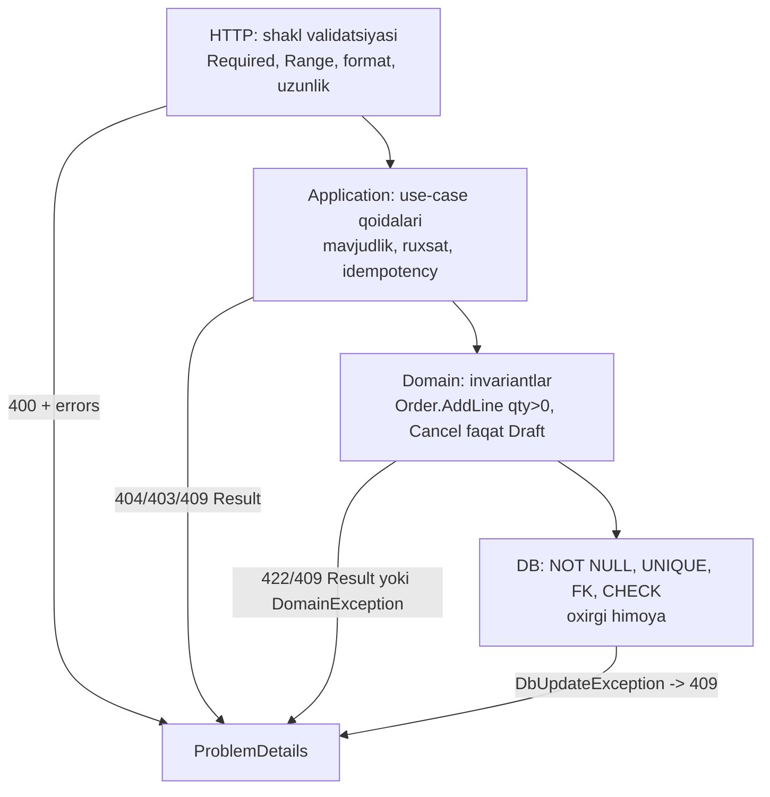

# 10. Validatsiya va xatolarni boshqarish

> **Bir jumlada:** Validatsiya qatlamlar bo'yicha bo'linadi (shakl API chegarasida, qoida domain'da), kutilgan xatolar `Result` bilan, kutilmaganlari exception bilan ifodalanadi, va hammasi bitta `IExceptionHandler` + ProblemDetails orqali xavfsiz, `traceId`li javobga aylanadi.
> **Nega Middle uchun:** Stack trace mijozga chiqib ketishi xavfsizlik incident'i; "topilmadi" uchun exception tashlash yuklamada CPU'ni yeydi; har qatlam o'z formatida xato qaytarsa frontend va qo'llab-quvvatlash azob chekadi. Bu uchalasi dizayn qarorlari, kutubxona tanlovi emas.
> **O'qish vaqti:** ~35 daqiqa

## Mundarija

- [1. Muammo va yechim](#1-muammo-va-yechim)
- [2. Qanday ishlaydi](#2-qanday-ishlaydi)
- [3. Asosiy tushunchalar](#3-asosiy-tushunchalar)
- [4. Amaliy misol](#4-amaliy-misol)
- [5. Tipik xatolar va anti-patternlar](#5-tipik-xatolar-va-anti-patternlar)
- [6. Best practices checklist](#6-best-practices-checklist)
- [7. Suhbat savollari va javoblar](#7-suhbat-savollari-va-javoblar)
- [8. Qo'shimcha manbalar](#8-qoshimcha-manbalar)

## 1. Muammo va yechim

To'lov servisida mijoz noto'g'ri karta raqami yuborganda javob shunday edi: `System.InvalidOperationException: Card not found at PaymentService.Charge() in /src/Payments/PaymentService.cs:line 84 ... Npgsql.NpgsqlConnection ... Host=10.0.3.7;Username=payments_rw`. Stack trace, fayl yo'llari, ichki IP va DB foydalanuvchisi tashqariga chiqdi. Sabab: `UseDeveloperExceptionPage` emas, jamoaning o'z middleware'i `ex.ToString()`ni qaytarardi.

Ikkinchi holat: buyurtma qidirish endpoint'ida mahsulot topilmasa `throw new NotFoundException()`. Katalog sinxronizatsiyasi 40 000 ta yo'q SKU bilan shu endpoint'ni chaqirdi. Sekundiga 2 000 exception, CPU 90%, boshqa endpoint'lar sekinlashdi. Exception stack unwinding va trace yig'ish oddiy `return null`dan yuz baravar qimmat.

Uchinchi holat: qo'llab-quvvatlash "mijoz 14:32 da 500 oldi" deydi. Log'da o'sha daqiqada 300 ta xato. Qaysi biri? Javobda `traceId` yo'q, mijoz skrinshotida faqat "Ichki xato".

To'rtinchi: validatsiya uch joyda: frontend, controller (`[Required]`), service (`if (string.IsNullOrEmpty(...)) throw`), DB (`NOT NULL`). Biri o'zgartirilsa boshqalari eskiradi; qaysi qatlam nimani tekshirishi aniq emas.

Yechim: qatlamlar bo'yicha aniq mas'uliyat, kutilgan/kutilmagan xatolarni ajratish, bitta global handler, xavfsiz javob, `traceId` orqali log'ga bog'lash.

## 2. Qanday ishlaydi

### 2.1 Exception ASP.NET Core'da qanday sayohat qiladi

Handler ichida exception chiqdi. U `await` zanjiri bo'ylab yuqoriga ko'tariladi: endpoint filter → `EndpointMiddleware` → sizning middleware'laringiz → `ExceptionHandlerMiddleware`. Bu middleware `try { await next(ctx); } catch (Exception ex)` shaklida; tutgach:

1. `ctx.Response.HasStarted` tekshiradi. Javob allaqachon boshlangan bo'lsa (sarlavhalar ketgan), hech narsa qila olmaydi: log yozadi va exception'ni qayta tashlaydi, Kestrel ulanishni uzadi.
2. Javobni tozalaydi (`Response.Clear()`), status 500 qo'yadi.
3. Ro'yxatga olingan `IExceptionHandler`larni **ro'yxat tartibida** chaqiradi; birinchisi `true` qaytarsa to'xtaydi.
4. Hech biri tutmasa: `IProblemDetailsService` bo'lsa, umumiy 500 ProblemDetails yozadi; bo'lmasa bo'sh 500.
5. `ExceptionHandlerMiddleware` xatoni `ILogger` orqali `Error` darajasida log qiladi (diagnostic `Microsoft.AspNetCore.Diagnostics.ExceptionHandlerMiddleware` kategoriyasi) va `IExceptionHandlerFeature`ga saqlaydi.

.NET 8+ da `UseExceptionHandler()` argumentsiz chaqirilganda `IExceptionHandler` yoki `IProblemDetailsService` ro'yxatga olingan bo'lishi shart, aks holda startup'da `InvalidOperationException`.

Minimal API'da ba'zi xatolar handler'ga yetmaydi: JSON body noto'g'ri bo'lsa (`JsonException`) framework o'zi 400 qaytaradi (`BadHttpRequestException` ichida); route parametri parse bo'lmasa ham 400. Bu holatlar `IExceptionHandler`ga tushmaydi.

### 2.2 Exception narxi

`throw` qilinganda runtime: (1) exception obyektini yaratadi, (2) stack trace yig'adi (har frame uchun metadata), (3) ikki bosqichli unwinding: avval mos `catch`ni qidiradi (first pass), keyin `finally`larni bajarib stack'ni buzadi (second pass), (4) first-chance exception hodisasini debugger/diagnostika uchun yuboradi. .NET 9 da exception handling NativeAOT'dan ko'chirilgan managed implementatsiyaga o'tdi va 2-4 barobar tezlashdi, lekin baribir: oddiy `return` nanosekund, `throw`/`catch` mikrosekundlar (chuqur stack'da o'nlab mikrosekund). Sekundiga minglab exception CPU'da ko'rinadi, `dotnet-counters`da `System.Runtime` `exception-count` o'sadi.

Qoida: exception **kutilmagan** holat uchun (DB yo'q, bug, invariant buzildi). **Kutilgan** biznes natija (topilmadi, balans yetmaydi, holat o'tishi mumkin emas) qaytariladigan qiymat: `Result`, `OneOf`, `ErrorOr`.

### 2.3 Validatsiya qatlamlari



Har qatlam faqat o'ziga tegishli narsani tekshiradi: HTTP qatlami DB'ga bormaydi (mavjudlikni tekshirmaydi), domain HTTP tushunchalarini bilmaydi (`400` yo'q, `Error` bor), DB cheklovlari bug'dan himoya (ikki parallel so'rov bir xil unikal raqam yaratishga urinsa, faqat DB uni to'xtatadi).

## 3. Asosiy tushunchalar

### 3.1 DataAnnotations

- **Ta'rif:** `System.ComponentModel.DataAnnotations` atributlari: `[Required]`, `[Range]`, `[StringLength]`, `[RegularExpression]`, `[EmailAddress]`, `[MinLength]`; murakkab qoida uchun `IValidatableObject.Validate`.
- **Qachon:** oddiy shakl tekshiruvi, options klasslari, DTO'lar. `[ApiController]` avtomatik 400 `ValidationProblemDetails` beradi.
- **Chegarasi:** cross-field qoidalar noqulay (`IValidatableObject` ichida), DI'dagi servisga kirish yo'q (`ValidationContext.GetService` bor, lekin ro'yxatga olish qo'lda), shartli qoidalar (`When`) yo'q, xabarlar atribut ichida.

```csharp
public sealed record CreateOrderRequest(
    [property: Required] Guid CustomerId,
    [property: Required, MinLength(1), MaxLength(50)] List<OrderLineRequest> Lines,
    [property: StringLength(500)] string? Comment);

public sealed record OrderLineRequest(
    [property: Required, RegularExpression("^[A-Z]{3}-\\d{4}$")] string Sku,
    [property: Range(1, 1000)] int Quantity);
```

### 3.2 .NET 10 built-in Minimal API validation

- **Ta'rif:** `builder.Services.AddValidation()` (paket `Microsoft.Extensions.Validation`, ASP.NET Core 10 bilan keladi). Minimal API handler parametrlari DataAnnotations va `IValidatableObject` bo'yicha avtomatik tekshiriladi, xato bo'lsa handler chaqirilmaydi, 400 `HttpValidationProblemDetails` qaytadi. Ichma-ich obyektlar va kolleksiyalar rekursiv tekshiriladi, xato kaliti `lines[0].quantity` ko'rinishida.
- **Ichki mexanizm:** source generator kompilyatsiya vaqtida handler parametrlaridan yetib boriladigan tiplar uchun validatsiya kodini yaratadi (reflection yo'q, AOT mos). Handler'dan yetib bo'lmaydigan tip uchun `[ValidatableType]` atributi. Endpoint uchun o'chirish: `.DisableValidation()`.

```csharp
builder.Services.AddValidation();
// Shundan keyin:
app.MapPost("/api/orders", (CreateOrderRequest req, OrderService svc, CancellationToken ct) => svc.PlaceAsync(req, ct));
// Noto'g'ri body:
// 400 { "type": "...", "title": "One or more validation errors occurred.", "status": 400,
//       "errors": { "lines[0].quantity": ["The field Quantity must be between 1 and 1000."] } }
```

- **Tipik xato:** FluentValidation endpoint filter'ini ham qo'shib ikkita validatsiya ketma-ket ishlashi va xabarlar ikki tilda chiqishi. Bitta mexanizm tanlang: oddiy DTO uchun built-in, murakkab uchun FluentValidation va `DisableValidation()`.

### 3.3 FluentValidation

- **Ta'rif:** Qoidalar alohida `AbstractValidator<T>` klassida, lambda bilan: `RuleFor(x => x.Quantity).InclusiveBetween(1, 1000)`. DI orqali boshqa servisga kirish, `MustAsync`, `When`, `RuleForEach`, `SetValidator` (ichki obyekt), `RuleSet`, custom xabarlar va lokalizatsiya.
- **Qachon:** cross-field va shartli qoidalar, DI kerak bo'lsa (masalan, SKU formatini konfiguratsiyadan olish), xabarlarni markazlashtirish.
- **Ro'yxatga olish:** `FluentValidation.DependencyInjectionExtensions` paketi, `AddValidatorsFromAssemblyContaining<CreateOrderValidator>()`. `FluentValidation.AspNetCore` paketining avtomatik MVC validatsiyasi muallif tomonidan tavsiya etilmaydi (asinxron qoidalar ishlamaydi); endpoint filter yoki handler ichida qo'lda chaqiring.

```csharp
public sealed class CreateOrderValidator : AbstractValidator<CreateOrderRequest>
{
    public CreateOrderValidator(IOptions<OrderOptions> options)
    {
        RuleFor(x => x.CustomerId).NotEmpty();
        RuleFor(x => x.Lines).NotEmpty().WithMessage("Kamida bitta qator kerak")
            .Must(l => l.Count <= options.Value.MaxLinesPerOrder)
            .WithMessage(x => $"Maksimum {options.Value.MaxLinesPerOrder} qator");
        RuleForEach(x => x.Lines).SetValidator(new OrderLineValidator());
        RuleFor(x => x.Lines).Must(l => l.Select(x => x.Sku).Distinct().Count() == l.Count)
            .WithMessage("SKU takrorlanmasin");                          // cross-item qoida
        RuleFor(x => x.DeliveryDate).GreaterThan(_ => DateOnly.FromDateTime(DateTime.UtcNow))
            .When(x => x.DeliveryDate is not null);                      // shartli
    }
}

public sealed class OrderLineValidator : AbstractValidator<OrderLineRequest>
{
    public OrderLineValidator()
    {
        RuleFor(x => x.Sku).NotEmpty().Matches("^[A-Z]{3}-\\d{4}$").WithMessage("SKU formati: ABC-1234");
        RuleFor(x => x.Quantity).InclusiveBetween(1, 1000);
    }
}
```

Endpoint filter (6-bobdagi `ValidationFilter<T>`): `validator.ValidateAsync` → `result.ToDictionary()` → `TypedResults.ValidationProblem(...)`. Shu bilan FluentValidation xatolari built-in bilan bir xil ProblemDetails shaklida chiqadi.

- **Tipik xato:** `MustAsync` ichida DB'ga borib mavjudlikni tekshirish ("CustomerId mavjudmi"). Bu application qatlamining ishi: validator `Customer` mavjudligini tekshirsa, handler yana DB'ga boradi (ikki so'rov) va race condition (tekshirdi, keyin o'chirildi). Mavjudlik use-case ichida, natija `Error.NotFound`.

### 3.4 Validatsiya taqqoslash

| Mezon | DataAnnotations + .NET 10 built-in | FluentValidation |
|---|---|---|
| Qoida joyi | DTO ustida atribut | Alohida klass |
| Cross-field | `IValidatableObject` (noqulay) | `Must`, `When` tabiiy |
| DI | Amalda yo'q | Konstruktor injection |
| Async qoida | Yo'q | `MustAsync` |
| Lokalizatsiya | `ErrorMessageResourceType` | `WithMessage`, `LanguageManager` |
| AOT | Ha (source gen) | Reflection, AOT emas |
| Qo'shimcha paket | Yo'q | FluentValidation (MIT, bepul) |
| Minimal API integratsiya | `AddValidation()` avtomatik | Endpoint filter qo'lda |
| Tavsiya | Oddiy DTO, options | Murakkab biznes shakllari |

### 3.5 Custom exception ierarxiyasi

- **Ta'rif:** Ilovaning o'z xatolari uchun bazaviy `AppException` va undan kelib chiqadigan konkret tiplar; har biri HTTP status va `type` URI'ga map qilinadi.
- **Nega kerak:** handler `switch` bilan bir joyda map qiladi; `catch (NotFoundException)` konkret; `ArgumentException` kabi umumiy tiplar bilan aralashmaydi.
- **Qachon exception, qachon Result:** ierarxiya kerak, lekin "topilmadi" va "balans yetmaydi" uchun uni tashlamang; ular `Result`. Exception: invariant buzildi (`DomainException`: kod xato ishlatilgan), tashqi bog'liqlik ishlamadi, mijoz bekor qildi.

```csharp
public abstract class AppException(string code, string message, Exception? inner = null) : Exception(message, inner)
{
    public string Code { get; } = code;   // "order.not_cancellable": type URI'ning oxirgi qismi
    public abstract int StatusCode { get; }
}

public sealed class NotFoundException(string entity, object key)
    : AppException("not_found", $"{entity} '{key}' topilmadi")
{ public override int StatusCode => StatusCodes.Status404NotFound; }

public sealed class ConflictException(string code, string message) : AppException(code, message)
{ public override int StatusCode => StatusCodes.Status409Conflict; }

public sealed class ForbiddenException(string message) : AppException("forbidden", message)
{ public override int StatusCode => StatusCodes.Status403Forbidden; }

// Domain invarianti buzildi: dasturchi xatosi yoki aldov, 422 bilan chiqadi, lekin log'da Warning
public sealed class DomainException(string code, string message) : AppException(code, message)
{ public override int StatusCode => StatusCodes.Status422UnprocessableEntity; }
```

### 3.6 Result pattern

- **Ta'rif:** Metod muvaffaqiyat yoki xatoni qaytariladigan qiymatda ifodalaydi; chaqiruvchi ikkalasini ham ko'rib chiqishga majbur. Exception'dan farqi: kutilgan natija, arzon, imzoda ko'rinadi (`Task<Result<Order>>`: "xato bo'lishi mumkin" degani).
- **O'z implementatsiyasi** (kichik, bog'liqliksiz):

```csharp
public enum ErrorType { Validation, NotFound, Conflict, Forbidden, Unexpected }

public sealed record Error(string Code, string Description, ErrorType Type)
{
    public static Error Validation(string code, string d) => new(code, d, ErrorType.Validation);
    public static Error NotFound(string code, string d) => new(code, d, ErrorType.NotFound);
    public static Error Conflict(string code, string d) => new(code, d, ErrorType.Conflict);
    public static Error Forbidden(string code, string d) => new(code, d, ErrorType.Forbidden);
}

public readonly struct Result<T>
{
    private readonly T? _value;
    public Error? Error { get; }
    public bool IsSuccess => Error is null;
    public bool IsFailure => Error is not null;
    public T Value => IsSuccess ? _value! : throw new InvalidOperationException("Xatoli Result'dan Value o'qildi");

    private Result(T value) { _value = value; Error = null; }
    private Result(Error error) { _value = default; Error = error; }

    public static implicit operator Result<T>(T value) => new(value);    // return order.Id;
    public static implicit operator Result<T>(Error error) => new(error); // return Error.NotFound(...);

    public TOut Match<TOut>(Func<T, TOut> onSuccess, Func<Error, TOut> onFailure)
        => IsSuccess ? onSuccess(_value!) : onFailure(Error!);
}
```

HTTP'ga map qilish, C# 14 extension member sintaksisi bilan:

```csharp
public static class ErrorHttpExtensions
{
    extension(Error error)
    {
        public ProblemHttpResult ToProblem(HttpContext http) => TypedResults.Problem(
            type: $"https://api.wms.uz/problems/{error.Code}",
            title: error.Type switch
            {
                ErrorType.Validation => "So'rov qoidaga zid",
                ErrorType.NotFound => "Topilmadi",
                ErrorType.Conflict => "Konflikt",
                ErrorType.Forbidden => "Ruxsat yo'q",
                _ => "Ichki xato"
            },
            detail: error.Description,
            statusCode: error.Type switch
            {
                ErrorType.Validation => StatusCodes.Status422UnprocessableEntity,
                ErrorType.NotFound => StatusCodes.Status404NotFound,
                ErrorType.Conflict => StatusCodes.Status409Conflict,
                ErrorType.Forbidden => StatusCodes.Status403Forbidden,
                _ => StatusCodes.Status500InternalServerError
            },
            extensions: new Dictionary<string, object?>
            {
                ["code"] = error.Code,
                ["traceId"] = Activity.Current?.TraceId.ToString() ?? http.TraceIdentifier
            });
    }
}
```

- **Tayyor kutubxonalar:** `ErrorOr` (`ErrorOr<T>`, `Error.NotFound(...)`, `Errors` ro'yxati, `Match`, `Then` zanjiri; MIT) va `OneOf` (`OneOf<Order, NotFound, ValidationFailed>` diskriminant union, `Match`/`Switch`, kompilyator barcha holatlarni talab qiladi). C# 14 da til darajasidagi union hali yo'q (.NET 11 preview'da muhokama), shuning uchun kutubxona yoki o'z tipi.
- **Tipik xato:** `Result`ni qaytarib, chaqiruvchida `.Value`ni tekshirmasdan o'qish: exception'ni `Result`ga, keyin yana exception'ga aylantirdingiz. `Match` yoki `IsFailure` tekshiruvi majburiy; analyzer (`ErrorOr` uchun yo'q, lekin `Result` struct'ini `[MustUseReturnValue]` bilan belgilash mumkin).

### 3.7 IExceptionHandler to'liq implementatsiya

- **Ta'rif:** `.NET 8+` interfeysi: `ValueTask<bool> TryHandleAsync(HttpContext, Exception, CancellationToken)`. `true`: tutildi, javob yozildi; `false`: keyingi handler. Ro'yxat: `AddExceptionHandler<T>()`, tartib muhim.
- **Dizayn:** ikkita handler: `AppExceptionHandler` (bizning tiplar, 4xx, Warning log) va `GlobalExceptionHandler` (qolgan hammasi, 500, Error log, detail yashirin). Alohida: `OperationCanceledException` mijoz uzilganda (log shovqini emas), `DbUpdateConcurrencyException` → 409, `BadHttpRequestException` → o'z statusi.

```csharp
public sealed class AppExceptionHandler(IProblemDetailsService problems, ILogger<AppExceptionHandler> log) : IExceptionHandler
{
    public async ValueTask<bool> TryHandleAsync(HttpContext http, Exception ex, CancellationToken ct)
    {
        if (ex is not AppException app) return false;      // bizniki emas, keyingi handler

        log.LogWarning("Kutilgan xato {Code} {Path}: {Message}", app.Code, http.Request.Path, app.Message);
        http.Response.StatusCode = app.StatusCode;
        return await problems.TryWriteAsync(new ProblemDetailsContext
        {
            HttpContext = http,
            Exception = ex,
            ProblemDetails = new ProblemDetails
            {
                Type = $"https://api.wms.uz/problems/{app.Code}",
                Title = app.StatusCode switch { 404 => "Topilmadi", 409 => "Konflikt", 403 => "Ruxsat yo'q", _ => "So'rov bajarilmadi" },
                Status = app.StatusCode,
                Detail = app.Message,                        // AppException xabari mijozga mo'ljallangan
                Extensions = { ["code"] = app.Code }
            }
        });
    }
}

public sealed class GlobalExceptionHandler(
    IProblemDetailsService problems, IHostEnvironment env, ILogger<GlobalExceptionHandler> log) : IExceptionHandler
{
    public async ValueTask<bool> TryHandleAsync(HttpContext http, Exception ex, CancellationToken ct)
    {
        var traceId = Activity.Current?.TraceId.ToString() ?? http.TraceIdentifier;

        var (status, title, logLevel) = ex switch
        {
            OperationCanceledException when http.RequestAborted.IsCancellationRequested
                => (499, "Mijoz so'rovni bekor qildi", LogLevel.Information),      // nginx uslubidagi 499, log shovqini emas
            DbUpdateConcurrencyException => (StatusCodes.Status409Conflict, "Ma'lumot parallel o'zgartirilgan", LogLevel.Warning),
            DbUpdateException { InnerException: PostgresException { SqlState: "23505" } }
                => (StatusCodes.Status409Conflict, "Takroriy yozuv", LogLevel.Warning),                // unique_violation
            BadHttpRequestException bad => (bad.StatusCode, "So'rov noto'g'ri", LogLevel.Warning),
            TimeoutException or HttpRequestException => (StatusCodes.Status502BadGateway, "Tashqi servis javob bermadi", LogLevel.Error),
            _ => (StatusCodes.Status500InternalServerError, "Ichki xato", LogLevel.Error)
        };

        // Exception obyektini birinchi argument sifatida: stack trace strukturali log'ga tushadi
        log.Log(logLevel, ex, "Unhandled {ExceptionType} -> {Status} {Method} {Path} traceId={TraceId}",
            ex.GetType().Name, status, http.Request.Method, http.Request.Path, traceId);

        http.Response.StatusCode = status;
        var problem = new ProblemDetails
        {
            Type = $"https://api.wms.uz/problems/{(status >= 500 ? "internal" : "request")}",
            Title = title,
            Status = status,
            // Production'da detail umumiy; Development'da exception xabari (stack trace emas, u log'da)
            Detail = env.IsDevelopment() ? ex.Message : "So'rovni bajarib bo'lmadi. traceId bilan murojaat qiling.",
            Extensions = { ["traceId"] = traceId }
        };
        if (env.IsDevelopment()) problem.Extensions["exception"] = ex.GetType().FullName;

        return await problems.TryWriteAsync(new ProblemDetailsContext { HttpContext = http, Exception = ex, ProblemDetails = problem });
    }
}

// Program.cs: tartib = ro'yxat tartibi
builder.Services.AddProblemDetails(o => o.CustomizeProblemDetails = ctx =>
    ctx.ProblemDetails.Extensions.TryAdd("traceId", Activity.Current?.TraceId.ToString() ?? ctx.HttpContext.TraceIdentifier));
builder.Services.AddExceptionHandler<AppExceptionHandler>();
builder.Services.AddExceptionHandler<GlobalExceptionHandler>();
var app = builder.Build();
app.UseExceptionHandler();          // eng tepada (6-bob)
app.UseStatusCodePages();           // body'siz 404/405 ham ProblemDetails bo'lsin
```

`IProblemDetailsService.TryWriteAsync` `CustomizeProblemDetails`ni ham qo'llaydi va `Accept` sarlavhasiga qarab yozadi (mijoz JSON qabul qilmasa `false` qaytaradi; shunda middleware bo'sh status bilan javob beradi).

### 3.8 traceId va logging bilan bog'lash

- **Ikkita identifikator:** `HttpContext.TraceIdentifier` Kestrel ulanish id'si + ketma-ket raqam (`0HN7A2B3C4D5E:00000003`), faqat shu jarayonda ma'noli. `Activity.Current.TraceId` W3C Trace Context (`traceparent` sarlavha), 32 hex belgi, OpenTelemetry orqali barcha servislar va log'larda bir xil. Distributed tizimda ikkinchisi; shuning uchun yuqorida `Activity.Current?.TraceId` birinchi.
- **Log'da:** `Microsoft.Extensions.Logging` `ActivityTrackingOptions` bilan `TraceId`/`SpanId`ni scope sifatida qo'shadi (`builder.Logging.Configure(o => o.ActivityTrackingOptions = ActivityTrackingOptions.TraceId | ActivityTrackingOptions.SpanId)`); Serilog'da `Enrich.WithSpan()` yoki OpenTelemetry sink. Natija: mijoz `traceId`ni aytadi, siz Seq/Grafana'da `TraceId = "..."` deb qidirasiz va so'rovning barcha log qatorlari, SQL'lari, tashqi chaqiruvlari chiqadi.
- **Log darajasi:** 5xx → `Error` (exception bilan), kutilgan 4xx → `Warning` yoki `Information`, validatsiya 400 → `Debug` (hajm katta, qiymati kam), mijoz bekor qilgan → `Information`. 404'ni `Error` qilish alert'larni shovqinga ko'madi.

### 3.9 Production'da xavfsiz xato javobi

Mijozga chiqmaydi: stack trace, exception tipi va xabari (`ex.Message` DB jadval nomlari, fayl yo'li, connection string bo'lagi bo'lishi mumkin), SQL matni, ichki IP/host, kutubxona versiyalari. Chiqadi: `type`, `title`, `status`, umumiy `detail`, `traceId`, `code`. `DeveloperExceptionPage` faqat Development (`WebApplication` o'zi shunday qiladi, lekin `ASPNETCORE_ENVIRONMENT=Development` production'da qolib ketmasin). `AppException.Message` mijozga mo'ljallab yoziladi, shuning uchun u `detail`ga chiqishi mumkin; boshqa exception'lar xabari hech qachon.

## 4. Amaliy misol

Buyurtma yaratish: validatsiya (FluentValidation filter), application `Result`, domain invariant, DB cheklovi, va hammasi ProblemDetails'ga.

```csharp
// Domain/Order.cs: invariantlar konstruktor va metodlarda, HTTP haqida bilmaydi
public sealed class Order
{
    private readonly List<OrderLine> _lines = [];
    public Guid Id { get; private set; }
    public Guid TenantId { get; private set; }
    public OrderStatus Status { get; private set; }
    public uint Version { get; private set; }      // PostgreSQL xmin -> concurrency token
    public IReadOnlyList<OrderLine> Lines => _lines;
    public decimal Total => _lines.Sum(l => l.Quantity * l.UnitPrice);

    public static Order Create(Guid tenantId, Guid customerId) =>
        new() { Id = Guid.CreateVersion7(), TenantId = tenantId, Status = OrderStatus.Draft };

    public void AddLine(string sku, int quantity, decimal unitPrice)
    {
        // Bu yerga 0 kelishi dasturchi xatosi: HTTP qatlami allaqachon tekshirgan. Shuning uchun exception.
        if (quantity <= 0) throw new DomainException("order.invalid_quantity", "Miqdor musbat bo'lishi kerak");
        if (Status != OrderStatus.Draft) throw new DomainException("order.not_editable", $"Holat {Status}: qator qo'shib bo'lmaydi");
        _lines.Add(new OrderLine(sku, quantity, unitPrice));
    }

    public void Submit()
    {
        if (_lines.Count == 0) throw new DomainException("order.empty", "Bo'sh buyurtma yuborilmaydi");
        Status = OrderStatus.Submitted;
    }
}
```

```csharp
// Application/PlaceOrderHandler.cs: kutilgan holatlar Result bilan
public sealed class PlaceOrderHandler(OrdersDbContext db, ICurrentUser user, IPriceCatalog prices, IStockClient stock)
{
    public async Task<Result<Guid>> HandleAsync(PlaceOrderCommand cmd, CancellationToken ct)
    {
        // Mavjudlik: application qatlami, 404 emas 422: so'rov "noto'g'ri mijoz" bilan kelgan
        var customerExists = await db.Customers.AnyAsync(c => c.Id == cmd.CustomerId && c.TenantId == user.TenantId, ct);
        if (!customerExists)
            return Error.Validation("customer.unknown", $"Mijoz {cmd.CustomerId} topilmadi");

        var order = Order.Create(user.TenantId, cmd.CustomerId);
        foreach (var line in cmd.Lines)
        {
            var price = await prices.GetAsync(line.Sku, ct);
            if (price is null)
                return Error.Validation("sku.unknown", $"SKU {line.Sku} katalogda yo'q");
            order.AddLine(line.Sku, line.Quantity, price.Value);
        }

        // Tashqi servis: kutilgan biznes natija (yo'q) Result, tarmoq xatosi exception (502 ga map)
        var reservation = await stock.ReserveAsync(order.Id, order.Lines, ct);
        if (!reservation.Succeeded)
            return Error.Conflict("stock.insufficient", $"Yetarli emas: {string.Join(", ", reservation.MissingSkus)}");

        order.Submit();
        db.Orders.Add(order);
        await db.SaveChangesAsync(ct);   // unikal raqam to'qnashsa DbUpdateException -> GlobalExceptionHandler -> 409
        return order.Id;
    }
}
```

```csharp
// Endpoints/OrderEndpoints.cs
orders.MapPost("/", async Task<Results<CreatedAtRoute<CreatedOrderResponse>, ProblemHttpResult>> (
        CreateOrderRequest req, PlaceOrderHandler handler, HttpContext http, CancellationToken ct) =>
    {
        var result = await handler.HandleAsync(req.ToCommand(), ct);
        return result.Match<Results<CreatedAtRoute<CreatedOrderResponse>, ProblemHttpResult>>(
            id => TypedResults.CreatedAtRoute(new CreatedOrderResponse(id), "GetOrder", new { id }),
            error => error.ToProblem(http));
    })
    .AddEndpointFilter<ValidationFilter<CreateOrderRequest>>()   // 400: shakl
    .DisableValidation()                                          // .NET 10 built-in'ni o'chiramiz, FluentValidation ishlaydi
    .ProducesValidationProblem()
    .ProducesProblem(StatusCodes.Status422UnprocessableEntity)
    .ProducesProblem(StatusCodes.Status409Conflict);
```

Xato oqimi:

| Holat | Qatlam | Mexanizm | Javob |
|---|---|---|---|
| `quantity: 0` | HTTP | FluentValidation filter | 400, `errors.lines[0].quantity` |
| Noma'lum mijoz | Application | `Error.Validation` | 422, `code: customer.unknown` |
| Ombor yetarli emas | Application (tashqi) | `Error.Conflict` | 409, `code: stock.insufficient` |
| Ombor servisi timeout | Tashqi | `HttpRequestException` → `GlobalExceptionHandler` | 502, `traceId` |
| Parallel takroriy raqam | DB | `DbUpdateException` 23505 → handler | 409 |
| Mijoz brauzerni yopdi | Kestrel | `OperationCanceledException` | 499, log Information |
| Bug: `AddLine` 0 bilan | Domain | `DomainException` → `AppExceptionHandler` | 422, log Warning |

Nega `DomainException` 422 bilan chiqadi, 500 emas: HTTP qatlami tekshiruvi bo'lmagan yo'ldan (masalan, ichki import) kelgan noto'g'ri ma'lumot ham mijozga tushunarli javob olsin; lekin log'da u Warning va bu holat ko'p takrorlansa HTTP qatlamida yetishmayotgan tekshiruv borligini bildiradi.

## 5. Tipik xatolar va anti-patternlar

### 5.1 Exception control flow sifatida

```csharp
// ❌ Har "topilmadi" uchun throw: yuklamada CPU, stack trace, log shovqini
public async Task<Order> GetAsync(Guid id) =>
    await db.Orders.FindAsync(id) ?? throw new NotFoundException("Order", id);
```

```csharp
// ✅ Kutilgan holat Result; exception faqat kutilmagan uchun
public async Task<Result<Order>> GetAsync(Guid id, CancellationToken ct) =>
    await db.Orders.FindAsync([id], ct) is { } o ? o : Error.NotFound("order.not_found", $"Buyurtma {id} topilmadi");
```

### 5.2 `catch (Exception) { }` yoki `throw ex;`

```csharp
// ❌ Yutilgan xato: ma'lumot yo'qoladi, hech kim bilmaydi
try { await db.SaveChangesAsync(); } catch (Exception) { }
// ❌ throw ex: stack trace qayta boshlanadi, asl joy yo'qoladi
catch (Exception ex) { log.LogError(ex, "..."); throw ex; }
```

```csharp
// ✅ Faqat bilgan narsangizni tuting, qolganini o'tkazing; qayta tashlash `throw;`
catch (DbUpdateConcurrencyException) { return Error.Conflict("order.concurrent", "Qayta yuklang"); }
// yoki
catch (Exception ex) when (ShouldWrap(ex)) { throw new InfrastructureException("...", ex); } // inner saqlanadi
```

### 5.3 Exception xabarini mijozga chiqarish

```csharp
// ❌ Production'da ex.Message/ToString()
await ctx.Response.WriteAsJsonAsync(new { error = ex.ToString() });
```

Nega yomon: stack trace, fayl yo'li, connection string bo'laklari, kutubxona versiyalari oshkor.

```csharp
// ✅ 3.7 dagi GlobalExceptionHandler: umumiy detail + traceId, tafsilot log'da
```

### 5.4 Validatsiya controller'da `if` bilan

```csharp
// ❌ Har endpoint'da takror, xabar formati har xil
if (req.Lines.Count == 0) return BadRequest("lines bo'sh");
if (req.Lines.Any(l => l.Quantity <= 0)) return BadRequest(new { msg = "qty" });
```

```csharp
// ✅ Validator klassi + filter, bitta ProblemDetails shakli
```

### 5.5 Domain'dan HTTP status qaytarish

```csharp
// ❌ Domain HTTP'ni biladi: boshqa transport (gRPC, queue) uchun yaroqsiz
public void Cancel() { if (Status != Draft) throw new HttpResponseException(409); }
```

```csharp
// ✅ Domain Error/DomainException, mapping API qatlamida (ToProblem, IExceptionHandler)
```

### 5.6 `OperationCanceledException`ni Error sifatida log qilish

```csharp
// ❌ Mijoz sahifani yopdi: Error log, alert, on-call uyg'onadi
```

```csharp
// ✅ when (http.RequestAborted.IsCancellationRequested) -> 499, Information (3.7)
```

### 5.7 Ikki validatsiya mexanizmi bir vaqtda

```csharp
// ❌ AddValidation() + FluentValidation filter: ikki marta tekshiruv, ikki xil xabar
```

```csharp
// ✅ Endpoint bo'yicha bittasi: .DisableValidation() FluentValidation ishlatilgan joyda
```

### 5.8 Generic `catch` ichida javob yozib, keyin `throw`

```csharp
// ❌ Javob boshlangan, keyin exception: ExceptionHandler hech narsa qila olmaydi, ulanish uziladi
await ctx.Response.WriteAsync("partial"); throw new Exception();
```

Qoida: javob yozishdan oldin xato chiqishi mumkin bo'lgan hamma ishni tugating; streaming'da xato bo'lsa, uni body ichida protokol darajasida (masalan, SSE `event: error`) bildiring.

## 6. Best practices checklist

- [ ] Shakl validatsiyasi API chegarasida (built-in yoki FluentValidation), mavjudlik va ruxsat application'da, invariant domain'da, cheklov DB'da: har qatlam o'z ishini qiladi, takror yo'q.
- [ ] Kutilgan biznes natijalar `Result`/`ErrorOr`/`OneOf`, exception faqat kutilmagan holat uchun: CPU va log shovqini tejaladi, imzo xatoni ko'rsatadi.
- [ ] Bitta `UseExceptionHandler` + `AddProblemDetails`, `IExceptionHandler` zanjiri (app → global): barcha xatolar bir formatda.
- [ ] `AppException` ierarxiyasi `Code` va `StatusCode` bilan; `ArgumentException`/`InvalidOperationException` HTTP'ga map qilinmaydi (500 qoladi).
- [ ] Production `detail` umumiy, `traceId` har xato javobida; `ex.Message` va stack trace faqat log'da.
- [ ] `traceId` = `Activity.Current.TraceId` (W3C), log'da `ActivityTrackingOptions` yoki Serilog enricher bilan: mijoz aytgan id bilan to'liq so'rov topiladi.
- [ ] Log darajalari: 5xx Error (exception obyekti bilan), kutilgan 4xx Warning, validatsiya Debug, bekor qilingan so'rov Information.
- [ ] `OperationCanceledException` `RequestAborted` bo'lsa 499/Information: on-call shovqinsiz.
- [ ] `DbUpdateConcurrencyException` → 409, unique violation → 409, `BadHttpRequestException` → o'z statusi: DB va transport xatolari ham ProblemDetails.
- [ ] `throw;` ishlating, `throw ex;` emas; wrap qilganda `inner` bering: asl stack trace saqlanadi.
- [ ] `catch` faqat tutib hal qila oladigan tip uchun; `catch (Exception)` faqat eng tashqi chegarada (handler, background loop).
- [ ] Validatsiya mexanizmi endpoint bo'yicha bitta; `DisableValidation()` FluentValidation ishlatilgan joyda.
- [ ] `UseStatusCodePages()` body'siz 404/405/415 uchun: mijoz har doim `problem+json` oladi.
- [ ] Xato javoblari OpenAPI'da (`ProducesProblem`, `ProducesValidationProblem`): mijoz generator'i xato tiplarini biladi.

## 7. Suhbat savollari va javoblar

**1. Exception'ni control flow uchun ishlatish nega yomon?**
`throw` runtime'da stack trace yig'ish, ikki bosqichli unwinding, first-chance hodisa degani: oddiy `return`dan yuz-ming barobar qimmat, .NET 9 tezlashuviga qaramay mikrosekundlar. Yuklamada "topilmadi" uchun throw qilinsa sekundiga minglab exception CPU'ni yeydi. Semantik tomondan: kutilgan natija metod imzosida ko'rinmaydi, chaqiruvchi uni unutadi, `catch` zanjirlari o'sadi. `Result`/`OneOf` natijani tipga qo'yadi, kompilyator tekshiradi. Tuzoq: hamma narsani `Result` qilish ham xato; DB yo'q bo'lsa bu exception, uni `Result.Failure("db down")` qilish xatoni yashiradi.

**2. ProblemDetails nima va nega standart?**
RFC 9457: `type`, `title`, `status`, `detail`, `instance` + kengaytmalar, `application/problem+json`. Standart bo'lgani uchun frontend, mobil, hamkor va API gateway bitta parser ishlatadi; ASP.NET Core `AddProblemDetails` bilan validatsiya, exception handler, status code pages hammasi shu formatda. `type` URI xato turini mashina uchun, `title` o'zgarmas, `detail` holatga xos, `traceId` kengaytmasi log bilan bog'laydi. Tuzoq: `detail`ga `ex.Message` yozish; `title`ni lokalizatsiya qilish (u identifikator kabi barqaror bo'lishi kerak, lokalizatsiya `detail` uchun).

**3. Validatsiya qayerda bo'lishi kerak: controller, service yoki domain?**
Uchalasida, lekin har xil narsa. Controller/endpoint: shakl (required, diapazon, format), DB'siz, 400. Application/service: kontekstga bog'liq (mijoz mavjudmi, ruxsat bormi, idempotency), `Result` bilan 404/409/422. Domain: invariantlar (`AddLine(qty<=0)` mumkin emas), bu yerga noto'g'ri qiymat kelishi dasturchi xatosi, exception. DB: oxirgi himoya, parallel so'rovlar uchun yagona ishonchli tekshiruv (unique). Tuzoq: validator'da DB'ga borish (ikki so'rov, race) yoki domain'da HTTP status.

**4. `IExceptionHandler` qanday ishlaydi, bir nechta bo'lsa tartib?**
`ExceptionHandlerMiddleware` exception'ni tutib, ro'yxatga olingan handler'larni ro'yxat tartibida chaqiradi; birinchi `true` qaytargani javobni yozadi, qolganlar chaqirilmaydi. Hech biri tutmasa `IProblemDetailsService` umumiy 500 yozadi. Shuning uchun konkret handler (AppException) oldin, umumiy keyin. Javob allaqachon boshlangan bo'lsa (`HasStarted`), middleware hech narsa yoza olmaydi va exception'ni qayta tashlaydi. .NET 8+ da `UseExceptionHandler()` argumentsiz `IExceptionHandler` yoki ProblemDetails servisini talab qiladi.

**5. Production'da xato javobida nima bo'lishi mumkin, nima yo'q?**
Bo'ladi: `type`, `title`, `status`, umumiy `detail`, `traceId`, `code`, validatsiya `errors` (maydon → xabar). Yo'q: stack trace, exception tipi va xabari, SQL, fayl yo'llari, ichki host/IP, versiyalar. `AppException.Message` istisno: u mijoz uchun yozilgan. `DeveloperExceptionPage` faqat Development. Tuzoq: `ASPNETCORE_ENVIRONMENT=Development` production container'da qolib ketishi; `IsDevelopment()` tekshiruvlari hammasi ochilib ketadi.

**6. `traceId`ni qayerdan olasiz va log'da qanday topasiz?**
`Activity.Current.TraceId` (W3C `traceparent`, OpenTelemetry bilan servislar aro bir xil); fallback `HttpContext.TraceIdentifier` (faqat shu jarayon ichida). Javobga `CustomizeProblemDetails` orqali qo'shiladi. Log'da `ActivityTrackingOptions.TraceId` yoki Serilog enricher bilan har qatorga tushadi; Seq/Loki/Elastic'da `TraceId = X` filtri so'rovning barcha log'larini, SQL'larini, tashqi chaqiruvlarini beradi. Tuzoq: `TraceIdentifier`ni mikroservislar aro kuzatish uchun ishlatish; u har servisda boshqa.

**7. `Result` va exception'ni qachon aralashtirasiz?**
`Result` application qatlamida kutilgan natijalar uchun; domain invariant buzilishi va infratuzilma xatolari exception. Handler ikkalasini tutadi: `Result.Error` → `ToProblem`, exception → `IExceptionHandler`. Chaqiruv zanjirida `Result`ni unutib `.Value` o'qilsa, o'z `Result` tipimiz `InvalidOperationException` tashlaydi, bu bug'ni tez ko'rsatadi. Tuzoq: `Result` ichiga exception'ni o'rab qo'yish (`Result.Failure(ex)`) va uni yuqorida log qilmaslik; asl xato yo'qoladi.

**8. DataAnnotations, FluentValidation va .NET 10 built-in'ni qanday tanlaysiz?**
Oddiy DTO va options: DataAnnotations + `AddValidation()` (nol paket, AOT, avtomatik 400). Cross-field, shartli, DI, lokalizatsiya: FluentValidation + endpoint filter, shu endpoint'da `DisableValidation()`. Ikkalasi ham `HttpValidationProblemDetails` qaytaradi, mijoz farqni sezmaydi. Tuzoq: ikkalasini bir endpoint'da qoldirish (ikki xil xabar); `MustAsync`da DB tekshiruvi (application ishi).

**9. `DbUpdateException`ni qanday 409 ga aylantirasiz, nega 500 emas?**
Unikal indeks buzilishi (PostgreSQL `SqlState 23505`) kutilgan holat: ikki parallel so'rov bir xil buyurtma raqamini yaratdi. `GlobalExceptionHandler`da `DbUpdateException { InnerException: PostgresException { SqlState: "23505" } }` pattern'i bilan 409 va Warning. Boshqa `DbUpdateException`lar (FK, NOT NULL) odatda bug, 500 va Error. `DbUpdateConcurrencyException` (rowversion/xmin mos kelmadi) ham 409: mijoz qayta o'qib qayta urinsin. Tuzoq: 23505 ni application'da `AnyAsync` bilan "oldini olish": race qoladi, DB tekshiruvi baribir kerak.

**10. Mijoz so'rovni bekor qilsa nima bo'ladi va buni qanday hal qilasiz?**
Kestrel `HttpContext.RequestAborted`ni bekor qiladi; handler'dan DB/HTTP chaqiruvlarigacha uzatilgan `CancellationToken` `OperationCanceledException` tashlaydi. Bu xato emas: mijoz ketdi. Handler'da `when (http.RequestAborted.IsCancellationRequested)` bilan 499 (javob baribir yetib bormaydi) va Information log. Token uzatilmasa so'rov oxirigacha ishlaydi, resurs isrof. Tuzoq: `SaveChanges`ni bekor qilish yarim holat qoldirmaydi (tranzaksiya rollback), lekin tashqi to'lov chaqiruvini bekor qilish "pul yechildi, yozilmadi" bera oladi; shunday joyda `CancellationToken.None` yoki idempotency.

**11. Xato log'ini qanday yozasiz: `LogError(ex.Message)` nega yetarli emas?**
`log.LogError(ex, "template {Param}", value)`: exception birinchi argument bo'lsa provider stack trace, inner exception'lar va `Data`ni strukturali saqlaydi; `ex.Message`ni template'ga interpolatsiya qilish faqat matnni saqlaydi va har xabar uchun yangi template (Seq/Elastic'da guruhlash buziladi). Strukturali parametrlar (`{OrderId}`) filtrlanadi, interpolatsiya emas. `BeginScope` bilan `TenantId`, `UserId` so'rov davomida barcha qatorlarga tushadi. Tuzoq: PII (telefon, karta) log'ga tushishi; parametrlarni maskalang.

## 8. Qo'shimcha manbalar

- Handle errors in ASP.NET Core (IExceptionHandler, ProblemDetails): https://learn.microsoft.com/aspnet/core/fundamentals/error-handling
- Minimal API error handling: https://learn.microsoft.com/aspnet/core/fundamentals/minimal-apis/handle-errors
- .NET 10 Minimal API validation: https://learn.microsoft.com/aspnet/core/fundamentals/minimal-apis/validation
- RFC 9457 Problem Details: https://www.rfc-editor.org/rfc/rfc9457
- FluentValidation hujjati: https://docs.fluentvalidation.net/
- ErrorOr: https://github.com/amantinband/error-or
- OneOf: https://github.com/mcintyre321/OneOf
- Exception best practices (.NET): https://learn.microsoft.com/dotnet/standard/exceptions/best-practices-for-exceptions
- .NET 9 exception handling tezlashuvi (runtime blog): https://devblogs.microsoft.com/dotnet/performance-improvements-in-net-9/
- Logging in .NET (ActivityTrackingOptions): https://learn.microsoft.com/dotnet/core/extensions/logging
- W3C Trace Context: https://www.w3.org/TR/trace-context/
- Andrew Lock, IExceptionHandler haqida: https://andrewlock.net/tag/error-handling/
