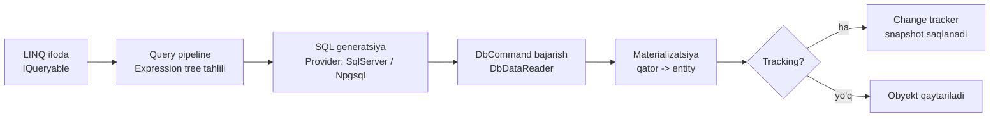

# 11. Entity Framework Core chuqur

> **Bir jumlada:** EF Core LINQ ifodani SQL ga aylantiradi, qaytgan qatorlarni obyektga materializatsiya qiladi va change tracker orqali o'zgarishlarni SaveChanges'da UPDATE/INSERT/DELETE ga aylantiradi; sekin ilovaning ko'p qismi aynan shu uch bosqichni tushunmaslikdan kelib chiqadi.
> **Nega Middle uchun:** Junior "ishlaydigan" LINQ yozadi, Middle qaysi LINQ qanday SQL berishini, qaysi so'rov tracking'ga tushishini, migration production'ga qanday chiqishini va concurrency buzilganda nima bo'lishini biladi.
> **O'qish vaqti:** ~45 daqiqa

## Mundarija

- [1. Muammo va yechim](#1-muammo-va-yechim)
- [2. Qanday ishlaydi](#2-qanday-ishlaydi)
- [3. Asosiy tushunchalar](#3-asosiy-tushunchalar): change tracker, AsNoTracking, N+1, Include/projection/split, migrations, concurrency, ExecuteUpdate, interceptors, query filters, compiled queries, FromSql, value converters, complex types, pooling, tranzaksiyalar, Dapper
- [4. Amaliy misol](#4-amaliy-misol)
- [5. Tipik xatolar va anti-patternlar](#5-tipik-xatolar-va-anti-patternlar)
- [6. Best practices checklist](#6-best-practices-checklist)
- [7. Suhbat savollari va javoblar](#7-suhbat-savollari-va-javoblar)
- [8. Qo'shimcha manbalar](#8-qoshimcha-manbalar)

## 1. Muammo va yechim

Ombor tizimida "Buyurtmalar" sahifasi 500 ta qatorni 9 soniyada ochardi. Profiler ko'rsatdi: bitta `SELECT ... FROM orders` va keyin 500 ta `SELECT ... FROM customers WHERE id = @p0`, yana 500 ta `SELECT ... FROM order_lines WHERE order_id = @p0`. Jami 1001 ta so'rov, har biri 5-8 ms. Bu N+1. Kod esa "to'g'ri" ko'rinardi: `foreach (var o in orders) row.Customer = o.Customer.Name`.

Ikkinchi holat: tungi job 200 ming eskirgan buyurtmani `Expired` holatiga o'tkazadi. Kod hammasini `ToListAsync()` bilan yuklab, sikl ichida `Status` ni o'zgartirib, `SaveChangesAsync()` chaqirardi. 200 ming entity xotirada, change tracker har birini snapshot bilan solishtiradi, SaveChanges 200 ming alohida UPDATE yuboradi. 40 daqiqa va 3 GB RAM. Bitta `ExecuteUpdateAsync` buni 2 soniyada qiladi.

Uchinchi holat: ilova startida `db.Database.Migrate()` chaqirilardi. Uchta replica bir vaqtda ko'tarildi, ikkitasi bir xil migration'ni qo'llashga urindi, biri xato berdi, ilova yarim holatda qoldi.

EF Core bularning hammasi uchun mexanizm beradi: tracking'ni boshqarish, so'rov shaklini tanlash, set-based buyruqlar, migration script/bundle. Lekin ular avtomatik ishlamaydi, dasturchi ichki mexanizmni bilishi kerak.

## 2. Qanday ishlaydi

EF Core so'rovni to'rt bosqichda bajaradi:



1. **Expression tree.** `db.Orders.Where(o => o.Status == s)` C# da `Expression<Func<Order,bool>>` ga aylanadi. EF uni daraxt sifatida o'qiydi, shuning uchun tarjima qila olmaydigan C# metod (o'zingizning `IsActive()` metodingiz) `InvalidOperationException: could not be translated` beradi.
2. **Query cache.** Daraxt shakli (parametr qiymatlarisiz) xeshlanadi va kompilyatsiya qilingan "query executor" keshda saqlanadi; bir xil shakldagi keyingi so'rov kesh orqali o'tadi.
3. **SQL.** Provider daraxtni SQL ga aylantiradi. Qiymatlar `@p0`, `@__status_0` kabi parametr bo'ladi, shuning uchun SQL injection xavfi yo'q va DB plan keshi ishlaydi.
4. **Materializatsiya.** `DbDataReader` dan qator o'qilib, entity konstruktori yoki property'lar orqali obyekt yaratiladi. Tracking yoqilgan bo'lsa, change tracker avval shu kalitli obyekt bor-yo'qligini tekshiradi (identity resolution): bor bo'lsa, yangi obyekt yaratmaydi, mavjudini qaytaradi.

`SaveChangesAsync()` esa teskari yo'l: change tracker `DetectChanges()` chaqiradi, har tracked entity'ning joriy qiymatlarini snapshot bilan solishtiradi, farq bo'lganlarni `Modified` qiladi, keyin entity'larni bog'liqlik tartibida saralab (FK tartibi) INSERT/UPDATE/DELETE buyruqlarini bitta tranzaksiyada, batch qilib yuboradi (SQL Server'da default max 42 ta buyruq bir batch'da, `MaxBatchSize` bilan sozlanadi).

## 3. Asosiy tushunchalar

### 3.1 Change tracker va entity state

- **Ta'rif.** Change tracker DbContext ichidagi obyekt bo'lib, u yuklangan yoki qo'shilgan har bir entity'ni, uning kalitini va dastlabki qiymatlar nusxasini (snapshot) saqlaydi. Har entity besh holatdan birida: `Detached` (context bilmaydi), `Unchanged`, `Added`, `Modified`, `Deleted`.
- **Nega kerak.** Siz `order.Status = Shipped` deb yozasiz, EF `UPDATE orders SET status = @p0 WHERE id = @p1` generatsiya qiladi. Buning uchun EF eski qiymatni bilishi shart, shuning uchun snapshot.

```csharp
var order = await db.Orders.FirstAsync(o => o.Id == id, ct);
db.Entry(order).State;                 // Unchanged
order.Status = OrderStatus.Shipped;    // hali EF buni bilmaydi
db.Entry(order).State;                 // Entry() DetectChanges chaqiradi -> Modified

// DetectChanges qachon chaqiriladi: SaveChanges, Entry(), ChangeTracker.Entries(),
// Local, Add/Attach/Remove graph operatsiyalari. Oddiy property o'zgartirish chaqirmaydi.

await db.SaveChangesAsync(ct);
// SQL: UPDATE orders SET status = @p0 WHERE id = @p1;  (faqat o'zgargan ustun)
```

`Update()` va `Attach()` farqi:

```csharp
db.Attach(order);   // Unchanged: "bu entity bazada bor, hali o'zgarmagan"
db.Update(order);   // Modified: BARCHA property'lar Modified, barcha ustun UPDATE qilinadi
db.Entry(order).Property(o => o.Status).IsModified = true; // faqat bitta ustun
```

- **Tipik xato.** API'dan kelgan DTO'ni to'g'ridan-to'g'ri `db.Update(dto.ToEntity())` qilish: tracked emas, hamma ustun qayta yoziladi, bazada boshqa foydalanuvchi o'zgartirgan maydonlar yo'qoladi (lost update).

### 3.2 AsNoTracking

- **Ta'rif.** `AsNoTracking()` so'rov natijasini change tracker'ga qo'shmaydi: snapshot olinmaydi, identity resolution qilinmaydi.
- **Nega kerak.** Faqat o'qish uchun so'rovlarda tracking ortiqcha xotira va CPU. 10 ming qatorli hisobotda farq 2-3 barobar.

```csharp
// Faqat o'qish: tracking yo'q
var list = await db.Orders.AsNoTracking()
    .Where(o => o.TenantId == tenantId)
    .ToListAsync(ct);

// Katta graph'da bir xil Customer ko'p marta kelsa, dublikat obyekt bo'lmasin:
var withIdentity = await db.Orders.AsNoTrackingWithIdentityResolution()
    .Include(o => o.Customer)
    .ToListAsync(ct);

// Butun context uchun default: options.UseQueryTrackingBehavior(QueryTrackingBehavior.NoTracking)
```

Projection (`Select` DTO) baribir tracking qilinmaydi, unda `AsNoTracking()` ortiqcha.

- **Tipik xato.** `AsNoTracking()` bilan yuklab, keyin o'zgartirib `SaveChangesAsync()` chaqirish: hech narsa bo'lmaydi, xato ham bo'lmaydi. Yechim: tracked yuklash yoki `db.Attach()` qilib state'ni qo'lda belgilash.

### 3.3 N+1 muammosi va uni aniqlash

- **Ta'rif.** N+1: bitta asosiy so'rov (1) va har natija uchun navigation'ni yuklovchi alohida so'rov (N). Odatda lazy loading yoki sikl ichida alohida so'rov bilan paydo bo'ladi.
- **Nega kerak.** EF Core default'da lazy loading qilmaydi: `o.Customer` yuklanmagan bo'lsa `null`. Lekin `UseLazyLoadingProxies()` yoqilsa yoki sikl ichida `db.Customers.Find(o.CustomerId)` chaqirilsa, N+1 paydo bo'ladi.

Qanday aniqlash:

```csharp
// 1) EF log: Microsoft.EntityFrameworkCore.Database.Command kategoriyasi, Information daraja
options.UseNpgsql(cs)
       .LogTo(Console.WriteLine, [RelationalEventId.CommandExecuted])
       .EnableSensitiveDataLogging(builder.Environment.IsDevelopment()); // parametr qiymatlari logda

// 2) Query tag: logda qaysi so'rov qayerdan ekanini ko'rish
var orders = await db.Orders
    .TagWith("OrdersPage: list")      // SQL boshida -- OrdersPage: list
    .TagWithCallSite()                // -- File: OrdersQuery.cs:42
    .ToListAsync(ct);

// 3) Integratsiya test: DbCommandInterceptor.ReaderExecuting ichida hisoblagich,
//    "bu endpoint 1 ta SQL yuboradi" deb assert qilinadi
```

Dev muhitda MiniProfiler (`MiniProfiler.AspNetCore.Mvc` + `MiniProfiler.EntityFrameworkCore`, `services.AddMiniProfiler().AddEntityFramework()`) har HTTP so'rov ichidagi SQL'lar sonini va takrorlanishini (`duplicate` belgisi) ko'rsatadi. Production'da OpenTelemetry trace'da bitta HTTP span ostida 500 ta DB span bo'lsa, bu N+1. Logda belgi: bir xil SQL matni, faqat parametr qiymati farq qiladi, ketma-ket yuzlab marta.

### 3.4 Include, projection, split query

Uchta usul, uch xil SQL.

**Include** entity graph'ni yuklaydi, tracking bilan, keyin o'zgartirish uchun qulay:

```csharp
var orders = await db.Orders
    .Where(o => o.TenantId == tenantId)
    .Include(o => o.Customer)
    .Include(o => o.Lines)
    .ToListAsync(ct);
```

Generatsiya qilinadigan SQL (PostgreSQL, qisqartirilgan):

```sql
SELECT o.id, o.status, o.total, c.id, c.name, l.id, l.order_id, l.price, l.qty
FROM orders AS o
INNER JOIN customers AS c ON o.customer_id = c.id
LEFT JOIN order_lines AS l ON o.id = l.order_id
WHERE o.tenant_id = @__tenantId_0
ORDER BY o.id, c.id
```

Bitta so'rov, lekin har order uchun uning line'lari soni qadar qator qaytadi va order ustunlari har qatorda takrorlanadi. Ikkita collection Include bo'lsa (`Lines` va `Payments`), natija kartezian ko'paytma: 10 line x 5 payment = 50 qator bitta order uchun. Bu "cartesian explosion". EF buni sezsa `MultipleCollectionIncludeWarning` beradi.

**Split query** har collection uchun alohida SELECT yuboradi:

```csharp
var orders = await db.Orders
    .Include(o => o.Lines).Include(o => o.Payments)
    .AsSplitQuery()
    .ToListAsync(ct);
```

```sql
-- 1-so'rov
SELECT o.id, o.status, o.total FROM orders AS o WHERE o.tenant_id = @p0 ORDER BY o.id;
-- 2-so'rov
SELECT l.id, l.order_id, l.price, l.qty FROM orders AS o
INNER JOIN order_lines AS l ON o.id = l.order_id WHERE o.tenant_id = @p0 ORDER BY o.id;
-- 3-so'rov: payments uchun xuddi shunday
```

Narxi: uchta round-trip va so'rovlar orasida ma'lumot o'zgarishi mumkin (izolyatsiya yo'q, agar tranzaksiya ochilmagan bo'lsa). Butun context uchun: `UseQuerySplittingBehavior(QuerySplittingBehavior.SplitQuery)`, bitta so'rov uchun `AsSingleQuery()` bilan qaytarish mumkin.

**Projection** faqat kerakli ustunlarni oladi, tracking yo'q, eng tez:

```csharp
var rows = await db.Orders
    .Where(o => o.TenantId == tenantId)
    .Select(o => new OrderRow(
        o.Id,
        o.Customer.Name,
        o.Lines.Sum(l => l.Price * l.Qty),
        o.Lines.Count))
    .ToListAsync(ct);
```

```sql
SELECT o.id, c.name,
  (SELECT COALESCE(SUM(l.price * l.qty), 0.0) FROM order_lines AS l WHERE o.id = l.order_id) AS "Total",
  (SELECT COUNT(*)::int FROM order_lines AS l0 WHERE o.id = l0.order_id) AS "Count"
FROM orders AS o
INNER JOIN customers AS c ON o.customer_id = c.id
WHERE o.tenant_id = @__tenantId_0
```

Qoida: o'qish uchun projection, o'zgartirish uchun Include, ikkitadan ortiq collection bo'lsa split query. Filtered include ham bor: `.Include(o => o.Lines.Where(l => !l.IsCancelled).Take(10))`.

### 3.5 Migrations production strategiyasi

- **Ta'rif.** Migration bu model o'zgarishini `Up()`/`Down()` metodlari bilan ifodalovchi C# klass va model snapshot. `__EFMigrationsHistory` jadvali qaysi migration qo'llanganini saqlaydi.
- **Nega kerak.** Schema o'zgarishi kodning bir qismi bo'lib versiyalanadi, lekin production'ga qanday yetib borishi alohida qaror.

Uchta usul:

```bash
# 1) Idempotent SQL script: har migration IF NOT EXISTS (history jadvalini tekshirib) bilan o'raladi.
#    DBA ko'rib chiqadi, pipeline'da psql/sqlcmd bilan bajariladi.
dotnet ef migrations script --idempotent --output migrate.sql --project src/Infrastructure --startup-project src/Api

# 2) Migration bundle: self-contained bajariladigan fayl, SDK kerak emas.
dotnet ef migrations bundle --self-contained -r linux-x64 --output efbundle
./efbundle --connection "$DB_CONNECTION"   # pipeline'dagi alohida qadam, ilova deploy'idan OLDIN

# 3) Aniq oraliq, teskari tartibda rollback script: dotnet ef migrations script <Yangi> <Eski> -o rollback.sql
```

Production'da ilova startida `Migrate()` chaqirish nega xavfli: bir nechta replica bir vaqtda ishga tushadi (EF Core 9 dan `__EFMigrationsLock` jadvali bilan lock olinadi, lekin baribir ilova migrate huquqi bilan ishlashi kerak bo'ladi, bu least privilege'ga zid); uzoq migration (index qurish) health check'ni o'ldiradi; xato bo'lsa ilova umuman ko'tarilmaydi.

Zero-downtime uchun **expand/contract**: avval qo'shuvchi migration (yangi ustun nullable, yangi jadval), eski va yangi kod ikkalasi ishlaydi; keyin kod deploy; keyin tozalovchi migration (eski ustunni o'chirish). Ustun nomini o'zgartirish ham shunday: yangi ustun qo'shish, ikkala ustunga yozish, ma'lumot ko'chirish, eski ustunni o'chirish.

Rollback: `Down()` ma'lumotni qaytarmaydi (`DROP COLUMN` dan keyin qiymatlar yo'q). Shuning uchun destruktiv migration'lar alohida release'da, backup bilan. EF Core 9 dan `Migrate()` oldidan pending model changes (migration yaratilmagan o'zgarish) bo'lsa `PendingModelChangesWarning` xato beradi, buni CI'da tekshirish: `dotnet ef migrations has-pending-model-changes`.

### 3.6 Optimistic concurrency

- **Ta'rif.** Optimistic concurrency: lock olinmaydi, UPDATE'ga `WHERE id = @id AND version = @oldVersion` qo'shiladi; 0 qator ta'sirlansa boshqa birov o'zgartirgan, `DbUpdateConcurrencyException`.
- **Nega kerak.** Ikki menejer bir buyurtmani bir vaqtda tahrirlaydi; lock'siz oxirgisi birinchisini ustidan yozadi.

```csharp
public byte[] RowVersion { get; set; } = [];   // Order ichida, SQL Server: rowversion ustuni

// SQL Server
modelBuilder.Entity<Order>().Property(o => o.RowVersion).IsRowVersion();
// PostgreSQL: tizim ustuni xmin (har UPDATE'da o'zgaradi), alohida ustun kerak emas
modelBuilder.Entity<Order>().UseXminAsConcurrencyToken();
// Istalgan ustunni token qilish (masalan, UpdatedAt)
modelBuilder.Entity<Order>().Property(o => o.UpdatedAt).IsConcurrencyToken();
```

Generatsiya qilinadigan SQL (SQL Server):

```sql
UPDATE [orders] SET [status] = @p0
OUTPUT INSERTED.[row_version]
WHERE [id] = @p1 AND [row_version] = @p2;
-- 0 qator -> DbUpdateConcurrencyException
```

Xatoni qayta ishlash:

```csharp
try
{
    await db.SaveChangesAsync(ct);
}
catch (DbUpdateConcurrencyException ex)
{
    var entry = ex.Entries.Single();
    var dbValues = await entry.GetDatabaseValuesAsync(ct);
    if (dbValues is null) throw new OrderDeletedException();          // boshqa birov o'chirgan
    throw new ConflictException(dbValues.ToObject());                 // 409: client yangi versiyani ko'rib qayta uradi
    // Yoki "database wins": entry.OriginalValues.SetValues(dbValues); keyin qayta SaveChanges
}
```

Web API'da to'g'ri yo'l: client `RowVersion` ni (base64) DTO'da olib keladi va qaytaradi; server uni `entry.Property(o => o.RowVersion).OriginalValue = dto.RowVersion` ga qo'yadi. Bu "disconnected" ssenariy; aks holda server o'zi yangi yuklagan versiya bilan solishtiradi va konflikt hech qachon sezilmaydi.

Pessimistic (lock) kerak bo'lsa: tranzaksiya ichida `FromSql($"... WHERE id = {id} FOR UPDATE")` (PostgreSQL) yoki `WITH (UPDLOCK, ROWLOCK)` (SQL Server).

### 3.7 ExecuteUpdate va ExecuteDelete

- **Ta'rif.** Set-based buyruqlar: entity yuklamasdan, change tracker'siz to'g'ridan-to'g'ri `UPDATE ... WHERE` / `DELETE ... WHERE` yuboradi.
- **Nega kerak.** Ming qatorni yuklab o'zgartirish xotira va vaqt. Bu buyruqlar bir SQL.

```csharp
var cutoff = DateTime.UtcNow.AddDays(-30);
int affected = await db.Orders
    .Where(o => o.Status == OrderStatus.Draft && o.CreatedAt < cutoff)
    .ExecuteUpdateAsync(s => s
        .SetProperty(o => o.Status, OrderStatus.Expired)
        .SetProperty(o => o.UpdatedAt, DateTime.UtcNow), ct);
// SQL: UPDATE orders SET status = @p0, updated_at = @p1 WHERE status = 0 AND created_at < @p2

await db.AuditLogs.Where(a => a.CreatedAt < cutoff).ExecuteDeleteAsync(ct);
// SQL: DELETE FROM audit_logs WHERE created_at < @p0

// EF Core 10: setter oddiy lambda bloki bo'lishi mumkin, shartli SetProperty:
//   ExecuteUpdateAsync(s => { s.SetProperty(o => o.Status, status); if (comment != null) s.SetProperty(o => o.Comment, comment); })
```

Muhim: bu buyruqlar change tracker'ni chetlab o'tadi. Xotirada tracked bo'lgan shu entity'lar eskirgan bo'lib qoladi. Interceptor'lar (`SavingChanges`) ham ishlamaydi, chunki bu SaveChanges emas. Global query filter'lar qo'llanadi (tenant filter saqlanadi). O'z tranzaksiyasi yo'q: SaveChanges bilan atomik bo'lishi kerak bo'lsa, `BeginTransaction` ichida bajaring.

### 3.8 Interceptors

- **Ta'rif.** Interceptor EF pipeline'ning ma'lum nuqtasiga (SaveChanges oldidan, buyruq bajarilishidan oldin/keyin, materializatsiya, ulanish ochilishi) kiradigan klass.
- **Nega kerak.** Audit maydonlarini to'ldirish, soft delete, sekin so'rovlarni loglash, query hint qo'shish, bularni har repository'da takrorlamasdan bir joyda qilish.

```csharp
// Audit + soft delete: SaveChanges oldidan
public sealed class AuditInterceptor(ICurrentUser user, TimeProvider clock) : SaveChangesInterceptor
{
    public override ValueTask<InterceptionResult<int>> SavingChangesAsync(
        DbContextEventData eventData, InterceptionResult<int> result, CancellationToken ct = default)
    {
        var now = clock.GetUtcNow();
        foreach (var entry in eventData.Context!.ChangeTracker.Entries<IAuditable>())
        {
            switch (entry.State)
            {
                case EntityState.Added:
                    entry.Entity.CreatedAt = now;
                    entry.Entity.CreatedBy = user.Id;
                    break;
                case EntityState.Modified:
                    entry.Entity.UpdatedAt = now;
                    entry.Entity.UpdatedBy = user.Id;
                    break;
            }
        }
        // Soft delete: DELETE o'rniga IsDeleted = true
        foreach (var entry in eventData.Context.ChangeTracker.Entries<ISoftDelete>()
                     .Where(e => e.State == EntityState.Deleted))
        {
            entry.State = EntityState.Modified;
            entry.Entity.IsDeleted = true;
            entry.Entity.DeletedAt = now;
        }
        return ValueTask.FromResult(result);
    }
}

// Sekin so'rov log: DbCommandInterceptor.ReaderExecutedAsync ichida eventData.Duration > 500ms bo'lsa LogWarning

// Ro'yxatga olish
services.AddDbContext<AppDbContext>((sp, o) => o
    .UseNpgsql(cs)
    .AddInterceptors(sp.GetRequiredService<AuditInterceptor>()));
```

- **Tipik xato.** Interceptor'da `DbContext` ni qayta chaqirib so'rov yuborish: SaveChanges jarayoni ichida yangi so'rov tracker'ni o'zgartiradi, rekursiya yoki `InvalidOperationException`.

### 3.9 Global query filters

- **Ta'rif.** Model darajasida `Where` sharti; har so'rovga (Include, navigation orqali ham) avtomatik qo'shiladi.
- **Nega kerak.** Multi-tenant va soft delete: dasturchi `Where(o => o.TenantId == current)` ni unutsa, boshqa tenant'ning ma'lumoti chiqadi.

```csharp
public sealed class AppDbContext(DbContextOptions<AppDbContext> options, ITenantContext tenant)
    : DbContext(options)
{
    // Field: filter har bajarilishda joriy qiymatni oladi (parametr sifatida), kesh buzilmaydi
    private readonly Guid _tenantId = tenant.TenantId;

    protected override void OnModelCreating(ModelBuilder mb)
    {
        // EF Core 10: nomlangan filter'lar, alohida-alohida o'chirish mumkin
        mb.Entity<Order>()
          .HasQueryFilter("Tenant", o => o.TenantId == _tenantId)
          .HasQueryFilter("SoftDelete", o => !o.IsDeleted);
    }
}

// Faqat soft delete filter'ni o'chirish (admin "o'chirilganlar" ro'yxati), tenant qoladi
var deleted = await db.Orders.IgnoreQueryFilters(["SoftDelete"]).ToListAsync(ct);
// Hammasini o'chirish (faqat tizim job'lari uchun)
var all = await db.Orders.IgnoreQueryFilters().ToListAsync(ct);
```

Generatsiya qilinadigan SQL: `WHERE o.tenant_id = @__ef_filter__p_0 AND NOT o.is_deleted`.

Tuzoq: filter required navigation'da (masalan, `Order.Customer` required, Customer soft-deleted) INNER JOIN qatorni yo'qotadi va Order ham chiqmaydi. Bunday holda navigation'ni optional qiling yoki filter'ni bog'liq jadvalda ham moslang.

### 3.10 Compiled queries

- **Ta'rif.** `EF.CompileAsyncQuery` LINQ ifodani bir marta delegat'ga kompilyatsiya qiladi; har chaqiruvda expression tree qurish va kesh qidirish bosqichlari o'tkazib yuboriladi.
- **Nega kerak.** Juda issiq yo'lda (sekundiga minglab bir xil so'rov) 5-15% CPU tejaladi. Oddiy CRUD'da sezilmaydi.

```csharp
private static readonly Func<AppDbContext, int, CancellationToken, Task<Order?>> OrderById =
    EF.CompileAsyncQuery((AppDbContext db, int id, CancellationToken ct) =>
        db.Orders.AsNoTracking().FirstOrDefault(o => o.Id == id));

public Task<Order?> GetAsync(int id, CancellationToken ct) => OrderById(db, id, ct);
```

Cheklov: dinamik shart qo'shib bo'lmaydi. Oddiy so'rov keshi yetarli tez, shuning uchun bu optimizatsiya o'lchovdan keyin qilinadi.

### 3.11 FromSql va raw SQL

- **Ta'rif.** `FromSql` (EF 7+) `FormattableString` oladi va interpolyatsiya qilingan qiymatlarni avtomatik parametrga aylantiradi. `FromSqlRaw` string oladi, parametrlarni alohida berasiz. `SqlQuery<T>` entity bo'lmagan natija (skalyar, DTO) uchun. `ExecuteSqlAsync` natija qaytarmaydigan buyruq uchun.
- **Nega kerak.** Window function, CTE, provider'ga xos sintaksis, saqlangan protsedura.

```csharp
// Xavfsiz: {tenantId} -> @p0 parametr bo'ladi
var orders = await db.Orders
    .FromSql($"SELECT * FROM orders WHERE tenant_id = {tenantId} AND status = {status}")
    .Where(o => o.Total > 1000)          // LINQ davom etadi: EF uni subquery qilib o'raydi
    .ToListAsync(ct);

// DTO uchun (entity emas), LINQ davom etishi mumkin
var stats = await db.Database
    .SqlQuery<DailyStat>($"SELECT date_trunc('day', created_at) AS \"Day\", COUNT(*) AS \"Count\" FROM orders WHERE tenant_id = {tenantId} GROUP BY 1")
    .Where(s => s.Count > 10)
    .ToListAsync(ct);

// FromSqlRaw faqat dinamik IDENTIFIKATOR (jadval nomi parametr bo'lolmaydi) whitelist'dan kelganda:
db.Orders.FromSqlRaw($"SELECT * FROM {allowedTable} WHERE id = {{0}}", id);  // qiymat baribir parametr
```

- **Tipik xato.** `FromSqlRaw("... WHERE name = '" + name + "'")`. Bu SQL injection. `FromSql` bilan `$"..."` ishlatganda ham interpolyatsiyani `string` o'zgaruvchiga oldindan saqlab yuborsangiz, parametrlash yo'qoladi (`FormattableString` emas, `string` bo'lib qoladi).

### 3.12 Value converters

- **Ta'rif.** Value converter property'ning CLR tipini baza tipiga va teskarisiga aylantiradi (enum -> string, `Money` -> decimal, `DateOnly` -> date).
- **Nega kerak.** Domain modelda boy tiplar, bazada oddiy ustunlar.

```csharp
// Strongly-typed id: readonly record struct OrderId(Guid Value)
modelBuilder.Entity<Order>().Property(o => o.Id).HasConversion(id => id.Value, v => new OrderId(v));

modelBuilder.Entity<Order>()
    .Property(o => o.Status)
    .HasConversion<string>()        // enum nomi matn sifatida, o'qiladigan baza
    .HasMaxLength(32);

// Butun model uchun: ConfigureConventions ichida
// cb.Properties<OrderId>().HaveConversion<OrderIdConverter>(); cb.Properties<decimal>().HavePrecision(18, 2);
```

Cheklov: konvertatsiya qilingan ustunda EF `WHERE status = @p0` parametrni ham konvertatsiya qiladi, lekin `Contains`, `StartsWith` kabi operatsiyalar baza tipiga mos bo'lishi kerak (string enum bo'lsa `o.Status.ToString().StartsWith` tarjima qilinmaydi). Converter ichida null bilan ishlash: `convertsNulls: true` berilmasa, null converter'ga o'tmaydi.

### 3.13 Owned va complex types

- **Ta'rif.** Owned type: alohida kaliti yo'q, egasi bilan bir jadvalda (yoki alohida jadvalda) saqlanadigan entity-ga o'xshash tip, EF uni tracking'da alohida entity deb hisoblaydi. Complex type (EF 8+): haqiqiy value object, identity yo'q, tracking'da egasining qismi, bir instance bir nechta egaga berilishi mumkin.
- **Nega kerak.** `Address`, `Money` kabi value object'larni alohida jadvalsiz saqlash.

```csharp
public sealed record Address(string Street, string City, string Postal);   // value object

modelBuilder.Entity<Order>(b =>
{
    // Complex type: ustunlar orders jadvalida shipping_street, shipping_city, ...
    b.ComplexProperty(o => o.Shipping, cp => cp.Property(a => a.Street).HasColumnName("shipping_street").HasMaxLength(200));
    b.ComplexProperty(o => o.Meta, cp => cp.ToJson());   // EF Core 10: complex type JSON ustunida
});

// Owned: eski uslub; kolleksiya uchun hali kerak
modelBuilder.Entity<Customer>().OwnsMany(c => c.Contacts, nb => nb.ToJson()); // JSON ustun
```

Complex type'ning afzalligi: `order.Shipping = otherOrder.Shipping` ishlaydi (owned'da "already tracked" xatosi). EF Core 10 gacha complex type nullable bo'lolmasdi, EF 10 da optional complex type qo'llab-quvvatlanadi.

### 3.14 DbContext pooling

- **Ta'rif.** `AddDbContextPool` har so'rov uchun yangi DbContext yaratish o'rniga tayyor instance'larni pool'dan oladi, so'rov tugagach holatini tozalab (`ResetState`) qaytaradi.
- **Nega kerak.** DbContext yaratish arzon, lekin ichki servislar (change tracker, query cache murojaatlari) ni initsializatsiya qilish 1-2 ms oladi; yuqori RPS'da sezilarli.

```csharp
builder.Services.AddDbContextPool<AppDbContext>(o => o.UseNpgsql(cs), poolSize: 256); // default 1024

// Pool bilan per-request holat: konstruktor faqat bir marta chaqiriladi!
public sealed class AppDbContext(DbContextOptions<AppDbContext> options) : DbContext(options)
{
    // Noto'g'ri: private readonly Guid _tenant = tenant.Id; (birinchi so'rovning tenant'i qolib ketadi)
    // To'g'ri: har so'rovda tashqaridan o'rnatiladi
    public Guid TenantId { get; set; }
}

// Middleware yoki scoped servis har so'rovda: db.TenantId = tenant.TenantId;
// Filter: mb.Entity<Order>().HasQueryFilter(o => o.TenantId == TenantId);
```

`AddPooledDbContextFactory<T>` background servis va parallel ish uchun: `factory.CreateDbContext()` pool'dan beradi, `using` bilan qaytariladi. DbContext thread-safe emas: bir context'da ikki parallel operatsiya `A second operation was started on this context` xatosi beradi.

### 3.15 Tranzaksiyalar

- **Ta'rif.** `SaveChangesAsync` o'zi atomik: barcha INSERT/UPDATE/DELETE bitta tranzaksiyada, biri xato bersa hammasi qaytariladi. Bir nechta SaveChanges yoki ExecuteUpdate'ni birlashtirish uchun aniq tranzaksiya kerak.
- **Nega kerak.** Buyurtma yaratish + ombordan rezerv qilish + outbox'ga xabar yozish, yo hammasi, yo hech biri.

```csharp
// 1) BeginTransaction: bitta context, bir ulanish
await using var tx = await db.Database.BeginTransactionAsync(IsolationLevel.ReadCommitted, ct);
db.Orders.Add(order);
await db.SaveChangesAsync(ct);
int reserved = await db.Stock
    .Where(s => s.ProductId == productId && s.Available >= qty)
    .ExecuteUpdateAsync(s => s.SetProperty(x => x.Available, x => x.Available - qty), ct);
if (reserved == 0) { await tx.RollbackAsync(ct); throw new OutOfStockException(); }
db.OutboxMessages.Add(new OutboxMessage(order));
await db.SaveChangesAsync(ct);
await tx.CommitAsync(ct);

// 2) EnableRetryOnFailure yoqilgan bo'lsa, qo'lda tranzaksiya
//    "The configured execution strategy does not support user-initiated transactions" beradi:
//    butun blokni db.Database.CreateExecutionStrategy().ExecuteAsync(...) ichiga oling (4-bo'limda misol).

// 3) TransactionScope: bir nechta DbContext yoki Dapper + EF bir tranzaksiyada
using var scope = new TransactionScope(TransactionScopeOption.Required,
    new TransactionOptions { IsolationLevel = System.Transactions.IsolationLevel.ReadCommitted },
    TransactionScopeAsyncFlowOption.Enabled);   // async/await bilan ambient tranzaksiya oqishi uchun shart
await db.SaveChangesAsync(ct);
await conn.ExecuteAsync("INSERT INTO audit ...", param);   // Dapper, bir xil ulanish
scope.Complete();
```

`TransactionScope` ikkita turli ulanishni o'rasa, distributed transaction (MSDTC) talab qilinadi; .NET'da bu faqat Windows va SQL Server uchun ishlaydi, Linux'da `PlatformNotSupportedException`. Shuning uchun bitta ulanishni ulashing: `db.Database.GetDbConnection()` ni Dapper'ga bering yoki `db.Database.UseTransaction(existingTx)`.

Uzun tranzaksiya oqibati: lock'lar ushlab turiladi, boshqa so'rovlar kutadi, PostgreSQL'da vacuum ishlamaydi. Tranzaksiya ichida tashqi HTTP chaqiruv qilish (to'lov provayderi) mumkin emas: avval yozib, outbox orqali yuborish kerak.

### 3.16 Dapper qachon

- **Ta'rif.** Dapper `IDbConnection` ustida SQL bajarib natijani obyektga map qiluvchi yengil kutubxona; change tracking, migration, LINQ yo'q.
- **Nega kerak.** Og'ir hisobot so'rovlari (CTE, window function, 10 ta JOIN), EF tarjima qila olmaydigan yoki yomon tarjima qiladigan holatlar, maksimal nazorat.

```csharp
public sealed class SalesReportQuery(NpgsqlDataSource dataSource)
{
    public async Task<IReadOnlyList<SalesRow>> RunAsync(Guid tenantId, DateOnly from, CancellationToken ct)
    {
        const string sql = """
            SELECT date_trunc('day', o.created_at) AS "Day", SUM(l.price * l.qty) AS "Total",
                   SUM(SUM(l.price * l.qty)) OVER (ORDER BY date_trunc('day', o.created_at)) AS "Cumulative"
            FROM orders o JOIN order_lines l ON l.order_id = o.id
            WHERE o.tenant_id = @TenantId AND o.created_at >= @From AND NOT o.is_deleted   -- filter qo'lda!
            GROUP BY 1 ORDER BY 1
            """;
        await using var conn = await dataSource.OpenConnectionAsync(ct);
        var rows = await conn.QueryAsync<SalesRow>(new CommandDefinition(sql,
            new { TenantId = tenantId, From = from.ToDateTime(TimeOnly.MinValue) }, cancellationToken: ct));
        return rows.AsList();
    }
}
```

Qoida: yozish (command) tomonida EF (tracking, concurrency, interceptor, filter), murakkab o'qish tomonida Dapper yoki EF `SqlQuery<T>`. Dapper'da global query filter yo'q, tenant va soft delete shartini qo'lda yozish shart, bu eng ko'p uchraydigan xato.

## 4. Amaliy misol

Buyurtma tasdiqlash: ombordan rezerv, status o'zgartirish, concurrency, audit, outbox. Bu kod yuqoridagi tushunchalarni birlashtiradi.

```csharp
// Domain (IAuditable, ISoftDelete interfeyslari 3.8 dagi interceptor uchun)
public sealed class Order : IAuditable, ISoftDelete
{
    public int Id { get; private set; }
    public Guid TenantId { get; private set; }
    public OrderStatus Status { get; private set; }
    public Money Total { get; private set; } = new(0, "UZS");
    public List<OrderLine> Lines { get; private set; } = [];
    public uint Version { get; private set; }            // PostgreSQL xmin
    // ... IAuditable va ISoftDelete property'lari

    public void Confirm()
    {
        if (Status != OrderStatus.Draft) throw new DomainException("Faqat Draft tasdiqlanadi");
        Status = OrderStatus.Confirmed;
    }
}

// DbContext
public sealed class AppDbContext(DbContextOptions<AppDbContext> options) : DbContext(options)
{
    public Guid TenantId { get; set; }                   // pooling'ga mos: har so'rovda o'rnatiladi
    public DbSet<Order> Orders => Set<Order>();
    public DbSet<StockItem> Stock => Set<StockItem>();
    public DbSet<OutboxMessage> Outbox => Set<OutboxMessage>();

    protected override void OnModelCreating(ModelBuilder mb)
    {
        mb.Entity<Order>(b =>
        {
            b.ToTable("orders");
            b.Property(o => o.Version).IsRowVersion();   // Npgsql: xmin ga map qilinadi
            b.Property(o => o.Status).HasConversion<string>().HasMaxLength(32);
            b.ComplexProperty(o => o.Total, cp =>
            {
                cp.Property(m => m.Amount).HasColumnName("total_amount").HasPrecision(18, 2);
                cp.Property(m => m.Currency).HasColumnName("total_currency").HasMaxLength(3);
            });
            b.HasMany(o => o.Lines).WithOne().HasForeignKey(l => l.OrderId);
            b.HasQueryFilter("Tenant", o => o.TenantId == TenantId)
             .HasQueryFilter("SoftDelete", o => !o.IsDeleted);
        });
    }
}

// Ro'yxatga olish
builder.Services.AddDbContextPool<AppDbContext>((sp, o) => o
    .UseNpgsql(builder.Configuration.GetConnectionString("Main"), npg => npg.EnableRetryOnFailure(3))
    .AddInterceptors(sp.GetRequiredService<AuditInterceptor>())        // singleton, ICurrentUser ni IHttpContextAccessor orqali oladi
    .UseQueryTrackingBehavior(QueryTrackingBehavior.NoTracking)        // default o'qish, yozishda AsTracking
    .ConfigureWarnings(w => w.Throw(RelationalEventId.MultipleCollectionIncludeWarning)));

// Use case
public sealed class ConfirmOrderHandler(AppDbContext db, ILogger<ConfirmOrderHandler> log)
{
    public async Task<Result> HandleAsync(int orderId, uint expectedVersion, CancellationToken ct)
    {
        var strategy = db.Database.CreateExecutionStrategy();   // retry bilan tranzaksiya
        return await strategy.ExecuteAsync(async () =>
        {
            await using var tx = await db.Database.BeginTransactionAsync(ct);

            // Yozish uchun tracked yuklash; Lines kerak, chunki rezerv miqdori ulardan olinadi
            var order = await db.Orders.AsTracking()
                .Include(o => o.Lines)
                .TagWith("ConfirmOrder")
                .FirstOrDefaultAsync(o => o.Id == orderId, ct);
            if (order is null) return Result.NotFound();

            // Disconnected concurrency: client ko'rgan versiya bilan solishtirish
            db.Entry(order).Property(o => o.Version).OriginalValue = expectedVersion;

            order.Confirm();

            // Set-based rezerv: har line uchun bitta UPDATE, entity yuklanmaydi
            foreach (var line in order.Lines)
            {
                int ok = await db.Stock
                    .Where(s => s.ProductId == line.ProductId && s.Available >= line.Qty)
                    .ExecuteUpdateAsync(s => s.SetProperty(x => x.Available, x => x.Available - line.Qty), ct);
                if (ok == 0) { await tx.RollbackAsync(ct); return Result.Conflict($"Omborda yetarli emas: {line.ProductId}"); }
            }

            db.Outbox.Add(OutboxMessage.From(new OrderConfirmed(order.Id, order.TenantId)));

            try
            {
                await db.SaveChangesAsync(ct);   // audit interceptor UpdatedAt/UpdatedBy ni to'ldiradi
            }
            catch (DbUpdateConcurrencyException)
            {
                await tx.RollbackAsync(ct);
                log.LogInformation("Order {Id} concurrency konflikti", orderId);
                return Result.Conflict("Buyurtma boshqa foydalanuvchi tomonidan o'zgartirilgan, yangilang");
            }
            await tx.CommitAsync(ct);
            return Result.Ok();
        });
    }
}
```

Nega shunday: context default NoTracking, shuning uchun yozish joyida `AsTracking()` aniq ko'rinadi. Rezerv `ExecuteUpdate` bilan qilingan, chunki `Available >= qty` shartini UPDATE'ning o'zida tekshirish race condition'ni yo'q qiladi (ikki parallel buyurtma bir xil zaxirani olmaydi). Outbox bir tranzaksiyada, shuning uchun xabar yo'qolmaydi. Execution strategy butun blokni o'rab turadi, chunki retry bo'lsa tranzaksiya boshidan qaytariladi.

## 5. Tipik xatolar va anti-patternlar

**1. Sikl ichida so'rov (N+1).**

```csharp
// ❌
var orders = await db.Orders.ToListAsync(ct);
foreach (var o in orders)
    o.CustomerName = (await db.Customers.FindAsync([o.CustomerId], ct))!.Name;
```

Oqibat: N+1 round-trip, sahifa sekin, DB connection band.

```csharp
// ✅ Projection, bitta so'rov
var rows = await db.Orders.Select(o => new { o.Id, CustomerName = o.Customer.Name }).ToListAsync(ct);
```

**2. Xotirada filtrlash.**

```csharp
// ❌ ToList'dan keyin Where (yoki IEnumerable qaytaruvchi repository): butun jadval yuklanadi
var expired = (await db.Orders.ToListAsync(ct)).Where(o => o.CreatedAt < cutoff);
```

Oqibat: butun jadval tarmoq orqali keladi, RAM, vaqt.

```csharp
// ✅ Filtr SQL'da
var expired = await db.Orders.Where(o => o.CreatedAt < cutoff).ToListAsync(ct);
```

**3. Entity'ni API'dan qaytarish.**

```csharp
// ❌ Navigation'lar sikl hosil qiladi (Order -> Lines -> Order), JSON serializer xato yoki ortiqcha ma'lumot
app.MapGet("/orders/{id}", (int id, AppDbContext db) => db.Orders.Include(o => o.Lines).FirstAsync(o => o.Id == id));
```

Oqibat: `JsonException: possible object cycle`, ichki maydonlar (TenantId, IsDeleted) tashqariga chiqadi, modelga ustun qo'shilsa API kontrakti o'zgaradi.

```csharp
// ✅ DTO projection
app.MapGet("/orders/{id}", (int id, AppDbContext db, CancellationToken ct) =>
    db.Orders.Where(o => o.Id == id).Select(o => new OrderDto(o.Id, o.Status, o.Total.Amount)).FirstOrDefaultAsync(ct));
```

**4. Bir DbContext'ni parallel ishlatish.**

```csharp
// ❌ Bir context, ikkita parallel so'rov
await Task.WhenAll(db.Orders.CountAsync(ct), db.Customers.CountAsync(ct));
// InvalidOperationException: A second operation was started on this context
```

Oqibat: tasodifiy xatolar, ba'zan ishlaydi, ba'zan yo'q; background servisda singleton context bo'lsa tracker to'lib ketadi.

```csharp
// ✅ Ketma-ket, yoki har parallel ish uchun alohida context
await using var db2 = await factory.CreateDbContextAsync(ct);   // IDbContextFactory<AppDbContext>
```

**5. Katta batch uchun SaveChanges.**

```csharp
// ❌ 100 ming entity change tracker'da
foreach (var row in csv) db.Products.Add(row.ToEntity());
await db.SaveChangesAsync(ct);
```

Oqibat: DetectChanges O(n) har chaqiruvda, xotira, bir ulkan tranzaksiya.

```csharp
// ✅ Bo'laklab, tracker'ni tozalab, yoki provider bulk (SqlBulkCopy / Npgsql COPY)
foreach (var chunk in csv.Chunk(2000))
{ db.Products.AddRange(chunk.Select(r => r.ToEntity())); await db.SaveChangesAsync(ct); db.ChangeTracker.Clear(); }
```

**6. Migration'ni ilova startida avtomatik qo'llash.**

```csharp
// ❌ Program.cs
using (var scope = app.Services.CreateScope()) scope.ServiceProvider.GetRequiredService<AppDbContext>().Database.Migrate();
```

Oqibat: replica'lar poyga, ilova DDL huquqi bilan ishlaydi, uzoq migration start'ni bloklaydi.

```bash
# ✅ Pipeline'da alohida qadam, deploy'dan oldin
./efbundle --connection "$MIGRATION_CONNECTION"   # DDL huquqli alohida foydalanuvchi
```

## 6. Best practices checklist

- [ ] O'qish so'rovlari projection (`Select` DTO) yoki `AsNoTracking`, chunki tracking faqat yozishda kerak.
- [ ] Ikkitadan ortiq collection Include'da `AsSplitQuery`, `MultipleCollectionIncludeWarning` ni CI'da `Throw` qiling, chunki kartezian portlash production'da sezilarli.
- [ ] Har so'rovda `CancellationToken` uzatiladi, chunki client uzilganda DB so'rovi ham to'xtashi kerak.
- [ ] Dev muhitida EF command log va MiniProfiler yoqilgan, integratsiya testlarida so'rov soni tekshiriladi, chunki N+1 kod ko'rinishidan bilinmaydi.
- [ ] Ommaviy yangilash/o'chirish `ExecuteUpdate`/`ExecuteDelete`, chunki entity yuklash xotira va vaqt.
- [ ] Tahrirlanadigan entity'larda concurrency token (rowversion/xmin) va 409 javob, chunki lost update sezilmasdan yuz beradi.
- [ ] Migration pipeline'da script yoki bundle bilan, ilova startida `Migrate()` yo'q, chunki replica'lar va huquqlar.
- [ ] Destruktiv migration'lar expand/contract bilan alohida release'da, chunki `Down()` ma'lumotni qaytarmaydi.
- [ ] Tenant va soft delete global filter'da, Dapper so'rovlarida qo'lda, chunki unutilgan `Where` ma'lumot sizishi.
- [ ] Raw SQL faqat `FromSql`/`SqlQuery` interpolyatsiya bilan, `FromSqlRaw` faqat whitelist'dan identifikator uchun, chunki injection.
- [ ] Tranzaksiya qisqa, ichida tashqi HTTP chaqiruv yo'q, xabarlar outbox orqali, chunki lock va MSDTC yo'qligi.
- [ ] DbContext pooling'da per-request holat konstruktorda emas, property orqali, chunki konstruktor bir marta chaqiriladi.
- [ ] Katta import bo'laklab `SaveChanges` + `ChangeTracker.Clear()` yoki bulk copy, chunki DetectChanges O(n).
- [ ] Entity API'dan chiqmaydi, faqat DTO, chunki sikl, sizish va kontrakt barqarorligi.

## 7. Suhbat savollari va javoblar

**1. Change tracker qanday ishlaydi va SaveChanges qanday UPDATE generatsiya qiladi?**
Tracked so'rov natijasi context ichida saqlanadi va har property'ning dastlabki qiymati snapshot'ga yoziladi. `SaveChanges` avval `DetectChanges` chaqiradi: har tracked entity'ning joriy qiymatini snapshot bilan solishtiradi, farq bo'lgan property'larni Modified deb belgilaydi. Keyin faqat o'zgargan ustunlar uchun `UPDATE ... SET col = @p WHERE id = @id` buyrug'i tuziladi, bir nechta buyruq batch qilinadi va bitta tranzaksiyada yuboriladi. Tuzoq: `Update()` metodi snapshot'siz barcha ustunlarni Modified qiladi, shuning uchun disconnected DTO'dan `Update` qilish boshqa foydalanuvchi o'zgarishini yo'q qiladi.

**2. AsNoTracking qachon ishlatmaslik kerak?**
Entity'ni keyin o'zgartirib SaveChanges qilmoqchi bo'lsangiz, chunki untracked entity'dagi o'zgarish sezilmaydi va xato ham bo'lmaydi. Shuningdek, bir so'rovda bir xil entity bir necha marta kelsa va bitta instance kerak bo'lsa identity resolution kerak; bunda `AsNoTrackingWithIdentityResolution` ishlatiladi. Projection so'rovlarida `AsNoTracking` kerak emas, DTO baribir tracking qilinmaydi.

**3. N+1 ni production'da qanday aniqlaysiz?**
Uch belgi: EF command logida bir xil SQL matni faqat parametr qiymati farq qilib yuzlab marta ketma-ket; OpenTelemetry trace'da bitta HTTP span ostida yuzlab DB span; MiniProfiler dev'da "duplicate" belgisi. `TagWith` so'rovni kodning qaysi joyidan kelganini ko'rsatadi. Oldini olish: lazy loading proxy'larni yoqmaslik, integratsiya testda `DbCommandInterceptor` bilan buyruq sonini assert qilish.

**4. Include va Select farqi, qachon split query?**
Include entity graph'ni JOIN bilan yuklaydi, tracking bilan, keyin o'zgartirish uchun. Select faqat kerakli ustunlarni oladi, tracking yo'q, eng kam ma'lumot. Ikkita va undan ortiq collection Include'da JOIN natijasi kartezian ko'paytma bo'ladi (10 line x 5 payment = 50 qator), shunda `AsSplitQuery` har collection'ni alohida SELECT bilan oladi. Split'ning narxi: ko'proq round-trip va so'rovlar orasida izchillik kafolati yo'q (tranzaksiya yoki snapshot bo'lmasa).

**5. Migration'ni production'ga qanday chiqarasiz? Rollback?**
Pipeline'da alohida qadam: `dotnet ef migrations script --idempotent` DBA ko'rib chiqadigan SQL beradi, yoki `migrations bundle` SDK'siz bajariladigan fayl. Ilova DDL huquqisiz oddiy foydalanuvchi bilan ishlaydi. Zero-downtime uchun expand/contract: avval qo'shuvchi o'zgarish, keyin kod, keyin tozalash. Rollback `Down()` orqali script generatsiya qilinadi, lekin o'chirilgan ustun ma'lumotini qaytarmaydi, shuning uchun destruktiv qadam backup bilan alohida release'da. Tuzoq: `Migrate()` ni startda chaqirish replica poygasini keltirib chiqaradi.

**6. Optimistic va pessimistic concurrency farqi, EF'da qaysi birini qanday qilasiz?**
Pessimistic: qator o'qilganda lock olinadi (`FOR UPDATE`, `UPDLOCK`), boshqalar kutadi; qisqa tranzaksiya va yuqori konflikt ehtimolida. Optimistic: lock yo'q, UPDATE'ga `WHERE version = @old` qo'shiladi, 0 qator bo'lsa `DbUpdateConcurrencyException`; konflikt kam, web'ga mos. EF'da SQL Server'da `IsRowVersion()`, PostgreSQL'da `UseXminAsConcurrencyToken()`. Tuzoq: web API'da client ko'rgan versiyani qaytarib `OriginalValue` ga qo'ymasa, server o'zi yangi yuklagani bilan solishtiradi va konflikt hech qachon sezilmaydi.

**7. DbContext pooling nima va qanday tuzoq bor?**
`AddDbContextPool` context instance'larini qayta ishlatadi, so'rov tugagach `ResetState` bilan tozalaydi; context yaratish ovehead'i yo'qoladi. Tuzoq: konstruktor bir marta chaqiriladi, shuning uchun konstruktorda tenant yoki user'ni saqlash birinchi so'rovning qiymatini keyingi so'rovlarga ham beradi. Per-request holat context property'siga tashqaridan har safar o'rnatilishi kerak.

**8. Global query filter'ning required navigation bilan muammosi?**
Filter Include va navigation'larga ham qo'llanadi. `Order.Customer` required (INNER JOIN) bo'lib, Customer soft-deleted bo'lsa, JOIN qatorni tashlab yuboradi va Order ham natijada chiqmaydi, xato bo'lmaydi, ma'lumot "yo'qoladi". Yechim: navigation'ni optional qilish yoki filter'ni ikkala tomonda moslashtirish. EF 10 nomlangan filter'lar bilan faqat kerakli filter'ni `IgnoreQueryFilters(["SoftDelete"])` bilan o'chirish mumkin.

**9. FromSql va FromSqlRaw farqi?**
`FromSql` `FormattableString` oladi va `{tenantId}` ni parametrga aylantiradi, SQL matniga qiymat qo'shilmaydi. `FromSqlRaw` oddiy string, qiymatni string konkatenatsiya bilan qo'shsangiz injection. `FromSqlRaw` faqat identifikator (jadval nomi) dinamik bo'lganda va u whitelist'dan kelganda ishlatiladi. Tuzoq: `FromSql` ga `$"..."` ni avval `string` o'zgaruvchiga saqlab bersangiz, u `string` bo'lib qoladi va parametrlash yo'qoladi; kompilyator `FormattableString` overload'ini to'g'ridan-to'g'ri interpolyatsiyada tanlaydi.

## 8. Qo'shimcha manbalar

- EF Core hujjatlari: https://learn.microsoft.com/ef/core/
- Change tracking: https://learn.microsoft.com/ef/core/change-tracking/
- Query: Include, split query, projection: https://learn.microsoft.com/ef/core/querying/related-data/
- Performance (efficient querying, N+1): https://learn.microsoft.com/ef/core/performance/efficient-querying
- Migrations, deployment (script, bundle): https://learn.microsoft.com/ef/core/managing-schemas/migrations/applying
- Concurrency: https://learn.microsoft.com/ef/core/saving/concurrency
- ExecuteUpdate/ExecuteDelete: https://learn.microsoft.com/ef/core/saving/execute-insert-update-delete
- Interceptors: https://learn.microsoft.com/ef/core/logging-events-diagnostics/interceptors
- Global query filters: https://learn.microsoft.com/ef/core/querying/filters
- Raw SQL: https://learn.microsoft.com/ef/core/querying/sql-queries
- DbContext pooling va boshqa performance: https://learn.microsoft.com/ef/core/performance/advanced-performance-topics
- Transactions: https://learn.microsoft.com/ef/core/saving/transactions
- EF Core 10 yangiliklari: https://learn.microsoft.com/ef/core/what-is-new/ef-core-10.0/whatsnew
- Npgsql EF provider (xmin, JSON): https://www.npgsql.org/efcore/
