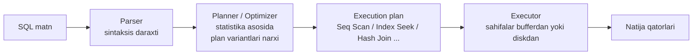

# 12. SQL va ma'lumotlar bazasi

> **Bir jumlada:** ORM SQL yozadi, lekin index tanlash, execution plan o'qish, izolyatsiya darajasini belgilash va deadlock'ni tushunish dasturchining ishi; baza bu qarorlarni o'rniga qabul qilmaydi.
> **Nega Middle uchun:** Enterprise'da DBA har doim ham yo'q, va "so'rov sekin" degan ticket EF emas, index va plan bilan yopiladi. Suhbatda "indeks nega hamma ustunga qo'yilmaydi" va "Read Committed'da qanday anomaliya qoladi" standart savollar.
> **O'qish vaqti:** ~35 daqiqa

## Mundarija

- [1. Muammo va yechim](#1-muammo-va-yechim)
- [2. Qanday ishlaydi](#2-qanday-ishlaydi)
- [3. Asosiy tushunchalar](#3-asosiy-tushunchalar): index turlari, SARGability, execution plan, isolation levels, lock'lar, deadlock, connection pooling, normalizatsiya, PostgreSQL vs SQL Server, uzun tranzaksiya, pagination, LINQ -> SQL
- [4. Amaliy misol](#4-amaliy-misol)
- [5. Tipik xatolar va anti-patternlar](#5-tipik-xatolar-va-anti-patternlar)
- [6. Best practices checklist](#6-best-practices-checklist)
- [7. Suhbat savollari va javoblar](#7-suhbat-savollari-va-javoblar)
- [8. Qo'shimcha manbalar](#8-qoshimcha-manbalar)

## 1. Muammo va yechim

Ombor tizimida `orders` jadvali 12 million qatorga yetdi. "Tenant bo'yicha oxirgi 50 buyurtma" so'rovi 100 ms dan 11 soniyaga chiqdi. Kod o'zgarmagan, EF bir xil SQL beradi. `EXPLAIN ANALYZE` ko'rsatdi: `Seq Scan on orders` va keyin `Sort`, ya'ni baza 12 million qatorni o'qib, filtrlab, saralaydi. Index faqat `id` (primary key) ustida edi. `(tenant_id, created_at DESC)` composite index qo'shilgach 3 ms.

Ikkinchi holat: to'lov servisida kunlik hisobot tranzaksiyasi 20 daqiqa davom etardi va shu vaqt ichida yangi to'lovlarni `INSERT` qilish lock kutib timeout bo'lardi. Sabab: hisobot `Serializable` izolyatsiyada yozilgan, kerak bo'lmagan range lock'lar ushlab turilgan.

Uchinchi holat: ikki parallel so'rov, biri `orders` keyin `stock`, ikkinchisi `stock` keyin `orders` ni yangilaydi. Har kuni 10-15 ta `deadlock detected` xatosi. Yechim: jadvallarga bir xil tartibda murojaat va retry.

Bu bobda baza bu holatlarda nima qilayotgani va dasturchi qaysi tugmalarni bosa olishi ko'rsatiladi.

## 2. Qanday ishlaydi

SQL deklarativ: siz "nima" deysiz, baza "qanday" ni o'zi tanlaydi. Tanlov jarayoni:



1. **Parser** matnni daraxtga aylantiradi, jadval va ustun mavjudligini tekshiradi.
2. **Planner** har jadval bo'yicha statistikaga (qator soni, qiymat taqsimoti, histogram) qarab bir nechta planning "narxini" (cost: disk o'qish + CPU) hisoblaydi va eng arzonini tanlaydi. Statistika eskirgan bo'lsa (`ANALYZE` / `UPDATE STATISTICS` bajarilmagan), planner noto'g'ri tanlaydi.
3. **Executor** planni bajaradi. Ma'lumot 8 KB sahifalarda (page) saqlanadi; sahifa buffer pool'da (RAM) bo'lsa tez, diskdan o'qilsa sekin. "Logical reads" soni so'rov narxining asosiy ko'rsatkichi.
4. **Index** B-tree: ildizdan barg sahifagacha 3-4 qadam, barg sahifada kalit va qator manzili (yoki clustered index'da qatorning o'zi). 12 million qatorda B-tree 4 sahifa o'qish, Seq Scan 150 ming sahifa.

Tranzaksiya qismi: har yozuv avval WAL/transaction log'ga yoziladi (durability), keyin sahifa xotirada o'zgaradi. Lock'lar tranzaksiya oxirigacha (commit/rollback) ushlab turiladi. PostgreSQL MVCC ishlatadi: UPDATE eski qator versiyasini o'chirmaydi, yangi versiya yozadi; o'quvchilar eski versiyani ko'radi, shuning uchun o'qish yozishni bloklamaydi. SQL Server default'da lock asosida ishlaydi (o'qish yozishni kutadi), `READ_COMMITTED_SNAPSHOT` yoqilsa MVCC ga o'xshash bo'ladi.

## 3. Asosiy tushunchalar

### 3.1 Index turlari

- **Ta'rif.** Index jadval ustun(lar)i bo'yicha saralangan alohida struktura (B-tree) bo'lib, qatorni to'liq skan qilmasdan topishga imkon beradi. Clustered index jadval qatorlarining o'zini shu tartibda saqlaydi (jadvalda bitta bo'ladi, SQL Server'da PK default clustered); non-clustered index alohida tuzilma, bargida kalit + qator manzili (SQL Server'da clustered kalit, PostgreSQL'da TID). PostgreSQL'da clustered index tushunchasi yo'q (heap jadval), `CLUSTER` buyrug'i bir martalik saralash.
- **Nega kerak.** O(n) skan o'rniga O(log n) qidiruv. Narxi: har INSERT/UPDATE/DELETE indexni ham yangilaydi, disk joy, planner uchun ko'proq variant.

```sql
-- Composite: ustun tartibi muhim. Tenglik (=) filtrlari oldinda, diapazon/tartib oxirida.
CREATE INDEX ix_orders_tenant_created ON orders (tenant_id, created_at DESC);
-- Foydalanadi: WHERE tenant_id = 7 ORDER BY created_at DESC
-- Foydalanadi: WHERE tenant_id = 7 AND created_at > '2026-01-01'
-- FOYDALANMAYDI: WHERE created_at > '2026-01-01'  (birinchi ustun yo'q, "leftmost prefix" qoidasi)

-- Covering index: INCLUDE ustunlari bargda saqlanadi, jadvalga qaytish (key lookup) kerak emas
CREATE INDEX ix_orders_tenant_status ON orders (tenant_id, status) INCLUDE (total, customer_id);
-- SELECT total, customer_id FROM orders WHERE tenant_id = 7 AND status = 'Confirmed'  -> faqat index

-- Partial (filtered) index: faqat kerakli qatorlar, kichik va tez
CREATE INDEX ix_orders_pending ON orders (created_at) WHERE status = 'Pending';   -- PostgreSQL
CREATE INDEX ix_orders_pending ON orders (created_at) WHERE status = 'Pending';   -- SQL Server (filtered index, bir xil sintaksis)

-- Unique index: biznes qoida + planner uchun ma'lumot (1 qator qaytadi)
CREATE UNIQUE INDEX ux_orders_tenant_number ON orders (tenant_id, number);
```

Composite tartib qoidasi: avval eng selektiv tenglik ustunlari (`tenant_id = ?`), keyin diapazon (`created_at > ?`) yoki `ORDER BY` ustuni. Diapazon ustunidan keyingi ustunlar faqat filtr uchun ishlatiladi, seek uchun emas.

- **Tipik xato.** Har ustunga alohida index: `(tenant_id)`, `(status)`, `(created_at)`. So'rov `WHERE tenant_id = 7 AND status = 'X'` bo'lsa planner bittasini tanlaydi va qolganini jadvalga qaytib tekshiradi (yoki bitmap AND qiladi); bitta composite index ancha arzon. Index soni ko'p bo'lsa yozish sekinlashadi.

### 3.2 SARGability

- **Ta'rif.** SARGable (Search ARGument able) predikat: index seek ishlata oladigan shart. Ustun o'zi solishtiriladi, ustun ustida funksiya yoki arifmetika yo'q.
- **Nega kerak.** Index `created_at` bo'yicha saralangan, `DATE(created_at)` bo'yicha emas; funksiya qo'llanganda baza har qatorni hisoblab chiqishi kerak, bu Seq Scan.

```sql
-- ❌ Seq Scan: ustun funksiya ichida
SELECT id FROM orders WHERE DATE(created_at) = '2026-10-27';
SELECT id FROM customers WHERE LOWER(email) = 'a@b.uz';
SELECT id FROM orders WHERE total * 1.12 > 1000;
SELECT id FROM orders WHERE number LIKE '%123';          -- boshida %

-- ✅ Index seek: ustun yalang'och
SELECT id FROM orders WHERE created_at >= '2026-10-27' AND created_at < '2026-10-28';
SELECT id FROM customers WHERE email = 'a@b.uz';          -- yoki LOWER(email) ustida expression index
SELECT id FROM orders WHERE total > 1000 / 1.12;
SELECT id FROM orders WHERE number LIKE '123%';
```

EF tarjimasi: `o.CreatedAt.Date == today` -> `CAST(created_at AS date) = @p` (SARGable emas); `o.Email.ToLower() == x` -> `LOWER(email) = @p`. PostgreSQL'da `citext` tipi yoki `CREATE INDEX ON customers (LOWER(email))` expression index yechim. Implicit conversion ham SARGability'ni buzadi: `nvarchar` parametr bilan `varchar` ustun (SQL Server'da `CONVERT_IMPLICIT`), EF'da `.HasColumnType("varchar(100)")` yoki `.IsUnicode(false)` bilan hal bo'ladi.

### 3.3 Execution plan o'qish

- **Ta'rif.** Execution plan baza tanlagan operatorlar daraxti. Estimated plan statistika asosidagi taxmin; actual plan haqiqiy bajarilish bilan (qator soni, vaqt, o'qilgan sahifalar).
- **Nega kerak.** "So'rov sekin" ning sababi plansiz taxmin. Plan "qayerda vaqt ketdi" ni aniq ko'rsatadi.

```sql
-- PostgreSQL: actual plan + buffer statistikasi
EXPLAIN (ANALYZE, BUFFERS) SELECT id, total FROM orders WHERE tenant_id = 7 ORDER BY created_at DESC LIMIT 50;

-- Yomon plan (index yo'q):
-- Limit (actual time=9800.1..9800.2 rows=50)
--   -> Sort (actual time=9800.0..9800.1 rows=50)  Sort Method: top-N heapsort
--        -> Seq Scan on orders (actual time=0.03..9100.5 rows=1200000 loops=1)
--              Filter: (tenant_id = 7)   Rows Removed by Filter: 10800000
--              Buffers: shared read=150000

-- Yaxshi plan (ix_orders_tenant_created bilan):
-- Limit (actual time=0.05..0.21 rows=50)
--   -> Index Scan using ix_orders_tenant_created on orders (actual time=0.04..0.19 rows=50)
--        Index Cond: (tenant_id = 7)
--        Buffers: shared hit=6
```

```sql
-- SQL Server: actual plan (SSMS: Ctrl+M, yoki)
SET STATISTICS IO, TIME ON;
SELECT id, total FROM orders WHERE tenant_id = 7 ORDER BY created_at DESC OFFSET 0 ROWS FETCH NEXT 50 ROWS ONLY;
-- Chiqish: Table 'orders'. Scan count 1, logical reads 6   (yaxshi) / logical reads 150000 (yomon)
```

Operatorlar lug'ati:

| Operator | Ma'nosi | Belgi |
|---|---|---|
| Seq Scan / Clustered Index Scan / Table Scan | Butun jadval o'qiladi | Katta jadvalda sekin, index yo'q yoki SARGable emas |
| Index Seek (SQL Server) / Index Scan with Index Cond (PG) | B-tree bo'yicha aniq qidiruv | Kerakli holat |
| Index Only Scan (PG) / Seek without Key Lookup | Hamma ustun indexda, jadvalga qaytilmaydi | Covering index ishlayapti |
| Key Lookup / RID Lookup (SQL Server) | Index topdi, qolgan ustunlar uchun jadvalga qaytish | Ko'p bo'lsa INCLUDE qo'shing |
| Bitmap Heap Scan (PG) | Bir nechta index natijasi birlashtirilib jadval o'qiladi | O'rtacha selektivlikda normal |
| Nested Loop | Har tashqi qator uchun ichki qidiruv | Kichik tashqi to'plam + index'li ichki uchun yaxshi |
| Hash Join | Kichik tomondan hash jadval, kattasini skan | Katta to'plamlar uchun |
| Merge Join | Ikkala tomon saralangan | Saralangan kirish bo'lsa eng arzon |
| Sort | Xotirada/diskda saralash | `ORDER BY` indexga mos bo'lsa yo'qoladi |

Birinchi qaraydigan narsa: estimated rows va actual rows farqi. 100 kutilgan, 1 200 000 kelgan bo'lsa statistika eskirgan yoki planner parametr qiymatini bilmaydi (parameter sniffing, SQL Server'da bitta plan har qiymat uchun keshlanadi).

### 3.4 Transaction isolation levels

- **Ta'rif.** Izolyatsiya darajasi bir tranzaksiya boshqa tranzaksiyaning tugallanmagan yoki keyin o'zgargan ma'lumotini qanchalik ko'rishini belgilaydi. Anomaliyalar: dirty read (commit qilinmagan ma'lumotni o'qish), non-repeatable read (bir tranzaksiyada bir qatorni ikki marta o'qiganda farq), phantom read (bir xil `WHERE` ikki marta turli qator to'plamini qaytaradi), lost update (ikki tranzaksiya bir qatorni o'qib, ikkalasi yozadi, biri yo'qoladi), write skew (ikki tranzaksiya turli qatorlarni o'zaro tekshirib yozadi, umumiy invariant buziladi).

| Daraja | Dirty read | Non-repeatable read | Phantom | Qanday ishlaydi |
|---|---|---|---|---|
| Read Uncommitted | Mumkin | Mumkin | Mumkin | SQL Server: lock olmaydi (`NOLOCK`). PostgreSQL: Read Committed kabi ishlaydi |
| Read Committed (default ikkalasida) | Yo'q | Mumkin | Mumkin | Har statement o'z snapshot'i (PG) yoki qisqa shared lock (SQL Server) |
| Repeatable Read | Yo'q | Yo'q | SQL Server: mumkin; PG: yo'q | SQL Server: o'qilgan qatorlarga lock tranzaksiya oxirigacha; PG: tranzaksiya boshidagi snapshot |
| Snapshot (SQL Server) | Yo'q | Yo'q | Yo'q | Tranzaksiya boshidagi versiya, `ALLOW_SNAPSHOT_ISOLATION` kerak; yozishda konflikt xatosi |
| Serializable | Yo'q | Yo'q | Yo'q | SQL Server: range lock'lar; PG: SSI (Serializable Snapshot Isolation), konfliktda `40001` xato, retry kerak |

```csharp
// EF: tranzaksiya darajasi
await using var tx = await db.Database.BeginTransactionAsync(IsolationLevel.RepeatableRead, ct);
```

Read Committed'da qoladigan muammo: lost update. Ikki so'rov `SELECT available FROM stock WHERE id = 1` (100), ikkalasi `UPDATE stock SET available = 90` yozadi, 20 emas 10 ayriladi. Yechim: atomik `UPDATE stock SET available = available - 10 WHERE id = 1 AND available >= 10` (EF `ExecuteUpdate`), optimistic concurrency token, yoki `SELECT ... FOR UPDATE`.

### 3.5 Lock'lar

- **Ta'rif.** Lock resurs (qator, sahifa, jadval, kalit diapazoni) ustidagi egalik belgisi. Shared (S) o'qish uchun, bir nechta tranzaksiya bir vaqtda; Exclusive (X) yozish uchun, boshqa hech kim; Update (U, SQL Server) "o'qib keyin yozaman" niyati, deadlock'ni kamaytiradi; Intent lock'lar (IS, IX) jadval darajasida "pastda lock bor" belgisi.
- **Nega kerak.** Lock kutish (blocking) sekinlikning ikkinchi asosiy sababi. `sys.dm_exec_requests` (SQL Server, `blocking_session_id`) va `pg_stat_activity` + `pg_locks` (PostgreSQL, `wait_event_type = 'Lock'`) kim kimni kutayotganini ko'rsatadi.

```sql
-- PostgreSQL: kim bloklayapti
SELECT pid, state, wait_event_type, now() - xact_start AS tx_age, left(query, 80)
FROM pg_stat_activity WHERE state <> 'idle' ORDER BY xact_start;

-- Pessimistic lock: qatorni o'qib, boshqalar yozmasin (tranzaksiya ichida)
SELECT * FROM stock WHERE product_id = 42 FOR UPDATE;              -- PG
SELECT * FROM stock WITH (UPDLOCK, ROWLOCK) WHERE product_id = 42;  -- SQL Server
-- Kutmasdan o'tkazib yuborish (queue pattern): FOR UPDATE SKIP LOCKED (PG), WITH (READPAST) (SQL Server)
```

Lock escalation (SQL Server): bir tranzaksiya 5000 dan ortiq qator lock olsa jadval lock'iga ko'tariladi, butun jadval bloklanadi. Katta UPDATE'ni bo'laklab bajarish shundan.

### 3.6 Deadlock

- **Ta'rif.** Ikki tranzaksiya bir-birining lock'ini kutadi: A `orders` ni ushlab `stock` ni kutadi, B `stock` ni ushlab `orders` ni kutadi. Baza buni aniqlab birini "qurbon" qiladi (SQL Server: xato 1205; PostgreSQL: `40P01 deadlock_detected`, `deadlock_timeout` 1 s dan keyin tekshiradi).
- **Nega kerak.** Deadlock bazaning emas, ilova dizaynining xatosi; retry bilan yashirsa bo'ladi, lekin sababi yo'qolmaydi.

Sabablar va yechim:

1. Jadvallarga turli tartibda murojaat. Yechim: butun kodda bir xil tartib (masalan, har doim `orders` keyin `stock`).
2. Uzun tranzaksiya ichida ko'p lock. Yechim: qisqa tranzaksiya, tashqi chaqiruvlar tashqarida.
3. Index yo'qligi sababli UPDATE ko'p qatorni skan qilib lock oladi. Yechim: `WHERE` ustuniga index.
4. Foreign key tekshiruvi: child INSERT parent qatorga shared lock oladi. Yechim: parent'ni avval yangilamaslik yoki tartibni bir xil qilish.

```csharp
// Retry: deadlock qurboni bo'lgan tranzaksiyani qayta urinish (butun tranzaksiya, bitta statement emas)
// Npgsql: PostgresException.SqlState == "40P01" (deadlock) yoki "40001" (serialization failure)
// SqlClient: SqlException.Number == 1205
var strategy = db.Database.CreateExecutionStrategy();   // EnableRetryOnFailure deadlock'ni ham qamrab oladi (provider ro'yxati)
await strategy.ExecuteAsync(async () =>
{
    await using var tx = await db.Database.BeginTransactionAsync(ct);
    // orders -> stock tartibi, hamma joyda bir xil
    await db.Orders.Where(o => o.Id == orderId).ExecuteUpdateAsync(s => s.SetProperty(o => o.Status, OrderStatus.Confirmed), ct);
    await db.Stock.Where(s => s.ProductId == productId).ExecuteUpdateAsync(s => s.SetProperty(x => x.Available, x => x.Available - qty), ct);
    await tx.CommitAsync(ct);
});
```

Diagnostika: SQL Server'da `system_health` extended event sessiyasida deadlock graph; PostgreSQL logida `DETAIL: Process 123 waits for ShareLock on transaction 456; blocked by process 789` va ikkala so'rov matni.

### 3.7 Connection pooling

- **Ta'rif.** Ulanish ochish (TCP + TLS + autentifikatsiya) 20-50 ms; pool ulanishlarni yopmasdan qayta ishlatadi. ADO.NET'da `SqlConnection`/`NpgsqlConnection` ni `Dispose` qilish uni pool'ga qaytaradi, haqiqatan yopmaydi. Pool connection string bo'yicha ajratiladi.
- **Nega kerak.** Pool to'lsa (`Max Pool Size`, default 100) so'rovlar kutadi, `Connection Timeout` dan keyin xato. Uzun tranzaksiya yoki `using`siz ulanish pool'ni band qiladi.

```text
Host=db;Database=erp;Username=app;Password=...;Maximum Pool Size=50;Minimum Pool Size=5;Timeout=15;Command Timeout=30
```

EF'da DbContext ulanishni so'rov paytida ochib, darhol pool'ga qaytaradi (tranzaksiya ochiq bo'lmasa). Shuning uchun 1000 ta parallel HTTP so'rov 50 ta ulanish bilan ishlashi mumkin, agar tranzaksiyalar qisqa bo'lsa. PostgreSQL'da server tomonida ham pooler (PgBouncer) bo'lsa, `transaction` rejimida prepared statement va `SET` buyruqlari cheklanadi.

Replica'lar soni x pool o'lchami > bazaning `max_connections` bo'lmasin: 20 pod x 100 = 2000 ulanish PostgreSQL default 100 ni oshiradi.

### 3.8 Normalizatsiya va denormalizatsiya

- **Ta'rif.** Normalizatsiya ma'lumotni takrorlanmaydigan qilib jadvallarga bo'lish. 1NF: atomik qiymatlar, 2NF: har ustun butun kalitga bog'liq, 3NF: ustunlar faqat kalitga bog'liq, boshqa ustunga emas. Denormalizatsiya: o'qish tezligi uchun ataylab takrorlash.
- **Nega kerak.** 3NF yozish anomaliyalarini yo'qotadi (mijoz nomi bir joyda). Lekin hisobot 8 ta JOIN talab qilsa sekin; shunda hisoblangan ustun (`orders.total`), materialized view yoki alohida read-model jadval.

```sql
-- Denormalizatsiya: orders.total order_lines'dan hisoblanadi, lekin ro'yxat uchun saqlanadi.
-- Izchillik: bitta tranzaksiyada yangilanadi (EF'da domain metod Total ni qayta hisoblaydi) yoki trigger.
-- PostgreSQL materialized view: og'ir agregat, vaqti-vaqti bilan yangilanadi
CREATE MATERIALIZED VIEW mv_daily_sales AS
SELECT tenant_id, date_trunc('day', created_at) AS day, SUM(total) AS total, COUNT(*) AS cnt
FROM orders WHERE status = 'Confirmed' GROUP BY 1, 2;
CREATE UNIQUE INDEX ON mv_daily_sales (tenant_id, day);
REFRESH MATERIALIZED VIEW CONCURRENTLY mv_daily_sales;   -- o'qishni bloklamaydi
```

Qoida: yozish modeli normal, o'qish modeli denormal; ikkisini bir tranzaksiya yoki event bilan sinxron ushlab turish dasturchining javobgarligi.

### 3.9 PostgreSQL vs SQL Server

| Mavzu | PostgreSQL | SQL Server |
|---|---|---|
| Concurrency | MVCC tabiiy, o'qish yozishni bloklamaydi; `VACUUM` eski versiyalarni tozalaydi | Lock asosida; `READ_COMMITTED_SNAPSHOT ON` bilan versiyalash (tempdb) |
| JSON | `jsonb` binar, index qilinadi (`GIN`), operatorlar `->`, `@>` | `nvarchar(max)` + `JSON_VALUE`, `OPENJSON`; SQL Server 2025 da `json` tipi |
| Yozib qaytarish | `INSERT ... RETURNING id, created_at` | `OUTPUT INSERTED.id` |
| Tarix | Qo'lda (trigger, audit jadval) yoki extension | System-versioned temporal tables (`FOR SYSTEM_TIME AS OF`) |
| Partial index | `WHERE` bilan | Filtered index, `WHERE` bilan |
| Analitika | Column-store extension'lar, `BRIN` index katta vaqt seriyalar uchun | Columnstore index built-in |
| Identity | `GENERATED ALWAYS AS IDENTITY`, `uuid` tabiiy | `IDENTITY`, `NEWSEQUENTIALID()` |
| Upsert | `INSERT ... ON CONFLICT (key) DO UPDATE` | `MERGE` (ehtiyot: tarixan xatolari bor) |
| Case sensitivity | Matn case-sensitive default, `citext` / `ILIKE` | Collation'ga bog'liq, default case-insensitive |

```sql
-- PostgreSQL jsonb: Order meta ichidan qidiruv, GIN index bilan
CREATE INDEX ix_orders_meta ON orders USING GIN (meta);
SELECT id FROM orders WHERE meta @> '{"channel": "telegram"}';

-- SQL Server temporal: 1-oktabrdagi holat
SELECT * FROM orders FOR SYSTEM_TIME AS OF '2026-10-01' WHERE id = 42;
```

EF Core ikkalasini ham qo'llab-quvvatlaydi: Npgsql `jsonb` ni `OwnsOne(...).ToJson()` yoki `JsonDocument` property bilan, SQL Server temporal'ni `ToTable(t => t.IsTemporal())` va `TemporalAsOf()` bilan.

### 3.10 Uzun tranzaksiya oqibatlari

- **Ta'rif.** Uzun tranzaksiya sekundlar yoki daqiqalar davomida ochiq qoladigan tranzaksiya, ko'pincha ichida tashqi chaqiruv, foydalanuvchi kutishi yoki katta sikl bo'lgani uchun.
- **Nega kerak.** Oqibatlar: lock'lar tranzaksiya oxirigacha ushlanadi, boshqalar kutadi; pool'dagi ulanish band; PostgreSQL'da `VACUUM` eski qator versiyalarini tozalay olmaydi (jadval shishadi, "bloat"), transaction ID wraparound xavfi; SQL Server'da transaction log o'smaydi va truncate bo'lmaydi; replication kechikadi.

```sql
-- PostgreSQL: 5 daqiqadan uzoq tranzaksiyalar
SELECT pid, now() - xact_start AS age, state, left(query, 60)
FROM pg_stat_activity WHERE xact_start < now() - interval '5 minutes';
-- Himoya: har ulanish uchun limit
ALTER ROLE app SET idle_in_transaction_session_timeout = '30s';
ALTER ROLE app SET statement_timeout = '30s';
```

`idle in transaction` holati eng xavflisi: ilova `BeginTransaction` qilib, exception'da `Rollback` qilmagan yoki `await` qilmasdan unutgan. EF'da `await using var tx` bu holatni dispose'da rollback qilib yopadi.

### 3.11 Pagination SQL

- **Ta'rif.** Offset pagination: `OFFSET n LIMIT m`, baza n+m qatorni o'qib n tasini tashlaydi. Keyset (cursor) pagination: oxirgi ko'rilgan kalitdan davom etish, `WHERE (created_at, id) < (@lastCreated, @lastId)`.
- **Nega kerak.** 10 000-sahifa offset'da 500 000 qator skan qilinadi; keyset doimo index seek. Offset'da sahifalar orasida yangi qator qo'shilsa qator takrorlanadi yoki tushib qoladi.

```sql
-- Offset: oddiy, kichik sahifalar uchun, "N-sahifaga o'tish" kerak bo'lsa
SELECT id, total FROM orders WHERE tenant_id = 7 ORDER BY created_at DESC, id DESC LIMIT 50 OFFSET 5000;

-- Keyset: cheksiz scroll, API cursor
SELECT id, total, created_at FROM orders
WHERE tenant_id = 7 AND (created_at, id) < (@lastCreatedAt, @lastId)     -- PG row comparison
ORDER BY created_at DESC, id DESC LIMIT 50;
-- SQL Server'da row comparison yo'q:
-- WHERE tenant_id = 7 AND (created_at < @c OR (created_at = @c AND id < @id))
```

```csharp
// EF keyset
var page = await db.Orders
    .Where(o => o.TenantId == tenantId)
    .Where(o => o.CreatedAt < lastCreatedAt || (o.CreatedAt == lastCreatedAt && o.Id < lastId))
    .OrderByDescending(o => o.CreatedAt).ThenByDescending(o => o.Id)
    .Take(50)
    .Select(o => new OrderRow(o.Id, o.Total, o.CreatedAt))
    .ToListAsync(ct);
```

`ORDER BY` da unikal "tie-breaker" ustun (`id`) shart: `created_at` teng bo'lgan qatorlar tartibi aniqlanmagan, sahifalar orasida qator sakraydi. Umumiy soni (`COUNT(*)`) alohida so'rov va qimmat; katta jadvalda taxminiy son (`pg_class.reltuples`) yoki "keyingi sahifa bormi" (m+1 qator so'rash) yetarli.

### 3.12 LINQ qanday SQL beradi

| LINQ | SQL (PostgreSQL) | Izoh |
|---|---|---|
| `Where(o => o.Status == s)` | `WHERE status = @__s_0` | Parametr, plan keshi ishlaydi |
| `Where(o => ids.Contains(o.Id))` | `WHERE id = ANY(@__ids_0)` (PG) / `IN (@p1, @p2, ...)` yoki `OPENJSON` (SQL Server, versiyaga qarab) | SQL Server'da ro'yxat uzunligi plan keshini to'ldirishi mumkin |
| `FirstOrDefault()` | `LIMIT 1` / `TOP(1)` | `Single()` esa `LIMIT 2` (ikkinchisi bo'lsa xato) |
| `Any()` | `SELECT EXISTS(SELECT 1 ...)` | `Count() > 0` dan arzon |
| `Count()` | `SELECT count(*)::int` | Butun jadval sanaydi, katta jadvalda sekin |
| `Include(o => o.Lines)` | `LEFT JOIN order_lines ... ORDER BY o.id` | Collection include'da ORDER BY qo'shiladi |
| `Select(o => o.Lines.Sum(...))` | Korrelyatsiyalangan subquery | Har qator uchun subquery, index kerak |
| `GroupBy(o => o.Status).Select(g => new { g.Key, Count = g.Count() })` | `GROUP BY status` | Faqat agregat projection tarjima bo'ladi; `GroupBy` dan keyin elementlar ro'yxati bo'lsa EF 6+ client-side |
| `Skip(n).Take(m)` | `LIMIT @m OFFSET @n` | `OrderBy`siz tartib aniqlanmagan, EF warning beradi |
| `o.Name.Contains("x")` | `LIKE '%x%'` (SQL Server `LIKE N'%x%'`) | Index ishlamaydi |
| `EF.Functions.ILike(o.Name, "x%")` | `ILIKE 'x%'` | PG, case-insensitive |
| `o.CreatedAt.Date == d` | `CAST(created_at AS date) = @d` | SARGable emas, diapazon ishlating |
| `string.IsNullOrEmpty(o.Note)` | `note IS NULL OR note = ''` | C# null semantikasi SQL'ga moslanadi |
| `o.Customer.Name` (projection) | `INNER JOIN customers` (required) / `LEFT JOIN` (optional) | FK nullability JOIN turini belgilaydi |

EF Core 10 da `LeftJoin`/`RightJoin` LINQ operatorlari to'g'ridan-to'g'ri `LEFT JOIN` beradi (`GroupJoin + SelectMany + DefaultIfEmpty` o'rniga).

## 4. Amaliy misol

Buyurtmalar ro'yxati: tenant filtri, status filtri, sana diapazoni, keyset pagination, va shu so'rov uchun index va plan tekshiruvi. Maqsad: 12 million qatorda 5 ms.

```sql
-- 1) Schema va index (migration'da EF HasIndex orqali ham yaratish mumkin)
CREATE TABLE orders (
    id            bigint GENERATED ALWAYS AS IDENTITY PRIMARY KEY,
    tenant_id     uuid        NOT NULL,
    customer_id   bigint      NOT NULL REFERENCES customers(id),
    status        varchar(32) NOT NULL,
    total_amount  numeric(18,2) NOT NULL,
    created_at    timestamptz NOT NULL DEFAULT now(),
    is_deleted    boolean     NOT NULL DEFAULT false
);

-- Ro'yxat so'rovi uchun: tenglik (tenant, status) + tartib (created_at, id) + covering (total_amount)
-- Partial: o'chirilganlar indexda yo'q, index kichik
CREATE INDEX ix_orders_list
    ON orders (tenant_id, status, created_at DESC, id DESC)
    INCLUDE (total_amount, customer_id)
    WHERE is_deleted = false;

-- 2) Tekshiruv
EXPLAIN (ANALYZE, BUFFERS)
SELECT id, total_amount, customer_id, created_at
FROM orders
WHERE tenant_id = '7d3a...' AND status = 'Confirmed' AND is_deleted = false
  AND (created_at, id) < ('2026-10-20 10:00+05', 9123456)
ORDER BY created_at DESC, id DESC
LIMIT 50;
-- Kutilgan: Index Only Scan using ix_orders_list ... Heap Fetches: 0, Buffers: shared hit=5
-- "Heap Fetches" > 0 bo'lsa VACUUM kerak (visibility map yangilanmagan)
```

```csharp
// 3) EF tomoni: aynan shu SQL ni beradigan LINQ
public sealed record OrderListRow(long Id, decimal Total, long CustomerId, DateTimeOffset CreatedAt);
public sealed record Cursor(DateTimeOffset CreatedAt, long Id);

public sealed class OrderListQuery(AppDbContext db)
{
    public async Task<(IReadOnlyList<OrderListRow> Rows, Cursor? Next)> RunAsync(
        Guid tenantId, OrderStatus status, Cursor? after, int size, CancellationToken ct)
    {
        IQueryable<Order> q = db.Orders                     // global filter: tenant_id = @, is_deleted = false
            .Where(o => o.Status == status);                // status string converter bilan parametr

        if (after is not null)
            q = q.Where(o => o.CreatedAt < after.CreatedAt
                          || (o.CreatedAt == after.CreatedAt && o.Id < after.Id));   // keyset, SQL Server'ga ham mos

        var rows = await q
            .OrderByDescending(o => o.CreatedAt).ThenByDescending(o => o.Id)        // index tartibi bilan bir xil
            .Take(size + 1)                                                          // +1: keyingi sahifa bormi
            .Select(o => new OrderListRow(o.Id, o.Total.Amount, o.CustomerId, o.CreatedAt))  // faqat INCLUDE ustunlari
            .TagWith("OrderList")
            .ToListAsync(ct);

        Cursor? next = rows.Count > size ? new(rows[size - 1].CreatedAt, rows[size - 1].Id) : null;
        return (rows.Take(size).ToList(), next);
    }
}
```

Nega shunday: `Select` faqat indexdagi ustunlarni oladi, shuning uchun Index Only Scan. `ORDER BY` index tartibi bilan aynan bir xil, `Sort` operatori yo'qoladi. `COUNT(*)` so'ralmaydi, `size + 1` bilan "keyingi bormi" aniqlanadi. Global filter `is_deleted = false` partial index shartiga mos keladi, planner shu indexni tanlaydi. Status `string` converter orqali parametr bo'ladi, shuning uchun bitta plan har status uchun ishlaydi.

Index bitta so'rov shakli uchun. Agar "status'siz, faqat tenant + sana" so'rovi ham bo'lsa, `(tenant_id, status, created_at)` indexi unga seek bera olmaydi (status o'rtada), alohida `(tenant_id, created_at DESC)` index kerak yoki `status IN (barcha)` bilan planner "skip scan" qilolmaydi (PostgreSQL 18 da skip scan paydo bo'ldi, lekin bunga tayanmang).

## 5. Tipik xatolar va anti-patternlar

**1. SELECT * va entity yuklash.**

```sql
-- ❌
SELECT * FROM orders WHERE tenant_id = 7;
```

Oqibat: covering index ishlamaydi (Key Lookup), tarmoqqa keraksiz ustunlar (JSON, matn), ustun qo'shilganda kod sinadi.

```sql
-- ✅
SELECT id, total_amount FROM orders WHERE tenant_id = 7;
```

**2. Funksiya ichidagi ustun (SARGable emas).**

```csharp
// ❌ EF: CAST(created_at AS date) = @d -> Seq Scan
var todays = await db.Orders.Where(o => o.CreatedAt.Date == today).ToListAsync(ct);
```

Oqibat: index e'tiborsiz, butun jadval skan.

```csharp
// ✅ Diapazon
var from = today.ToDateTime(TimeOnly.MinValue); var to = from.AddDays(1);
var todays = await db.Orders.Where(o => o.CreatedAt >= from && o.CreatedAt < to).ToListAsync(ct);
```

**3. Tranzaksiya ichida tashqi chaqiruv.**

```csharp
// ❌
await using var tx = await db.Database.BeginTransactionAsync(ct);
order.Status = OrderStatus.Paid;
await db.SaveChangesAsync(ct);
await paymentGateway.CaptureAsync(order.Id, ct);   // 3 soniya, lock ushlab turiladi
await tx.CommitAsync(ct);
```

Oqibat: `orders` qatori 3 soniya X lock ostida, pool'dagi ulanish band, gateway timeout bo'lsa "idle in transaction".

```csharp
// ✅ Avval yozish + outbox, keyin tashqi chaqiruv alohida (outbox processor)
order.Status = OrderStatus.PaymentPending;
db.Outbox.Add(OutboxMessage.From(new CapturePayment(order.Id)));
await db.SaveChangesAsync(ct);   // bitta atomik SaveChanges, tranzaksiya millisekundlar
```

**4. Offset pagination chuqur sahifalarda.**

```sql
-- ❌ 1 000 050 qator o'qilib 1 000 000 tasi tashlanadi
SELECT ... ORDER BY created_at DESC LIMIT 50 OFFSET 1000000;
```

Oqibat: har keyingi sahifa sekinroq, DB CPU.

```sql
-- ✅ Keyset
SELECT ... WHERE (created_at, id) < (@last, @lastId) ORDER BY created_at DESC, id DESC LIMIT 50;
```

**5. NOLOCK bilan "tezlashtirish".**

```sql
-- ❌ SQL Server
SELECT SUM(amount) FROM payments WITH (NOLOCK) WHERE day = @d;
```

Oqibat: commit qilinmagan, keyin rollback bo'ladigan qatorlar hisobga kiradi; sahifa bo'linishida qator ikki marta yoki umuman sanalmaydi. Moliyaviy hisobot noto'g'ri.

```sql
-- ✅ READ_COMMITTED_SNAPSHOT ni baza darajasida yoqish: o'qish yozishni kutmaydi va izchil
ALTER DATABASE erp SET READ_COMMITTED_SNAPSHOT ON;
```

**6. Har ustunga alohida index va "har ehtimolga" index.**

Oqibat: `orders` da 14 ta index, INSERT 3 barobar sekin, planner noto'g'ri index tanlaydi, disk 2 barobar. Yechim: real so'rovlar ro'yxatidan composite index'lar, ishlatilmayotganlarini o'chirish (`pg_stat_user_indexes.idx_scan = 0`, SQL Server `sys.dm_db_index_usage_stats`).

## 6. Best practices checklist

- [ ] Har ro'yxat/qidiruv so'rovi uchun `EXPLAIN ANALYZE` / actual plan ko'rilgan, chunki plan ko'rmasdan index taxmin.
- [ ] Composite index tartibi: tenglik ustunlari, keyin diapazon/tartib ustuni, chunki leftmost prefix qoidasi.
- [ ] Ro'yxat so'rovlari covering (INCLUDE) index bilan, chunki Key Lookup qator soniga ko'payadi.
- [ ] `WHERE` da ustun ustida funksiya yo'q, chunki SARGable bo'lmagan shart indexni o'chiradi.
- [ ] Tranzaksiya qisqa, ichida tashqi HTTP/queue chaqiruvi yo'q, chunki lock va pool band bo'ladi.
- [ ] `statement_timeout` va `idle_in_transaction_session_timeout` sozlangan, chunki unutilgan tranzaksiya butun tizimni to'xtatadi.
- [ ] Jadvallarga hamma joyda bir xil tartibda murojaat va deadlock retry bor, chunki deadlock dizayn xatosi, lekin nol bo'lmaydi.
- [ ] Lost update'ga qarshi atomik UPDATE yoki concurrency token, chunki Read Committed uni oldini olmaydi.
- [ ] Pagination keyset, `ORDER BY` da unikal tie-breaker, chunki offset chuqur sahifada sekin va qator sakraydi.
- [ ] Pool o'lchami x replica soni < baza `max_connections`, chunki pool to'lganda timeout.
- [ ] Statistika yangilanadi (autovacuum/`ANALYZE`, SQL Server auto update stats), chunki planner statistika bilan ishlaydi.
- [ ] Katta UPDATE/DELETE bo'laklab, chunki lock escalation va ulkan log.
- [ ] Ishlatilmayotgan index'lar har chorakda o'chiriladi, chunki har index yozish narxi.

## 7. Suhbat savollari va javoblar

**1. Index nega hamma ustunga qo'yilmaydi?**
Har index alohida B-tree: har INSERT/UPDATE/DELETE uni ham yangilaydi, bu yozish vaqti va WAL hajmi; disk joy; planner ko'proq variant orasida tanlab noto'g'ri tanlashi mumkin. Shuningdek, bitta ustunli index'lar ko'p ustunli filtrga yordam bermaydi, composite kerak. Index real so'rov shakli asosida qo'yiladi: `WHERE` tenglik ustunlari, keyin diapazon/tartib, `SELECT` ustunlari INCLUDE'da. Tuzoq: "index qo'shsak zarar qilmaydi" fikri; yozish og'ir jadvalda (events, logs) har index sezilarli.

**2. Clustered va non-clustered index farqi?**
Clustered index jadval qatorlarining o'zini kalit tartibida saqlaydi, jadvalda bittasi bo'ladi, SQL Server'da PK default clustered. Non-clustered alohida struktura, bargida kalit va qatorga ko'rsatkich (SQL Server'da clustered kalit, shuning uchun keng clustered kalit barcha index'larni kattalashtiradi). PostgreSQL'da jadval heap, clustered index yo'q, hamma index non-clustered, `CLUSTER` buyrug'i bir martalik fizik saralash. Non-clustered index orqali topilgan qatorning qolgan ustunlari uchun Key Lookup bo'ladi, INCLUDE buni yo'qotadi.

**3. Read Committed'da qanday anomaliya qoladi va qanday himoyalanasiz?**
Non-repeatable read, phantom read va lost update qoladi. Amalda eng xavflisi lost update: ikki tranzaksiya `available = 100` ni o'qib, ikkalasi `available = 90` yozadi. Himoya: atomik `UPDATE ... SET available = available - 10 WHERE available >= 10` (shart UPDATE ichida), optimistic concurrency token (rowversion/xmin), yoki `SELECT ... FOR UPDATE` pessimistic lock. Izolyatsiya darajasini ko'tarish (Serializable) ham yechim, lekin konflikt xatolari va retry bilan.

**4. Deadlock bo'lganda ilova nima qilishi kerak?**
Baza birini qurbon qiladi va xato qaytaradi (SQL Server 1205, PostgreSQL 40P01). Ilova butun tranzaksiyani (bitta statement emas) qayta urinishi kerak, chunki qurbon tranzaksiyaning hamma ishi rollback bo'lgan. Lekin retry bu simptom davosi; sababni yo'qotish kerak: jadvallarga hamma joyda bir xil tartibda murojaat, qisqa tranzaksiya, UPDATE `WHERE` ustuniga index (aks holda skan paytida ko'p lock). Tuzoq: retry'ni EF `EnableRetryOnFailure` bilan "bepul" olaman deb o'ylash, u qo'lda ochilgan tranzaksiyani faqat `CreateExecutionStrategy().ExecuteAsync` ichida qayta uradi.

**5. SELECT * nega yomon?**
Covering index ishlamaydi, chunki hamma ustun indexda yo'q, Key Lookup bo'ladi; keraksiz katta ustunlar (JSON, matn, blob) tarmoqdan o'tadi; ustun qo'shilsa yoki tartibi o'zgarsa ustun indeksi bo'yicha o'qiydigan kod sinadi; EF'da bu entity yuklash, ya'ni tracking va xotira. Yechim: projection, faqat kerakli ustunlar.

**6. Execution plan'da birinchi nimaga qaraysiz?**
Estimated rows va actual rows farqiga: 100 kutilib 1 million kelsa statistika eskirgan yoki parameter sniffing. Keyin eng qimmat operatorga: Seq Scan/Clustered Index Scan katta jadvalda, Sort (ORDER BY indexga mos emas), Key Lookup ko'p qator uchun, Nested Loop ichida katta skan. PostgreSQL'da `BUFFERS` bilan `shared read` (disk) va `shared hit` (RAM) nisbati; SQL Server'da `SET STATISTICS IO` logical reads.

**7. Optimistic va pessimistic lock qachon?**
Pessimistic (`FOR UPDATE`) konflikt ehtimoli yuqori va tranzaksiya qisqa bo'lganda: ombor zaxirasini ayirish, ketma-ket raqam olish. Optimistic (version ustun) konflikt kam va foydalanuvchi "o'qib, o'ylab, yozadigan" web ssenariyda; lock web so'rovlar orasida ushlab turilmaydi. Tuzoq: pessimistic lock'ni tranzaksiyasiz chaqirish, lock statement tugashi bilan bo'shaydi.

**8. PostgreSQL va SQL Server'da o'qish yozishni bloklaydimi?**
PostgreSQL'da yo'q: MVCC, o'quvchi eski versiyani ko'radi, yozuvchi yangi versiya yaratadi, faqat yozuvchi yozuvchini kutadi. SQL Server default Read Committed'da o'qish shared lock oladi va X lock'ni kutadi, shuning uchun uzun UPDATE hisobotni bloklaydi; `READ_COMMITTED_SNAPSHOT ON` bilan versiyalash yoqiladi (tempdb'da) va PostgreSQL'ga o'xshaydi. `NOLOCK` yechim emas, dirty read beradi.

**9. Connection pool nima va qachon to'ladi?**
ADO.NET ulanishlarni connection string bo'yicha pool'da ushlab turadi, `Dispose` haqiqatan yopmaydi, qaytaradi. Pool `Max Pool Size` (default 100) ga yetsa yangi so'rov kutadi va timeout'da xato. To'lish sabablari: uzun tranzaksiyalar (ulanish tranzaksiya davomida band), dispose qilinmagan ulanish/DbContext, sekin so'rovlar. Diagnostika: baza tomonida `pg_stat_activity` / `sys.dm_exec_sessions` da ilova ulanishlari soni va holati.

**10. Keyset pagination nega offset'dan yaxshi va qachon offset kerak?**
Keyset `WHERE (created_at, id) < (@last, @lastId)` bilan har sahifa index seek, chuqurlikka bog'liq emas, qatorlar sahifalar orasida sakramaydi. Offset n+m qatorni o'qib n tasini tashlaydi, chuqur sahifa sekin. Offset kerak: "N-sahifaga sakrash" UI talab qilsa va jadval kichik bo'lsa. Tuzoq: keyset'da `ORDER BY` da unikal tie-breaker bo'lmasa teng qiymatli qatorlar yo'qoladi yoki takrorlanadi.

## 8. Qo'shimcha manbalar

- PostgreSQL EXPLAIN: https://www.postgresql.org/docs/current/using-explain.html
- PostgreSQL index turlari: https://www.postgresql.org/docs/current/indexes-types.html
- PostgreSQL transaction isolation: https://www.postgresql.org/docs/current/transaction-iso.html
- SQL Server execution plans: https://learn.microsoft.com/sql/relational-databases/performance/execution-plans
- SQL Server index design guide: https://learn.microsoft.com/sql/relational-databases/sql-server-index-design-guide
- SQL Server transaction locking and row versioning: https://learn.microsoft.com/sql/relational-databases/sql-server-transaction-locking-and-row-versioning-guide
- SQL Server temporal tables: https://learn.microsoft.com/sql/relational-databases/tables/temporal-tables
- SqlClient connection pooling: https://learn.microsoft.com/sql/connect/ado-net/sql-server-connection-pooling
- Npgsql connection string va pooling: https://www.npgsql.org/doc/connection-string-parameters.html
- EF Core: LINQ tarjimasi va pagination: https://learn.microsoft.com/ef/core/querying/pagination
- Use The Index, Luke (Markus Winand, SQL indexing kitobi, bepul): https://use-the-index-luke.com/
