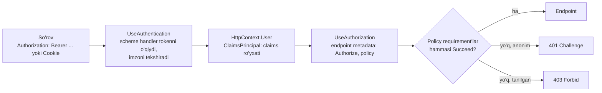
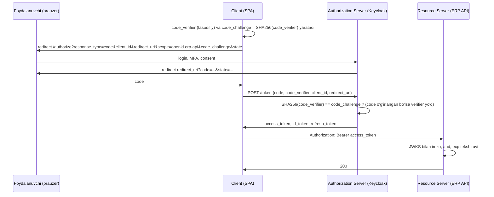
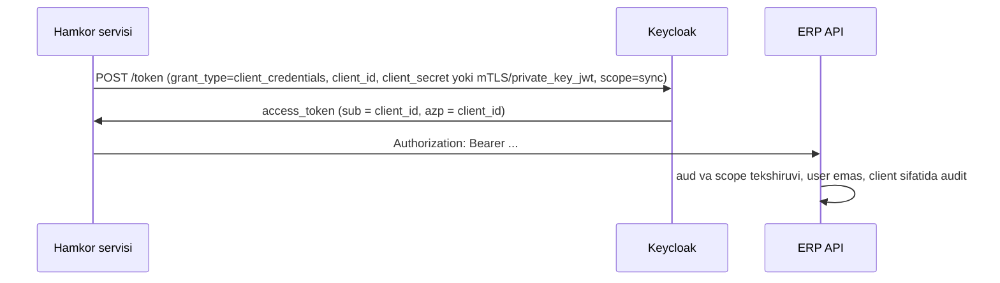

# 13. Authentication va Authorization

> **Bir jumlada:** Authentication "bu kim?" savoliga javob beradi (token yoki cookie'dan ClaimsPrincipal yasaladi), authorization "unga shu amalga ruxsat bormi?" ga (role, policy, resurs bo'yicha); ASP.NET Core'da bu ikki middleware ketma-ket turadi va har biri alohida sozlanadi.
> **Nega Middle uchun:** Enterprise'da SSO (Keycloak, Entra ID), bir nechta tenant, rollar va "faqat o'z buyurtmasini ko'rsin" talablari bir vaqtda keladi; JWT'ni "bekor qilib bo'lmaydi" va refresh token'ni qayerda saqlash kabi savollar har suhbatda.
> **O'qish vaqti:** ~40 daqiqa

## Mundarija

- [1. Muammo va yechim](#1-muammo-va-yechim)
- [2. Qanday ishlaydi](#2-qanday-ishlaydi)
- [3. Asosiy tushunchalar](#3-asosiy-tushunchalar): JWT, access/refresh, OAuth2/OIDC flow'lar, Keycloak/Entra ID, cookie, Identity va passkey, role/policy/resource, claims transformation, multi-tenant, API key, token saqlash
- [4. Amaliy misol](#4-amaliy-misol)
- [5. Tipik xatolar va anti-patternlar](#5-tipik-xatolar-va-anti-patternlar)
- [6. Best practices checklist](#6-best-practices-checklist)
- [7. Suhbat savollari va javoblar](#7-suhbat-savollari-va-javoblar)
- [8. Qo'shimcha manbalar](#8-qoshimcha-manbalar)

## 1. Muammo va yechim

ERP tizimida uchta client bor: React SPA (ofis xodimlari), mobil ilova (ombor), va hamkor kompaniyaning integratsiya servisi (tungi sinxronizatsiya). Dastlab hammasi uchun bitta "login + parol -> JWT 30 kun" endpoint yozildi. Oqibatlar: xodim ishdan ketganda uning tokeni 30 kun ishlaydi; SPA tokenni localStorage'da saqlaydi, bitta XSS zaiflik orqali tokenlar o'g'irlandi; hamkor servisi inson foydalanuvchi nomidan ishlaydi, kim nima qilganini audit ajrata olmaydi; "menejer" roli bor, lekin "faqat o'z filialining buyurtmalarini tasdiqlasin" talabini role bilan ifodalab bo'lmadi, controller'larda `if (user.Branch != order.Branch)` tarqalib ketdi.

Yechim: identity provider (Keycloak yoki Entra ID) orqali OIDC; SPA uchun Authorization Code + PKCE va qisqa access token (10 daqiqa) + rotatsiyali refresh token; hamkor uchun Client Credentials va o'z client_id'si; API'da policy va resource-based authorization; tenant/filial tekshiruvi bir joyda, `IAuthorizationHandler` ichida.

## 2. Qanday ishlaydi

ASP.NET Core'da har so'rov uchun:



1. **Authentication middleware** ro'yxatdan o'tgan scheme'lar (JwtBearer, Cookie, OpenIdConnect, custom) ichidan default'ini yoki endpoint'da ko'rsatilganini chaqiradi. Handler `AuthenticateAsync` qiladi: JWT bo'lsa imzo, muddat, issuer, audience tekshiriladi va payload claim'larga aylanadi; cookie bo'lsa Data Protection bilan shifrlangan cookie ochilib ichidagi ticket (claims) o'qiladi. Natija `HttpContext.User` (`ClaimsPrincipal`, ichida bir yoki bir nechta `ClaimsIdentity`). Token bo'lmasa `User` anonim, middleware xato bermaydi.
2. **Authorization middleware** endpoint metadata'sidan `[Authorize]`/`RequireAuthorization` va policy nomlarini oladi, `IAuthorizationService` orqali har requirement uchun handler'larni chaqiradi. Barcha requirement `Succeed` bo'lsa o'tadi; aks holda foydalanuvchi anonim bo'lsa `Challenge` (401, JWT'da `WWW-Authenticate` header, cookie'da login sahifasiga redirect), tanilgan bo'lsa `Forbid` (403).
3. **Resource-based** tekshiruv middleware'da emas, endpoint ichida: resurs (Order) yuklangandan keyin `IAuthorizationService.AuthorizeAsync(user, order, policy)`.

Claim: `(type, value)` juftligi, masalan `("sub", "u-42")`, `("role", "manager")`. Policy: requirement'lar to'plami. Handler: bitta requirement'ni tekshiruvchi klass. Scheme: tokenni qanday o'qish usuli.

## 3. Asosiy tushunchalar

### 3.1 JWT tuzilishi va imzo tekshiruvi

- **Ta'rif.** JWT (JSON Web Token) uch qism base64url bilan kodlangan va nuqta bilan ajratilgan: `header.payload.signature`. Header: `alg` (RS256, ES256, HS256), `kid` (kalit identifikatori), `typ`. Payload: claim'lar (`iss`, `sub`, `aud`, `exp`, `iat`, `nbf`, `jti` va custom). Signature: header+payload ustidan imzo; RS256/ES256 asimmetrik (provider private key bilan imzolaydi, API public key bilan tekshiradi), HS256 simmetrik (ikkalasida bir xil sir).
- **Nega kerak.** API har so'rovda bazaga yoki provider'ga murojaat qilmasdan "kim" ekanini tekshiradi: imzo to'g'ri va `exp` o'tmagan bo'lsa, payload'ga ishoniladi. Shu sabab token'ni server tomonda "o'chirib" bo'lmaydi; u muddati tugaguncha haqiqiy.

```csharp
builder.Services.AddAuthentication(JwtBearerDefaults.AuthenticationScheme)
    .AddJwtBearer(o =>
    {
        o.Authority = "https://auth.company.uz/realms/erp";   // /.well-known/openid-configuration dan public key (JWKS) olinadi va keshlanadi
        o.Audience = "erp-api";                               // aud claim shu bo'lishi shart
        o.MapInboundClaims = false;                           // "sub" ni "nameidentifier" ga o'girmasin, asl nomlar qolsin
        o.TokenValidationParameters = new TokenValidationParameters
        {
            ValidateIssuer = true,
            ValidateAudience = true,
            ValidateLifetime = true,
            ValidateIssuerSigningKey = true,
            ClockSkew = TimeSpan.FromSeconds(30),             // default 5 daqiqa: exp dan keyin 5 daqiqa hali ishlaydi
            NameClaimType = "preferred_username",
            RoleClaimType = "role",
        };
        o.Events = new JwtBearerEvents
        {
            OnAuthenticationFailed = ctx =>
            {
                // Imzo xato, muddat tugagan, kid topilmadi: log, lekin tafsilotni client'ga bermang
                ctx.HttpContext.RequestServices.GetRequiredService<ILogger<Program>>()
                   .LogWarning(ctx.Exception, "JWT rad etildi");
                return Task.CompletedTask;
            }
        };
    });
```

Tekshiruv tartibi (JsonWebTokenHandler): token formatini o'qish, `kid` bo'yicha JWKS'dan kalit topish (topilmasa provider'dan qayta yuklash), imzo, `nbf`/`exp` (clock skew bilan), `iss`, `aud`. `alg: none` va HS256 kalitini public key sifatida berish hujumlari kutubxona tomonidan rad etiladi, lekin `ValidateIssuerSigningKey = false` yoki `SignatureValidator` ni o'zingiz bekor qilsangiz himoya yo'qoladi.

- **Tipik xato.** Token payload'ida PII (telefon, manzil) yoki rollar ro'yxati 200 ta: token 8 KB, har so'rov header'ida ketadi, reverse proxy header limitiga uradi. Payload'ga faqat identifikator va kam sonli claim.

### 3.2 Access va refresh token strategiyasi

- **Ta'rif.** Access token qisqa umrli (5-15 daqiqa), API'ga yuboriladi, stateless tekshiriladi. Refresh token uzun umrli (soat-kunlar), faqat token endpoint'ga yuboriladi, yangi access token olish uchun; server tomonda saqlanadi va bekor qilinishi mumkin.
- **Nega kerak.** Access token'ni bekor qilib bo'lmaydi, shuning uchun u qisqa. Foydalanuvchi har 10 daqiqada login qilmasligi uchun refresh token. Xodim ishdan ketganda refresh token'ni bazada bekor qilish 10 daqiqa ichida kuchga kiradi.

Rotatsiya: har refresh'da yangi refresh token beriladi, eskisi bekor qilinadi. Eski (bekor qilingan) token qayta ishlatilsa, bu o'g'irlik belgisi: butun "oila" (shu login sessiyasidan chiqqan barcha tokenlar) bekor qilinadi.

```csharp
public sealed class RefreshToken
{
    public Guid Id { get; set; }
    public string UserId { get; set; } = "";
    public string TokenHash { get; set; } = "";       // bazada faqat SHA-256 hash; baza sizsa tokenlar ishlamaydi
    public Guid FamilyId { get; set; }                // bitta login sessiyasi
    public DateTimeOffset ExpiresAt { get; set; }
    public DateTimeOffset? UsedAt { get; set; }       // rotatsiyada belgilanadi
    public DateTimeOffset? RevokedAt { get; set; }
}

public sealed class TokenService(AppDbContext db, TimeProvider clock, IJwtIssuer jwt)
{
    public async Task<TokenPair> RefreshAsync(string presented, CancellationToken ct)
    {
        var hash = Convert.ToHexString(SHA256.HashData(Encoding.UTF8.GetBytes(presented)));
        var stored = await db.RefreshTokens.FirstOrDefaultAsync(t => t.TokenHash == hash, ct)
                     ?? throw new UnauthorizedException();

        var now = clock.GetUtcNow();
        if (stored.UsedAt is not null)
        {
            // Qayta ishlatish: o'g'irlangan deb hisoblaymiz, butun oilani bekor qilamiz
            await db.RefreshTokens.Where(t => t.FamilyId == stored.FamilyId && t.RevokedAt == null)
                .ExecuteUpdateAsync(s => s.SetProperty(t => t.RevokedAt, now), ct);
            throw new UnauthorizedException();
        }
        if (stored.RevokedAt is not null || stored.ExpiresAt < now) throw new UnauthorizedException();

        stored.UsedAt = now;
        var newRaw = RandomNumberGenerator.GetHexString(64);          // 256 bit tasodifiy, JWT emas
        db.RefreshTokens.Add(new RefreshToken
        {
            UserId = stored.UserId, FamilyId = stored.FamilyId,
            TokenHash = Convert.ToHexString(SHA256.HashData(Encoding.UTF8.GetBytes(newRaw))),
            ExpiresAt = now.AddDays(14),
        });
        await db.SaveChangesAsync(ct);
        return new TokenPair(await jwt.IssueAccessAsync(stored.UserId, ct), newRaw);
    }
}
```

Keycloak/Entra ID ishlatilsa, bu mantiq provider ichida: siz faqat `offline_access` scope va rotatsiya sozlamasini yoqasiz. Yuqoridagi kod o'z identity server'ingiz bo'lsa kerak.

Access token'ni darhol bekor qilish kerak bo'lsa (parol o'zgardi, akkaunt bloklandi): token `jti` ni Redis'dagi deny-list'ga `exp` gacha TTL bilan qo'yish va har so'rovda tekshirish. Bu stateless afzallikni qisman yo'qotadi, shuning uchun faqat xavfsizlik hodisalari uchun.

### 3.3 OAuth2 va OpenID Connect flow'lar

- **Ta'rif.** OAuth2 avtorizatsiya protokoli: client foydalanuvchi nomidan resurs serverga kirish uchun access token oladi. OpenID Connect (OIDC) uning ustidagi identifikatsiya qatlami: `id_token` (foydalanuvchi kim), `userinfo` endpoint, discovery (`/.well-known/openid-configuration`), standart claim'lar. Rollar: Resource Owner (foydalanuvchi), Client (SPA, mobil, servis), Authorization Server (Keycloak), Resource Server (sizning API).
- **Nega kerak.** Parol faqat provider'ga kiritiladi, client va API uni ko'rmaydi; SSO, MFA, passkey provider'da bir marta sozlanadi.

**Authorization Code + PKCE** (SPA, mobil, server-rendered web, barchasi uchun hozirgi standart; Implicit flow eskirgan):



PKCE (Proof Key for Code Exchange) `code` ni ushlab olgan hujumchi `code_verifier` siz token ololmasligini ta'minlaydi; public client (SPA, mobil) uchun client_secret yo'q, shuning uchun majburiy. `state` CSRF'ga qarshi (redirect qaytganda boshlagan sessiya bilan bog'lanadi).

**Client Credentials** (servis-servis, foydalanuvchi yo'q):



```csharp
// Client Credentials bilan tashqi API'ga murojaat: Duende.AccessTokenManagement yoki qo'lda keshlash
builder.Services.AddClientCredentialsTokenManagement()
    .AddClient("sync", c =>
    {
        c.TokenEndpoint = "https://auth.company.uz/realms/erp/protocol/openid-connect/token";
        c.ClientId = "warehouse-sync";
        c.ClientSecret = builder.Configuration["Sync:ClientSecret"];   // secret manager / vault
        c.Scope = "partner-api";
    });
builder.Services.AddClientCredentialsHttpClient("partner", "sync", c => c.BaseAddress = new("https://partner.uz/api/"));
// Token keshlanadi va exp dan oldin yangilanadi; HttpClient har so'rovda Bearer header qo'shadi
```

Boshqa flow'lar: Device Code (TV, CLI), Resource Owner Password (eskirgan, faqat legacy migratsiya), Token Exchange (RFC 8693, servis foydalanuvchi tokenini boshqa audience'ga almashtiradi).

### 3.4 Keycloak va Entra ID bilan ulash

- **Ta'rif.** Keycloak ochiq kodli identity provider (realm, client, role, user federation LDAP/AD). Microsoft Entra ID (eski Azure AD) bulutli; `Microsoft.Identity.Web` kutubxonasi ASP.NET Core bilan integratsiya.
- **Nega kerak.** O'z login/parol/MFA/parol tiklash tizimini yozmaslik; korporativ AD foydalanuvchilarini SSO bilan kiritish.

```csharp
// Keycloak: API (resource server). Rollar realm_access.roles ichida, uni "role" claim'ga aylantirish kerak (3.8)
builder.Services.AddAuthentication(JwtBearerDefaults.AuthenticationScheme)
    .AddJwtBearer(o =>
    {
        o.Authority = builder.Configuration["Keycloak:Authority"];   // https://auth.company.uz/realms/erp
        o.Audience = "erp-api";                                      // Keycloak client'da audience mapper sozlanadi
        o.MapInboundClaims = false;
    });

// Entra ID: Microsoft.Identity.Web, appsettings "AzureAd": { Instance, TenantId, ClientId, Audience }
builder.Services.AddAuthentication(JwtBearerDefaults.AuthenticationScheme)
    .AddMicrosoftIdentityWebApi(builder.Configuration.GetSection("AzureAd"));
// Entra'da rollar "roles" claim'da (App roles), guruhlar "groups" (ko'p bo'lsa overage, Graph API kerak)

// Server-rendered web ilova (Razor/MVC/Blazor Server): OIDC + cookie
builder.Services.AddAuthentication(o =>
    {
        o.DefaultScheme = CookieAuthenticationDefaults.AuthenticationScheme;          // so'rovlar cookie bilan
        o.DefaultChallengeScheme = OpenIdConnectDefaults.AuthenticationScheme;         // login provider'ga redirect
    })
    .AddCookie()
    .AddOpenIdConnect(o =>
    {
        o.Authority = "https://auth.company.uz/realms/erp";
        o.ClientId = "erp-web"; o.ClientSecret = builder.Configuration["Oidc:Secret"];  // confidential client
        o.ResponseType = OpenIdConnectResponseType.Code;   // PKCE default yoqilgan
        o.Scope.Add("erp-api"); o.Scope.Add("offline_access");
        o.SaveTokens = true;                               // access/refresh token cookie ticket ichida (hajm!)
        o.GetClaimsFromUserInfoEndpoint = true;
    });
```

Realm sozlamalari kodda emas: Keycloak'da client (`erp-spa` public + PKCE, `erp-web` confidential, `warehouse-sync` service account), audience mapper, role'lar. Bu sozlamalar `kcadm` yoki realm export JSON bilan versiyalanadi.

### 3.5 Cookie authentication

- **Ta'rif.** Server login'dan keyin claims'ni Data Protection bilan shifrlab, imzolab cookie'ga yozadi; har so'rovda cookie ochiladi. Brauzer cookie'ni avtomatik yuboradi.
- **Nega kerak.** Server-rendered ilovalar va BFF (Backend for Frontend) pattern: SPA token'ni ko'rmaydi, BFF cookie bilan ishlaydi va API'ga Bearer qo'shadi.

```csharp
builder.Services.AddAuthentication(CookieAuthenticationDefaults.AuthenticationScheme)
    .AddCookie(o =>
    {
        o.Cookie.Name = "__Host-erp";                 // __Host- prefiksi: Secure, Path=/, Domain yo'q, brauzer majburlaydi
        o.Cookie.HttpOnly = true;                     // JS o'qiy olmaydi (XSS'dan himoya)
        o.Cookie.SecurePolicy = CookieSecurePolicy.Always;
        o.Cookie.SameSite = SameSiteMode.Lax;         // cross-site POST'da yuborilmaydi (CSRF kamayadi); OIDC callback uchun Lax kerak
        o.ExpireTimeSpan = TimeSpan.FromHours(8);
        o.SlidingExpiration = true;                   // faol foydalanuvchi uchun uzayadi
        o.LoginPath = "/login";
        o.Events.OnValidatePrincipal = async ctx =>
        {
            // Har 5 daqiqada bazadan "security stamp" tekshirish: parol o'zgargan/bloklangan bo'lsa cookie bekor
            var validator = ctx.HttpContext.RequestServices.GetRequiredService<ISessionValidator>();
            if (!await validator.IsValidAsync(ctx.Principal!, ctx.Properties.IssuedUtc))
            { ctx.RejectPrincipal(); await ctx.HttpContext.SignOutAsync(); }
        };
    });

// Login
await HttpContext.SignInAsync(CookieAuthenticationDefaults.AuthenticationScheme,
    new ClaimsPrincipal(new ClaimsIdentity(claims, "cookie")),
    new AuthenticationProperties { IsPersistent = rememberMe });
```

Cookie bir nechta instance orasida ishlashi uchun Data Protection kalitlari umumiy joyda (Redis, blob, DB) saqlanadi, aks holda bir pod yozgan cookie'ni boshqa pod ocholmaydi (14-bobda).

Cookie auth bilan CSRF xavfi bor (brauzer cookie'ni avtomatik yuboradi), shuning uchun antiforgery token yoki `SameSite=Strict/Lax` + custom header tekshiruvi shart; Bearer token'da bu xavf yo'q, chunki JS header'ni ataylab qo'shadi.

### 3.6 ASP.NET Core Identity va passkey

- **Ta'rif.** Identity foydalanuvchi boshqaruvi kutubxonasi: `UserManager`, `SignInManager`, `RoleManager`, parol hashing (PBKDF2), lockout, 2FA (TOTP), email tasdiqlash, external login, EF store. .NET 10 da passkey (WebAuthn/FIDO2) qo'llab-quvvatlanadi: foydalanuvchi parolsiz, qurilma biometrikasi yoki xavfsizlik kaliti bilan kiradi.
- **Nega kerak.** Provider ishlatmasdan o'z foydalanuvchi bazasi kerak bo'lganda (kichik tizim, B2C). Identity'ni o'zingiz yozmang: lockout, hash, 2FA xatolari qimmat.

```csharp
builder.Services.AddIdentityCore<AppUser>(o =>
    {
        o.Password.RequiredLength = 12;
        o.Lockout.MaxFailedAccessAttempts = 5;
        o.Lockout.DefaultLockoutTimeSpan = TimeSpan.FromMinutes(15);
        o.User.RequireUniqueEmail = true;
    })
    .AddRoles<IdentityRole>()
    .AddEntityFrameworkStores<AppDbContext>()
    .AddSignInManager()
    .AddDefaultTokenProviders();   // email tasdiqlash, parol tiklash tokenlari (Data Protection bilan)

// .NET 10 passkey: registratsiya (attestation) va kirish (assertion) ikki bosqich, brauzer navigator.credentials bilan
// 1) Server: options yaratadi, challenge'ni sessiyada saqlaydi
var creationOptions = await signInManager.MakePasskeyCreationOptionsAsync(
    new PasskeyUserEntity(user.Id, user.UserName!, user.Email!));
// 2) Brauzer: navigator.credentials.create(options) -> attestation natijasi JSON
// 3) Server: tekshiradi va foydalanuvchiga biriktiradi
var attestation = await signInManager.PerformPasskeyAttestationAsync(credentialJson);
if (attestation.Succeeded) await userManager.AddOrUpdatePasskeyAsync(user, attestation.Passkey);
// Kirish: MakePasskeyRequestOptionsAsync -> navigator.credentials.get -> PasskeySignInAsync(credentialJson)
```

Passkey afzalligi: phishing'ga chidamli (kalit domen bilan bog'langan), parol bazasi yo'q, server tomonida faqat public key saqlanadi. Identity ma'lumotlari uchun `IdentityUserPasskey` jadvali `AddEntityFrameworkStores` bilan avtomatik keladi (migration kerak).

### 3.7 Role, policy va resource-based authorization

- **Ta'rif.** Role-based: `[Authorize(Roles = "manager")]`, `role` claim bo'yicha. Policy-based: nomlangan requirement'lar to'plami (claim, role, custom mantiq). Resource-based: qaror aniq resurs (Order) qiymatiga bog'liq, endpoint ichida `IAuthorizationService` chaqiriladi.
- **Nega kerak.** Rollar "kim" ni aytadi, "qaysi buyurtma" ni emas. "Faqat o'z filialidagi va summasi limitdan kichik buyurtmani tasdiqlasin" role bilan ifodalanmaydi.

```csharp
// Policy'lar
builder.Services.AddAuthorizationBuilder()
    .AddPolicy("orders.read", p => p.RequireAuthenticatedUser().RequireClaim("scope", "erp-api"))
    .AddPolicy("orders.approve", p => p.RequireRole("manager", "director")
                                       .AddRequirements(new ApproveOrderRequirement()))
    .AddPolicy("tenant.member", p => p.AddRequirements(new TenantMemberRequirement()))
    .SetFallbackPolicy(new AuthorizationPolicyBuilder().RequireAuthenticatedUser().Build()); // default: hamma endpoint auth talab qiladi

// Requirement: faqat ma'lumot, mantiq yo'q
public sealed class ApproveOrderRequirement : IAuthorizationRequirement;

// Resource-based handler: requirement + resurs
public sealed class ApproveOrderHandler(IApprovalLimits limits)
    : AuthorizationHandler<ApproveOrderRequirement, Order>
{
    protected override async Task HandleRequirementAsync(
        AuthorizationHandlerContext context, ApproveOrderRequirement requirement, Order order)
    {
        var user = context.User;
        var branch = user.FindFirstValue("branch");
        if (branch is null || branch != order.BranchCode) return;             // Succeed chaqirilmaydi -> rad

        // Director hamma summani, manager limitgacha
        if (user.IsInRole("director")) { context.Succeed(requirement); return; }

        var limit = await limits.ForUserAsync(user.FindFirstValue("sub")!);
        if (order.Total.Amount <= limit) context.Succeed(requirement);
        // Boshqa handler'lar ham ishlaydi; context.Fail() faqat aniq taqiq uchun (boshqa handler Succeed qilsa ham rad)
    }
}
builder.Services.AddScoped<IAuthorizationHandler, ApproveOrderHandler>();   // handler DI'dan, scoped bo'lishi mumkin

// Endpoint: resurs yuklangandan keyin tekshiruv
app.MapPost("/orders/{id:int}/approve", async (int id, AppDbContext db, IAuthorizationService authz,
    ClaimsPrincipal user, CancellationToken ct) =>
{
    var order = await db.Orders.AsTracking().FirstOrDefaultAsync(o => o.Id == id, ct);
    if (order is null) return Results.NotFound();

    var result = await authz.AuthorizeAsync(user, order, "orders.approve");
    if (!result.Succeeded) return Results.Forbid();          // 403; 404 qaytarish ham mumkin (resurs mavjudligini yashirish)

    order.Approve(user.FindFirstValue("sub")!);
    await db.SaveChangesAsync(ct);
    return Results.NoContent();
}).RequireAuthorization("orders.read");   // policy middleware'da; resource tekshiruvi ichkarida
```

Handler semantikasi: bitta requirement uchun bir nechta handler bo'lishi mumkin, biri `Succeed` qilsa yetarli; `Fail()` hammasini bekor qiladi. Handler exception tashlasa 500, shuning uchun bazaga murojaat ehtiyot bilan. `[Authorize]` atributlari bir nechta bo'lsa hammasi (AND) bajarilishi kerak; `Roles = "a,b"` ichida OR.

- **Tipik xato.** Resource tekshiruvini `if (order.OwnerId != userId) return Forbid()` deb har endpoint'da yozish: 30 endpoint'da 30 nusxa, biri unutiladi. Handler bir joyda, test qilinadi.

### 3.8 Claims transformation

- **Ta'rif.** `IClaimsTransformation` authentication'dan keyin, authorization'dan oldin `ClaimsPrincipal` ni boyitadi yoki o'zgartiradi: provider claim'larini ilova formatiga keltirish, bazadan qo'shimcha claim (filial, tenant rollari) yuklash.
- **Nega kerak.** Keycloak rollarni `realm_access: { roles: [...] }` JSON ichida beradi, ASP.NET `IsInRole` esa `role` claim kutadi. Entra ID guruh ID'larini beradi, nom kerak.

```csharp
public sealed class KeycloakRoleTransformation : IClaimsTransformation
{
    public Task<ClaimsPrincipal> TransformAsync(ClaimsPrincipal principal)
    {
        var identity = principal.Identity as ClaimsIdentity;
        if (identity is null || identity.HasClaim(c => c.Type == "role")) return Task.FromResult(principal); // har so'rovda bir necha marta chaqirilishi mumkin, idempotent bo'lsin

        var realmAccess = principal.FindFirst("realm_access")?.Value;
        if (realmAccess is not null)
        {
            using var doc = JsonDocument.Parse(realmAccess);
            if (doc.RootElement.TryGetProperty("roles", out var roles))
                foreach (var r in roles.EnumerateArray())
                    identity.AddClaim(new Claim("role", r.GetString()!));
        }
        return Task.FromResult(principal);
    }
}
builder.Services.AddSingleton<IClaimsTransformation, KeycloakRoleTransformation>();
```

Bazadan boyitish (masalan, foydalanuvchining filiali) har so'rovda DB so'rovi; `IMemoryCache`/HybridCache bilan 1-5 daqiqa keshlang yoki bu claim'ni token'ga provider mapper orqali qo'shing.

### 3.9 Multi-tenant authorization

- **Ta'rif.** Tenant identifikatori token'dan (`tid` claim, Entra ID'da tenant GUID, Keycloak'da custom mapper) yoki so'rovdan (subdomain, header, route) olinadi; har so'rov tenant kontekstida bajariladi.
- **Nega kerak.** Boshqa tenant ma'lumotini ko'rish eng og'ir hodisa. Tekshiruv bir joyda: token tenant'i so'rov tenant'iga mos keladimi.

```csharp
public sealed class TenantMemberRequirement : IAuthorizationRequirement;

public sealed class TenantMemberHandler(IHttpContextAccessor http) : AuthorizationHandler<TenantMemberRequirement>
{
    protected override Task HandleRequirementAsync(AuthorizationHandlerContext ctx, TenantMemberRequirement req)
    {
        var tokenTenant = ctx.User.FindFirstValue("tid");
        var routeTenant = http.HttpContext?.GetRouteValue("tenant")?.ToString();   // /t/{tenant}/orders
        if (tokenTenant is not null && tokenTenant == routeTenant) ctx.Succeed(req);
        return Task.CompletedTask;
    }
}

// ITenantContext: token'dan o'qiydi, EF global filter shu qiymatni ishlatadi (11-bob)
public sealed class ClaimsTenantContext(IHttpContextAccessor http) : ITenantContext
{
    public Guid TenantId => Guid.TryParse(http.HttpContext?.User.FindFirstValue("tid"), out var id)
        ? id : throw new UnauthorizedException("tenant claim yo'q");
}
```

Foydalanuvchi bir nechta tenant'da bo'lsa: token bitta tenant uchun beriladi (login'da tanlanadi) yoki `tenants` claim ro'yxati va so'rov tenant'i shu ro'yxatda tekshiriladi. Header'dan (`X-Tenant-Id`) olingan tenant'ga token tasdig'isiz ishonib bo'lmaydi.

### 3.10 API key

- **Ta'rif.** Tashqi integratsiya uchun uzun tasodifiy satr; so'rov header'ida (`X-Api-Key`) keladi, bazada hash bilan saqlanadi, client identifikatori va scope'lariga map qilinadi.
- **Nega kerak.** OAuth client credentials qila olmaydigan oddiy integratsiyalar (webhook, eski tizim). OAuth mavjud bo'lsa client credentials afzal: muddat, rotatsiya, standart.

```csharp
public sealed class ApiKeyHandler(IOptionsMonitor<AuthenticationSchemeOptions> opt, ILoggerFactory lf,
    UrlEncoder enc, IApiKeyStore store) : AuthenticationHandler<AuthenticationSchemeOptions>(opt, lf, enc)
{
    protected override async Task<AuthenticateResult> HandleAuthenticateAsync()
    {
        if (!Request.Headers.TryGetValue("X-Api-Key", out var raw)) return AuthenticateResult.NoResult(); // boshqa scheme urinishi mumkin
        var hash = SHA256.HashData(Encoding.UTF8.GetBytes(raw.ToString()!));
        var client = await store.FindByHashAsync(hash, Context.RequestAborted);   // hash bo'yicha index; sabit vaqt taqqoslash DB'da emas, shuning uchun hash qidiruv
        if (client is null || client.RevokedAt is not null) return AuthenticateResult.Fail("Invalid API key");

        var claims = new List<Claim> { new("sub", $"apikey:{client.Id}"), new("client_type", "apikey"), new("tid", client.TenantId.ToString()) };
        claims.AddRange(client.Scopes.Select(s => new Claim("scope", s)));
        var principal = new ClaimsPrincipal(new ClaimsIdentity(claims, Scheme.Name));
        return AuthenticateResult.Success(new AuthenticationTicket(principal, Scheme.Name));
    }
}
builder.Services.AddAuthentication().AddScheme<AuthenticationSchemeOptions, ApiKeyHandler>("ApiKey", null);
// Endpoint'da ikkala scheme: [Authorize(AuthenticationSchemes = "Bearer,ApiKey")] yoki policy.AddAuthenticationSchemes(...)
```

Kalit yaratilganda bir marta ko'rsatiladi, bazada faqat hash; rotatsiya uchun bir vaqtda ikkita faol kalit bo'lishi mumkin; har kalit tenant va scope bilan cheklangan; rate limit kalit bo'yicha.

### 3.11 Token saqlash: localStorage vs HttpOnly cookie

- **Ta'rif.** SPA'da access/refresh token qayerda turadi: `localStorage` (JS o'qiydi, XSS o'g'irlaydi), xotirada (sahifa yangilansa yo'qoladi, refresh kerak), yoki server cookie (`HttpOnly`, JS ko'rmaydi, lekin CSRF va cookie hajmi).
- **Nega kerak.** XSS bitta zaiflik bilan barcha foydalanuvchi tokenlarini olib ketishi mumkin; refresh token localStorage'da bo'lsa, 14 kunlik kirish o'g'irlanadi.

| Variant | XSS | CSRF | Sahifa yangilanishi | Tavsiya |
|---|---|---|---|---|
| localStorage | Token o'qiladi | Yo'q | Saqlanadi | Yo'q, ayniqsa refresh token uchun |
| Xotira (JS o'zgaruvchi) + refresh HttpOnly cookie | Access qisqa, refresh himoyalangan | Refresh endpoint'da CSRF himoyasi kerak | Refresh bilan tiklanadi | Qabul qilinadi |
| BFF: hamma narsa HttpOnly cookie, server token'ni ushlaydi | Token brauzerga chiqmaydi | Antiforgery + SameSite | Saqlanadi | Enterprise uchun eng xavfsiz |

BFF'da SPA faqat o'z domenidagi backend'ga cookie bilan murojaat qiladi; backend OIDC bilan provider'dan token oladi, server tomonda (session store) saqlaydi va API'ga Bearer qo'shadi. `Duende.BFF` yoki oddiy YARP + cookie bilan quriladi.

## 4. Amaliy misol

ERP API: Keycloak JWT + API key, Keycloak rollarini transformatsiya, tenant va resource-based policy, bir endpoint.

```csharp
var builder = WebApplication.CreateBuilder(args);

builder.Services.AddHttpContextAccessor();
builder.Services.AddScoped<ITenantContext, ClaimsTenantContext>();
builder.Services.AddSingleton<IClaimsTransformation, KeycloakRoleTransformation>();
builder.Services.AddScoped<IAuthorizationHandler, ApproveOrderHandler>();
builder.Services.AddScoped<IAuthorizationHandler, TenantMemberHandler>();

builder.Services.AddAuthentication(JwtBearerDefaults.AuthenticationScheme)
    .AddJwtBearer(o =>
    {
        o.Authority = builder.Configuration["Keycloak:Authority"];
        o.Audience = "erp-api";
        o.MapInboundClaims = false;
        o.TokenValidationParameters.NameClaimType = "preferred_username";
        o.TokenValidationParameters.RoleClaimType = "role";
        o.TokenValidationParameters.ClockSkew = TimeSpan.FromSeconds(30);
        o.RequireHttpsMetadata = !builder.Environment.IsDevelopment();
    })
    .AddScheme<AuthenticationSchemeOptions, ApiKeyHandler>("ApiKey", null);

builder.Services.AddAuthorizationBuilder()
    // Fallback: hech qaysi endpoint tasodifan ochiq qolmaydi; ochiq bo'lishi kerak bo'lganlar AllowAnonymous
    .SetFallbackPolicy(new AuthorizationPolicyBuilder(JwtBearerDefaults.AuthenticationScheme, "ApiKey")
        .RequireAuthenticatedUser().Build())
    .AddPolicy("tenant.member", p => p.AddAuthenticationSchemes(JwtBearerDefaults.AuthenticationScheme, "ApiKey")
        .RequireAuthenticatedUser().AddRequirements(new TenantMemberRequirement()))
    .AddPolicy("orders.approve", p => p.AddAuthenticationSchemes(JwtBearerDefaults.AuthenticationScheme)  // API key tasdiqlay olmaydi
        .RequireRole("manager", "director").AddRequirements(new ApproveOrderRequirement()));

var app = builder.Build();
app.UseAuthentication();     // tartib: routing -> authentication -> authorization -> endpoint
app.UseAuthorization();

var tenantApi = app.MapGroup("/t/{tenant:guid}").RequireAuthorization("tenant.member");

tenantApi.MapGet("/orders", async (AppDbContext db, CancellationToken ct) =>
    // Global filter tenant'ni ITenantContext (token "tid") dan oladi; route tenant'i policy'da tekshirilgan
    await db.Orders.Select(o => new OrderRow(o.Id, o.Status, o.Total.Amount)).Take(100).ToListAsync(ct));

tenantApi.MapPost("/orders/{id:int}/approve", async (int id, AppDbContext db, IAuthorizationService authz,
    ClaimsPrincipal user, CancellationToken ct) =>
{
    var order = await db.Orders.AsTracking().Include(o => o.Lines).FirstOrDefaultAsync(o => o.Id == id, ct);
    if (order is null) return Results.NotFound();
    var decision = await authz.AuthorizeAsync(user, order, "orders.approve");
    if (!decision.Succeeded) return Results.Forbid();
    order.Approve(user.FindFirstValue("sub")!);
    await db.SaveChangesAsync(ct);
    return Results.NoContent();
});

app.MapGet("/health", () => Results.Ok()).AllowAnonymous();
app.Run();
```

Nega shunday: fallback policy "default yopiq" prinsipi, yangi endpoint unutilsa ham ochiq qolmaydi. Tenant tekshiruvi route guruhi darajasida, har endpoint'da takrorlanmaydi. Tasdiqlash policy'si faqat JWT scheme'ni qabul qiladi, API key bilan tasdiqlab bo'lmaydi (inson qarori). Rollar transformation orqali, shuning uchun `RequireRole` Keycloak formatiga bog'liq emas. Resource tekshiruvi endpoint ichida, chunki Order bazadan yuklangandan keyingina summasi ma'lum.

## 5. Tipik xatolar va anti-patternlar

**1. Uzun umrli access token va refresh'siz dizayn.**

```csharp
// ❌ 30 kunlik JWT
var token = new JwtSecurityToken(expires: DateTime.UtcNow.AddDays(30), ...);
```

Oqibat: bekor qilib bo'lmaydi, ishdan ketgan xodim 30 kun kiradi, o'g'irlangan token 30 kun ishlaydi.

```csharp
// ✅ 10 daqiqa access + rotatsiyali refresh (bazada hash, oila, qayta ishlatish aniqlash)
expires: DateTime.UtcNow.AddMinutes(10)
```

**2. Audience tekshirmaslik.**

```csharp
// ❌
o.TokenValidationParameters = new() { ValidateAudience = false };
```

Oqibat: shu provider'ning boshqa ilovasi uchun berilgan token (masalan, "hr-api" uchun) sizning API'ngizda ishlaydi (token reuse across services).

```csharp
// ✅
o.Audience = "erp-api";   // ValidateAudience default true
```

**3. Rolni token'dan emas, so'rovdan olish.**

```csharp
// ❌ Client "isAdmin": true yuboradi
app.MapPost("/orders", (CreateOrder dto) => { if (dto.IsAdmin) ... });
```

Oqibat: privilege escalation, har kim admin.

```csharp
// ✅ Faqat ClaimsPrincipal (imzolangan token) dan
if (user.IsInRole("admin")) ...
```

**4. Resource tekshiruvini unutish (IDOR).**

```csharp
// ❌ Autentifikatsiya bor, lekin buyurtma kimniki tekshirilmaydi
app.MapGet("/orders/{id}", (int id, AppDbContext db) => db.Orders.FindAsync(id)).RequireAuthorization();
```

Oqibat: `id` ni 1, 2, 3 deb o'zgartirib boshqa mijozning buyurtmasini ko'rish (Insecure Direct Object Reference).

```csharp
// ✅ Tenant global filter + owner tekshiruvi so'rov ichida
db.Orders.Where(o => o.Id == id && o.CustomerId == customerId)
```

**5. HS256 sirini appsettings'da va qisqa.**

```json
// ❌ appsettings.json
{ "Jwt": { "Secret": "mysecret123" } }
```

Oqibat: git tarixida sir; 11 belgili sir brute-force; sir bilan har kim token yasaydi.

```csharp
// ✅ RS256/ES256 provider'da (private key API'da yo'q); o'z server'ingiz bo'lsa 256+ bit sir vault/secret manager'da
```

**6. Authorization middleware tartibi va UseAuthentication'siz.**

```csharp
// ❌
app.UseAuthorization();
app.UseAuthentication();   // User hali bo'sh, hamma 401
```

Oqibat: barcha so'rovlar 401 yoki, fallback yo'q bo'lsa, `[Authorize]` ishlamay qoladi.

```csharp
// ✅ Routing -> Authentication -> Authorization -> Endpoints (Minimal API'da UseRouting yashirin)
app.UseAuthentication(); app.UseAuthorization();
```

## 6. Best practices checklist

- [ ] Access token 5-15 daqiqa, refresh token rotatsiya + bazada hash + qayta ishlatishda oila bekor, chunki JWT'ni bekor qilib bo'lmaydi.
- [ ] `aud`, `iss`, `exp`, imzo tekshiriladi, `ClockSkew` kamaytirilgan, chunki default 5 daqiqa muddatni uzaytiradi.
- [ ] Asimmetrik imzo (RS256/ES256), JWKS discovery orqali, chunki API'da private key bo'lmasligi kerak.
- [ ] SPA va mobil uchun Authorization Code + PKCE, servis-servis uchun Client Credentials, Implicit va Password flow yo'q, chunki ular eskirgan va xavfli.
- [ ] Fallback policy `RequireAuthenticatedUser`, ochiq endpoint'lar aniq `AllowAnonymous`, chunki default yopiq.
- [ ] Resurs egaligi `IAuthorizationHandler` da, endpoint'larda `if` tarqalmagan, chunki bitta unutilgan tekshiruv IDOR.
- [ ] Tenant token'dan olinadi va route/header bilan solishtiriladi, EF global filter shu qiymatni ishlatadi, chunki header'ga ishonib bo'lmaydi.
- [ ] Rollar va huquqlar faqat imzolangan token/claims'dan, so'rov body'sidan emas, chunki client nazoratida.
- [ ] Brauzer tokenlari HttpOnly cookie yoki BFF, localStorage'da refresh token yo'q, chunki XSS.
- [ ] Cookie: `__Host-` prefiks, `Secure`, `HttpOnly`, `SameSite=Lax/Strict`, antiforgery, chunki brauzer cookie'ni avtomatik yuboradi.
- [ ] API key bazada hash, tenant va scope bilan cheklangan, rotatsiya mumkin, chunki kalit sizsa tez almashtirish kerak.
- [ ] Data Protection kalitlari umumiy store'da, chunki ko'p instance cookie/token'ni o'qiy olishi kerak.
- [ ] Autentifikatsiya xatolari loglanadi (token rad sababi), lekin client'ga umumiy 401, chunki tafsilot hujumchiga yordam.
- [ ] Logout provider'da ham (end session endpoint), refresh token bekor qilinadi, chunki faqat cookie o'chirish SSO sessiyani tugatmaydi.

## 7. Suhbat savollari va javoblar

**1. JWT'ni server tomonda qanday bekor qilasiz?**
To'g'ridan-to'g'ri bekor qilib bo'lmaydi: imzo va `exp` to'g'ri bo'lsa, API uni qabul qiladi, provider'ga murojaat qilmaydi. Shuning uchun access token qisqa (5-15 daqiqa), va bekor qilish refresh token darajasida: bazada saqlanadi, rotatsiya qilinadi, xodim ketganda bekor qilinadi, keyingi refresh muvaffaqiyatsiz. Darhol bekor qilish shart bo'lsa `jti` ni Redis deny-list'ga `exp` gacha qo'yib har so'rovda tekshiriladi; bu stateless afzallikni qisman yo'qotadi, faqat xavfsizlik hodisalarida. Tuzoq: "blacklist qilamiz" deb javob berib, uni har so'rovda tekshirish narxini aytmaslik.

**2. Access va refresh token farqi, refresh'ni qayerda saqlaysiz?**
Access token API'ga yuboriladi, stateless, qisqa. Refresh faqat token endpoint'ga, uzun, server tomonda hash bilan saqlanadi va bekor qilinadi. Client tomonda refresh HttpOnly cookie'da (yoki BFF'da server sessiyasida), localStorage'da emas. Rotatsiya: har ishlatishda yangi refresh, eskisi "used"; eski qayta kelsa oila bekor qilinadi, bu o'g'irlikni aniqlaydi.

**3. Authorization Code + PKCE qanday ishlaydi, PKCE nima uchun?**
Client tasodifiy `code_verifier` va uning SHA-256 `code_challenge` ni yaratadi, foydalanuvchini provider'ga `code_challenge` bilan yuboradi; login'dan keyin provider `code` bilan qaytaradi; client `code` + `code_verifier` ni token endpoint'ga yuboradi; provider hash mosligini tekshirib token beradi. PKCE `code` ni ushlab olgan hujumchi (redirect log, brauzer kengaytmasi) `verifier` siz token ololmasligini ta'minlaydi. Public client'da (SPA, mobil) secret saqlab bo'lmaydi, shuning uchun PKCE majburiy; confidential client'da ham tavsiya.

**4. Client Credentials flow qachon?**
Foydalanuvchi yo'q, servis o'z nomidan ishlaydi: tungi sinxronizatsiya, microservice'lar orasida, hamkor integratsiyasi. Client `client_id` + secret (yoki mTLS, private_key_jwt) bilan token oladi, `sub` client'ning o'zi. Audit'da "kim" client bo'ladi, inson emas. Tuzoq: inson foydalanuvchi so'rovini servis-servis chaqiruvda client credentials bilan davom ettirish, foydalanuvchi konteksti yo'qoladi; bunda Token Exchange yoki asl tokenni uzatish.

**5. Role-based, policy-based, resource-based farqi?**
Role: `role` claim bor-yo'qligi, eng sodda. Policy: nomlangan requirement'lar to'plami, claim, role va custom handler'lar, middleware darajasida. Resource-based: qaror resurs qiymatiga bog'liq (bu buyurtma shu filialnikimi, summasi limitdan kichikmi), endpoint ichida `IAuthorizationService.AuthorizeAsync(user, resource, policy)` va `AuthorizationHandler<TRequirement, TResource>`. Tuzoq: resource-based tekshiruvni `[Authorize]` atributi bilan qilish mumkin deb o'ylash; atribut resursni bilmaydi, u yuklangunga qadar ishlaydi.

**6. Token'ni localStorage'da saqlash xavfsizmi?**
Yo'q: istalgan XSS (uchinchi tomon skript, CDN buzilishi, kiritilgan HTML) `localStorage.getItem` bilan tokenni olib ketadi, refresh token bo'lsa uzoq muddatli kirish. HttpOnly cookie JS'ga ko'rinmaydi, lekin CSRF'ga ochiq, shuning uchun `SameSite` + antiforgery kerak. Enterprise'da BFF pattern: token brauzerga chiqmaydi, server sessiyada, SPA cookie bilan BFF'ga.

**7. Authentication va authorization farqi, qaysi middleware birinchi?**
Authentication "kim" (token/cookie -> ClaimsPrincipal), authorization "ruxsat bormi" (policy, role, resurs). `UseAuthentication` avval, u `HttpContext.User` ni to'ldiradi; `UseAuthorization` keyin, endpoint metadata'siga qarab tekshiradi. Teskari tartibda User bo'sh bo'ladi. Authentication xatosi so'rovni to'xtatmaydi (anonim davom etadi), authorization 401/403 beradi.

**8. Keycloak rollari ASP.NET'da nega ishlamaydi va qanday tuzatasiz?**
Keycloak rollarni `realm_access.roles` (yoki `resource_access.<client>.roles`) JSON claim ichida beradi, ASP.NET `IsInRole` esa `RoleClaimType` (default `role` yoki `ClaimTypes.Role`) ni qidiradi. Yechim: `IClaimsTransformation` bilan JSON'ni `role` claim'lariga ochish, yoki Keycloak client mapper'ida rollarni tekis `roles` claim'ga chiqarib `RoleClaimType = "roles"`. `MapInboundClaims = false` asl claim nomlarini saqlaydi (`sub` o'zgarmaydi).

**9. Multi-tenant'da tenant'ni header'dan olish mumkinmi?**
Header client nazoratida, unga ishonib bo'lmaydi. Tenant token claim'ida (`tid`) bo'lishi va so'rovdagi tenant (route, subdomain, header) u bilan solishtirilishi kerak; mos kelmasa 403. Keyin EF global filter token tenant'ini ishlatadi. Foydalanuvchi ko'p tenant'da bo'lsa, token'da tenant ro'yxati yoki tenant tanlab alohida token.

**10. .NET 10 da passkey nima beradi va qanday ishlaydi?**
Passkey WebAuthn/FIDO2 asosida parolsiz kirish: brauzer/qurilma kalit juftligi yaratadi, public key serverda saqlanadi, kirishda server challenge yuboradi, qurilma private key bilan imzolaydi. Kalit domenga bog'langan, phishing sayti uni ishlatolmaydi; serverda parol hash bazasi yo'q. ASP.NET Core Identity .NET 10 da `SignInManager` passkey metodlari (creation/request options, attestation/assertion) va `IdentityUserPasskey` store bilan keladi; brauzer tomonida `navigator.credentials.create/get`.

## 8. Qo'shimcha manbalar

- ASP.NET Core authentication umumiy: https://learn.microsoft.com/aspnet/core/security/authentication/
- JWT Bearer: https://learn.microsoft.com/aspnet/core/security/authentication/configure-jwt-bearer-authentication
- Authorization (policy, resource-based): https://learn.microsoft.com/aspnet/core/security/authorization/resourcebased
- Claims transformation: https://learn.microsoft.com/aspnet/core/security/authentication/claims
- Cookie authentication: https://learn.microsoft.com/aspnet/core/security/authentication/cookie
- ASP.NET Core Identity va passkeys: https://learn.microsoft.com/aspnet/core/security/authentication/identity
- Microsoft.Identity.Web (Entra ID): https://learn.microsoft.com/entra/identity-platform/
- Keycloak securing apps: https://www.keycloak.org/securing-apps/oidc-layers
- OAuth 2.0 Security Best Current Practice (RFC 9700): https://www.rfc-editor.org/rfc/rfc9700
- OAuth 2.0 for Browser-Based Apps (BFF, token storage): https://datatracker.ietf.org/doc/draft-ietf-oauth-browser-based-apps/
- Duende BFF va AccessTokenManagement: https://docs.duendesoftware.com/
