# 14. Xavfsizlik

> **Bir jumlada:** Web ilovaning har kirish nuqtasi (URL, body, header, fayl, cookie, tashqi URL) hujumchi nazoratida deb hisoblanadi; ASP.NET Core ko'p himoyani beradi (parametrlash, encoding, antiforgery, Data Protection, rate limiter), lekin har birini dasturchi to'g'ri yoqishi va "qayerda buziladi" ni bilishi kerak.
> **Nega Middle uchun:** Enterprise ilova audit va penetration test o'tadi; "FromSql va FromSqlRaw farqi", "JWT bilan CSRF kerakmi", "parolni qanday saqlaysiz" suhbatning standart savollari, va production'da bitta IDOR butun mijoz bazasini ochadi.
> **O'qish vaqti:** ~40 daqiqa

## Mundarija

- [1. Muammo va yechim](#1-muammo-va-yechim)
- [2. Qanday ishlaydi](#2-qanday-ishlaydi)
- [3. Asosiy tushunchalar](#3-asosiy-tushunchalar): OWASP Top 10, injection, XSS, CSRF, CORS, rate limiting, Data Protection, parol hashing, security header'lar va HSTS, mass assignment, fayl yuklash, SSRF, dependency scanning, PII logging, secrets
- [4. Amaliy misol](#4-amaliy-misol)
- [5. Tipik xatolar va anti-patternlar](#5-tipik-xatolar-va-anti-patternlar)
- [6. Best practices checklist](#6-best-practices-checklist)
- [7. Suhbat savollari va javoblar](#7-suhbat-savollari-va-javoblar)
- [8. Qo'shimcha manbalar](#8-qoshimcha-manbalar)

## 1. Muammo va yechim

Penetration test hisobotidan uch topilma. Birinchisi: `/api/orders/{id}` endpoint'i autentifikatsiya talab qiladi, lekin `id` ni 1 dan 50 000 gacha aylantirib barcha mijozlarning buyurtmalari va telefonlari olingan (Broken Access Control, IDOR). Ikkinchisi: hisobot filtri `FromSqlRaw("... WHERE name LIKE '%" + q + "%'")` bilan yozilgan, `q = "' UNION SELECT password_hash FROM users --"` ishladi (Injection). Uchinchisi: `/login` endpoint'ida limit yo'q, 10 daqiqada 200 000 parol urinishi o'tdi, bir nechta zaif parolli akkaunt ochildi (Authentication Failures). To'rtinchisi hisobotga kirmadi, lekin ichki auditda topildi: log'da `Login attempt: user=..., password=...` va to'liq karta raqami.

Hech biri "murakkab" hujum emas. Hammasi dasturchi "bu kirish nuqtasi hujumchi nazoratida" deb o'ylamaganidan. Yechim fikrlash tarzi: har endpoint uchun "kim chaqiradi, nima yubora oladi, nimani o'zgartira oladi, nima bo'lsa eng yomon" (threat model), keyin framework vositasini to'g'ri yoqish.

## 2. Qanday ishlaydi

Threat model: STRIDE bo'yicha har kirish nuqtasini ko'rib chiqish. Spoofing (o'zini boshqa deb ko'rsatish: token o'g'irlash), Tampering (ma'lumotni o'zgartirish: body'da `isAdmin`, `price`), Repudiation (inkor: audit yo'q), Information disclosure (sizish: stack trace, IDOR, log), Denial of service (resurs tugatish: limitsiz fayl, limitsiz so'rov), Elevation of privilege (huquq ko'tarish: mass assignment, role'ni so'rovdan olish).

So'rov ASP.NET Core pipeline'ida qaysi himoya qayerda ishlaydi:

```mermaid
flowchart LR
    I[Internet] --> P[Reverse proxy / gateway\nTLS, WAF, IP rate limit]
    P --> H[HTTPS redirect, HSTS\nForwarded headers]
    H --> S[Security headers middleware]
    S --> C[CORS]
    C --> R[Rate limiter]
    R --> A[Authentication / Authorization]
    A --> F[Antiforgery\nform/cookie endpoint'larda]
    F --> M[Model binding + validation\nDTO, limitlar]
    M --> E[Endpoint\nparametrli SQL, encoding, resurs tekshiruvi]
    E --> O[Response\nJSON, nosniff, ProblemDetails]
```



Har qatlam bir xil hujumni to'xtatmaydi: proxy IP bo'yicha flood'ni, rate limiter foydalanuvchi bo'yicha brute force'ni, authorization IDOR'ni, parametrlash injection'ni, encoding XSS'ni. Bittasiga tayanish (faqat WAF, faqat validatsiya) "defense in depth" ga zid.

## 3. Asosiy tushunchalar

### 3.1 OWASP Top 10 ASP.NET Core kontekstida

OWASP Top 10 web ilovalardagi eng ko'p va eng og'ir zaiflik toifalari ro'yxati, 2025 nashri. Har biri uchun: qanday yuz beradi -> ASP.NET Core'da qanday yopiladi.

| # | Toifa | ASP.NET Core'da qanday yuz beradi | Qanday yopiladi |
|---|---|---|---|
| A01 | Broken Access Control | IDOR (`/orders/{id}` egasi tekshirilmaydi), `[Authorize]` unutilgan, role so'rovdan olinadi | Fallback policy, resource-based handler, tenant global filter (13-bob) |
| A02 | Security Misconfiguration | `DeveloperExceptionPage` production'da, Swagger ochiq, `AllowAnyOrigin`, default parollar | Environment'ga qarab sozlash, security header'lar, `ProblemDetails` |
| A03 | Software Supply Chain Failures | Zaif NuGet paket, typosquatting, CI'da tekshirilmagan dependency | NuGet audit, `dotnet list package --vulnerable`, lock file, SBOM |
| A04 | Cryptographic Failures | Parol shifrlangan (hash emas), HS256 qisqa sir, MD5, HTTP | PBKDF2/Argon2, Data Protection, TLS 1.2+, HSTS |
| A05 | Injection | `FromSqlRaw` + konkatenatsiya, `Process.Start` ga foydalanuvchi matni, LDAP filter | Parametrlash (`FromSql`, Dapper param), allowlist |
| A06 | Insecure Design | Parol tiklash tokeni 6 raqam, limitsiz; biznes mantiqda tekshiruv yo'q (manfiy miqdor) | Threat model, domain invariantlar, rate limit |
| A07 | Authentication Failures | Brute force, uzun sessiya, zaif parol siyosati, 2FA yo'q | Identity lockout, rate limiter, qisqa token, passkey/MFA |
| A08 | Software or Data Integrity Failures | Imzosiz webhook, `BinaryFormatter`, CI'da tekshirilmagan artefakt | Webhook HMAC tekshiruvi, `System.Text.Json`, signed packages |
| A09 | Security Logging and Alerting Failures | Login xatolari loglanmaydi, yoki PII loglanadi, alert yo'q | Strukturali audit log, redaction, alert'lar |
| A10 | Mishandling of Exceptional Conditions | Stack trace client'ga, exception'da tranzaksiya ochiq qoladi, fail-open | `UseExceptionHandler` + ProblemDetails, fail-closed, `await using` |

### 3.2 Injection

- **Ta'rif.** Foydalanuvchi ma'lumoti buyruq (SQL, OS, LDAP) matnining bir qismi bo'lib ketishi. SQL'da parametr buyruq matnidan alohida yuboriladi, baza uni hech qachon kod sifatida o'qimaydi.
- **Nega kerak.** Bitta konkatenatsiya butun bazani ochadi. EF LINQ har doim parametrlaydi; xavf raw SQL'da.

```csharp
// ❌ Injection: q matn SQL'ga qo'shiladi
var rows = db.Orders.FromSqlRaw("SELECT * FROM orders WHERE number LIKE '%" + q + "%'");

// ✅ FromSql: FormattableString, {q} -> @p0 parametr
var rows = db.Orders.FromSql($"SELECT * FROM orders WHERE number LIKE {"%" + q + "%"}");

// ✅ FromSqlRaw parametr bilan (ham to'g'ri, lekin {0} va qiymat tartibini o'zingiz kuzatasiz)
var rows = db.Orders.FromSqlRaw("SELECT * FROM orders WHERE number LIKE {0}", $"%{q}%");

// ❌ Tuzoq: interpolyatsiyani avval string'ga saqlash, FormattableString emas string bo'lib qoladi
string sql = $"SELECT * FROM orders WHERE number = '{q}'";
db.Orders.FromSqlRaw(sql);   // FromSql(sql) kompilyatsiya bo'lmaydi, FromSqlRaw(sql) injection

// Dapper: anonim obyekt parametr, konkatenatsiya yo'q
await conn.QueryAsync<Order>("SELECT * FROM orders WHERE tenant_id = @TenantId AND status = @Status",
    new { TenantId = tenantId, Status = status });

// Identifikator (jadval/ustun nomi) parametr bo'lolmaydi: faqat allowlist
var sortColumn = sort switch { "date" => "created_at", "total" => "total_amount", _ => "id" };
```

OS buyruq: `Process.Start("convert", userFileName)` o'rniga argumentlarni `ArgumentList` bilan alohida bering va fayl nomini o'zingiz generatsiya qiling. LINQ dinamik so'rovlar (`System.Linq.Dynamic.Core`) ham foydalanuvchi matnini ifoda sifatida bajaradi, allowlist'siz ishlatmang. `EF.Functions.Like(o.Name, pattern)` da `%` va `_` foydalanuvchidan kelsa, bu injection emas, lekin "hamma qator" natijasini beradi, kerak bo'lsa escape qiling.

### 3.3 XSS

- **Ta'rif.** Cross-Site Scripting: hujumchi matni brauzerda HTML/JS sifatida bajariladi. Stored (bazada saqlangan izoh), reflected (URL parametridan sahifaga), DOM-based (frontend JS).
- **Nega kerak.** XSS bilan token, cookie (HttpOnly bo'lmasa), sahifa mazmuni o'g'irlanadi, foydalanuvchi nomidan amallar bajariladi.

```cshtml
@* Razor: @ ifoda avtomatik HTML-encode qilinadi *@
<p>@Model.Comment</p>                  @* <script> -> &lt;script&gt; *@
@Html.Raw(Model.Comment)               @* ❌ encode yo'q, faqat o'zingiz tozalagan HTML uchun (HtmlSanitizer paketi) *@
<script>const name = @Json.Serialize(Model.Name);</script>   @* JS kontekstida JSON encoder, string konkatenatsiya emas *@
```

API (JSON) uchun: javob `Content-Type: application/json` va `X-Content-Type-Options: nosniff` bo'lsa, brauzer uni HTML deb bajarmaydi; XSS frontend'da (React `dangerouslySetInnerHTML`) paydo bo'ladi. Backend tomonidan qo'shimcha himoya: Content-Security-Policy header (`script-src 'self'`), inline skriptlarni taqiqlaydi; `System.Text.Json` default'da `<`, `>` ni `<` qilib encode qiladi (`JavaScriptEncoder.UnsafeRelaxedJsonEscaping` ni API javoblarida yoqmang).

Kiritilgan HTML saqlash kerak bo'lsa (boy matn muharriri): `HtmlSanitizer` (Ganss.Xss) bilan allowlist teglar, saqlashdan oldin.

### 3.4 CSRF va antiforgery

- **Ta'rif.** Cross-Site Request Forgery: hujumchi sayti foydalanuvchi brauzerini sizning saytingizga so'rov yuborishga majburlaydi; brauzer cookie'ni avtomatik qo'shadi, server so'rovni foydalanuvchiniki deb qabul qiladi. Faqat cookie (yoki Basic auth) bilan autentifikatsiya qilinadigan endpoint'lar zaif.
- **Nega kerak.** Bearer token header'da JS tomonidan qo'shiladi, tashqi sayt uni qo'sha olmaydi, shuning uchun JWT API'da CSRF xavfi yo'q. Cookie auth'da esa shart.

```csharp
builder.Services.AddAntiforgery(o => o.HeaderName = "X-CSRF-TOKEN");   // SPA header orqali yuboradi
var app = builder.Build();
app.UseAuthentication(); app.UseAuthorization();
app.UseAntiforgery();   // auth'dan keyin, endpoint'dan oldin

// Minimal API: form parametrli endpoint'larda antiforgery tekshiruvi .NET 8+ da avtomatik
app.MapPost("/orders/{id}/cancel", ([FromForm] CancelForm form) => ...);
// Tekshiruvsiz (faqat Bearer bilan himoyalangan API uchun): .DisableAntiforgery()

// SPA uchun token berish: cookie + header "double submit"
app.MapGet("/antiforgery/token", (IAntiforgery af, HttpContext ctx) =>
{
    var tokens = af.GetAndStoreTokens(ctx);          // cookie'ga yashirin token yoziladi
    return Results.Ok(new { token = tokens.RequestToken });   // SPA buni X-CSRF-TOKEN header'da yuboradi
}).RequireAuthorization();
```

Antiforgery tokeni Data Protection bilan imzolangan va foydalanuvchiga bog'langan, hujumchi sayti uni bilmaydi. Qo'shimcha qatlam: `SameSite=Lax` (default) cross-site POST'da cookie yuborilmaydi, lekin eski brauzerlar va `GET` orqali o'zgartiradigan endpoint'lar (dizayn xatosi) uchun yetarli emas. Razor Pages va MVC form'larida `@Html.AntiForgeryToken()` / `asp-antiforgery` va `[ValidateAntiForgeryToken]` (Razor Pages'da default yoqilgan).

### 3.5 CORS

- **Ta'rif.** Cross-Origin Resource Sharing: brauzer boshqa origin'dan (scheme + host + port) kelgan JS so'rovini server ruxsat bergan taqdirdagina javobni o'qishga qo'yadi. Preflight (`OPTIONS`) so'rovi `Access-Control-Allow-*` header'larini tekshiradi.
- **Nega kerak.** CORS server emas, brauzer himoyasi: curl'ga ta'sir qilmaydi. Noto'g'ri sozlash (`*` + credentials) tashqi saytga sizning API'ngizdan foydalanuvchi nomidan ma'lumot o'qishga ruxsat beradi.

```csharp
builder.Services.AddCors(o => o.AddPolicy("spa", p => p
    .WithOrigins("https://erp.company.uz", "https://admin.company.uz")   // aniq ro'yxat, trailing slash'siz
    .WithHeaders("Authorization", "Content-Type", "X-CSRF-TOKEN")
    .WithMethods("GET", "POST", "PUT", "DELETE")
    .AllowCredentials()                                                    // cookie bilan ishlasa; AllowAnyOrigin bilan birga bo'lolmaydi (exception)
    .SetPreflightMaxAge(TimeSpan.FromHours(1))));
app.UseCors("spa");   // UseRouting'dan keyin, UseAuthentication'dan oldin
// Subdomain'lar: .SetIsOriginAllowedToAllowWildcardSubdomains().WithOrigins("https://*.company.uz")
// ❌ .SetIsOriginAllowed(_ => true).AllowCredentials()  : "*" ning yashirin shakli, credentials bilan ochiq
```

Tuzoq: CORS'ni "xavfsizlik" deb o'ylab, authorization o'rniga ishlatish. CORS faqat brauzerdagi JS'ni cheklaydi; API har so'rovni token bilan tekshirishi kerak.

### 3.6 Rate limiting middleware

- **Ta'rif.** `Microsoft.AspNetCore.RateLimiting` so'rovlar sonini bo'lim (partition: foydalanuvchi, IP, API key) bo'yicha cheklaydi. Algoritmlar: fixed window (oynada N ta, oyna chegarasida ikki barobar o'tishi mumkin), sliding window (oyna segmentlarga bo'linadi, tekisroq), token bucket (sekundiga token to'ldiriladi, burst'ga ruxsat), concurrency (bir vaqtda N ta bajarilayotgan so'rov, uzun operatsiyalar uchun).
- **Nega kerak.** Brute force (login, OTP), scraping, bitta mijozning boshqalarni to'xtatishi (noisy neighbour), qimmat endpoint'lar (hisobot, eksport).

```csharp
builder.Services.AddRateLimiter(o =>
{
    o.RejectionStatusCode = StatusCodes.Status429TooManyRequests;
    o.OnRejected = async (ctx, ct) =>
    {
        if (ctx.Lease.TryGetMetadata(MetadataName.RetryAfter, out var retry))
            ctx.HttpContext.Response.Headers.RetryAfter = ((int)retry.TotalSeconds).ToString();
        await ctx.HttpContext.Response.WriteAsync("Too many requests", ct);
    };

    // Global: har IP uchun token bucket (burst 100, sekundiga 20 to'ldiriladi)
    o.GlobalLimiter = PartitionedRateLimiter.Create<HttpContext, string>(ctx =>
        RateLimitPartition.GetTokenBucketLimiter(
            ctx.Connection.RemoteIpAddress?.ToString() ?? "unknown",   // proxy ortida UseForwardedHeaders shart
            _ => new TokenBucketRateLimiterOptions
            {
                TokenLimit = 100, TokensPerPeriod = 20, ReplenishmentPeriod = TimeSpan.FromSeconds(1),
                QueueLimit = 0, AutoReplenishment = true
            }));

    // Login: IP + username bo'yicha fixed window, 5 ta / 1 daqiqa
    o.AddPolicy("login", ctx =>
    {
        var user = ctx.Request.Form.TryGetValue("username", out var u) ? u.ToString() : "";
        return RateLimitPartition.GetFixedWindowLimiter($"{ctx.Connection.RemoteIpAddress}|{user}",
            _ => new FixedWindowRateLimiterOptions { PermitLimit = 5, Window = TimeSpan.FromMinutes(1), QueueLimit = 0 });
    });

    // Autentifikatsiya qilingan foydalanuvchi: sliding window 100 / daqiqa, 6 segment
    o.AddPolicy("per-user", ctx => RateLimitPartition.GetSlidingWindowLimiter(
        ctx.User.FindFirstValue("sub") ?? ctx.Connection.RemoteIpAddress?.ToString() ?? "anon",
        _ => new SlidingWindowRateLimiterOptions { PermitLimit = 100, Window = TimeSpan.FromMinutes(1), SegmentsPerWindow = 6 }));

    // Hisobot eksporti: bir vaqtda 2 ta, navbatda 4 ta (eng eski birinchi)
    o.AddConcurrencyLimiter("export", c => { c.PermitLimit = 2; c.QueueLimit = 4; c.QueueProcessingOrder = QueueProcessingOrder.OldestFirst; });
});

app.UseRateLimiter();   // auth'dan keyin bo'lsa User bo'yicha partition ishlaydi
app.MapPost("/login", Login).RequireRateLimiting("login");
app.MapGet("/reports/export", Export).RequireRateLimiting("export");
app.MapGroup("/api").RequireRateLimiting("per-user");
```

Cheklov: bu middleware instance ichida ishlaydi (xotira). 10 replica bo'lsa, har biri o'z hisobini yuritadi, limit 10 barobar. Aniq global limit uchun gateway (YARP, nginx, cloud API gateway) yoki Redis asosidagi limiter. Amaliy qoida: qo'pol IP/flood limit gateway'da, foydalanuvchi va biznes (login, OTP, eksport) limitlari ilovada, chunki gateway `sub` claim'ini bilmaydi.

### 3.7 Data Protection API

- **Ta'rif.** ASP.NET Core'ning shifrlash va imzolash tizimi: cookie ticket, antiforgery token, Identity tokenlari (parol tiklash, email tasdiqlash), TempData shu bilan himoyalanadi. Kalitlar avtomatik yaratiladi va 90 kunda rotatsiya qilinadi; eski kalitlar o'qish uchun saqlanadi.
- **Nega kerak.** Default'da kalitlar lokal diskda (konteynerda: efemer). Ikki pod turli kalit bilan ishlasa, biri yozgan cookie'ni ikkinchisi ocholmaydi: foydalanuvchi tasodifiy logout bo'ladi, antiforgery xatolari.

```csharp
builder.Services.AddDataProtection()
    .SetApplicationName("erp")                                      // bir nechta ilova bir store'ni ulashsa izolyatsiya
    .PersistKeysToStackExchangeRedis(redis, "dp-keys")              // yoki PersistKeysToDbContext<AppDbContext>(), PersistKeysToAzureBlobStorage
    .ProtectKeysWithCertificate(cert)                               // kalitlar store'da shifrlangan; yoki Azure Key Vault
    .SetDefaultKeyLifetime(TimeSpan.FromDays(90));

// O'z ma'lumotingizni himoyalash: masalan, bazada tashqi API tokenini saqlash
public sealed class PartnerTokenStore(IDataProtectionProvider provider)
{
    private readonly IDataProtector _protector = provider.CreateProtector("PartnerTokens.v1");  // purpose string: boshqa purpose ocholmaydi
    public string Protect(string token) => _protector.Protect(token);
    public string Unprotect(string stored) => _protector.Unprotect(stored);   // CryptographicException kalit yo'q/buzilgan bo'lsa
}
// Vaqt chegarali: provider.CreateProtector("Invite").ToTimeLimitedDataProtector().Protect(payload, TimeSpan.FromHours(24))
```

Data Protection parol saqlash uchun emas (u qaytariladigan shifrlash), parol uchun hash.

### 3.8 Parol hashing

- **Ta'rif.** Parol hech qachon shifrlanmaydi (kalit sizsa hammasi ochiladi), faqat sekin, tuzlangan (salt) hash saqlanadi: PBKDF2, bcrypt, scrypt, Argon2id. "Sekin" ataylab: GPU'da sekundiga milliardlab emas, minglab urinish.
- **Nega kerak.** Baza sizganda (A04) parollar ochilmasligi; foydalanuvchilar parolni boshqa saytlarda ham ishlatadi.

```csharp
// ASP.NET Core Identity: PasswordHasher<TUser>, PBKDF2-HMAC-SHA512, 100 000 iteratsiya (default), 128-bit salt, format versiyalangan
builder.Services.Configure<PasswordHasherOptions>(o => o.IterationCount = 600_000);   // OWASP tavsiyasi (2023+)
// Hash eski parametr bilan bo'lsa VerifyHashedPassword "SuccessRehashNeeded" qaytaradi: login'da qayta hash qiling

// Identity'siz, Argon2id (Konscious.Security.Cryptography paketi)
public static class PasswordHash
{
    public static (byte[] Hash, byte[] Salt) Create(string password)
    {
        var salt = RandomNumberGenerator.GetBytes(16);
        using var argon = new Argon2id(Encoding.UTF8.GetBytes(password))
        { Salt = salt, DegreeOfParallelism = 2, MemorySize = 64 * 1024, Iterations = 3 };   // 64 MB, OWASP minimal
        return (argon.GetBytes(32), salt);
    }
    public static bool Verify(string password, byte[] hash, byte[] salt)
    {
        using var argon = new Argon2id(Encoding.UTF8.GetBytes(password))
        { Salt = salt, DegreeOfParallelism = 2, MemorySize = 64 * 1024, Iterations = 3 };
        return CryptographicOperations.FixedTimeEquals(argon.GetBytes(32), hash);   // timing attack'ga qarshi
    }
}
```

Parametrlar (iteratsiya, xotira) hash bilan birga saqlanadi, keyin kuchaytirilganda eski hash'lar login'da qayta hisoblanadi. Login xatosida "foydalanuvchi topilmadi" va "parol noto'g'ri" bir xil xabar va bir xil vaqt (foydalanuvchi yo'q bo'lsa ham hash hisoblang), aks holda username enumeration.

### 3.9 HTTPS, HSTS va security header'lar

- **Ta'rif.** HSTS (`Strict-Transport-Security`) brauzerga "bu domen faqat HTTPS" deydi, keyingi tashriflarda HTTP so'rovi umuman yuborilmaydi. Security header'lar brauzer xatti-harakatini cheklaydi: `X-Content-Type-Options: nosniff` (MIME taxmin yo'q), `X-Frame-Options: DENY` / CSP `frame-ancestors` (clickjacking), `Content-Security-Policy` (skript manbalari), `Referrer-Policy`, `Permissions-Policy`.
- **Nega kerak.** TLS tugatish ko'pincha proxy'da; ilova `X-Forwarded-Proto` ni o'qimasa, o'zini HTTP deb hisoblab redirect sikliga tushadi yoki `Secure` cookie yozmaydi.

```csharp
// Proxy ortida: avval forwarded headers, faqat ishonchli proxy'dan
builder.Services.Configure<ForwardedHeadersOptions>(o =>
{
    o.ForwardedHeaders = ForwardedHeaders.XForwardedFor | ForwardedHeaders.XForwardedProto;
    o.KnownIPNetworks.Clear(); o.KnownProxies.Clear();
    o.KnownIPNetworks.Add(new System.Net.IPNetwork(IPAddress.Parse("10.0.0.0"), 8));   // ingress tarmog'i; hamma uchun ochiq bo'lsa IP spoofing (rate limit chetlab o'tiladi)
});
builder.Services.AddHsts(o => { o.MaxAge = TimeSpan.FromDays(365); o.IncludeSubDomains = true; o.Preload = true; });

var app = builder.Build();
app.UseForwardedHeaders();
if (!app.Environment.IsDevelopment()) { app.UseHsts(); app.UseHttpsRedirection(); }

// Security header'lar: built-in middleware yo'q, qisqa custom (yoki NetEscapades.AspNetCore.SecurityHeaders paketi)
app.Use(async (ctx, next) =>
{
    var h = ctx.Response.Headers;
    h["X-Content-Type-Options"] = "nosniff";
    h["X-Frame-Options"] = "DENY";
    h["Referrer-Policy"] = "strict-origin-when-cross-origin";
    h["Permissions-Policy"] = "camera=(), microphone=(), geolocation=()";
    h["Content-Security-Policy"] = "default-src 'self'; frame-ancestors 'none'; object-src 'none'";   // API uchun qattiq; Razor sahifalarida nonce bilan skript
    h.Remove("Server");
    await next();
});
```

Kestrel `Server` header'ini `AddServerHeader = false` bilan ham o'chirish mumkin. TLS versiyasi va cipher'lar odatda proxy'da; Kestrel to'g'ridan-to'g'ri ochiq bo'lsa `ConfigureHttpsDefaults(o => o.SslProtocols = SslProtocols.Tls12 | SslProtocols.Tls13)`.

### 3.10 Mass assignment

- **Ta'rif.** Client so'rov body'sida u o'zgartirmasligi kerak bo'lgan maydonni yuboradi (`isAdmin`, `price`, `tenantId`, `status`), va server uni entity'ga to'g'ridan-to'g'ri bind qiladi.
- **Nega kerak.** Entity'ni request model sifatida ishlatish eng ko'p uchraydigan sabab.

```csharp
// ❌ Entity to'g'ridan-to'g'ri body: {"name":"x","price":0.01,"isAdmin":true,"tenantId":"..."} hammasi bind bo'ladi
app.MapPut("/products/{id}", async (int id, Product body, AppDbContext db) => { db.Update(body); await db.SaveChangesAsync(); });

// ✅ DTO faqat ruxsat etilgan maydonlar; narx va tenant server tomonda
public sealed record UpdateProductRequest(string Name, string? Description, int CategoryId);
app.MapPut("/products/{id}", async (int id, UpdateProductRequest req, AppDbContext db, CancellationToken ct) =>
{
    var product = await db.Products.AsTracking().FirstOrDefaultAsync(p => p.Id == id, ct);   // global tenant filter
    if (product is null) return Results.NotFound();
    product.Rename(req.Name, req.Description); product.MoveTo(req.CategoryId);             // domain metodlar invariantni tekshiradi
    await db.SaveChangesAsync(ct);
    return Results.NoContent();
});
```

Shu toifaga kiradi: `PATCH` (JSON Patch) bilan istalgan yo'lni o'zgartirish (`/tenantId`), `[Bind]` atributi bilan MVC'da qisman yopish (DTO afzal), `GraphQL` input'larida ortiqcha maydonlar.

### 3.11 Fayl yuklash xavfsizligi

- **Ta'rif.** Yuklangan fayl: nomi, kengaytmasi, `Content-Type` va mazmuni hammasi hujumchi nazoratida. Xavflar: path traversal (`../../appsettings.json`), ijro etiladigan fayl (`.aspx`, `.php` webroot'da), katta fayl (DoS), zararli PDF/SVG (XSS), zip bomb.
- **Nega kerak.** Fayl saqlash webroot'da va asl nomi bilan bo'lsa, hujumchi o'z faylini URL orqali ochadi.

```csharp
builder.Services.Configure<FormOptions>(o => o.MultipartBodyLengthLimit = 10 * 1024 * 1024);   // 10 MB

app.MapPost("/orders/{id}/attachments", async (int id, IFormFile file, IBlobStore blobs, CancellationToken ct) =>
{
    if (file.Length is 0 or > 10 * 1024 * 1024) return Results.BadRequest("Hajm 1 B..10 MB");

    // Kengaytma allowlist + magic bytes (Content-Type header'ga ishonmang)
    var ext = Path.GetExtension(file.FileName).ToLowerInvariant();       // faqat kengaytma; Path.GetFileName ham traversal'ni kesadi
    if (ext is not (".pdf" or ".png" or ".jpg")) return Results.BadRequest("Ruxsat etilmagan tur");
    await using var stream = file.OpenReadStream();
    var head = new byte[8]; var read = await stream.ReadAtLeastAsync(head, 4, throwOnEndOfStream: false, ct);
    bool ok = ext switch
    {
        ".pdf" => head.AsSpan(0, 4).SequenceEqual("%PDF"u8),
        ".png" => head.AsSpan(0, 4).SequenceEqual(new byte[] { 0x89, 0x50, 0x4E, 0x47 }),
        ".jpg" => head[0] == 0xFF && head[1] == 0xD8,
        _ => false
    };
    if (!ok) return Results.BadRequest("Fayl mazmuni turga mos emas");
    stream.Position = 0;

    // Yangi tasodifiy nom, webroot'dan tashqarida (blob storage), asl nom faqat metadata
    var storedName = $"{Guid.NewGuid():N}{ext}";
    await blobs.PutAsync($"orders/{id}/{storedName}", stream, contentType: ext == ".pdf" ? "application/pdf" : "image/" + ext[1..], ct);
    // Qaytarishda: Content-Disposition: attachment; X-Content-Type-Options: nosniff; SVG/HTML hech qachon inline emas
    return Results.Created($"/orders/{id}/attachments/{storedName}", new { storedName, original = Path.GetFileName(file.FileName) });
}).RequireAuthorization().DisableAntiforgery();   // Bearer bilan himoyalangan, antiforgery kerak emas
```

Qo'shimcha: antivirus skan (ClamAV) asinxron, foydalanuvchiga "tekshirilmoqda" holati; rasmlarni qayta kodlash (ImageSharp bilan resize) metadata va embedded payload'ni yo'q qiladi; `RequestSizeLimit` endpoint darajasida, Kestrel `MaxRequestBodySize` default 30 MB.

### 3.12 SSRF

- **Ta'rif.** Server-Side Request Forgery: server foydalanuvchi bergan URL'ga so'rov yuboradi; hujumchi ichki tarmoq (`http://10.0.0.5/admin`, `http://169.254.169.254/` cloud metadata, `http://localhost:5432`) ga kirish uchun ishlatadi.
- **Nega kerak.** "Webhook URL", "avatar URL'dan yuklash", "PDF'ga URL'dan rasm" funksiyalari odatiy. Ichki servislar ko'pincha autentifikatsiyasiz.

```csharp
public sealed class SafeUrlFetcher(IHttpClientFactory factory)
{
    private static readonly string[] AllowedHosts = ["cdn.company.uz", "images.partner.uz"];   // eng kuchli himoya: allowlist

    public async Task<byte[]> FetchAsync(string url, CancellationToken ct)
    {
        if (!Uri.TryCreate(url, UriKind.Absolute, out var uri) || uri.Scheme != Uri.UriSchemeHttps)
            throw new ValidationException("Faqat https URL");
        if (!AllowedHosts.Contains(uri.Host, StringComparer.OrdinalIgnoreCase))
            throw new ValidationException("Host ruxsat etilmagan");

        var client = factory.CreateClient("outbound");   // redirect o'chirilgan, timeout 10 s, javob hajmi cheklangan
        using var resp = await client.GetAsync(uri, HttpCompletionOption.ResponseHeadersRead, ct);
        if (resp.Content.Headers.ContentLength > 5 * 1024 * 1024) throw new ValidationException("Juda katta");
        return await resp.Content.ReadAsByteArrayAsync(ct);
    }
}

// Allowlist mumkin bo'lmasa (foydalanuvchi ixtiyoriy webhook): DNS natijasini ulanish paytida tekshirish
builder.Services.AddHttpClient("outbound")
    .ConfigurePrimaryHttpMessageHandler(() => new SocketsHttpHandler
    {
        AllowAutoRedirect = false,                     // redirect bilan ichki IP'ga o'tishni oldini oladi
        ConnectCallback = async (ctx, ct) =>
        {
            var addresses = await Dns.GetHostAddressesAsync(ctx.DnsEndPoint.Host, ct);
            var ip = addresses.FirstOrDefault(a => !IsPrivate(a)) ?? throw new HttpRequestException("Ichki manzil taqiqlangan");
            var socket = new Socket(ip.AddressFamily, SocketType.Stream, ProtocolType.Tcp) { NoDelay = true };
            await socket.ConnectAsync(new IPEndPoint(ip, ctx.DnsEndPoint.Port), ct);   // tekshirilgan IP'ga ulanish (DNS rebinding'ga qarshi)
            return new NetworkStream(socket, ownsSocket: true);
        }
    });
// IsPrivate: 10/8, 172.16/12, 192.168/16, 127/8, 169.254/16, ::1, fc00::/7, IPv4-mapped IPv6 ham tekshiriladi
```

Tarmoq darajasida ham: ilova pod'idan metadata endpoint va boshqa ichki servislarga egress policy bilan taqiq (defense in depth).

### 3.13 Dependency scanning

- **Ta'rif.** NuGet paketlarida ma'lum zaifliklar (CVE) ni aniqlash. .NET SDK `restore` paytida NuGet audit qiladi (NU1901-NU1904 warning'lari, transitive ham), `dotnet list package --vulnerable` hisobot beradi.
- **Nega kerak.** Supply chain (A03): `System.Text.Json` yoki `Npgsql` ning eski versiyasidagi zaiflik sizning kodingizdagi kabi xavfli.

```bash
dotnet list package --vulnerable --include-transitive      # CVE ro'yxati, severity bilan
dotnet list package --outdated
dotnet list package --deprecated
```

```xml
<!-- Directory.Build.props: audit warning'larini xatoga aylantirish, CI'da build yiqiladi -->
<PropertyGroup>
  <NuGetAudit>true</NuGetAudit>
  <NuGetAuditMode>all</NuGetAuditMode>            <!-- transitive ham -->
  <NuGetAuditLevel>moderate</NuGetAuditLevel>
  <WarningsAsErrors>$(WarningsAsErrors);NU1901;NU1902;NU1903;NU1904</WarningsAsErrors>
  <RestorePackagesWithLockFile>true</RestorePackagesWithLockFile>   <!-- packages.lock.json, CI'da --locked-mode -->
</PropertyGroup>
```

Qo'shimcha: GitHub Dependabot / Renovate avtomatik PR, `dotnet nuget verify` imzo tekshiruvi, SBOM (`dotnet CycloneDX`), container image skan (Trivy). Base image (`mcr.microsoft.com/dotnet/aspnet:10.0`) ham muntazam yangilanadi.

### 3.14 PII logging va redaction

- **Ta'rif.** PII (Personally Identifiable Information): ism, telefon, email, manzil, karta raqami, parol, token. Log tizimi (Seq, Elastic, cloud) ko'pincha baza darajasida himoyalanmagan va uzoq saqlanadi.
- **Nega kerak.** Qonun (shaxsiy ma'lumotlar), audit, va log sizishi bazaning sizishiga teng.

```csharp
// ❌ Butun obyektni loglash: parol, token, karta
logger.LogInformation("Login: {@Request}", request);

// ✅ 1) Faqat identifikatorlar
logger.LogInformation("Login urinish: userId={UserId}, ip={Ip}", userId, ip);

// ✅ 2) Microsoft.Extensions.Compliance.Redaction: klassifikatsiya + redactor
public static class DataTaxonomy
{
    public static DataClassification Personal { get; } = new("ERP", "Personal");
    public static DataClassification Secret { get; } = new("ERP", "Secret");
}
public sealed record LoginRequest(
    [property: PersonalData] string Username,          // [PersonalData] = DataTaxonomy.Personal attribute'i
    [property: SecretData] string Password);
builder.Services.AddRedaction(r =>
{
    r.SetRedactor<ErasingRedactor>(new DataClassificationSet(DataTaxonomy.Secret));       // butunlay o'chadi
    r.SetHmacRedactor(o => { o.Key = Convert.ToBase64String(key); }, new DataClassificationSet(DataTaxonomy.Personal)); // bir xil qiymat bir xil hash: korrelyatsiya mumkin, qiymat yo'q
});
builder.Logging.EnableRedaction();
// [LoggerMessage] source generator bilan [LogProperties] parametrlar klassifikatsiyaga qarab redakt qilinadi
```

EF `EnableSensitiveDataLogging` faqat development'da: production'da SQL parametr qiymatlari (telefon, ism) logga tushadi. Exception xabarlarida ham PII bo'lishi mumkin (`User a@b.uz not found`), identifikator ishlating.

### 3.15 Secrets

- **Ta'rif.** Sirlar: connection string paroli, API kalitlari, imzo kalitlari, client secret. Ular kodda, `appsettings.json` da yoki git tarixida bo'lmasligi kerak.
- **Nega kerak.** Git tarixidan sir olib tashlab bo'lmaydi (force push ham klonlarda qoladi); konteyner image'ida `appsettings.Production.json` har kimga ochiq.

```bash
# Development: Secret Manager, loyiha tashqarisida (~/.microsoft/usersecrets/<id>/secrets.json), gitga tushmaydi
dotnet user-secrets init
dotnet user-secrets set "ConnectionStrings:Main" "Host=localhost;..."
```

```csharp
// Production: environment variable (Kubernetes Secret, Docker secret) yoki vault provider
builder.Configuration.AddEnvironmentVariables();   // ConnectionStrings__Main
if (builder.Environment.IsProduction())
    builder.Configuration.AddAzureKeyVault(new Uri(builder.Configuration["KeyVault:Uri"]!), new DefaultAzureCredential());
// HashiCorp Vault: VaultSharp yoki Vault Agent sidecar fayl -> AddJsonFile(reloadOnChange)
// Connection string'da parolsiz: managed identity (Azure SQL), IAM auth (RDS), sertifikat (PostgreSQL)
```

Rotatsiya: sir almashtirilganda ilova qayta ishga tushmasdan oladigan qilib (`IOptionsMonitor`, `reloadOnChange`); git'da sir topish uchun pre-commit `gitleaks`. Log'da connection string chiqmasin (`EnableSensitiveDataLogging` va exception xabarlari).

## 4. Amaliy misol

Ommaviy API'ning xavfsizlik pipeline'i: proxy ortida, JWT, CORS, rate limit, header'lar, ProblemDetails, fayl yuklash. Tartib muhim.

```csharp
var builder = WebApplication.CreateBuilder(args);
var cfg = builder.Configuration;

// Sirlar: dev'da user-secrets, prod'da env/vault (appsettings'da yo'q)
if (builder.Environment.IsProduction())
    builder.Configuration.AddAzureKeyVault(new Uri(cfg["KeyVault:Uri"]!), new DefaultAzureCredential());

builder.Services.Configure<ForwardedHeadersOptions>(o =>
{
    o.ForwardedHeaders = ForwardedHeaders.XForwardedFor | ForwardedHeaders.XForwardedProto;
    o.KnownIPNetworks.Clear(); o.KnownProxies.Clear();
    o.KnownIPNetworks.Add(new System.Net.IPNetwork(IPAddress.Parse("10.0.0.0"), 8));
});
builder.Services.AddHsts(o => { o.MaxAge = TimeSpan.FromDays(365); o.IncludeSubDomains = true; });
builder.Services.AddProblemDetails(o => o.CustomizeProblemDetails = ctx =>
{
    ctx.ProblemDetails.Extensions["traceId"] = ctx.HttpContext.TraceIdentifier;   // support uchun, stack trace emas
});
builder.Services.AddCors(o => o.AddPolicy("spa", p => p.WithOrigins(cfg.GetSection("Cors:Origins").Get<string[]>()!)
    .WithHeaders("Authorization", "Content-Type").WithMethods("GET", "POST", "PUT", "DELETE")));
builder.Services.AddRateLimiter(o =>
{
    o.RejectionStatusCode = 429;
    o.GlobalLimiter = PartitionedRateLimiter.Create<HttpContext, string>(ctx => RateLimitPartition.GetTokenBucketLimiter(
        ctx.Connection.RemoteIpAddress?.ToString() ?? "?", _ => new() { TokenLimit = 200, TokensPerPeriod = 50, ReplenishmentPeriod = TimeSpan.FromSeconds(1), QueueLimit = 0 }));
    o.AddPolicy("per-user", ctx => RateLimitPartition.GetSlidingWindowLimiter(ctx.User.FindFirstValue("sub") ?? ctx.Connection.RemoteIpAddress?.ToString() ?? "?",
        _ => new() { PermitLimit = 300, Window = TimeSpan.FromMinutes(1), SegmentsPerWindow = 6 }));
});
builder.Services.AddAuthentication(JwtBearerDefaults.AuthenticationScheme).AddJwtBearer(o =>
{
    o.Authority = cfg["Auth:Authority"]; o.Audience = "erp-api"; o.MapInboundClaims = false;
    o.TokenValidationParameters.ClockSkew = TimeSpan.FromSeconds(30);
});
builder.Services.AddAuthorizationBuilder().SetFallbackPolicy(new AuthorizationPolicyBuilder().RequireAuthenticatedUser().Build());
builder.Services.AddDataProtection().SetApplicationName("erp").PersistKeysToStackExchangeRedis(redis, "dp-keys");
builder.Services.Configure<FormOptions>(o => o.MultipartBodyLengthLimit = 10 * 1024 * 1024);
builder.Services.AddRedaction(); builder.Logging.EnableRedaction();
builder.WebHost.ConfigureKestrel(k => { k.AddServerHeader = false; k.Limits.MaxRequestBodySize = 10 * 1024 * 1024; });

var app = builder.Build();

app.UseForwardedHeaders();                         // 1. haqiqiy IP va scheme (rate limit va HSTS shunga tayanadi)
app.UseExceptionHandler();                         // 2. har qanday exception -> ProblemDetails 500, stack trace yo'q
app.UseStatusCodePages();
if (!app.Environment.IsDevelopment()) { app.UseHsts(); app.UseHttpsRedirection(); }
app.Use(async (ctx, next) =>                       // 3. security header'lar har javobda
{
    ctx.Response.Headers["X-Content-Type-Options"] = "nosniff";
    ctx.Response.Headers["X-Frame-Options"] = "DENY";
    ctx.Response.Headers["Content-Security-Policy"] = "default-src 'none'; frame-ancestors 'none'";
    ctx.Response.Headers["Referrer-Policy"] = "no-referrer";
    await next();
});
app.UseCors("spa");                                // 4. preflight'ga javob auth'dan oldin
app.UseAuthentication();                           // 5. User to'ldiriladi
app.UseRateLimiter();                              // 6. auth'dan keyin: "sub" bo'yicha partition ishlaydi
app.UseAuthorization();                            // 7.

var api = app.MapGroup("/api").RequireRateLimiting("per-user");
api.MapPost("/orders/{id:int}/attachments", UploadAttachment).DisableAntiforgery();   // 3.11 dagi handler
api.MapGet("/orders", ListOrders);
app.MapGet("/health", () => Results.Ok()).AllowAnonymous().DisableRateLimiting();
app.Run();
```

Nega shunday: `UseForwardedHeaders` birinchi, aks holda rate limiter proxy IP'sini ko'radi va hamma bitta partition'ga tushadi. `UseExceptionHandler` ikkinchi, pastdagi hamma xato ProblemDetails bo'lib chiqadi. CORS auth'dan oldin, chunki preflight `OPTIONS` so'rovida token yo'q. Rate limiter auth'dan keyin, `sub` bo'yicha partition uchun; auth'siz flood global IP limiter bilan to'xtaydi. Fallback policy bilan `/health` aniq `AllowAnonymous`.

## 5. Tipik xatolar va anti-patternlar

**1. Raw SQL konkatenatsiya.**

```csharp
// ❌
db.Orders.FromSqlRaw($"SELECT * FROM orders WHERE number = '{number}'");
```

Oqibat: `number = "' OR 1=1 --"` barcha qatorlar; `UNION SELECT` bilan boshqa jadvallar.

```csharp
// ✅
db.Orders.FromSql($"SELECT * FROM orders WHERE number = {number}");
```

**2. Stack trace client'ga.**

```csharp
// ❌ Production'da
app.UseDeveloperExceptionPage();
```

Oqibat: fayl yo'llari, SQL, connection string, kutubxona versiyalari hujumchiga.

```csharp
// ✅
app.UseExceptionHandler(); builder.Services.AddProblemDetails();   // 500 + traceId, tafsilot logda
```

**3. CORS "hamma uchun" + credentials.**

```csharp
// ❌ Runtime exception (AllowAnyOrigin + AllowCredentials) yoki SetIsOriginAllowed(_ => true).AllowCredentials() bilan yashirin ochiq
p.SetIsOriginAllowed(_ => true).AllowCredentials();
```

Oqibat: istalgan sayt foydalanuvchi cookie'si bilan API'dan ma'lumot o'qiydi.

```csharp
// ✅
p.WithOrigins("https://erp.company.uz").AllowCredentials();
```

**4. Parolni shifrlash yoki tez hash.**

```csharp
// ❌
var hash = Convert.ToHexString(SHA256.HashData(Encoding.UTF8.GetBytes(password)));
```

Oqibat: GPU sekundiga milliardlab SHA-256; salt yo'q, rainbow table; bir xil parol bir xil hash.

```csharp
// ✅ Identity PasswordHasher (PBKDF2, 600k) yoki Argon2id, salt bilan, FixedTimeEquals
```

**5. Fayl nomini saqlashda ishlatish.**

```csharp
// ❌
await using var fs = File.Create(Path.Combine(uploadDir, file.FileName));   // "../../wwwroot/x.html"
```

Oqibat: path traversal, ijro etiladigan fayl webroot'da, mavjud faylni ustidan yozish.

```csharp
// ✅ Guid nom, allowlist kengaytma, magic bytes, webroot tashqarisida yoki blob
```

**6. Rate limit faqat gateway'da yoki umuman yo'q login'da.**

Oqibat: credential stuffing (sizgan parol ro'yxatlari) soatiga millionlab urinish; gateway `username` ni bilmaydi, IP almashtirib chetlab o'tiladi. Yechim: login'da IP + username bo'yicha fixed window, Identity lockout, muvaffaqiyatsiz urinishlarni audit log + alert.

**7. Fail-open xato qayta ishlash.**

```csharp
// ❌ Tekshiruv xato bersa ruxsat beriladi
try { allowed = await authz.CheckAsync(...); } catch { allowed = true; }
```

Oqibat: avtorizatsiya servisi yiqilsa hamma ruxsat oladi (A10).

```csharp
// ✅ Fail-closed: xato = rad, log + alert
catch (Exception ex) { logger.LogError(ex, "authz xato"); return Results.StatusCode(503); }
```

## 6. Best practices checklist

- [ ] Har endpoint uchun threat model savoli: kim, nima yubora oladi, eng yomon oqibat, chunki himoya kirish nuqtasini bilishdan boshlanadi.
- [ ] Raw SQL faqat `FromSql`/`SqlQuery` interpolyatsiya yoki Dapper parametr bilan, identifikatorlar allowlist, chunki injection.
- [ ] Entity hech qachon request/response model emas, DTO va domain metodlar, chunki mass assignment va sizish.
- [ ] Resurs egaligi va tenant har so'rovda tekshiriladi (handler + global filter), chunki IDOR eng ko'p topiladigan zaiflik.
- [ ] Cookie auth'da antiforgery + `SameSite`, Bearer API'da CSRF kerak emas, chunki brauzer cookie'ni avtomatik yuboradi.
- [ ] CORS aniq origin ro'yxati, `AllowCredentials` faqat kerak bo'lsa, chunki `*` + credentials ochiq eshik.
- [ ] Rate limit: global IP token bucket, login/OTP uchun IP+username, foydalanuvchi bo'yicha sliding window, chunki brute force va noisy neighbour.
- [ ] Data Protection kalitlari umumiy store'da va shifrlangan, chunki ko'p instance va kalit sizishi.
- [ ] Parol PBKDF2 (600k) yoki Argon2id, `FixedTimeEquals`, login xabari va vaqti bir xil, chunki offline crack va enumeration.
- [ ] HTTPS + HSTS, forwarded headers faqat ishonchli proxy'dan, security header'lar har javobda, chunki transport va brauzer himoyasi.
- [ ] Fayl: hajm limiti, kengaytma allowlist, magic bytes, tasodifiy nom, webroot tashqarisi, `nosniff` + `attachment`, chunki fayl to'liq hujumchi nazoratida.
- [ ] Tashqi URL'ga so'rov allowlist yoki IP filtri + redirect o'chirilgan, chunki SSRF ichki tarmoqni ochadi.
- [ ] NuGet audit CI'da xato darajasida, lock file, base image yangilanadi, chunki supply chain.
- [ ] Logda PII yo'q (redaction, identifikatorlar), `EnableSensitiveDataLogging` faqat dev, chunki log sizishi baza sizishiga teng.
- [ ] Sirlar user-secrets/env/vault'da, xato = rad (fail-closed), `UseExceptionHandler` + ProblemDetails, chunki git tarixi abadiy va stack trace sizadi.

## 7. Suhbat savollari va javoblar

**1. FromSql va FromSqlRaw farqi?**
`FromSql` `FormattableString` oladi: `$"... WHERE id = {id}"` dagi `{id}` SQL matniga qo'shilmaydi, `@p0` parametr bo'lib alohida yuboriladi, injection mumkin emas. `FromSqlRaw` oddiy `string` oladi: `{0}` placeholder va alohida argumentlar bilan ishlatilsa xavfsiz, lekin `$"..."` yoki `+` bilan qiymat qo'shilsa injection. Tuzoq: `$"..."` ni avval `string` o'zgaruvchiga saqlab `FromSqlRaw` ga berish, kompilyator `FormattableString` emas `string` tanlaydi va parametrlash yo'qoladi. `FromSqlRaw` faqat dinamik identifikator (allowlist'dan) kerak bo'lganda.

**2. JWT bilan CSRF himoyasi kerakmi?**
Agar token `Authorization` header'ida JS tomonidan yuborilsa, kerak emas: tashqi sayt brauzerni sizning API'ngizga so'rov yuborishga majburlay oladi, lekin header qo'sha olmaydi (CORS preflight ham to'sadi). Agar JWT cookie'da saqlansa (BFF yoki `HttpOnly` cookie'da token), brauzer uni avtomatik yuboradi va CSRF xavfi qaytadi: antiforgery token yoki `SameSite=Strict/Lax` + custom header tekshiruvi shart. Tuzoq: "JWT ishlatamiz, CSRF yo'q" deb cookie'da saqlangan JWT'ni unutish.

**3. Parolni qanday saqlaysiz?**
Shifrlash emas, hash: qaytarib bo'lmaydigan, sekin (PBKDF2 600k iteratsiya, bcrypt, Argon2id 64 MB xotira), har foydalanuvchi uchun tasodifiy salt bilan. ASP.NET Core Identity `PasswordHasher` buni beradi (PBKDF2-HMAC-SHA512, versiyalangan format, `SuccessRehashNeeded` bilan parametr kuchaytirish). Tekshiruvda `CryptographicOperations.FixedTimeEquals`. Login xatosida "foydalanuvchi yo'q" va "parol noto'g'ri" ajratilmaydi, foydalanuvchi yo'q bo'lsa ham hash hisoblanadi (vaqt bir xil). Tuzoq: SHA-256 + salt "yetarli" deb o'ylash, u tez, GPU'da milliardlab urinish.

**4. Rate limiting'ni gateway'da qilasizmi yoki ilovada?**
Ikkalasida, lekin turli maqsadda. Gateway (nginx, YARP, cloud): qo'pol IP/flood limiti, DDoS, butun klaster uchun bitta hisob. Ilova: foydalanuvchi (`sub`), API key, biznes operatsiya (login IP+username, OTP, eksport concurrency) bo'yicha, chunki gateway token ichini bilmaydi. ASP.NET Core limiter xotirada, replica'lar orasida ulashilmaydi: 10 pod = 10 barobar limit; aniq global limit kerak bo'lsa Redis asosidagi limiter yoki gateway. Tuzoq: proxy ortida `UseForwardedHeaders` siz hamma so'rov bitta IP (proxy) bo'lib ko'rinadi.

**5. IDOR nima va qanday oldini olasiz?**
Insecure Direct Object Reference: `/orders/42` da foydalanuvchi autentifikatsiya qilingan, lekin 42 uniki ekani tekshirilmaydi, `id` ni o'zgartirib boshqalarnikini ko'radi. Yechim: so'rovga egalik sharti (`Where(o => o.Id == id && o.CustomerId == me)`), tenant global filter, resource-based `IAuthorizationHandler`; GUID id IDOR'ni yo'qotmaydi, faqat taxminni qiyinlashtiradi. Mavjudlikni yashirish uchun 403 o'rniga 404 qaytarish mumkin.

**6. Data Protection API nima uchun va ko'p instance'da nima bo'ladi?**
Cookie ticket, antiforgery, Identity tokenlari shu bilan shifrlanadi va imzolanadi; kalitlar 90 kunda rotatsiya. Default kalit lokal diskda: konteynerda efemer, har pod o'z kaliti bilan, foydalanuvchi bir pod'da login qilib, boshqasida "logout" bo'ladi, antiforgery xato beradi. Yechim: `PersistKeysTo...` (Redis, DB, blob) + `ProtectKeysWith...` (sertifikat, Key Vault) + `SetApplicationName`. Parol saqlash uchun emas, u qaytariladigan shifrlash.

**7. SSRF qanday yuz beradi va qanday yopiladi?**
Server foydalanuvchi bergan URL'ga so'rov yuboradi (webhook, avatar URL), hujumchi `http://169.254.169.254/` (cloud metadata, IAM token) yoki ichki servis manzilini beradi. Himoya qatlamlari: host allowlist (eng kuchli), faqat https, redirect o'chirilgan, DNS natijasini ulanish paytida tekshirish (ichki diapazonlar taqiq, DNS rebinding'ga qarshi `ConnectCallback`), javob hajmi va timeout, tarmoq egress policy. Tuzoq: URL'ni regex bilan tekshirib "ichki IP yo'q" deyish, DNS keyin boshqa IP'ga resolve bo'ladi.

**8. Fayl yuklashda nimalarni tekshirasiz?**
Hajm (FormOptions, Kestrel limit, endpoint limit), kengaytma allowlist, magic bytes (Content-Type header'ga ishonmaslik), yangi tasodifiy nom (asl nom faqat metadata, `Path.GetFileName` bilan kesilgan), saqlash webroot tashqarisida yoki blob storage, qaytarishda `Content-Disposition: attachment` va `nosniff`, SVG/HTML hech qachon inline emas (XSS), antivirus asinxron, rasmlarni qayta kodlash. Zip bo'lsa ichidagi yo'llar va umumiy hajm (zip bomb).

**9. Logda PII bo'lmasligini qanday ta'minlaysiz?**
Qoida: faqat identifikatorlar (userId, orderId, traceId), obyektlarni `{@Obj}` bilan loglamaslik. Mexanizm: `Microsoft.Extensions.Compliance.Redaction` bilan DTO maydonlari klassifikatsiya qilinadi (Personal, Secret) va logger ularni o'chiradi yoki HMAC qiladi (korrelyatsiya saqlanadi, qiymat yo'q). EF `EnableSensitiveDataLogging` faqat dev. Exception xabarlarida email emas id. Code review'da `LogInformation(.*password|token|card` grep.

**10. Dependency zaifliklarini qanday kuzatasiz?**
NuGet audit `restore` da (NU1901-1904), CI'da `WarningsAsErrors`, `NuGetAuditMode=all` transitive uchun, `dotnet list package --vulnerable --include-transitive` hisobot; Dependabot/Renovate avtomatik PR; lock file (`--locked-mode`) build takrorlanuvchanligi; container image Trivy skan; base image yangilanishi. Tuzoq: faqat to'g'ridan-to'g'ri paketlarni tekshirish, zaiflik ko'pincha transitive'da.

## 8. Qo'shimcha manbalar

- OWASP Top 10 (2025): https://owasp.org/Top10/
- OWASP Cheat Sheet Series (password storage, SSRF, file upload, CSRF): https://cheatsheetseries.owasp.org/
- ASP.NET Core security umumiy: https://learn.microsoft.com/aspnet/core/security/
- Rate limiting middleware: https://learn.microsoft.com/aspnet/core/performance/rate-limit
- Antiforgery: https://learn.microsoft.com/aspnet/core/security/anti-request-forgery
- CORS: https://learn.microsoft.com/aspnet/core/security/cors
- Data Protection: https://learn.microsoft.com/aspnet/core/security/data-protection/introduction
- HTTPS va HSTS: https://learn.microsoft.com/aspnet/core/security/enforcing-ssl
- Forwarded headers (proxy ortida): https://learn.microsoft.com/aspnet/core/host-and-deploy/proxy-load-balancer
- Fayl yuklash: https://learn.microsoft.com/aspnet/core/mvc/models/file-uploads
- EF Core raw SQL xavfsizligi: https://learn.microsoft.com/ef/core/querying/sql-queries
- NuGet audit: https://learn.microsoft.com/nuget/concepts/auditing-packages
- Compliance redaction: https://learn.microsoft.com/dotnet/core/extensions/data-redaction
- Secrets (Secret Manager, Key Vault): https://learn.microsoft.com/aspnet/core/security/app-secrets
