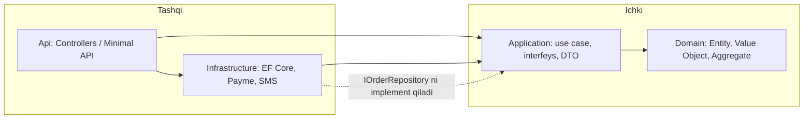

# 15. Arxitektura uslublari

> **Bir jumlada:** Arxitektura uslubi bu kodni qaysi chegaralar bo'yicha bo'lish va bog'liqliklar qaysi tomonga qarashi haqidagi kelishuv; Clean/Onion, Vertical Slice, CQRS, DDD va modular monolith shu kelishuvning turli ko'rinishlari.
> **Nega Middle uchun:** Middle dasturchi arxitekturani o'zi tanlamasa ham, har kuni uning ichida kod yozadi: qaysi qatlamga nima qo'yish, aggregate chegarasini buzmaslik, command va query'ni aralashtirmaslik uning mas'uliyati. Chegara buzilsa, loyiha bir yilda "hamma narsa hamma narsaga bog'liq" holatga keladi.
> **O'qish vaqti:** ~45 daqiqa

## Mundarija

- [1. Muammo va yechim](#1-muammo-va-yechim)
- [2. Qanday ishlaydi](#2-qanday-ishlaydi)
- [3. Asosiy tushunchalar](#3-asosiy-tushunchalar)
  - [3.1 Clean / Onion qatlamlari](#31-clean--onion-qatlamlari)
  - [3.2 Bog'liqlik yo'nalishi va project reference](#32-bogliqlik-yonalishi-va-project-reference)
  - [3.3 EF Core qaysi qatlamda](#33-ef-core-qaysi-qatlamda)
  - [3.4 Vertical Slice](#34-vertical-slice)
  - [3.5 CQRS](#35-cqrs)
  - [3.6 MediatR litsenziyasi va o'z IDispatcher](#36-mediatr-litsenziyasi-va-oz-idispatcher)
  - [3.7 Pipeline behaviors](#37-pipeline-behaviors)
  - [3.8 Entity va Value Object](#38-entity-va-value-object)
  - [3.9 Aggregate va invariant](#39-aggregate-va-invariant)
  - [3.10 Domain Event](#310-domain-event)
  - [3.11 Bounded Context](#311-bounded-context)
  - [3.12 Modular monolith vs microservices](#312-modular-monolith-vs-microservices)
  - [3.13 Arxitektura testlari](#313-arxitektura-testlari)
- [4. Amaliy misol](#4-amaliy-misol)
- [5. Tipik xatolar va anti-patternlar](#5-tipik-xatolar-va-anti-patternlar)
- [6. Best practices checklist](#6-best-practices-checklist)
- [7. Suhbat savollari va javoblar](#7-suhbat-savollari-va-javoblar)
- [8. Qo'shimcha manbalar](#8-qoshimcha-manbalar)

## 1. Muammo va yechim

Ombor tizimida `OrderController.Create` metodi 380 qator bo'lib ketgan: ichida `DbContext` so'rovlari, Payme API chaqiruvi, SMS yuborish, chegirma hisoblash va `if (user.Role == "Admin")` tekshiruvlari bor. Yangi talab keldi: buyurtmani Telegram bot orqali ham yaratish kerak. Bot uchun alohida `BotOrderService` yozildi, 380 qatorning 300 tasi nusxalandi. Olti oydan keyin chegirma qoidasi o'zgardi, uni bir joyda tuzatishdi, ikkinchi joyda unutishdi. Mijoz bot orqali eski narxda buyurtma berdi.

Muammo bitta: biznes qoidalar (chegirma, buyurtma holati, miqdor cheklovi) transport (HTTP, bot) va infratuzilma (EF, Payme, SMS) bilan bitta metodga yopishib qolgan. Qoidani boshqa joyda ishlatish uchun uni nusxalashdan boshqa yo'l yo'q, testlash uchun esa haqiqiy baza va Payme kerak.

Arxitektura uslublari shu muammoni yechadi: kodni shunday bo'lish kerakki, biznes qoida bitta joyda yashasin, transport va infratuzilma unga tashqaridan "ulanib" ishlasin. Clean/Onion buni qatlamlar va bog'liqlik yo'nalishi orqali qiladi, Vertical Slice funksiya bo'yicha papkalar orqali, CQRS o'qish va yozishni ajratish orqali, DDD esa biznes qoidani aggregate ichiga qamab qo'yish orqali. Modular monolith bularni bitta deploy birligida, lekin qat'iy modul chegaralari bilan saqlashga yordam beradi.

## 2. Qanday ishlaydi

Arxitektura uslubi runtime'da hech narsa qilmaydi: CLR qatlam nima ekanini bilmaydi. Chegara kompilyatsiya vaqtida ikki mexanizm bilan ushlab turiladi:

1. **Project reference yo'nalishi.** `Domain.csproj` hech qaysi loyihaga `ProjectReference` bermaydi. `Application.csproj` faqat `Domain` ga, `Infrastructure.csproj` `Application` va `Domain` ga, `Api.csproj` hammasiga. Agar `Domain` ichida `using Microsoft.EntityFrameworkCore;` yozsangiz, kompilyator xato beradi, chunki paket u yerda yo'q. Bu eng arzon va eng ishonchli himoya.
2. **Dependency Inversion.** `Application` qatlami `IOrderRepository` interfeysini e'lon qiladi, `Infrastructure` uni EF Core bilan amalga oshiradi. Runtime'da DI konteyner (`Program.cs` dagi composition root) ikkisini bog'laydi. Shunday qilib bog'liqlik kod darajasida ichkariga (Domain tomon) qaraydi, lekin boshqaruv oqimi tashqaridan ichkariga kiradi.



So'rov oqimi: HTTP so'rov `Api` ga keladi, u `Application` dagi command handler'ni chaqiradi, handler `Domain` dagi aggregate metodini chaqiradi (qoida shu yerda tekshiriladi), keyin `IOrderRepository` orqali saqlaydi, bu interfeysning amalga oshirilishi `Infrastructure` da `DbContext` bilan ishlaydi. `Domain` bu zanjirning hech qaysi qismini bilmaydi.

CQRS esa handler darajasida ishlaydi: `CreateOrderCommand` aggregate orqali o'tadi (qoida tekshiriladi, event chiqadi), `GetOrdersQuery` esa aggregate'ni umuman yuklamaydi, `DbContext` dan `Select` bilan to'g'ridan-to'g'ri DTO oladi. Shu sababli query'lar tez (change tracker yo'q, kerakli ustunlar), command'lar esa xavfsiz (qoidalar aggregate ichida).

## 3. Asosiy tushunchalar

### 3.1 Clean / Onion qatlamlari

- **Ta'rif:** Kod to'rt qatlamga bo'linadi: Domain (biznes modeli), Application (use case'lar va interfeyslar), Infrastructure (tashqi dunyo bilan aloqa), Presentation/Api (transport). Onion va Clean Architecture bir xil g'oyaning ikki nomi, farqi faqat diagramma chizilishida.
- **Nega kerak:** Biznes qoidalar tashqi texnologiyalardan (EF, HTTP, Payme) ajratilgan bo'ladi; texnologiya almashganda (Payme o'rniga Click) Domain va Application o'zgarmaydi.
- **Papka tuzilmasi:**

```text
src/
  Shop.Domain/            # hech kimga bog'liq emas
    Orders/Order.cs
    Orders/OrderLine.cs
    Orders/Money.cs
    Orders/Events/OrderSubmitted.cs
    Common/Entity.cs
  Shop.Application/       # -> Domain
    Orders/Commands/SubmitOrder/SubmitOrderCommand.cs
    Orders/Commands/SubmitOrder/SubmitOrderHandler.cs
    Orders/Queries/GetOrderList/GetOrderListQuery.cs
    Abstractions/IOrderRepository.cs
    Abstractions/IAppDbContext.cs
    Behaviors/ValidationBehavior.cs
  Shop.Infrastructure/    # -> Application, Domain
    Persistence/AppDbContext.cs
    Persistence/Configurations/OrderConfiguration.cs
    Persistence/OrderRepository.cs
    Payments/PaymeClient.cs
  Shop.Api/               # -> hammasi (composition root)
    Program.cs
    Endpoints/OrderEndpoints.cs
```

- **Tipik xato:** Qatlamlarni papka sifatida bitta loyihada saqlash. U holda kompilyator chegarani tekshirmaydi, `Domain` ichida `DbContext` chaqirish erkin bo'lib qoladi.

### 3.2 Bog'liqlik yo'nalishi va project reference

- **Ta'rif:** Bog'liqlik faqat ichkariga qaraydi: tashqi qatlam ichkini biladi, ichki tashqini bilmaydi.
- **Nega kerak:** Ichki qatlam (Domain) eng barqaror va eng ko'p testlanadigan qism; u tashqi o'zgarishlardan ta'sirlanmasligi kerak.
- **Kod:** `Shop.Application.csproj` da faqat `<ProjectReference Include="..\Shop.Domain\Shop.Domain.csproj" />`, EF yoki HTTP paketi yo'q; `Shop.Infrastructure.csproj` da `Shop.Application` reference'i va `Npgsql.EntityFrameworkCore.PostgreSQL` paketi.

- **Tipik xato:** `Application` dan `Infrastructure` ga reference qo'shish "chunki `PaymeClient` kerak edi". To'g'ri yo'l: `Application` da `IPaymentGateway` e'lon qilish, `Infrastructure` da amalga oshirish.

### 3.3 EF Core qaysi qatlamda

- **Ta'rif:** `DbContext` va entity konfiguratsiyalari (`IEntityTypeConfiguration<T>`) Infrastructure'da; Domain entity'lari EF haqida bilmaydi.
- **Nega kerak:** Domain'da `[Table]`, `[Column]` atributlari paydo bo'lsa, Domain EF paketiga bog'lanadi va qatlam ma'nosini yo'qotadi. Fluent API konfiguratsiya shu bog'liqlikni Infrastructure'ga ko'chiradi.
- **Kod:**

```csharp
// Shop.Infrastructure/Persistence/Configurations/OrderConfiguration.cs
public sealed class OrderConfiguration : IEntityTypeConfiguration<Order>
{
    public void Configure(EntityTypeBuilder<Order> b)
    {
        b.ToTable("orders", "orders");
        b.HasKey(o => o.Id);

        // Domain'da private field, EF unga backing field orqali kiradi
        b.HasMany(o => o.Lines)
         .WithOne()
         .HasForeignKey("OrderId");
        b.Navigation(o => o.Lines)
         .UsePropertyAccessMode(PropertyAccessMode.Field);

        // Value Object: alohida jadval emas, ikkita ustun
        b.ComplexProperty(o => o.Total, m =>
        {
            m.Property(x => x.Amount).HasColumnName("total_amount").HasPrecision(18, 2);
            m.Property(x => x.Currency).HasColumnName("total_currency").HasMaxLength(3);
        });

        // Domain event'lar bazaga yozilmaydi
        b.Ignore(o => o.DomainEvents);
    }
}
```

Pragmatik istisno: `Application` qatlamida query'lar uchun `IAppDbContext` interfeysi (`DbSet<Order> Orders { get; }`) e'lon qilib, `Application` ga `Microsoft.EntityFrameworkCore` paketini qo'shish ko'p jamoalarda qabul qilingan. Bu Domain'ni toza qoldiradi, lekin Application'ni EF ga bog'laydi. Qaror: repository abstraksiyasi orqali EF ni to'liq yashirish (toza, lekin ko'p kod) yoki `IAppDbContext` (kamroq kod, EF Application'da ko'rinadi). Ikkalasi ham to'g'ri, faqat bitta tanlang va hujjatlang.

- **Tipik xato:** Domain entity'da `public virtual ICollection<OrderLine> Lines { get; set; }` ochiq setter bilan. Har kim ro'yxatga to'g'ridan-to'g'ri qo'shadi, invariant chetlab o'tiladi.

### 3.4 Vertical Slice

- **Ta'rif:** Kod qatlam bo'yicha emas, funksiya (feature) bo'yicha papkalarga bo'linadi: bitta use case'ning request, handler, validator va endpoint'i bitta papkada (ko'pincha bitta faylda) turadi.
- **Nega kerak:** Katta loyihada "buyurtma yaratish" ni o'zgartirish uchun to'rt loyihada sakkiz fayl ochish o'rniga bitta papka ochiladi. Slice'lar bir-biriga bog'lanmaydi, shuning uchun bittasini o'zgartirish boshqasini buzmaydi.
- **Papka misoli:**

```text
src/Shop.Api/
  Features/
    Orders/
      SubmitOrder/
        SubmitOrder.cs          # record Command, Validator, Handler, Endpoint
      GetOrderList/
        GetOrderList.cs         # Query + Handler (Dapper yoki EF Select)
      CancelOrder/
        CancelOrder.cs
    Warehouse/
      ReserveStock/
        ReserveStock.cs
  Domain/                       # umumiy aggregate'lar shu yerda qoladi
    Orders/Order.cs
```

```csharp
// Features/Orders/SubmitOrder/SubmitOrder.cs: bitta slice, bitta fayl
public static class SubmitOrder
{
    public sealed record Command(Guid OrderId) : ICommand<Result>;

    public sealed class Validator : AbstractValidator<Command>
    {
        public Validator() => RuleFor(c => c.OrderId).NotEmpty();
    }

    public sealed class Handler(IAppDbContext db) : ICommandHandler<Command, Result>
    {
        public async Task<Result> Handle(Command cmd, CancellationToken ct)
        {
            var order = await db.Orders.Include(o => o.Lines)
                .FirstOrDefaultAsync(o => o.Id == cmd.OrderId, ct);
            if (order is null) return Result.NotFound("order");
            order.Submit();                     // qoida Domain'da
            await db.SaveChangesAsync(ct);
            return Result.Ok();
        }
    }

    // Map(IEndpointRouteBuilder): MapPost("/orders/{id}/submit") -> dispatcher.Send(new Command(id))
}
```

- **Tipik xato:** Slice'lar orasida umumiy "Service" sinflar yaratib, yana qatlamli arxitekturaga qaytib ketish. Umumiy mantiq Domain aggregate'da bo'lishi kerak, slice'lar orasida emas.

### 3.5 CQRS

- **Ta'rif:** Command Query Responsibility Segregation: yozish (command) va o'qish (query) modellari ajratiladi. Command aggregate orqali o'tadi va holatni o'zgartiradi, query aggregate'ga tegmaydi, to'g'ridan-to'g'ri DTO qaytaradi.
- **Nega kerak:** O'qish va yozish talablari turlicha. O'qish uchun 12 ta jadvalni join qilib tekis DTO kerak, yozish uchun esa bitta aggregate va uning invariantlari. Bitta model ikkisiga ham xizmat qilsa, ikkisi ham yomon chiqadi: query'lar og'ir aggregate yuklaydi, aggregate esa "ekran uchun" maydonlar bilan to'ladi.
- **Kod:**

```csharp
// Command: Domain orqali
public sealed record CancelOrderCommand(Guid OrderId, string Reason) : ICommand<Result>;

// Query: Domain'ni chetlab, to'g'ridan-to'g'ri DTO
public sealed record GetOrderListQuery(Guid CustomerId, int Page) : IQuery<PagedResult<OrderListItem>>;

public sealed class GetOrderListHandler(IAppDbContext db)
    : IQueryHandler<GetOrderListQuery, PagedResult<OrderListItem>>
{
    public async Task<PagedResult<OrderListItem>> Handle(GetOrderListQuery q, CancellationToken ct)
    {
        var query = db.Orders.AsNoTracking()
            .Where(o => o.CustomerId == q.CustomerId)
            .OrderByDescending(o => o.CreatedAt);

        var total = await query.CountAsync(ct);
        var items = await query
            .Skip((q.Page - 1) * 20).Take(20)
            .Select(o => new OrderListItem(o.Id, o.Status, o.Total.Amount, o.Lines.Count))
            .ToListAsync(ct);                   // SQL: faqat 4 ustun + COUNT subquery

        return new PagedResult<OrderListItem>(items, total);
    }
}
```

CQRS ikkita baza degani emas. Ko'p loyihalarda bitta PostgreSQL, bitta `DbContext`: farq faqat handler'da. Alohida o'qish bazasi (read replica, Elasticsearch) faqat o'qish yuki yozishdan o'nlab marta ko'p bo'lganda qo'shiladi, va u holda eventual consistency (o'qish modeli bir necha millisekund orqada qolishi) bilan yashashga to'g'ri keladi.

- **Tipik xato:** Query handler ichida `SaveChangesAsync` chaqirish ("oxirgi ko'rilgan vaqtni yangilab qo'yay"). Query holatni o'zgartirmaydi; bu qoida buzilsa, caching va retry xavfsiz bo'lmay qoladi.

### 3.6 MediatR litsenziyasi va o'z IDispatcher

- **Ta'rif:** MediatR bu command/query'ni handler'ga yo'naltiruvchi (dispatcher) kutubxona. 2025-yildan boshlab (v13+) u tijoriy litsenziyaga o'tdi: kichik kompaniyalar va ochiq kodli loyihalar uchun bepul, belgilangan daromaddan yuqori kompaniyalar uchun pullik.
- **Nega kerak:** Dispatcher'ning o'zi 50 qator kod; agar litsenziya muammo bo'lsa yoki jamoa tashqi bog'liqlikni xohlamasa, o'zingiz yozasiz. Muqobillar: `Mediator` (martinothamar, source generator, reflection'siz), Wolverine (dispatcher + messaging birga).
- **Kod (o'z dispatcher, DI orqali):**

```csharp
public interface ICommand<TResult>;
public interface IQuery<TResult>;

public interface ICommandHandler<in TCommand, TResult> where TCommand : ICommand<TResult>
{
    Task<TResult> Handle(TCommand command, CancellationToken ct);
}
public interface IQueryHandler<in TQuery, TResult> where TQuery : IQuery<TResult>
{
    Task<TResult> Handle(TQuery query, CancellationToken ct);
}

public interface IDispatcher
{
    Task<TResult> Send<TResult>(ICommand<TResult> command, CancellationToken ct);
    Task<TResult> Query<TResult>(IQuery<TResult> query, CancellationToken ct);
}

public sealed class Dispatcher(IServiceProvider sp) : IDispatcher
{
    public Task<TResult> Send<TResult>(ICommand<TResult> command, CancellationToken ct)
    {
        // Runtime'da aniq tip: ICommandHandler<CancelOrderCommand, Result>
        var handlerType = typeof(ICommandHandler<,>).MakeGenericType(command.GetType(), typeof(TResult));
        dynamic handler = sp.GetRequiredService(handlerType);
        return handler.Handle((dynamic)command, ct);
    }

    // Query<TResult> xuddi shunday, IQueryHandler<,> bilan
}
```

`dynamic` bu yerda sehr emas: `command` statik tipi `ICommand<TResult>`, lekin handler'ning `Handle` metodi aniq `CancelOrderCommand` kutadi; `dynamic` runtime'da to'g'ri overload'ni topadi. Narxi: birinchi chaqiruvda DLR call-site cache yaratiladi, keyingilari tez. Buni xohlamasangiz, har bir command tipi uchun generic wrapper yaratib `ConcurrentDictionary` da saqlaysiz (MediatR shunday qiladi) yoki source generator ishlatasiz.

Handler'larni ro'yxatdan o'tkazish: `Scrutor` paketi (`services.Scan(s => s.FromAssemblyOf<SubmitOrderHandler>().AddClasses(c => c.AssignableTo(typeof(ICommandHandler<,>))).AsImplementedInterfaces().WithScopedLifetime())`) yoki qo'lda.

- **Tipik xato:** MediatR'ni "arxitektura" deb hisoblash. U faqat in-process yo'naltirgich; u bo'lmasa ham CQRS va Clean saqlanadi.

### 3.7 Pipeline behaviors

- **Ta'rif:** Handler atrofida o'raladigan middleware'lar: so'rov handler'ga yetguncha validation, logging, transaction, idempotency kabi umumiy ishlar bajariladi.
- **Nega kerak:** Har bir handler'da `try { BeginTransaction } ... Commit` yoki `validator.Validate()` yozish takrorlanadi va unutiladi. Pipeline bir marta yoziladi, hamma handler'ga tatbiq bo'ladi.
- **Kod (o'z dispatcher uchun):**

```csharp
public delegate Task<TResult> HandlerDelegate<TResult>();

public interface IPipelineBehavior<in TRequest, TResult>
{
    Task<TResult> Handle(TRequest request, HandlerDelegate<TResult> next, CancellationToken ct);
}

// 1) Validation: FluentValidation validator'lari bo'lsa ishga tushadi
public sealed class ValidationBehavior<TRequest, TResult>(IEnumerable<IValidator<TRequest>> validators)
    : IPipelineBehavior<TRequest, TResult>
{
    public async Task<TResult> Handle(TRequest request, HandlerDelegate<TResult> next, CancellationToken ct)
    {
        var failures = new List<ValidationFailure>();
        foreach (var v in validators)
        {
            var r = await v.ValidateAsync(request, ct);
            failures.AddRange(r.Errors);
        }
        if (failures.Count > 0) throw new ValidationException(failures);
        return await next();
    }
}

// 2) Logging: davomiylik va xato
public sealed class LoggingBehavior<TRequest, TResult>(ILogger<TRequest> log)
    : IPipelineBehavior<TRequest, TResult>
{
    public async Task<TResult> Handle(TRequest request, HandlerDelegate<TResult> next, CancellationToken ct)
    {
        var sw = Stopwatch.StartNew();
        try { return await next(); }
        finally { log.LogInformation("{Request} {Elapsed}ms", typeof(TRequest).Name, sw.ElapsedMilliseconds); }
    }
}

// 3) Transaction: faqat command'lar uchun, query'lar uchun emas
public sealed class TransactionBehavior<TRequest, TResult>(AppDbContext db)
    : IPipelineBehavior<TRequest, TResult> where TRequest : ICommand<TResult>
{
    public async Task<TResult> Handle(TRequest request, HandlerDelegate<TResult> next, CancellationToken ct)
    {
        // ExecutionStrategy: Npgsql retry siyosati bilan tranzaksiya mos bo'lishi uchun
        var strategy = db.Database.CreateExecutionStrategy();
        return await strategy.ExecuteAsync(async () =>
        {
            await using var tx = await db.Database.BeginTransactionAsync(ct);
            var result = await next();
            await tx.CommitAsync(ct);
            return result;
        });
    }
}
```

Dispatcher ichida behavior'lar zanjir qilinadi: `validators -> logging -> transaction -> handler`. Tartib ro'yxatdan o'tish tartibiga bog'liq: validation tranzaksiyadan oldin turishi kerak, aks holda noto'g'ri so'rov uchun ham tranzaksiya ochiladi.

- **Tipik xato:** `TransactionBehavior` ni query'larga ham qo'llash. Har bir o'qish uchun tranzaksiya ochish PostgreSQL'da connection'ni uzoqroq band qiladi.

### 3.8 Entity va Value Object

- **Ta'rif:** Entity bu identifikatori (Id) bilan ajralib turadigan obyekt: ikki `Order` ma'lumotlari bir xil bo'lsa ham, Id turlicha bo'lsa, turli buyurtmalar. Value Object identifikatorsiz, faqat qiymati bilan aniqlanadigan, o'zgarmas (immutable) obyekt: `Money(100, "UZS")` ning ikki nusxasi bir xil.
- **Nega kerak:** Value Object primitiv maydonlarni (`decimal Amount; string Currency`) bitta ma'noli tipga yig'adi va qoidani (valyutalar farq qilsa qo'shib bo'lmaydi) shu tip ichida saqlaydi. Primitiv obsession (hamma narsa `string` va `decimal`) shu bilan yo'qoladi.
- **Kod:**

```csharp
// record: qiymat bo'yicha tenglik va immutability kompilyator tomonidan
public sealed record Money(decimal Amount, string Currency)
{
    public static Money Uzs(decimal amount) => new(amount, "UZS");
    public static readonly Money ZeroUzs = Uzs(0);

    public Money Add(Money other)
    {
        if (other.Currency != Currency)
            throw new DomainException($"Valyuta mos emas: {Currency} va {other.Currency}");
        return this with { Amount = Amount + other.Amount };
    }

    public Money Multiply(int qty) => this with { Amount = Amount * qty };
}

public abstract class Entity<TId> where TId : notnull
{
    public TId Id { get; protected init; } = default!;

    public override bool Equals(object? obj) =>
        obj is Entity<TId> other && GetType() == other.GetType() && Id.Equals(other.Id);
    public override int GetHashCode() => HashCode.Combine(GetType(), Id);
}
```

- **Tipik xato:** Value Object'ni `class` qilib, `set` bilan o'zgaruvchan qilish. U holda `order.Total.Amount = 0` kabi o'zgartirish aggregate'ni chetlab o'tadi.

### 3.9 Aggregate va invariant

- **Ta'rif:** Aggregate bu birga o'zgaradigan entity va value object'lar guruhi; unga faqat bitta kirish nuqtasi, aggregate root, orqali murojaat qilinadi. Invariant bu har qanday operatsiyadan keyin ham to'g'ri bo'lib qolishi shart bo'lgan qoida ("submitted buyurtmada kamida bitta qator bor"). Aggregate tranzaksiya chegarasi: bitta tranzaksiyada bitta aggregate o'zgaradi.
- **Nega kerak:** Invariant aggregate ichida tekshirilsa, uni buzishning yo'li yo'q: `OrderLine` ni tashqaridan yaratib bo'lmaydi, `Order.AddLine` orqali o'tish shart.
- **Chegara tanlash mezonlari:**
  - Birga o'zgaradigan va bitta invariant bilan bog'langan narsalar bitta aggregate'da (`Order` va `OrderLine`).
  - Boshqa aggregate'ga faqat Id orqali havola (`Order.CustomerId`, `Customer` obyekti emas).
  - Aggregate kichik bo'lsin: `Customer` ichida uning 10 000 buyurtmasi bo'lmasin, chunki uni yuklash va concurrency konflikti og'ir.
  - Bitta foydalanuvchi harakati bitta aggregate'ni o'zgartirsin; ikkinchisi domain event orqali keyin o'zgaradi (eventual consistency).
- **Tipik xato:** "Hamma narsa bitta aggregate" (`Customer -> Orders -> Lines -> Product -> Stock`). Bitta buyurtmaga qator qo'shish uchun mijozning butun tarixi yuklanadi, ikki operator bir mijoz bilan ishlasa optimistic concurrency xatosi chiqadi.

### 3.10 Domain Event

- **Ta'rif:** Aggregate ichida sodir bo'lgan faktni ifodalovchi obyekt (`OrderSubmitted`). Aggregate uni ro'yxatga yig'adi, infratuzilma saqlashdan keyin handler'larga tarqatadi.
- **Nega kerak:** "Buyurtma submit bo'lganda omborda zaxira band qilinsin va SMS ketsin" talabini `Order.Submit` ichiga yozib bo'lmaydi (Domain SMS'ni bilmaydi). Event bu bog'liqlikni teskari qiladi: `Order` faqat "submit bo'ldim" deydi, kim tinglashi uning ishi emas.
- **Kod (tarqatish mexanizmi, Infrastructure):**

```csharp
public interface IDomainEvent { DateTimeOffset OccurredAt { get; } }

public sealed class AppDbContext(DbContextOptions<AppDbContext> o, IDomainEventDispatcher dispatcher)
    : DbContext(o), IAppDbContext
{
    public DbSet<Order> Orders => Set<Order>();

    public override async Task<int> SaveChangesAsync(CancellationToken ct = default)
    {
        // 1) Tracked aggregate'lardan event'larni yig'amiz
        var events = ChangeTracker.Entries<IHasDomainEvents>()
            .SelectMany(e => e.Entity.DomainEvents)
            .ToList();
        foreach (var e in ChangeTracker.Entries<IHasDomainEvents>())
            e.Entity.ClearDomainEvents();

        // 2) Avval saqlaymiz, keyin tarqatamiz: tranzaksiya behavior'da ochilgan,
        //    shuning uchun handler'lar ham shu tranzaksiya ichida yozadi
        var result = await base.SaveChangesAsync(ct);
        foreach (var e in events)
            await dispatcher.Dispatch(e, ct);
        return result;
    }
}
```

Agar handler boshqa servisga (broker) xabar yuborishi kerak bo'lsa, bu yerda to'g'ridan-to'g'ri yubormang; outbox jadvaliga yozing (16-mavzu). Aks holda tranzaksiya rollback bo'lsa, xabar allaqachon ketgan bo'ladi.

- **Tipik xato:** Event'ni `SaveChanges` dan oldin tarqatish va handler'da yana `SaveChanges` chaqirish: rekursiya yoki yarim saqlangan holat.

### 3.11 Bounded Context

- **Ta'rif:** Bitta terminologiya (ubiquitous language) va bitta model amal qiladigan chegara. "Mahsulot" Katalog kontekstida nom, rasm, tavsif; Ombor kontekstida SKU, joylashuv, miqdor; Buyurtma kontekstida faqat Id, nom va narx snapshot'i.
- **Nega kerak:** Bitta `Product` sinfini hamma uchun yaratsangiz, u 60 ta maydonga ega bo'ladi va har bir kontekst boshqalarining o'zgarishidan sinadi. Har bir kontekst o'zining kichik modelini saqlaydi, kontekstlar orasida event yoki kontrakt orqali aloqa.
- **Kod (Buyurtma kontekstidagi mahsulot snapshot'i):**

```csharp
// Shop.Domain/Orders/OrderLine.cs: katalogdagi Product emas, snapshot
public sealed class OrderLine
{
    public Guid ProductId { get; private set; }
    public string ProductName { get; private set; } = null!;   // o'sha paytdagi nom
    public Money UnitPrice { get; private set; } = null!;      // o'sha paytdagi narx
    public int Quantity { get; private set; }
    public Money LineTotal => UnitPrice.Multiply(Quantity);

    internal OrderLine(Guid productId, string productName, Money unitPrice, int quantity) =>
        (ProductId, ProductName, UnitPrice, Quantity) = (productId, productName, unitPrice, quantity);
    private OrderLine() { }   // EF uchun
    internal void Increase(int qty) => Quantity += qty;
}
```

- **Tipik xato:** Kontekstlar o'rtasida navigatsiya property (`OrderLine.Product` katalogdagi entity'ga). Katalog modeli o'zgarsa buyurtma tarixidagi narx ham "o'zgaradi".

### 3.12 Modular monolith vs microservices

- **Ta'rif:** Modular monolith bitta deploy birligi (bitta process), lekin ichida qat'iy chegarali modullar: har biri o'z Domain/Application/Infrastructure, o'z DB schema'si va boshqa modullar uchun faqat kichik ochiq kontrakt. Microservices bu modullarni alohida process va alohida bazaga ajratish.
- **Modul chegarasi qanday ushlab turiladi:**
  - Har modul alohida loyiha(lar): `Modules.Orders`, `Modules.Warehouse`. Modullar bir-biriga to'g'ridan-to'g'ri reference bermaydi, faqat `Modules.Orders.Contracts` (public interfeys va DTO) ga.
  - Alohida schema: `modelBuilder.HasDefaultSchema("orders")`, migratsiya tarixi ham alohida: `options.UseNpgsql(cs, o => o.MigrationsHistoryTable("__EFMigrationsHistory", "orders"))`. Bitta modul boshqasining jadvaliga JOIN qila olmaydi (keyinchalik alohida bazaga ko'chirish shu tufayli oson).
  - Ichki kontrakt: `public interface IStockApi { Task<bool> TryReserve(Guid productId, int qty, CancellationToken ct); }` Warehouse modulining Contracts loyihasida, implementatsiyasi `internal`.
  - Modullar aro asinxron aloqa in-process event bus (yoki outbox + broker) orqali.

```csharp
// Modules.Warehouse.Contracts
public interface IStockApi
{
    Task<StockReservationResult> ReserveAsync(Guid orderId, IReadOnlyList<(Guid ProductId, int Qty)> items, CancellationToken ct);
}

// Modules.Warehouse (implementatsiya tashqariga ko'rinmaydi)
internal sealed class StockApi(WarehouseDbContext db) : IStockApi { /* ... */ }

// Modul ro'yxatdan o'tishi: har modul o'z DI kengaytmasini beradi
public static IServiceCollection AddWarehouseModule(this IServiceCollection s, string cs) =>
    s.AddDbContext<WarehouseDbContext>(o => o.UseNpgsql(cs,
          n => n.MigrationsHistoryTable("__EFMigrationsHistory", "warehouse")))
     .AddScoped<IStockApi, StockApi>();
```

- **Microservices'ga o'tish mezonlari (hammasi bir vaqtda bo'lishi shart emas, lekin kamida ikkitasi):**
  - Bir necha jamoa bitta kod bazasida bir-birini deploy'ga to'sib qo'yadi.
  - Modullarning yuk profili keskin farq qiladi (hisobot moduli 20 instansga, buyurtma 2 ga muhtoj).
  - Modul alohida texnologiya talab qiladi (ML uchun Python).
  - Modul alohida muvofiqlik talabiga ega (to'lov ma'lumotlari alohida izolyatsiya).
- **Microservices'ga o'tmaslik sabablari:** jamoa 3-8 kishi; tarqalgan tranzaksiya, tarmoq xatolari, distributed tracing, har servis uchun CI/CD va monitoring narxi; "modullar chegarasi hali aniq emas" (chegara noto'g'ri bo'lsa, monolitda refactor arzon, microservices'da qimmat).

### 3.13 Arxitektura testlari

- **Ta'rif:** Qatlam va modul chegaralarini avtomatik tekshiruvchi unit testlar; assembly'larni reflection orqali skan qilib, taqiqlangan bog'liqliklarni topadi.
- **Nega kerak:** Project reference ko'p narsani ushlaydi, lekin bitta loyiha ichidagi namespace chegaralari (Vertical Slice, modular monolith bitta assembly'da) yoki "handler'lar `sealed` bo'lsin" kabi kelishuvlarni ushlamaydi. Test CI'da yiqilsa, PR merge bo'lmaydi.
- **Kod (NetArchTest.Rules):**

```csharp
public sealed class ArchitectureTests
{
    private static readonly Assembly Domain = typeof(Order).Assembly;
    private static readonly Assembly Application = typeof(SubmitOrderHandler).Assembly;

    [Fact]
    public void Domain_hech_qaysi_tashqi_qatlamga_bogliq_emas()
    {
        var result = Types.InAssembly(Domain)
            .ShouldNot()
            .HaveDependencyOnAny("Shop.Application", "Shop.Infrastructure", "Shop.Api",
                                 "Microsoft.EntityFrameworkCore")
            .GetResult();

        Assert.True(result.IsSuccessful, string.Join(", ", result.FailingTypeNames ?? []));
    }

    [Fact]
    public void Orders_moduli_Warehouse_ichki_tiplariga_tegmaydi()
    {
        var result = Types.InAssembly(Application)
            .That().ResideInNamespace("Shop.Modules.Orders")
            .ShouldNot().HaveDependencyOn("Shop.Modules.Warehouse.Internal")
            .GetResult();

        Assert.True(result.IsSuccessful);
    }
}
```

- **Tipik xato:** Testlarni bir marta yozib, yangi modul qo'shilganda yangilamaslik. Har yangi modul uchun chegara testi PR shabloniga kiritiladi.

## 4. Amaliy misol

To'liq `Order` aggregate'i, uning command handler'i va EF konfiguratsiyasi. Buyurtma qoralama (Draft) holatida yaratiladi, qatorlar qo'shiladi, submit qilinadi; submit paytida `OrderSubmitted` event chiqadi, uni Warehouse moduli tinglab zaxira band qiladi.

```csharp
// ===== Shop.Domain/Orders/Order.cs =====
public enum OrderStatus { Draft, Submitted, Paid, Shipped, Cancelled }

public interface IHasDomainEvents
{
    IReadOnlyList<IDomainEvent> DomainEvents { get; }
    void ClearDomainEvents();
}

public sealed class Order : Entity<Guid>, IHasDomainEvents
{
    private readonly List<OrderLine> _lines = [];
    private readonly List<IDomainEvent> _events = [];

    public Guid CustomerId { get; private set; }
    public OrderStatus Status { get; private set; }
    public Money Total { get; private set; } = Money.ZeroUzs;
    public DateTimeOffset CreatedAt { get; private set; }

    public IReadOnlyList<OrderLine> Lines => _lines;
    public IReadOnlyList<IDomainEvent> DomainEvents => _events;

    private Order() { }   // EF Core: parametrsiz private konstruktor kerak

    // Factory: noto'g'ri holatda obyekt yaratib bo'lmaydi
    public static Order CreateDraft(Guid customerId, TimeProvider clock)
    {
        if (customerId == Guid.Empty) throw new DomainException("Mijoz ko'rsatilmagan");
        return new Order
        {
            Id = Guid.CreateVersion7(),       // vaqt bo'yicha tartiblangan, index uchun qulay
            CustomerId = customerId,
            Status = OrderStatus.Draft,
            CreatedAt = clock.GetUtcNow()
        };
    }

    public void AddLine(Guid productId, string productName, Money unitPrice, int quantity)
    {
        EnsureDraft();
        if (quantity <= 0) throw new DomainException("Miqdor musbat bo'lishi kerak");
        if (_lines.Count >= 100) throw new DomainException("Bitta buyurtmada 100 tadan ko'p qator bo'lmaydi");

        // Bir xil mahsulot ikkinchi marta qo'shilsa, miqdor oshadi (invariant: qator unikal)
        var existing = _lines.FirstOrDefault(l => l.ProductId == productId);
        if (existing is not null) existing.Increase(quantity);
        else _lines.Add(new OrderLine(productId, productName, unitPrice, quantity));

        Recalculate();
    }

    public void Submit()
    {
        EnsureDraft();
        if (_lines.Count == 0) throw new DomainException("Bo'sh buyurtmani yuborib bo'lmaydi");

        Status = OrderStatus.Submitted;
        // Event'da faqat kerakli ma'lumot: Warehouse modul uchun mahsulot va miqdor
        _events.Add(new OrderSubmitted(Id, CustomerId,
            _lines.Select(l => new OrderSubmitted.Item(l.ProductId, l.Quantity)).ToList(),
            DateTimeOffset.UtcNow));
    }

    private void EnsureDraft()
    {
        if (Status != OrderStatus.Draft)
            throw new DomainException($"Faqat qoralama o'zgartiriladi, hozirgi holat: {Status}");
    }

    // Total hisoblangan qiymat, lekin ustun sifatida saqlanadi: ro'yxat query'larida
    // Lines'ni yuklamasdan ko'rsatish uchun
    private void Recalculate() =>
        Total = _lines.Aggregate(Money.ZeroUzs, (acc, l) => acc.Add(l.LineTotal));

    public void ClearDomainEvents() => _events.Clear();
}

// ===== Shop.Domain/Orders/Events/OrderSubmitted.cs =====
public sealed record OrderSubmitted(
    Guid OrderId, Guid CustomerId, IReadOnlyList<OrderSubmitted.Item> Items, DateTimeOffset OccurredAt)
    : IDomainEvent
{
    public sealed record Item(Guid ProductId, int Quantity);
}

// ===== Shop.Application/Orders/Commands/AddOrderLine/AddOrderLineHandler.cs =====
public sealed record AddOrderLineCommand(Guid OrderId, Guid ProductId, int Quantity) : ICommand<Result>;

public sealed class AddOrderLineHandler(IAppDbContext db, ICatalogApi catalog)
    : ICommandHandler<AddOrderLineCommand, Result>
{
    public async Task<Result> Handle(AddOrderLineCommand cmd, CancellationToken ct)
    {
        // Lines yuklanadi, chunki AddLine invarianti ro'yxatga bog'liq (unikal qator, 100 limit)
        var order = await db.Orders
            .Include(o => o.Lines)
            .FirstOrDefaultAsync(o => o.Id == cmd.OrderId, ct);
        if (order is null) return Result.NotFound("order");

        // Katalog boshqa bounded context: faqat kontrakt orqali, snapshot olamiz
        var product = await catalog.GetAsync(cmd.ProductId, ct);
        if (product is null) return Result.NotFound("product");

        try
        {
            order.AddLine(product.Id, product.Name, Money.Uzs(product.Price), cmd.Quantity);
        }
        catch (DomainException ex)
        {
            return Result.Invalid(ex.Message);   // 422 ga aylanadi, 500 emas
        }

        await db.SaveChangesAsync(ct);          // domain event'lar shu yerda tarqaladi
        return Result.Ok();
    }
}

// ===== Modules.Warehouse: ReserveStockOnOrderSubmitted : IDomainEventHandler<OrderSubmitted> =====
// Har item uchun Stock aggregate'ini yuklab stock.Reserve(e.OrderId, qty) chaqiradi (o'z invarianti: available >= qty),
// keyin WarehouseDbContext.SaveChangesAsync. Order tipiga emas, faqat event'ga bog'langan.
```

Nima uchun shunday:

- `private Order()` va `private set` EF Core'ga kerak, lekin tashqi kodga yo'l bermaydi. EF Core backing field (`_lines`) orqali to'ldiradi, `UsePropertyAccessMode(PropertyAccessMode.Field)` konfiguratsiyasi shu uchun.
- `Total` saqlanadi, hisoblanmaydi: ro'yxat sahifasida 20 buyurtma uchun 20 marta `Lines` yuklash o'rniga bitta ustun o'qiladi. Ikki manbali haqiqat (`Lines` va `Total`) xavfi `Recalculate` ni faqat aggregate ichida chaqirish bilan nazorat qilinadi.
- `Guid.CreateVersion7()` (.NET 9+) vaqt tartibli GUID beradi; PostgreSQL B-tree indeksida tasodifiy v4 GUID'ga nisbatan sahifa bo'linishi kam.
- `DomainException` handler'da ushlanib `Result.Invalid` ga aylanadi; global exception middleware uni 500 qilib yuborishi noto'g'ri, chunki bu foydalanuvchi xatosi.
- Warehouse handler `Order` ga emas, `OrderSubmitted` ga bog'langan. Ertaga Warehouse alohida servisga chiqsa, event outbox orqali broker'ga ketadi, handler kodi o'zgarmaydi.

## 5. Tipik xatolar va anti-patternlar

**1. Anemic domain model (qoida servisda, entity faqat DTO)**

```csharp
// ❌ Entity'da faqat getter/setter, qoida OrderService'da
public class Order { public List<OrderLine> Lines { get; set; } = []; public string Status { get; set; } }

public async Task Submit(Guid id)
{
    var o = await db.Orders.FindAsync(id);
    if (o.Lines.Count == 0) throw new Exception("empty");   // bot servisida bu tekshiruv unutilgan
    o.Status = "Submitted";
}
```

Oqibati: qoida ikki-uch servisda takrorlanadi, bittasida unutiladi, `Status` string bo'lgani uchun `"submited"` xatosi runtime'da chiqadi.

```csharp
// ✅ Qoida aggregate ichida, holat enum, setter private
order.Submit();   // bo'sh bo'lsa DomainException, qayerdan chaqirilishidan qat'i nazar
```

**2. Repository'dan `IQueryable` qaytarish**

```csharp
// ❌
public interface IOrderRepository { IQueryable<Order> Query(); }
// Api qatlamida: repo.Query().Include(o => o.Lines).Where(...)   -> EF Api'ga sizib chiqdi
```

Oqibati: abstraksiya yolg'on, `IQueryable` orqali EF hamma joyga tarqaladi; test uchun in-memory `IQueryable` haqiqiy SQL tarjimasini tekshirmaydi.

```csharp
// ✅ Aniq metodlar (command uchun) yoki query handler'da to'g'ridan-to'g'ri DbContext
public interface IOrderRepository
{
    Task<Order?> GetWithLinesAsync(Guid id, CancellationToken ct);
    void Add(Order order);
}
```

**3. Query uchun aggregate yuklash**

```csharp
// ❌ Ro'yxat uchun har buyurtmaning Lines va Customer yuklanadi
var orders = await db.Orders.Include(o => o.Lines).Include(o => o.Customer).ToListAsync(ct);
return orders.Select(o => new OrderListItem(o.Id, o.Customer.Name, o.Total.Amount));
```

Oqibati: 500 buyurtma uchun 5 000 qator keladi, change tracker 5 500 obyekt kuzatadi; 9 soniya.

```csharp
// ✅ Projection: faqat kerakli ustunlar, tracking yo'q
var items = await db.Orders.AsNoTracking()
    .Select(o => new OrderListItem(o.Id, o.Customer.Name, o.Total.Amount))
    .ToListAsync(ct);
```

**4. Domain event handler'da tashqi servisga to'g'ridan-to'g'ri chaqiruv.** Tranzaksiya ichida SMS ketdi, keyin commit yiqildi: mijoz SMS oldi, buyurtma yo'q. Yechim: handler outbox jadvaliga yozadi, alohida worker yuboradi (16-mavzu).

**5. Modullar orasida to'g'ridan-to'g'ri DbContext**

```csharp
// ❌ Orders moduli Warehouse jadvaliga yozadi
var stock = await warehouseDb.Stocks.FirstAsync(...);  stock.Quantity -= qty;
```

Oqibati: Warehouse'ning invarianti chetlab o'tiladi, schema o'zgarsa Orders sinadi, keyin alohida servisga chiqarib bo'lmaydi.

```csharp
// ✅ Kontrakt orqali
var result = await stockApi.ReserveAsync(order.Id, items, ct);
```

## 6. Best practices checklist

- [ ] Domain loyihasi hech qaysi NuGet paketga (EF, ASP.NET) bog'lanmaydi, chunki kompilyator chegarani shu orqali ushlaydi.
- [ ] Aggregate'ning hamma setter'lari `private`, ro'yxatlar `IReadOnlyList` orqali ochiladi, chunki invariant faqat metodlar orqali o'tilsa kafolatlanadi.
- [ ] Aggregate'lar bir-biriga Id orqali havola qiladi, obyekt orqali emas, chunki aks holda bitta yuklash butun grafni tortadi.
- [ ] Bitta tranzaksiya bitta aggregate'ni o'zgartiradi; ikkinchisi domain event orqali, chunki ikki aggregate'ni bitta tranzaksiyada o'zgartirish concurrency konfliktini oshiradi va keyinchalik ajratishga xalaqit beradi.
- [ ] Query handler'lar `AsNoTracking` + `Select` projection ishlatadi va hech qachon `SaveChanges` chaqirmaydi, chunki query tez va yon ta'sirsiz bo'lishi kerak.
- [ ] Command handler `DomainException` ni `Result`/422 ga aylantiradi, chunki bu foydalanuvchi xatosi, server xatosi emas.
- [ ] Pipeline tartibi: validation -> logging -> transaction -> handler, chunki noto'g'ri so'rov uchun tranzaksiya ochilmasligi kerak.
- [ ] Transaction behavior faqat `ICommand` ga qo'llanadi, chunki query uchun tranzaksiya connection'ni bekor band qiladi.
- [ ] Har modul o'z DB schema'si va o'z migratsiya tarixiga ega, chunki keyin alohida bazaga ko'chirish shu tufayli mexanik ish bo'ladi.
- [ ] Modullar faqat `*.Contracts` loyihasi orqali bog'lanadi, implementatsiya `internal`, chunki aks holda chegara bir PR'da yo'qoladi.
- [ ] Arxitektura testlari CI'da ishlaydi va yangi modul qo'shilganda yangilanadi, chunki chegara insonga emas, testga ishonib qoldirilgani ishonchliroq.
- [ ] Microservices'ga o'tish qarori yozma mezonlar (jamoa soni, yuk profili, texnologiya) asosida qabul qilinadi, chunki "zamonaviy" degan sabab operatsion narxni qoplamaydi.

## 7. Suhbat savollari va javoblar

**1. Clean Architecture'da EF Core qaysi qatlamda turadi? Domain entity'da EF atributi bo'lishi mumkinmi?**

`DbContext`, `IEntityTypeConfiguration<T>` va migratsiyalar Infrastructure qatlamida. Domain entity'da `[Table]`, `[Key]` kabi atributlar bo'lmasligi kerak, chunki ular `Microsoft.EntityFrameworkCore` yoki `System.ComponentModel.DataAnnotations.Schema` paketiga bog'liqlik keltiradi va Domain "hech narsaga bog'lanmaydi" qoidasi buziladi. Mapping Fluent API bilan Infrastructure'da yoziladi, private field'lar `UsePropertyAccessMode(Field)` orqali to'ldiriladi. Tuzoq: `[Required]`, `[MaxLength]` ham DataAnnotations; ular Domain'da validation uchun ishlatilsa, EF ularni mapping sifatida ham o'qiydi, shuning uchun Domain'da ulardan voz kechib, qoidani konstruktor/metodda tekshirish to'g'ri. Pragmatik istisno sifatida Application'da `IAppDbContext` interfeysi orqali EF ishlatish mumkin, lekin bu Application'ni EF ga bog'laydi va jamoa bilan kelishilgan bo'lishi kerak.

**2. CQRS ikkita baza degani emasmi?**

Yo'q. CQRS modelni ajratish: command aggregate orqali yozadi, query DTO qaytaradi. Bitta PostgreSQL va bitta `DbContext` bilan ham to'liq CQRS bo'ladi. Alohida o'qish bazasi (read replica, Elasticsearch, materialized view) ixtiyoriy ikkinchi qadam va u eventual consistency olib keladi: yozgandan keyin darhol o'qiganda eski ma'lumot qaytishi mumkin. Tuzoq: "CQRS qildik" deb Event Sourcing'ni nazarda tutish; Event Sourcing (holat o'rniga event'lar ketma-ketligini saqlash) alohida pattern, CQRS unga muhtoj emas.

**3. Aggregate chegarasini qanday tanlaysiz?**

Invariantdan boshlayman: qaysi qoida bir necha obyektni birga tekshirishni talab qiladi? "Buyurtma submit bo'lganda kamida bitta qator bo'lsin" `Order` va `OrderLine` ni bitta aggregate qiladi. "Mijozning qarzi limitdan oshmasin" esa `Customer` va `Order` ni birlashtirmaydi, chunki bu qoida eventual bo'lishi mumkin (buyurtma yaratiladi, keyin limit tekshiruvi event bilan). Keyin hajmni tekshiraman: aggregate'ni yuklash bitta so'rovda, bir necha yuz qatordan oshmasligi kerak. Boshqa aggregate'ga faqat Id. Agar ikki foydalanuvchi bir vaqtda bitta aggregate'ni tez-tez o'zgartirsa, u juda katta; kichraytirish kerak.

**4. Microservices'ga qachon o'tish kerak emas?**

Jamoa bitta (3-8 kishi) bo'lsa, modul chegaralari hali barqarorlashmagan bo'lsa, ishga tushirish infratuzilmasi (Kubernetes, distributed tracing, per-service CI/CD, broker) tayyor bo'lmasa. Microservices tarmoq xatolari, qisman ishlamay qolish, tarqalgan tranzaksiya va debugging murakkabligini qo'shadi; bu narx faqat tashkiliy masshtab (ko'p jamoa) yoki texnik masshtab (keskin farqli yuk) bilan oqlanadi. Modular monolith alohida schema va kontrakt bilan qurilsa, keyin bitta modulni servisga chiqarish mexanik ish bo'ladi, shuning uchun erta ajratishning foydasi yo'q.

**5. MediatR'siz CQRS qilish mumkinmi? Pipeline behavior'ni qanday amalga oshirasiz?**

Mumkin. Dispatcher bu `IServiceProvider` dan `ICommandHandler<TCommand, TResult>` ni topib `Handle` chaqiruvchi 30-50 qator kod. Pipeline behavior'lar `IPipelineBehavior<TRequest, TResult>` ro'yxati bo'lib, dispatcher ularni oxiridan boshiga qarab delegate zanjiriga o'raydi: `next` har bir behavior uchun keyingisini chaqiradi, oxirgisi handler'ni. MediatR 2025-yildan tijoriy litsenziyaga o'tdi, shuning uchun bu savol tez-tez beriladi. Muqobillar: `Mediator` source generator (reflection yo'q, AOT mos), Wolverine. Tuzoq: `dynamic` yoki `MakeGenericType` bilan yozilgan dispatcher Native AOT'da ishlamasligi mumkin; AOT kerak bo'lsa source generator tanlanadi.

**6. Domain event va integration event farqi nima?**

Domain event bitta bounded context ichida, in-process, odatda bitta tranzaksiya ichida tarqaladi (`OrderSubmitted` -> Warehouse handler shu tranzaksiyada zaxira band qiladi). Integration event kontekstlar/servislar orasida broker orqali ketadi, alohida tranzaksiyada, at-least-once yetkaziladi va versiyalanadi. Domain event domain tiplari (Value Object) bilan boy bo'lishi mumkin; integration event tekis, serializatsiya qilinadigan kontrakt. Odatda domain event handler'i integration event'ni outbox'ga yozadi. Tuzoq: domain event'ni to'g'ridan-to'g'ri broker'ga yuborish, tranzaksiya rollback bo'lsa boshqa servis yolg'on xabar oladi.

**7. Vertical Slice va Clean Architecture bir-biriga ziddmi?**

Yo'q, ular turli o'qlar bo'yicha bo'ladi. Clean bog'liqlik yo'nalishini belgilaydi (Domain ichkarida), Vertical Slice papka tashkilotini (feature bo'yicha). Ko'p loyihalar ikkisini birlashtiradi: Domain alohida loyiha, Application/Api esa feature papkalarida slice'lar. Slice ichida handler Domain aggregate'ini chaqiradi, o'zi qoida yozmaydi. Tuzoq: Vertical Slice'ni "qatlam yo'q, hamma narsa handler'da" deb tushunish; u holda qoidalar slice'lar orasida takrorlanadi.

**8. Arxitektura testlari nima va qanday yozasiz?**

Assembly'larni reflection bilan skan qilib, kelishuvlarni tekshiruvchi unit testlar: "Domain `Microsoft.EntityFrameworkCore` ga bog'lanmasin", "Orders moduli Warehouse ichki namespace'iga tegmasin", "handler'lar `sealed` bo'lsin". NetArchTest.Rules yoki ArchUnitNET bilan yoziladi, CI'da oddiy test sifatida ishlaydi. Project reference tekshira olmaydigan holatlar (bitta assembly ichidagi namespace chegaralari) shu orqali ushlanadi. Tuzoq: test faqat yuklangan assembly'larni ko'radi; reference bo'lsa ham hali tipi ishlatilmagan assembly yuklanmagan bo'lishi mumkin, shuning uchun `typeof(SomeType).Assembly` orqali aniq yuklash kerak.

## 8. Qo'shimcha manbalar

- Microsoft Learn, Common web application architectures: https://learn.microsoft.com/dotnet/architecture/modern-web-apps-azure/common-web-application-architectures
- Microsoft Learn, Design a DDD-oriented microservice: https://learn.microsoft.com/dotnet/architecture/microservices/microservice-ddd-cqrs-patterns/ddd-oriented-microservice
- Microsoft Learn, Implementing value objects: https://learn.microsoft.com/dotnet/architecture/microservices/microservice-ddd-cqrs-patterns/implement-value-objects
- Microsoft Learn, Domain events, design and implementation: https://learn.microsoft.com/dotnet/architecture/microservices/microservice-ddd-cqrs-patterns/domain-events-design-implementation
- EF Core, Backing fields: https://learn.microsoft.com/ef/core/modeling/backing-field
- EF Core, Complex types: https://learn.microsoft.com/ef/core/modeling/complex-types
- Jimmy Bogard, Vertical Slice Architecture: https://www.jimmybogard.com/vertical-slice-architecture/
- Martin Fowler, CQRS: https://martinfowler.com/bliki/CQRS.html
- NetArchTest: https://github.com/BenMorris/NetArchTest
- MediatR litsenziya e'loni (Jimmy Bogard): https://www.jimmybogard.com/automapper-and-mediatr-going-commercial/
