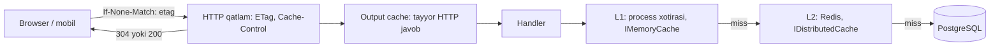
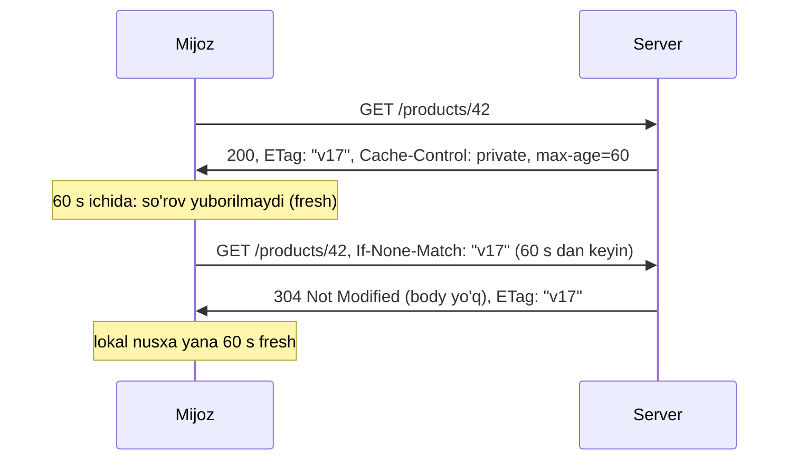

# 17. Caching

> **Bir jumlada:** Cache bu qimmat hisoblangan natijani arzon joyda (xotira, Redis) saqlab, keyingi so'rovlarda qayta hisoblamaslik; asosiy qiyinchilik saqlashda emas, eskirgan nusxani o'z vaqtida yo'q qilishda (invalidation).
> **Nega Middle uchun:** Cache eng arzon tezlashtirish vositasi, lekin noto'g'ri invalidation enterprise tizimlardagi "mijoz eski narxni ko'ryapti", "ikki instans har xil javob beryapti" bug'larining asosiy manbai. Middle qaysi qatlamda, qancha vaqt va qanday kalit bilan cache qilishni asoslab tanlashi kerak.
> **O'qish vaqti:** ~45 daqiqa

## Mundarija

- [1. Muammo va yechim](#1-muammo-va-yechim)
- [2. Qanday ishlaydi](#2-qanday-ishlaydi)
- [3. Asosiy tushunchalar](#3-asosiy-tushunchalar)
  - [3.1 IMemoryCache](#31-imemorycache)
  - [3.2 IDistributedCache](#32-idistributedcache)
  - [3.3 HybridCache](#33-hybridcache)
  - [3.4 Cache stampede](#34-cache-stampede)
  - [3.5 Cache-aside pattern](#35-cache-aside-pattern)
  - [3.6 Output caching](#36-output-caching)
  - [3.7 Response caching: Cache-Control, ETag, 304](#37-response-caching-cache-control-etag-304)
  - [3.8 Invalidation strategiyalari](#38-invalidation-strategiyalari)
  - [3.9 Redis: data structure, pub/sub, lock, cluster](#39-redis-data-structure-pubsub-lock-cluster)
  - [3.10 Cache kalit dizayni](#310-cache-kalit-dizayni)
  - [3.11 Serializatsiya narxi](#311-serializatsiya-narxi)
  - [3.12 Nimani cache qilmaslik kerak](#312-nimani-cache-qilmaslik-kerak)
  - [3.13 Monitoring: hit ratio](#313-monitoring-hit-ratio)
- [4. Amaliy misol](#4-amaliy-misol)
- [5. Tipik xatolar va anti-patternlar](#5-tipik-xatolar-va-anti-patternlar)
- [6. Best practices checklist](#6-best-practices-checklist)
- [7. Suhbat savollari va javoblar](#7-suhbat-savollari-va-javoblar)
- [8. Qo'shimcha manbalar](#8-qoshimcha-manbalar)

## 1. Muammo va yechim

Katalog sahifasi har ochilganda `GET /products?category=5` 14 ta jadvalni join qilib 180 ms da javob beradi. Kuniga 400 000 marta ochiladi, mahsulot ro'yxati esa kuniga 3-4 marta o'zgaradi. PostgreSQL CPU 70% da, ulanishlar pool'i tiqilib, buyurtma yaratish so'rovlari (haqiqatan yozish kerak bo'lganlar) kutib qoladi.

Birinchi urinish: `IMemoryCache` ga 10 daqiqa. Yuk tushdi, lekin ikki muammo chiqdi. Birinchisi, servis 3 instansda ishlaydi; narx o'zgarganda admin birinchi instansda yangi narxni ko'rdi, mijoz ikkinchi instansda eskisini, qo'llab-quvvatlash bo'limi "narx goh u, goh bu" deb shikoyat oldi. Ikkinchisi, cache muddati tugagan soniyada 200 ta parallel so'rov bir vaqtda miss ko'rib, 200 marta og'ir so'rovni bazaga yubordi (stampede), baza 3 soniya qotdi.

Yechim qatlamli: HybridCache (lokal xotira + Redis, stampede himoyasi bilan), narx o'zgarganda tag bo'yicha invalidation (hamma instansda), HTTP darajasida ETag bilan 304 (mijoz tarmoqni ham tejaydi). Har bir qatlam qaysi muammoni yechishi va qaysi yangi muammoni keltirishi quyida.

## 2. Qanday ishlaydi

Uch darajadagi cache bir so'rov yo'lida:



- **L1 (in-process):** `ConcurrentDictionary<object, CacheEntry>` ustida qurilgan `MemoryCache`. O'qish bu lug'atdan olish, mikrosekund. Lekin har instans o'z nusxasini saqlaydi.
- **L2 (Redis):** tarmoq round-trip (0.3-1 ms lokal tarmoqda) + serializatsiya. Hamma instans uchun bitta manba.
- **HybridCache:** avval L1, miss bo'lsa L2, miss bo'lsa factory (baza). Yozishda ikkalasiga yozadi. Bir xil kalit uchun parallel so'rovlarni bitta factory chaqiruviga birlashtiradi (stampede himoyasi).
- **Output cache:** handler umuman chaqirilmaydi, tayyor HTTP javob (body + header) saqlanadi.
- **HTTP cache:** mijoz `ETag` yuboradi, server "o'zgarmagan" desa `304 Not Modified` va bo'sh body qaytadi; tarmoq trafigi ham tejaladi.

Invalidation oqimi: narx o'zgardi -> `RemoveByTagAsync("products")` -> HybridCache L1 va L2 dagi shu tag'li yozuvlarni eskirgan deb belgilaydi. Boshqa instanslarning L1 nusxalari qanday eskiradi? HybridCache tag'lar uchun "tag yaratilish vaqti" ni L2'da saqlaydi va L1 dan o'qishda yozuv vaqtini tag vaqti bilan solishtiradi; tag vaqti yangiroq bo'lsa, yozuv miss hisoblanadi. Shu tufayli alohida pub/sub kanalsiz ham hamma instans yangilanadi (L2 ga bitta qo'shimcha o'qish narxiga).

## 3. Asosiy tushunchalar

### 3.1 IMemoryCache

- **Ta'rif:** Bitta process xotirasidagi kalit-qiymat cache; obyektlar serializatsiyasiz, havola sifatida saqlanadi.
- **Nega kerak:** Eng tez (lug'atdan o'qish), konfiguratsiya, lug'at ma'lumotlari (viloyatlar, valyuta kurslari), bitta instans ichida takror hisoblanadigan narsalar uchun.
- **Ichida:** `MemoryCache` `ConcurrentDictionary` + har yozuv uchun `CacheEntry` (qiymat, absolute/sliding muddat, size, eviction callback). Muddati o'tgan yozuvlar darhol o'chmaydi: har o'qishda shu yozuv tekshiriladi, va `ExpirationScanFrequency` (default 1 daqiqa) oralig'ida fon skan ishlaydi. `SizeLimit` qo'yilsa, oshganda `CompactionPercentage` (default 5%) miqdorda eng kam ishlatilgan/eskirgan yozuvlar o'chiriladi.
- **Kod:**

```csharp
builder.Services.AddMemoryCache(o => o.SizeLimit = 10_000);   // birlik: siz belgilaysiz (masalan, yozuv soni)

public sealed class RegionCatalog(IMemoryCache cache, AppDbContext db)
{
    public async Task<IReadOnlyList<RegionDto>> GetAllAsync(CancellationToken ct) =>
        (await cache.GetOrCreateAsync("regions:all", async entry =>
        {
            entry.AbsoluteExpirationRelativeToNow = TimeSpan.FromHours(6);
            entry.Size = 1;                                   // SizeLimit bo'lsa Size majburiy
            return await db.Regions.AsNoTracking()
                .Select(r => new RegionDto(r.Id, r.Name)).ToListAsync(ct);
        }))!;
}
```

- **Tipik xato:** Cache'dan olingan `List<T>` ni o'zgartirish (`list.Add(...)`). Havola umumiy, hamma so'rov o'zgargan ro'yxatni ko'radi. Cache'ga faqat immutable obyektlar (`IReadOnlyList`, `record`) qo'ying. Ikkinchi xato: `GetOrCreateAsync` atomik emas, ikki parallel chaqiruv ikkala factory'ni ishga tushiradi (stampede).

### 3.2 IDistributedCache

- **Ta'rif:** Tashqi saqlagich (Redis, SQL Server, NCache) ustidagi `byte[]` kalit-qiymat abstraksiyasi. Metodlari: `GetAsync`, `SetAsync`, `RefreshAsync`, `RemoveAsync`.
- **Nega kerak:** Ko'p instansda bitta manba; instans qayta ishga tushganda cache yo'qolmaydi; sessiya, token, rate limit hisoblagichlari uchun.
- **Ichida (Redis):** `AddStackExchangeRedisCache` har kalitni Redis hash sifatida saqlaydi (`absexp`, `sldexp`, `data` maydonlari) va `EXPIRE` bilan TTL qo'yadi; sliding expiration bo'lsa har `Get` da `EXPIRE` yangilanadi (qo'shimcha round-trip). Qiymat faqat `byte[]`: serializatsiya sizning zimmangizda.
- **Kod:**

```csharp
builder.Services.AddStackExchangeRedisCache(o =>
{
    o.Configuration = builder.Configuration.GetConnectionString("Redis");   // "redis:6379,abortConnect=false"
    o.InstanceName = "shop:";   // hamma kalitga prefiks: bitta Redis'ni bir necha ilova bo'lishsa
});

public async Task<CustomerDto?> GetAsync(Guid id, CancellationToken ct)
{
    var key = $"customer:{id}";
    var bytes = await cache.GetAsync(key, ct);
    if (bytes is not null) return JsonSerializer.Deserialize<CustomerDto>(bytes);

    var dto = await db.Customers.Where(c => c.Id == id).Select(c => new CustomerDto(c.Id, c.Name)).FirstOrDefaultAsync(ct);
    if (dto is not null)
        await cache.SetAsync(key, JsonSerializer.SerializeToUtf8Bytes(dto),
            new DistributedCacheEntryOptions { AbsoluteExpirationRelativeToNow = TimeSpan.FromMinutes(15) }, ct);
    return dto;
}
```

- **Tipik xato:** Har so'rovda Redis'ga borish, hatto lug'at ma'lumotlari uchun ham: 1 ms round-trip x 30 chaqiruv = 30 ms. Tez-tez o'qiladigan, kam o'zgaradigan narsalar uchun L1 kerak, ya'ni HybridCache.

### 3.3 HybridCache

- **Ta'rif:** `Microsoft.Extensions.Caching.Hybrid` paketidagi (.NET 9 davrida chiqqan, .NET 10 da barqaror) ikki darajali cache: L1 `MemoryCache`, L2 mavjud `IDistributedCache` (ro'yxatdan o'tgan bo'lsa). Stampede himoyasi, tag bo'yicha invalidation va serializatsiya ichida.
- **Nega kerak:** `IMemoryCache` + `IDistributedCache` ni qo'lda birlashtirish (ikkalasiga yozish, miss zanjiri, lock) 100 qator xato-yomg'ir kod; HybridCache uni standart qiladi.
- **Ichida:** `GetOrCreateAsync(key, factory)`: (1) L1 dan o'qiydi; (2) miss bo'lsa, shu kalit uchun allaqachon ishlayotgan factory bormi tekshiradi (in-flight lug'ati), bo'lsa uning natijasini kutadi; (3) yo'q bo'lsa L2 ga boradi; (4) miss bo'lsa factory'ni chaqiradi, natijani L2 va L1 ga yozadi. Qiymat L1 da ham serializatsiya qilingan holda (`byte[]`) saqlanadi va har o'qishda deserializatsiya qilinadi, agar tip immutable deb belgilanmagan bo'lsa (`[ImmutableObject(true)]` atributi yoki `sealed record` kabi tiplarni HybridCache immutable deb tan oladi); immutable bo'lsa obyekt havola bilan qaytadi. Bu "cache'dan olingan obyektni o'zgartirish" xatosidan himoya.
- **Kod:**

```csharp
builder.Services.AddStackExchangeRedisCache(o => o.Configuration = redisCs);   // L2
builder.Services.AddHybridCache(o =>
{
    o.MaximumPayloadBytes = 1024 * 1024;          // 1 MiB dan katta qiymat cache'ga yozilmaydi (default ham shu)
    o.DefaultEntryOptions = new HybridCacheEntryOptions
    {
        Expiration = TimeSpan.FromMinutes(10),        // L2 muddati
        LocalCacheExpiration = TimeSpan.FromMinutes(2) // L1 muddati, odatda qisqaroq
    };
});

public sealed class ProductQueries(HybridCache cache, AppDbContext db)
{
    public ValueTask<ProductDto?> GetAsync(Guid id, CancellationToken ct) =>
        cache.GetOrCreateAsync(
            $"product:v2:{id}",
            async token => await db.Products.AsNoTracking()
                .Where(p => p.Id == id)
                .Select(p => new ProductDto(p.Id, p.Name, p.Price))
                .FirstOrDefaultAsync(token),
            tags: ["products", $"product:{id}"],
            cancellationToken: ct);

    public ValueTask InvalidateAsync(Guid id, CancellationToken ct) =>
        cache.RemoveByTagAsync($"product:{id}", ct);
}
```

`LocalCacheExpiration < Expiration` nima uchun: L1 nusxasi tag invalidation'siz o'zgarishlarni (masalan boshqa tizim to'g'ridan-to'g'ri Redis'ni yangilasa) kech ko'radi; qisqa L1 muddati bu kechikishni chegaralaydi.

- **Tipik xato:** Factory ichida tashqi `ct` ni ishlatish (`token` o'rniga). HybridCache bir factory natijasini bir necha kutuvchiga beradi; birinchi so'rov bekor bo'lsa, boshqalar ham natijasiz qoladi. Factory'ga beriladigan `token` shu holatni hisobga olgan.

### 3.4 Cache stampede

- **Ta'rif:** Mashhur kalit muddati tugagan (yoki o'chirilgan) paytda ko'p parallel so'rov bir vaqtda miss ko'rib, hammasi manbaga (bazaga) boradi. "Thundering herd" ham deyiladi.
- **Nega muhim:** Aynan cache bilan "himoyalangan" og'ir so'rov bir soniyada 200 marta ishlaydi; cache'siz holatdan yomonroq, chunki yuk bir lahzaga to'planadi.
- **Yechimlar:**
  - **Single-flight (request coalescing):** bir kalit uchun bitta factory, qolganlar kutadi. HybridCache buni default qiladi. `IMemoryCache` da qo'lda: `ConcurrentDictionary<string, Lazy<Task<T>>>` yoki kalit bo'yicha `SemaphoreSlim`.
  - **Early refresh / jitter:** TTL'ga tasodifiy 0-10% qo'shish, hamma kalit bir soniyada tugamasligi uchun; yoki muddat tugashidan oldin fon yangilash.
  - **Stale-while-revalidate:** eski qiymatni qaytarib, fon'da yangilash. HybridCache'da to'g'ridan-to'g'ri yo'q, output cache'da ham yo'q; FusionCache kutubxonasi buni beradi.
- **Kod (IMemoryCache uchun single-flight):**

```csharp
public sealed class SingleFlightCache(IMemoryCache cache)
{
    private readonly ConcurrentDictionary<string, Lazy<Task<object?>>> _inflight = new();

    public async Task<T?> GetOrCreateAsync<T>(string key, Func<CancellationToken, Task<T?>> factory, TimeSpan ttl, CancellationToken ct)
    {
        if (cache.TryGetValue(key, out T? hit)) return hit;

        // Lazy: ikki thread bir vaqtda GetOrAdd qilsa ham factory bir marta ishlaydi
        var lazy = _inflight.GetOrAdd(key, _ => new Lazy<Task<object?>>(async () =>
        {
            var value = await factory(CancellationToken.None);   // birinchi so'rov bekor bo'lsa ham boshqalar natija oladi
            if (value is not null) cache.Set(key, value, ttl);
            return value;
        }));

        try { return (T?)await lazy.Value.WaitAsync(ct); }
        finally { _inflight.TryRemove(key, out _); }
    }
}
```

- **Tipik xato:** Hamma kalitni bir xil TTL bilan bir vaqtda (ilova start'ida) to'ldirish; 10 daqiqadan keyin hammasi bir vaqtda tugaydi.

### 3.5 Cache-aside pattern

- **Ta'rif:** Ilova o'zi cache'ni boshqaradi: avval cache'dan o'qiydi, miss bo'lsa manbadan oladi va cache'ga yozadi (lazy loading). Yozishda manbani yangilab, cache'ni o'chiradi (yangilamaydi).
- **Nega "o'chirish, yangilamas":** Ikki parallel yozuv tartibsiz tugasa, cache'da eski qiymat qolishi mumkin; o'chirish esa keyingi o'qishda yangi qiymatni majburan yuklaydi. Yangilash faqat qiymat hisoblash juda qimmat bo'lganda va yozuvlar ketma-ket bo'lganda.
- **Muqobillar:** Read-through/write-through (cache o'zi manba bilan gaplashadi; HybridCache factory bilan read-through'ga yaqin), write-behind (cache'ga yozib, manbaga keyin; yo'qotish xavfi), refresh-ahead (muddat tugashidan oldin fon yangilash).
- **Kod:** 3.3 dagi `GetAsync` (o'qish) va yozish tomoni:

```csharp
public async Task UpdatePriceAsync(Guid id, decimal price, CancellationToken ct)
{
    var product = await db.Products.FirstAsync(p => p.Id == id, ct);
    product.ChangePrice(Money.Uzs(price));
    await db.SaveChangesAsync(ct);                       // 1) manba
    await cache.RemoveByTagAsync($"product:{id}", ct);   // 2) cache o'chadi, keyingi o'qish yangisini yuklaydi
}
```

- **Tipik xato:** Tartibni teskari qilish (avval cache'ni o'chirish, keyin saqlash): orada boshqa so'rov eski qiymatni bazadan o'qib cache'ga qaytaradi. Shuning uchun avval baza, keyin cache; yanada xavfsizroq: tranzaksiya commit'dan keyin o'chirish.

### 3.6 Output caching

- **Ta'rif:** ASP.NET Core middleware (`AddOutputCache`/`UseOutputCache`), endpoint'ning to'liq HTTP javobini server tomonida saqlaydi; keyingi so'rovlar handler'ga yetmaydi. Policy bilan boshqariladi: muddat, vary-by (query, header, route), tag.
- **Response caching'dan farqi:** Response caching mijozga `Cache-Control` header beradi va standart HTTP qoidalariga bo'ysunadi (masalan, `Authorization` header'li so'rov cache qilinmaydi, mijoz `no-cache` yuborsa chetlab o'tiladi). Output caching server tomonida, mijoz header'lariga bog'liq emas, dasturiy invalidation (tag) bor.
- **Kod:**

```csharp
builder.Services.AddStackExchangeRedisOutputCache(o => o.Configuration = redisCs);  // ko'p instans uchun; bo'lmasa in-memory
builder.Services.AddOutputCache(o =>
{
    o.AddBasePolicy(b => b.NoCache());   // default: hech narsa cache qilinmaydi, policy ochiq ko'rsatiladi
    o.AddPolicy("catalog", b => b
        .Expire(TimeSpan.FromMinutes(5))
        .SetVaryByQuery("category", "page")
        .SetVaryByHeader("Accept-Language")
        .Tag("catalog"));
});

var app = builder.Build();
app.UseOutputCache();   // UseRouting dan keyin, auth'dan keyin

app.MapGet("/products", async (int? category, int page, ProductQueries q, CancellationToken ct) =>
        TypedResults.Ok(await q.ListAsync(category, page, ct)))
   .CacheOutput("catalog");

// Narx o'zgarganda
app.MapPut("/products/{id:guid}/price", async (Guid id, PriceDto dto, ProductCommands c, IOutputCacheStore store, CancellationToken ct) =>
{
    await c.UpdatePriceAsync(id, dto.Price, ct);
    await store.EvictByTagAsync("catalog", ct);   // hamma sahifa va kategoriya variantlari o'chadi
    return TypedResults.NoContent();
});
```

Ichida: output cache middleware'da ham stampede himoyasi bor (bir kalit uchun bitta so'rov handler'ga o'tadi, qolganlar kutadi). Default'da faqat `GET`/`HEAD`, 200 javob, `Authorization` header'siz va `Set-Cookie` siz javoblar cache qilinadi; buni policy'da `b.AllowAnonymous...` emas, aniq `b.Cache()` yoki custom policy bilan o'zgartirish mumkin, lekin foydalanuvchiga xos javobni cache qilish xavfini anglab.

- **Tipik xato:** Foydalanuvchiga xos endpoint'ni (`/me/orders`) `VaryByHeader("Authorization")` siz cache qilish: bir mijoz boshqasining buyurtmalarini ko'radi.

### 3.7 Response caching: Cache-Control, ETag, 304

- **Ta'rif:** HTTP standart cache mexanizmi. `Cache-Control` mijoz/proxy'ga javobni qancha saqlash mumkinligini aytadi; `ETag` javob versiyasining identifikatori; mijoz keyingi so'rovda `If-None-Match: "etag"` yuboradi, server o'zgarmagan bo'lsa `304 Not Modified` qaytaradi (body'siz).
- **Nega kerak:** Tarmoq trafigi va mijoz tomonidagi kechikish kamayadi; server ham body serializatsiya qilmaydi (lekin ETag hisoblash uchun ma'lumotni olishi kerak, agar versiya ustunidan hisoblanmasa).
- **Oqim:**



- **Kod (ETag versiya ustunidan, qimmat so'rovsiz):**

```csharp
app.MapGet("/products/{id:guid}", async (Guid id, HttpContext http, AppDbContext db, CancellationToken ct) =>
{
    // Version ustuni (xmin yoki RowVersion) har o'zgarishda ortadi: ETag uchun ideal
    var head = await db.Products.AsNoTracking()
        .Where(p => p.Id == id).Select(p => new { p.Version }).FirstOrDefaultAsync(ct);
    if (head is null) return Results.NotFound();

    var etag = new EntityTagHeaderValue($"\"{head.Version}\"");
    var reqHeaders = http.Request.GetTypedHeaders();
    if (reqHeaders.IfNoneMatch.Any(t => t.Compare(etag, useStrongComparison: false)))
        return Results.StatusCode(StatusCodes.Status304NotModified);

    var dto = await db.Products.AsNoTracking().Where(p => p.Id == id)
        .Select(p => new ProductDto(p.Id, p.Name, p.Price)).FirstAsync(ct);

    var resp = http.Response.GetTypedHeaders();
    resp.ETag = etag;
    resp.CacheControl = new CacheControlHeaderValue { Private = true, MaxAge = TimeSpan.FromSeconds(60) };
    return Results.Ok(dto);
});
```

`private` (faqat mijoz brauzeri saqlaydi) vs `public` (CDN/proxy ham saqlaydi): foydalanuvchiga bog'liq javob doim `private`. `no-store` umuman saqlanmasin (to'lov sahifasi), `no-cache` saqlash mumkin, lekin har safar serverdan tasdiqlash (`If-None-Match`) shart.

- **Tipik xato:** ETag'ni butun body'ning hash'i sifatida hisoblash: 304 qaytarish uchun ham to'liq so'rov va serializatsiya bajariladi, server hech narsa tejamaydi. Versiya ustuni yoki `UpdatedAt` dan hisoblang.

### 3.8 Invalidation strategiyalari

- **TTL (vaqt bo'yicha):** Eng oddiy; "N daqiqa eskirgan bo'lishi mumkin" degan biznes roziligi kerak. Lug'at ma'lumotlari (soat), katalog (daqiqalar), kurs (1 daqiqa).
- **Tag bo'yicha:** Bir guruh kalitni bitta buyruq bilan o'chirish (`RemoveByTagAsync("products")`, output cache `EvictByTagAsync`). Kalit nomlarini bilish shart emas; "kategoriya 5 ning hamma sahifalari" kabi guruhlar uchun.
- **Event-driven:** Ma'lumot o'zgarganda (domain event, broker xabari, PostgreSQL `LISTEN/NOTIFY`) cache o'chiriladi. Eng aniq, lekin har o'zgarish manbasini qamrab olish kerak: to'g'ridan-to'g'ri SQL bilan o'zgartirilgan ma'lumot cache'da eski qoladi.
- **Versiyali kalit:** Kalitga versiya qo'shish (`product:v2:{id}`); schema o'zgarganda `v3` ga o'tiladi, eski yozuvlar TTL bilan o'zi o'chadi. Deploy paytida eski va yangi kod bir vaqtda ishlasa, eski kod yangi formatni o'qib yiqilmaydi.
- **Kombinatsiya:** Amalda TTL har doim bor (xavfsizlik to'ri), ustiga tag/event. TTL'siz "abadiy" cache bir kun xato qoldirib ketadi.

```csharp
// Event-driven: domain event handler cache'ni o'chiradi (tranzaksiya commit'dan keyin ishlashi kerak)
internal sealed class EvictProductCacheOnPriceChanged(HybridCache cache, IOutputCacheStore output)
    : IDomainEventHandler<ProductPriceChanged>
{
    public async Task Handle(ProductPriceChanged e, CancellationToken ct)
    {
        await cache.RemoveByTagAsync($"product:{e.ProductId}", ct);
        await output.EvictByTagAsync("catalog", ct);
    }
}
```

- **Tipik xato:** Tag'ni juda keng qilish (`"all"`): bitta mahsulot narxi o'zgarganda butun katalog cache'i o'chadi va stampede boshlanadi. Tag ierarxiyasi: `product:{id}` (aniq), `category:{id}` (o'rta), `products` (keng, kamdan-kam).

### 3.9 Redis: data structure, pub/sub, lock, cluster

- **Ta'rif:** Redis xotirada ishlaydigan kalit-qiymat server, bitta thread'da buyruqlarni ketma-ket bajaradi (shuning uchun har buyruq atomik), tarmoq I/O multiplexed. Qiymat tiplari: string, hash, list, set, sorted set, stream, HyperLogLog, bitmap.
- **Data structure'lar qachon:**
  - `string` (`SET/GET`, `INCR`): serializatsiya qilingan DTO, hisoblagich (rate limit: `INCR` + `EXPIRE`).
  - `hash` (`HSET/HGET`): bitta obyektning maydonlari, bitta maydonni alohida yangilash/o'qish (`HINCRBY stock:42 reserved 3`).
  - `sorted set` (`ZADD/ZRANGE`): reyting, leaderboard, vaqt bo'yicha navbat ("qachon bajarilsin" score sifatida).
  - `set`: unikal elementlar (bugun ko'rgan foydalanuvchilar), kesishma/birlashma.
  - `list` (`LPUSH/BRPOP`): oddiy navbat (lekin at-least-once kafolati yo'q; haqiqiy navbat uchun stream yoki broker).
  - `stream` (`XADD/XREADGROUP`): consumer group bilan log; Kafka'ning yengil versiyasi.
- **Pub/Sub:** `PUBLISH channel msg` / `SUBSCRIBE channel`. Fire-and-forget: obunachi yo'q bo'lsa xabar yo'qoladi, saqlanmaydi. Qo'llanishi: cache invalidation signali instanslarga, SignalR backplane (19-mavzu). Ishonchli yetkazish uchun emas.
- **Distributed lock (SET NX):** `SET lock:report:daily <token> NX PX 30000`: kalit yo'q bo'lsa (NX) yarat va 30 s TTL (PX) qo'y. Atomik, bitta buyruq. Bo'shatish: faqat o'z token'ingizni o'chirish, Lua skript bilan (`GET` + `DEL` alohida bo'lsa, orada TTL tugab, boshqa egasining qulfini o'chirib yuborasiz).

```csharp
public sealed class RedisLock(IConnectionMultiplexer redis)
{
    private const string ReleaseScript = """
        if redis.call('GET', KEYS[1]) == ARGV[1] then
            return redis.call('DEL', KEYS[1])
        end
        return 0
        """;

    public async Task<IAsyncDisposable?> TryAcquireAsync(string resource, TimeSpan ttl)
    {
        var db = redis.GetDatabase();
        var key = $"lock:{resource}";
        var token = Guid.NewGuid().ToString("N");

        // SET key token NX PX ttl: faqat kalit yo'q bo'lsa yoziladi
        var acquired = await db.StringSetAsync(key, token, ttl, When.NotExists);
        if (!acquired) return null;

        return new Releaser(db, key, token);
    }

    private sealed class Releaser(IDatabase db, string key, string token) : IAsyncDisposable
    {
        public async ValueTask DisposeAsync() =>
            await db.ScriptEvaluateAsync(ReleaseScript, [new RedisKey(key)], [new RedisValue(token)]);
    }
}
```

Cheklov: TTL ichida ish tugamasa, qulf boshqasiga o'tadi va ikki ish bir vaqtda bajariladi. Bu lock "ko'pincha bitta" kafolati beradi, "har doim bitta" emas; shuning uchun ish o'zi idempotent bo'lishi kerak. Redlock (bir necha mustaqil Redis'da ovoz berish) ham bu muammoni to'liq yechmaydi (Martin Kleppmann tahlili); qat'iy kafolat kerak bo'lsa, PostgreSQL advisory lock yoki baza tranzaksiyasi.

- **Cluster:** 16384 hash slot, har master o'z slot diapazoniga ega; kalit CRC16 bilan slot'ga tushadi. Ko'p kalitli buyruqlar (`MGET`, tranzaksiya, Lua) faqat bir slot'dagi kalitlar bilan ishlaydi. Hash tag `{...}` bilan kalitlarni bir slot'ga majburlash: `order:{42}:lines` va `order:{42}:total` bir joyda. Cluster yozish hajmi uchun; faqat o'qish/HA uchun Sentinel + replica yetadi.
- **Tipik xato:** `KEYS pattern*` ni production'da ishlatish: bitta thread'li Redis'ni millionlab kalitda bir necha soniya bloklaydi. `SCAN` ishlating, yaxshisi tag/versiyali kalit bilan pattern o'chirishdan voz keching.

### 3.10 Cache kalit dizayni

- **Ta'rif:** Kalit bu cache'dagi yozuvning manzili; uning tuzilishi invalidation, ko'p ilova va ko'p tenant muhitida to'qnashuv va debug'ni belgilaydi.
- **Qoidalar:**
  - Prefiks ierarxiyasi: `{ilova}:{tenant}:{entity}:{versiya}:{id}`. Masalan `shop:t42:product:v2:8f1c...`. `InstanceName` ilova prefiksini beradi.
  - Tenant kalitda bo'lsin, aks holda bir tenant boshqasining ma'lumotini ko'radi.
  - Versiya: DTO shakli o'zgarganda `v2` -> `v3`; deploy paytida eski kod eski formatni o'qiydi.
  - Parametrlar deterministik tartibda: `list:category=5:page=2`, `list:page=2:category=5` emas. Query parametrlarini sort qilib yig'ing.
  - Kalit uzunligi: Redis kalit xotirani yeydi; 100 belgidan oshsa hash qiling (`SHA256` ning 16 bayti), lekin inson o'qiydigan prefiksni qoldiring.
  - Kalitda PII yo'q (email, telefon): Redis monitoring/loglarida ko'rinadi. Foydalanuvchi Id yetarli.
- **Kod:**

```csharp
public static class CacheKeys
{
    public static string Product(Guid tenantId, Guid id) => $"t{tenantId:N}:product:v2:{id:N}";

    public static string ProductList(Guid tenantId, int? category, int page, string lang) =>
        $"t{tenantId:N}:products:v2:c={category?.ToString() ?? "all"}:p={page}:l={lang}";
}
```

- **Tipik xato:** Kalit sifatida `request.ToString()` yoki `JsonSerializer.Serialize(request)`: maydon tartibi va formatlash o'zgarsa kalit ham o'zgaradi, cache "ko'rinmas" miss beradi.

### 3.11 Serializatsiya narxi

- **Ta'rif:** L2 (Redis) `byte[]` saqlaydi; har yozish serializatsiya, har o'qish deserializatsiya. HybridCache L1 da ham ko'pincha `byte[]` saqlaydi (immutable bo'lmagan tiplar uchun), shuning uchun L1 hit ham deserializatsiya narxiga ega.
- **Raqamlar (taxminiy, 10 KB JSON):** System.Text.Json deserializatsiya 20-50 mikrosekund, 1 MB uchun millisekundlar. 1000 RPS x 1 MB = soniyasiga 1 GB allocation, GC bosimi. Redis tarmog'i ham: 1 MB x 1000 = 1 Gbit/s.
- **Kamaytirish:**
  - DTO'ni kichik qiling: faqat ekranga kerak maydonlar. Entity'ni emas, projection'ni cache qiling.
  - Katta ro'yxatni butunlay emas, sahifalab yoki Id ro'yxati + har elementni alohida (ko'p kalit, lekin invalidation aniq).
  - Immutable tiplar (`sealed record`, `[ImmutableObject(true)]`): HybridCache L1 da obyektni to'g'ridan-to'g'ri saqlaydi, deserializatsiya yo'q.
  - Serializer: System.Text.Json default; MessagePack (`IHybridCacheSerializerFactory` orqali) 2-3 marta ixcham va tez, lekin inson o'qimaydi (debug qiyin).
  - `MaximumPayloadBytes` limit: undan katta qiymat cache'ga yozilmaydi (HybridCache jim o'tkazib yuboradi, factory har safar ishlaydi); log'da buni kuzating.
- **Tipik xato:** EF entity'ni (navigatsiyalari bilan) cache'ga qo'yish: siklik havola, lazy proxy, 50 maydon. Faqat DTO.

### 3.12 Nimani cache qilmaslik kerak

- **Qat'iy izchillik (strong consistency) talab qiladigan ma'lumot:** hisob balansi, zaxira miqdori checkout paytida, to'lov holati. Eskirgan qiymat bilan qaror qabul qilish moliyaviy xato. Bu yerda bazadan o'qish, kerak bo'lsa `FOR UPDATE`.
- **Avtorizatsiya qarorlari:** "foydalanuvchi X ni ko'ra oladimi" natijasi; rol o'zgarganda darhol kuchga kirishi kerak. Rollarni qisqa TTL bilan cache qilish mumkin, lekin tekshiruvning o'zini emas.
- **Foydalanuvchiga xos sezgir ma'lumot umumiy kalitda:** kalitda foydalanuvchi/tenant Id yo'q bo'lsa, bir foydalanuvchi boshqasining ma'lumotini oladi.
- **Juda tez o'zgaradigan narsa:** soniyada 10 marta o'zgarsa, hit ratio nolga yaqin, cache faqat qo'shimcha yozuv narxi.
- **Bir marta o'qiladigan narsa:** hisobot natijasi, eksport fayli; hit bo'lmaydi.
- **Katta va kam ishlatiladigan:** 5 MB ro'yxat haftada ikki marta ochilsa, Redis xotirasi va serializatsiya narxi foydadan ko'p.
- **Xato javoblar:** `null`/404/exception natijasini cache qilish ongli qaror bo'lishi kerak (negative caching qisqa TTL bilan foydali, lekin xatolik holatini "muzlatib" qo'yish xavfli).

### 3.13 Monitoring: hit ratio

- **Ta'rif:** Hit ratio = hit / (hit + miss). Cache samaradorligining asosiy ko'rsatkichi; 0.9+ yaxshi, 0.5 dan past bo'lsa TTL juda qisqa, kalit noto'g'ri (har so'rov yangi kalit) yoki ma'lumot cache'ga mos emas.
- **Qayerdan olinadi:**
  - Redis: `INFO stats` dagi `keyspace_hits`, `keyspace_misses`; `used_memory`, `evicted_keys` (xotira yetmay o'chirilgan kalitlar, `maxmemory-policy` bilan bog'liq), `expired_keys`.
  - Ilova darajasida: `System.Diagnostics.Metrics` bilan o'z hisoblagichingiz; HybridCache factory chaqiruvini miss deb hisoblash mumkin.
  - Output cache: middleware log'lari, custom `IOutputCacheStore` dekorator.
- **Kod (hit/miss metrikasi HybridCache atrofida):**

```csharp
public sealed class MeteredCache(HybridCache inner, IMeterFactory meters)
{
    private readonly Counter<long> _hits = meters.Create("Shop.Cache").CreateCounter<long>("cache.hits");
    private readonly Counter<long> _misses = meters.Create("Shop.Cache").CreateCounter<long>("cache.misses");

    public async ValueTask<T> GetOrCreateAsync<T>(string key, string area, Func<CancellationToken, ValueTask<T>> factory,
        IReadOnlyCollection<string>? tags = null, CancellationToken ct = default)
    {
        var missed = false;
        var result = await inner.GetOrCreateAsync(key, async t =>
        {
            missed = true;                   // factory ishladi = miss (L1 va L2 ikkalasida ham yo'q edi)
            return await factory(t);
        }, tags: tags, cancellationToken: ct);

        (missed ? _misses : _hits).Add(1, new KeyValuePair<string, object?>("area", area));
        return result;
    }
}
```

Alert: hit ratio keskin tushsa (deploy'dan keyin kalit prefiksi o'zgargan), `evicted_keys` o'ssa (Redis xotirasi yetmayapti), Redis latency p99 5 ms dan oshsa (tarmoq yoki katta payload).

## 4. Amaliy misol

Ko'p tenant'li katalog: mahsulot kartasi HybridCache orqali, ro'yxat output cache orqali, narx o'zgarishi ikkalasini tag bilan o'chiradi, HTTP darajasida ETag.

```csharp
// ===== Program.cs =====
var redisCs = builder.Configuration.GetConnectionString("Redis")!;

builder.Services.AddStackExchangeRedisCache(o => { o.Configuration = redisCs; o.InstanceName = "shop:"; });
builder.Services.AddHybridCache(o => o.DefaultEntryOptions = new HybridCacheEntryOptions
{
    Expiration = TimeSpan.FromMinutes(15),
    LocalCacheExpiration = TimeSpan.FromMinutes(3)
});
builder.Services.AddStackExchangeRedisOutputCache(o => { o.Configuration = redisCs; o.InstanceName = "shop:oc:"; });
builder.Services.AddOutputCache(o =>
{
    o.AddBasePolicy(b => b.NoCache());
    o.AddPolicy("catalog-list", b => b
        .Expire(TimeSpan.FromMinutes(5))
        .SetVaryByRouteValue("tenant")                 // /t/{tenant}/products
        .SetVaryByQuery("category", "page", "sort")
        .SetVaryByHeader("Accept-Language")
        .Tag("catalog"));                              // tenant'ga xos tag quyida dinamik qo'shiladi
});

var app = builder.Build();
app.UseAuthentication();
app.UseAuthorization();
app.UseOutputCache();

// ===== Mahsulot kartasi: HybridCache + ETag =====
app.MapGet("/t/{tenant:guid}/products/{id:guid}",
    async (Guid tenant, Guid id, HttpContext http, ProductQueries q, CancellationToken ct) =>
{
    var dto = await q.GetAsync(tenant, id, ct);
    if (dto is null) return Results.NotFound();

    // ETag DTO ichidagi Version'dan: cache'dan kelgan bo'lsa ham to'g'ri, chunki o'zgarishda cache o'chadi
    var etag = new EntityTagHeaderValue($"\"{dto.Version}\"");
    if (http.Request.GetTypedHeaders().IfNoneMatch.Any(t => t.Compare(etag, useStrongComparison: false)))
        return Results.StatusCode(StatusCodes.Status304NotModified);

    var h = http.Response.GetTypedHeaders();
    h.ETag = etag;
    h.CacheControl = new CacheControlHeaderValue { Private = true, MaxAge = TimeSpan.FromSeconds(30) };
    return Results.Ok(dto);
});

// ===== Ro'yxat: output cache =====
app.MapGet("/t/{tenant:guid}/products",
    async (Guid tenant, int? category, int page, string? sort, ProductQueries q, CancellationToken ct) =>
        TypedResults.Ok(await q.ListAsync(tenant, category, page, sort, ct)))
   .CacheOutput("catalog-list");

// ===== Narx o'zgarishi =====
app.MapPut("/t/{tenant:guid}/products/{id:guid}/price",
    async (Guid tenant, Guid id, ChangePriceDto dto, ProductCommands c, CancellationToken ct) =>
{
    await c.ChangePriceAsync(tenant, id, dto.Price, ct);
    return TypedResults.NoContent();
}).RequireAuthorization("catalog-admin");

// ===== Queries =====
public sealed record ProductDto(Guid Id, string Name, decimal Price, uint Version);   // sealed record: HybridCache immutable deb oladi

public sealed class ProductQueries(HybridCache cache, AppDbContext db)
{
    public ValueTask<ProductDto?> GetAsync(Guid tenant, Guid id, CancellationToken ct) =>
        cache.GetOrCreateAsync(
            CacheKeys.Product(tenant, id),
            async t => await db.Products.AsNoTracking()
                .Where(p => p.TenantId == tenant && p.Id == id)
                .Select(p => new ProductDto(p.Id, p.Name, p.Price.Amount, p.Version))   // Version: PostgreSQL xmin
                .FirstOrDefaultAsync(t),
            tags: [$"t{tenant:N}:products", $"product:{id:N}"],
            cancellationToken: ct);

    public async Task<PagedResult<ProductListItem>> ListAsync(Guid tenant, int? category, int page, string? sort, CancellationToken ct)
    {
        // Ro'yxat HybridCache'da emas: variantlar ko'p (kategoriya x sahifa x sort x til),
        // output cache HTTP darajasida bitta javobni saqlaydi va serializatsiya ham tejaladi
        var q = db.Products.AsNoTracking().Where(p => p.TenantId == tenant);
        if (category is not null) q = q.Where(p => p.CategoryId == category);
        q = sort == "price" ? q.OrderBy(p => p.Price.Amount) : q.OrderBy(p => p.Name);
        var items = await q.Skip((page - 1) * 20).Take(20)
            .Select(p => new ProductListItem(p.Id, p.Name, p.Price.Amount)).ToListAsync(ct);
        return new(items, await q.CountAsync(ct));
    }
}

// ===== Commands: avval baza, keyin cache =====
public sealed class ProductCommands(AppDbContext db, HybridCache cache, IOutputCacheStore output)
{
    public async Task ChangePriceAsync(Guid tenant, Guid id, decimal price, CancellationToken ct)
    {
        var product = await db.Products.FirstOrDefaultAsync(p => p.TenantId == tenant && p.Id == id, ct)
                      ?? throw new NotFoundException("product");
        product.ChangePrice(Money.Uzs(price));
        await db.SaveChangesAsync(ct);                          // 1) commit

        // 2) invalidation: aniq mahsulot (karta) va tenant ro'yxatlari
        await cache.RemoveByTagAsync($"product:{id:N}", ct);
        await output.EvictByTagAsync("catalog", ct);            // output cache policy tag'i; tenant bo'yicha ajratish uchun custom policy kerak
    }
}
```

Nima uchun shunday:

- Karta HybridCache'da, ro'yxat output cache'da: karta bitta kalit va aniq invalidation; ro'yxat yuzlab variant, uni tag bilan butunlay o'chirish arzon, 5 daqiqa TTL esa xavfsizlik to'ri.
- `ProductDto` `sealed record`: HybridCache uni immutable deb tan olib L1 da havola sifatida saqlaydi, har hit'da deserializatsiya qilmaydi.
- ETag `Version` (PostgreSQL `xmin`, EF'da `IsRowVersion()`) dan: har yangilanishda o'zgaradi, hisoblash narxi nol. Cache'dan kelgan DTO bilan ham to'g'ri, chunki narx o'zgarishi shu cache'ni o'chiradi.
- `Cache-Control: private, max-age=30`: brauzer 30 s so'rov yubormaydi, keyin `If-None-Match` bilan keladi; CDN saqlamaydi (tenant'ga xos).
- Invalidation tartibi: `SaveChangesAsync` dan keyin. Agar o'rtada boshqa so'rov eski narxni cache'ga qaytarsa ham (commit va remove orasidagi millisekundlar), `RemoveByTag` uni o'chiradi, chunki remove keyin keladi.
- Tenant tag (`t{tenant}:products`) `RemoveByTagAsync` uchun tayyor: tenant'ning butun katalogini (import tugaganda) bitta buyruq bilan o'chirish.

## 5. Tipik xatolar va anti-patternlar

**1. Ko'p instansda IMemoryCache bilan o'zgaruvchan ma'lumot**

```csharp
// ❌ Instans A narxni yangiladi va o'z cache'ini tozaladi, B va C eskisini 10 daqiqa ko'rsatadi
memoryCache.Set($"product:{id}", dto, TimeSpan.FromMinutes(10));
```

Oqibati: foydalanuvchi load balancer orqali har safar boshqa javob oladi. Yechim: HybridCache (L2 Redis + tag invalidation) yoki faqat lug'at ma'lumotlari uchun `IMemoryCache`.

**2. Cache'dagi obyektni o'zgartirish**

```csharp
// ❌
var list = memoryCache.Get<List<ProductDto>>("products");
list.RemoveAll(p => p.Price > filter.Max);   // cache'dagi ro'yxatning o'zi qisqardi
```

Oqibati: keyingi so'rovlar to'liq bo'lmagan ro'yxat oladi, bug "tasodifiy" ko'rinadi. Yechim: `IReadOnlyList`/`record`, filtrlash yangi ro'yxatga (`Where(...).ToList()`).

**3. Stampede'ga ochiq GetOrCreate**

```csharp
// ❌ 200 parallel so'rov, 200 marta factory
var v = await memoryCache.GetOrCreateAsync(key, e => HeavyQueryAsync());
```

Yechim: HybridCache (single-flight ichida) yoki 3.4 dagi `Lazy<Task>` lug'ati.

**4. Avval cache'ni o'chirib, keyin bazaga yozish**

```csharp
// ❌
await cache.RemoveAsync(key);
await db.SaveChangesAsync();   // orada boshqa so'rov eski qiymatni cache'ga qaytardi
```

Yechim: avval commit, keyin remove; TTL xavfsizlik to'ri sifatida.

**5. Foydalanuvchiga xos javobni umumiy output cache'da**

```csharp
// ❌ /me/orders uchun VaryBy yo'q, kalit faqat path
app.MapGet("/me/orders", ...).CacheOutput(b => b.Expire(TimeSpan.FromMinutes(1)));
```

Oqibati: birinchi foydalanuvchining buyurtmalari hammaga ko'rsatiladi; default policy `Authorization` header bor so'rovni cache qilmaydi, lekin cookie auth bilan yoki custom policy bilan buni o'chirib qo'yish oson. Yechim: foydalanuvchiga xos endpoint'larni output cache qilmang; kerak bo'lsa `VaryByValue` bilan user Id.

**6. Entity'ni cache'ga qo'yish**

```csharp
// ❌ EF entity, navigation'lar, change tracker'dan uzilgan obyekt
await cache.SetAsync(key, JsonSerializer.SerializeToUtf8Bytes(orderEntity));
```

Oqibati: siklik havola xatosi yoki 200 KB payload, keyin `Attach` qilishga urinish va tracking xatolari. Yechim: faqat DTO.

**7. `KEYS *` bilan invalidation**

```csharp
// ❌ server.Keys(pattern: "product:*") har safar butun keyspace'ni skan qiladi
```

Oqibati: Redis bir necha soniya bloklanadi, hamma so'rovlar kutadi. Yechim: tag (HybridCache), versiyali prefiks, yoki `SCAN` fon ishida.

## 6. Best practices checklist

- [ ] Har cache yozuvida TTL bor, hatto event-driven invalidation bo'lsa ham, chunki qamrab olinmagan o'zgarish manbasi doim topiladi.
- [ ] Ko'p instansda o'zgaruvchan ma'lumot uchun L1 yolg'iz ishlatilmaydi, HybridCache yoki L2, chunki instanslar bir-birining o'chirishini ko'rmaydi.
- [ ] `LocalCacheExpiration` `Expiration` dan qisqa, chunki L1 nusxasi tashqi o'zgarishlarni faqat muddat tugaganda ko'radi.
- [ ] Cache'ga faqat immutable DTO (`sealed record`), chunki umumiy havolani o'zgartirish hamma so'rovga ta'sir qiladi va HybridCache immutable tipni deserializatsiyasiz qaytaradi.
- [ ] Invalidation tartibi: commit, keyin remove, chunki teskari tartib eski qiymatni cache'ga qaytaradi.
- [ ] Kalitda tenant va versiya bor, parametrlar deterministik tartibda, PII yo'q, chunki to'qnashuv, deploy mosligi va log xavfsizligi shunga bog'liq.
- [ ] Tag ierarxiyasi tor (`product:{id}`) dan keng (`products`) ga, keng tag faqat ommaviy o'zgarishda, chunki keng tag'ni tez-tez o'chirish stampede beradi.
- [ ] Foydalanuvchiga xos endpoint output cache'da `VaryBy` siz hech qachon, chunki ma'lumot boshqa foydalanuvchiga chiqadi.
- [ ] ETag versiya ustunidan hisoblanadi, body hash'idan emas, chunki 304 server ishini tejashi kerak.
- [ ] Balans, zaxira (checkout), to'lov holati va avtorizatsiya qarorlari cache qilinmaydi, chunki eskirgan qiymat moliyaviy/xavfsizlik xatosi.
- [ ] Redis lock faqat `SET NX PX` + token + Lua release bilan, va ish idempotent, chunki TTL tugasa qulf boshqasiga o'tadi.
- [ ] `KEYS` production'da taqiqlangan, chunki bitta thread'li Redis bloklanadi.
- [ ] Hit ratio, `evicted_keys`, Redis latency metrikalari dashboard'da, chunki deploy'dan keyin kalit prefiksi o'zgarishi jim miss beradi.
- [ ] Payload hajmi nazorat ostida (`MaximumPayloadBytes`, DTO kichik), chunki 1 MB x 1000 RPS tarmoq va GC'ni yeydi.

## 7. Suhbat savollari va javoblar

**1. Ikki instansli servisda IMemoryCache bilan nima muammo?**

Har instans o'z process xotirasida alohida nusxa saqlaydi. Instans A ma'lumotni yangilab o'z cache'ini tozalasa, B va C hali eski nusxani TTL tugaguncha beradi; load balancer foydalanuvchini har safar boshqa instansga yo'naltirgani uchun javob "sakraydi". Yechim: o'zgaruvchan ma'lumot uchun L2 (Redis) bilan HybridCache, uning tag invalidation'i hamma instansga ta'sir qiladi; yoki pub/sub orqali "o'chir" signali; yoki faqat kam o'zgaradigan lug'atlarni `IMemoryCache` da qisqa TTL bilan. Tuzoq: "sticky session" taklif qilish; u masshtablash va deploy'ni qiyinlashtiradi, muammoni yashiradi.

**2. ETag qanday ishlaydi va qachon foyda beradi?**

Server javob bilan `ETag: "v17"` (resurs versiyasi) yuboradi. Mijoz keyingi so'rovda `If-None-Match: "v17"` qo'shadi; server joriy versiyani solishtirib, o'zgarmagan bo'lsa `304 Not Modified` va bo'sh body qaytaradi. Foyda: tarmoq trafigi va mijoz tomonidagi parsing tejaladi; server tomonida esa faqat ETag'ni arzon hisoblash mumkin bo'lsa (versiya ustuni, `UpdatedAt`) tejaladi, aks holda server baribir to'liq ishni qiladi. `Cache-Control: max-age` bilan birga: muddat ichida so'rov umuman ketmaydi, muddatdan keyin ETag bilan tasdiqlanadi. Tuzoq: zaif ETag (`W/"..."`) semantik tenglik, kuchli ETag bayt-bayt tenglik; `If-None-Match` uchun zaif solishtirish yetarli, `If-Match` (optimistic concurrency, PUT) uchun kuchli kerak.

**3. Cache stampede nima va qanday oldini olasiz?**

Mashhur kalit muddati tugaganda ko'p parallel so'rov bir vaqtda miss ko'rib, hammasi manbaga boradi; cache himoya qilishi kerak bo'lgan og'ir so'rov yuz marta bir lahzada ishlaydi. Yechimlar: single-flight (bir kalit uchun bitta factory, qolganlar natijani kutadi), HybridCache va output cache buni default qiladi; TTL'ga jitter (kalitlar bir vaqtda tugamasin); early refresh (muddat tugashidan oldin fonda yangilash); stale-while-revalidate (eskisini berib, fonda yangilash; FusionCache). Tuzoq: `IMemoryCache.GetOrCreateAsync` atomik emas, uni stampede himoyasi deb aytish xato.

**4. Nimani cache qilmaslik kerak?**

Qat'iy izchillik talab qiladigan ma'lumot: hisob balansi, checkout paytidagi zaxira, to'lov holati, chunki eskirgan qiymat bilan qaror moliyaviy xato. Avtorizatsiya natijalari, chunki rol o'zgarishi darhol kuchga kirishi kerak. Foydalanuvchiga xos ma'lumot umumiy kalitda. Juda tez o'zgaradigan (hit ratio past) yoki bir marta o'qiladigan (hisobot) natijalar. Katta va kam ishlatiladigan obyektlar. Bundan tashqari, xato javoblarni (exception) cache qilmaslik, `null` ni esa faqat qisqa TTL bilan ongli ravishda (negative caching). Tuzoq: "hamma narsani cache qilamiz, TTL 1 soniya" ham javob emas, 1 soniyalik TTL yozish yukini oshiradi va hit kam.

**5. HybridCache IMemoryCache + IDistributedCache'dan nima bilan farq qiladi?**

Uchta narsa: (1) ikki daraja bitta API ostida, L1 miss bo'lsa L2, keyin factory, natija ikkalasiga yoziladi; (2) stampede himoyasi, bir kalit uchun bir vaqtda bitta factory; (3) tag bo'yicha invalidation, L2 da tag vaqt belgisi saqlanib, boshqa instanslarning L1 nusxalari ham eskirgan deb topiladi. Serializatsiya ham ichida (System.Text.Json default, almashtirish mumkin). L2 ixtiyoriy: `IDistributedCache` ro'yxatdan o'tmagan bo'lsa faqat L1 ishlaydi. Tuzoq: HybridCache `IDistributedCache` ni almashtirmaydi, uning ustida ishlaydi; `AddStackExchangeRedisCache` baribir kerak.

**6. Output caching va response caching farqi?**

Response caching HTTP standartiga tayanadi: server `Cache-Control` header qo'yadi, mijoz/proxy saqlaydi; `ResponseCachingMiddleware` server tomonida ham saqlashi mumkin, lekin faqat HTTP qoidalariga mos so'rovlar uchun (`Authorization` yo'q, mijoz `no-cache` yubormagan). Dasturiy invalidation yo'q. Output caching server tomonida, mijoz header'lariga bog'liq emas, policy bilan boshqariladi (vary-by, TTL, tag), `EvictByTagAsync` bilan o'chiriladi, Redis store bilan ko'p instansda ishlaydi, stampede himoyasi bor. Amalda: output cache server yukini kamaytirish uchun, `Cache-Control`/ETag mijoz va CDN uchun, ikkalasi birga ishlatiladi. Tuzoq: output cache default'da `Authorization` header'li so'rovni cache qilmaydi; buni o'chirib, VaryBy qo'shmasdan ishlatish ma'lumot sizishi.

**7. Redis'da distributed lock qanday qilinadi va qanday cheklovlari bor?**

`SET lock:resource <random-token> NX PX <ttl>`: kalit yo'q bo'lsa atomik yaratiladi, TTL bilan (egasi crash bo'lsa qulf o'zi ochiladi). Bo'shatish Lua skript bilan: `GET` token mos bo'lsa `DEL`; alohida `GET`+`DEL` orasida TTL tugab, boshqa egasining qulfini o'chirish mumkin. Cheklov: TTL ichida ish tugamasa, qulf ikkinchi egaga o'tadi va ikki ish parallel ishlaydi; GC pauza yoki tarmoq kechikishi buni keltirib chiqarishi mumkin. Shuning uchun Redis lock "samaradorlik uchun" (odatda bitta ishlasin), "to'g'rilik uchun" emas; to'g'rilik kerak bo'lsa, ish idempotent qilinadi yoki PostgreSQL advisory lock/tranzaksiya ishlatiladi. Tuzoq: Redlock algoritmini "to'liq kafolat" deb taqdim etish; Kleppmann tahlili fencing token'siz kafolat yo'qligini ko'rsatadi.

**8. Cache-aside'da yozishda cache'ni yangilash o'rniga nega o'chirish?**

Ikki parallel yozuv (A: narx 100, B: narx 120) bazaga B, A tartibida emas, A, B tartibida tushishi mumkin, lekin cache'ga yozish B, A tartibida bo'lishi mumkin (tarmoq kechikishi); natijada bazada 120, cache'da 100. O'chirish bu holatni yo'q qiladi: keyingi o'qish bazadan to'g'ri qiymatni oladi. Narxi: har yozuvdan keyin bitta miss. Yangilash faqat hisoblash juda qimmat va yozuvlar ketma-ket (bitta writer) bo'lganda. Tuzoq: o'chirishni commit'dan oldin qilish, u holda commit'gacha boshqa so'rov eski qiymatni cache'ga qaytaradi.

**9. Cache kalitini qanday loyihalaysiz?**

Ierarxik prefiks: ilova, tenant, entity, versiya, identifikator: `shop:t42:product:v2:{id}`. Tenant to'qnashuvni oldini oladi, versiya DTO shakli o'zgarganda eski yozuvlarni "ko'rinmas" qiladi (deploy paytida eski va yangi kod birga ishlasa ham sinmaydi). Ro'yxat kalitlarida parametrlar deterministik tartibda (`c=5:p=2`), aks holda bir xil so'rov turli kalit beradi. PII (email, telefon) kalitga kirmaydi, Redis loglarida ko'rinadi. Uzun kalitlar (100+ belgi) hash qilinadi, lekin prefiks o'qiladigan qoladi. Tuzoq: `request.GetHashCode()` kalit sifatida: `GetHashCode` process'lar orasida bir xil bo'lishi kafolatlanmagan (string hashing randomized), ikki instans turli kalit ishlatadi.

**10. Redis cluster'da ko'p kalitli operatsiya nega ishlamaydi va nima qilasiz?**

Cluster'da 16384 slot masterlar orasida bo'lingan, har kalit CRC16 bo'yicha slot'ga tushadi. `MGET`, `MULTI/EXEC`, Lua skript faqat bitta node'da bajariladi, shuning uchun kalitlar bir slot'da bo'lishi shart, aks holda `CROSSSLOT` xatosi. Yechim hash tag: kalitning `{...}` qismidan slot hisoblanadi, `order:{42}:lines` va `order:{42}:total` bir slot'ga tushadi. Lekin hamma kalitni bitta tag'ga yig'ish ("hot slot") cluster'ning ma'nosini yo'qotadi. Tuzoq: cluster faqat yozish hajmi uchun; o'qish masshtabi va HA uchun Sentinel + replica soddaroq.

**11. HybridCache'da boshqa instansning L1 nusxasi tag bilan o'chirilganda qanday eskiradi?**

`RemoveByTagAsync` tag uchun "o'chirilgan vaqt" belgisini L2 (Redis) ga yozadi. Har instans L1 dan o'qiganda yozuvning yaratilish vaqtini tegishli tag'larning o'chirish vaqti bilan solishtiradi; yozuv eskiroq bo'lsa, u miss hisoblanadi va qayta yuklanadi. Tag vaqtlari instans ichida ham cache qilinadi va vaqti-vaqti bilan L2 dan yangilanadi, shuning uchun o'chirish boshqa instanslarga bir necha soniya (yoki L2 ga keyingi murojaat) ichida yetadi; darhol emas. Bu alohida pub/sub kanalsiz ishlaydi. Tuzoq: `LocalCacheExpiration` ni uzun qo'yib, "tag bor-ku" deb o'ylash; tag'siz o'zgarishlar faqat L1 muddati tugaganda ko'rinadi.

**12. Cache monitoring'da qaysi metrikalarga qaraysiz?**

Hit ratio (hit/(hit+miss)) sohalar bo'yicha (area tag bilan); keskin tushish deploy'dan keyin kalit prefiksi o'zgarganini yoki TTL noto'g'riligini ko'rsatadi. Redis `evicted_keys` (xotira yetmay o'chirilgan kalitlar) o'ssa, `maxmemory` yetarli emas yoki TTL'lar uzun. Redis latency p99 (tarmoq yoki katta payload). `used_memory` va kalit soni (sizib chiqish: TTL'siz kalitlar). Output cache uchun middleware log'lari. Ilova tomonida factory davomiyligi (miss narxi). Tuzoq: faqat Redis `INFO` ga qarash; L1 hit'lar Redis'ga yetmaydi, umumiy rasm ilova metrikasidan olinadi.

## 8. Qo'shimcha manbalar

- Microsoft Learn, HybridCache library in ASP.NET Core: https://learn.microsoft.com/aspnet/core/performance/caching/hybrid
- Microsoft Learn, Cache in-memory in ASP.NET Core: https://learn.microsoft.com/aspnet/core/performance/caching/memory
- Microsoft Learn, Distributed caching in ASP.NET Core: https://learn.microsoft.com/aspnet/core/performance/caching/distributed
- Microsoft Learn, Output caching middleware: https://learn.microsoft.com/aspnet/core/performance/caching/output
- Microsoft Learn, Response caching in ASP.NET Core: https://learn.microsoft.com/aspnet/core/performance/caching/response
- Microsoft Learn, Cache-Aside pattern: https://learn.microsoft.com/azure/architecture/patterns/cache-aside
- MDN, HTTP caching: https://developer.mozilla.org/docs/Web/HTTP/Caching
- Redis docs, Distributed Locks with Redis: https://redis.io/docs/latest/develop/use/patterns/distributed-locks/
- Redis docs, Cluster specification: https://redis.io/docs/latest/operate/oss_and_stack/reference/cluster-spec/
- Martin Kleppmann, How to do distributed locking: https://martin.kleppmann.com/2016/02/08/how-to-do-distributed-locking.html
- StackExchange.Redis docs: https://stackexchange.github.io/StackExchange.Redis/
