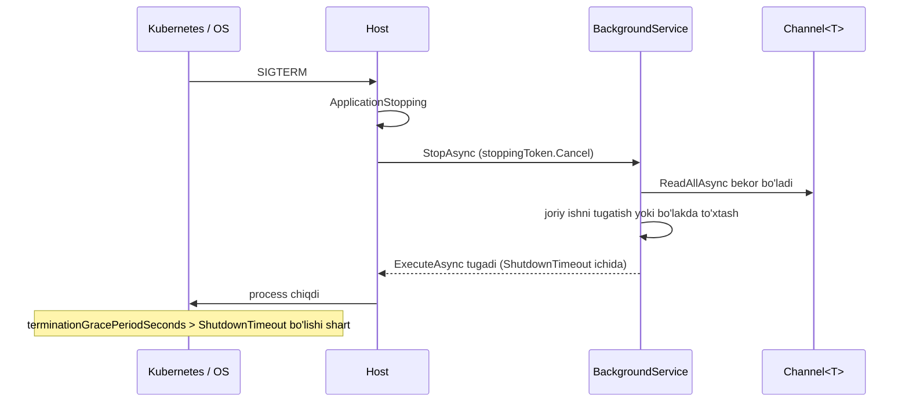

# 18. Background ishlar

> **Bir jumlada:** Hisobot generatsiya, email/SMS, tashqi tizim bilan sinxronizatsiya kabi uzoq yoki kechiktirilishi mumkin bo'lgan ishlar HTTP so'rov ichida emas, alohida fon jarayonida bajariladi; qaysi vosita (BackgroundService + Channel, Hangfire, Quartz, broker) tanlanishi ishning yo'qolishga, takrorlanishga va masshtabga bo'lgan talabiga bog'liq.
> **Nega Middle uchun:** Middle dasturchi fon ishini yozganda uch narsa uning zimmasida: ilova o'chganda ish yo'qolmasin yoki yarim qolmasin, ikki instansda ikki marta ishlamasin, xato bo'lsa cheksiz takrorlanmasin. Bu uchta talab to'g'ri bajarilmagan fon ishi production'da "tasodifiy" ikki marta ketgan SMS va yo'qolgan hisobot sifatida chiqadi.
> **O'qish vaqti:** ~40 daqiqa

## Mundarija

- [1. Muammo va yechim](#1-muammo-va-yechim)
- [2. Qanday ishlaydi](#2-qanday-ishlaydi)
- [3. Asosiy tushunchalar](#3-asosiy-tushunchalar)
  - [3.1 IHostedService va BackgroundService](#31-ihostedservice-va-backgroundservice)
  - [3.2 Channel<T>: ichki navbat](#32-channelt-ichki-navbat)
  - [3.3 Scope yaratish: IServiceScopeFactory](#33-scope-yaratish-iservicescopefactory)
  - [3.4 Graceful shutdown: StoppingToken va bo'laklash](#34-graceful-shutdown-stoppingtoken-va-bolaklash)
  - [3.5 Hangfire](#35-hangfire)
  - [3.6 Quartz.NET](#36-quartznet)
  - [3.7 Ikki instansda cron dublikati](#37-ikki-instansda-cron-dublikati)
  - [3.8 Idempotency, retry va backoff](#38-idempotency-retry-va-backoff)
  - [3.9 Job monitoring](#39-job-monitoring)
  - [3.10 Qachon broker (MassTransit) afzal](#310-qachon-broker-masstransit-afzal)
- [4. Amaliy misol](#4-amaliy-misol)
- [5. Tipik xatolar va anti-patternlar](#5-tipik-xatolar-va-anti-patternlar)
- [6. Best practices checklist](#6-best-practices-checklist)
- [7. Suhbat savollari va javoblar](#7-suhbat-savollari-va-javoblar)
- [8. Qo'shimcha manbalar](#8-qoshimcha-manbalar)

## 1. Muammo va yechim

`POST /orders/{id}/submit` ichida buyurtma saqlanadi, keyin Eskiz orqali SMS yuboriladi (1.5 s), keyin PDF hisob-faktura yaratilib S3 ga yuklanadi (4 s). Foydalanuvchi 6 soniya kutadi; Eskiz sekinlashsa 20 soniya. Birinchi "yechim": `_ = Task.Run(() => SendSmsAndPdf(order))`. Javob 200 ms ga tushdi. Keyin uch muammo: (1) deploy paytida ilova o'chganda ishlab turgan `Task.Run` yarim yo'lda uzildi, 14 mijoz SMS olmadi; (2) `Task.Run` ichida scoped `DbContext` request tugagach dispose bo'lib, `ObjectDisposedException`; (3) tashqi API xato berganda hech kim qayta urinmaydi, exception log'da ham yo'q (unobserved task).

Yechim ish turiga qarab: ilova ichida kichik navbat kerak bo'lsa `BackgroundService` + `Channel<T>` (yo'qolishga rozi bo'lgan, tez ishlar); ishning saqlanishi, qayta urinish va kuzatuv kerak bo'lsa Hangfire (bazada saqlanadi, dashboard, retry); murakkab jadval (har oyning oxirgi ish kuni) kerak bo'lsa Quartz.NET; ish bir necha servisga tegishli yoki hajm katta bo'lsa broker (MassTransit). Hammasida uch qoida: `StoppingToken` ni hurmat qilish, har ish uchun o'z DI scope'i, idempotent qayta ishlash.

## 2. Qanday ishlaydi

Generic Host (`WebApplication` ham shu) ishga tushganda ro'yxatdagi barcha `IHostedService` larning `StartAsync` ini chaqiradi (default'da ketma-ket, `HostOptions.ServicesStartConcurrently = true` bo'lsa parallel). `BackgroundService.StartAsync` `ExecuteAsync` ni chaqiradi va qaytgan `Task` ni saqlab qo'yadi; agar `ExecuteAsync` birinchi `await` gacha sinxron ishlasa, host start shu yerda bloklanadi (Kestrel hali tinglamaydi). Shuning uchun `ExecuteAsync` darhol `await` ga yetishi kerak.

O'chirish (SIGTERM, Ctrl+C, Kubernetes pod o'chirishi): host `IHostApplicationLifetime.ApplicationStopping` ni ishga tushiradi, keyin har `IHostedService.StopAsync` ni chaqiradi. `BackgroundService.StopAsync` `stoppingToken` ni bekor qiladi va `ExecuteAsync` task'ining tugashini `HostOptions.ShutdownTimeout` (default 30 s, .NET 8 gacha 5 s edi) ichida kutadi. Muddat o'tsa, host kutishni to'xtatadi va process tugaydi: ish yarim qoladi. Kubernetes'da `terminationGracePeriodSeconds` (default 30 s) shu muddatdan katta bo'lishi kerak, aks holda SIGKILL oldin keladi.



`ExecuteAsync` ichida ushlanmagan exception: .NET 6 dan `HostOptions.BackgroundServiceExceptionBehavior` default `StopHost`, ya'ni bitta worker yiqilsa butun ilova (Kestrel bilan birga) to'xtaydi. Bu ataylab: jim o'lgan worker'dan ko'ra ko'rinarli crash yaxshi. Lekin siz loop ichida har ishni `try/catch` bilan o'rab, loop'ni tirik saqlashingiz kerak.

Hangfire boshqacha ishlaydi: `BackgroundJob.Enqueue` metod chaqiruvini (tip, metod, argumentlar JSON) bazaga yozadi; `AddHangfireServer` ro'yxatdan o'tkazgan server (o'zi `IHostedService`) bazadan navbatni so'rab (polling, default 15 s; PostgreSQL'da `LISTEN/NOTIFY` bilan tezroq) ishni oladi, `Processing` holatiga o'tkazadi, DI orqali tipni yaratib metodni chaqiradi. Server o'chsa, `Processing` holatidagi ish ma'lum muddatdan keyin (invisibility timeout) boshqa server tomonidan qayta olinadi: shu yerda at-least-once va dublikat ehtimoli.

## 3. Asosiy tushunchalar

### 3.1 IHostedService va BackgroundService

- **Ta'rif:** `IHostedService` host bilan birga boshlanib, birga to'xtaydigan servis (`StartAsync`, `StopAsync`). `BackgroundService` uning abstrakt bazasi: siz faqat `ExecuteAsync(CancellationToken stoppingToken)` ni yozasiz. `IHostedLifecycleService` (.NET 8+) `StartingAsync`/`StartedAsync`/`StoppingAsync`/`StoppedAsync` qo'shimcha nuqtalar beradi.
- **Nega kerak:** Ilova hayot sikliga bog'langan uzoq ishlaydigan loop (navbat o'qish, polling, outbox worker) uchun standart joy.
- **Kod:**

```csharp
public sealed class StockSyncWorker(ILogger<StockSyncWorker> log) : BackgroundService
{
    protected override async Task ExecuteAsync(CancellationToken stoppingToken)
    {
        using var timer = new PeriodicTimer(TimeSpan.FromMinutes(5));
        // WaitForNextTickAsync bekor qilinganda OperationCanceledException emas, false qaytaradi
        while (await timer.WaitForNextTickAsync(stoppingToken))
        {
            try
            {
                await SyncAsync(stoppingToken);
            }
            catch (Exception ex) when (ex is not OperationCanceledException)
            {
                log.LogError(ex, "Stock sync xato, keyingi tick'da qayta uriniladi");
                // loop davom etadi; catch bo'lmasa host to'xtaydi (StopHost behavior)
            }
        }
    }

    private Task SyncAsync(CancellationToken ct) => Task.CompletedTask;
}

builder.Services.AddHostedService<StockSyncWorker>();
```

`PeriodicTimer` `Task.Delay` loop'idan farqi: tick ishning davomiyligini hisobga oladi (ish 2 daqiqa olsa, keyingi tick 3 daqiqadan keyin, 5 emas), va bekor qilinganda `false` qaytaradi, exception emas.

- **Tipik xato:** `ExecuteAsync` ichida `while (true) { ... }` sinxron ish bilan va `await` siz: host start bloklanadi, Kestrel tinglamaydi.

### 3.2 Channel<T>: ichki navbat

- **Ta'rif:** `System.Threading.Channels.Channel<T>` thread-safe producer/consumer navbati: bir tomonda `Writer.WriteAsync`, ikkinchi tomonda `Reader.ReadAllAsync`. Bounded (chegaralangan, to'lganda kutadi/tashlaydi) yoki unbounded.
- **Nega kerak:** HTTP so'rov ishni navbatga qo'yib darhol javob qaytaradi; `BackgroundService` navbatni o'qib bajaradi. Broker va bazasiz, bitta process ichida. Narxi: process o'chsa navbat yo'qoladi.
- **Ichida:** Bounded channel ichida `Deque<T>` va kutayotgan reader/writer'lar ro'yxati; `WriteAsync` navbat to'la bo'lsa `FullMode` ga qarab kutadi (`Wait`), eng eskisini tashlaydi (`DropOldest`) yoki yangisini (`DropWrite`). `SingleReader = true` ichki qulflarni soddalashtiradi.
- **Kod:**

```csharp
public sealed record EmailJob(Guid Id, string To, string Template, IReadOnlyDictionary<string, string> Model);

// Ro'yxat: bitta channel, yozuvchi va o'quvchi tomonlari alohida interfeys sifatida
builder.Services.AddSingleton(Channel.CreateBounded<EmailJob>(new BoundedChannelOptions(capacity: 1_000)
{
    FullMode = BoundedChannelFullMode.Wait,   // to'lganda producer kutadi: backpressure
    SingleReader = true,
    SingleWriter = false
}));
builder.Services.AddSingleton(sp => sp.GetRequiredService<Channel<EmailJob>>().Writer);
builder.Services.AddSingleton(sp => sp.GetRequiredService<Channel<EmailJob>>().Reader);

// Producer (handler ichida)
await writer.WriteAsync(new EmailJob(Guid.CreateVersion7(), customer.Email, "order-submitted", model), ct);
```

- **Tipik xato:** Unbounded channel: tashqi servis sekinlashsa navbat xotirada cheksiz o'sadi, OOM. Bounded + `Wait` producer'ni sekinlashtiradi (backpressure), bu to'g'ri xatti-harakat.

### 3.3 Scope yaratish: IServiceScopeFactory

- **Ta'rif:** `BackgroundService` singleton; `DbContext` va boshqa scoped servislar unga to'g'ridan-to'g'ri inject qilinmaydi (konteyner validation xato beradi yoki bitta `DbContext` abadiy yashaydi). Har ish uchun `IServiceScopeFactory.CreateScope()` bilan yangi scope yaratiladi.
- **Nega kerak:** `DbContext` bitta ish uchun yashashi kerak: change tracker to'planmasin, xato holat keyingi ishga o'tmasin, connection qaytarilsin.
- **Kod:**

```csharp
public sealed class EmailWorker(ChannelReader<EmailJob> reader, IServiceScopeFactory scopes, ILogger<EmailWorker> log)
    : BackgroundService
{
    protected override async Task ExecuteAsync(CancellationToken stoppingToken)
    {
        await foreach (var job in reader.ReadAllAsync(stoppingToken))
        {
            // Har ish uchun alohida scope: DbContext va IMailer yangi
            await using var scope = scopes.CreateAsyncScope();
            var mailer = scope.ServiceProvider.GetRequiredService<IMailer>();
            try
            {
                await mailer.SendAsync(job, stoppingToken);
            }
            catch (Exception ex) when (ex is not OperationCanceledException)
            {
                log.LogError(ex, "Email {JobId} yuborilmadi", job.Id);
            }
        }
    }
}
```

`CreateAsyncScope` + `await using`: scope ichidagi `IAsyncDisposable` servislar (`DbContext`) asinxron dispose bo'ladi.

- **Tipik xato:** Scope'ni `ExecuteAsync` boshida bir marta yaratib, hamma ish uchun ishlatish: `DbContext` minglab entity kuzatadi, bitta xato holat (masalan, failed `SaveChanges` dan keyin tracked entity) keyingi ishlarni ham buzadi.

### 3.4 Graceful shutdown: StoppingToken va bo'laklash

- **Ta'rif:** Graceful shutdown bu ilova to'xtash signalini olganda joriy ishni xavfsiz nuqtada tugatib, keyin chiqishi. `stoppingToken` shu signal; uni har `await` ga uzatish va uzun ishni tekshirish nuqtalari bilan bo'laklash kerak.
- **Nega kerak:** Deploy har kuni bo'ladi; har deploy'da yarim qolgan ish bu yo'qolgan SMS yoki yarim yozilgan hisobot.
- **Uzun ishni bo'laklash:** 100 000 qatorli eksportni bitta `foreach` da emas, 1 000 talik batch'larda, har batch'dan keyin progress saqlab va `stoppingToken.IsCancellationRequested` tekshirib. To'xtash kelsa, progress bazada, keyingi start davom ettiradi.
- **Kod:**

```csharp
private async Task ExportAsync(Guid exportId, CancellationToken stoppingToken)
{
    await using var scope = scopes.CreateAsyncScope();
    var db = scope.ServiceProvider.GetRequiredService<AppDbContext>();
    var export = await db.Exports.FirstAsync(e => e.Id == exportId, stoppingToken);

    while (true)
    {
        // Keyset pagination: oxirgi Id dan davom etadi; restart'da progress yo'qolmaydi
        var batch = await db.Orders.AsNoTracking()
            .Where(o => o.Id > export.LastProcessedId)
            .OrderBy(o => o.Id).Take(1_000)
            .ToListAsync(stoppingToken);
        if (batch.Count == 0) break;

        await WriteRowsAsync(export, batch, stoppingToken);
        export.LastProcessedId = batch[^1].Id;
        await db.SaveChangesAsync(CancellationToken.None);   // progress yozuvi bekor qilinmasin, u qisqa

        if (stoppingToken.IsCancellationRequested) return;   // xavfsiz nuqta: batch tugadi, progress saqlandi
    }

    export.MarkCompleted();
    await db.SaveChangesAsync(CancellationToken.None);
}
```

`SaveChangesAsync(CancellationToken.None)` progress uchun ataylab: to'xtash signali kelgan bo'lsa ham bu qisqa yozuv tugasin, aks holda bajarilgan batch'ning progress'i yo'qoladi va u qayta ishlanadi (idempotent bo'lsa zararsiz, lekin bekor ish).

- **Tipik xato:** `catch (OperationCanceledException)` ni oddiy xato deb log'ga yozib, loop'ni davom ettirish: host `ShutdownTimeout` gacha kutadi, keyin ishni o'ldiradi.

### 3.5 Hangfire

- **Ta'rif:** Bazada saqlanadigan (persisted) fon ishlar kutubxonasi: fire-and-forget, delayed, recurring (cron), continuation. Dashboard, avtomatik retry, bir necha server. Asosiy paket LGPL (bepul), Hangfire Pro (batch, Redis storage) pullik. PostgreSQL storage: `Hangfire.PostgreSql` (community).
- **Nega kerak:** Channel'dan farqli, ish bazada: ilova o'chsa ham ish turadi, boshqa instans oladi; xato bo'lsa 10 marta eksponensial retry; dashboard'da holat ko'rinadi.
- **Kod:**

```csharp
builder.Services.AddHangfire(c => c
    .SetDataCompatibilityLevel(CompatibilityLevel.Version_180)
    .UseSimpleAssemblyNameTypeSerializer()
    .UseRecommendedSerializerSettings()
    .UsePostgreSqlStorage(o => o.UseNpgsqlConnection(builder.Configuration.GetConnectionString("Hangfire"))));

builder.Services.AddHangfireServer(o =>
{
    o.WorkerCount = Environment.ProcessorCount * 2;   // bir vaqtda nechta ish
    o.Queues = ["critical", "default"];                // tartib: avval critical
    o.ServerName = $"{Environment.MachineName}:{Environment.ProcessId}";
});

var app = builder.Build();
app.MapHangfireDashboard("/hangfire", new DashboardOptions
{
    Authorization = [new RoleDashboardAuthorizationFilter("Ops")]   // IDashboardAuthorizationFilter: o'zingiz yozasiz
}).RequireAuthorization();

// Fire-and-forget: metod chaqiruvi serializatsiya qilinib bazaga yoziladi
BackgroundJob.Enqueue<IInvoiceService>(s => s.GenerateAsync(orderId, CancellationToken.None));

// Delayed: 15 daqiqadan keyin
BackgroundJob.Schedule<IReminderService>(s => s.SendCartReminderAsync(cartId, CancellationToken.None), TimeSpan.FromMinutes(15));

// Recurring: har kuni 06:00 Toshkent vaqti; "daily-report" identifikator, AddOrUpdate idempotent
RecurringJob.AddOrUpdate<IReportService>("daily-report",
    s => s.BuildDailyAsync(CancellationToken.None),
    Cron.Daily(6),
    new RecurringJobOptions { TimeZone = TimeZoneInfo.FindSystemTimeZoneById("Asia/Tashkent") });

// Continuation: oldingisi tugagach
var exportId = BackgroundJob.Enqueue<IExportService>(s => s.ExportAsync(reportId, CancellationToken.None));
BackgroundJob.ContinueJobWith<IMailer>(exportId, m => m.SendExportLinkAsync(reportId, CancellationToken.None));
```

Ichida: `Enqueue` expression'ni tahlil qilib tip nomi, metod nomi, argumentlar JSON'ini `hangfire.job` jadvaliga yozadi va `hangfire.jobqueue` ga qo'yadi. `CancellationToken.None` argumenti maxsus: Hangfire uni bajarish paytida o'z token'i (server to'xtaganda yoki ish bekor qilinganda bekor bo'ladigan) bilan almashtiradi. Ish bajarilganda DI konteynerdan `IInvoiceService` olinadi (`AspNetCoreJobActivator` har ish uchun scope yaratadi).

- **Retry:** default `[AutomaticRetry(Attempts = 10)]` eksponensial kechikish bilan; tugagach `Failed` holatida qoladi (o'chirilmaydi, dashboard'dan qayta ishga tushirish mumkin). Idempotent bo'lmagan ish uchun `Attempts = 0`.
- **Distributed lock:** `[DisableConcurrentExecution(timeoutInSeconds: 600)]` bitta metodning bir vaqtda faqat bitta nusxasi ishlashini (hamma serverlarda) storage lock orqali ta'minlaydi; 600 s ichida lock olinmasa exception. Recurring job'lar uchun scheduler o'zi storage lock bilan faqat bitta server enqueue qilishini kafolatlaydi.
- **Tipik xato:** `Enqueue(() => service.Do(bigObject))`: butun obyekt JSON bo'lib bazaga yoziladi. Faqat Id uzating, ish ichida yuklang.

### 3.6 Quartz.NET

- **Ta'rif:** Java Quartz'ning .NET porti: boy jadval (cron soniyalar bilan, kalendar istisnolari, misfire siyosati), `IJob` interfeysi, persistent store va clustering.
- **Nega kerak:** Hangfire oddiy cron uchun yetarli; "har oyning oxirgi ish kuni 18:00 da, bayramlardan tashqari" kabi jadval, yoki misfire (server o'chganda o'tkazib yuborilgan ishga qanday munosabat) nazorati kerak bo'lsa Quartz.
- **Kod:**

```csharp
builder.Services.AddQuartz(q =>
{
    q.UsePersistentStore(s =>
    {
        s.UsePostgres(builder.Configuration.GetConnectionString("Quartz")!);
        s.UseClustering();                 // ko'p instans: QRTZ_LOCKS jadvali orqali bitta instans trigger'ni oladi
        s.UseSystemTextJsonSerializer();
    });

    var key = new JobKey("monthly-settlement", "finance");
    q.AddJob<MonthlySettlementJob>(j => j.WithIdentity(key).StoreDurably());
    q.AddTrigger(t => t
        .ForJob(key)
        .WithIdentity("monthly-settlement-trigger", "finance")
        .WithCronSchedule("0 0 18 L * ?",                      // 6 maydon: sek min soat kun oy hafta; L = oyning oxirgi kuni
            c => c.InTimeZone(TimeZoneInfo.FindSystemTimeZoneById("Asia/Tashkent"))
                  .WithMisfireHandlingInstructionFireAndProceed()));   // o'tkazib yuborilgan bo'lsa darhol bir marta ishlat
});
builder.Services.AddQuartzHostedService(o => o.WaitForJobsToComplete = true);   // shutdown'da joriy ishni kutadi

[DisallowConcurrentExecution]   // bir xil JobKey parallel ishlamaydi (cluster'da ham)
public sealed class MonthlySettlementJob(ISettlementService settlement) : IJob
{
    public Task Execute(IJobExecutionContext context) =>
        settlement.RunAsync(context.FireTimeUtc, context.CancellationToken);
}
```

Quartz job'lari DI scope'ida yaratiladi (`AddQuartz` Microsoft DI bilan integratsiya), shuning uchun scoped servislarni konstruktor orqali olish mumkin.

- **Tipik xato:** Quartz cron'ni Hangfire/Unix cron deb yozish: Quartz'da 6-7 maydon (sekund bilan), `0 6 * * *` xato.

### 3.7 Ikki instansda cron dublikati

- **Ta'rif:** Ilova 2+ instansda ishlasa, har instansdagi `PeriodicTimer`/cron bir vaqtda ishga tushadi: kunlik hisobot ikki marta, SMS ikki marta.
- **Yechimlar:**
  - **Hangfire recurring:** scheduler storage'dagi distributed lock bilan faqat bitta server enqueue qiladi; ishni bitta worker oladi. Qo'shimcha ish yo'q.
  - **Quartz clustering:** `UseClustering()`, instanslar `QRTZ_LOCKS` jadvali orqali trigger'ni bo'lishadi.
  - **O'z BackgroundService + PostgreSQL advisory lock:** `pg_try_advisory_lock(key)` sessiya darajasidagi qulf; bitta instans oladi, qolganlari o'tkazib yuboradi. Redis `SET NX` ham mumkin (17-mavzu), lekin advisory lock baza bilan bir xil tranzaksiya kontekstida ishonchliroq.
  - **Leader election:** Kubernetes lease yoki alohida "scheduler" deployment (1 replica); oddiy, lekin alohida deploy birligi.
- **Kod (advisory lock):**

```csharp
public sealed class DailyReportWorker(IServiceScopeFactory scopes, ILogger<DailyReportWorker> log) : BackgroundService
{
    private const long LockKey = 4_201;   // ish turi uchun unikal son; bigint

    protected override async Task ExecuteAsync(CancellationToken stoppingToken)
    {
        using var timer = new PeriodicTimer(TimeSpan.FromMinutes(1));
        while (await timer.WaitForNextTickAsync(stoppingToken))
        {
            if (DateTimeOffset.UtcNow.Hour != 1) continue;    // 06:00 Toshkent = 01:00 UTC

            await using var scope = scopes.CreateAsyncScope();
            var db = scope.ServiceProvider.GetRequiredService<AppDbContext>();
            await using var conn = (NpgsqlConnection)db.Database.GetDbConnection();
            await conn.OpenAsync(stoppingToken);

            // Sessiya qulfi: connection ochiq ekan ushlab turiladi, yopilganda avtomatik bo'shaydi
            var acquired = await db.Database.SqlQuery<bool>($"SELECT pg_try_advisory_lock({LockKey}) AS \"Value\"")
                .FirstAsync(stoppingToken);
            if (!acquired) { log.LogDebug("Boshqa instans ishlayapti"); continue; }

            try
            {
                var reports = scope.ServiceProvider.GetRequiredService<IReportService>();
                await reports.BuildDailyAsync(DateOnly.FromDateTime(DateTime.UtcNow), stoppingToken);   // idempotent: shu sana uchun bor bo'lsa qayta yaratmaydi
            }
            finally
            {
                await db.Database.ExecuteSqlAsync($"SELECT pg_advisory_unlock({LockKey})", CancellationToken.None);
            }
        }
    }
}
```

- **Tipik xato:** `IMemoryCache` yoki `static bool _running` bilan "lock": faqat bitta process ichida ishlaydi.

### 3.8 Idempotency, retry va backoff

- **Ta'rif:** Idempotent ish: ikki marta bajarilsa natija bir xil (ikkinchi marta "allaqachon qilingan" deb chiqadi). Retry: xatoda qayta urinish; backoff: urinishlar orasidagi kutish, eksponensial (1s, 2s, 4s, 8s) va jitter bilan.
- **Nega birga:** Har qanday persisted navbat (Hangfire, broker) at-least-once: worker crash bo'lsa, ish qayta olinadi. Retry ham xuddi shunday takror bajaradi. Shuning uchun retry faqat idempotent ish uchun xavfsiz.
- **Idempotent qilish usullari:**
  - Tabiiy kalit: `invoices` jadvalida `order_id` UNIQUE; ikkinchi urinishda "bor, qaytaman".
  - Holat tekshiruvi: `if (order.InvoiceGenerated) return;` tranzaksiya ichida.
  - Tashqi tizimga idempotency key: Eskiz/Payme'ga `order_id` ni reference sifatida yuborish, ular dublikatni rad etadi.
  - Ish Id'sini `processed_jobs` jadvalida saqlash (16-mavzudagi inbox bilan bir xil).
- **Kod (Hangfire ichida idempotent + cheklangan retry):**

```csharp
public sealed class InvoiceService(AppDbContext db, IPdfRenderer pdf, IBlobStore blobs) : IInvoiceService
{
    [AutomaticRetry(Attempts = 5, DelaysInSeconds = [10, 60, 300, 900, 3600])]   // backoff: 10 s ... 1 soat
    [DisableConcurrentExecution(timeoutInSeconds: 120)]
    public async Task GenerateAsync(Guid orderId, CancellationToken ct)
    {
        var order = await db.Orders.Include(o => o.Lines).FirstAsync(o => o.Id == orderId, ct);
        if (order.InvoiceUrl is not null) return;              // idempotent: allaqachon bor

        var bytes = await pdf.RenderAsync(order, ct);
        var url = await blobs.PutAsync($"invoices/{orderId}.pdf", bytes, ct);   // bir xil nom: qayta yozish zararsiz

        order.SetInvoice(url);
        await db.SaveChangesAsync(ct);
    }
}
```

Qaysi xatoda retry qilmaslik: validation xatosi, "buyurtma topilmadi", biznes rad etishi. Bu holatlar qayta urinishdan o'zgarmaydi; ularni alohida exception tipiga ajratib, `[AutomaticRetry(OnAttemptsExceeded = AttemptsExceededAction.Delete)]` yoki Hangfire filter'da retry'ni o'chiring. Retry faqat vaqtinchalik xatolar (tarmoq, timeout, deadlock) uchun.

- **Tipik xato:** Retry'siz ham, retry bilan ham ishni "yarim idempotent" qoldirish: PDF yaratildi, S3 ga yozildi, `SaveChanges` yiqildi; qayta urinishda yana PDF yaratiladi. Bu holda zarar yo'q (bir xil fayl nomi), lekin email yuborish bo'lsa, ikkinchi email ketadi. Yon ta'sirli qadamni oxiriga qo'ying va undan oldin "yuborildi" belgisini saqlang.

### 3.9 Job monitoring

- **Ta'rif:** Fon ishlar foydalanuvchi ko'zidan yashirin; ular to'xtab qolsa hech kim darhol sezmaydi. Monitoring: ish bajarildimi, qancha vaqt oldi, nechta xato, navbat uzunligi qancha.
- **Vositalar:**
  - Hangfire dashboard: navbatlar, `Failed`, `Scheduled`, `Processing`, serverlar ro'yxati, har ishning tarixi. Lekin dashboard'ga odam qarashi kerak; alert uchun `JobStorage.Current.GetMonitoringApi().FailedCount()` ni metrikaga chiqaring.
  - Health check: `AspNetCore.HealthChecks.Hangfire` (`MaximumJobsFailed`, `MinimumAvailableServers`), yoki o'zingiz: "oxirgi muvaffaqiyatli `daily-report` 26 soatdan oshdi" degan tekshiruv.
  - Metrikalar (`System.Diagnostics.Metrics`): `jobs.processed`, `jobs.failed`, `jobs.duration` histogram, `queue.length` (Channel uchun `reader.Count`).
  - Log'da correlation: ish Id va biznes Id (orderId) har log yozuvida (`using var _ = log.BeginScope(...)`).
  - "Dead man's switch": recurring ish har bajarilganda tashqi monitoring URL'ga ping yuboradi (healthchecks.io uslubi); ping kelmasa alert.
- **Kod (Channel navbat uzunligi metrikasi):**

```csharp
builder.Services.AddSingleton(sp =>
{
    var meter = sp.GetRequiredService<IMeterFactory>().Create("Shop.Jobs");
    var reader = sp.GetRequiredService<ChannelReader<EmailJob>>();
    meter.CreateObservableGauge("email.queue.length", () => reader.Count);   // Count: bounded channel'da mavjud
    return meter;
});
```

- **Tipik xato:** Hangfire `Failed` ro'yxatini hech kim ko'rmasligi; 3 oydan keyin 12 000 ta failed ish topiladi.

### 3.10 Qachon broker (MassTransit) afzal

- **Channel<T>:** bitta process, yo'qolishga rozi (qayta hisoblash arzon: cache isitish, metrika), millisekundlik kechikish. Deploy'da navbatdagi ishlar yo'qoladi.
- **Hangfire/Quartz:** bitta ilova ichida saqlanadigan ishlar, cron, retry, dashboard; hajm soniyasiga o'nlab-yuzlab ish. Baza yuki: polling va job jadvali o'sishi (tozalash kerak).
- **Broker (MassTransit + RabbitMQ):** ish bir necha servisga tegishli (Orders yaratadi, Notifications bajaradi), hajm soniyasiga minglab, publish/subscribe (bir event, ko'p consumer), consumer'larni alohida masshtablash, outbox bilan tranzaksiya mosligi. Narxi: broker infratuzilmasi, at-least-once bilan yashash (idempotent consumer).
- **Qaror jadvali:**

| Talab | Channel | Hangfire/Quartz | Broker |
|---|---|---|---|
| Ilova o'chsa ish saqlanadi | Yo'q | Ha (baza) | Ha (broker) |
| Cron/jadval | Qo'lda | Ha | Yo'q (scheduler kerak, MassTransit scheduler bor) |
| Boshqa servis bajaradi | Yo'q | Yo'q (bitta kod bazasi) | Ha |
| Hajm | Juda yuqori (xotira) | O'rta | Yuqori |
| Retry/backoff | Qo'lda | Ha | Ha |
| Kuzatuv | Qo'lda | Dashboard | Broker UI + tracing |
| Qo'shimcha infratuzilma | Yo'q | Baza jadvallari | Broker |

Hangfire'ning MassTransit bilan kombinatsiyasi ham oddiy: Hangfire cron'i vaqtida `Publish(new DailyReportRequested())` qiladi, consumer'lar ishni bajaradi.

## 4. Amaliy misol

Buyurtma submit bo'lganda SMS (tez, yo'qolsa qayta yuborish mumkin) `Channel` orqali, hisob-faktura PDF (saqlanishi shart, retry kerak) Hangfire orqali; kunlik hisobot Hangfire recurring. Graceful shutdown va scope to'g'ri.

```csharp
// ===== Program.cs =====
builder.Services.AddDbContext<AppDbContext>(o => o.UseNpgsql(cs));

// Channel: SMS navbati
builder.Services.AddSingleton(Channel.CreateBounded<SmsJob>(new BoundedChannelOptions(2_000)
{
    FullMode = BoundedChannelFullMode.Wait, SingleReader = true
}));
builder.Services.AddSingleton(sp => sp.GetRequiredService<Channel<SmsJob>>().Writer);
builder.Services.AddSingleton(sp => sp.GetRequiredService<Channel<SmsJob>>().Reader);
builder.Services.AddHostedService<SmsWorker>();

// Hangfire: persisted ishlar
builder.Services.AddHangfire(c => c
    .SetDataCompatibilityLevel(CompatibilityLevel.Version_180)
    .UseSimpleAssemblyNameTypeSerializer()
    .UseRecommendedSerializerSettings()
    .UsePostgreSqlStorage(o => o.UseNpgsqlConnection(cs)));
builder.Services.AddHangfireServer(o => { o.WorkerCount = 8; o.Queues = ["critical", "default"]; });

builder.Services.Configure<HostOptions>(o =>
{
    o.ShutdownTimeout = TimeSpan.FromSeconds(25);   // Kubernetes terminationGracePeriodSeconds = 30 dan kichik
    o.BackgroundServiceExceptionBehavior = BackgroundServiceExceptionBehavior.StopHost;   // default, ochiq yozilgan
});

var app = builder.Build();
app.MapHangfireDashboard("/hangfire", new DashboardOptions { Authorization = [new OpsOnlyFilter()] });

// Recurring ro'yxati start'da: AddOrUpdate idempotent, har instans chaqirsa ham bitta yozuv
RecurringJob.AddOrUpdate<IReportService>("daily-report",
    s => s.BuildDailyAsync(CancellationToken.None), Cron.Daily(1));   // 01:00 UTC = 06:00 Toshkent

// ===== Command handler: ishlarni navbatga qo'yish =====
public sealed class SubmitOrderHandler(AppDbContext db, ChannelWriter<SmsJob> sms, IBackgroundJobClient jobs)
    : ICommandHandler<SubmitOrderCommand, Result>
{
    public async Task<Result> Handle(SubmitOrderCommand cmd, CancellationToken ct)
    {
        var order = await db.Orders.Include(o => o.Lines).Include(o => o.Customer)
            .FirstOrDefaultAsync(o => o.Id == cmd.OrderId, ct);
        if (order is null) return Result.NotFound("order");

        order.Submit();
        await db.SaveChangesAsync(ct);   // avval commit; keyin fon ishlar (rollback bo'lsa ish ketmasin)

        // Tez, yo'qolsa zarar kichik: Channel
        await sms.WriteAsync(new SmsJob(Guid.CreateVersion7(), order.Customer.Phone,
            $"Buyurtma #{order.Number} qabul qilindi"), ct);

        // Saqlanishi shart, retry kerak: Hangfire. Faqat Id uzatiladi.
        jobs.Enqueue<IInvoiceService>("critical", s => s.GenerateAsync(order.Id, CancellationToken.None));

        return Result.Ok();
    }
}

// ===== SMS worker =====
public sealed record SmsJob(Guid Id, string Phone, string Text);

public sealed class SmsWorker(ChannelReader<SmsJob> reader, IServiceScopeFactory scopes, ILogger<SmsWorker> log)
    : BackgroundService
{
    protected override async Task ExecuteAsync(CancellationToken stoppingToken)
    {
        await foreach (var job in reader.ReadAllAsync(stoppingToken))
        {
            using var _ = log.BeginScope(new Dictionary<string, object> { ["SmsJobId"] = job.Id });
            await using var scope = scopes.CreateAsyncScope();
            var sms = scope.ServiceProvider.GetRequiredService<ISmsGateway>();   // HttpClient resilience bilan (16-mavzu)

            try
            {
                // Eskiz'ga tashqi Id sifatida job.Id: ikki marta yuborilsa, gateway dublikatni rad etadi
                await sms.SendAsync(job.Phone, job.Text, externalId: job.Id.ToString("N"), stoppingToken);
            }
            catch (OperationCanceledException) when (stoppingToken.IsCancellationRequested)
            {
                // Shutdown: joriy SMS yo'qoladi, bu Channel tanlovining ongli narxi; log'ga yozamiz
                log.LogWarning("Shutdown paytida SMS {SmsJobId} yuborilmadi", job.Id);
                throw;
            }
            catch (Exception ex)
            {
                // Retry yo'q: SMS uchun resilience handler allaqachon 2 marta urindi; keyin voz kechamiz
                log.LogError(ex, "SMS yuborilmadi: {Phone}", Mask(job.Phone));
            }
        }
    }

    private static string Mask(string phone) => phone.Length > 4 ? $"***{phone[^4..]}" : "***";
}

// ===== Hangfire ish: idempotent, retry, lock =====
public sealed class InvoiceService(AppDbContext db, IPdfRenderer pdf, IBlobStore blobs, ILogger<InvoiceService> log) : IInvoiceService
{
    [AutomaticRetry(Attempts = 5, DelaysInSeconds = [10, 60, 300, 900, 3600])]
    [DisableConcurrentExecution(timeoutInSeconds: 120)]
    public async Task GenerateAsync(Guid orderId, CancellationToken ct)   // ct: Hangfire o'z token'ini beradi
    {
        var order = await db.Orders.Include(o => o.Lines).FirstOrDefaultAsync(o => o.Id == orderId, ct);
        if (order is null) { log.LogWarning("Order {OrderId} yo'q, ish tashlandi", orderId); return; }   // retry foydasiz
        if (order.InvoiceUrl is not null) return;                                                        // allaqachon bor

        var bytes = await pdf.RenderAsync(order, ct);
        var url = await blobs.PutAsync($"invoices/{orderId:N}.pdf", bytes, ct);
        order.SetInvoice(url);
        await db.SaveChangesAsync(ct);
    }
}
```

Nima uchun shunday:

- SMS Channel'da, PDF Hangfire'da: SMS yo'qolsa mijoz qayta so'rashi mumkin, PDF hisob-faktura moliyaviy hujjat, yo'qolishi mumkin emas. Vosita tanlovi ishning yo'qolish narxiga qarab.
- Fon ishlar `SaveChangesAsync` dan keyin navbatga qo'yiladi: commit yiqilsa SMS ketmaydi. Qarama-qarshi holat (commit o'tdi, `Enqueue` yiqildi) qoladi; bu holat muhim bo'lsa, outbox (16-mavzu) kerak.
- `jobs.Enqueue` ga faqat `order.Id`: Hangfire argumentni JSON'ga yozadi, ish bajarilganda ma'lumot yangi yuklanadi (eskirgan snapshot emas).
- `ShutdownTimeout = 25 s` Kubernetes 30 s dan kichik: SIGKILL kelishidan oldin host o'zi tugaydi.
- `DisableConcurrentExecution` retry va crash-recovery paytida bir buyurtma uchun ikki PDF generatsiyasini oldini oladi; `InvoiceUrl` tekshiruvi esa lock timeout'dan keyin ham himoya.
- Telefon raqami log'da maskalanadi: PII.

## 5. Tipik xatolar va anti-patternlar

**1. `Task.Run` fire-and-forget HTTP so'rov ichida**

```csharp
// ❌
_ = Task.Run(() => mailer.SendAsync(order));   // scoped mailer dispose bo'ladi, exception yo'qoladi, shutdown kutmaydi
```

Oqibati: `ObjectDisposedException`, kuzatilmagan exception, deploy'da yarim qolgan ish. Yechim: Channel + BackgroundService yoki Hangfire.

**2. Singleton worker'ga scoped DbContext inject**

```csharp
// ❌
public sealed class Worker(AppDbContext db) : BackgroundService { ... }   // DI validation xatosi yoki abadiy DbContext
```

Yechim: `IServiceScopeFactory`, har ish uchun scope.

**3. StoppingToken'ni e'tiborsiz qoldirish**

```csharp
// ❌
while (true) { await DoWork(); await Task.Delay(5000); }   // token yo'q: shutdown ShutdownTimeout gacha kutadi, keyin o'ldiradi
```

```csharp
// ✅
while (await timer.WaitForNextTickAsync(stoppingToken)) { await DoWork(stoppingToken); }
```

**4. Unbounded Channel**

```csharp
// ❌ Channel.CreateUnbounded<Job>()   // tashqi servis sekinlashsa xotira cheksiz o'sadi
```

Yechim: `CreateBounded` + `FullMode.Wait` (backpressure) yoki `DropOldest` (yo'qotish qabul qilinadigan metrika uchun).

**5. Hangfire'ga katta obyekt yoki closure uzatish**

```csharp
// ❌ butun order JSON bazada; closure ichidagi service serializatsiya qilinmaydi
BackgroundJob.Enqueue(() => service.Generate(order));
```

Yechim: `Enqueue<IInvoiceService>(s => s.GenerateAsync(order.Id, CancellationToken.None))`.

**6. Retry'ni idempotent bo'lmagan ishga**

```csharp
// ❌ Email yuboriladi, keyin SaveChanges yiqiladi, retry yana email yuboradi
await mailer.SendAsync(...); order.MarkNotified(); await db.SaveChangesAsync();
```

Yechim: avval "yuborilmoqda" belgisi saqlanadi (yoki tashqi idempotency key), keyin yuboriladi; yoki yon ta'sirli qadam alohida ish sifatida.

**7. Ikki instansda bir cron, lock'siz**

Oqibati: kunlik hisobot ikki marta, mijozga ikki SMS. Yechim: Hangfire recurring (lock ichida), Quartz clustering, yoki advisory lock.

**8. `ExecuteAsync` da catch'siz loop**

Oqibati: birinchi tarmoq xatosi butun ilovani (`StopHost`) to'xtatadi. Yechim: ish darajasida `try/catch`, `OperationCanceledException` dan tashqari.

## 6. Best practices checklist

- [ ] HTTP so'rov ichida faqat darhol kerak bo'lgan ish, qolgani navbatga, chunki foydalanuvchi va thread pool tashqi servis sekinligini kutmasligi kerak.
- [ ] `Task.Run` fire-and-forget hech qachon, chunki scope, exception va shutdown nazoratdan chiqadi.
- [ ] Vosita ishning yo'qolish narxiga qarab: Channel (yo'qolsa arzon), Hangfire/Quartz (saqlanishi shart), broker (ko'p servis), chunki har birining kafolati va narxi har xil.
- [ ] Har ish uchun `IServiceScopeFactory.CreateAsyncScope()`, chunki `DbContext` bitta ish davomida yashashi kerak.
- [ ] `stoppingToken` har `await` ga uzatiladi, uzun ish batch'larga bo'linib progress saqlanadi, chunki deploy har kuni va yarim ish yo'qolgan ish.
- [ ] `HostOptions.ShutdownTimeout` < `terminationGracePeriodSeconds`, chunki SIGKILL host kutishini bekor qiladi.
- [ ] Loop ichida har ish `try/catch` (`OperationCanceledException` dan tashqari), chunki ushlanmagan exception `StopHost` bilan butun ilovani to'xtatadi.
- [ ] Channel bounded, `FullMode` ongli tanlangan, chunki unbounded navbat OOM.
- [ ] Hangfire ishiga faqat Id uzatiladi, chunki argument JSON bo'lib bazada saqlanadi va eskiradi.
- [ ] Har persisted ish idempotent (tabiiy kalit, holat tekshiruvi yoki idempotency key), chunki Hangfire/broker at-least-once.
- [ ] Retry faqat vaqtinchalik xatolar uchun, cheklangan urinish va eksponensial backoff bilan, chunki "topilmadi" xatosi 10 marta takrorlansa ham o'zgarmaydi.
- [ ] Cron ishlar ko'p instansda lock bilan (Hangfire recurring, Quartz cluster, advisory lock), chunki har instans o'z timer'ini ishga tushiradi.
- [ ] Fon ishlar navbatga `SaveChanges` dan keyin qo'yiladi; "commit o'tdi, enqueue yiqildi" muhim bo'lsa outbox, chunki ikki tizimga yozish atomik emas.
- [ ] Failed ishlar soni, navbat uzunligi, oxirgi muvaffaqiyatli cron vaqti metrika va alert'da, chunki fon ish to'xtasa hech kim sezmaydi.
- [ ] Hangfire dashboard faqat ruxsatli rollar uchun, chunki undan ishni qayta ishga tushirish va o'chirish mumkin.

## 7. Suhbat savollari va javoblar

**1. Channel va Hangfire qachon?**

Channel bitta process ichidagi xotira navbati: millisekundlik kechikish, infratuzilma yo'q, lekin ilova o'chsa navbatdagi ishlar yo'qoladi va boshqa instans ularni ko'rmaydi. Yo'qolsa qayta so'rash arzon ishlar uchun: cache isitish, metrika, "iloji bo'lsa" bildirishnomalar. Hangfire ishni bazaga yozadi: ilova o'chsa ish turadi, istalgan server oladi, retry, delayed/recurring, dashboard. Moliyaviy hujjat, hisobot, tashqi tizim sinxronizatsiyasi kabi "bajarilishi shart" ishlar uchun. Narxi: baza jadvallari, polling yuki, Hangfire job jadvali o'sishi. Tuzoq: Channel'ni "tez" degani uchun muhim ish uchun tanlash; tezlik yo'qolish narxini qoplamaydi.

**2. Ikki instansda bir xil cron job ikki marta ishlamasligi uchun nima qilasiz?**

Uchta variant. Hangfire recurring: scheduler storage'da distributed lock oladi, faqat bitta server ishni enqueue qiladi, qo'shimcha kod yo'q. Quartz: `UseClustering()`, instanslar `QRTZ_LOCKS` orqali trigger'ni bo'lishadi. O'z `BackgroundService`: PostgreSQL `pg_try_advisory_lock` (yoki Redis `SET NX`) bilan bitta instans ishni oladi, qolganlari o'tkazib yuboradi; qo'shimcha himoya sifatida ish o'zi idempotent ("shu sana uchun hisobot bor bo'lsa, chiqib ketaman"). Tuzoq: `static` flag yoki `IMemoryCache` "lock" faqat bitta process ichida; va Redis lock TTL tugasa ikkinchi instans ham kiradi, shuning uchun idempotentlik baribir kerak.

**3. Job xato bersa nima bo'ladi?**

`BackgroundService` da: ushlanmagan exception `ExecuteAsync` ni tugatadi va default `BackgroundServiceExceptionBehavior.StopHost` butun ilovani to'xtatadi (jim o'lgan worker'dan ko'ra ko'rinarli crash afzal degan qaror); shuning uchun ish darajasida `try/catch`. Hangfire'da: `[AutomaticRetry]` default 10 marta eksponensial kechikish bilan qayta uriniladi, tugagach ish `Failed` holatida qoladi (o'chirilmaydi), dashboard'dan qo'lda qayta ishga tushirish mumkin. Quartz'da: `JobExecutionException` bilan `RefireImmediately` yoki trigger'ni to'xtatish; aks holda keyingi trigger vaqtida yana ishlaydi. Tuzoq: hamma xatoga retry; "topilmadi" yoki validation xatosi 10 marta takrorlanib navbatni band qiladi, bunday xatolarni retry'siz `Failed`/`Deleted` ga o'tkazish kerak.

**4. BackgroundService'da scoped servisni qanday olasiz va nega to'g'ridan-to'g'ri inject qilib bo'lmaydi?**

`BackgroundService` singleton (host bilan bir umr). Scoped `DbContext` ni unga inject qilsangiz, DI konteyner validation'da (`ValidateScopes`, Development'da default yoqilgan) xato beradi; production'da esa bitta `DbContext` abadiy yashaydi: change tracker cheksiz o'sadi, bitta xato holat keyingi ishlarga o'tadi, connection ushlab turiladi. To'g'ri yo'l: `IServiceScopeFactory` inject qilib, har ish (yoki har batch) uchun `CreateAsyncScope()`, `await using` bilan dispose. Tuzoq: scope'ni `ExecuteAsync` boshida bir marta yaratish; bu inject qilish bilan bir xil muammo.

**5. Graceful shutdown qanday ishlaydi va uzun ishni qanday to'xtatasiz?**

SIGTERM kelganda host `ApplicationStopping` ni ishga tushiradi, har `IHostedService.StopAsync` ni chaqiradi; `BackgroundService.StopAsync` `stoppingToken` ni bekor qilib `ExecuteAsync` tugashini `HostOptions.ShutdownTimeout` (default 30 s) ichida kutadi; muddat o'tsa process baribir chiqadi. Uzun ishni to'xtatish: token'ni har `await` ga uzatish (baza so'rovi, HTTP) va ishni batch'larga bo'lib, har batch'dan keyin progress saqlab, token tekshirish; keyingi start progress'dan davom etadi. Kubernetes'da `terminationGracePeriodSeconds` `ShutdownTimeout` dan katta bo'lishi shart. Tuzoq: `OperationCanceledException` ni oddiy xato kabi ushlab loop'ni davom ettirish; host kutadi, keyin ishni o'ldiradi.

**6. Hangfire ishga qanday argument uzatasiz, nega butun obyektni emas?**

`Enqueue<T>(x => x.Method(args))` expression'ni tahlil qilib, tip nomi, metod va argumentlarni JSON'ga serializatsiya qilib bazaga yozadi. Katta obyekt (butun `Order`) bazani to'ldiradi, serializatsiya xatolari (siklik havola, interfeys) beradi va ish bajarilganda eskirgan snapshot bilan ishlaydi. Faqat identifikator uzatib, ish ichida ma'lumotni yangi yuklash to'g'ri. `CancellationToken.None` argumenti maxsus: Hangfire uni bajarish paytida o'z token'i bilan almashtiradi (server to'xtasa yoki ish o'chirilsa bekor bo'ladi). Tuzoq: closure ichidagi servisni (`() => _service.Do()`) uzatish; Hangfire tipni DI orqali yaratishi uchun generic `Enqueue<IService>` ishlating.

**7. At-least-once va idempotency fon ishlarda qanday bog'langan?**

Hangfire worker ishni `Processing` holatiga o'tkazib bajaradi; worker crash bo'lsa, ish ma'lum muddatdan keyin boshqa worker tomonidan qayta olinadi. Retry ham ishni qayta bajaradi. Demak har persisted ish bir necha marta bajarilishi mumkin, bu at-least-once. Ish faqat idempotent bo'lsa bu xavfsiz: tabiiy kalit (`order_id` UNIQUE), holat tekshiruvi (`InvoiceUrl is not null`), tashqi tizimga idempotency key (SMS gateway'ga external Id). Yon ta'sirli qadam (email) oxirida va undan oldin "yuborilmoqda" belgisi. Tuzoq: `DisableConcurrentExecution` ni idempotentlik o'rniga ishlatish; u parallel bajarishni to'xtatadi, ketma-ket ikki marta bajarishni emas.

**8. Quartz.NET'ni Hangfire o'rniga qachon tanlaysiz?**

Jadval murakkab bo'lganda: soniya aniqligi, "oyning oxirgi ish kuni", kalendar istisnolari (bayramlar), bir job uchun bir necha trigger, misfire siyosati (server o'chganda o'tkazib yuborilgan trigger'ni darhol bir marta ishlatishmi, tashlab yuborishmi). Quartz bu jadval modelini beradi, Hangfire oddiy cron bilan cheklangan. Hangfire esa fire-and-forget, delayed, continuation va dashboard'da kuchliroq. Ko'p loyihalar ikkisini birga ishlatmaydi: cron sodda bo'lsa Hangfire, murakkab bo'lsa Quartz. Tuzoq: Quartz cron'i 6-7 maydon (sekund bilan), Unix cron formatini ko'chirib qo'yish xato.

**9. Fon ishni qachon broker (MassTransit) orqali qilasiz?**

Ish boshqa servisga tegishli bo'lganda (Orders chiqaradi, Notifications bajaradi), bitta event'ni bir necha consumer tinglaganda (publish/subscribe), hajm soniyasiga minglab bo'lganda, consumer'larni alohida masshtablash kerak bo'lganda va tranzaksiya mosligi (outbox) talab qilinganda. Hangfire bitta kod bazasi ichida, bitta baza ustida; broker servislar orasida. Narxi: broker infratuzilmasi, at-least-once bilan yashash. Kombinatsiya odatiy: Hangfire cron vaqtida event publish qiladi, consumer'lar bajaradi. Tuzoq: broker'ni "scheduler" sifatida ishlatish; RabbitMQ'da delayed message plugin bor, lekin cron yo'q, MassTransit scheduler (Quartz yoki Hangfire ustida) kerak.

**10. Channel bounded bo'lsa va to'lsa nima bo'ladi?**

`FullMode` ga bog'liq. `Wait` (default): `WriteAsync` navbat bo'shaguncha kutadi, bu backpressure, HTTP handler sekinlashadi, lekin xotira o'smaydi. `DropOldest`/`DropNewest`: eski yoki yangi element tashlanadi, metrika kabi yo'qotish qabul qilinadigan holatlar uchun. `DropWrite`: yangi yozuv tashlanadi, `TryWrite` false qaytaradi. `Wait` rejimida handler `ct` bilan kutadi, mijoz so'rovni bekor qilsa `WriteAsync` ham bekor bo'ladi. Tuzoq: `TryWrite` natijasini tekshirmaslik; `false` qaytsa ish jimgina yo'qoladi.

**11. Hangfire'ning ichki mexanizmi: ish qanday saqlanadi va bajariladi?**

`Enqueue` ish ma'lumotini (`InvocationData`: tip, metod, argumentlar JSON) `job` jadvaliga, holatini `state` ga (`Enqueued`), navbat yozuvini `jobqueue` ga yozadi. `AddHangfireServer` ro'yxatdan o'tkazgan server `IHostedService` sifatida ishga tushadi, `WorkerCount` ta worker `jobqueue` dan ish oladi (`FOR UPDATE SKIP LOCKED` uslubidagi fetch), holatni `Processing` ga o'tkazadi, `JobActivator` orqali DI scope'da tipni yaratib metodni chaqiradi, tugagach `Succeeded` (default 1 kundan keyin o'chiriladi) yoki retry/`Failed`. Recurring job'lar `set`/`hash` jadvallarida saqlanadi; scheduler har sekund (yoki storage signalida) ularni tekshirib, vaqti kelganini enqueue qiladi. Tuzoq: `Succeeded` ishlar tarixini uzoq saqlash (`WithJobExpirationTimeout`) jadvalni shishiradi, PostgreSQL'da vacuum yuki.

**12. Fon ishlarni qanday monitoring qilasiz?**

To'rt daraja. Hangfire dashboard: navbat, `Failed`, serverlar; lekin faqat qaralsa foyda beradi. Metrikalar: `jobs.processed`/`jobs.failed` counter'lar, `jobs.duration` histogram, navbat uzunligi gauge (`ChannelReader.Count`, Hangfire `EnqueuedCount`), OpenTelemetry orqali Prometheus/Grafana. Health check: "failed ishlar soni > N" yoki "oxirgi `daily-report` 26 soatdan oshdi". "Dead man's switch": cron ish bajarilganda tashqi monitoring'ga ping, ping kelmasa alert, bu "ish umuman ishga tushmadi" holatini ushlaydi (metrika nol bo'lsa alert bermaydi). Log'da ish Id va biznes Id scope'i, trace'ga bog'lash. Tuzoq: faqat xato metrikasi; ish ishga tushmagan bo'lsa xato ham yo'q.

## 8. Qo'shimcha manbalar

- Microsoft Learn, Background tasks with hosted services in ASP.NET Core: https://learn.microsoft.com/aspnet/core/fundamentals/host/hosted-services
- Microsoft Learn, Worker Services in .NET: https://learn.microsoft.com/dotnet/core/extensions/workers
- Microsoft Learn, System.Threading.Channels library: https://learn.microsoft.com/dotnet/core/extensions/channels
- Microsoft Learn, .NET Generic Host (HostOptions, shutdown): https://learn.microsoft.com/dotnet/core/extensions/generic-host
- Hangfire documentation: https://docs.hangfire.io/
- Hangfire.PostgreSql: https://github.com/hangfire-postgres/Hangfire.PostgreSql
- Quartz.NET documentation: https://www.quartz-scheduler.net/documentation/
- PostgreSQL, Advisory Locks: https://www.postgresql.org/docs/current/explicit-locking.html#ADVISORY-LOCKS
- Stephen Toub, An Introduction to System.Threading.Channels: https://devblogs.microsoft.com/dotnet/an-introduction-to-system-threading-channels/
- Andrew Lock, Running async tasks on app startup / BackgroundService gotchas: https://andrewlock.net/tag/background-services/
