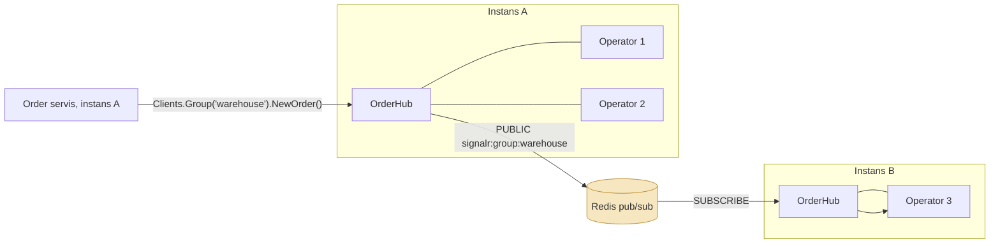

# 19. Real-time

> **Bir jumlada:** Real-time bu server o'zgarishni mijozga o'zi yuborishi (push), mijoz har 5 soniyada so'rab turishi (polling) emas; SignalR ikki tomonlama, Server-Sent Events bir tomonlama oqim beradi, ikkalasi ham ko'p instansda alohida muammolarga (backplane, reconnect, xabar yo'qolishi) duch keladi.
> **Nega Middle uchun:** Bildirishnoma, buyurtma holati, dashboard, progress bar kabi talablar har enterprise loyihada bor. Bitta instansda SignalR 20 qator; ikki instansga chiqqanda "xabar yarim foydalanuvchiga yetmaydi" va "reconnect'dan keyin xabar yo'qoldi" muammolari boshlanadi, va buni tushunmagan dasturchi polling'ga qaytadi.
> **O'qish vaqti:** ~40 daqiqa

## Mundarija

- [1. Muammo va yechim](#1-muammo-va-yechim)
- [2. Qanday ishlaydi](#2-qanday-ishlaydi)
- [3. Asosiy tushunchalar](#3-asosiy-tushunchalar)
  - [3.1 SignalR arxitekturasi: hub va transport fallback](#31-signalr-arxitekturasi-hub-va-transport-fallback)
  - [3.2 Connection lifecycle, groups va users](#32-connection-lifecycle-groups-va-users)
  - [3.3 Strongly typed hub va IHubContext](#33-strongly-typed-hub-va-ihubcontext)
  - [3.4 Auth: query string token](#34-auth-query-string-token)
  - [3.5 Backplane: Redis va Azure SignalR](#35-backplane-redis-va-azure-signalr)
  - [3.6 Scale muammolari](#36-scale-muammolari)
  - [3.7 Server-Sent Events (.NET 10)](#37-server-sent-events-net-10)
  - [3.8 SSE vs SignalR vs WebSocket](#38-sse-vs-signalr-vs-websocket)
  - [3.9 Client (JS) va reconnect strategiyasi](#39-client-js-va-reconnect-strategiyasi)
  - [3.10 Xabar yo'qolishi va Last-Event-ID](#310-xabar-yoqolishi-va-last-event-id)
- [4. Amaliy misol](#4-amaliy-misol)
- [5. Tipik xatolar va anti-patternlar](#5-tipik-xatolar-va-anti-patternlar)
- [6. Best practices checklist](#6-best-practices-checklist)
- [7. Suhbat savollari va javoblar](#7-suhbat-savollari-va-javoblar)
- [8. Qo'shimcha manbalar](#8-qoshimcha-manbalar)

## 1. Muammo va yechim

Ombor operatorlari ekranida "yangi buyurtmalar" ro'yxati bor. Frontend har 3 soniyada `GET /orders?status=new` so'raydi. 120 operator x 20 so'rov/daqiqa = daqiqasiga 2 400 so'rov, 99% hollarda javob o'zgarmagan. PostgreSQL CPU shu so'rovlarga ketyapti, yangi buyurtma esa o'rtacha 1.5 soniya kechikib ko'rinadi. Mijoz tomonida "buyurtma holati" sahifasi ham shunday polling bilan, mobil tarmoqda batareyani yeydi.

Birinchi yechim: SignalR hub, buyurtma yaratilganda `Clients.Group("warehouse").NewOrder(dto)`. Yuk daqiqasiga 2 400 dan nolga tushdi, kechikish 50 ms. Keyin ikki instansga chiqarildi: operatorlarning yarmi (ikkinchi instansga ulanganlar) xabar olmay qoldi, chunki `Clients.Group` faqat shu instansga ulangan connection'larni biladi. Redis backplane qo'shildi. Keyin deploy paytida ulanish uzildi, 10 soniya ichida kelgan 3 buyurtma operator ekranida yo'q; reconnect bo'lgan, lekin orada o'tgan xabarlar hech qayerda saqlanmagan.

Yechim uch qatlam: transport (SignalR yoki SSE) push uchun; backplane ko'p instans uchun; va xabar yo'qolishiga qarshi durable event log + "last event id" dan davom ettirish. Oxirgisi eng ko'p unutiladigan qism: transport real-time, lekin ishonchli yetkazish emas.

## 2. Qanday ishlaydi

**SignalR ulanish oqimi:**

1. Mijoz `POST /hubs/orders/negotiate` yuboradi. Server `connectionId`, `connectionToken` va qo'llab-quvvatlanadigan transport'lar ro'yxatini (`WebSockets`, `ServerSentEvents`, `LongPolling`) qaytaradi.
2. Mijoz eng yaxshi transport bilan ulanadi: WebSocket (`GET /hubs/orders?id=...` + `Upgrade: websocket`). Bo'lmasa SSE (server->mijoz oqim, mijoz->server alohida POST'lar). Bo'lmasa long polling (mijoz so'rov yuboradi, server xabar bo'lguncha ushlab turadi).
3. Handshake: mijoz protokolni (`json` yoki `messagepack`) e'lon qiladi.
4. Server har `KeepAliveInterval` (default 15 s) da ping yuboradi; mijoz `ClientTimeoutInterval` (default 30 s) ichida hech narsa olmasa ulanishni uzilgan deb hisoblaydi va reconnect boshlaydi. Server ham mijozdan 30 s xabar olmasa `OnDisconnectedAsync` chaqiradi.
5. Hub metodi chaqiruvi: `{"type":1,"target":"Watch","arguments":[42]}` kabi JSON frame; server hub instansini DI scope'da yaratadi, metodni chaqiradi, hub'ni dispose qiladi. Hub instansi har chaqiruvda yangi, unda holat saqlanmaydi.

**Backplane nima uchun kerak:**



Backplane'siz: `Clients.Group("warehouse")` instans A dagi `HubLifetimeManager` ichidagi lug'atga qaraydi, u faqat C1 va C2 ni biladi; C3 xabar olmaydi. Redis backplane `RedisHubLifetimeManager` ni o'rnatadi: har `Send` Redis kanaliga `PUBLISH`, har instans kanalga obuna, kelgan xabarni o'z lokal connection'lariga yetkazadi. Xabar hamma instansga ketadi (hatto u yerda tegishli connection bo'lmasa ham), bu backplane trafigi N instansga ko'payadi degani.

**SSE oqimi:** mijoz oddiy `GET` yuboradi, server `Content-Type: text/event-stream` bilan javobni ochiq qoldirib, `data: ...\n\n` bloklarini yozib turadi. HTTP/1.1 da bitta uzoq javob, HTTP/2 da bitta stream. Mijoz->server yo'nalishi yo'q (oddiy so'rovlar bilan). Brauzer `EventSource` uzilganda avtomatik qayta ulanadi va oxirgi `id:` ni `Last-Event-ID` header'ida yuboradi.

## 3. Asosiy tushunchalar

### 3.1 SignalR arxitekturasi: hub va transport fallback

- **Ta'rif:** Hub bu server tomonidagi sinf, uning public metodlarini mijoz chaqiradi, u esa `Clients` orqali mijoz metodlarini chaqiradi (RPC ikki tomonga). Transport bu ulanish mexanizmi: WebSocket, SSE, long polling; SignalR mavjud eng yaxshisini tanlaydi (fallback).
- **Nega kerak:** WebSocket hamma joyda ishlamaydi (eski proxy, korporativ firewall, ba'zi load balancer'lar); fallback mijoz kodini o'zgartirmasdan ishlashni ta'minlaydi. Hub abstraksiyasi frame formati, serializatsiya, keepalive, guruhlarni yashiradi.
- **Kod:**

```csharp
builder.Services.AddSignalR(o =>
{
    o.KeepAliveInterval = TimeSpan.FromSeconds(15);
    o.ClientTimeoutInterval = TimeSpan.FromSeconds(30);   // KeepAlive x 2 tavsiya
    o.MaximumReceiveMessageSize = 64 * 1024;              // mijozdan keladigan xabar limiti, default 32 KB
    o.EnableDetailedErrors = builder.Environment.IsDevelopment();   // production'da exception matni mijozga ketmasin
}).AddMessagePackProtocol();   // ixtiyoriy: binary, JSON'dan ixcham

var app = builder.Build();
app.MapHub<OrderHub>("/hubs/orders", o =>
{
    // Faqat WebSocket: sticky session kerak emas (3.6), lekin fallback yo'q
    o.Transports = HttpTransportType.WebSockets | HttpTransportType.ServerSentEvents;
});
```

- **Tipik xato:** Hub'da field'da holat saqlash (`private List<int> _watched`): hub instansi har chaqiruvda yangi, holat yo'qoladi. Holat `Context.Items` (connection davomida) yoki tashqi store'da.

### 3.2 Connection lifecycle, groups va users

- **Ta'rif:** Har ulanish `ConnectionId` ga ega (reconnect'da yangi Id). `OnConnectedAsync`/`OnDisconnectedAsync` ulanish boshlanishi va tugashi. Group bu connection'lar to'plami (nomi bo'yicha), `Groups.AddToGroupAsync(connectionId, name)`. User bu autentifikatsiya qilingan foydalanuvchi identifikatori (`Context.UserIdentifier`, default `ClaimTypes.NameIdentifier` claim'idan); `Clients.User(id)` shu foydalanuvchining hamma connection'lariga (telefon + brauzer) yuboradi.
- **Nega kerak:** Group buyurtma, tenant, rol bo'yicha yo'naltirish; User esa qurilmadan qat'i nazar shaxsga yuborish. Groups connection'ga bog'langan: reconnect'da yangi connectionId guruhda emas, mijoz qayta qo'shilishi kerak.
- **Kod:**

```csharp
[Authorize]
public sealed class OrderHub(IOrderAccessChecker access, ILogger<OrderHub> log) : Hub<IOrderClient>
{
    public override async Task OnConnectedAsync()
    {
        // Rolga qarab avtomatik guruh: ombor operatorlari hamma yangi buyurtmani ko'radi
        if (Context.User!.IsInRole("warehouse"))
            await Groups.AddToGroupAsync(Context.ConnectionId, "warehouse");
        log.LogInformation("Ulandi {ConnectionId} user {User}", Context.ConnectionId, Context.UserIdentifier);
        await base.OnConnectedAsync();
    }

    // Mijoz chaqiradi: aniq buyurtmani kuzatish. Avtorizatsiya hub metodida, chunki guruh nomi mijozdan keladi
    public async Task Watch(Guid orderId)
    {
        if (!await access.CanViewAsync(Context.User!, orderId, Context.ConnectionAborted))
            throw new HubException("Ruxsat yo'q");   // HubException matni mijozga boradi, boshqa exception'lar yo'q
        await Groups.AddToGroupAsync(Context.ConnectionId, GroupNames.Order(orderId));
    }

    public Task Unwatch(Guid orderId) =>
        Groups.RemoveFromGroupAsync(Context.ConnectionId, GroupNames.Order(orderId));

    public override Task OnDisconnectedAsync(Exception? exception)
    {
        // Guruhdan o'chirish shart emas: connection yo'qolganda guruh a'zoligi ham yo'qoladi
        if (exception is not null) log.LogWarning(exception, "Uzildi {ConnectionId}", Context.ConnectionId);
        return base.OnDisconnectedAsync(exception);
    }
}

public static class GroupNames
{
    public static string Order(Guid id) => $"order:{id:N}";
}
```

- **Tipik xato:** Guruh nomini mijozdan tekshirmasdan qabul qilish (`Watch(string groupName)`): mijoz `"admin"` guruhiga qo'shilib boshqalarning ma'lumotini oladi.

### 3.3 Strongly typed hub va IHubContext

- **Ta'rif:** `Hub<T>` da `T` mijoz metodlari interfeysi; `Clients.All.StatusChanged(...)` kompilyator tekshiradi, `SendAsync("StatusChanged", ...)` string emas. `IHubContext<THub, T>` hub tashqarisidan (servis, consumer, background worker) mijozlarga yuborish uchun.
- **Nega kerak:** Metod nomi string bo'lsa, refactoring va typo xatolari runtime'da chiqadi. `IHubContext` esa hub'ni biznes koddan chaqirishning yagona to'g'ri yo'li: hub instansini o'zingiz yaratib bo'lmaydi.
- **Kod:**

```csharp
public interface IOrderClient
{
    Task StatusChanged(OrderStatusDto status);
    Task NewOrder(OrderSummaryDto order);
    Task Progress(Guid jobId, int percent);
}

// Biznes kod (domain event handler yoki MassTransit consumer)
internal sealed class NotifyClientsOnOrderStatusChanged(IHubContext<OrderHub, IOrderClient> hub)
    : IDomainEventHandler<OrderStatusChanged>
{
    public Task Handle(OrderStatusChanged e, CancellationToken ct) =>
        hub.Clients.Group(GroupNames.Order(e.OrderId))
           .StatusChanged(new OrderStatusDto(e.OrderId, e.NewStatus.ToString(), e.OccurredAt));
}
```

`hub.Clients.Group(...).StatusChanged(...)` qaytargan `Task` xabar transport bufferiga yozilganda tugaydi, mijoz olganida emas: SignalR yetkazilganlik tasdig'ini bermaydi.

- **Tipik xato:** Mijoz metodini interfeysda `void` yoki `Task<T>` qilib e'lon qilish: faqat `Task` (yoki `ValueTask`) ruxsat, qaytish qiymati yo'q (server mijozdan natija so'rash uchun .NET 7+ da `InvokeAsync` bor, lekin u alohida API).

### 3.4 Auth: query string token

- **Ta'rif:** Brauzer WebSocket API'si custom header (Authorization) qo'ya olmaydi; SignalR JS client token'ni `access_token` query parametri bilan yuboradi (WebSocket va SSE uchun; long polling'da header). Server JWT middleware'ini shu parametrni o'qishga sozlash kerak.
- **Nega kerak:** Aks holda `[Authorize]` hub 401 beradi. Query string token log'larda ko'rinishi mumkin, shuning uchun faqat hub yo'li uchun ruxsat beriladi va access token qisqa muddatli bo'ladi.
- **Kod:**

```csharp
builder.Services.AddAuthentication(JwtBearerDefaults.AuthenticationScheme)
    .AddJwtBearer(o =>
    {
        o.Authority = builder.Configuration["Auth:Authority"];
        o.Events = new JwtBearerEvents
        {
            OnMessageReceived = ctx =>
            {
                var token = ctx.Request.Query["access_token"];
                var path = ctx.HttpContext.Request.Path;
                // Faqat hub yo'llari uchun: oddiy API'da query token qabul qilinmaydi
                if (!string.IsNullOrEmpty(token) && path.StartsWithSegments("/hubs"))
                    ctx.Token = token;
                return Task.CompletedTask;
            }
        };
    });
```

```javascript
const connection = new signalR.HubConnectionBuilder()
    .withUrl("/hubs/orders", { accessTokenFactory: () => auth.getAccessToken() })  // har reconnect'da qayta chaqiriladi
    .build();
```

Token muddati tugasa: mavjud WebSocket ulanishi uzilmaydi (auth faqat ulanishda tekshiriladi), lekin reconnect'da `accessTokenFactory` yangi token qaytarishi kerak. Uzoq ulanishlarda token eskirishini xohlamasangiz, serverda `OnConnectedAsync` da `exp` claim'iga qarab timer qo'yib `Context.Abort()` chaqiring.

- **Tipik xato:** Query string token'ni butun ilova uchun yoqish; access log'lar va proxy'lar token'ni saqlaydi.

### 3.5 Backplane: Redis va Azure SignalR

- **Ta'rif:** Backplane bu instanslar orasida hub xabarlarini tarqatuvchi kanal. Redis backplane pub/sub ishlatadi; Azure SignalR Service esa boshqa model: mijoz ulanishlarini o'zi ushlab turadi, ilova instanslari unga faqat xabar yuboradi (connection'lar ilova serverida umuman yo'q).
- **Nega kerak:** 2-bo'limdagi diagramma: `Clients.Group` lokal connection'larni biladi, boshqa instansdagilarni emas.
- **Kod:**

```csharp
// Redis backplane
builder.Services.AddSignalR()
    .AddStackExchangeRedis(builder.Configuration.GetConnectionString("Redis")!, o =>
    {
        o.Configuration.ChannelPrefix = RedisChannel.Literal("shop-signalr");   // bitta Redis'ni bir necha ilova bo'lishsa
    });

// Azure SignalR Service (Azure'da): connection'lar servisda, backplane kerak emas
// builder.Services.AddSignalR().AddAzureSignalR();   // ulanish satri Azure:SignalR:ConnectionString dan
```

Ichida (Redis): `Clients.All` -> `PUBLISH shop-signalr:all`; `Clients.Group("g")` -> `PUBLISH shop-signalr:group:g`; `Clients.Client(id)` -> `PUBLISH shop-signalr:connection:{id}`. `Groups.AddToGroupAsync` ham Redis orqali hamma instansga tarqatiladi (connection boshqa instansda bo'lishi mumkin), va `ack` kutadi. Pub/sub saqlamaydi: xabar yuborilgan paytda obuna bo'lmagan instans uni olmaydi; Redis qayta ishga tushsa, SignalR qayta obuna bo'ladi, lekin orada yuborilganlar yo'qoladi.

- **Tipik xato:** Backplane'ni "xabarlarni saqlaydi" deb tushunish; u faqat tarqatadi, yo'qolgan xabarni qayta bermaydi.

### 3.6 Scale muammolari

- **Sticky session:** Negotiate instans A da, keyingi so'rov (SSE/long polling) instans B ga tushsa, B bu connectionId ni bilmaydi, 404. Shuning uchun WebSocket bo'lmagan transport'larda load balancer sticky session (cookie affinity) talab qiladi. WebSocket'da bitta TCP ulanish bo'lgani uchun kerak emas; `skipNegotiation: true` + `transport: WebSockets` bilan negotiate ham o'tkazib yuboriladi.
- **Connection soni:** Har ulanish Kestrel'da socket, buffer va `HubConnectionContext` (o'nlab KB) xotira. Bitta instans o'n minglab ulanishni ushlaydi, lekin OS limitlari (`ulimit -n`, ephemeral port) va load balancer idle timeout (AWS ALB default 60 s, keepalive 15 s buni oldini oladi) sozlanishi kerak.
- **Backplane trafigi:** Har xabar hamma instansga ketadi. 10 instans, soniyasiga 1 000 xabar = Redis'da 10 000 yetkazish/s. Katta hajmda Azure SignalR yoki shard'lash (tenant bo'yicha alohida Redis kanal prefiksi va instans guruhi).
- **Broadcast storm:** `Clients.All` ga soniyada yuz marta yuborish har connection uchun serializatsiya va yozish. Yechim: batching (100 ms ichida to'plab bitta xabar), faqat o'zgargan qismni yuborish, guruhlarni tor qilish.
- **Deploy:** Instans o'chganda uning hamma ulanishlari uziladi va bir vaqtda reconnect qiladi (reconnect storm). JS client `withAutomaticReconnect` default kechikishlari (0, 2, 10, 30 s) buni biroz tarqatadi; serverda graceful shutdown ulanishlarni asta-sekin yopmaydi, Kubernetes'da rolling update va `maxUnavailable` bilan boshqariladi.

### 3.7 Server-Sent Events (.NET 10)

- **Ta'rif:** SSE bu HTTP ustidagi bir tomonlama (server->mijoz) matnli oqim, `text/event-stream`. .NET 10 da `TypedResults.ServerSentEvents` va `System.Net.ServerSentEvents` dagi `SseItem<T>` built-in. Brauzerda `EventSource` API avtomatik reconnect va `Last-Event-ID` bilan.
- **Nega kerak:** Bildirishnoma, progress, dashboard kabi faqat server yuboradigan holatlarda SignalR'ning negotiate, hub protokoli va backplane'i ortiqcha; SSE oddiy HTTP, har proxy va HTTP/2 bilan ishlaydi, kutubxona kerak emas.
- **Kod (to'liq misol, Last-Event-ID bilan):**

```csharp
app.MapGet("/orders/{id:guid}/events",
    (Guid id, HttpContext http, IOrderEventFeed feed, CancellationToken ct) =>
{
    // Brauzer reconnect'da oxirgi olgan id'ni yuboradi; undan keyingi event'larni replay qilamiz
    long lastId = long.TryParse(http.Request.Headers["Last-Event-ID"], out var v) ? v : 0;

    // Proxy'lar (nginx) javobni buferlamasin
    http.Response.Headers["X-Accel-Buffering"] = "no";
    http.Response.Headers.CacheControl = "no-cache";

    return TypedResults.ServerSentEvents(Stream(id, lastId, feed, ct));
}).RequireAuthorization();

static async IAsyncEnumerable<SseItem<OrderEventDto>> Stream(
    Guid orderId, long afterId, IOrderEventFeed feed, [EnumeratorCancellation] CancellationToken ct)
{
    // 1) Durable log'dan o'tkazib yuborilganlar (afterId dan keyingi)
    await foreach (var e in feed.ReplayAsync(orderId, afterId, ct))
        yield return new SseItem<OrderEventDto>(e.Payload, eventType: e.Type) { EventId = e.Id.ToString() };

    // 2) Jonli oqim: feed ichida Channel yoki Redis pub/sub; heartbeat idle timeout'ga qarshi
    await foreach (var e in feed.SubscribeAsync(orderId, ct))
    {
        yield return e is null
            ? new SseItem<OrderEventDto>(default!, eventType: "ping")   // 15 s ga bir heartbeat
            : new SseItem<OrderEventDto>(e.Payload, eventType: e.Type)
              {
                  EventId = e.Id.ToString(),
                  ReconnectionInterval = TimeSpan.FromSeconds(3)   // retry: 3000 satri, brauzer reconnect kutishi
              };
    }
}
```

Simda ko'rinishi:

```text
event: status
id: 1042
retry: 3000
data: {"orderId":"8f1c...","status":"Shipped","at":"2026-10-27T09:12:00Z"}

event: ping
data:

```

`SseItem<T>` ni `TypedResults.ServerSentEvents` JSON (System.Text.Json) bilan `data:` satriga yozadi; `string` bo'lsa matn sifatida. Har event'dan keyin `FlushAsync`, shuning uchun response buffering muammosi yo'q; lekin orada reverse proxy (nginx `proxy_buffering`, Azure App Gateway) buferlashi mumkin, `X-Accel-Buffering: no` nginx uchun.

- **Tipik xato:** Heartbeat'siz SSE: load balancer 60 s idle'dan keyin ulanishni uzadi, brauzer reconnect qiladi, bu doimiy churn. Har 15-30 s `ping` event.

### 3.8 SSE vs SignalR vs WebSocket

| Mezon | SSE | SignalR | Raw WebSocket |
|---|---|---|---|
| Yo'nalish | Server -> mijoz | Ikki tomonlama (RPC) | Ikki tomonlama (frame) |
| Protokol | HTTP, `text/event-stream` | O'z protokoli (JSON/MessagePack) WebSocket/SSE/long polling ustida | WebSocket (RFC 6455), format sizniki |
| Brauzer qo'llab-quvvatlashi | `EventSource`, built-in | JS kutubxona (`@microsoft/signalr`) | `WebSocket` API, built-in |
| Reconnect | Avtomatik, `Last-Event-ID` bilan | `withAutomaticReconnect`, .NET 8+ stateful reconnect | Qo'lda |
| Binary | Yo'q (matn, base64) | MessagePack bilan ha | Ha |
| Proxy/firewall | Oddiy HTTP, deyarli hamma joyda | Fallback bor | Ba'zi proxy'lar bloklaydi |
| Ko'p instans | O'zingiz (Redis pub/sub + durable log) | Backplane (Redis/Azure) | O'zingiz |
| Groups/users | O'zingiz | Built-in | O'zingiz |
| HTTP/1.1 limiti | Domenga 6 ta ulanish (HTTP/2 da yo'q) | WebSocket'da yo'q | Yo'q |
| Auth header | `EventSource` custom header qo'ya olmaydi (cookie yoki query, yoki `fetch` + stream) | Query token | Query token yoki cookie |
| Qachon | Bildirishnoma, progress, dashboard, log oqimi | Chat, hamkorlik, mijoz->server tez-tez chaqiruv, guruhlar | Maxsus protokol, juda yuqori hajm, binary |

### 3.9 Client (JS) va reconnect strategiyasi

- **SignalR JS:**

```javascript
import * as signalR from "@microsoft/signalr";

const connection = new signalR.HubConnectionBuilder()
    .withUrl("/hubs/orders", { accessTokenFactory: () => auth.getAccessToken() })
    .withAutomaticReconnect([0, 2000, 5000, 10000, 30000])   // kechikishlar; oxirgisidan keyin to'xtaydi (null)
    .withStatefulReconnect({ bufferSize: 100_000 })           // .NET 8+: qisqa uzilishda xabarlar buferlanadi
    .configureLogging(signalR.LogLevel.Warning)
    .build();

connection.on("StatusChanged", s => store.applyStatus(s));

connection.onreconnecting(err => ui.setOffline(true));
connection.onreconnected(async newConnectionId => {
    ui.setOffline(false);
    // Yangi connectionId guruhda emas: qayta a'zo bo'lish
    await connection.invoke("Watch", currentOrderId);
    // Uzilish davrida o'tkazib yuborilganlar: REST orqali oxirgi holatni olish (3.10)
    await store.refetchSince(store.lastEventAt);
});
connection.onclose(err => scheduleFullRestart());   // avtomatik reconnect urinishlari tugadi

await connection.start();
await connection.invoke("Watch", currentOrderId);
```

- **Reconnect strategiyasi:** eksponensial kechikish + jitter (hamma mijoz bir vaqtda qaytmasin); `onreconnected` da guruhlarga qayta qo'shilish va "orada nima o'zgardi" ni REST'dan olish; `onclose` dan keyin to'liq restart (yangi `start()`), masalan 30 s dan keyin. Token eskirgan bo'lsa `accessTokenFactory` yangisini qaytaradi.
- **Stateful reconnect (.NET 8+):** server `MapHub(..., o => o.AllowStatefulReconnects = true)` va client `withStatefulReconnect()`: qisqa tarmoq uzilishida server xabarlarni buferda (default 100 KB) saqlab, mijoz qaytganda connectionId saqlanib qolgan holda yetkazadi; guruh a'zoligi ham saqlanadi. Faqat WebSocket transport'ida va bufer limitida ishlaydi; uzoq uzilish uchun 3.10 kerak.
- **SSE JS:**

```javascript
const es = new EventSource(`/orders/${orderId}/events`, { withCredentials: true });   // cookie auth
es.addEventListener("status", ev => store.applyStatus(JSON.parse(ev.data)));
es.addEventListener("ping", () => {});                      // heartbeat, hech narsa qilmaydi
es.onerror = () => ui.setOffline(true);                     // brauzer o'zi retry: kutishi bilan qayta ulanadi, Last-Event-ID yuboradi
```

- **Tipik xato:** `onreconnected` da guruhga qayta qo'shilmaslik: ulanish tirik, lekin xabar kelmaydi, "SignalR ishlamayapti" deb hisoblanadi.

### 3.10 Xabar yo'qolishi va Last-Event-ID

- **Ta'rif:** SignalR va SSE transport darajasida "at-most-once": ulanish yo'q paytda yuborilgan xabar hech qayerda saqlanmaydi (stateful reconnect bufferi va backplane bundan mustasno emas, ular ham vaqtinchalik). Ishonchli yetkazish uchun event'lar durable log'da (jadval yoki Redis stream) monoton ortib boruvchi Id bilan saqlanadi, mijoz oxirgi olgan Id'ni eslab, qayta ulanganda shu Id'dan keyingilarini so'raydi.
- **Nega kerak:** Deploy, tarmoq uzilishi, telefon uyqu rejimi, hammasi uzilish. Buyurtma "Shipped" bo'ldi, mijoz 40 s offline edi, keyin "Delivered" keldi: "Shipped" ni ko'rmasa ham zarar yo'q (oxirgi holat yetarli), lekin "to'lov qaytarildi" xabari yo'qolsa zarar bor. Qaysi xabar yo'qolishi mumkinligi biznes qarori; yo'qolmasligi kerak bo'lgani uchun durable log.
- **Kod (durable feed):**

```csharp
public sealed record OrderEvent(long Id, Guid OrderId, string Type, OrderEventDto Payload, DateTimeOffset At);

public interface IOrderEventFeed
{
    IAsyncEnumerable<OrderEvent> ReplayAsync(Guid orderId, long afterId, CancellationToken ct);
    IAsyncEnumerable<OrderEvent?> SubscribeAsync(Guid orderId, CancellationToken ct);   // null = heartbeat
}

public sealed class OrderEventFeed(IServiceScopeFactory scopes, IConnectionMultiplexer redis) : IOrderEventFeed
{
    public async IAsyncEnumerable<OrderEvent> ReplayAsync(Guid orderId, long afterId, [EnumeratorCancellation] CancellationToken ct)
    {
        await using var scope = scopes.CreateAsyncScope();
        var db = scope.ServiceProvider.GetRequiredService<AppDbContext>();
        // order_events: bigint identity PK, (order_id, id) index; yozuvchi tomon domain event handler'da
        var rows = db.OrderEvents.AsNoTracking()
            .Where(e => e.OrderId == orderId && e.Id > afterId)
            .OrderBy(e => e.Id)
            .AsAsyncEnumerable();
        await foreach (var r in rows.WithCancellation(ct))
            yield return new OrderEvent(r.Id, r.OrderId, r.Type, JsonSerializer.Deserialize<OrderEventDto>(r.Payload)!, r.At);
    }

    public async IAsyncEnumerable<OrderEvent?> SubscribeAsync(Guid orderId, [EnumeratorCancellation] CancellationToken ct)
    {
        // Redis pub/sub: yozuvchi tomon jadvalga yozgach PUBLISH qiladi; bu faqat "yangi yozuv bor" signali
        var channel = Channel.CreateBounded<OrderEvent>(new BoundedChannelOptions(256) { FullMode = BoundedChannelFullMode.DropOldest });
        var sub = redis.GetSubscriber();
        var redisChannel = RedisChannel.Literal($"order-events:{orderId:N}");
        await sub.SubscribeAsync(redisChannel, (_, value) =>
            channel.Writer.TryWrite(JsonSerializer.Deserialize<OrderEvent>((string)value!)!));

        try
        {
            using var heartbeat = new PeriodicTimer(TimeSpan.FromSeconds(15));
            while (!ct.IsCancellationRequested)
            {
                var read = channel.Reader.WaitToReadAsync(ct).AsTask();
                var tick = heartbeat.WaitForNextTickAsync(ct).AsTask();
                var done = await Task.WhenAny(read, tick);
                if (done == tick) { yield return null; continue; }
                while (channel.Reader.TryRead(out var e)) yield return e;
            }
        }
        finally
        {
            await sub.UnsubscribeAsync(redisChannel);
        }
    }
}
```

Replay va subscribe orasidagi bo'shliq: replay tugadi, subscribe boshlanguncha yangi event yozildi. Yechim: avval subscribe, keyin replay, va mijoz tomonida Id bo'yicha dublikatni tashlash (`if (e.id <= lastId) return`). SignalR'da ham xuddi shu: `onreconnected` da `GET /orders/{id}/events?after={lastId}` chaqirib, keyin jonli oqimni davom ettirish.

- **Tipik xato:** Log'ni cheksiz saqlash; event jadvali yoki Redis stream (`XADD ... MAXLEN ~ 10000`) uchun retention siyosati kerak, undan eski Id so'ralsa mijozga "to'liq qayta yuklang" signali.

## 4. Amaliy misol

Buyurtma holati: ombor operatorlari SignalR orqali (ikki tomonlama: Watch/Unwatch, guruhlar), mijoz esa SSE orqali kuzatadi. Ikkalasi bitta durable `order_events` jadvali va Redis pub/sub ustida; ikki instansda ishlaydi.

```csharp
// ===== Program.cs =====
var redisCs = builder.Configuration.GetConnectionString("Redis")!;
builder.Services.AddSingleton<IConnectionMultiplexer>(_ => ConnectionMultiplexer.Connect(redisCs));

builder.Services.AddSignalR(o =>
{
    o.KeepAliveInterval = TimeSpan.FromSeconds(15);
    o.ClientTimeoutInterval = TimeSpan.FromSeconds(30);
}).AddStackExchangeRedis(redisCs, o => o.Configuration.ChannelPrefix = RedisChannel.Literal("shop-signalr"));

builder.Services.AddSingleton<IOrderEventFeed, OrderEventFeed>();
builder.Services.AddSingleton<IUserIdProvider, SubClaimUserIdProvider>();   // JWT "sub" claim'ini UserIdentifier qilish

builder.Services.AddAuthentication(JwtBearerDefaults.AuthenticationScheme).AddJwtBearer(o =>
{
    o.Authority = builder.Configuration["Auth:Authority"];
    o.Events = new JwtBearerEvents
    {
        OnMessageReceived = ctx =>
        {
            var token = ctx.Request.Query["access_token"];
            if (!string.IsNullOrEmpty(token) && ctx.HttpContext.Request.Path.StartsWithSegments("/hubs"))
                ctx.Token = token;
            return Task.CompletedTask;
        }
    };
});

var app = builder.Build();
app.UseAuthentication();
app.UseAuthorization();

app.MapHub<OrderHub>("/hubs/orders", o => o.AllowStatefulReconnects = true);

// SSE: mijoz uchun, cookie yoki Bearer header (fetch + ReadableStream bilan) orqali auth
app.MapGet("/orders/{id:guid}/events", OrderEventsEndpoint.Handle).RequireAuthorization("customer");

// ===== Event yozuvchi: bitta tranzaksiya (holat + event log), keyin PUBLISH =====
internal sealed class RecordAndBroadcastOrderStatus(
    AppDbContext db, IConnectionMultiplexer redis, IHubContext<OrderHub, IOrderClient> hub)
    : IDomainEventHandler<OrderStatusChanged>
{
    public async Task Handle(OrderStatusChanged e, CancellationToken ct)
    {
        var payload = new OrderEventDto(e.OrderId, e.NewStatus.ToString(), e.OccurredAt);
        var row = new OrderEventRow
        {
            OrderId = e.OrderId, Type = "status",
            Payload = JsonSerializer.Serialize(payload), At = e.OccurredAt
        };
        db.OrderEvents.Add(row);
        await db.SaveChangesAsync(ct);          // Id (bigint identity) shu yerda keladi; aggregate bilan bitta tranzaksiyada

        // Tranzaksiya commit'dan keyin bo'lishi kerak: bu handler TransactionBehavior ichida ishlasa,
        // PUBLISH ni "after commit" hook'ga ko'chiring (masalan, outbox yoki IDbContextTransaction callback)
        var evt = new OrderEvent(row.Id, row.OrderId, row.Type, payload, row.At);
        await redis.GetSubscriber().PublishAsync(
            RedisChannel.Literal($"order-events:{e.OrderId:N}"), JsonSerializer.Serialize(evt));

        // SignalR: operatorlar guruhi; backplane orqali hamma instansga
        await hub.Clients.Group(GroupNames.Order(e.OrderId)).StatusChanged(payload);
        if (e.NewStatus == OrderStatus.Submitted)
            await hub.Clients.Group("warehouse").NewOrder(new OrderSummaryDto(e.OrderId, e.OccurredAt));
    }
}

// ===== SSE endpoint (3.7 dagi bilan bir xil, alohida sinfga ajratilgan) =====
public static class OrderEventsEndpoint
{
    public static IResult Handle(Guid id, HttpContext http, IOrderEventFeed feed, IOrderAccessChecker access, CancellationToken ct)
    {
        if (!access.CanView(http.User, id)) return TypedResults.Forbid();

        long lastId = long.TryParse(http.Request.Headers["Last-Event-ID"], out var v) ? v
                    : long.TryParse(http.Request.Query["after"], out v) ? v : 0;   // birinchi ulanishda query orqali
        http.Response.Headers["X-Accel-Buffering"] = "no";
        return TypedResults.ServerSentEvents(Stream(id, lastId, feed, ct));
    }

    private static async IAsyncEnumerable<SseItem<OrderEventDto>> Stream(
        Guid orderId, long afterId, IOrderEventFeed feed, [EnumeratorCancellation] CancellationToken ct)
    {
        // Avval obuna (bo'shliq bo'lmasin), keyin replay, keyin jonli; dublikatni Id bo'yicha filtrlaymiz
        var live = feed.SubscribeAsync(orderId, ct);
        var lastSent = afterId;

        await foreach (var e in feed.ReplayAsync(orderId, afterId, ct))
        {
            lastSent = e.Id;
            yield return ToItem(e);
        }
        await foreach (var e in live)
        {
            if (e is null) { yield return new SseItem<OrderEventDto>(default!, "ping"); continue; }
            if (e.Id <= lastSent) continue;      // replay bilan ustma-ust tushgan
            lastSent = e.Id;
            yield return ToItem(e);
        }
    }

    private static SseItem<OrderEventDto> ToItem(OrderEvent e) =>
        new(e.Payload, e.Type) { EventId = e.Id.ToString(), ReconnectionInterval = TimeSpan.FromSeconds(3) };
}
```

Nima uchun shunday:

- Event avval jadvalga, keyin pub/sub ga: pub/sub yo'qolsa ham (Redis restart) mijoz reconnect'da `Last-Event-ID` bilan jadvaldan oladi. Jadval "haqiqat manbai", pub/sub faqat tezlik.
- Operatorlar uchun SignalR: ular `Watch`/`Unwatch` chaqiradi, guruh boshqaruvi va `Clients.User` kerak. Mijoz uchun SSE: faqat o'qiydi, `EventSource` reconnect va `Last-Event-ID` ni o'zi qiladi, kutubxona yo'q.
- `AllowStatefulReconnects`: operator Wi-Fi'si 5 soniya uzilsa, server buferdan yetkazadi, guruhga qayta qo'shilish kerak emas. Uzoqroq uzilishda `onreconnected` REST orqali `after={lastId}` bilan tiklaydi.
- `IUserIdProvider`: JWT'da `sub` claim bo'lib, `ClaimTypes.NameIdentifier` map bo'lmasa `Clients.User` ishlamaydi; provider buni aniq qiladi.
- `X-Accel-Buffering: no`: nginx SSE javobini buferlamasin, aks holda event'lar bir necha KB to'planguncha mijozga yetmaydi.
- PUBLISH tranzaksiya commit'dan keyin: aks holda rollback bo'lsa mijoz mavjud bo'lmagan holatni ko'radi. Pipeline'da `TransactionBehavior` bo'lsa, bu handler commit'dan keyingi bosqichga (outbox worker yoki `after commit` callback) ko'chiriladi.

## 5. Tipik xatolar va anti-patternlar

**1. Ko'p instansda backplane'siz SignalR**

```csharp
// ❌ builder.Services.AddSignalR();   // ikki instans, Redis yo'q
```

Oqibati: operatorlarning yarmi xabar olmaydi, "tasodifiy" ishlaydi. Yechim: `AddStackExchangeRedis` yoki Azure SignalR.

**2. Hub'ni to'g'ridan-to'g'ri yaratish yoki DI'dan olish**

```csharp
// ❌ var hub = new OrderHub(); await hub.Clients.All...   // Clients null
```

Yechim: `IHubContext<OrderHub, IOrderClient>`.

**3. Hub metodida uzun ish**

```csharp
// ❌ public async Task GenerateReport() { await Task.Delay(60_000); ... }   // hub chaqiruvi 60 s band
```

Oqibati: `ClientTimeoutInterval` tufayli ulanish uzilishi mumkin, hub pipeline band. Yechim: ishni navbatga (18-mavzu), natijani `Clients.Caller.Progress(...)` bilan push qilish.

**4. Mijozdan kelgan guruh nomini tekshirmaslik**

```csharp
// ❌ public Task Join(string group) => Groups.AddToGroupAsync(Context.ConnectionId, group);
```

Oqibati: har kim `"admin"` yoki boshqa tenant guruhiga qo'shiladi. Yechim: guruh nomini serverda yasash, kirishdan oldin avtorizatsiya.

**5. Reconnect'dan keyin guruhga qayta qo'shilmaslik va orada o'tganlarni olmaslik**

Oqibati: ulanish "yashil", lekin xabar yo'q; yoki 30 s uzilishda kelgan 3 holat o'zgarishi ko'rinmaydi. Yechim: `onreconnected` da `Watch` + REST `after={lastId}`; yoki stateful reconnect (qisqa uzilish uchun).

**6. SSE'da heartbeat yo'q, HTTP/1.1 da ko'p EventSource**

Oqibati: LB idle timeout'da uzadi; brauzer bir domenga 6 ta ulanish limiti (HTTP/1.1) bilan boshqa so'rovlar qotadi. Yechim: 15-30 s `ping`; HTTP/2 yoki bitta multiplexed oqim (bir EventSource, event tipi bilan ajratish).

**7. Real-time'ni "ishonchli yetkazish" deb hisoblash**

```csharp
// ❌ await hub.Clients.User(id).PaymentRefunded(dto);   // "yetdi" deb hisoblab, boshqa hech narsa qilmaslik
```

Oqibati: foydalanuvchi offline edi, muhim xabar yo'qoldi. Yechim: muhim xabar durable (jadval, bildirishnoma qutisi), push faqat "yangi narsa bor" signali.

**8. Production'da `EnableDetailedErrors = true`**

Oqibati: hub exception matni (SQL, ichki yo'llar) mijozga ketadi. Faqat `HubException` matni mijozga mo'ljallangan.

## 6. Best practices checklist

- [ ] Ko'p instansda SignalR faqat backplane (Redis/Azure SignalR) bilan, chunki `Clients.*` lokal connection'larni biladi.
- [ ] Non-WebSocket transport'lar uchun sticky session yoki faqat WebSocket + `skipNegotiation`, chunki negotiate va keyingi so'rov bir instansda bo'lishi kerak.
- [ ] Hub metodlari qisqa (millisekundlar), uzun ish navbatga, chunki hub pipeline va timeout band bo'ladi.
- [ ] Guruh nomlari serverda yasaladi, mijozdan kelgan nom avtorizatsiya qilinadi, chunki guruh bu ma'lumot chegarasi.
- [ ] `IHubContext<THub, TClient>` orqali strongly typed yuborish, string metod nomlari yo'q, chunki typo runtime'da jim yo'qoladi.
- [ ] JWT query string faqat hub yo'llari uchun, access token qisqa muddatli, chunki query log'larda qoladi.
- [ ] `KeepAliveInterval` LB idle timeout'dan kichik, `ClientTimeoutInterval` keepalive'ning 2 barobari, chunki aks holda LB ulanishni uzadi yoki mijoz noto'g'ri "uzildi" deydi.
- [ ] `EnableDetailedErrors` production'da o'chiq, mijozga faqat `HubException`, chunki ichki xato matni sizib chiqadi.
- [ ] Client `withAutomaticReconnect` + `onreconnected` da guruhga qayta qo'shilish + orada o'tganlarni REST'dan olish, chunki yangi connectionId guruhda emas va transport xabarni saqlamaydi.
- [ ] Muhim event'lar durable log'da monoton Id bilan, mijoz `Last-Event-ID`/`after` bilan davom ettiradi, chunki SignalR/SSE at-most-once.
- [ ] Replay va live orasidagi bo'shliq yopilgan (avval subscribe, keyin replay, Id bo'yicha dedupe), chunki aks holda event o'tkazib yuboriladi.
- [ ] SSE'da 15-30 s heartbeat, `X-Accel-Buffering: no`, `Cache-Control: no-cache`, chunki proxy'lar oqimni buferlaydi yoki uzadi.
- [ ] Event log uchun retention va "juda eski Id" holatida mijozga to'liq qayta yuklash signali, chunki log cheksiz o'smaydi.
- [ ] Broadcast chastotasi nazoratda (batching, faqat delta), chunki `Clients.All` soniyada yuz marta har connection uchun serializatsiya.
- [ ] Connection soni, reconnect soni, backplane latency metrikada, chunki real-time muammolari HTTP metrikalarida ko'rinmaydi.

## 7. Suhbat savollari va javoblar

**1. SignalR va WebSocket farqi nima?**

WebSocket bu transport protokoli (RFC 6455): HTTP'dan upgrade qilinadigan ikki tomonlama TCP ulanish, frame'lar formati va ma'nosi sizniki. SignalR WebSocket ustidagi (va fallback sifatida SSE/long polling ustidagi) kutubxona: hub RPC modeli (metod chaqiruvi, argumentlar), JSON/MessagePack protokoli, guruhlar va foydalanuvchilar, keepalive, avtomatik reconnect, backplane orqali ko'p instans, auth integratsiyasi. Raw WebSocket bilan bularning hammasini o'zingiz yozasiz. SignalR'ni tanlamaslik sababi: maxsus binary protokol, juda yuqori hajm, yoki .NET bo'lmagan server bilan standart WebSocket kontrakti. Tuzoq: "SignalR WebSocket'dan sekin" degan da'vo; WebSocket transport'ida qo'shimcha narx hub frame'ining bir necha bayti.

**2. Backplane nima uchun kerak?**

Har instansdagi `HubLifetimeManager` faqat o'ziga ulangan connection'larni biladi. `Clients.Group("warehouse")` instans A da chaqirilsa, B ga ulangan operatorlar xabar olmaydi. Backplane (Redis pub/sub) har yuborishni kanalga `PUBLISH` qiladi, hamma instans obuna bo'lib o'z lokal connection'lariga yetkazadi; `AddToGroup` ham shu orqali tarqaladi. Narxi: har xabar N instansga ketadi, Redis trafigi N barobar; pub/sub saqlamaydi, Redis uzilganda yuborilganlar yo'qoladi. Azure SignalR Service boshqa yondashuv: connection'lar servisda, ilova faqat xabar yuboradi, backplane kerak emas. Tuzoq: backplane'ni "message queue" deb tushunish; u yetkazish kafolati bermaydi.

**3. SSE va SignalR qachon?**

SSE: faqat server->mijoz oqim (bildirishnoma, progress, dashboard, log), oddiy HTTP, `EventSource` built-in reconnect va `Last-Event-ID` bilan, kutubxona va negotiate yo'q, .NET 10 da `TypedResults.ServerSentEvents`. Cheklovlari: matn, bir tomonlama, `EventSource` header qo'ya olmaydi (cookie yoki `fetch` + stream), HTTP/1.1 da 6 ulanish limiti. SignalR: mijoz->server tez-tez chaqiruv (chat, hamkorlik), guruh/foydalanuvchi routing, binary (MessagePack), fallback, backplane tayyor. Agar faqat push kerak bo'lsa SSE soddaroq va proxy-do'st; ikki tomonlama yoki guruh boshqaruvi kerak bo'lsa SignalR. Tuzoq: SSE'da ham ko'p instans muammosi bor; `EventSource` instans B ga reconnect qilsa, A dagi xotira holati yo'q, shuning uchun durable log + pub/sub baribir kerak.

**4. Brauzer WebSocket'da Authorization header yo'q, SignalR'da auth qanday qilinadi?**

JS client token'ni `access_token` query parametri sifatida yuboradi (WebSocket va SSE uchun; long polling'da header mumkin). Serverda `JwtBearerEvents.OnMessageReceived` da query'dan token olinib `ctx.Token` ga qo'yiladi, faqat hub yo'li (`/hubs`) uchun. `[Authorize]` hub'da ishlaydi, `Context.User` to'ldiriladi. Xavf: query string access log'larda; shuning uchun qisqa muddatli access token va faqat hub yo'li. Token eskirsa mavjud ulanish uzilmaydi (auth ulanishda tekshiriladi), reconnect'da `accessTokenFactory` yangisini beradi; uzoq ulanishlarda serverda `exp` bo'yicha `Context.Abort()` timer'i. Tuzoq: cookie auth bilan SignalR CSRF'ga ochiq bo'lishi mumkin, CORS va `SameSite` sozlamalari kerak.

**5. Reconnect'dan keyin xabar yo'qolishini qanday oldini olasiz?**

Uch daraja. Qisqa uzilish (soniyalar): .NET 8+ stateful reconnect, server xabarlarni buferda (default 100 KB) saqlab, mijoz qaytganda connectionId va guruhlar saqlangan holda yetkazadi; faqat WebSocket. O'rta/uzoq uzilish: durable event log (jadval, Redis stream) monoton Id bilan; mijoz oxirgi Id'ni saqlab, `onreconnected` da REST `after={lastId}` (SSE'da brauzer `Last-Event-ID` ni o'zi yuboradi). Muhim xabarlar: bildirishnoma qutisi jadvali, push faqat "yangi bor" signali, o'qilganlik belgisi. Replay va live orasidagi bo'shliq avval subscribe, keyin replay, Id bo'yicha dedupe bilan yopiladi. Tuzoq: `Clients.User(...).Send` qaytgan `Task` yetkazilganlikni bildirmaydi, faqat transport buferiga yozilganini.

**6. Hub instansi qanday yashaydi, unda holat saqlasa bo'ladimi?**

Hub har metod chaqiruvi (va `OnConnectedAsync`/`OnDisconnectedAsync`) uchun DI scope'da yangi yaratiladi va chaqiruvdan keyin dispose qilinadi. Shuning uchun hub field'lari holat saqlamaydi. Connection davomidagi holat `Context.Items` (connection'ga bog'langan lug'at) da, ko'p instans holati tashqi store'da (Redis, baza). Hub konstruktoriga scoped servislar (DbContext) inject qilinadi, bu to'g'ri, chunki scope chaqiruv bilan tugaydi. Tuzoq: hub'da `static` lug'at bilan "kim qaysi buyurtmani kuzatyapti" ni saqlash: ko'p instansda noto'g'ri, va xotira sizib chiqadi.

**7. Sticky session SignalR'ga qachon kerak?**

WebSocket bo'lmagan transport'larda (SSE, long polling): negotiate instans A da connectionId yaratadi, keyingi HTTP so'rov load balancer orqali B ga tushsa, B bu connectionId ni bilmaydi va 404 qaytaradi. Shuning uchun LB cookie affinity bilan bir mijozni bir instansga yopishtirishi kerak. WebSocket'da bitta TCP ulanish upgrade bo'lib, hamma trafik shu ulanishda ketadi, sticky kerak emas; `skipNegotiation: true` bilan negotiate so'rovi ham bo'lmaydi. Azure SignalR Service'da ham kerak emas (connection'lar servisda). Tuzoq: sticky session'ni yoqib "backplane kerak emas" deb o'ylash; sticky faqat bitta connection'ning so'rovlarini bir instansga yo'naltiradi, boshqa instansdagi mijozlarga xabar yuborish uchun backplane baribir kerak.

**8. `Clients.All` ga soniyada 50 marta yuborish nima bo'ladi?**

Har yuborish har connection uchun serializatsiya (protokol bo'yicha bir marta, lekin yozish har connection'ga) va backplane orqali hamma instansga `PUBLISH`. 5 000 connection x 50/s = 250 000 yozish/s, Redis'da instans soni barobar. Yechim: batching (50-100 ms oynada o'zgarishlarni to'plab bitta xabar), faqat o'zgargan qismni (delta) yuborish, guruhlarni tor qilish (hamma hamma narsani ko'rmasligi kerak), MessagePack bilan payload kichraytirish, mijoz tomonida throttling (UI 10 fps dan tez yangilanmaydi). Tuzoq: server tomonida `Task.WhenAll` bilan parallel yuborish tezlashtirmaydi, bottleneck serializatsiya va tarmoq.

**9. .NET 10 da SSE qanday yoziladi va `Last-Event-ID` ni qanday ishlatasiz?**

`TypedResults.ServerSentEvents(IAsyncEnumerable<SseItem<T>>)` minimal API'dan qaytariladi; `SseItem<T>` da `EventId`, `EventType`, `ReconnectionInterval` (brauzer `retry:` ni o'qib reconnect kutishini belgilaydi). Framework `text/event-stream` content type qo'yadi, har item'ni `event:`/`id:`/`data:` satrlariga yozib flush qiladi. Brauzer uzilganda avtomatik qayta ulanadi va oxirgi `id:` ni `Last-Event-ID` header'ida yuboradi; endpoint uni o'qib, durable log'dan shu Id'dan keyingilarini replay qiladi, keyin jonli oqimga o'tadi. Heartbeat `event: ping` 15-30 s, nginx uchun `X-Accel-Buffering: no`. Tuzoq: `IAsyncEnumerable` ichida `CancellationToken` ni `[EnumeratorCancellation]` bilan olmaslik; mijoz uzilganda loop to'xtamaydi, Redis obunasi sizib chiqadi.

**10. SignalR'da mijozga yuborilgan xabar yetganini bilish mumkinmi?**

Transport darajasida yo'q: `Clients.Client(id).Method()` qaytargan `Task` xabar yozilganini bildiradi, qabul qilinganini emas. .NET 7+ da `Clients.Client(connectionId).InvokeAsync<T>(...)` bilan server mijozdan javob so'rashi mumkin (faqat bitta connection'ga, guruhga emas), bu "ack" sifatida ishlatilishi mumkin, lekin uzilishda baribir exception. Ishonchli yetkazish ilova darajasida: durable log + mijoz "oxirgi ko'rgan Id" ni saqlashi, yoki bildirishnoma qutisi va o'qilganlik belgisi. Tuzoq: `InvokeAsync` ni hub metodi ichida o'sha chaqiruvchi mijozga qarata ishlatish deadlock beradi (mijoz javob kutyapti, server undan javob kutyapti), hujjatlar buni alohida ogohlantiradi.

**11. Keepalive va timeout sozlamalari qanday bog'langan?**

Server `KeepAliveInterval` (default 15 s) da ping yuboradi, mijoz `serverTimeoutInMilliseconds` (default 30 s) ichida hech narsa olmasa uzilgan deb hisoblaydi. Mijoz ham `keepAliveIntervalInMilliseconds` (15 s) da ping yuboradi, server `ClientTimeoutInterval` (30 s) kutadi. Qoida: timeout keepalive'ning kamida 2 barobari, aks holda bitta kechikkan ping noto'g'ri uzilish beradi. Load balancer idle timeout (AWS ALB 60 s, Azure LB 4 daqiqa) keepalive'dan katta bo'lishi kerak, aks holda LB ulanishni uzadi va mijoz doimiy reconnect qiladi. Tuzoq: mobil tarmoqda keepalive'ni 5 s ga tushirish batareya va trafikni yeydi; 15-30 s yetarli.

**12. SSE'ni ko'p instansda qanday ishlatasiz?**

SSE'da backplane tushunchasi yo'q, lekin muammo bir xil: event instans A da yuz berdi, mijoz B ga ulangan. Yechim: event yozuvchi durable log'ga yozib Redis pub/sub (yoki Redis stream, PostgreSQL `LISTEN/NOTIFY`) orqali signal beradi; har instansdagi SSE endpoint shu kanalga obuna bo'lib o'z mijozlariga yozadi. Reconnect'da mijoz `Last-Event-ID` bilan istalgan instansga tushadi va log'dan replay oladi; instans holatiga bog'liq emas, shuning uchun sticky session kerak emas. Tuzoq: pub/sub xabarining o'zini "haqiqat" deb olish; u yo'qolishi mumkin, haqiqat log'da, pub/sub faqat "tekshir" signali bo'lsa ham ishlaydi.

## 8. Qo'shimcha manbalar

- Microsoft Learn, Overview of ASP.NET Core SignalR: https://learn.microsoft.com/aspnet/core/signalr/introduction
- Microsoft Learn, Use hubs in SignalR: https://learn.microsoft.com/aspnet/core/signalr/hubs
- Microsoft Learn, Authentication and authorization in SignalR: https://learn.microsoft.com/aspnet/core/signalr/authn-and-authz
- Microsoft Learn, SignalR hosting and scaling (backplane, sticky sessions): https://learn.microsoft.com/aspnet/core/signalr/scale
- Microsoft Learn, Redis backplane for SignalR: https://learn.microsoft.com/aspnet/core/signalr/redis-backplane
- Microsoft Learn, SignalR configuration (keepalive, timeouts, stateful reconnect): https://learn.microsoft.com/aspnet/core/signalr/configuration
- Microsoft Learn, SignalR JavaScript client: https://learn.microsoft.com/aspnet/core/signalr/javascript-client
- Microsoft Learn, Server-Sent Events in minimal APIs (.NET 10): https://learn.microsoft.com/aspnet/core/fundamentals/minimal-apis/responses
- Microsoft Learn, System.Net.ServerSentEvents namespace: https://learn.microsoft.com/dotnet/api/system.net.serversentevents
- MDN, Using server-sent events: https://developer.mozilla.org/docs/Web/API/Server-sent_events/Using_server-sent_events
- Azure SignalR Service documentation: https://learn.microsoft.com/azure/azure-signalr/
