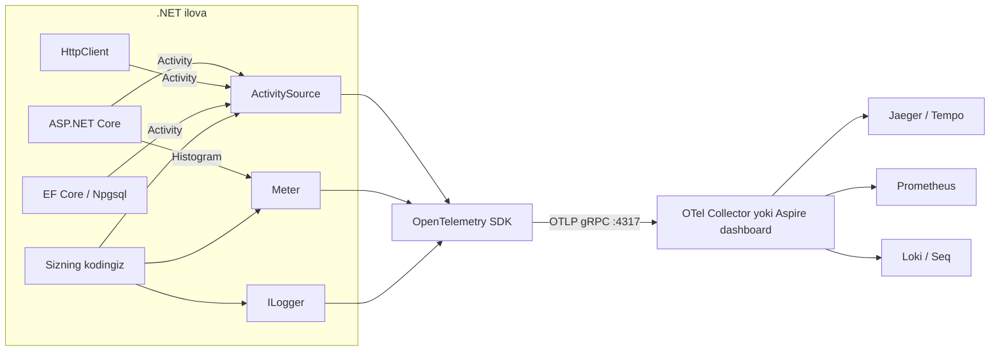

# 20. Observability

> **Bir jumlada:** Observability (kuzatuvchanlik) bu tizim ichida nima bo'layotganini tashqaridan, uni to'xtatmasdan va debugger ulamasdan tushunish qobiliyati: log, metrika va trace uchlikdan iborat.
> **Nega Middle uchun:** Production'da debugger yo'q. "Buyurtma sahifasi sekin" degan shikoyatga Middle 10 daqiqada "qaysi so'rov, qaysi SQL, qaysi servis, qancha vaqt" deb javob bera olishi kerak, "mening mashinamda tez" emas.
> **O'qish vaqti:** ~45 daqiqa

## Mundarija

- [1. Muammo va yechim](#1-muammo-va-yechim)
- [2. Qanday ishlaydi](#2-qanday-ishlaydi)
- [3. Asosiy tushunchalar](#3-asosiy-tushunchalar)
- [4. Amaliy misol](#4-amaliy-misol)
- [5. Tipik xatolar va anti-patternlar](#5-tipik-xatolar-va-anti-patternlar)
- [6. Best practices checklist](#6-best-practices-checklist)
- [7. Suhbat savollari va javoblar](#7-suhbat-savollari-va-javoblar)
- [8. Qo'shimcha manbalar](#8-qoshimcha-manbalar)

## 1. Muammo va yechim

Holat. Ombor tizimida mijoz "buyurtmani tasdiqlash tugmasi ba'zan 8-10 soniya aylanadi" deb yozdi. Jamoa quyidagilarga ega edi: `Console.WriteLine("Order saved")` uslubidagi loglar, `try/catch` ichida `logger.LogError(ex.Message)` (stack trace yo'q), va serverda `top` buyrug'i. Natija: uch kun davomida hech kim muammoni takrorlay olmadi, chunki:

- Loglar so'rovga bog'lanmagan: 40 ta parallel so'rovning satrlari aralashib ketgan, qaysi satr qaysi buyurtmaga tegishli ekani noma'lum.
- "Sekin" degan so'z o'lchanmagan: o'rtacha javob vaqti 300 ms edi, lekin har 100-so'rovdan biri 9 soniya. O'rtacha hech narsani ko'rsatmaydi.
- So'rov to'rt servisdan (API, Pricing, Stock, Payment) o'tadi. Qaysi bosqichda vaqt ketgani ko'rinmaydi.

Yechim uchta mustaqil, lekin bir-biriga bog'langan oqim:

| Ustun | Savolga javob beradi | Shakli | Asbob |
|---|---|---|---|
| Logs | Nima bo'ldi? (hodisa, kontekst bilan) | Vaqt belgili, strukturali yozuvlar | Serilog, Seq, Loki, Elastic |
| Metrics | Qancha? Qanchalik tez? Qanchalik tez-tez? | Vaqt bo'yicha agregatsiyalangan raqamlar | OpenTelemetry Meter, Prometheus, Grafana |
| Traces | Bitta so'rov qayerlardan o'tdi va har biri qancha vaqt oldi? | Span daraxti (parent/child) | ActivitySource, OTLP, Jaeger, Tempo |

Uchalasini bog'laydigan narsa correlation (bog'lash) identifikatori: `TraceId`. Trace'da sekin span ko'rinadi, o'sha `TraceId` bilan loglar filtrlanadi, metrika esa "bu bitta hodisa yoki tizimli muammo" ekanini aytadi. Yuqoridagi holatda trace Stock servisidagi `SELECT ... FOR UPDATE` 8.7 soniya kutganini ko'rsatdi; sabab boshqa fon job'ning uzun tranzaksiyasi edi. Observability'siz bu uch kun, observability bilan 15 daqiqa.

## 2. Qanday ishlaydi

.NET'da observability'ning asosi BCL'ning o'zida, kutubxonalarda emas:

- `System.Diagnostics.Activity` bu span (bitta ish birligi: HTTP so'rov, SQL buyruq, metod). `ActivitySource` ularni yaratadi. ASP.NET Core har kiruvchi so'rov uchun, `HttpClient` har chiquvchi so'rov uchun, Npgsql/EF Core har SQL buyruq uchun `Activity` ochadi. Listener (tinglovchi) bo'lmasa `StartActivity` `null` qaytaradi va hech narsa sarflanmaydi.
- `System.Diagnostics.Metrics.Meter` bu instrument'lar (Counter, Histogram, Gauge) fabrikasi. ASP.NET Core 8+ `http.server.request.duration` histogram'ini, runtime esa GC va thread pool metrikalarini shu orqali chiqaradi.
- `Microsoft.Extensions.Logging.ILogger` bu log API. Provider'lar (Console, Serilog, OpenTelemetry) unga ulanadi.

OpenTelemetry (OTel) SDK bu uchta manbaga ulanadi, ma'lumotni standart formatga (OTLP, OpenTelemetry Protocol) o'giradi va eksport qiladi. Protokol standart bo'lgani uchun backend (Jaeger, Tempo, Prometheus, Seq, Datadog) almashtirilganda kod o'zgarmaydi.



So'rov chegaradan o'tganda kontekst `traceparent` header orqali uzatiladi (W3C Trace Context standarti):

```
traceparent: 00-4bf92f3577b34da6a3ce929d0e0e4736-00f067aa0ba902b7-01
             │  │                                │                │
             │  trace-id (16 bayt, hex)          span-id (8 bayt) flags (01 = sampled)
             versiya
```

`HttpClient` chiquvchi so'rovga bu header'ni avtomatik qo'shadi (`DistributedContextPropagator` orqali), ASP.NET Core kiruvchi so'rovdan o'qiydi va yangi `Activity`'ni o'sha `TraceId` bilan, `ParentSpanId` sifatida kelgan span-id bilan ochadi. Shuning uchun to'rt servisdagi span'lar bitta daraxtga yig'iladi. Xabar brokerlari (RabbitMQ, Kafka) uchun header'ni kutubxona (MassTransit) yoki siz qo'lda message header'iga yozasiz.

Log bilan bog'lanish: `ILogger` provider'i yozuv paytida `Activity.Current`'ni o'qiydi va `TraceId`, `SpanId`'ni yozuvga qo'shadi. ASP.NET Core'da bu `ActivityTrackingOptions` orqali default yoqilgan (`TraceId | SpanId | ParentId`). Serilog 4 `LogEvent.TraceId` maydonini o'zi to'ldiradi.

## 3. Asosiy tushunchalar

### 3.1 Structured logging (strukturali log)

- Ta'rif: log yozuvi matn emas, nomlangan maydonlar to'plami: `{ "Message": "Order 42 created", "OrderId": 42, "CustomerId": 7, "TraceId": "4bf9..." }`.
- Nega kerak: matnli logda `grep "Order 42"` "Order 420" ni ham topadi, "mijoz 7 ning barcha buyurtmalari" degan so'rovni berib bo'lmaydi. Strukturali logda Seq/Loki `OrderId = 42` deb filtrlaydi, maydonlar bo'yicha agregatsiya qiladi.
- Mexanizm: `logger.LogInformation("Order {OrderId} created", order.Id)` chaqirilganda template (`"Order {OrderId} created"`) va argumentlar massivi alohida saqlanadi. Provider maydonlarni nomi bilan yozadi; matn faqat ko'rsatish uchun render qilinadi. Log level o'chirilgan bo'lsa, render umuman bo'lmaydi.

```csharp
// To'g'ri: template va argumentlar alohida, OrderId maydon bo'lib ketadi
logger.LogInformation("Order {OrderId} created for customer {CustomerId}", order.Id, order.CustomerId);

// Noto'g'ri: interpolation. Xabar avval satrga aylanadi, struktura yo'qoladi,
// Information o'chirilgan bo'lsa ham satr formatlanadi (allokatsiya bekorga)
logger.LogInformation($"Order {order.Id} created for customer {order.CustomerId}");
```

- Tipik xato: `{0}` yoki `{}` kabi pozitsion nomlar. Maydon nomi `0` bo'ladi, qidirib bo'lmaydi. Nomlar PascalCase, ma'noli, loyihada bir xil (`OrderId`, `orderId` emas).

### 3.2 Log level'lar

- Ta'rif: `Trace < Debug < Information < Warning < Error < Critical`. Level yozuvning kimga va qachon kerakligini bildiradi.
- Nega kerak: production'da `Information` yoki `Warning` darajasi yoqiladi; pastroq level'dagi chaqiruvlar `IsEnabled` tekshiruvida to'xtaydi va qimmat emas. Level noto'g'ri tanlansa, yoki muhim hodisa yo'qoladi, yoki log oqimi shovqinga to'ladi.

| Level | Qachon | Misol |
|---|---|---|
| Trace | Faqat lokal debugging, har bir qadam | So'rov body'si, SQL parametrlar |
| Debug | Ishlab chiqish, diagnostika | Cache hit/miss, retry raqami |
| Information | Biznes hodisa, so'rov yakuni | Buyurtma yaratildi, to'lov tasdiqlandi |
| Warning | Kutilmagan, lekin tizim davom etadi | Retry, tashqi API sekin, kesh ishlamadi |
| Error | Operatsiya bajarilmadi, odam qarashi kerak | To'lov provayderi 500 qaytardi |
| Critical | Tizim ishlamayapti | Baza ulanib bo'lmaydi, startup xato |

```json
// appsettings.Production.json: namespace bo'yicha nozik sozlash
{
  "Logging": {
    "LogLevel": {
      "Default": "Information",
      "Microsoft.AspNetCore": "Warning",
      "Microsoft.EntityFrameworkCore.Database.Command": "Warning",
      "Warehouse.Orders": "Debug"
    }
  }
}
```

- Tipik xato: validatsiya xatosini (`400`) `Error` deb yozish. Mijoz noto'g'ri ma'lumot kiritdi, bu tizim xatosi emas; alert'lar shovqinga to'ladi. Validatsiya `Information` yoki umuman log emas (metrika yetarli).

### 3.3 Log scopes (ko'lam)

- Ta'rif: `BeginScope` ichida yozilgan barcha loglarga avtomatik qo'shiladigan maydonlar to'plami.
- Nega kerak: `OrderId`'ni 15 ta log chaqiruvining har biriga qo'lda uzatish o'rniga bir marta scope ochiladi.

```csharp
using (logger.BeginScope(new Dictionary<string, object> { ["OrderId"] = orderId, ["TenantId"] = tenantId }))
{
    logger.LogInformation("Reserving stock");          // OrderId va TenantId avtomatik qo'shiladi
    await stock.ReserveAsync(orderId, ct);
    logger.LogInformation("Stock reserved");
}
```

Serilog'da buning ekvivalenti `LogContext.PushProperty`. Middleware darajasida `TenantId`, `UserId`'ni scope'ga qo'yish standart amaliyot. Console provider'da scope'lar faqat `IncludeScopes = true` bo'lsa chiqadi; Serilog'da `Enrich.FromLogContext()` kerak.

### 3.4 LoggerMessage source generator

- Ta'rif: `[LoggerMessage]` atributi bilan belgilangan `partial` metod uchun kompilyator log kodini generatsiya qiladi.
- Nega kerak: `LogInformation(string, params object[])` har chaqiruvda `object[]` massiv yaratadi va value type'larni box qiladi. Generator buni oldindan tayyorlangan delegate'ga aylantiradi: level o'chirilgan bo'lsa nol allokatsiya, yoqilgan bo'lsa box yo'q. Shuningdek, xabar template'lari bir joyda, `EventId` doimiy.

```csharp
public static partial class OrderLogs
{
    [LoggerMessage(EventId = 1001, Level = LogLevel.Information,
        Message = "Order {OrderId} created for customer {CustomerId}, total {Total} UZS")]
    public static partial void OrderCreated(this ILogger logger, Guid orderId, Guid customerId, decimal total);

    [LoggerMessage(EventId = 1002, Level = LogLevel.Warning,
        Message = "Stock reservation for {OrderId} retried, attempt {Attempt}")]
    public static partial void StockReservationRetried(this ILogger logger, Guid orderId, int attempt);
}

// Ishlatish:
logger.OrderCreated(order.Id, order.CustomerId, order.Total);
```

Kompilyator generatsiya qiladigan kod taxminan: `private static readonly Action<ILogger, Guid, Guid, decimal, Exception?> __OrderCreatedCallback = LoggerMessage.Define<Guid, Guid, decimal>(LogLevel.Information, new EventId(1001, nameof(OrderCreated)), "Order {OrderId} ...")` va metod tanasida `if (logger.IsEnabled(LogLevel.Information)) __OrderCreatedCallback(logger, orderId, customerId, total, null);`.

- Tipik xato: exception'ni template argumenti sifatida uzatish. Metod parametrlaridan `Exception` tipidagisi generator tomonidan avtomatik exception sifatida olinadi, template'ga `{Exception}` yozish shart emas.

### 3.5 Serilog sozlash va sink'lar

- Ta'rif: Serilog bu structured logging kutubxonasi; sink bu log chiqadigan joy (Console, File, Seq, Loki, Elastic). `Serilog.AspNetCore` paketi uni `ILogger` provider'i sifatida ulaydi.
- Nega kerak: Microsoft Console provider JSON chiqara oladi, lekin enricher'lar, sink'larga batching, dinamik filtrlash va `appsettings` orqali to'liq sozlash Serilog'da pishiqroq.

```csharp
// Program.cs
builder.Host.UseSerilog((context, services, cfg) => cfg
    .ReadFrom.Configuration(context.Configuration)   // appsettings "Serilog" bo'limi
    .ReadFrom.Services(services)                      // DI'dan enricher'lar
    .Enrich.FromLogContext()                          // PushProperty / BeginScope maydonlari
    .Enrich.WithProperty("Service", "orders-api")
    .Enrich.WithProperty("Version", typeof(Program).Assembly.GetName().Version?.ToString() ?? "dev")
    .WriteTo.Console(new Serilog.Formatting.Compact.CompactJsonFormatter()) // konteynerda stdout JSON
    .WriteTo.Seq(context.Configuration["Seq:Url"] ?? "http://localhost:5341"));

var app = builder.Build();

// Har so'rov uchun bitta yozuv: metod, yo'l, status, davomiylik. Default ASP.NET Core 4-5 yozuvi o'rniga.
app.UseSerilogRequestLogging(o =>
{
    o.EnrichDiagnosticContext = (diag, http) =>
    {
        diag.Set("TenantId", http.User.FindFirst("tenant")?.Value);
        diag.Set("ClientIp", http.Connection.RemoteIpAddress?.ToString());
    };
});
```

Sink tanlash: Seq bu bitta konteynerli, kuchli so'rov tiliga ega server (kichik va o'rta jamoalar uchun eng tez start). Grafana Loki bu Prometheus uslubida label'lar bo'yicha indekslaydi, arzon saqlaydi, Grafana'da trace bilan yonma-yon ko'rsatadi (`Serilog.Sinks.Grafana.Loki`). Konteyner muhitida eng barqaror yo'l: stdout'ga JSON yozish, yig'ishni (Promtail, Fluent Bit, OTel Collector) platformaga qoldirish. Ilova ichidan to'g'ridan-to'g'ri tarmoq sink'iga yozish ilovani log backend'iga bog'laydi.

- Tipik xato: `WriteTo.File` konteynerda. Konteyner o'chsa fayl yo'qoladi, disk to'lsa ilova yiqiladi.

### 3.6 OpenTelemetry: ActivitySource va custom span

- Ta'rif: `ActivitySource` nomlangan span manbai; `StartActivity` ochilgan `Activity` `Dispose` bo'lganda yakunlanadi va eksport qilinadi.
- Nega kerak: avtomatik instrumentatsiya HTTP va SQL chegaralarini ko'rsatadi, lekin "narx hisoblash 3 soniya oldi" degan ichki bosqich ko'rinmaydi. Custom span shu bo'shliqni to'ldiradi.

```csharp
public static class Telemetry
{
    // Nom: OTel'da "tracer name". Shu nom bilan AddSource() qilinadi.
    public static readonly ActivitySource Source = new("Warehouse.Orders", "1.0.0");
}

public sealed class PricingService(IPriceRepository prices)
{
    public async Task<Money> CalculateAsync(Order order, CancellationToken ct)
    {
        // Listener yo'q bo'lsa null qaytadi; ?. tufayli xarajat nol
        using var activity = Telemetry.Source.StartActivity("pricing.calculate");
        activity?.SetTag("order.id", order.Id);
        activity?.SetTag("order.lines", order.Lines.Count);

        try
        {
            var total = await prices.ComputeAsync(order, ct);
            activity?.SetTag("order.total", (double)total.Amount);
            return total;
        }
        catch (Exception ex)
        {
            // Status Error bo'lsa Jaeger/Tempo span'ni qizil ko'rsatadi
            activity?.SetStatus(ActivityStatusCode.Error, ex.Message);
            activity?.AddException(ex);   // .NET 9+ API: exception event sifatida yoziladi
            throw;
        }
    }
}
```

- Tipik xato: tag'ga yuqori kardinallikdagi qiymat (to'liq SQL, body, email) yozish. Trace backend'i indekslaydi, hajm va narx o'sadi, PII oqadi.

### 3.7 OpenTelemetry: Meter va custom metrika

- Ta'rif: `Meter` metrik instrument'lar fabrikasi. `Counter<T>` faqat o'sadi (yaratilgan buyurtmalar), `Histogram<T>` taqsimotni o'lchaydi (davomiylik, summa), `ObservableGauge<T>` oniy qiymatni so'raganda o'qiydi (navbat uzunligi).
- Nega kerak: trace har so'rovni ko'rsatadi, lekin "so'nggi 5 daqiqada daqiqasiga nechta buyurtma, p95 qancha" degan savolga faqat metrika arzon javob beradi (sampling'siz, agregatsiyalangan).

```csharp
public sealed class OrderMetrics
{
    private readonly Counter<long> _created;
    private readonly Histogram<double> _checkoutDuration;

    public OrderMetrics(IMeterFactory factory)   // DI orqali, Meter'ni to'g'ridan-to'g'ri new qilmang
    {
        var meter = factory.Create("Warehouse.Orders");
        _created = meter.CreateCounter<long>("orders.created", unit: "{order}",
            description: "Yaratilgan buyurtmalar soni");
        _checkoutDuration = meter.CreateHistogram<double>("orders.checkout.duration", unit: "s",
            description: "Checkout bosqichi davomiyligi");
    }

    // Tag'lar: past kardinallik (tenant, payment provider), ID'lar emas
    public void OrderCreated(string tenant, string paymentProvider) =>
        _created.Add(1, new KeyValuePair<string, object?>("tenant", tenant),
                        new KeyValuePair<string, object?>("payment.provider", paymentProvider));

    public void CheckoutCompleted(double seconds, string tenant) =>
        _checkoutDuration.Record(seconds, new KeyValuePair<string, object?>("tenant", tenant));
}
```

Histogram ichida nima bor: qiymatlar saqlanmaydi, bucket'lar (chegaralar) bo'yicha hisoblagichlar: `≤0.005, ≤0.01, ..., ≤10`. Prometheus `histogram_quantile(0.95, ...)` shu bucket'lardan p95'ni taxminan hisoblaydi. Default chegaralar sekundga mo'ljallangan; millisekund yozsangiz hammasi oxirgi bucket'ga tushadi va p95 ma'nosiz bo'ladi. Birlikni `s` qiling yoki OTel View bilan chegaralarni o'zgartiring.

- Tipik xato: metrikaga `order.id` tag'i. Har buyurtma yangi time series; Prometheus xotirasi tugaydi (cardinality explosion).

### 3.8 OTLP exporter va backend'lar

- Ta'rif: OTLP bu OpenTelemetry'ning tarmoq protokoli (gRPC `:4317`, HTTP/protobuf `:4318`). Exporter batch'lab yuboradi.
- Nega kerak: bitta exporter, istalgan backend.

```csharp
// Paketlar: OpenTelemetry.Extensions.Hosting, OpenTelemetry.Instrumentation.AspNetCore,
// OpenTelemetry.Instrumentation.Http, OpenTelemetry.Instrumentation.Runtime,
// OpenTelemetry.Exporter.OpenTelemetryProtocol, Npgsql.OpenTelemetry
builder.Services.AddOpenTelemetry()
    .ConfigureResource(r => r.AddService("orders-api", serviceVersion: "1.4.0",
                                          serviceInstanceId: Environment.MachineName))
    .WithTracing(t => t
        .AddSource("Warehouse.Orders")             // bizning ActivitySource
        .AddAspNetCoreInstrumentation(o =>
        {
            o.Filter = ctx => !ctx.Request.Path.StartsWithSegments("/health"); // probe'larni trace qilmang
            o.RecordException = true;
        })
        .AddHttpClientInstrumentation()
        .AddNpgsql()                               // SQL span'lar (Npgsql.OpenTelemetry)
        .AddOtlpExporter())                        // OTEL_EXPORTER_OTLP_ENDPOINT env'dan o'qiydi
    .WithMetrics(m => m
        .AddMeter("Warehouse.Orders")
        .AddAspNetCoreInstrumentation()            // http.server.request.duration
        .AddHttpClientInstrumentation()
        .AddRuntimeInstrumentation()               // GC, thread pool, exception soni
        .AddOtlpExporter());

// Log'larni ham OTLP orqali yuborish (Serilog o'rniga yoki u bilan birga)
builder.Logging.AddOpenTelemetry(o =>
{
    o.IncludeScopes = true;
    o.IncludeFormattedMessage = true;
    o.AddOtlpExporter();
});
```

Backend'lar: Jaeger va Grafana Tempo trace saqlaydi (Tempo arzon, object storage'da). Prometheus metrikani pull qiladi (OTel Collector `prometheus` exporter orqali yoki `OpenTelemetry.Exporter.Prometheus.AspNetCore` bilan `/metrics` endpoint). Grafana hammasini bitta oynada ko'rsatadi; Loki log satridagi `TraceId`'dan Tempo'ga, Tempo span'idan Loki'ga o'tish ("exemplars", "derived fields") sozlanadi.

Endpoint konfiguratsiyasi env orqali: `OTEL_EXPORTER_OTLP_ENDPOINT=http://otel-collector:4317`, `OTEL_SERVICE_NAME=orders-api`, `OTEL_RESOURCE_ATTRIBUTES=deployment.environment=prod`. Kodda hardcode qilmang.

.NET 11 (RC2, GA 2026-noyabr) ASP.NET Core'ning o'zida trace instrumentatsiyasini kengaytiradi va `Microsoft.Extensions.Diagnostics` da `Activity` tracing'ni qoidalar bilan deklarativ sozlash imkonini beradi; shuningdek `MemoryCache` uchun built-in OpenTelemetry metrikalari keladi. .NET 10 da hali `OpenTelemetry.Instrumentation.AspNetCore` paketi kerak.

### 3.9 Health checks: liveness va readiness

- Ta'rif: liveness "jarayon tirikmi?" (yo'q bo'lsa restart), readiness "trafik qabul qila oladimi?" (yo'q bo'lsa load balancer'dan chiqar, restart qilma).
- Nega kerak: baza 30 soniya ulanmasa readiness yiqiladi, pod trafikdan chiqadi, baza qaytgach qaytadi. Agar bu liveness bo'lsa, Kubernetes barcha pod'larni bir vaqtda restart qiladi va baza qaytganda uni restart bo'roni kutib oladi.

```csharp
// Paketlar: AspNetCore.HealthChecks.NpgSql, AspNetCore.HealthChecks.Redis, AspNetCore.HealthChecks.Rabbitmq
builder.Services.AddHealthChecks()
    .AddNpgSql(connString, name: "postgres", tags: ["ready"], timeout: TimeSpan.FromSeconds(3))
    .AddRedis(redisConn, name: "redis", tags: ["ready"])
    .AddCheck<OutboxBacklogHealthCheck>("outbox", tags: ["ready"]);

// Custom check: outbox navbati 10 000 dan oshsa degraded
public sealed class OutboxBacklogHealthCheck(AppDbContext db) : IHealthCheck
{
    public async Task<HealthCheckResult> CheckHealthAsync(HealthCheckContext context, CancellationToken ct = default)
    {
        var backlog = await db.OutboxMessages.CountAsync(m => m.ProcessedAt == null, ct);
        var data = new Dictionary<string, object> { ["backlog"] = backlog };
        return backlog switch
        {
            > 50_000 => HealthCheckResult.Unhealthy($"Outbox backlog {backlog}", data: data),
            > 10_000 => HealthCheckResult.Degraded($"Outbox backlog {backlog}", data: data),
            _        => HealthCheckResult.Healthy(data: data)
        };
    }
}

// Liveness: hech qanday check yo'q, jarayon javob bersa tirik
app.MapHealthChecks("/health/live", new HealthCheckOptions { Predicate = _ => false });
// Readiness: faqat "ready" tag'li check'lar
app.MapHealthChecks("/health/ready", new HealthCheckOptions
{
    Predicate = h => h.Tags.Contains("ready"),
    ResponseWriter = UIResponseWriter.WriteHealthCheckUIResponse  // AspNetCore.HealthChecks.UI.Client: JSON tafsilot
});
```

Kubernetes tomoni:

```yaml
livenessProbe:
  httpGet: { path: /health/live, port: 8080 }
  initialDelaySeconds: 10
  periodSeconds: 10
  failureThreshold: 3        # 30 s javob yo'q = restart
readinessProbe:
  httpGet: { path: /health/ready, port: 8080 }
  periodSeconds: 5
  failureThreshold: 2        # 10 s = trafikdan chiqarish
startupProbe:
  httpGet: { path: /health/live, port: 8080 }
  failureThreshold: 30       # 30 * 5 s = 150 s startup'ga ruxsat, JIT va migration uchun
  periodSeconds: 5
```

- Tipik xato: readiness'ga tashqi, siz boshqarmaydigan servisni (to'lov provayderi) qo'shish. Payme yotsa butun API trafikdan chiqadi, garchi buyurtma ko'rish ishlayotgan bo'lsa ham. Tashqi bog'liqliklar `Degraded`, `Unhealthy` emas.

### 3.10 Diagnostika vositalari: dotnet-counters, dotnet-trace, dotnet-dump

- Ta'rif: `dotnet-counters` real vaqt metrikalar (terminal dashboard), `dotnet-trace` CPU/allokatsiya profili, `dotnet-dump` xotira snapshot'i va tahlili. Barchasi `dotnet tool install -g` orqali, ishlab turgan jarayonga restart'siz ulanadi.
- Nega kerak: metrika "CPU 100%" deydi, lekin qaysi metod ekanini `dotnet-trace` aytadi. "Xotira 4 GB'ga o'sdi" deydi, qaysi obyekt ekanini `dotnet-dump` aytadi.

```bash
# 1. Jarayonni topish
dotnet-counters ps

# 2. Real vaqtda thread pool, GC, so'rovlar. Thread pool queue o'sayotgan bo'lsa: sync-over-async yoki bloklash
dotnet-counters monitor -p 1234 --counters System.Runtime,Microsoft.AspNetCore.Hosting,Microsoft.AspNetCore.Server.Kestrel

# 3. 30 soniya CPU profili. Natija .nettrace: Visual Studio, PerfView yoki speedscope'da ochiladi
dotnet-trace collect -p 1234 --profile cpu-sampling --duration 00:00:30
# GC allokatsiya profili: qaysi tip ko'p yaratilmoqda
dotnet-trace collect -p 1234 --providers Microsoft-DotNETCore-SampleProfiler,Microsoft-Windows-DotNETRuntime:0x1:5

# 4. Xotira dump (jarayon bir necha soniya to'xtaydi; production'da ehtiyot bo'ling)
dotnet-dump collect -p 1234 -o /tmp/orders.dmp
dotnet-dump analyze /tmp/orders.dmp
# > dumpheap -stat          # tiplar bo'yicha soni va hajmi, eng pastda eng kattasi
# > dumpheap -mt <MT>       # o'sha tipning obyektlari
# > gcroot <address>        # kim ushlab turibdi (leak sababi)
# > clrstack -all           # barcha thread'larning stack'i: deadlock, bloklanish
```

Konteynerda: `mcr.microsoft.com/dotnet/aspnet` image'ida tool'lar yo'q. Yoki `dotnet-monitor` sidecar ishlatiladi (HTTP orqali dump/trace/metrics), yoki vaqtincha `kubectl debug` bilan SDK image'li ephemeral konteyner ulanadi. Chiseled image'da shell ham yo'q, `dotnet-monitor` yagona yo'l.

### 3.11 Aspire dashboard

- Ta'rif: .NET Aspire'ning OTLP qabul qiluvchi va ko'rsatuvchi dashboard'i; log, trace, metrika bir oynada, lokal ishlab chiqish uchun.
- Nega kerak: Jaeger + Prometheus + Grafana + Loki'ni lokal ko'tarish o'rniga bitta konteyner.

```bash
docker run --rm -it -p 18888:18888 -p 4317:18889 \
  -e DASHBOARD__FRONTEND__AUTHMODE=Unsecured \
  mcr.microsoft.com/dotnet/aspire-dashboard:latest
# Ilova: OTEL_EXPORTER_OTLP_ENDPOINT=http://localhost:4317
# Brauzer: http://localhost:18888
```

Aspire AppHost loyihasida (22-bob) dashboard avtomatik ko'tariladi va `AddServiceDefaults()` OTel'ni standart sozlaydi. Dashboard saqlamaydi (xotirada, restart'da yo'qoladi), production backend emas.

### 3.12 p50 / p95 / p99

- Ta'rif: percentil. p95 = 200 ms degani so'rovlarning 95% 200 ms yoki undan tez, 5% sekinroq.
- Nega kerak: o'rtacha (average) yolg'on gapiradi. 99 so'rov 100 ms, bittasi 10 s bo'lsa o'rtacha 199 ms, "hammasi yaxshi". p99 esa 10 s, va o'sha 1% mijoz har 100-marta checkout'da kutadi. Yirik mijoz kuniga 500 so'rov qilsa, kuniga 5 marta sekin ko'radi.
- Qaysi percentil: SLO (Service Level Objective, maqsad) odatda p95 yoki p99 bilan yoziladi: "checkout p99 < 1 s". p50 (median) "oddiy foydalanuvchi" tajribasi, p99 "eng yomon real tajriba". p100 (max) shovqinli (bitta GC pauzasi yoki tarmoq uzilishi), undan alert qilinmaydi.

```promql
# Grafana'da p95, so'nggi 5 daqiqa, route bo'yicha
histogram_quantile(0.95,
  sum by (le, http_route) (rate(http_server_request_duration_seconds_bucket{service_name="orders-api"}[5m])))
```

### 3.13 Alert dizayni

- Ta'rif: alert bu odamni uyg'otadigan shart. Dashboard qaraladi, alert kelsa harakat qilinadi.
- Nega kerak: noto'g'ri alert ikki yo'l bilan zarar qiladi: shovqin (hech kim o'qimaydi) yoki sukut (muammo bor, hech kim bilmaydi).

Qoidalar:
- Simptomga alert qiling, sababga emas: "checkout p99 > 2 s 5 daqiqa davomida" (mijoz sezadi), "CPU > 80%" emas (CPU yuqori bo'lishi mumkin va hammasi yaxshi).
- Davomiylik bilan: bir lahzalik sakrash alert emas, `for: 5m`.
- Har alert'ga runbook (nima qilish kerak) havolasi. Runbook'siz alert bu "nimadir yomon" degan xabar.
- Error rate foizda, sonda emas: 1000 so'rovdan 50 xato (5%) muammo, kuniga 50 xato 1 000 000 dan emas.
- Ikki daraja: `page` (hozir, tunda ham) faqat mijozga ta'sir qilganda; `ticket` (ertaga) disk 70% to'lganda.

```yaml
# Prometheus alert rule misoli
- alert: CheckoutLatencyHigh
  expr: histogram_quantile(0.99, sum by (le) (rate(http_server_request_duration_seconds_bucket{http_route="/orders/{id}/checkout"}[5m]))) > 2
  for: 5m
  labels: { severity: page }
  annotations:
    summary: "Checkout p99 {{ $value | humanizeDuration }} (SLO 1s)"
    runbook: "https://wiki/runbooks/checkout-latency"
```

### 3.14 PII va sirlarni log'ga tushirmaslik

- Ta'rif: PII (Personally Identifiable Information): ism, telefon, pasport, karta raqami, email. Sirlar: token, parol, API kalit.
- Nega kerak: log'lar ko'p odam ko'radigan, uzoq saqlanadigan, ko'pincha uchinchi tomon SaaS'da yotadigan ma'lumot. Qonun (O'zbekistonda shaxsiy ma'lumotlar to'g'risidagi qonun, Yevropada GDPR, kartalar uchun PCI DSS) buni taqiqlaydi; sizib chiqqan JWT bilan hisobga kirish mumkin.

```csharp
// Noto'g'ri: butun obyekt destructure qilinadi, ichida telefon va karta bor
logger.LogInformation("Payment request {@Request}", request);

// To'g'ri: faqat kerakli, xavfsiz maydonlar
logger.LogInformation("Payment {PaymentId} requested, provider {Provider}, amount {Amount}",
    request.Id, request.Provider, request.Amount);

// Karta raqami kerak bo'lsa: faqat oxirgi 4 raqam
logger.LogInformation("Card ending {CardLast4}", request.CardNumber[^4..]);
```

Qo'shimcha chora: Serilog `Destructure.ByTransforming<PaymentRequest>(r => new { r.Id, r.Provider })` yoki `[LogMasked]`-uslubidagi enricher'lar; `HttpClient` logging'ida `Authorization` header'i default redact qilinadi, lekin custom body logging'da siz javob berasiz. .NET 8+ `Microsoft.Extensions.Compliance.Redaction` paketi `[DataClassification]` atributi orqali maydonlarni tizimli redact qiladi.

## 4. Amaliy misol

Buyurtma checkout oqimi: API so'rovni qabul qiladi, narx hisoblaydi, omborda rezerv qiladi, to'lov so'rovi yuboradi. Maqsad: har bosqich trace'da ko'rinsin, loglar `OrderId` va `TraceId` bilan bog'lansin, biznes metrika Grafana'ga chiqsin.

```csharp
// Program.cs (qisqartirilgan, 3.5 va 3.8 dagi sozlash bilan birga)
builder.Services.AddSingleton<OrderMetrics>();
builder.Services.AddHttpClient<PaymentGatewayClient>(c => c.BaseAddress = new Uri(builder.Configuration["Payme:Url"]!))
    .AddStandardResilienceHandler();            // retry/timeout/circuit breaker, span'lar avtomatik

var app = builder.Build();
app.UseMiddleware<TenantScopeMiddleware>();     // har so'rov log'iga TenantId va UserId
app.UseSerilogRequestLogging();
app.MapPost("/orders/{id:guid}/checkout", CheckoutEndpoint.Handle);

// TenantScopeMiddleware: scope bitta joyda ochiladi, pastdagi barcha log'lar oladi
public sealed class TenantScopeMiddleware(RequestDelegate next, ILogger<TenantScopeMiddleware> logger)
{
    public async Task InvokeAsync(HttpContext ctx)
    {
        var tenant = ctx.User.FindFirst("tenant")?.Value ?? "anonymous";
        var user = ctx.User.FindFirst("sub")?.Value ?? "anonymous";
        // Trace'ga ham: Grafana'da tenant bo'yicha filtrlash uchun
        Activity.Current?.SetTag("tenant.id", tenant);
        using (logger.BeginScope(new Dictionary<string, object> { ["TenantId"] = tenant, ["UserId"] = user }))
        {
            await next(ctx);
        }
    }
}

public static class CheckoutEndpoint
{
    public static async Task<IResult> Handle(Guid id, AppDbContext db, PricingService pricing,
        StockService stock, PaymentGatewayClient payments, OrderMetrics metrics,
        ILogger<CheckoutHandler> logger, CancellationToken ct)
    {
        // Butun handler uchun bitta span; ASP.NET Core span'ining child'i bo'ladi
        using var activity = Telemetry.Source.StartActivity("order.checkout");
        activity?.SetTag("order.id", id);
        var sw = Stopwatch.StartNew();

        using var _ = logger.BeginScope(new Dictionary<string, object> { ["OrderId"] = id });

        var order = await db.Orders.Include(o => o.Lines).FirstOrDefaultAsync(o => o.Id == id, ct);
        if (order is null)
        {
            // Mijoz xatosi: Warning emas, Information. 404 metrikada ko'rinadi
            logger.LogInformation("Checkout requested for missing order");
            return Results.NotFound();
        }

        var total = await pricing.CalculateAsync(order, ct);      // o'z span'i: pricing.calculate
        await stock.ReserveAsync(order, ct);                       // o'z span'i + SQL span'lar

        // Tashqi chaqiruv: HttpClient instrumentation span ochadi, traceparent yuboradi
        var payment = await payments.CreateInvoiceAsync(order.Id, total, ct);

        order.MarkAwaitingPayment(payment.InvoiceId);
        await db.SaveChangesAsync(ct);

        sw.Stop();
        metrics.CheckoutCompleted(sw.Elapsed.TotalSeconds, order.TenantId);
        metrics.OrderCreated(order.TenantId, "payme");

        // Source-generated log: nol allokatsiya, EventId 1001
        logger.OrderCreated(order.Id, order.CustomerId, total.Amount);
        activity?.SetTag("payment.invoice_id", payment.InvoiceId);

        return Results.Ok(new { payment.InvoiceId, payment.PayUrl });
    }
}
```

Nega shunday:
- Scope middleware'da ochiladi, handler'da `OrderId` qo'shiladi: pastdagi `StockService` va `PricingService` loglari `TenantId`, `OrderId`, `TraceId`'ni hech narsa qilmasdan oladi.
- `order.checkout` span'i ASP.NET Core'ning `POST /orders/{id}/checkout` span'ining ichida; uning ichida `pricing.calculate`, Npgsql span'lari, `POST payme/invoice` span'i. Jaeger'da waterfall ko'rinadi: qaysi bosqich sekin.
- Metrika sekundda, tenant tag'i bilan (10-50 tenant, past kardinallik), `order.id` tag'siz.
- Tashqi so'rovga `traceparent` avtomatik ketadi; Payme uni qaytarmasa ham, bizning tomonda chiquvchi span davomiyligi va status kodi bor.

Grafana'da natija: panel 1 `orders.created` rate (daqiqasiga buyurtma), panel 2 `orders.checkout.duration` p50/p95/p99, panel 3 `http.server.request.duration` 5xx foizi. Alert: p99 > 2 s 5 daqiqa.

## 5. Tipik xatolar va anti-patternlar

### 5.1 Exception'ni xabar sifatida log qilish

```csharp
// ❌
catch (Exception ex) { logger.LogError("Checkout failed: " + ex.Message); throw; }
```
Oqibat: stack trace yo'q, inner exception yo'q, qaysi satr ekani noma'lum. `ex.Message` ko'pincha "Object reference not set" dan boshqa narsa emas.

```csharp
// ✅ Exception birinchi parametr, template strukturali
catch (Exception ex) { logger.LogError(ex, "Checkout failed for order {OrderId}", id); throw; }
```

### 5.2 Log-and-rethrow har qatlamda

```csharp
// ❌ Repository, Service, Controller: har biri catch + LogError + throw
```
Oqibat: bitta xato uchun 3-4 ta Error yozuvi, alert hisobi 4 barobar oshadi, haqiqiy chastota noma'lum.

✅ Exception bitta joyda, eng tashqi chegarada (exception handler middleware, `IExceptionHandler`) log qilinadi. Oraliq qatlamlar faqat kontekst qo'shishi kerak bo'lsa catch qiladi va yangi exception'ga `innerException` sifatida o'raydi.

### 5.3 Har joyda Stopwatch va qo'lda log

```csharp
// ❌
var sw = Stopwatch.StartNew(); await repo.GetAsync(); logger.LogInformation("GetAsync took {Ms}", sw.ElapsedMilliseconds);
```
Oqibat: davomiylik log satrida, uni agregatsiya qilib bo'lmaydi, p95 hisoblanmaydi, loglar to'ladi.

✅ Davomiylik span (trace) yoki histogram (metrika). Log faqat hodisa uchun.

### 5.4 Trace sampling'siz hamma narsani yuborish

Oqibat: kuniga 50 mln so'rov × 15 span = Tempo/Jaeger hajmi va narxi; tarmoq va CPU ilovada.

✅ Head sampling (`SetSampler(new TraceIdRatioBasedSampler(0.1))`) yoki Collector'da tail sampling (xatoli va sekin trace'larni 100%, qolganini 5% saqlash). `ParentBased` sampler bilan yuqori oqim qarorini hurmat qiling, aks holda trace uziladi.

### 5.5 Health check'da og'ir ish

```csharp
// ❌ readiness har 5 soniyada 20 ta jadvalni COUNT qiladi
```
Oqibat: bazaga probe yuklama, readiness o'zi sekinlashadi va yiqiladi, pod trafikdan chiqadi (o'z-o'zini DoS).

✅ Check `SELECT 1` darajasida, timeout 2-3 s, og'ir tekshiruvlar fon job'ida va natijasi keshlanadi.

### 5.6 Log'da `{@Entity}` destructure

```csharp
// ❌
logger.LogInformation("Saving {@Order}", order);  // Lines, Customer, navigation'lar, PII, siklik havola
```
Oqibat: megabaytli yozuvlar, PII, EF proxy'larida sikl va exception.

✅ Faqat identifikator va kerakli skalar maydonlar.

### 5.7 Correlation ID'ni qo'lda ixtiro qilish

```csharp
// ❌ X-Correlation-Id header, Guid.NewGuid(), AsyncLocal, har HttpClient'ga qo'lda qo'shish
```
Oqibat: W3C standarti bilan mos kelmaydi, tashqi servislar va kutubxonalar tanimaydi, ikki ID tizimi parallel yashaydi.

✅ `Activity.Current.TraceId` va `traceparent`. Mijozga qaytarish uchun javob header'iga `TraceId`'ni yozing (support "trace id'ingizni ayting" deydi).

## 6. Best practices checklist

- [ ] Loglar strukturali, message template bilan, interpolation'siz: maydon bo'yicha qidirish va nol-xarajatli o'chirilgan level uchun.
- [ ] Issiq yo'llarda (`per-request`) `[LoggerMessage]` source generator: allokatsiya va boxing yo'q.
- [ ] Har log yozuvida `TraceId`, `TenantId`, `OrderId` kabi kontekst scope orqali, qo'lda emas: unutib qo'yilmaydi.
- [ ] Konteynerda stdout'ga JSON; yig'ish platformaniki: ilova log backend'iga bog'lanmaydi.
- [ ] OpenTelemetry bilan trace + metrika, OTLP exporter, endpoint env orqali: backend almashganda kod o'zgarmaydi.
- [ ] Biznes bosqichlar uchun custom span, biznes hodisalar uchun custom Counter/Histogram: HTTP va SQL yetarli emas.
- [ ] Metrika tag'lari past kardinallikda, ID'lar yo'q: Prometheus xotirasi va narx.
- [ ] Histogram birligi sekund, default bucket'larga mos: p95 to'g'ri hisoblanadi.
- [ ] `/health/live` check'siz, `/health/ready` faqat o'z bog'liqliklari bilan, tashqi API `Degraded`: restart bo'roni va o'z-o'zini trafikdan chiqarish yo'q.
- [ ] Probe yo'llari trace va request log'dan chiqarilgan: shovqin yo'q.
- [ ] Alert simptomga, percentil bilan, `for` davomiyligi bilan, runbook havolasi bilan: harakat qilsa bo'ladigan alert.
- [ ] PII va sirlar log'da yo'q, `{@Obj}` destructure taqiqlangan, redaction qatlam bor: qonun va xavfsizlik.
- [ ] Production image'da diagnostika yo'li bor (`dotnet-monitor` sidecar yoki `kubectl debug`): dump olish imkoni muammo paytida qidirilmaydi.
- [ ] Sampling strategiyasi ongli tanlangan (ratio yoki tail): hajm nazoratda, xatolar yo'qolmaydi.

## 7. Suhbat savollari va javoblar

**1. Log'da string interpolation nega yomon?**
Ikki sabab. Birinchisi struktura: `$"Order {id} created"` chaqiruvdan oldin satrga aylanadi, logger faqat matnni oladi, `OrderId` maydoni yo'q, Seq'da `OrderId = 42` deb qidirib bo'lmaydi. Ikkinchisi xarajat: level o'chirilgan bo'lsa ham interpolation bajariladi, satr allokatsiya qilinadi, `ToString` chaqiriladi. Template bilan logger avval `IsEnabled` tekshiradi, keyin argumentlarni formatlaydi. Tuzoq: "lekin log Information doimo yoqilgan-ku" degan e'tiroz. Javob: `Debug` va `Trace` uchun yoqilmagan, va struktura argumenti baribir qoladi.

**2. Liveness va readiness farqi nima, nega ikkalasi kerak?**
Liveness "jarayon tirikmi va javob bera oladimi": deadlock yoki osilib qolgan bo'lsa Kubernetes restart qiladi. Readiness "hozir trafik qabul qila oladimi": baza ulanmayotgan, kesh isinmagan, migration tugamagan bo'lsa Service'dan chiqariladi, lekin restart qilinmaydi. Tuzoq: bazani liveness'ga qo'yish. Baza 1 daqiqa yotsa hamma pod restart bo'ladi, baza qaytganda bir vaqtda 20 ta pod ulanadi va JIT isinadi. Readiness'da esa pod'lar tinch kutadi va baza qaytishi bilan trafik qaytadi.

**3. Tarqalgan tizimda bitta so'rovni qanday kuzatasiz?**
W3C Trace Context: kiruvchi so'rovda `traceparent` header bo'lsa ASP.NET Core `Activity`'ni o'sha `TraceId` bilan ochadi, bo'lmasa yangi yaratadi. `HttpClient` chiquvchi so'rovga avtomatik `traceparent` qo'shadi. Xabar brokeri orqali o'tganda header'ni message'ga yozamiz (MassTransit buni o'zi qiladi). Har servis span'larini OTLP orqali Tempo/Jaeger'ga yuboradi, u `TraceId` bo'yicha daraxt yig'adi. Loglar ham `TraceId` bilan yoziladi, Grafana'da trace'dan log'ga o'tiladi. Mijozga javob header'ida `TraceId` qaytaramiz, support shu ID bilan keladi.

**4. p99 latency nima va nega o'rtacha emas?**
p99 bu so'rovlarning 99% undan tez bajariladigan vaqt. O'rtacha taqsimotni yashiradi: 99 ta 100 ms va bitta 10 s so'rovning o'rtachasi 199 ms. Mijoz o'rtachani his qilmaydi, u aynan o'sha sekin so'rovni his qiladi, va bitta sahifa 20 ta API chaqiruvidan iborat bo'lsa, p99 hodisasi deyarli har sahifada uchraydi. SLO p95/p99 bilan yoziladi. Tuzoq: p100 (max) bilan alert qilish, bitta GC pauzasi alert beradi.

**5. Metrika va trace o'rtasida qachon qaysi birini tanlaysiz?**
Metrika agregatsiyalangan va arzon: "daqiqasiga nechta", "p95 qancha", "xato foizi". Dashboard va alert uchun. Trace bitta so'rovning anatomiyasi: "nega aynan shu so'rov sekin". Tekshirish (investigation) uchun. Trace sampling qilinadi, metrika hamma so'rovni hisoblaydi. Qoida: alert metrikadan, tashxis trace'dan, tafsilot log'dan. Tuzoq: davomiylikni log'ga yozish, u na agregatsiya, na daraxt beradi.

**6. Metrika tag'iga `UserId` qo'ysam nima bo'ladi?**
Har noyob tag kombinatsiyasi alohida time series. 100 000 foydalanuvchi × 10 route × 5 status = 5 mln series; Prometheus xotirasi va scrape vaqti portlaydi, Grafana so'rovlari timeout bo'ladi. Tag'lar past kardinallikda: tenant (o'nlab), route (o'nlab), status, provider. Foydalanuvchi bo'yicha tahlil kerak bo'lsa, bu log yoki trace, metrika emas.

**7. LoggerMessage source generator oddiy `LogInformation`'dan nima bilan farq qiladi?**
`LogInformation(string, params object[])` har chaqiruvda `object[]` yaratadi, int/Guid/decimal'ni box qiladi, template'ni har safar parse qiladi (kesh bor, lekin lookup bor). Generator `LoggerMessage.Define<T1,T2,T3>` bilan kompilyatsiya vaqtida delegate yaratadi: tiplar generic, boxing yo'q, `IsEnabled` tekshiruvi metod boshida, template bir marta parse. Issiq yo'lda (har so'rov) farq sezilarli. Bonus: barcha log xabarlari bitta `partial class`da, `EventId` barqaror, review oson.

**8. Xotira sizayotganini qanday aniqlaysiz?**
Avval metrika: `dotnet-counters` yoki OTel runtime metrikasida `GC Heap Size` doimiy o'sadi, Gen2 GC tez-tez va heap tushmaydi. Keyin `dotnet-dump collect`, `dotnet-dump analyze`, `dumpheap -stat` eng ko'p joy egallagan tipni ko'rsatadi, `dumpheap -mt` obyektlarni, `gcroot` kim ushlab turganini. Tipik topilma: static `List`, `Dictionary` kesh chegarasiz, event'ga obuna bo'lib unsubscribe qilinmagan, `HttpClient` har safar `new`. Tuzoq: `dotnet-dump` jarayonni to'xtatadi, production'da avval trafikdan chiqarib keyin oling. Chiseled image'da shell yo'q, `dotnet-monitor` sidecar kerak.

**9. Alert'lar juda ko'p va hech kim o'qimaydi. Nima qilasiz?**
Har alert'ni ko'rib chiqaman: oxirgi 30 kunda nechta marta ishlagan va nechta marta harakat talab qilgan. Harakatsiz alert o'chiriladi yoki `ticket` darajasiga tushiriladi. Qolganlarni simptom asosida qayta yozaman (CPU emas, latency va error rate), `for` davomiyligini qo'shaman, SLO asosida chegaralarni belgilayman. Har biriga runbook. Natija: `page` alert'lar oyiga bir necha marta, har biri harakat.

**10. Tashqi to'lov provayderi yotsa readiness yiqilsinmi?**
Yo'q. Readiness pod'ni trafikdan chiqaradi, lekin buyurtma ko'rish, katalog, ombor hisoboti provayderga bog'liq emas. Provayder check'i `Degraded` qaytaradi (HTTP 200, status "Degraded"), dashboard'da ko'rinadi, alert ishlaydi, lekin pod ishlayveradi. To'lov endpoint'i o'zi circuit breaker bilan tez xato qaytaradi. Qoida: readiness faqat ilova mustaqil ishlay olmaydigan bog'liqliklar (asosiy baza) uchun.

**11. Sampling 10% bo'lsa xatoli so'rovlar yo'qolmaydimi?**
Head sampling'da (ilovada, so'rov boshida qaror) ha, 90% xato trace'i yo'qoladi. Yechim tail sampling: OTel Collector barcha span'larni qabul qiladi, trace tugagach qaror qiladi: status Error yoki davomiylik > 1 s bo'lsa saqlaydi, qolganini 5% saqlaydi. Narxi Collector'da xotira (trace tugaguncha ushlab turadi). Metrika sampling'siz, shuning uchun xato foizi doim aniq.

**12. Log yozuvlarida PII borligini qanday oldini olasiz?**
Uch daraja. Kod: `{@Obj}` destructure code review'da taqiqlangan, faqat ID va skalar maydonlar. Kutubxona: Serilog `Destructure.ByTransforming` yoki `Microsoft.Extensions.Compliance.Redaction` bilan `[DataClassification]` belgilangan maydonlar avtomatik maskalanadi. Infratuzilma: Collector'da `transform` processor email/telefon regex bilan redact qiladi, log backend'ida access control va retention (30-90 kun). Tuzoq: `HttpClient` body logging yoqish, ichida token va karta bor.

## 8. Qo'shimcha manbalar

- Logging in .NET: https://learn.microsoft.com/dotnet/core/extensions/logging
- Compile-time logging source generation: https://learn.microsoft.com/dotnet/core/extensions/logger-message-generator
- .NET observability with OpenTelemetry: https://learn.microsoft.com/dotnet/core/diagnostics/observability-with-otel
- Distributed tracing instrumentation (ActivitySource): https://learn.microsoft.com/dotnet/core/diagnostics/distributed-tracing-instrumentation-walkthroughs
- Metrics instrumentation (Meter): https://learn.microsoft.com/dotnet/core/diagnostics/metrics-instrumentation
- ASP.NET Core built-in metrics: https://learn.microsoft.com/aspnet/core/log-mon/metrics/built-in
- Health checks in ASP.NET Core: https://learn.microsoft.com/aspnet/core/host-and-deploy/health-checks
- dotnet-counters / dotnet-trace / dotnet-dump: https://learn.microsoft.com/dotnet/core/diagnostics/tools-overview
- dotnet-monitor: https://learn.microsoft.com/dotnet/core/diagnostics/dotnet-monitor
- Aspire dashboard standalone: https://learn.microsoft.com/dotnet/aspire/fundamentals/dashboard/standalone
- Serilog hujjatlari: https://github.com/serilog/serilog/wiki
- OpenTelemetry .NET: https://opentelemetry.io/docs/languages/dotnet/
- W3C Trace Context: https://www.w3.org/TR/trace-context/
- Data redaction in .NET: https://learn.microsoft.com/dotnet/core/extensions/data-redaction
