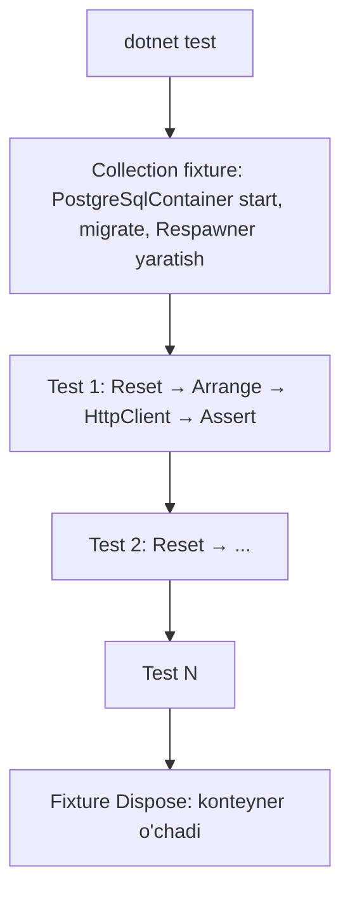

# 21. Testing

> **Bir jumlada:** Test bu kodning kutilgan xatti-harakatini avtomatik tekshiradigan va refactoring'da sizni himoya qiladigan ikkinchi kod; qaysi darajada (unit, integration, E2E) nimani tekshirish kerakligini bilish test yozishdan muhimroq.
> **Nega Middle uchun:** Junior'dan "test yozdi" kutiladi, Middle'dan "to'g'ri joyga to'g'ri test yozdi va u 6 oydan keyin ham ishonchli" kutiladi. Integration test haqiqiy baza bilan, mock'lar faqat chegarada, flaky test nol.
> **O'qish vaqti:** ~45 daqiqa

## Mundarija

- [1. Muammo va yechim](#1-muammo-va-yechim)
- [2. Qanday ishlaydi](#2-qanday-ishlaydi)
- [3. Asosiy tushunchalar](#3-asosiy-tushunchalar)
- [4. Amaliy misol](#4-amaliy-misol)
- [5. Tipik xatolar va anti-patternlar](#5-tipik-xatolar-va-anti-patternlar)
- [6. Best practices checklist](#6-best-practices-checklist)
- [7. Suhbat savollari va javoblar](#7-suhbat-savollari-va-javoblar)
- [8. Qo'shimcha manbalar](#8-qoshimcha-manbalar)

## 1. Muammo va yechim

Holat. Ombor tizimida 1 200 ta test bor, coverage 78%, CI yashil. Chegirma hisoblash qoidasi o'zgartirildi, deploy qilindi, ertasiga 340 ta buyurtma noto'g'ri narx bilan ketdi. Tahlil:

- 900 ta unit test `DbContext`'ni mock qilgan: `_db.Orders.Returns(fakeList.AsQueryable())`. Chegirma so'rovi `.Where(o => o.Customer.Tier == Tier.Gold)` edi; mock'da `Customer` navigation yuklangan, haqiqiy bazada `Include` yo'q edi, `Customer` null, `NullReferenceException`. Mock test bu yo'lni "yashil" deb ko'rsatgan.
- Integration testlar EF InMemory provider'da. InMemory'da `string.Compare` case-sensitive, PostgreSQL'da collation bo'yicha case-insensitive; InMemory'da tranzaksiya yo'q, `SaveChanges` qisman bajariladi. Testlar "bazaga yozdim, o'qidim" dan boshqa narsani isbotlamagan.
- 12 ta test "ba'zan" yiqilar edi, jamoa ularni `[Fact(Skip = "flaky")]` qilgan. Ulardan ikkitasi aynan chegirma oqimini tekshirardi.

Yechim: test piramidasi ongli qurilgan to'plam.

| Daraja | Nimani tekshiradi | Tezlik | Soni | Asbob |
|---|---|---|---|---|
| Unit | Domain logika: `Order.ApplyDiscount`, `Money`, `PricingPolicy`. Tashqi bog'liqlik yo'q | ms | ko'p (yuzlab) | xUnit, FluentAssertions |
| Integration | HTTP → handler → EF → haqiqiy PostgreSQL. Bitta use-case oxirigacha | 50-500 ms | o'rtacha (o'nlab-yuzlab) | WebApplicationFactory, Testcontainers, Respawn |
| Architecture | Qatlam qoidalari: Domain Infrastructure'ni ko'rmaydi | ms | bir nechta | NetArchTest |
| Contract/Snapshot | API javob shakli o'zgarmadi | ms | o'nlab | Verify |
| E2E | Brauzer/mijoz → butun tizim | soniya | kam (bir necha) | Playwright |

Yuqoridagi xato integration testda haqiqiy PostgreSQL bilan birinchi ishga tushirishdayoq `NullReferenceException` bilan ko'rinardi. Mock'lar sizni "bog'liqlik qanday ishlaydi" degan taxminingizga bog'laydi; haqiqiy baza taxminni tekshiradi.

## 2. Qanday ishlaydi

xUnit test ishga tushirilganda nima bo'ladi:

1. Runner (`dotnet test`, Test Explorer) test assembly'ni yuklaydi, `[Fact]` va `[Theory]` metodlarini reflection bilan topadi.
2. Har test metodi uchun test class'ning **yangi instance'i** yaratiladi (konstruktor = setup, `Dispose` = teardown). Bu xUnit'ning NUnit'dan asosiy farqi: testlar bir-birining holatini ko'rmaydi.
3. Default parallelizm: turli **test class'lar** (aniqrog'i, turli test collection'lar) parallel, bitta class ichidagi testlar ketma-ket. Har class o'z collection'i. `[Collection("Database")]` bilan bir nechta class bitta collection'ga birlashtiriladi va ular ketma-ket ishlaydi, lekin collection fixture'ni (masalan, bitta PostgreSQL konteyneri) bo'lishadi.
4. `IClassFixture<T>` class'dagi barcha testlar uchun bitta `T` instance (konstruktorga inject qilinadi), `ICollectionFixture<T>` collection uchun bitta instance. Fixture `IAsyncLifetime` bo'lsa, `InitializeAsync` birinchi testdan oldin, `DisposeAsync` oxirgi testdan keyin.

xUnit v3 (2025) `xunit.v3` paketi: testlar `Microsoft.Testing.Platform` ustida ishlaydi, `IAsyncLifetime` endi `ValueTask` qaytaradi, `TestContext.Current.CancellationToken` bor. v2 (`xunit` paketi) hali keng tarqalgan; quyidagi misollar v3 uchun, v2'da `Task` qaytaring.

`WebApplicationFactory<Program>` nima qiladi: `Program.cs`'dagi `builder`ni haqiqiy ishga tushiradi (barcha DI, middleware, endpoint'lar), lekin Kestrel o'rniga `TestServer` ulaydi: `HttpClient` so'rovi tarmoqsiz, xotirada, to'g'ridan-to'g'ri middleware pipeline'ga boradi. `ConfigureWebHost` orqali DI'ni test uchun o'zgartirasiz (haqiqiy bazani konteyner bazasiga, tashqi API'ni fake'ga).

Testcontainers nima qiladi: Docker API orqali konteyner ishga tushiradi (`postgres:17`), tasodifiy portga bog'laydi, tayyor bo'lguncha kutadi (`wait strategy`), connection string beradi; test tugagach o'chiradi (Ryuk sidecar konteyneri yetim konteynerlarni ham tozalaydi). CI'da Docker kerak (GitHub Actions `ubuntu-latest` runner'ida bor).

Respawn nima qiladi: baza sxemasini bir marta o'qiydi, FK bog'liqlik grafigini quradi, `ResetAsync` to'g'ri tartibda `DELETE` (yoki PostgreSQL'da `TRUNCATE ... CASCADE`) bajaradi. Bazani qayta yaratishdan (soniyalar) yuz barobar tez (millisekundlar). Har testdan oldin chaqiriladi: test toza bazadan boshlanadi.



## 3. Asosiy tushunchalar

### 3.1 Fact, Theory va nomlash

- Ta'rif: `[Fact]` parametrsiz bitta test; `[Theory]` + `[InlineData]`/`[MemberData]`/`[ClassData]` bir xil mantiq, bir nechta kiritish.
- Nega kerak: bir xil testni 5 marta ko'chirish o'rniga 5 qator ma'lumot. Nomlash `Method_Scenario_Expected` yoki `Should_Expected_When_Scenario`: test yiqilganda nomdan nima buzilgani ko'rinadi.

```csharp
public sealed class OrderTests
{
    [Fact]
    public void Confirm_WithNoLines_ThrowsDomainException()
    {
        // Arrange
        var order = new OrderBuilder().WithNoLines().Build();

        // Act
        var act = () => order.Confirm();

        // Assert
        act.Should().Throw<DomainException>().WithMessage("*at least one line*");
    }

    [Theory]
    [InlineData(CustomerTier.Regular, 0)]
    [InlineData(CustomerTier.Silver, 5)]
    [InlineData(CustomerTier.Gold, 10)]
    public void DiscountPercent_ByTier_ReturnsExpected(CustomerTier tier, int expected)
    {
        var policy = new TierDiscountPolicy();
        policy.PercentFor(tier).Should().Be(expected);
    }
}
```

- Tipik xato: bitta testda bir nechta mustaqil assert bilan turli sabablar. Birinchi assert yiqilsa qolganlari ko'rinmaydi. Qoida: bitta test, bitta yiqilish sababi (bir obyektning bir nechta maydonini tekshirish mumkin, ikki alohida stsenariy emas).

### 3.2 Fixtures va collections

- Ta'rif: `IClassFixture<T>` class bo'yicha, `ICollectionFixture<T>` bir nechta class bo'yicha bo'lishiladigan qimmat resurs.
- Nega kerak: PostgreSQL konteynerini har test uchun ko'tarish 3-5 soniya; 200 test uchun 15 daqiqa. Bitta konteyner, testlar orasida Respawn.

```csharp
// Bitta collection: shu nom bilan belgilangan barcha class'lar bitta fixture oladi va ketma-ket ishlaydi
[CollectionDefinition(nameof(ApiCollection))]
public sealed class ApiCollection : ICollectionFixture<ApiFactory>;

[Collection(nameof(ApiCollection))]
public sealed class OrdersEndpointTests(ApiFactory factory) : IAsyncLifetime
{
    private readonly HttpClient _client = factory.CreateClient();

    public async ValueTask InitializeAsync() => await factory.ResetDatabaseAsync();  // har testdan oldin toza baza
    public ValueTask DisposeAsync() => ValueTask.CompletedTask;
}
```

- Tipik xato: collection'siz `IClassFixture<ApiFactory>` bir nechta class'da. Har class o'z konteynerini ko'taradi, parallel ishlaydi, Docker 10 ta PostgreSQL bilan to'ladi.

### 3.3 Parallelizm

- Ta'rif: xUnit collection'larni parallel ishga tushiradi (default: CPU yadrolari soni).
- Nega kerak: unit testlar parallelda tez; integration testlar bitta bazani bo'lishsa, parallel ishlasa bir-birining ma'lumotini o'chiradi (Respawn vaqtida boshqa test yozmoqda).

```csharp
// AssemblyInfo.cs yoki istalgan .cs faylda: integration test assembly'sida parallelizmni o'chirish
[assembly: CollectionBehavior(DisableTestParallelization = true)]
```

Alternativa: har collection'ga o'z konteyneri (`ApiFactory` collection fixture sifatida, 3-4 collection parallel). Yoki bitta konteynerda har collection'ga alohida database (`CREATE DATABASE test_{guid}`), bu tezroq va izolyatsiyalangan.

### 3.4 Mock kutubxonalari: NSubstitute va Moq

- Ta'rif: mock (test dubl) bu interfeysning soxta amalga oshirilishi: nima qaytarishini siz aytasiz, chaqirilganini tekshirasiz. NSubstitute: `Substitute.For<T>()`; Moq: `new Mock<T>()`.
- Nega kerak: unit testda tashqi chegara (to'lov API, SMS, vaqt, tasodifiy) nazorat qilinishi kerak. Moq 4.20 (2023) SponsorLink hodisasi (build'da dasturchi email'ini yig'ish) tufayli ko'p jamoalar NSubstitute'ga o'tdi; ikkalasi hozir ishlaydi, NSubstitute sintaksisi qisqaroq.

```csharp
[Fact]
public async Task Checkout_WhenGatewayFails_LeavesOrderPendingAndDoesNotReserveStock()
{
    // Arrange: faqat chegaralar mock, domain obyektlar haqiqiy
    var gateway = Substitute.For<IPaymentGateway>();
    gateway.CreateInvoiceAsync(Arg.Any<Guid>(), Arg.Any<Money>(), Arg.Any<CancellationToken>())
           .ThrowsAsync(new PaymentGatewayException("timeout"));
    var stock = Substitute.For<IStockReservation>();
    var clock = Substitute.For<TimeProvider>();                 // .NET 8+ abstraksiya, DateTime.UtcNow emas
    clock.GetUtcNow().Returns(new DateTimeOffset(2026, 10, 27, 10, 0, 0, TimeSpan.Zero));

    var order = new OrderBuilder().WithLine("SKU-1", qty: 2, price: 50_000m).Build();
    var handler = new CheckoutHandler(gateway, stock, clock);

    // Act
    var act = () => handler.HandleAsync(order, CancellationToken.None);

    // Assert
    await act.Should().ThrowAsync<PaymentGatewayException>();
    order.Status.Should().Be(OrderStatus.Pending);
    await stock.DidNotReceive().ReserveAsync(Arg.Any<Order>(), Arg.Any<CancellationToken>());
}
```

- Tipik xato: mock'ning qaytargan qiymatini tekshirish (`gateway.CreateInvoiceAsync(...).Returns(x); result.Should().Be(x)`). Bu mock'ni test qiladi, kodni emas.

### 3.5 FluentAssertions va AAA

- Ta'rif: `result.Should().Be(5)` uslubidagi assert kutubxonasi; yiqilganda tushunarli xabar (`Expected result to be 5, but found 3`). AAA: Arrange (tayyorlash), Act (bajarish), Assert (tekshirish) bo'limlari.
- Nega kerak: `Assert.Equal(expected, actual)` tartibini chalkashtirish oson, xabar qisqa. FluentAssertions obyektlarni strukturaviy solishtiradi (`BeEquivalentTo`), kolleksiyalar, exception'lar uchun boy API.
- Litsenziya: FluentAssertions 8 (2025-yanvar) tijoriy ishlatish uchun pullik bo'ldi; 7.x Apache 2.0 bo'lib qoladi. Muqobillar: Shouldly (`result.ShouldBe(5)`), AwesomeAssertions (7 dan fork, bepul). Loyihada qaysi biri ekanini `Directory.Packages.props`'da bir marta hal qiling.

```csharp
// Strukturaviy solishtirish: ID va vaqtni e'tiborsiz qoldirib
actual.Should().BeEquivalentTo(expected, o => o.Excluding(x => x.Id).Excluding(x => x.CreatedAt));
```

- Tipik xato: Act va Assert'ni aralashtirish: `order.Confirm().Status.Should()...`. Act alohida qatorda bo'lsa, yiqilganda qaysi qism buzilgani aniq.

### 3.6 Test data builder

- Ta'rif: test obyektini qadam-baqadam quradigan class; default'lar to'g'ri, test faqat farqni aytadi.
- Nega kerak: `new Order(Guid.NewGuid(), customerId, tenantId, new List<Line>{...}, DateTime.UtcNow, ...)` har testda 8 qator; konstruktor o'zgarsa 200 test o'zgaradi. Builder bilan test "nima muhim" ni aytadi.

```csharp
public sealed class OrderBuilder
{
    private readonly List<(string Sku, int Qty, decimal Price)> _lines = [("SKU-DEFAULT", 1, 10_000m)];
    private CustomerTier _tier = CustomerTier.Regular;
    private Guid _tenantId = Guid.Parse("11111111-1111-1111-1111-111111111111");

    public OrderBuilder WithNoLines() { _lines.Clear(); return this; }
    public OrderBuilder WithLine(string sku, int qty, decimal price) { _lines.Add((sku, qty, price)); return this; }
    public OrderBuilder ForGoldCustomer() { _tier = CustomerTier.Gold; return this; }
    public OrderBuilder InTenant(Guid tenantId) { _tenantId = tenantId; return this; }

    public Order Build()
    {
        var customer = new Customer(Guid.NewGuid(), _tenantId, "Test Customer", _tier);
        var order = Order.Create(customer, _tenantId);
        foreach (var (sku, qty, price) in _lines)
            order.AddLine(sku, qty, new Money(price, "UZS"));
        return order;
    }
}
```

Bogus kutubxonasi (`new Faker<Customer>().RuleFor(c => c.Name, f => f.Person.FullName)`) tasodifiy, lekin seed bilan takrorlanadigan ma'lumot beradi; builder bilan birga ishlatiladi.

### 3.7 WebApplicationFactory

- Ta'rif: `Microsoft.AspNetCore.Mvc.Testing` paketidagi class; ilovani xotirada ko'taradi, `HttpClient` beradi.
- Nega kerak: butun pipeline (routing, auth, validatsiya, filter, serialization, EF) haqiqiy; faqat tashqi chegaralar almashtiriladi.

```csharp
public sealed class ApiFactory : WebApplicationFactory<Program>, IAsyncLifetime
{
    private readonly PostgreSqlContainer _pg = new PostgreSqlBuilder()
        .WithImage("postgres:17-alpine")
        .WithDatabase("warehouse_test")
        .Build();
    private Respawner _respawner = default!;
    private NpgsqlConnection _conn = default!;

    public IPaymentGateway PaymentGateway { get; } = Substitute.For<IPaymentGateway>();

    protected override void ConfigureWebHost(IWebHostBuilder builder)
    {
        builder.UseEnvironment("Testing");            // appsettings.Testing.json, Development sozlamalari emas
        builder.ConfigureTestServices(services =>
        {
            // Haqiqiy DbContext ro'yxatini olib tashlab, konteyner bazasiga ulaymiz
            services.RemoveAll<DbContextOptions<AppDbContext>>();
            services.AddDbContext<AppDbContext>(o => o.UseNpgsql(_pg.GetConnectionString()));

            // Tashqi chegara: to'lov provayderi. Haqiqiy HTTP ketmaydi
            services.RemoveAll<IPaymentGateway>();
            services.AddSingleton(PaymentGateway);

            // Fon job'lar testda kerak emas (outbox publisher va h.k.)
            services.RemoveAll<IHostedService>();

            // Auth: test handler, har so'rovga "tenant" va "sub" claim beradi
            services.AddAuthentication(TestAuthHandler.Scheme)
                    .AddScheme<AuthenticationSchemeOptions, TestAuthHandler>(TestAuthHandler.Scheme, _ => { });
        });
    }

    public async ValueTask InitializeAsync()
    {
        await _pg.StartAsync();
        // Migration bir marta: sxema haqiqiy migration'lardan, EnsureCreated emas
        using var scope = Services.CreateScope();
        await scope.ServiceProvider.GetRequiredService<AppDbContext>().Database.MigrateAsync();

        _conn = new NpgsqlConnection(_pg.GetConnectionString());
        await _conn.OpenAsync();
        _respawner = await Respawner.CreateAsync(_conn, new RespawnerOptions
        {
            DbAdapter = DbAdapter.Postgres,
            SchemasToInclude = ["public"],
            TablesToIgnore = [new Table("__EFMigrationsHistory")]
        });
    }

    public Task ResetDatabaseAsync() => _respawner.ResetAsync(_conn);

    public new async ValueTask DisposeAsync()
    {
        await _conn.DisposeAsync();
        await _pg.DisposeAsync();
        await base.DisposeAsync();
    }
}

// Program.cs top-level statements bo'lsa, test assembly'si Program'ni ko'rishi uchun:
// public partial class Program { }   (Program.cs oxirida)
```

- Tipik xato: `UseEnvironment` bermaslik. Factory `Development` bilan ishga tushadi, `appsettings.Development.json`'dagi lokal baza, Seq, lokal URL'lar yuklanadi va CI'da tasodifiy xatolar.

### 3.8 Nega InMemory provider aldamchi

- Ta'rif: `Microsoft.EntityFrameworkCore.InMemory` bu relyatsion bo'lmagan, xotiradagi "baza"; EF jamoasi uni test uchun tavsiya etmaydi.
- Nega muhim: InMemory bilan o'tgan test production'da yiqilishi mumkin, chunki:
  - Tranzaksiya yo'q: `SaveChanges` o'rtada xato bersa qisman yozilgan holat qoladi; `BeginTransaction` hech narsa qilmaydi (warning).
  - Constraint yo'q: FK, unique index, `NOT NULL`, `CHECK` tekshirilmaydi. Dublikat SKU bazada 23505 beradi, InMemory'da bemalol.
  - LINQ o'girilmaydi: `string.Contains` InMemory'da case-sensitive, PostgreSQL `LIKE` collation'ga bog'liq, `ILIKE` esa boshqa. Client-side evaluation xatolari (`InvalidOperationException: could not be translated`) InMemory'da chiqmaydi, chunki hamma narsa client-side.
  - Raw SQL, `ExecuteUpdate`/`ExecuteDelete`, `FromSql`, stored procedure, JSON ustunlar, `xmin` concurrency token ishlamaydi.
  - Sxema yo'q: migration xatosi (noto'g'ri ustun tipi, yetishmayotgan index) ko'rinmaydi.
- SQLite in-memory oraliq variant: relyatsion, tranzaksiya bor, lekin PostgreSQL emas (tiplar, `RETURNING`, `ILIKE`, schema yo'q). Testcontainers bilan haqiqiy PostgreSQL arzon bo'lgani uchun oraliq variant kerak emas.

### 3.9 DbContext'ni mock qilmaslik

- Ta'rif: `Substitute.For<AppDbContext>()` yoki `DbSet<T>`'ni `IQueryable` list bilan almashtirish.
- Nega yomon: `DbSet` bu `IQueryable`, uning kuchi expression tree'ni SQL'ga o'girishda. Mock'da expression tree LINQ-to-Objects bilan bajariladi: navigation'lar "yuklangan", `Include` ma'nosiz, `AsNoTracking`, `ExecuteUpdate`, `FindAsync` ishlamaydi yoki alohida mock talab qiladi (`MockQueryable` kabi kutubxonalar bilan ham `async` metodlar og'riq). Test kodning qaysi SQL hosil bo'lishini tekshirmaydi, ya'ni asosiy xavfni yopmaydi.
- To'g'ri chegara: domain logika `DbContext`'siz (entity metodlari, policy'lar) unit test; `DbContext` ishlatadigan kod (handler, repository) haqiqiy bazada integration test. Agar handler'ni bazasiz test qilmoqchi bo'lsangiz, repository interfeysi (`IOrderRepository.GetWithLinesAsync`) mock qilinadi, u kichik va aniq kontrakt.

### 3.10 Architecture tests

- Ta'rif: assembly'lar va namespace'lar orasidagi bog'liqlik qoidalarini tekshiradigan test (NetArchTest.Rules yoki ArchUnitNET).
- Nega kerak: "Domain Infrastructure'ga bog'lanmasin" qoidasi code review'da unutiladi; test unutmaydi.

```csharp
public sealed class ArchitectureTests
{
    private static readonly Assembly Domain = typeof(Order).Assembly;
    private static readonly Assembly Application = typeof(CheckoutHandler).Assembly;

    [Fact]
    public void Domain_ShouldNotDependOn_InfrastructureOrEfCore()
    {
        var result = Types.InAssembly(Domain)
            .ShouldNot()
            .HaveDependencyOnAny("Warehouse.Infrastructure", "Microsoft.EntityFrameworkCore", "Microsoft.AspNetCore")
            .GetResult();

        result.IsSuccessful.Should().BeTrue(because: string.Join(", ", result.FailingTypeNames ?? []));
    }

    [Fact]
    public void Handlers_ShouldBeSealed_AndEndWithHandler()
    {
        Types.InAssembly(Application)
            .That().ImplementInterface(typeof(ICommandHandler<,>))
            .Should().BeSealed().And().HaveNameEndingWith("Handler")
            .GetResult().IsSuccessful.Should().BeTrue();
    }
}
```

### 3.11 Snapshot va contract test (Verify)

- Ta'rif: snapshot test natijani (JSON, matn) faylga yozadi (`*.verified.txt`), keyingi ishga tushirishda solishtiradi. Verify kutubxonasi (`Verify.XunitV3` yoki `Verify.Xunit`) buni qiladi; contract test API javobining shakli (maydonlar, tiplar) mijoz kutganidan o'zgarmaganini tekshiradi.
- Nega kerak: `OrderResponse`'ga maydon qo'shilsa yoki nomi o'zgarsa frontend buziladi; snapshot diff'da aynan nima o'zgargani ko'rinadi va PR'da ongli tasdiqlanadi.

```csharp
[Fact]
public async Task GetOrder_Response_MatchesSnapshot()
{
    var id = await SeedOrderAsync();
    var response = await _client.GetAsync($"/orders/{id}");
    var json = await response.Content.ReadAsStringAsync();

    // Id va vaqtlar har safar boshqa: scrub qilinadi (Guid → Guid_1, DateTime → DateTime_1)
    await Verify(json).ScrubInlineGuids().ScrubInlineDateTimes("yyyy-MM-ddTHH:mm:ss.fffffffZ");
}
```

Birinchi ishga tushirishda `*.received.txt` yaratiladi, siz uni `*.verified.txt`'ga nomlaysiz (yoki diff tool qabul qiladi) va git'ga qo'shasiz. Keyin har o'zgarish PR diff'ida.

- Tipik xato: snapshot'ni ko'rmasdan qabul qilish (`accept all`). Snapshot test faqat odam diff'ni o'qiganda qiymatli.

### 3.12 Flaky test sabablari

- Ta'rif: flaky (beqaror) test bir xil kodda ba'zan o'tadi, ba'zan yiqiladi.
- Nega xavfli: jamoa qizil CI'ga ishonmay qo'yadi, "qayta ishga tushir" refleksi haqiqiy xatolarni yashiradi.

| Sabab | Belgisi | Davosi |
|---|---|---|
| Umumiy holat (static, bitta baza, parallel) | Yolg'iz o'tadi, to'plamda yiqiladi | Respawn, collection, static'ni olib tashlash |
| Vaqt (`DateTime.UtcNow`, yarim tun, sekund chegarasi) | Tunda yoki oy oxirida yiqiladi | `TimeProvider` inject, `FakeTimeProvider` |
| Tartib (`OrderBy`'siz `First()`) | Baza indeksi o'zgarganda | Explicit `OrderBy`, `BeEquivalentTo` (tartibsiz) |
| Tasodifiy ma'lumot seed'siz | Har 50-marta yiqiladi | Bogus `UseSeed(1234)` |
| `Task.Delay` bilan "kutish" | Sekin CI'da yiqiladi | Polling `WaitUntil` yoki signal (`TaskCompletionSource`) |
| Port, fayl, env bo'yicha raqobat | Parallel ishlaganda | Tasodifiy port (Testcontainers), temp dir per test |
| Haqiqiy tashqi servis | Tarmoq yo'q/sekin | Mock yoki WireMock.Net (HTTP stub) |

```csharp
// Fon job natijasini kutish: Delay emas, polling
await WaitUntilAsync(async () => await db.Orders.AnyAsync(o => o.Status == OrderStatus.Paid),
                     timeout: TimeSpan.FromSeconds(5), interval: TimeSpan.FromMilliseconds(50));
```

### 3.13 Coverage: nima o'lchaydi, nima o'lchamaydi

- Ta'rif: code coverage bu test paytida bajarilgan satr/branch foizi (`coverlet.collector`, `dotnet test --collect:"XPlat Code Coverage"`, ReportGenerator HTML).
- Nima o'lchaydi: qaysi kod umuman test tomonidan ishga tushirilmaganini (0% bo'lgan `PricingPolicy` xavf).
- Nima o'lchamaydi: assert sifatini. `var r = Calculate(); ` assert'siz 100% coverage beradi va hech narsani tekshirmaydi. Ma'lumot kombinatsiyalarini (branch 100%, lekin `qty = 0` holati yo'q). Integratsiyani (unit testlar 90%, lekin SQL hech qachon bajarilmagan).
- Qanday ishlatish: trend va bo'shliq topish uchun, maqsad raqam sifatida emas. "80% bo'lsin" talabi getter/setter va DTO testlarini tug'diradi. Mutation testing (Stryker.NET) assert sifatini o'lchaydi: kodni buzadi va test sezadimi tekshiradi.

```bash
dotnet test --collect:"XPlat Code Coverage" --results-directory ./coverage
reportgenerator -reports:coverage/**/coverage.cobertura.xml -targetdir:coverage/html -reporttypes:Html
```

### 3.14 Unit vs integration chegarasi: real misol

Use-case: "Buyurtmani tasdiqlash: satrlar bo'sh bo'lmasin, Gold mijozga 10% chegirma, ombor rezerv, status Confirmed, `OrderConfirmed` outbox'ga".

| Nima | Daraja | Nega |
|---|---|---|
| Bo'sh satr bilan `Confirm()` exception | Unit (`Order`) | Sof domain, bog'liqlik yo'q |
| Gold uchun 10% | Unit (`TierDiscountPolicy`) | Sof hisob, Theory bilan 3 qator |
| `Money` yaxlitlash (UZS tiyinsiz) | Unit | Arifmetika |
| Handler gateway xatosida stock'ni chaqirmaydi | Unit (handler, mock chegaralar) | Oqim mantiqi, baza shart emas |
| `POST /orders/{id}/confirm` 200 qaytaradi va bazada `Confirmed` | Integration | Routing, auth, EF, tranzaksiya, SQL |
| Outbox'ga yozuv SaveChanges bilan bir tranzaksiyada | Integration | Tranzaksiya semantikasi faqat haqiqiy bazada |
| Ikki parallel tasdiqlash: bittasi 409 | Integration | Concurrency token, `xmin`, bazaning qulflari |
| Domain EF'ga bog'lanmagan | Architecture | Assembly qoidasi |
| Javob JSON shakli | Snapshot | Kontrakt |

## 4. Amaliy misol

Integration test class'i: 3.7 dagi `ApiFactory` bilan buyurtma tasdiqlash oqimi oxirigacha.

```csharp
[Collection(nameof(ApiCollection))]
public sealed class ConfirmOrderTests(ApiFactory factory) : IAsyncLifetime
{
    private readonly HttpClient _client = factory.CreateClient();

    public async ValueTask InitializeAsync()
    {
        await factory.ResetDatabaseAsync();
        factory.PaymentGateway.ClearReceivedCalls();          // oldingi test chaqiruvlari qolmasin
        factory.PaymentGateway
            .CreateInvoiceAsync(Arg.Any<Guid>(), Arg.Any<Money>(), Arg.Any<CancellationToken>())
            .Returns(call => new InvoiceResult(InvoiceId: $"inv-{call.Arg<Guid>():N}", PayUrl: "https://sandbox.payme/x"));
    }
    public ValueTask DisposeAsync() => ValueTask.CompletedTask;

    // Seed: haqiqiy baza orqali, HTTP orqali emas (tezroq va testning Act qismi bitta)
    private async Task<Guid> SeedOrderAsync(Action<OrderBuilder>? configure = null)
    {
        var builder = new OrderBuilder().InTenant(TestAuthHandler.TenantId);
        configure?.Invoke(builder);
        var order = builder.Build();
        using var scope = factory.Services.CreateScope();
        var db = scope.ServiceProvider.GetRequiredService<AppDbContext>();
        db.Orders.Add(order);
        await db.SaveChangesAsync();
        return order.Id;
    }

    [Fact]
    public async Task Confirm_GoldCustomer_AppliesDiscountAndWritesOutbox()
    {
        // Arrange
        var id = await SeedOrderAsync(b => b.ForGoldCustomer().WithLine("SKU-9", qty: 2, price: 100_000m));

        // Act
        var response = await _client.PostAsync($"/orders/{id}/confirm", content: null);

        // Assert: HTTP
        response.StatusCode.Should().Be(HttpStatusCode.OK);
        var body = await response.Content.ReadFromJsonAsync<ConfirmOrderResponse>();
        body!.Total.Should().Be(198_000m);                     // 220 000 - 10%

        // Assert: baza holati, yangi scope (handler'ning change tracker'i emas)
        using var scope = factory.Services.CreateScope();
        var db = scope.ServiceProvider.GetRequiredService<AppDbContext>();
        var saved = await db.Orders.AsNoTracking().SingleAsync(o => o.Id == id);
        saved.Status.Should().Be(OrderStatus.Confirmed);

        var outbox = await db.OutboxMessages.AsNoTracking().Where(m => m.AggregateId == id).ToListAsync();
        outbox.Should().ContainSingle(m => m.Type == nameof(OrderConfirmed));

        // Assert: tashqi chegara to'g'ri summa bilan chaqirildi
        await factory.PaymentGateway.Received(1)
            .CreateInvoiceAsync(id, Arg.Is<Money>(m => m.Amount == 198_000m), Arg.Any<CancellationToken>());
    }

    [Fact]
    public async Task Confirm_WithEmptyLines_Returns400ProblemDetails()
    {
        var id = await SeedOrderAsync(b => b.WithNoLines());

        var response = await _client.PostAsync($"/orders/{id}/confirm", content: null);

        response.StatusCode.Should().Be(HttpStatusCode.BadRequest);
        var problem = await response.Content.ReadFromJsonAsync<ProblemDetails>();
        problem!.Detail.Should().Contain("at least one line");
        await factory.PaymentGateway.DidNotReceiveWithAnyArgs().CreateInvoiceAsync(default, default!, default);
    }

    [Fact]
    public async Task Confirm_OtherTenantsOrder_Returns404()
    {
        // Tenant izolyatsiyasi: boshqa tenant buyurtmasi ko'rinmasligi kerak, 403 emas (mavjudligini oshkor qilmaymiz)
        var id = await SeedOrderAsync(b => b.InTenant(Guid.NewGuid()));

        var response = await _client.PostAsync($"/orders/{id}/confirm", content: null);

        response.StatusCode.Should().Be(HttpStatusCode.NotFound);
    }

    [Fact]
    public async Task Confirm_Twice_Concurrently_OneSucceedsOneConflicts()
    {
        var id = await SeedOrderAsync();

        // Ikki so'rov bir vaqtda: optimistic concurrency (xmin) bittasini 409 qilishi kerak
        var tasks = Enumerable.Range(0, 2).Select(_ => _client.PostAsync($"/orders/{id}/confirm", content: null));
        var responses = await Task.WhenAll(tasks);

        responses.Select(r => r.StatusCode).Should().BeEquivalentTo(
            [HttpStatusCode.OK, HttpStatusCode.Conflict]);     // tartibsiz solishtirish
        await factory.PaymentGateway.ReceivedWithAnyArgs(1).CreateInvoiceAsync(default, default!, default);
    }
}
```

Nega shunday:
- Seed to'g'ridan-to'g'ri bazaga: test bitta endpoint'ni tekshiradi; "create" endpoint'i buzilsa "confirm" testlari yiqilmasin.
- Baza tekshiruvi yangi scope'da `AsNoTracking` bilan: handler'ning `DbContext`'i allaqachon dispose bo'lgan, keshlangan entity emas, haqiqatan yozilgan satr o'qiladi.
- Tashqi chegara (`IPaymentGateway`) factory darajasida bitta substitute, har testda `ClearReceivedCalls` va qayta sozlash: testlar bir-biriga ta'sir qilmaydi.
- Concurrency testi haqiqiy bazada: InMemory'da `xmin` yo'q, ikkalasi ham 200 qaytarardi.

## 5. Tipik xatolar va anti-patternlar

### 5.1 DbSet'ni mock qilish

```csharp
// ❌
var orders = new List<Order> { order }.AsQueryable().BuildMockDbSet();
db.Orders.Returns(orders);
```
Oqibat: `Include`, `AsNoTracking`, `FindAsync`, `ExecuteUpdateAsync` ishlamaydi yoki qo'shimcha mock talab qiladi; SQL hech qachon hosil bo'lmaydi; translate bo'lmaydigan LINQ yashil ko'rinadi.

✅ Domain logika entity ichida va `DbContext`'siz unit test; handler haqiqiy PostgreSQL bilan integration test.

### 5.2 Test o'rtasida bazani tozalamaslik

```csharp
// ❌ Har test o'z ma'lumotini qoldiradi, keyingi test "3 ta buyurtma" kutadi va 7 ta topadi
```
Oqibat: testlar tartibga bog'liq, yolg'iz o'tadi, to'plamda yiqiladi.

✅ `InitializeAsync`'da `Respawner.ResetAsync`; testlar to'plamda va yolg'iz bir xil natija beradi.

### 5.3 `Thread.Sleep` / `Task.Delay` bilan fon ishni kutish

```csharp
// ❌
await Task.Delay(2000); // outbox publisher ishlasin
```
Oqibat: lokalda 200 ms yetadi, CI'da 2 soniya yetmaydi; test sekin va flaky.

✅ Polling helper (3.12) yoki fon job'ni testda to'g'ridan-to'g'ri chaqirish (`await publisher.ProcessOnceAsync()`).

### 5.4 Implementatsiya tafsilotini test qilish

```csharp
// ❌
await repo.Received(1).GetByIdAsync(id);
await repo.Received(1).SaveAsync(Arg.Any<Order>());
await cache.Received(1).RemoveAsync($"order:{id}");
```
Oqibat: refactoring (keshni o'chirish tartibini o'zgartirish) testni buzadi, xatti-harakat o'zgarmagan bo'lsa ham. Test "kod shunday yozilgan" ni tekshiradi, "kod to'g'ri ishlaydi" ni emas.

✅ Natijani tekshiring: status, baza holati, javob. Chaqiruv tekshiruvi faqat chegaradagi side-effect muhim bo'lganda (to'lov so'rovi ketdi/ketmadi).

### 5.5 Bitta ulkan test

```csharp
// ❌ CreateOrder_ThenConfirm_ThenPay_ThenShip_ThenCancel_Works  (120 qator, 25 assert)
```
Oqibat: yiqilganda qayerda ekani noma'lum, bitta qadam o'zgarsa butun test o'zgaradi, parallel ishlamaydi.

✅ Har use-case alohida test, seed helper'lar bilan kerakli holatga tez yetib boriladi.

### 5.6 `DateTime.UtcNow` to'g'ridan-to'g'ri

```csharp
// ❌ if (order.CreatedAt < DateTime.UtcNow.AddDays(-30)) ...  testda "30 kun oldin" ni qanday yaratasiz?
```
Oqibat: testlar vaqtga bog'liq, tungi CI'da yiqiladi, "30 kun" holatini test qilib bo'lmaydi.

✅ `TimeProvider` inject (`TimeProvider.System` production'da, `Microsoft.Extensions.TimeProvider.Testing` paketidagi `FakeTimeProvider` testda, `Advance(TimeSpan.FromDays(31))`).

### 5.7 Testda production konfiguratsiya

Oqibat: `WebApplicationFactory` `Development` muhiti bilan `appsettings.Development.json`'ni o'qiydi: lokal Seq, lokal Redis, developer'ning connection string'i. CI'da ulanmaydi, lokalda "tasodifan" ishlaydi.

✅ `UseEnvironment("Testing")`, `appsettings.Testing.json`, va testda kerak bo'lmagan servislarni (`IHostedService`, telemetry exporter) `RemoveAll`.

## 6. Best practices checklist

- [ ] Domain logika `DbContext`'siz unit test, `DbContext` ishlatadigan kod haqiqiy PostgreSQL bilan integration test: mock'lar SQL'ni tekshirmaydi.
- [ ] Testcontainers + Respawn, `EnsureCreated` emas, `MigrateAsync`: sxema production migration'lardan, migration xatosi testda chiqadi.
- [ ] InMemory provider yo'q: tranzaksiya, constraint, SQL translate farqlari yashirin qoladi.
- [ ] Integration testlar collection fixture bilan bitta konteyner, har testdan oldin reset: tez va izolyatsiyalangan.
- [ ] Nomlash `Method_Scenario_Expected`, AAA bo'limlari ajratilgan: yiqilganda nomdan sabab o'qiladi.
- [ ] Bitta test bitta yiqilish sababi: diagnostika aniq.
- [ ] Test data builder'lar, konstruktor chaqiruvi testda yo'q: model o'zgarsa bitta joy o'zgaradi.
- [ ] Mock faqat chegarada (to'lov, SMS, vaqt, tasodif), ichki class'lar mock emas: refactoring testni buzmaydi.
- [ ] `TimeProvider` inject, `DateTime.UtcNow` to'g'ridan-to'g'ri yo'q: vaqtga bog'liq holatlar test qilinadi.
- [ ] Fon ish natijasi polling bilan kutiladi, `Delay` bilan emas: flaky yo'q.
- [ ] Architecture test qatlam qoidalarini qo'riqlaydi: review unutadi, test unutmaydi.
- [ ] API javoblari snapshot bilan, diff PR'da ko'rib chiqiladi: kontrakt o'zgarishi ongli.
- [ ] Flaky test `Skip` qilinmaydi, sababi topiladi yoki o'chiriladi: qizil CI'ga ishonch saqlanadi.
- [ ] Coverage trend va bo'shliq uchun, maqsad raqam emas: assert sifati muhim, mutation testing kritik modullarda.
- [ ] CI'da testlar har PR'da, Docker mavjud runner'da, natijalar TRX/JUnit formatda: yiqilgan test PR'da ko'rinadi.

## 7. Suhbat savollari va javoblar

**1. InMemory EF provider bilan test qilish nega aldamchi?**
InMemory relyatsion baza emas: tranzaksiya yo'q (qisman yozuv qoladi), FK va unique constraint tekshirilmaydi, LINQ SQL'ga o'girilmaydi (client-side bajariladi, shuning uchun translate xatolari ko'rinmaydi va `string.Contains` semantikasi boshqa), raw SQL va `ExecuteUpdate` ishlamaydi, concurrency token yo'q. Test "obyektni list'ga qo'shdim va topdim" dan boshqa narsani isbotlamaydi. EF jamoasi o'zi tavsiya etmaydi. Testcontainers bilan haqiqiy PostgreSQL 3 soniyada ko'tariladi, shuning uchun aldamchi variantga sabab yo'q. Tuzoq: "SQLite in-memory bo'lsa-chi?" Yaxshiroq, lekin PostgreSQL emas: tiplar, `ILIKE`, schema, `RETURNING` farq qiladi.

**2. Mock va stub farqi nima? Nimani mock qilmaslik kerak?**
Stub faqat javob qaytaradi (`gateway.Create(...).Returns(x)`), test uning chaqirilganini tekshirmaydi. Mock chaqiruvni tekshiradi (`Received(1)`), ya'ni side-effect'ning o'zi test maqsadi. Mock qilinmaydigan narsalar: `DbContext`/`DbSet` (SQL ko'rinmaydi), o'z domain class'laringiz (ular haqiqiy, tez, bog'liqliksiz), `HttpClient` (uning o'rniga `HttpMessageHandler` yoki WireMock), framework class'lari. Mock faqat tashqi chegara interfeyslari uchun: to'lov, SMS, vaqt, fayl saqlash.

**3. Flaky test sabablari qanday va nima qilasiz?**
Asosiy sabablar: umumiy holat (bitta baza, static, parallel testlar), vaqt (`DateTime.UtcNow`), tartibsiz so'rov (`OrderBy`'siz `First`), seed'siz tasodif, `Task.Delay` bilan kutish, haqiqiy tashqi servis, port/fayl raqobati. Yondashuv: yiqilish log'ini yig'aman (CI'da artifact), yolg'iz va to'plamda ishga tushiraman, parallelizmni o'chirib tekshiraman. Topilgan sababga mos dori: Respawn, `TimeProvider`, explicit tartib, seed, polling. `Skip` qilmayman, chunki u haqiqiy xatoni yashiradi; agar test qiymatsiz bo'lsa, o'chiraman.

**4. Test coverage necha foiz bo'lishi kerak?**
Raqam emas, kritik yo'llar. Coverage faqat "bu kod test paytida bajarildi" deydi, "to'g'ri tekshirildi" demaydi: assert'siz test ham 100% beradi. Men coverage'ni bo'shliq topish uchun ishlataman: `PricingPolicy` 0% bo'lsa, bu xavf. Majburiy foiz DTO va getter testlarini tug'diradi. Kritik modullarda (narx, to'lov, ruxsat) mutation testing (Stryker) sifatni ko'rsatadi: kodni buzib test sezadimi tekshiradi. Tuzoq: "80% talab qilamiz" degan jamoada test soni ko'p, ishonch past.

**5. WebApplicationFactory nima qiladi va qachon kerak?**
`Program.cs`'ni haqiqiy ishga tushiradi (DI, middleware, routing, auth, filter, EF), lekin Kestrel o'rniga `TestServer`: `HttpClient` so'rovi xotirada pipeline'ga boradi. `ConfigureTestServices` bilan haqiqiy bog'liqliklarni almashtirasiz: bazani Testcontainers bazasiga, to'lov API'ni substitute'ga, auth'ni test handler'ga. Kerak: endpoint oxirigacha (validatsiya, auth, serialization, SQL, tranzaksiya) tekshirilganda. Kerak emas: sof domain logika uchun (unit tezroq). Tuzoq: `UseEnvironment` bermasdan Development sozlamalari yuklanadi.

**6. Testlar parallel ishlasa baza bilan nima bo'ladi?**
xUnit class'larni parallel ishlatadi. Ikki class bitta bazani bo'lishsa, birining Respawn'i ikkinchisining ma'lumotini o'chiradi. Yechimlar: integration test class'larini bitta `[Collection]`ga qo'yish (ketma-ket, bitta fixture); yoki har collection'ga alohida database (bir konteyner, `CREATE DATABASE`), parallel va izolyatsiyalangan; yoki assembly darajasida parallelizmni o'chirish (eng oddiy, sekinroq). Unit testlar parallel qolaveradi, ular alohida assembly'da.

**7. Unit va integration chegarasini qanday belgilaysiz?**
Savol: "bu xatti-harakat qayerda buzilishi mumkin?" Arifmetika va domain qoidalari (`Confirm` bo'sh satr bilan, chegirma foizi) domain class'da buziladi, unit. Oqim mantiqi (gateway xatosida stock'ni chaqirmaslik) handler'da, chegaralar mock bilan unit. SQL, tranzaksiya, constraint, concurrency, routing, auth, serialization faqat haqiqiy pipeline va bazada buziladi, integration. Qoida: bitta xatti-harakat bitta darajada, ikkalasida takrorlanmaydi.

**8. Snapshot test qachon foydali va qachon zararli?**
Foydali: API javob shakli (kontrakt), generatsiya qilingan SQL/hisobot/email matni kabi "shakli muhim, qo'lda assert yozish uzun" natijalar. Diff PR'da ko'rinadi, o'zgarish ongli tasdiqlanadi. Zararli: tez o'zgaradigan yoki tasodifiy qismlar scrub qilinmasa (Guid, vaqt), har commit snapshot'ni buzadi va jamoa "accept all" refleksini oladi; o'shanda test hech narsani tekshirmaydi. Shuning uchun scrubber'lar va review intizomi shart.

**9. `IHostedService`'larni testda nega olib tashlaysiz?**
Fon job'lar (outbox publisher, kesh isitish, navbat consumer) `WebApplicationFactory` ko'tarilganda ishga tushadi: bazaga yozadi, Respawn bilan raqobatlashadi, tashqi servisga uladi, testlar o'rtasida holat qoldiradi. Testda job'ning o'zi kerak bo'lsa, uni to'g'ridan-to'g'ri chaqiraman (`ProcessOnceAsync`), bu deterministik. Butun hosted service'larni `RemoveAll<IHostedService>` qilish eng oddiy, lekin kerakli birini qaytarib qo'shish mumkin.

**10. Architecture test nimani tekshiradi va oddiy code review'dan farqi?**
NetArchTest assembly'ni reflection bilan skanlaydi va qoidalarni tekshiradi: Domain `EntityFrameworkCore`'ga havola qilmaydi, handler'lar `sealed` va `*Handler` nomli, controller'lar `DbContext`'ni to'g'ridan-to'g'ri ishlatmaydi. Review'da bunday qoida unutiladi, ayniqsa katta PR'da va yangi odam kelganda. Test CI'da har PR'da ishlaydi va buzilishni darhol ko'rsatadi. Bu qoidalarni hujjatlash ham: yangi dasturchi testni o'qib arxitektura chegaralarini tushunadi.

**11. Testda haqiqiy tashqi API (Payme sandbox) ishlatish mumkinmi?**
Avtomatik test to'plamida yo'q: tarmoq, sandbox yotishi, rate limit, ma'lumot to'planishi testni flaky va sekin qiladi. Chegarani ikki qismga ajrataman: `IPaymentGateway` interfeysi (unit/integration testda substitute) va uning HTTP implementatsiyasi (WireMock.Net bilan HTTP stub testi: so'rov shakli, header, xato kodlari). Sandbox bilan haqiqiy chaqiruv alohida, qo'lda yoki nightly ishga tushiriladigan "smoke" test, asosiy CI'ga kirmaydi.

**12. CI'da integration testlar 15 daqiqa oladi. Nima qilasiz?**
Avval o'lchayman: `dotnet test --logger trx` natijasida eng sekin testlar. Tipik sabablar: har class o'z konteyneri (collection fixture bilan bittaga tushiradi), `EnsureDeleted/EnsureCreated` har testda (Respawn bilan millisekund), `Task.Delay`, HTTP orqali seed (bazaga to'g'ridan-to'g'ri). Keyin parallelizm: collection'lar alohida database bilan parallel. Keyin ajratish: unit testlar alohida job (1 daqiqa, PR'ni bloklaydi), integration alohida job parallel ishlaydi. Image'ni runner'da keshlash (`postgres:17-alpine` pull vaqti).

## 8. Qo'shimcha manbalar

- Integration tests in ASP.NET Core: https://learn.microsoft.com/aspnet/core/test/integration-tests
- Testing EF Core applications (choosing a strategy): https://learn.microsoft.com/ef/core/testing/
- Testing without your production database system (nega InMemory tavsiya etilmaydi): https://learn.microsoft.com/ef/core/testing/testing-without-the-database
- xUnit hujjatlari: https://xunit.net/docs/getting-started/v3/getting-started
- Shared context in xUnit (fixtures, collections): https://xunit.net/docs/shared-context
- Testcontainers for .NET: https://dotnet.testcontainers.org/
- Respawn: https://github.com/jbogard/Respawn
- NSubstitute: https://nsubstitute.github.io/help/getting-started/
- FluentAssertions: https://fluentassertions.com/introduction
- Verify: https://github.com/VerifyTests/Verify
- NetArchTest: https://github.com/BenMorris/NetArchTest
- TimeProvider va FakeTimeProvider: https://learn.microsoft.com/dotnet/standard/datetime/timeprovider-overview
- Code coverage in .NET: https://learn.microsoft.com/dotnet/core/testing/unit-testing-code-coverage
- Stryker.NET mutation testing: https://stryker-mutator.io/docs/stryker-net/introduction/
