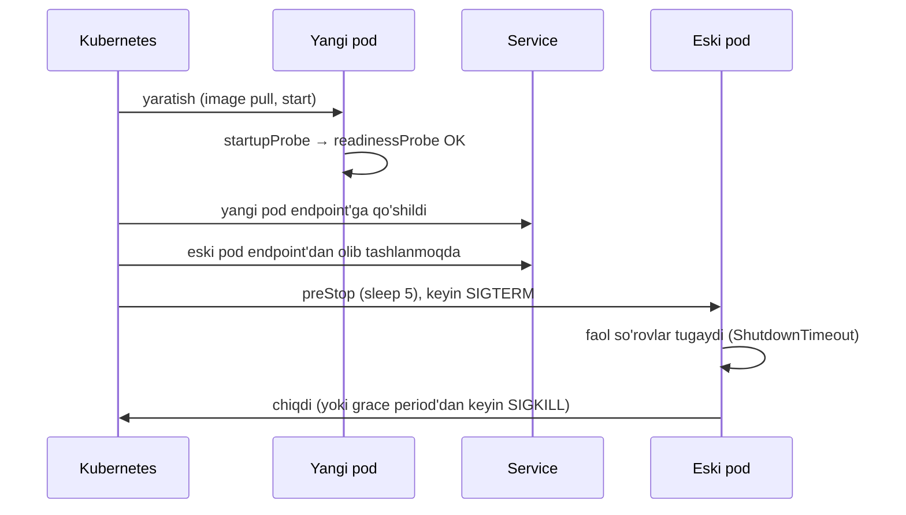

# 22. Deploy va DevOps

> **Bir jumlada:** Deploy bu kodni takrorlanadigan, tekshirilgan va qaytarib olinadigan yo'l bilan production'ga yetkazish; konteyner, pipeline va Kubernetes bu yo'lning standart qismlari.
> **Nega Middle uchun:** Backend dasturchi o'z servisini konteynerga solib, pipeline orqali chiqara olishi, staging'da nima buzilganini (image, env, migration, probe, resurs limiti) o'zi tushunishi va zero-downtime talabini kod darajasida (migration tartibi, graceful shutdown) hisobga olishi kerak.
> **O'qish vaqti:** ~50 daqiqa

## Mundarija

- [1. Muammo va yechim](#1-muammo-va-yechim)
- [2. Qanday ishlaydi](#2-qanday-ishlaydi)
- [3. Asosiy tushunchalar](#3-asosiy-tushunchalar)
- [4. Amaliy misol](#4-amaliy-misol)
- [5. Tipik xatolar va anti-patternlar](#5-tipik-xatolar-va-anti-patternlar)
- [6. Best practices checklist](#6-best-practices-checklist)
- [7. Suhbat savollari va javoblar](#7-suhbat-savollari-va-javoblar)
- [8. Qo'shimcha manbalar](#8-qoshimcha-manbalar)

## 1. Muammo va yechim

Holat. Ombor tizimi bitta VM'da `dotnet Api.dll` sifatida `systemd` orqali ishlaydi. Deploy: dasturchi `dotnet publish` qiladi, `scp` bilan nusxalaydi, servisni restart qiladi. Natija so'nggi oyda:

- Juma kuni deploy'dan keyin 4 daqiqa tizim yotdi: restart vaqtida migration bajarildi, 2 mln qatorli `orders` jadvaliga ustun qo'shish `ACCESS EXCLUSIVE` qulf oldi, barcha so'rovlar kutdi.
- Staging'da ishlagan, production'da yiqildi: staging'da `ASPNETCORE_ENVIRONMENT=Development` edi, production'da `appsettings.Production.json`'da Redis manzili yo'q.
- Rollback 40 daqiqa oldi: oldingi build qaysi commit'dan ekani noma'lum, qayta build qilindi.
- Xotira: VM'da 8 GB, ilova 6 GB oldi, OOM killer boshqa servisni o'ldirdi. Hech kim chegarani qo'ymagan.

Yechim to'rt qatlam:

1. **Konteyner**: ilova + runtime + sozlama bitta immutable (o'zgarmas) image'da, tag'i commit SHA. "Staging'da ishladi" degani "aynan shu baytlar production'ga boradi" degani.
2. **Pipeline**: build → test → scan → image → deploy avtomatik, har PR'da, qo'lda qadam yo'q. Migration alohida, nazorat ostidagi qadam.
3. **Orkestrator (Kubernetes)**: replica'lar, rolling update, probe'lar, resurs limitlari, avtomatik masshtab. Restart bo'roni, OOM va 4 daqiqalik yotish shu qatlamda hal bo'ladi.
4. **Jarayon**: expand/contract migration, feature flag, rollback rejasi. Zero-downtime kod va sxema dizaynidan boshlanadi, infratuzilmadan emas.

## 2. Qanday ishlaydi

**Docker image qatlamlari.** Dockerfile'ning har buyrug'i (`COPY`, `RUN`) yangi read-only qatlam yaratadi; qatlam kontentining hash'i bilan keshlanadi. Multi-stage build'da `build` stage SDK (1.2 GB) bilan kompilyatsiya qiladi, `final` stage faqat runtime (`aspnet:10.0` ~220 MB, chiseled ~110 MB) va `COPY --from=build` natijasini oladi. SDK, manbalar, `obj/` production image'ga kirmaydi. `csproj` fayllarini avval nusxalab `dotnet restore` qilish keshni kodga emas, paket ro'yxatiga bog'laydi: kod o'zgarganda restore qatlami qayta ishlatiladi.

**.NET konteynerda nimani ko'radi.** Runtime cgroup (Linux resurs chegaralari) ni o'qiydi: CPU quota `Environment.ProcessorCount`'ga aylanadi (1.5 CPU → 2), thread pool shu songa qarab min thread'larni belgilaydi, GC heap'lar sonini shu songa qarab yaratadi. Xotira limiti `GCHeapHardLimit` bo'ladi: default limitning 75%; heap shundan oshsa `OutOfMemoryException`, konteyner esa OOM kill bo'lmaydi (lekin 25% zaxira native xotira, JIT, stack uchun yetmasa kill bo'ladi). .NET 8+ image'lari default non-root `app` foydalanuvchisi (UID 1654) va `ASPNETCORE_HTTP_PORTS=8080` bilan keladi (port 80 emas, chunki non-root 1024 dan past portni ocha olmaydi).

**Kubernetes rolling update.** `Deployment`'da yangi image tag'i berilganda controller yangi ReplicaSet yaratadi va `maxSurge`/`maxUnavailable` bo'yicha pod'larni almashtiradi: yangi pod `readinessProbe` o'tgach Service'ga qo'shiladi, keyin eski pod'ga `SIGTERM` boradi. ASP.NET Core `SIGTERM`'ni `IHostApplicationLifetime.ApplicationStopping` sifatida qabul qiladi: Kestrel yangi ulanishlarni to'xtatadi, faol so'rovlarga `HostOptions.ShutdownTimeout` (default 30 s) ichida tugashga ruxsat beradi; bu vaqt `terminationGracePeriodSeconds` (default 30 s) dan kam bo'lishi kerak, aks holda `SIGKILL`. Muammo: Service endpoint'dan pod'ni olib tashlash va `SIGTERM` parallel, bir necha yuz millisekund davomida yangi so'rovlar to'xtayotgan pod'ga kelishi mumkin; `preStop: sleep 5` shu oynani yopadi.



**Migration va kod ikki alohida narsa.** Rolling update paytida eski va yangi kod bir vaqtda ishlaydi (bir necha daqiqa, rollback bo'lsa soatlab). Sxema ikkalasiga ham mos bo'lishi kerak. Shuning uchun migration kod deploy'idan oldin, alohida qadamda, orqaga mos (backward-compatible) shaklda bajariladi.

## 3. Asosiy tushunchalar

### 3.1 Multi-stage Dockerfile

- Ta'rif: bitta Dockerfile'da bir nechta `FROM`; oxirgisi yakuniy image, oldingilar faqat build uchun.
- Nega kerak: kichik image (tez pull, kam hujum yuzasi), SDK va manba kodi production'da yo'q, kesh qatlamlari to'g'ri.

```dockerfile
# syntax=docker/dockerfile:1.7
# ---------- 1-bosqich: build ----------
FROM mcr.microsoft.com/dotnet/sdk:10.0 AS build
ARG TARGETARCH                      # buildx beri: amd64 / arm64, cross-build uchun
WORKDIR /src

# Avval faqat paket ro'yxatini ta'sir qiladigan fayllar: restore qatlami kod o'zgarganda keshdan olinadi
COPY Directory.Build.props Directory.Packages.props global.json nuget.config* ./
COPY src/Warehouse.Api/Warehouse.Api.csproj src/Warehouse.Api/
COPY src/Warehouse.Application/Warehouse.Application.csproj src/Warehouse.Application/
COPY src/Warehouse.Domain/Warehouse.Domain.csproj src/Warehouse.Domain/
COPY src/Warehouse.Infrastructure/Warehouse.Infrastructure.csproj src/Warehouse.Infrastructure/
# NuGet keshini build'lar orasida saqlash (BuildKit cache mount): har build'da paket yuklanmaydi
RUN --mount=type=cache,id=nuget,target=/root/.nuget/packages \
    dotnet restore src/Warehouse.Api/Warehouse.Api.csproj -a $TARGETARCH

# Endi butun manba
COPY src/ src/
RUN --mount=type=cache,id=nuget,target=/root/.nuget/packages \
    dotnet publish src/Warehouse.Api/Warehouse.Api.csproj \
      -c Release -a $TARGETARCH --no-restore \
      -o /app/publish \
      /p:UseAppHost=false            # native launcher kerak emas, "dotnet Warehouse.Api.dll" bilan ishga tushadi

# ---------- 2-bosqich: runtime ----------
# chiseled: shell, paket menejeri, bash yo'q. Hujum yuzasi minimal, ~110 MB
FROM mcr.microsoft.com/dotnet/aspnet:10.0-noble-chiseled AS final
WORKDIR /app
COPY --from=build /app/publish .

# Base image allaqachon USER app (UID 1654) va ASPNETCORE_HTTP_PORTS=8080 bilan keladi; aniq yozish o'qilishi uchun
USER app
EXPOSE 8080

# Konteyner uchun tavsiya: invariant globalization yoqilmagan bo'lsa ICU kerak (chiseled'da yo'q);
# UZS formatlash kerak bo'lsa "aspnet:10.0-noble-chiseled-extra" (ICU bilan) tanlang yoki quyidagini yoqing
ENV DOTNET_SYSTEM_GLOBALIZATION_INVARIANT=false

ENTRYPOINT ["dotnet", "Warehouse.Api.dll"]
```

`.dockerignore` majburiy: `**/bin`, `**/obj`, `.git`, `**/*.user`, `tests/`, aks holda `COPY src/ src/` lokal `obj/` papkalarini oladi va kesh har safar buziladi.

- Tipik xato: `COPY . .` birinchi qatorda. Har bir kod o'zgarishi restore'ni qayta bajaradi (3-5 daqiqa).

### 3.2 dotnet publish /t:PublishContainer (Dockerfile'siz)

- Ta'rif: .NET SDK'ning o'zi image yasaydi, Docker daemon shart emas (registry'ga to'g'ridan-to'g'ri push qila oladi).
- Nega kerak: oddiy servislar uchun Dockerfile yo'q, sozlama `csproj`'da, SDK base image'ni runtime versiyasiga mos tanlaydi.

```xml
<!-- Warehouse.Api.csproj -->
<PropertyGroup>
  <ContainerRepository>registry.example.uz/warehouse/api</ContainerRepository>
  <ContainerFamily>noble-chiseled</ContainerFamily>   <!-- base image varianti -->
  <ContainerUser>app</ContainerUser>
  <ContainerPort>8080</ContainerPort>
</PropertyGroup>
<ItemGroup>
  <ContainerEnvironmentVariable Include="ASPNETCORE_HTTP_PORTS" Value="8080" />
  <ContainerLabel Include="org.opencontainers.image.source" Value="https://github.com/example/warehouse" />
</ItemGroup>
```

```bash
# Lokal Docker daemon'ga
dotnet publish -c Release -r linux-x64 /t:PublishContainer -p:ContainerImageTag=$(git rev-parse --short HEAD)
# To'g'ridan-to'g'ri registry'ga (daemon'siz)
dotnet publish -c Release -r linux-x64 /t:PublishContainer -p:ContainerRegistry=registry.example.uz
```

Chegara: custom `RUN` qadamlar (native kutubxona o'rnatish, font qo'shish QuestPDF uchun) yo'q; bunda Dockerfile kerak.

### 3.3 Chiseled image va non-root

- Ta'rif: chiseled (Ubuntu "chisel" vositasi bilan kesilgan) image'da faqat .NET runtime va uning bog'liqliklari; shell, `apt`, `curl` yo'q. Non-root: jarayon `root` emas, `app` sifatida ishlaydi.
- Nega kerak: CVE'lar soni (skanerda) bir necha barobar kam, image kichik; konteynerdan chiqib ketish (escape) bo'lsa ham `root` emas. Ko'p kluster `PodSecurity` `restricted` profil bilan root'ni taqiqlaydi.
- Oqibatlari: `kubectl exec -it pod -- sh` ishlamaydi (shell yo'q), `curl localhost:8080/health` ishlamaydi; diagnostika `kubectl debug` (ephemeral konteyner) yoki `dotnet-monitor` sidecar orqali. Fayl yozish faqat `app` ruxsati bor joyga (`/tmp`, mounted volume), `/app` read-only.

- Tipik xato: `USER root` "chunki fayl yozishda xato chiqdi". To'g'ri: yoziladigan papkani volume qilib `fsGroup` yoki `chown` bilan berish.

### 3.4 docker-compose lokal stack

- Ta'rif: bir nechta konteynerni (baza, kesh, broker, ilova) bitta YAML bilan ko'tarish.
- Nega kerak: yangi dasturchi `docker compose up` bilan 2 daqiqada ishlaydigan muhit oladi; "mening mashinamda PostgreSQL 14, production'da 17" muammosi yo'q.

```yaml
# compose.yaml
services:
  postgres:
    image: postgres:17-alpine
    environment:
      POSTGRES_USER: warehouse
      POSTGRES_PASSWORD: dev-only          # faqat lokal; production'da hech qachon
      POSTGRES_DB: warehouse
    ports: ["5432:5432"]
    volumes: [pgdata:/var/lib/postgresql/data]
    healthcheck:
      test: ["CMD-SHELL", "pg_isready -U warehouse"]
      interval: 5s
      retries: 10

  redis:
    image: redis:7-alpine
    command: ["redis-server", "--maxmemory", "256mb", "--maxmemory-policy", "allkeys-lru"]
    ports: ["6379:6379"]

  rabbitmq:
    image: rabbitmq:4-management-alpine
    ports: ["5672:5672", "15672:15672"]    # 15672: boshqaruv UI
    healthcheck:
      test: ["CMD", "rabbitmq-diagnostics", "-q", "ping"]
      interval: 10s

  seq:
    image: datalust/seq:latest
    environment: { ACCEPT_EULA: "Y" }
    ports: ["5341:80"]

  api:
    build: { context: ., dockerfile: src/Warehouse.Api/Dockerfile }
    environment:
      ASPNETCORE_ENVIRONMENT: Development
      ConnectionStrings__Warehouse: "Host=postgres;Database=warehouse;Username=warehouse;Password=dev-only"
      Redis__Configuration: "redis:6379"
      RabbitMq__Host: rabbitmq
      Seq__Url: "http://seq:80"
    ports: ["8080:8080"]
    depends_on:
      postgres: { condition: service_healthy }   # faqat port ochilishi emas, pg_isready
      rabbitmq: { condition: service_healthy }

volumes:
  pgdata:
```

`ConnectionStrings__Warehouse`: .NET konfiguratsiyasida `__` (ikki pastki chiziq) `:` ierarxiyasini bildiradi, chunki env nomida `:` ba'zi shell'larda ishlamaydi.

### 3.5 .NET Aspire AppHost

- Ta'rif: Aspire bu C# kodida yozilgan orkestrator va dashboard: konteynerlar, loyihalar va ular orasidagi bog'lanishlar (connection string, env) kod bilan tasvirlanadi.
- Nega kerak: compose'dagi env nomlarini qo'lda moslashtirish o'rniga `WithReference` ulanishni inject qiladi; dashboard log/trace/metrika bilan birga keladi; `ServiceDefaults` loyihasi OTel, health check, resilience'ni standart sozlaydi.

```csharp
// Warehouse.AppHost/Program.cs (paket: Aspire.Hosting.AppHost va Aspire.Hosting.PostgreSQL, .Redis, .RabbitMQ)
var builder = DistributedApplication.CreateBuilder(args);

var postgres = builder.AddPostgres("postgres")
    .WithDataVolume()                 // ma'lumot restart'da saqlanadi
    .WithPgAdmin();                   // brauzerda pgAdmin
var warehouseDb = postgres.AddDatabase("warehouse");

var redis = builder.AddRedis("redis");
var rabbit = builder.AddRabbitMQ("rabbitmq").WithManagementPlugin();

builder.AddProject<Projects.Warehouse_Api>("api")
    .WithReference(warehouseDb)       // ConnectionStrings__warehouse env'ga tushadi
    .WithReference(redis)
    .WithReference(rabbit)
    .WaitFor(warehouseDb)             // baza tayyor bo'lguncha API ishga tushmaydi
    .WithReplicas(2)                  // lokalda 2 nusxa: load balancing muammolarini erta ko'rish
    .WithHttpHealthCheck("/health/ready");

builder.AddProject<Projects.Warehouse_Worker>("worker")
    .WithReference(warehouseDb)
    .WithReference(rabbit)
    .WaitFor(rabbit);

builder.Build().Run();
```

```csharp
// Warehouse.Api/Program.cs ichida
builder.AddServiceDefaults();              // ServiceDefaults loyihasi: OTel, health, service discovery, resilience
builder.AddNpgsqlDbContext<AppDbContext>("warehouse");   // Aspire.Npgsql.EntityFrameworkCore.PostgreSQL
builder.AddRedisDistributedCache("redis");
```

Aspire lokal ishlab chiqish va test uchun (`Aspire.Hosting.Testing` bilan integration test ham); production'ga `aspire publish` yoki manifest orqali compose/Kubernetes/Azure chiqarish mumkin, lekin production deploy'ning asosiy yo'li hali ham pipeline + Kubernetes manifest (yoki Helm). 2025-yil oxiridan mahsulot nomi "Aspire" (".NET" prefiksisiz) va versiyalash 13.x ga o'tdi; API yuqoridagicha qoldi.

### 3.6 CI/CD pipeline (GitHub Actions)

- Ta'rif: CI (Continuous Integration) har PR'da build va test; CD (Continuous Delivery/Deployment) tasdiqlangan build'ni muhitlarga chiqarish.
- Nega kerak: qo'lda qadam yo'q, har build takrorlanadigan, image tag'i commit'ga bog'langan, scan (zaiflik tekshiruvi) deploy'dan oldin.

```yaml
# .github/workflows/ci-cd.yaml
name: ci-cd
on:
  pull_request:
  push:
    branches: [main]
    tags: ['v*']

env:
  REGISTRY: ghcr.io
  IMAGE: ghcr.io/${{ github.repository }}/api
  DOTNET_NOLOGO: true
  DOTNET_CLI_TELEMETRY_OPTOUT: true

permissions:
  contents: read
  packages: write        # ghcr.io push
  id-token: write        # OIDC: bulut provayderiga parolsiz kirish
  security-events: write # Trivy SARIF

jobs:
  build-test:
    runs-on: ubuntu-latest
    services:               # integration testlar uchun; Testcontainers ishlatilsa shart emas (Docker runner'da bor)
      postgres:
        image: postgres:17-alpine
        env: { POSTGRES_PASSWORD: ci, POSTGRES_DB: warehouse_test }
        ports: ['5432:5432']
        options: --health-cmd pg_isready --health-interval 5s --health-retries 10
    steps:
      - uses: actions/checkout@v4
        with: { fetch-depth: 0 }                    # GitVersion / tag'lar uchun to'liq tarix

      - uses: actions/setup-dotnet@v4
        with: { global-json-file: global.json }     # SDK versiyasi global.json'dan, "10.0.x" emas

      - name: Restore (kesh bilan)
        uses: actions/cache@v4
        with:
          path: ~/.nuget/packages
          key: nuget-${{ runner.os }}-${{ hashFiles('**/Directory.Packages.props', '**/*.csproj') }}
      - run: dotnet restore --locked-mode             # packages.lock.json bilan mos bo'lishi shart

      - run: dotnet build -c Release --no-restore -warnaserror

      - name: Unit tests
        run: dotnet test tests/Warehouse.UnitTests -c Release --no-build --logger "trx;LogFileName=unit.trx" --results-directory TestResults

      - name: Integration tests
        run: dotnet test tests/Warehouse.IntegrationTests -c Release --no-build --logger "trx;LogFileName=integration.trx" --results-directory TestResults
        env:
          ConnectionStrings__Warehouse: "Host=localhost;Database=warehouse_test;Username=postgres;Password=ci"

      - uses: actions/upload-artifact@v4
        if: always()                                  # yiqilganda ham natijalar PR'da ko'rinsin
        with: { name: test-results, path: TestResults }

      - name: Vulnerable packages
        run: dotnet list package --vulnerable --include-transitive 2>&1 | tee vuln.txt && ! grep -q "has the following vulnerable packages" vuln.txt

  image:
    needs: build-test
    if: github.event_name == 'push'                   # PR'da image push qilinmaydi
    runs-on: ubuntu-latest
    outputs:
      digest: ${{ steps.push.outputs.digest }}
    steps:
      - uses: actions/checkout@v4
      - uses: docker/setup-buildx-action@v3
      - uses: docker/login-action@v3
        with: { registry: ${{ env.REGISTRY }}, username: ${{ github.actor }}, password: ${{ secrets.GITHUB_TOKEN }} }

      - id: meta
        uses: docker/metadata-action@v5
        with:
          images: ${{ env.IMAGE }}
          tags: |
            type=sha,prefix=,format=long       # immutable: commit SHA
            type=ref,event=tag                 # v1.4.0
            type=raw,value=latest,enable={{is_default_branch}}

      - id: push
        uses: docker/build-push-action@v6
        with:
          context: .
          file: src/Warehouse.Api/Dockerfile
          push: true
          tags: ${{ steps.meta.outputs.tags }}
          labels: ${{ steps.meta.outputs.labels }}
          cache-from: type=gha                 # qatlam keshi Actions'da
          cache-to: type=gha,mode=max
          provenance: true                     # SLSA attestation

      - name: Scan image
        uses: aquasecurity/trivy-action@0.28.0
        with:
          image-ref: ${{ env.IMAGE }}@${{ steps.push.outputs.digest }}
          severity: CRITICAL,HIGH
          exit-code: '1'                       # CRITICAL/HIGH bo'lsa pipeline to'xtaydi
          ignore-unfixed: true
          format: sarif
          output: trivy.sarif
      - uses: github/codeql-action/upload-sarif@v3
        if: always()
        with: { sarif_file: trivy.sarif }

  migrate-and-deploy-staging:
    needs: image
    runs-on: ubuntu-latest
    environment: staging                        # muhit sirlari va (ixtiyoriy) tasdiqlovchi
    steps:
      - uses: actions/checkout@v4
      - name: Kubeconfig
        run: echo "${{ secrets.KUBECONFIG_STAGING }}" | base64 -d > kubeconfig && echo "KUBECONFIG=$PWD/kubeconfig" >> $GITHUB_ENV

      # 1. Migration: alohida Job, kod deploy'idan OLDIN, tugashini kutamiz
      - name: Run migration job
        run: |
          sed "s|IMAGE_DIGEST|${{ env.IMAGE }}@${{ needs.image.outputs.digest }}|" deploy/k8s/migration-job.yaml \
            | kubectl apply -n warehouse -f -
          kubectl wait -n warehouse --for=condition=complete --timeout=600s job/warehouse-migrate-${{ github.sha }}

      # 2. Kod: digest bilan, tag bilan emas (tag ko'chishi mumkin, digest yo'q)
      - name: Deploy
        run: |
          kubectl set image -n warehouse deployment/warehouse-api api=${{ env.IMAGE }}@${{ needs.image.outputs.digest }}
          kubectl rollout status -n warehouse deployment/warehouse-api --timeout=300s

      # 3. Smoke: tashqi URL orqali readiness va bitta real so'rov
      - run: curl -fsS https://staging-api.example.uz/health/ready && curl -fsS -H "Authorization: Bearer ${{ secrets.SMOKE_TOKEN }}" https://staging-api.example.uz/orders?take=1

  deploy-production:
    needs: migrate-and-deploy-staging
    if: startsWith(github.ref, 'refs/tags/v')   # faqat tag'dan
    runs-on: ubuntu-latest
    environment: production                     # majburiy tasdiq (required reviewers)
    steps:
      - run: echo "staging bilan bir xil qadamlar, production kubeconfig bilan"
```

Kalit qarorlar: `--locked-mode` (restore paketni jimgina yangilamaydi), image digest (tag o'zgaruvchan, digest o'zgarmas), migration `kubectl wait` bilan tugaguncha kutiladi, `environment: production` tasdiq talab qiladi, PR'da image push yo'q.

### 3.7 Migration deploy qadami

- Ta'rif: EF Core migration'larini ilova start'ida emas, alohida Kubernetes Job (yoki pipeline qadami) sifatida bajarish; `dotnet ef migrations bundle` migration'larni bitta bajariladigan faylga yig'adi.
- Nega kerak: start'da `Database.Migrate()` bilan 3 replica bir vaqtda migration bajarishga urinadi (EF `__EFMigrationsHistory` da qulf bilan himoya qiladi, lekin uzun migration'da replica'lar startup probe'dan o'tmay restart bo'ladi); ilova DDL huquqiga ega bo'lishi kerak (xavfsizlik); migration xatosi ilovani ishga tushmas qiladi; rollback kodi migration'ni qaytarmaydi.

```bash
# Build bosqichida: self-contained bundle, runtime shart emas
dotnet ef migrations bundle --project src/Warehouse.Infrastructure --startup-project src/Warehouse.Api \
  --configuration Release --self-contained -r linux-x64 -o /app/efbundle
# Job'da:
./efbundle --connection "$MIGRATION_CONNECTION"      # DDL huquqli alohida foydalanuvchi
```

```yaml
# deploy/k8s/migration-job.yaml
apiVersion: batch/v1
kind: Job
metadata: { name: warehouse-migrate-GIT_SHA }     # har deploy yangi nom; eski Job ttl bilan o'chadi
spec:
  backoffLimit: 0                                 # migration qayta urinilmaydi: odam qarasin
  ttlSecondsAfterFinished: 86400
  template:
    spec:
      restartPolicy: Never
      containers:
        - name: migrate
          image: IMAGE_DIGEST                     # API image'ida efbundle ham bor (build'da nusxalangan)
          command: ["/app/efbundle", "--connection", "$(MIGRATION_CONNECTION)"]
          env:
            - name: MIGRATION_CONNECTION
              valueFrom: { secretKeyRef: { name: warehouse-db-migrate, key: connection } }
```

- Tipik xato: `Program.cs`'da `db.Database.Migrate()` "qulaylik uchun". Lokalda qulay, production'da yuqoridagi barcha muammolar. Lokal uchun `if (app.Environment.IsDevelopment())` sharti bilan cheklang.

### 3.8 Kubernetes manifest'lari

- Ta'rif: `Deployment` (replica'lar va update strategiyasi), `Service` (barqaror ichki manzil, load balancing), `ConfigMap` (sozlama), `Secret` (sirlar), `HorizontalPodAutoscaler` (yuklamaga qarab replica soni).
- Nega kerak: 3.9-3.11 dagi barcha muammolar (probe, resurs, masshtab, zero-downtime) shu obyektlar orqali hal qilinadi.

```yaml
apiVersion: v1
kind: ConfigMap
metadata: { name: warehouse-api-config, namespace: warehouse }
data:
  ASPNETCORE_ENVIRONMENT: Production
  ASPNETCORE_HTTP_PORTS: "8080"
  Redis__Configuration: "redis.warehouse.svc:6379"
  OTEL_EXPORTER_OTLP_ENDPOINT: "http://otel-collector.observability.svc:4317"
  OTEL_SERVICE_NAME: warehouse-api
  DOTNET_gcServer: "1"
  DOTNET_GCDynamicAdaptationMode: "1"     # DATAS: heap hajmi yuklamaga moslashadi (.NET 9+ server GC'da default)
---
apiVersion: v1
kind: Secret
metadata: { name: warehouse-api-secrets, namespace: warehouse }
type: Opaque
stringData:                               # haqiqiy loyihada: External Secrets Operator / Vault / SealedSecrets, git'da emas
  ConnectionStrings__Warehouse: "Host=pg.warehouse.svc;Database=warehouse;Username=api;Password=CHANGE_ME"
  Payme__Secret: "CHANGE_ME"
---
apiVersion: apps/v1
kind: Deployment
metadata: { name: warehouse-api, namespace: warehouse }
spec:
  replicas: 3
  revisionHistoryLimit: 5                 # rollback uchun oldingi ReplicaSet'lar saqlanadi
  selector: { matchLabels: { app: warehouse-api } }
  strategy:
    type: RollingUpdate
    rollingUpdate: { maxSurge: 1, maxUnavailable: 0 }   # avval yangi pod, keyin eskisi: sig'im tushmaydi
  template:
    metadata:
      labels: { app: warehouse-api }
    spec:
      securityContext:
        runAsNonRoot: true
        runAsUser: 1654                   # base image'dagi "app"
        seccompProfile: { type: RuntimeDefault }
      terminationGracePeriodSeconds: 40   # preStop 5 s + ShutdownTimeout 30 s + zaxira
      containers:
        - name: api
          image: ghcr.io/example/warehouse/api@sha256:REPLACED_BY_PIPELINE
          ports: [{ containerPort: 8080, name: http }]
          envFrom:
            - configMapRef: { name: warehouse-api-config }
            - secretRef: { name: warehouse-api-secrets }
          resources:
            requests: { cpu: "500m", memory: "512Mi" }   # scheduler shunga qarab joylashtiradi
            limits: { cpu: "2", memory: "1Gi" }           # GC heap limiti 75% = 768 Mi
          startupProbe:
            httpGet: { path: /health/live, port: http }
            periodSeconds: 5
            failureThreshold: 24          # 2 daqiqa: JIT, kesh isitish
          readinessProbe:
            httpGet: { path: /health/ready, port: http }
            periodSeconds: 5
            failureThreshold: 2
          livenessProbe:
            httpGet: { path: /health/live, port: http }
            periodSeconds: 10
            failureThreshold: 3
          lifecycle:
            preStop:
              sleep: { seconds: 5 }       # endpoint'dan chiqarish tarqalguncha kutish (K8s 1.30+ native sleep)
          securityContext:
            allowPrivilegeEscalation: false
            readOnlyRootFilesystem: true
            capabilities: { drop: ["ALL"] }
          volumeMounts:
            - { name: tmp, mountPath: /tmp }   # readOnlyRootFilesystem bo'lsa /tmp alohida
      volumes:
        - name: tmp
          emptyDir: {}
      topologySpreadConstraints:          # replica'lar turli node'larda
        - maxSkew: 1
          topologyKey: kubernetes.io/hostname
          whenUnsatisfiable: ScheduleAnyway
          labelSelector: { matchLabels: { app: warehouse-api } }
---
apiVersion: v1
kind: Service
metadata: { name: warehouse-api, namespace: warehouse }
spec:
  selector: { app: warehouse-api }
  ports: [{ port: 80, targetPort: http }]
---
apiVersion: autoscaling/v2
kind: HorizontalPodAutoscaler
metadata: { name: warehouse-api, namespace: warehouse }
spec:
  scaleTargetRef: { apiVersion: apps/v1, kind: Deployment, name: warehouse-api }
  minReplicas: 3
  maxReplicas: 12
  metrics:
    - type: Resource
      resource: { name: cpu, target: { type: Utilization, averageUtilization: 70 } }   # request'ga nisbatan
  behavior:
    scaleDown:
      stabilizationWindowSeconds: 300     # 5 daqiqa tinch bo'lsa kamaytiradi: flapping yo'q
---
apiVersion: policy/v1
kind: PodDisruptionBudget                # node drain paytida kamida 2 ta pod tirik qoladi
metadata: { name: warehouse-api, namespace: warehouse }
spec:
  minAvailable: 2
  selector: { matchLabels: { app: warehouse-api } }
```

### 3.9 GC va thread pool konteynerda

- Ta'rif: runtime cgroup limitlaridan CPU soni va xotira chegarasini o'qiydi; GC rejimi (Workstation/Server) va heap limiti shunga qarab.
- Nega kerak: noto'g'ri limit yo'q bo'lgan muammolarni tug'diradi: 1 CPU limit bilan Server GC Workstation'ga tushadi (sekin), xotira limiti kichik bo'lsa GC tez-tez, limit yo'q bo'lsa heap node'ni to'ldiradi.

Qoidalar:
- `limits.cpu: "2"` → `ProcessorCount = 2`, thread pool min thread 2, Server GC 2 heap. `cpu: "500m"` → `ProcessorCount = 1`, Server GC o'chadi (Workstation). ASP.NET Core uchun kamida 1 to'liq CPU limit, afzal 2.
- CPU limit CFS throttling beradi: 2 CPU limit bilan 4 thread parallel ishlasa, 100 ms oynaning yarmida throttle. Ko'p jamoa `requests` qo'yib `limits.cpu` qo'ymaydi (xotira limiti esa shart). Bu kluster siyosatiga bog'liq.
- Xotira: `limits.memory: 1Gi` → GC heap hard limit 768 Mi (75%). Qolgan 25% native, JIT, thread stack'lar (har thread ~1 MB), Kestrel buferlari. Heap 768 Mi dan oshsa `OutOfMemoryException` (ilova ichida, log'da ko'rinadi), umumiy 1 Gi dan oshsa OOMKilled (exit 137, log'siz). `DOTNET_GCHeapHardLimitPercent=60` bilan zaxirani oshirish mumkin.
- DATAS (`GCDynamicAdaptationMode=1`, .NET 9+ Server GC'da default): heap'lar soni yuklamaga qarab o'zgaradi, past yuklamada Server GC xotirani kam oladi. Yuqori yuklamali, barqaror servislarda o'chirib (`0`) solishtirib ko'ring.
- Thread pool: `DOTNET_ThreadPool_MinThreads` bilan o'ynamang; thread pool starvation bo'lsa sabab sync-over-async (`.Result`, `.Wait()`), yechim kod.

### 3.10 Zero-downtime: rolling update va expand/contract migration

- Ta'rif: deploy paytida bironta so'rov xato olmaydi. Infratuzilma tomoni rolling update + probe + graceful shutdown (3.8); sxema tomoni expand/contract (kengaytir/qisqartir).
- Nega kerak: rolling update paytida eski va yangi kod bir vaqtda bitta bazaga qaraydi. Ustunni o'chiradigan migration eski kodni yiqitadi; ustun nomini o'zgartiradigan migration ikkalasini ham.

Expand/contract, misol: `orders.customer_name` ustunini `customers` jadvaliga ko'chirish.

| Qadam | Migration (deploy'dan oldin) | Kod (deploy) | Nega xavfsiz |
|---|---|---|---|
| 1. Expand | `customers` jadvali va `orders.customer_id NULL` qo'shish | v1 (eski) hali `customer_name` yozadi | Yangi ustun nullable, eski kod ko'rmaydi |
| 2. Dual write | yo'q | v2: ikkala joyga yozadi, `customer_name` dan o'qiydi | Eski kod (rollback) hali ishlaydi |
| 3. Backfill | Fon job: eski satrlar uchun `customer_id` to'ldirish, batch'lab | v2 | Qulfsiz, bo'laklab |
| 4. Switch read | `customer_id NOT NULL` (validatsiya `NOT VALID` + `VALIDATE` bilan, qulfsiz) | v3: `customers` dan o'qiydi, hali ikkala joyga yozadi | Rollback v2'ga xavfsiz |
| 5. Contract | `orders.customer_name` ni o'chirish | v4: faqat `customer_id` | Hech qanday ishlayotgan kod ustunni ishlatmaydi |

Har qadam alohida deploy, orasida kamida bitta release sikli. EF Core migration'da `DropColumn` 5-qadamda, 1-qadamda emas.

PostgreSQL'da qulf muammolari: `ADD COLUMN ... DEFAULT` (PG 11+ tez, metadata), `ADD COLUMN NOT NULL` default'siz katta jadvalda rewrite, `CREATE INDEX` → `CREATE INDEX CONCURRENTLY` (EF'da `migrationBuilder.Sql(...)` yoki `.Annotation("Npgsql:CreatedConcurrently", true)`, tranzaksiyasiz migration), `ALTER COLUMN TYPE` rewrite. Migration'dan oldin `SET lock_timeout = '5s'` qo'yish: qulf olinmasa migration yiqiladi, production yotmaydi.

Feature flag: kod deploy'i va xususiyat yoqilishi ajratiladi (`Microsoft.FeatureManagement` yoki oddiy konfiguratsiya). Yangi oqim o'chiq holda deploy qilinadi, 5% tenant'ga yoqiladi, muammo bo'lsa flag o'chiriladi (rollback yo'q, sekundlar).

### 3.11 Environment o'zgaruvchilari va sirlar

- Ta'rif: muhitga bog'liq sozlama (URL, connection string, flag) image ichida emas, env orqali.
- Nega kerak: bitta image barcha muhitlarda; sirlar git'da va image'da yo'q.

| O'zgaruvchi | Vazifa |
|---|---|
| `ASPNETCORE_ENVIRONMENT` | `Production`/`Staging`; `appsettings.{Env}.json` tanlaydi, `IsDevelopment()` tarmoqlari |
| `ASPNETCORE_HTTP_PORTS` | Kestrel portlari (`8080`); `ASPNETCORE_URLS` ustunroq, lekin eskiroq usul |
| `ConnectionStrings__Warehouse` | `Configuration.GetConnectionString("Warehouse")` |
| `DOTNET_gcServer`, `DOTNET_GCHeapHardLimitPercent` | GC sozlamalari (`runtimeconfig.json`'dan ustun) |
| `OTEL_EXPORTER_OTLP_ENDPOINT`, `OTEL_SERVICE_NAME` | Telemetriya |
| `DOTNET_SYSTEM_GLOBALIZATION_INVARIANT` | ICU'siz image'da `true` bo'lishi kerak, aks holda startup xato |

Sirlar: Kubernetes `Secret` base64, shifrlangan emas; etcd shifrlash yoqilgan bo'lishi kerak. Yaxshiroq: External Secrets Operator (Vault, AWS/Azure/GCP secret manager'dan tortadi) yoki CSI driver bilan fayl sifatida mount. Ilova kodida `IConfiguration` orqali o'qiladi, qayerdan kelgani kodga ahamiyatsiz. Sirni log'ga, exception xabariga, `/health` javobiga chiqarmang.

### 3.12 Rollback strategiyasi

- Ta'rif: deploy muvaffaqiyatsiz bo'lsa oldingi ishlaydigan holatga qaytish.
- Nega kerak: rollback 40 daqiqa emas, 1 daqiqa bo'lishi uchun oldindan rejalashtiriladi.

Darajalar (tezdan sekinga):
1. Feature flag o'chirish: sekundlar, deploy yo'q.
2. `kubectl rollout undo deployment/warehouse-api`: oldingi ReplicaSet (oldingi digest) qaytadi, 1-2 daqiqa. Ishlashi sharti: sxema eski kod bilan mos (expand/contract).
3. Oldingi tag'ni pipeline orqali deploy: 5-10 daqiqa, tarix aniq.
4. Migration rollback (`efbundle` oldingi migration nomi bilan): faqat `Down` xavfsiz yozilgan va ma'lumot yo'qotilmasa. Ko'pincha "oldinga tuzatish" (fix-forward) xavfsizroq: yangi migration bilan tuzatish.

Avtomatik: `rollout status --timeout` yiqilsa pipeline `rollout undo` qiladi; Argo Rollouts/Flagger canary 10% trafikda error rate va p99 kuzatib avtomatik qaytaradi.

## 4. Amaliy misol

Graceful shutdown va startup'ni ilova tomonida to'g'ri qilish. Manifest 3.8 dagi; kod shu bilan hamkorlik qilishi kerak.

```csharp
// Program.cs
var builder = WebApplication.CreateBuilder(args);

// SIGTERM'dan keyin faol so'rovlar uchun vaqt; terminationGracePeriodSeconds (40) dan kam
builder.Services.Configure<HostOptions>(o => o.ShutdownTimeout = TimeSpan.FromSeconds(25));

// Kestrel: so'rov hajmi va header chegaralari env orqali o'zgartiriladigan
builder.WebHost.ConfigureKestrel(k =>
{
    k.Limits.MaxRequestBodySize = 10 * 1024 * 1024;
    k.AddServerHeader = false;
});

builder.Services.AddHealthChecks()
    .AddNpgSql(builder.Configuration.GetConnectionString("Warehouse")!, tags: ["ready"])
    .AddRedis(builder.Configuration["Redis:Configuration"]!, tags: ["ready"]);

// Readiness'ni shutdown paytida darhol "unhealthy" qilish: Kubernetes trafikni tezroq uzadi
builder.Services.AddSingleton<ShutdownState>();
builder.Services.AddHealthChecks().AddCheck<ShuttingDownCheck>("shutdown", tags: ["ready"]);

var app = builder.Build();

// ApplicationStopping: SIGTERM keldi. Avval readiness'ni yiqitamiz, keyin host so'rovlarni tugatadi
var lifetime = app.Services.GetRequiredService<IHostApplicationLifetime>();
var shutdown = app.Services.GetRequiredService<ShutdownState>();
lifetime.ApplicationStopping.Register(() =>
{
    shutdown.IsShuttingDown = true;
    app.Logger.LogInformation("SIGTERM received, draining requests");
});

// Faqat lokal: migration start'da. Production'da Job orqali (3.7)
if (app.Environment.IsDevelopment())
{
    using var scope = app.Services.CreateScope();
    await scope.ServiceProvider.GetRequiredService<AppDbContext>().Database.MigrateAsync();
}

app.MapHealthChecks("/health/live", new HealthCheckOptions { Predicate = _ => false });
app.MapHealthChecks("/health/ready", new HealthCheckOptions { Predicate = h => h.Tags.Contains("ready") });
app.MapOrderEndpoints();

await app.RunAsync();

public sealed class ShutdownState { public volatile bool IsShuttingDown; }

public sealed class ShuttingDownCheck(ShutdownState state) : IHealthCheck
{
    public Task<HealthCheckResult> CheckHealthAsync(HealthCheckContext context, CancellationToken ct = default) =>
        Task.FromResult(state.IsShuttingDown
            ? HealthCheckResult.Unhealthy("Shutting down")
            : HealthCheckResult.Healthy());
}
```

Fon worker (`BackgroundService`) uchun ham xuddi shu: `stoppingToken` ni har `await`ga uzating, xabarni qayta ishlashni o'rtada tashlamang (ack qilmang, broker qayta yetkazadi), `ExecuteAsync` token bekor bo'lganda 25 soniya ichida chiqsin.

Nega shunday: Kubernetes `preStop` 5 s kutadi (endpoint o'chirish tarqaladi), `SIGTERM` yuboradi, `ApplicationStopping` readiness'ni yiqitadi (ingress tezroq sezadi), Kestrel yangi ulanishlarni rad etadi, faol so'rovlar 25 s ichida tugaydi, jarayon chiqadi. Jami 30 s < 40 s grace period, `SIGKILL` bo'lmaydi, bironta so'rov uzilmaydi.

## 5. Tipik xatolar va anti-patternlar

### 5.1 `latest` tag bilan deploy

```yaml
# ❌ image: registry/warehouse/api:latest
```
Oqibat: qaysi kod ishlayotgani noma'lum, pod restart bo'lsa boshqa versiya tortilishi mumkin, rollback'da "oldingi latest" yo'q.

✅ Digest (`@sha256:...`) yoki commit SHA tag; `imagePullPolicy` muhim emas, chunki digest o'zgarmas.

### 5.2 Migration ilova start'ida

```csharp
// ❌ Program.cs: db.Database.Migrate();  har replica, har restart
```
Oqibat: 3 replica raqobatlashadi, uzun migration startup probe'ni yiqitadi va pod restart bo'ladi (migration yarim), ilova DDL huquqli, rollback sxemani qaytarmaydi.

✅ Alohida Job, `efbundle`, kod deploy'idan oldin, `kubectl wait` bilan.

### 5.3 Resurs limiti yo'q

```yaml
# ❌ resources: {}
```
Oqibat: ilova node xotirasini to'ldiradi, qo'shni pod'lar OOM, scheduler joylashtirishni noto'g'ri hisoblaydi, HPA CPU foizini hisoblay olmaydi (`request` yo'q).

✅ `requests` har doim, `limits.memory` har doim, `limits.cpu` kluster siyosatiga qarab; GC 75% qoidasini hisobga oling.

### 5.4 Liveness'ga baza tekshiruvi

Oqibat: baza 1 daqiqa yotsa barcha pod'lar restart, qaytganda bir vaqtda ulanish bo'roni va JIT isinish (20-bob).

✅ Liveness check'siz, readiness bog'liqliklar bilan.

### 5.5 Sirlar image yoki git'da

```dockerfile
# ❌ ENV ConnectionStrings__Warehouse="Host=...;Password=Pr0d!"
```
Oqibat: image'ni pull qila olgan har kim parolni ko'radi, registry va git tarixi abadiy.

✅ Env Secret'dan, Secret tashqi manager'dan; image skaneri sirlarni ham tekshiradi (Trivy `--scanners secret`).

### 5.6 Shutdown'ni e'tiborsiz qoldirish

```csharp
// ❌ BackgroundService: while (true) { await ProcessAsync(); }   stoppingToken yo'q
```
Oqibat: `SIGTERM`'dan keyin 30 s o'tib `SIGKILL`, qayta ishlanayotgan xabar yarim qoladi, HTTP so'rovlar `connection reset` oladi.

✅ `stoppingToken` hamma joyda, `ShutdownTimeout` < `terminationGracePeriodSeconds`, `preStop` sleep.

### 5.7 Staging production'dan farq qiladi

Oqibat: "staging'da ishladi" hech narsani isbotlamaydi: boshqa muhit nomi, boshqa baza versiyasi, replica 1, limit yo'q.

✅ Bir xil manifest (Kustomize overlay yoki Helm values), faqat hajm va sirlar farq qiladi; staging ham `Production` environment nomi bilan (`Staging` emas) yoki `IsDevelopment()` tarmoqlari faqat lokalda.

## 6. Best practices checklist

- [ ] Multi-stage Dockerfile, `csproj` avval nusxalanadi, `.dockerignore` bor: tez va keshlangan build, kichik image.
- [ ] Runtime image chiseled yoki minimal, non-root, read-only root FS: hujum yuzasi va CVE soni kam.
- [ ] Image tag commit SHA va deploy digest bilan: qaysi kod ishlayotgani aniq, rollback aniq.
- [ ] `dotnet restore --locked-mode` va `packages.lock.json`: build takrorlanadigan.
- [ ] Pipeline: build → test → vulnerable packages → image → scan → deploy, PR'da push yo'q: tekshirilmagan narsa chiqmaydi.
- [ ] Migration alohida Job, kod deploy'idan oldin, DDL huquqli alohida foydalanuvchi: raqobat yo'q, xavfsizlik, nazorat.
- [ ] Expand/contract: `DropColumn` va rename alohida release'da: eski kod rolling update va rollback paytida ishlaydi.
- [ ] `lock_timeout` migration'da, `CREATE INDEX CONCURRENTLY`: katta jadvalda production yotmaydi.
- [ ] Probe'lar uchta: startup (sekin start uchun), readiness (bog'liqliklar), liveness (check'siz): restart bo'roni yo'q.
- [ ] `requests`/`limits`, GC heap 75% hisobga olingan, Server GC uchun kamida 2 CPU: OOM va throttling kutilmagan emas.
- [ ] `ShutdownTimeout` < `terminationGracePeriodSeconds`, `preStop` sleep, `stoppingToken` hamma joyda: deploy'da so'rov uzilmaydi.
- [ ] `maxUnavailable: 0`, PDB, topology spread: deploy va node drain paytida sig'im tushmaydi.
- [ ] Sirlar tashqi secret manager'dan env/mount orqali, git va image'da yo'q: sizish yo'q.
- [ ] HPA `request`ga nisbatan, scaleDown stabilization: flapping yo'q.
- [ ] Rollback rejasi yozilgan va sinalgan (`rollout undo` staging'da kamida bir marta): birinchi marta production'da emas.

## 7. Suhbat savollari va javoblar

**1. Multi-stage build nega kerak?**
Build uchun SDK (kompilyator, NuGet, MSBuild, ~1.2 GB) kerak, ishga tushirish uchun faqat runtime (~110-220 MB). Bitta stage'da hammasi production image'ga kiradi: katta pull, ko'p CVE, manba kodi image ichida. Multi-stage'da `build` stage kompilyatsiya qiladi, `final` stage faqat `publish` natijasini oladi. Qo'shimcha: `csproj` fayllarini avval nusxalab restore qilsangiz, qatlam keshi kod o'zgarishida saqlanadi, build 5 daqiqadan 40 soniyaga tushadi. Tuzoq: `.dockerignore`'siz `COPY . .` lokal `bin/obj`'ni oladi va keshni buzadi.

**2. Migration'ni konteyner start'ida ishga tushirish xavfi nima?**
Bir nechta replica bir vaqtda start bo'ladi va migration bajarishga urinadi; EF tarix jadvalida qulf bilan himoya qiladi, lekin uzun migration'da (index, backfill) qolgan replica'lar kutadi, startup probe tugaydi, Kubernetes restart qiladi, yana urinadi. Ilova DDL huquqiga ega bo'lishi kerak, bu xavfsizlik buzilishi. Migration xatosi ilovani umuman ishga tushirmaydi, rollback (eski image) sxemani qaytarmaydi. Yechim: alohida Job `efbundle` bilan, kod deploy'idan oldin, pipeline tugashini kutadi.

**3. Ustunni o'chiradigan migration'ni zero-downtime qanday qilasiz?**
Expand/contract: ustunni o'chirish oxirgi qadam. Avval kod ustunni o'qimaydigan va yozmaydigan versiyaga o'tadi (deploy, kuzatish, rollback xavfi o'tishi uchun kamida bir release). Keyin migration `DropColumn`. Shunda rolling update paytida ishlayotgan ikkala versiya ham ustunga tegmaydi. EF'da entity'dan property'ni olib tashlash `DropColumn` migration'ini avtomatik yaratadi; uni keyingi release'ga ko'chiraman yoki `[NotMapped]`/`Ignore` bilan oraliq qadam qilaman. Rename uchun: yangi ustun qo'sh, dual write, backfill, read switch, eski ustunni o'chir.

**4. Readiness probe xato bo'lsa Kubernetes nima qiladi?**
Pod'ni Service endpoint ro'yxatidan olib tashlaydi, trafik unga bormaydi, lekin restart qilmaydi. Probe qayta o'tsa, pod qaytadi. Rolling update'da yangi pod readiness o'tmaguncha eski pod o'chirilmaydi (`maxUnavailable: 0`), shuning uchun buzilgan deploy sig'imni tushirmaydi, `rollout status` timeout beradi. Liveness farqi: u restart qiladi. Tuzoq: readiness'ga tashqi API qo'yish, u yotsa butun servis trafikdan chiqadi.

**5. Konteynerga 1 CPU va 512 MB bersangiz .NET'ga nima bo'ladi?**
`ProcessorCount = 1`: Server GC Workstation'ga tushadi (ASP.NET Core default Server), thread pool min thread 1, parallel ish kam. GC heap hard limit 384 MB (75%); heap shundan oshsa `OutOfMemoryException`. Qolgan 128 MB native, thread stack'lar, JIT uchun; yetmasa OOMKilled (exit 137). CPU limit CFS throttling beradi: yuqori yuklamada latency sakraydi. Tavsiya: ASP.NET Core uchun kamida 1 to'liq CPU request, 2 limit, xotira 512 Mi dan boshlab, metrika bilan sozlash.

**6. `kubectl rollout undo` har doim xavfsizmi?**
Faqat eski kod hozirgi sxema bilan ishlasa. Expand/contract'ga rioya qilingan bo'lsa ha. Agar deploy bilan birga ustun o'chirilgan yoki nomi o'zgargan bo'lsa, eski kod SQL xatosi oladi, undo vaziyatni yomonlashtiradi. Shuningdek, eski kod yangi kod yozgan ma'lumotni tushunishi kerak (masalan, yangi enum qiymati). Shuning uchun rollback rejasi migration rejasi bilan birga yoziladi va ko'pincha fix-forward (yangi tuzatish) tezroq va xavfsizroq.

**7. Image skaneri CRITICAL topdi, lekin fix yo'q (`ignore-unfixed`). Nima qilasiz?**
Avval zaiflik bizning ishlatish holatimizga tegishimi: masalan, `libssl` CVE'si faqat mijoz sertifikat tekshiruvida, biz ishlatmaymiz. Vaqtinchalik exception qayd qilaman (ticket, muddat, sabab), `.trivyignore`ga CVE va izoh bilan. Chiseled image'ga o'tish ko'p CVE'ni butunlay olib tashlaydi (paket yo'q, zaiflik yo'q). Base image'ni muntazam yangilash (Renovate/Dependabot Docker tag'lari uchun). Tuzoq: `exit-code: 0` qilib skanerni "o'chirish".

**8. Aspire production'da Kubernetes o'rnini bosadimi?**
Yo'q. Aspire lokal ishlab chiqish va test uchun orkestrator (konteynerlar, loyihalar, ulanishlar, dashboard) va `ServiceDefaults` orqali standart OTel/health/resilience sozlash. Production'ga `aspire publish` compose yoki Kubernetes manifest/Helm chart generatsiya qila oladi, lekin kluster, ingress, secret, HPA, rollout siyosati baribir platforma jamoasining manifest'lari. Aspire'ning qiymati: lokal muhit production'ga o'xshaydi (replica, service discovery, telemetriya), "lokalda compose'siz ishladi" muammosi yo'qoladi.

**9. Deploy'dan keyin 5 soniya davomida 502 xatolar. Sabab?**
Ikkita tipik sabab. Birinchisi: eski pod `SIGTERM` oldi va darhol to'xtadi, lekin ingress/kube-proxy endpoint ro'yxatini hali yangilamagan, so'rovlar o'lik pod'ga boradi. Davosi `preStop: sleep 5` va `ShutdownTimeout`. Ikkinchisi: yangi pod readiness o'tdi, lekin JIT isinmagan, birinchi so'rovlar sekin va upstream timeout. Davosi startup probe'da kesh/JIT isitish (`ReadyToRun`, readiness'da bitta ichki so'rov) yoki `minReadySeconds`. Trace va ingress log'dan qaysi pod'ga ketganini ko'rib ajrataman.

**10. Staging'da ishladi, production'da `appsettings` qiymati yo'q. Qanday oldini olasiz?**
Options validation: `AddOptions<PaymeOptions>().BindConfiguration("Payme").ValidateDataAnnotations().ValidateOnStart()`. Ilova start'da yetishmayotgan sozlama bilan yiqiladi, startup probe o'tmaydi, rolling update eski pod'ni o'chirmaydi, `rollout status` qizil. Yaxshi xato "production'da 3 soat o'tib null reference" dan. Qo'shimcha: staging va production manifest'lari bitta shablondan (Kustomize/Helm), farq faqat values faylida, diff review'da ko'rinadi.

**11. Pipeline'da integration testlar uchun Docker kerak. Runner'da yo'q bo'lsa?**
GitHub-hosted `ubuntu-latest` da Docker bor, Testcontainers ishlaydi. Self-hosted yoki Kubernetes'dagi runner'da Docker socket yo'q bo'lishi mumkin: variantlar: `services:` bloki bilan PostgreSQL konteynerini runner darajasida ko'tarish va connection string env orqali berish (Testcontainers'siz), Testcontainers Cloud, yoki runner pod'iga sidecar PostgreSQL. Baribir haqiqiy PostgreSQL, InMemory'ga qaytish emas.

**12. HPA CPU bo'yicha masshtablaydi, lekin servis I/O-bound. Nima qilasiz?**
CPU past, lekin so'rovlar navbatda (baza yoki tashqi API kutadi), HPA sezmaydi. Custom metrika: `http.server.active_requests` yoki navbat uzunligi (RabbitMQ queue depth) Prometheus Adapter yoki KEDA orqali HPA'ga beriladi. Worker'lar uchun KEDA `ScaledObject` RabbitMQ trigger bilan: navbatda 1000 xabar bo'lsa 10 replica, bo'sh bo'lsa 0 (scale-to-zero). API uchun RPS yoki p95 latency asosida. Avval o'lchash: HPA'dan oldin thread pool starvation yoki baza ulanish pool'i to'lganini istisno qilaman, masshtab ularni yashiradi, hal qilmaydi.

## 8. Qo'shimcha manbalar

- .NET konteyner image'lari: https://learn.microsoft.com/dotnet/core/docker/introduction
- Containerize with dotnet publish (SDK container builds): https://learn.microsoft.com/dotnet/core/containers/sdk-publish
- Chiseled image'lar: https://learn.microsoft.com/dotnet/core/docker/container-images#chiseled-images
- GC konteynerda (hard limit, DATAS): https://learn.microsoft.com/dotnet/core/runtime-config/garbage-collector
- Host ASP.NET Core in Docker (ports, non-root): https://learn.microsoft.com/aspnet/core/host-and-deploy/docker/building-net-docker-images
- EF Core migration bundles: https://learn.microsoft.com/ef/core/managing-schemas/migrations/applying#bundles
- Kubernetes Deployments va rolling update: https://kubernetes.io/docs/concepts/workloads/controllers/deployment/
- Kubernetes probe'lar: https://kubernetes.io/docs/tasks/configure-pod-container/configure-liveness-readiness-startup-probes/
- Pod lifecycle, termination: https://kubernetes.io/docs/concepts/workloads/pods/pod-lifecycle/#pod-termination
- GitHub Actions for .NET: https://learn.microsoft.com/dotnet/devops/github-actions-overview
- .NET Aspire hujjatlari: https://learn.microsoft.com/dotnet/aspire/
- Options validation: https://learn.microsoft.com/dotnet/core/extensions/options#options-validation
