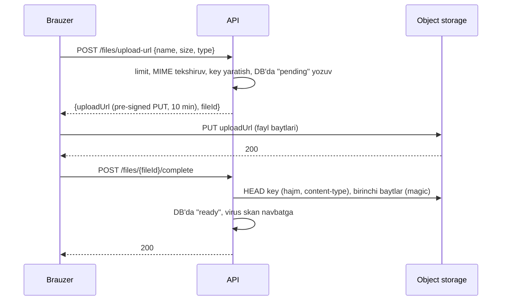

# 23. Fayl, hisobot va tashqi integratsiya

> **Bir jumlada:** Enterprise backend'ning "ko'rinmas yarmi" bu fayl yuklash va saqlash, Excel/PDF hisobotlar, email va tashqi tizimlar (to'lov, SMS, soliq, bank) bilan ikki tomonlama almashinuv; bularning har birida hajm, xavfsizlik va ishonchlilik muammolari CRUD'dan boshqacha.
> **Nega Middle uchun:** Middle'dan 50 MB faylni yiqilmasdan qabul qilish, 500 000 qatorli eksportni API'ni bloklamay yasash, tashqi API 30 soniya javob bermaganda ilovani tirik saqlash va webhook ikki marta kelganda ikki marta to'lov yozmaslik kutiladi.
> **O'qish vaqti:** ~50 daqiqa

## Mundarija

- [1. Muammo va yechim](#1-muammo-va-yechim)
- [2. Qanday ishlaydi](#2-qanday-ishlaydi)
- [3. Asosiy tushunchalar](#3-asosiy-tushunchalar)
- [4. Amaliy misol](#4-amaliy-misol)
- [5. Tipik xatolar va anti-patternlar](#5-tipik-xatolar-va-anti-patternlar)
- [6. Best practices checklist](#6-best-practices-checklist)
- [7. Suhbat savollari va javoblar](#7-suhbat-savollari-va-javoblar)
- [8. Qo'shimcha manbalar](#8-qoshimcha-manbalar)

## 1. Muammo va yechim

Holat. Ombor tizimida uch hodisa bir hafta ichida:

- Buxgalter "barcha buyurtmalar" Excel eksportini bosdi: 480 000 qator. Endpoint hammasini `List<Order>`ga yukladi (1.8 GB xotira), ClosedXML bilan workbook yasadi (yana 2 GB), 4 daqiqadan keyin ingress timeout (60 s) allaqachon o'tgan, mijoz qayta bosdi, ikki parallel eksport, pod OOMKilled, barcha foydalanuvchilar 30 soniya 502 ko'rdi.
- Payme webhook'i tarmoq uzilishi tufayli bitta to'lov uchun 3 marta keldi. Handler har safar `Payment` yozuvi yaratdi, buyurtma 3 marta "to'langan" bo'ldi, hisobot 3 barobar daromad ko'rsatdi.
- Soliq (Soliq.uz) API'si 40 soniya javob bermadi. `HttpClient` timeout default 100 s, retry yo'q, 200 ta so'rov o'sha API'ni kutib thread pool'ni band qildi, butun API sekinlashdi (buyurtma ko'rish ham).

Umumiy sabab: tashqi dunyo (fayl, mijoz brauzeri, uchinchi tomon API) ichki kod kabi ishonchli va tez deb qabul qilingan. Yechim har chegarada uchta savol: **hajm** (qancha bo'lishi mumkin va u xotiraga sig'adimi), **ishonch** (kim yubordi va u aytganidek narsami), **vaqt** (javob kelmasa yoki ikki marta kelsa nima bo'ladi).

| Chegara | Hajm | Ishonch | Vaqt |
|---|---|---|---|
| Fayl yuklash | Limit, streaming, object storage | MIME va magic bytes, nom tozalash | Pre-signed URL: API o'tkazmaydi |
| Eksport/hisobot | Streaming yozish, fon job | Ruxsat, tenant filtri | Progress, tayyor bo'lganda havola |
| Tashqi API | Javob hajmi limiti | TLS, sirlar, sandbox | Timeout, retry, circuit breaker, idempotency |
| Webhook | Body limiti | HMAC imzo, timestamp | Tez 200, navbat, dublikat himoyasi |
| Email | Attachment limiti | SPF/DKIM (infra) | Navbat, retry, dead-letter |

## 2. Qanday ishlaydi

**HTTP so'rov body'si Kestrel'da.** Kestrel body'ni xotiraga yig'maydi: `HttpRequest.Body` bu tarmoq soketidan o'qiydigan oqim (stream). `IFormFile` bilan model binding `multipart/form-data`'ni o'qib, har faylni buferlaydi: 64 KB gacha xotirada, undan kattasini vaqtinchalik faylga (`FileBufferingReadStream`) yozadi. Ya'ni 50 MB `IFormFile` xotirani to'ldirmaydi, lekin diskka ikki marta yoziladi (temp, keyin siz saqlaysiz) va `MultipartBodyLengthLimit` (default 128 MB) va Kestrel `MaxRequestBodySize` (default 30 MB) chegaralari bor. `MultipartReader` bilan oqimni o'zingiz o'qisangiz, bufer yo'q, fayl to'g'ridan-to'g'ri object storage'ga oqadi.

**Pre-signed URL.** Object storage (S3, MinIO, Azure Blob) imzolangan URL yaratish imkonini beradi: `PUT https://minio/bucket/key?X-Amz-Signature=...&X-Amz-Expires=600`. Imzo sizning maxfiy kalitingiz bilan HMAC; storage uni tekshiradi, muddat va metod (PUT, faqat shu key) cheklangan. Brauzer faylni to'g'ridan-to'g'ri storage'ga yuboradi, API orqali bayt o'tmaydi: API faqat URL yasaydi (millisekund) va keyin "yuklandi" tasdig'ini oladi.

**HMAC webhook imzosi.** Provayder body'ni (bayt sifatida) va umumiy sir bilan `HMAC-SHA256` hisoblab header'ga qo'yadi. Siz ham hisoblaysiz va solishtirasiz. Solishtirish `FixedTimeEquals` bilan: oddiy `==` birinchi farqli baytda to'xtaydi, vaqt farqi bo'yicha imzoni bayt-bayt topib olish mumkin (timing attack). Body'ni qayta serialize qilmasdan, kelgan xom baytlar ustida hisoblash shart: JSON'ni deserialize/serialize qilsangiz bo'shliq va tartib o'zgaradi, imzo mos kelmaydi.

**Idempotency.** Tashqi API'ga so'rov yubordingiz, timeout bo'ldi. Bajarilganmi yoki yo'qmi noma'lum. Qayta yuborsangiz ikki marta to'lov bo'lishi mumkin. `Idempotency-Key` header'i (siz yaratgan GUID) bilan provayder bir xil kalitli so'rovni bir marta bajaradi va oldingi javobni qaytaradi. Shu printsip kiruvchi tomonda ham: webhook `event_id`'si bazada unique, ikkinchi marta `INSERT` 23505 beradi va siz 200 qaytarasiz.



## 3. Asosiy tushunchalar

### 3.1 Object storage va metadata

- Ta'rif: S3-mos (AWS S3, MinIO, Yandex/Cloudflare R2) yoki Azure Blob: kalit → bayt + metadata; fayl tizimi emas, pod diski emas.
- Nega kerak: pod diski efemer (restart'da yo'q), replica'lar orasida bo'lishilmaydi, backup yo'q. Bazada fayl (`bytea`) baza hajmini va backup vaqtini portlatadi. Storage'da bayt, bazada metadata (kim, qachon, nom, hajm, tip, key, tenant).

```csharp
// Paket: AWSSDK.S3. MinIO uchun ServiceURL va ForcePathStyle
builder.Services.AddSingleton<IAmazonS3>(sp =>
{
    var o = sp.GetRequiredService<IOptions<StorageOptions>>().Value;
    return new AmazonS3Client(o.AccessKey, o.SecretKey, new AmazonS3Config
    {
        ServiceURL = o.Endpoint,          // "http://minio:9000"
        ForcePathStyle = true,            // bucket subdomain emas, path: /bucket/key
        AuthenticationRegion = "us-east-1"
    });
});

public sealed class StoredFile
{
    public Guid Id { get; init; }
    public Guid TenantId { get; init; }
    public string Key { get; init; } = default!;        // "tenant/{tenantId}/orders/{orderId}/{guid}.pdf"
    public string OriginalName { get; init; } = default!;
    public string ContentType { get; init; } = default!;
    public long Size { get; init; }
    public FileStatus Status { get; set; }               // Pending, Ready, Rejected
    public DateTimeOffset CreatedAt { get; init; }
}
```

Key'da foydalanuvchi bergan nom yo'q (path traversal, Unicode, bo'shliq), faqat sizning GUID'ingiz; original nom metadata'da, yuklab berishda `Content-Disposition` orqali qaytariladi.

- Tipik xato: pre-signed GET URL'ni bazada saqlash. U muddatli (va kalit almashganda o'ladi); saqlanadigan narsa `Key`, URL har so'rovda yasaladi.

### 3.2 Pre-signed URL

- Ta'rif: muddatli, bitta operatsiya (PUT yoki GET) va bitta key uchun imzolangan URL.
- Nega kerak: API orqali bayt o'tmaydi (CPU, xotira, tarmoq), yuklash tezroq (brauzer to'g'ridan-to'g'ri storage'ga), API faqat ruxsat va metadata.

```csharp
public sealed class UploadService(IAmazonS3 s3, AppDbContext db, IOptions<StorageOptions> opt, TimeProvider clock)
{
    private static readonly HashSet<string> AllowedTypes = ["application/pdf", "image/png", "image/jpeg",
        "application/vnd.openxmlformats-officedocument.spreadsheetml.sheet"];
    private const long MaxSize = 50L * 1024 * 1024;

    public async Task<UploadTicket> CreateUploadAsync(Guid tenantId, string name, long size, string contentType, CancellationToken ct)
    {
        if (size is <= 0 or > MaxSize) throw new ValidationException("Fayl hajmi 1 bayt dan 50 MB gacha");
        if (!AllowedTypes.Contains(contentType)) throw new ValidationException("Ruxsat etilmagan fayl turi");

        var id = Guid.CreateVersion7();
        var ext = Path.GetExtension(name).ToLowerInvariant();          // faqat kengaytma, nom emas
        var key = $"tenant/{tenantId}/uploads/{id}{ext}";

        db.Files.Add(new StoredFile { Id = id, TenantId = tenantId, Key = key, OriginalName = Path.GetFileName(name),
            ContentType = contentType, Size = size, Status = FileStatus.Pending, CreatedAt = clock.GetUtcNow() });
        await db.SaveChangesAsync(ct);

        var url = await s3.GetPreSignedURLAsync(new GetPreSignedUrlRequest
        {
            BucketName = opt.Value.Bucket,
            Key = key,
            Verb = HttpVerb.PUT,
            Expires = clock.GetUtcNow().UtcDateTime.AddMinutes(10),
            ContentType = contentType          // brauzer aynan shu Content-Type bilan PUT qilishi shart
        });
        return new UploadTicket(id, url);   // Azure Blob'da ekvivalent: BlobClient.GenerateSasUri(Write, 10 min)
    }

    public async Task CompleteAsync(Guid tenantId, Guid fileId, CancellationToken ct)
    {
        var file = await db.Files.SingleAsync(f => f.Id == fileId && f.TenantId == tenantId, ct);
        // Haqiqatan yuklandimi va hajm mos keladimi: mijoz so'ziga ishonmaymiz
        var meta = await s3.GetObjectMetadataAsync(opt.Value.Bucket, file.Key, ct);
        if (meta.ContentLength != file.Size) throw new ValidationException("Hajm mos emas");

        // Magic bytes: birinchi 16 baytni o'qiymiz (range request), butun faylni emas
        using var head = await s3.GetObjectAsync(new GetObjectRequest
            { BucketName = opt.Value.Bucket, Key = file.Key, ByteRange = new ByteRange(0, 15) }, ct);
        var buf = new byte[16];
        var read = await head.ResponseStream.ReadAtLeastAsync(buf, 16, throwOnEndOfStream: false, ct);
        if (!FileSignature.Matches(buf.AsSpan(0, read), file.ContentType))
        {
            file.Status = FileStatus.Rejected;
            await db.SaveChangesAsync(ct);
            await s3.DeleteObjectAsync(opt.Value.Bucket, file.Key, ct);
            throw new ValidationException("Fayl mazmuni e'lon qilingan turga mos emas");
        }
        file.Status = FileStatus.Ready;
        await db.SaveChangesAsync(ct);
    }
}
```

- Tipik xato: `Pending` yozuvlarni tozalamaslik. Mijoz URL olib yuklamadi: metadata qoladi. Fon job 24 soatdan eski `Pending`larni o'chiradi; storage'da esa lifecycle rule (`uploads/` prefiksida 1 kun).

### 3.3 IFormFile limitlari va streaming upload

- Ta'rif: `IFormFile` qulay, lekin buferlaydi va limitlar bilan keladi; `MultipartReader` oqimni bufersiz o'qiydi.
- Nega kerak: pre-signed URL har doim mumkin emas (ichki tarmoq, storage'ga to'g'ridan-to'g'ri ruxsat yo'q); unda API orqali, lekin xotirasiz.

Limitlar (uch qatlam, eng kichigi g'olib):
```csharp
// 1. Kestrel: butun body
builder.WebHost.ConfigureKestrel(k => k.Limits.MaxRequestBodySize = 60 * 1024 * 1024);
// 2. Form parsing
builder.Services.Configure<FormOptions>(o => o.MultipartBodyLengthLimit = 60 * 1024 * 1024);
// 3. Endpoint darajasida (attribut yoki metadata)
app.MapPost("/import", ImportHandler).WithMetadata(new RequestSizeLimitAttribute(60 * 1024 * 1024));
// Ingress (nginx: client_max_body_size) ham alohida limit, 413 ingress'dan keladi
```

Streaming: multipart oqimini bo'lak-bo'lak o'qib storage'ga yuborish.

```csharp
app.MapPost("/files/stream", async (HttpRequest req, IAmazonS3 s3, IOptions<StorageOptions> opt, CancellationToken ct) =>
{
    if (!MediaTypeHeaderValue.TryParse(req.ContentType, out var mt) || !mt.MediaType.Equals("multipart/form-data", StringComparison.OrdinalIgnoreCase))
        return Results.BadRequest("multipart/form-data kutilgan");

    var boundary = HeaderUtilities.RemoveQuotes(mt.Boundary).Value!;
    var reader = new MultipartReader(boundary, req.Body) { BodyLengthLimit = 60 * 1024 * 1024 };

    while (await reader.ReadNextSectionAsync(ct) is { } section)
    {
        if (!ContentDispositionHeaderValue.TryParse(section.ContentDisposition, out var cd) || string.IsNullOrEmpty(cd.FileName.Value))
            continue;   // oddiy form maydoni, fayl emas

        var key = $"uploads/{Guid.CreateVersion7()}{Path.GetExtension(cd.FileName.Value)}";
        // TransferUtility multipart upload: 5 MB bo'laklar, section.Body to'g'ridan-to'g'ri oqadi, xotirada bitta bo'lak
        await new TransferUtility(s3).UploadAsync(new TransferUtilityUploadRequest
        {
            BucketName = opt.Value.Bucket, Key = key, InputStream = section.Body,
            ContentType = section.ContentType, AutoCloseStream = false, PartSize = 5 * 1024 * 1024
        }, ct);
        return Results.Ok(new { key });
    }
    return Results.BadRequest("Fayl topilmadi");
}).DisableAntiforgery();
```

`section.Body` uzunligi oldindan noma'lum (`CanSeek = false`); `TransferUtility` buni multipart upload bilan hal qiladi. Oddiy `PutObjectAsync` `Content-Length` talab qiladi va seek qila olmaydigan oqimni buferlashga urinadi.

- Tipik xato: `using var ms = new MemoryStream(); await file.CopyToAsync(ms);` keyin `ms.ToArray()`. 50 MB fayl uchun 100+ MB xotira (MemoryStream o'sishi + massiv), 20 parallel yuklash pod'ni o'ldiradi.

### 3.4 MIME va magic bytes tekshiruvi

- Ta'rif: `Content-Type` va kengaytma mijoz aytgan narsa, ishonchsiz; magic bytes (fayl boshidagi imzo baytlar) mazmunni ko'rsatadi.
- Nega kerak: `.pdf` nomli `.exe` yoki `image/png` deb yuborilgan HTML (XSS: brauzer `Content-Type` sniffing bilan ishga tushirishi mumkin).

```csharp
public static class FileSignature
{
    private static readonly Dictionary<string, byte[][]> Signatures = new()
    {
        ["application/pdf"] = [[0x25, 0x50, 0x44, 0x46]],                   // %PDF
        ["image/png"]       = [[0x89, 0x50, 0x4E, 0x47, 0x0D, 0x0A, 0x1A, 0x0A]],
        ["image/jpeg"]      = [[0xFF, 0xD8, 0xFF]],
        // xlsx/docx bu ZIP: PK\x03\x04. ZIP ekanini tasdiqlaydi, ichida nima borligini emas
        ["application/vnd.openxmlformats-officedocument.spreadsheetml.sheet"] = [[0x50, 0x4B, 0x03, 0x04]],
    };

    public static bool Matches(ReadOnlySpan<byte> head, string contentType) =>
        Signatures.TryGetValue(contentType, out var sigs) && sigs.Any(s => head.Length >= s.Length && head[..s.Length].SequenceEqual(s));
}
```

Qo'shimcha choralar: yuklab berishda `X-Content-Type-Options: nosniff` va `Content-Disposition: attachment` (brauzer ochmaydi, yuklab oladi); rasmlarni qayta kodlash (ImageSharp bilan ochib qayta saqlash, ichidagi payload yo'qoladi); virus skan (ClamAV) fon job'da, `Ready` holati skan'dan keyin.

### 3.5 Excel: ClosedXML va MiniExcel

- Ta'rif: ClosedXML to'liq workbook modeli (formatlash, formula, diagramma), hammasi xotirada; MiniExcel qator-qator o'qiydi va yozadi (streaming), xotira doimiy. EPPlus kuchli, lekin tijoriy litsenziya (Polyform Noncommercial).
- Nega kerak: 10 000 qatorgacha hisobot ClosedXML bilan chiroyli; 500 000 qatorli eksport faqat streaming.

```csharp
// ClosedXML: kichik, formatlangan hisobot
public static byte[] BuildStockReport(IReadOnlyList<StockRow> rows)
{
    using var wb = new XLWorkbook();
    var ws = wb.Worksheets.Add("Qoldiq");
    ws.Cell(1, 1).Value = "Ombor qoldig'i";
    ws.Cell(1, 1).Style.Font.SetBold().Font.SetFontSize(14);
    var table = ws.Cell(3, 1).InsertTable(rows, "Stock", createTable: true);   // property nomlari sarlavha
    ws.Column(4).Style.NumberFormat.Format = "#,##0.00 \"UZS\"";
    ws.Columns().AdjustToContents();
    using var ms = new MemoryStream();
    wb.SaveAs(ms);
    return ms.ToArray();
}

// MiniExcel: katta eksport, IAsyncEnumerable → javob oqimiga to'g'ridan-to'g'ri
app.MapGet("/orders/export", (AppDbContext db, HttpResponse res, CancellationToken ct) =>
{
    res.ContentType = "application/vnd.openxmlformats-officedocument.spreadsheetml.sheet";
    res.Headers.ContentDisposition = "attachment; filename=\"orders.xlsx\"";
    // AsAsyncEnumerable: EF qatorlarni birma-bir o'qiydi, List yo'q. MiniExcel yozib boradi, xotira doimiy
    var rows = db.Orders.AsNoTracking().OrderBy(o => o.Id)
        .Select(o => new { o.Number, o.CustomerName, o.Total, o.CreatedAt })
        .AsAsyncEnumerable();
    return MiniExcel.SaveAsAsync(res.Body, rows, cancellationToken: ct);
});
```

Import: `MiniExcel.QueryAsync<ImportRow>(stream)` qator-qator; har qatorni validatsiya qilib, xatolarni qator raqami bilan yig'ib, natijani (muvaffaqiyatli/xato ro'yxati) qaytaring; 100 ming qatorli importni fon job'da.

- Tipik xato: Excel'ga formula sifatida talqin qilinadigan matn (`=HYPERLINK(...)`, `+cmd|...`) mijoz kiritgan maydonlardan to'g'ridan-to'g'ri yozish (CSV/formula injection). Mijoz matni `=`, `+`, `-`, `@` bilan boshlansa oldiga `'` qo'ying yoki kutubxonaning matn rejimini ishlating.

### 3.6 PDF: QuestPDF

- Ta'rif: QuestPDF C# fluent API bilan layout (sahifa, jadval, matn, rasm), HTML'siz. PuppeteerSharp HTML → PDF (Chromium kerak, image katta). Litsenziya: QuestPDF Community bepul (yillik daromad $1M gacha), kodda e'lon qilinadi.
- Nega kerak: hisob-faktura, nakladnoy, akt: aniq layout, sahifa raqamlari, jadval sahifa o'tishi, shrift.

```csharp
QuestPDF.Settings.License = LicenseType.Community;   // Program.cs, bir marta

public sealed class InvoiceDocument(Invoice inv) : IDocument
{
    public DocumentMetadata GetMetadata() => new() { Title = $"Hisob-faktura {inv.Number}" };

    public void Compose(IDocumentContainer container) => container.Page(page =>
    {
        page.Size(PageSizes.A4);
        page.Margin(1.5f, Unit.Centimetre);
        page.DefaultTextStyle(t => t.FontSize(10).FontFamily("DejaVu Sans"));   // konteynerda shrift bo'lishi shart

        page.Header().Row(row =>
        {
            row.RelativeItem().Column(c =>
            {
                c.Item().Text($"Hisob-faktura № {inv.Number}").FontSize(16).Bold();
                c.Item().Text($"Sana: {inv.Date:dd.MM.yyyy}");
            });
            row.ConstantItem(120).Image(inv.LogoPng);
        });

        page.Content().PaddingVertical(10).Table(t =>
        {
            t.ColumnsDefinition(c => { c.ConstantColumn(30); c.RelativeColumn(4); c.RelativeColumn(); c.RelativeColumn(); c.RelativeColumn(); });
            t.Header(h =>
            {
                foreach (var title in new[] { "№", "Nomi", "Miqdor", "Narx", "Summa" })
                    h.Cell().Background(Colors.Grey.Lighten3).Padding(4).Text(title).Bold();
            });
            var i = 1;
            foreach (var line in inv.Lines)
            {
                t.Cell().Padding(4).Text((i++).ToString());
                t.Cell().Padding(4).Text(line.Name);
                t.Cell().Padding(4).AlignRight().Text(line.Qty.ToString("N0"));
                t.Cell().Padding(4).AlignRight().Text(line.Price.ToString("N2"));
                t.Cell().Padding(4).AlignRight().Text((line.Qty * line.Price).ToString("N2"));
            }
            t.Cell().ColumnSpan(4).Padding(4).AlignRight().Text("Jami:").Bold();
            t.Cell().Padding(4).AlignRight().Text(inv.Total.ToString("N2") + " UZS").Bold();
        });

        page.Footer().AlignCenter().Text(x => { x.Span("Sahifa "); x.CurrentPageNumber(); x.Span(" / "); x.TotalPages(); });
    });
}

// Ishlatish: oqimga, keyin storage'ga yoki javobga
var pdf = new InvoiceDocument(invoice).GeneratePdf();
```

Konteynerda: chiseled image'da shrift yo'q; Dockerfile'da `fonts-dejavu` o'rnatilgan oddiy `aspnet:10.0` image yoki shrift faylini `QuestPDF.Drawing.FontManager.RegisterFont(stream)` bilan assembly'dan yuklang. QuestPDF SkiaSharp native kutubxonalarini o'z ichida olib keladi (`SkiaSharp.NativeAssets.Linux`); Alpine'da `musl` varianti kerak.

### 3.7 Email: MailKit, shablon, navbat

- Ta'rif: MailKit SMTP mijozi (`System.Net.Mail.SmtpClient` eskirgan va tavsiya etilmaydi); shablon Razor (RazorLight) yoki Fluid (Liquid); yuborish fon navbat orqali.
- Nega kerak: SMTP 2-10 soniya, provayder vaqtincha rad etishi mumkin (4xx greylisting); HTTP so'rov ichida yuborish so'rovni sekinlashtiradi va xato bo'lsa buyurtma tranzaksiyasini qaytaradi. Email "yuborilsin" bu outbox'dagi hodisa, yuborish alohida.

```csharp
// Outbox/navbatga yozish: buyurtma tranzaksiyasi ichida, SMTP emas
db.OutboxMessages.Add(OutboxMessage.From(new SendEmailRequested(
    To: customer.Email, Template: "order-confirmed", Model: new { order.Number, order.Total }, DedupKey: $"order-confirmed:{order.Id}")));

// Consumer (worker): shablon render, MailKit bilan yuborish
public sealed class EmailSender(IOptions<SmtpOptions> opt, FluidParser parser, ILogger<EmailSender> log)
{
    public async Task SendAsync(SendEmailRequested req, CancellationToken ct)
    {
        var template = parser.Parse(await File.ReadAllTextAsync($"Templates/{req.Template}.liquid", ct));
        var html = await template.RenderAsync(new TemplateContext(req.Model));   // HTML-encode default: XSS yo'q

        var msg = new MimeMessage();
        msg.From.Add(new MailboxAddress("Warehouse", opt.Value.From));
        msg.To.Add(MailboxAddress.Parse(req.To));
        msg.Subject = $"Buyurtma {req.Model.Number} tasdiqlandi";
        msg.Body = new BodyBuilder { HtmlBody = html, TextBody = HtmlToText(html) }.ToMessageBody();
        msg.Headers.Add("X-Entity-Ref", req.DedupKey);     // provayder log'ida izlash uchun

        using var client = new SmtpClient { Timeout = 15_000 };
        await client.ConnectAsync(opt.Value.Host, opt.Value.Port, SecureSocketOptions.StartTls, ct);
        await client.AuthenticateAsync(opt.Value.User, opt.Value.Password, ct);
        await client.SendAsync(msg, ct);
        await client.DisconnectAsync(quit: true, ct);
    }
}
```

Consumer xato bersa (SMTP 4xx, tarmoq) broker/outbox retry qiladi (eksponensial, 5 marta), keyin dead-letter. `DedupKey` bilan consumer "allaqachon yuborilgan" ni tekshiradi (bazada `sent_emails` unique), chunki at-least-once yetkazish ikki marta chaqirishi mumkin. Ommaviy yuborish (10 000 mijoz) uchun SMTP emas, provayder API (SendGrid, Mailgun, Brevo) va ularning rate limit'i.

### 3.8 Tashqi API: typed client, resilience, idempotency, sandbox

- Ta'rif: typed `HttpClient` (DI orqali sozlangan, `IHttpClientFactory` boshqaradi), `Microsoft.Extensions.Http.Resilience` standart pipeline (rate limiter, total timeout, retry, circuit breaker, attempt timeout), idempotency key, sandbox (provayderning test muhiti).
- Nega kerak: 1-bo'limdagi 40 soniyalik soliq API'si: attempt timeout 5 s, 2 retry, total 15 s; circuit breaker 30 s davomida 50% xato bo'lsa 15 s ochiq (tez xato, kutish yo'q); thread'lar band bo'lmaydi.

```csharp
builder.Services.AddOptions<PaymeOptions>().BindConfiguration("Payme").ValidateDataAnnotations().ValidateOnStart();

builder.Services.AddHttpClient<PaymeClient>((sp, c) =>
    {
        var o = sp.GetRequiredService<IOptions<PaymeOptions>>().Value;
        c.BaseAddress = new Uri(o.BaseUrl);       // sandbox: https://checkout.test.paycom.uz, prod: boshqa; env orqali
        c.DefaultRequestHeaders.Add("X-Auth", o.MerchantId);
        c.Timeout = TimeSpan.FromSeconds(30);     // resilience total timeout'dan katta: handler boshqaradi
    })
    .AddStandardResilienceHandler(o =>
    {
        o.AttemptTimeout.Timeout = TimeSpan.FromSeconds(5);
        o.TotalRequestTimeout.Timeout = TimeSpan.FromSeconds(15);
        o.Retry.MaxRetryAttempts = 2;
        o.Retry.BackoffType = DelayBackoffType.Exponential;
        o.Retry.UseJitter = true;
        // Faqat idempotent so'rovlar retry: GET, yoki Idempotency-Key bor POST
        o.Retry.ShouldHandle = args => ValueTask.FromResult(
            args.Outcome.Result is { } r && (r.StatusCode >= HttpStatusCode.InternalServerError || r.StatusCode == HttpStatusCode.TooManyRequests)
            && (args.Outcome.Result.RequestMessage?.Method == HttpMethod.Get || args.Outcome.Result.RequestMessage?.Headers.Contains("Idempotency-Key") == true)
            || args.Outcome.Exception is HttpRequestException or TimeoutRejectedException);
        o.CircuitBreaker.SamplingDuration = TimeSpan.FromSeconds(30);
        o.CircuitBreaker.FailureRatio = 0.5;
        o.CircuitBreaker.MinimumThroughput = 20;
        o.CircuitBreaker.BreakDuration = TimeSpan.FromSeconds(15);
    });

public sealed class PaymeClient(HttpClient http, ILogger<PaymeClient> log)
{
    public async Task<InvoiceResult> CreateInvoiceAsync(Guid orderId, Money amount, CancellationToken ct)
    {
        using var req = new HttpRequestMessage(HttpMethod.Post, "api/invoices")
        {
            Content = JsonContent.Create(new { order_id = orderId, amount = amount.Tiyin, currency = "UZS" })
        };
        // Bizning orderId asosida deterministik kalit: retry va qayta urinishda bir xil
        req.Headers.Add("Idempotency-Key", $"invoice-{orderId:N}");

        using var res = await http.SendAsync(req, ct);
        if (!res.IsSuccessStatusCode)
        {
            var body = await res.Content.ReadAsStringAsync(ct);
            log.LogWarning("Payme invoice failed for {OrderId}: {Status} {Body}", orderId, (int)res.StatusCode, Truncate(body, 500));
            throw new PaymentGatewayException($"Payme {(int)res.StatusCode}");
        }
        return (await res.Content.ReadFromJsonAsync<InvoiceResult>(ct))!;
    }
}
```

Sandbox: provayderning test muhiti (test kartalar, soxta pul). Konfiguratsiya: `BaseUrl`, `MerchantId`, `Secret` env orqali muhitga qarab; kodda `if (env == "prod")` tarmog'i yo'q. Integration testda WireMock.Net bilan provayder javoblari stub qilinadi (sandbox ham tarmoq va flaky).

- Tipik xato: `new HttpClient()` har so'rovda (soket tugaydi) yoki `static HttpClient` (DNS o'zgarishini sezmaydi). `IHttpClientFactory` handler'larni aylantirib turadi.

### 3.9 Webhook qabul qilish

- Ta'rif: provayder sizga HTTP POST yuboradi (to'lov holati o'zgardi). Siz: imzoni tekshirasiz, tez 200 qaytarasiz, ishlovni navbatga berasiz, dublikatni e'tiborsiz qoldirasiz.
- Nega kerak: provayder javobni 5-10 s kutadi, sekin bo'lsa qayta yuboradi (dublikat); imzosiz endpoint'ga har kim "to'landi" deb yuborishi mumkin.

```csharp
app.MapPost("/webhooks/payme", async (HttpRequest req, AppDbContext db, Channel<WebhookJob> queue,
    IOptions<PaymeOptions> opt, TimeProvider clock, ILogger<Program> log, CancellationToken ct) =>
{
    // 1. Xom body: qayta serialize qilmaymiz, imzo aynan shu baytlar ustida
    req.EnableBuffering();
    using var ms = new MemoryStream();
    await req.Body.CopyToAsync(ms, ct);
    var raw = ms.ToArray();
    if (raw.Length > 64 * 1024) return Results.StatusCode(StatusCodes.Status413PayloadTooLarge);

    // 2. Timestamp: 5 daqiqadan eski so'rov replay bo'lishi mumkin
    if (!long.TryParse(req.Headers["X-Timestamp"], out var ts) ||
        Math.Abs(clock.GetUtcNow().ToUnixTimeSeconds() - ts) > 300)
        return Results.Unauthorized();

    // 3. HMAC: sir + timestamp + body. Provayder hujjatiga qarab tartib
    var secret = Encoding.UTF8.GetBytes(opt.Value.WebhookSecret);
    var payload = Encoding.UTF8.GetBytes($"{ts}.").Concat(raw).ToArray();
    var expected = HMACSHA256.HashData(secret, payload);
    var received = SafeFromHex(req.Headers["X-Signature"].ToString());
    // FixedTimeEquals: uzunlik farq qilsa false, teng bo'lsa barcha baytlarni solishtiradi (timing attack yo'q)
    if (!CryptographicOperations.FixedTimeEquals(expected, received))
    {
        log.LogWarning("Webhook signature mismatch from {Ip}", req.HttpContext.Connection.RemoteIpAddress);
        return Results.Unauthorized();
    }

    // 4. Dublikat: event id unique index, ikkinchi marta 23505 → 200 (provayder qayta yubormasin)
    var evt = JsonSerializer.Deserialize<PaymeEventEnvelope>(raw)!;
    db.WebhookEvents.Add(new WebhookEvent { ProviderEventId = evt.Id, Provider = "payme", Payload = raw, ReceivedAt = clock.GetUtcNow() });
    try { await db.SaveChangesAsync(ct); }
    catch (DbUpdateException ex) when (ex.InnerException is PostgresException { SqlState: "23505" })
    {
        log.LogInformation("Duplicate webhook {EventId} ignored", evt.Id);
        return Results.Ok();
    }

    // 5. Ishlov navbatda, javob darhol. Channel bounded: to'lsa 503, provayder keyinroq qaytadi
    if (!queue.Writer.TryWrite(new WebhookJob(evt.Id)))
        return Results.StatusCode(StatusCodes.Status503ServiceUnavailable);
    return Results.Ok();
});

static byte[] SafeFromHex(string hex)
{
    try { return Convert.FromHexString(hex); } catch (FormatException) { return []; }   // bo'sh massiv: FixedTimeEquals false
}
```

Ishlov (`BackgroundService` `Channel`'dan o'qiydi): eventni bazadan yuklaydi, `Payment` holatini o'zgartiradi, `WebhookEvent.ProcessedAt` belgilaydi. Xato bo'lsa `Attempts++`, 5 dan oshsa `Failed` va alert. Pod restart'da `Channel` yo'qoladi, shuning uchun worker start'da `ProcessedAt IS NULL` eventlarni qayta oladi: baza haqiqat manbai, Channel faqat tezlatkich.

- Tipik xato: webhook ichida biznes mantiqni bajarish (to'lovni yozish, email yuborish, 1C'ga sinxronlash) va 8 soniyadan keyin 200. Provayder timeout, qayta yuboradi, dublikat.

### 3.10 Katta eksport: fon job va progress

- Ta'rif: so'rov "eksport yarat" deb darhol `202 Accepted` + job id qaytaradi; worker faylni yasab storage'ga qo'yadi; mijoz progress'ni so'raydi yoki SignalR/email orqali havola oladi.
- Nega kerak: 1-bo'limdagi OOM va timeout. HTTP so'rov 60 s dan uzun bo'lmasligi kerak (ingress, brauzer, mobil tarmoq).

```csharp
// API
app.MapPost("/exports/orders", async (ExportRequest r, AppDbContext db, Channel<Guid> jobs, ClaimsPrincipal user, CancellationToken ct) =>
{
    var job = new ExportJob { Id = Guid.CreateVersion7(), TenantId = user.TenantId(), Filter = r, Status = ExportStatus.Queued };
    db.ExportJobs.Add(job);
    await db.SaveChangesAsync(ct);
    jobs.Writer.TryWrite(job.Id);
    return Results.Accepted($"/exports/{job.Id}", new { job.Id });
});
app.MapGet("/exports/{id:guid}", async (Guid id, AppDbContext db, IAmazonS3 s3, IOptions<StorageOptions> opt, ClaimsPrincipal user) =>
{
    var job = await db.ExportJobs.AsNoTracking().FirstOrDefaultAsync(j => j.Id == id && j.TenantId == user.TenantId());
    if (job is null) return Results.NotFound();
    string? url = job.Status == ExportStatus.Done
        ? await s3.GetPreSignedURLAsync(new GetPreSignedUrlRequest { BucketName = opt.Value.Bucket, Key = job.FileKey, Verb = HttpVerb.GET, Expires = DateTime.UtcNow.AddMinutes(15) })
        : null;
    return Results.Ok(new { job.Status, job.Progress, job.Error, url });   // Progress: 0-100
});

// Worker
public sealed class ExportWorker(Channel<Guid> jobs, IServiceScopeFactory scopes, IAmazonS3 s3, IOptions<StorageOptions> opt) : BackgroundService
{
    protected override async Task ExecuteAsync(CancellationToken stop)
    {
        await foreach (var jobId in jobs.Reader.ReadAllAsync(stop))
        {
            using var scope = scopes.CreateScope();
            var db = scope.ServiceProvider.GetRequiredService<AppDbContext>();
            var job = await db.ExportJobs.SingleAsync(j => j.Id == jobId, stop);
            try
            {
                job.Status = ExportStatus.Running; await db.SaveChangesAsync(stop);
                var total = await db.Orders.CountAsync(o => o.TenantId == job.TenantId, stop);
                var key = $"tenant/{job.TenantId}/exports/{job.Id}.xlsx";

                // Vaqtinchalik fayl: storage multipart upload uchun seekable oqim, xotira emas
                var tmp = Path.Combine(Path.GetTempPath(), $"{job.Id}.xlsx");
                await using (var fs = File.Create(tmp))
                    await MiniExcel.SaveAsAsync(fs, Rows(db, job, total, stop), cancellationToken: stop);
                await new TransferUtility(s3).UploadAsync(tmp, opt.Value.Bucket, key, stop);
                File.Delete(tmp);

                job.FileKey = key; job.Progress = 100; job.Status = ExportStatus.Done;
            }
            catch (Exception ex) when (ex is not OperationCanceledException)
            {
                job.Status = ExportStatus.Failed; job.Error = "Eksport xatosi, qayta urinib ko'ring";   // ex.Message mijozga emas
            }
            await db.SaveChangesAsync(CancellationToken.None);   // stop bo'lsa ham holatni yozib qo'yamiz
        }
    }

    private static async IAsyncEnumerable<OrderExportRow> Rows(AppDbContext db, ExportJob job, int total, [EnumeratorCancellation] CancellationToken ct)
    {
        var done = 0;
        await foreach (var o in db.Orders.AsNoTracking().Where(o => o.TenantId == job.TenantId).OrderBy(o => o.Id)
                           .Select(o => new OrderExportRow(o.Number, o.CustomerName, o.Total, o.CreatedAt)).AsAsyncEnumerable().WithCancellation(ct))
        {
            yield return o;
            if (++done % 5000 == 0) { job.Progress = (int)(done * 100L / total); await db.SaveChangesAsync(ct); }   // har 5000 qatorda
        }
    }
}
```

Rolling update'da worker to'xtasa: job `Running` holatda qoladi; start'da `Running` va `UpdatedAt` 10 daqiqadan eski job'lar `Queued`ga qaytariladi. Bitta job ikki worker'da ishlamasligi uchun `UPDATE ... WHERE status = 'Queued' RETURNING` yoki `FOR UPDATE SKIP LOCKED` bilan olinadi. Hangfire/Quartz bu infratuzilmani tayyor beradi; `Channel` oddiy holat uchun.

### 3.11 Retry va dead-letter

- Ta'rif: retry vaqtinchalik xatoda qayta urinish (eksponensial kechikish + jitter); dead-letter queue (DLQ) necha marta urinib bo'lmagan xabarlar uchun alohida navbat.
- Nega kerak: cheksiz retry "poison message" (hech qachon muvaffaqiyatli bo'lmaydigan xabar) bilan consumer'ni band qiladi; retry'siz bitta tarmoq uzilishi buyurtmani yo'qotadi.

```csharp
// MassTransit (RabbitMQ): consumer darajasida retry, keyin _error navbati (DLQ)
cfg.ReceiveEndpoint("send-email", e =>
{
    e.UseMessageRetry(r => r.Exponential(5, TimeSpan.FromSeconds(1), TimeSpan.FromMinutes(2), TimeSpan.FromSeconds(2)));
    e.UseDelayedRedelivery(r => r.Intervals(TimeSpan.FromMinutes(5), TimeSpan.FromMinutes(30)));   // uzoq kechikish: broker'ga qaytarib
    e.ConfigureConsumer<SendEmailConsumer>(ctx);
    // 5 + 2 urinishdan keyin xabar "send-email_error" navbatiga: alert, qo'lda ko'rib chiqish, qayta yuborish
});
```

Qaysi xato retry: tarmoq, timeout, 5xx, 429, baza deadlock. Qaysi emas: validatsiya (400), ruxsat (401/403), mavjud emas (404), biznes rad (balans yetarli emas). Ikkinchi tur darhol DLQ yoki "failed" holat, retry foydasiz.

### 3.12 Integratsiya log'lari (sirlarsiz)

- Ta'rif: tashqi so'rov va javobning kuzatuv izini qoldirish: nima yuborildi, nima keldi, qancha vaqt, qaysi urinish.
- Nega kerak: "Payme 400 qaytardi" degan log yetarli emas, "qaysi maydon noto'g'ri" kerak; lekin so'rovda token, karta, telefon bo'lishi mumkin.

Qoidalar:
- Metadata har doim: URL (query'siz yoki maskalangan), metod, status, davomiylik, urinish raqami, `Idempotency-Key`, `TraceId`. Bu `HttpClient` instrumentation + `Microsoft.Extensions.Http.Logging` default beradi.
- Body faqat xato bo'lganda, kesilgan (500-2000 belgi), maskalangan (`"card": "8600****1234"`, `"token": "***"`). Provayder javob xatosi odatda PII'siz, so'rov body'si esa PII'li: so'rovni log qilmang, javobni qiling.
- `Authorization`, `X-Auth`, `Cookie` header'lari hech qachon. `.NET 8+` `AddExtendedHttpClientLogging` `RequestHeadersDataClasses` bilan qaysi header qaysi daraja ekanini belgilaydi.

## 4. Amaliy misol

To'liq webhook ishlov zanjiri: qabul (3.9) → `WebhookProcessor` → to'lov domen operatsiyasi → outbox hodisa. Bu yerda worker va idempotent ishlov.

```csharp
public sealed class WebhookProcessor(Channel<WebhookJob> queue, IServiceScopeFactory scopes, ILogger<WebhookProcessor> log) : BackgroundService
{
    protected override async Task ExecuteAsync(CancellationToken stop)
    {
        // Start'da: oldingi restart'da qolgan eventlar (Channel xotirada edi, yo'qoldi)
        await RequeueUnprocessedAsync(stop);

        await foreach (var job in queue.Reader.ReadAllAsync(stop))
        {
            using var scope = scopes.CreateScope();
            var db = scope.ServiceProvider.GetRequiredService<AppDbContext>();
            var handler = scope.ServiceProvider.GetRequiredService<PaymentWebhookHandler>();

            // SKIP LOCKED: bir nechta replica bo'lsa bitta event bitta worker'da
            var evt = await db.WebhookEvents
                .FromSql($"SELECT * FROM webhook_events WHERE provider_event_id = {job.EventId} AND processed_at IS NULL FOR UPDATE SKIP LOCKED")
                .FirstOrDefaultAsync(stop);
            if (evt is null) continue;   // allaqachon ishlangan yoki boshqa worker olgan

            using var _ = log.BeginScope(new Dictionary<string, object> { ["WebhookEventId"] = evt.ProviderEventId });
            await using var tx = await db.Database.BeginTransactionAsync(stop);
            try
            {
                await handler.HandleAsync(evt, stop);                   // domen: Payment → Paid, Order → Paid, outbox hodisa
                evt.ProcessedAt = DateTimeOffset.UtcNow;
                await db.SaveChangesAsync(stop);
                await tx.CommitAsync(stop);                             // event + to'lov + outbox bitta tranzaksiyada
            }
            catch (Exception ex) when (ex is not OperationCanceledException)
            {
                await tx.RollbackAsync(CancellationToken.None);
                evt.Attempts++;
                evt.LastError = ex.GetType().Name;                      // xabar emas: ichida PII bo'lishi mumkin
                if (evt.Attempts >= 5) { evt.Failed = true; log.LogError(ex, "Webhook permanently failed after {Attempts}", evt.Attempts); }
                else log.LogWarning(ex, "Webhook attempt {Attempt} failed, will retry", evt.Attempts);
                await db.SaveChangesAsync(CancellationToken.None);
                if (!evt.Failed) _ = Task.Delay(TimeSpan.FromSeconds(Math.Pow(2, evt.Attempts)), stop)
                                        .ContinueWith(_ => queue.Writer.TryWrite(job), TaskScheduler.Default);  // eksponensial qayta navbat
            }
        }
    }

    private async Task RequeueUnprocessedAsync(CancellationToken ct)
    {
        using var scope = scopes.CreateScope();
        var db = scope.ServiceProvider.GetRequiredService<AppDbContext>();
        var pending = await db.WebhookEvents.Where(e => e.ProcessedAt == null && !e.Failed).Select(e => e.ProviderEventId).ToListAsync(ct);
        foreach (var id in pending) queue.Writer.TryWrite(new WebhookJob(id));
        if (pending.Count > 0) log.LogInformation("Requeued {Count} unprocessed webhook events", pending.Count);
    }
}

public sealed class PaymentWebhookHandler(AppDbContext db)
{
    public async Task HandleAsync(WebhookEvent evt, CancellationToken ct)
    {
        var body = JsonSerializer.Deserialize<PaymeEventEnvelope>(evt.Payload)!;
        var payment = await db.Payments.Include(p => p.Order).SingleOrDefaultAsync(p => p.ProviderInvoiceId == body.InvoiceId, ct)
                      ?? throw new InvalidOperationException("Unknown invoice");   // retry foydasiz: Failed bo'ladi

        // Idempotent domen: allaqachon Paid bo'lsa hech narsa qilmaydi (eventlar tartibsiz kelishi mumkin)
        switch (body.State)
        {
            case "paid": payment.MarkPaid(body.PaidAt, body.Amount); break;      // ichida: if (Status == Paid) return;
            case "cancelled": payment.MarkCancelled(body.Reason); break;
            default: throw new InvalidOperationException($"Unknown state {body.State}");
        }
        // payment.MarkPaid ichida Order.MarkPaid() va OutboxMessages.Add(OrderPaid) bo'ladi
    }
}
```

Nega shunday: imzo va dublikat endpoint'da (tez, 20 ms), biznes mantiq worker'da (sekin bo'lishi mumkin); event, to'lov va outbox bitta tranzaksiyada (yarim holat yo'q); `SKIP LOCKED` bilan bir nechta replica raqobatlashmaydi; restart'da baza haqiqat manbai; 5 urinishdan keyin `Failed` va alert (DLQ ekvivalenti); domen metodlari idempotent (eventlar tartibsiz va takror kelsa ham holat to'g'ri).

## 5. Tipik xatolar va anti-patternlar

### 5.1 Fayl bazada yoki pod diskida

```csharp
// ❌ entity.Content = await file.ToByteArrayAsync();   // bytea ustun
// ❌ File.WriteAllBytes($"/app/uploads/{name}", bytes);
```
Oqibat: baza backup soatlab, `SELECT *` fayllarni tortadi, pod diski restart'da yo'q, replica'lar faylni ko'rmaydi.

✅ Object storage + metadata jadval + pre-signed URL.

### 5.2 Foydalanuvchi bergan nom yo'lda

```csharp
// ❌ var path = Path.Combine(root, file.FileName);   // "../../etc/passwd" yoki "..\\web.config"
```
Oqibat: path traversal, boshqa tenant faylini ustiga yozish.

✅ Key sizning GUID'ingiz, original nom faqat metadata va `Content-Disposition` (u ham `Uri.EscapeDataString` bilan).

### 5.3 Webhook'da imzo tekshiruvi `==` bilan

```csharp
// ❌ if (computedHex == headerHex)
```
Oqibat: timing attack nazariy, lekin arzon va skaner'lar topadi; `Content-Type`'ni o'zgartirgan proxy hex registrini o'zgartirsa `==` yiqiladi.

✅ `CryptographicOperations.FixedTimeEquals(expectedBytes, receivedBytes)`, hex parse xatosi bo'sh massivga.

### 5.4 Tashqi API timeout'siz va retry hamma narsaga

```csharp
// ❌ var res = await http.PostAsJsonAsync(url, body);   // default 100 s, retry yo'q
// ❌ retry POST'ni Idempotency-Key'siz
```
Oqibat: thread'lar 100 s band; retry bilan ikki marta to'lov.

✅ Standard resilience handler, attempt/total timeout, retry faqat idempotent so'rovlar, circuit breaker.

### 5.5 Email HTTP so'rov ichida

```csharp
// ❌ await smtp.SendAsync(msg); return Results.Ok(order);   // SMTP 8 s, xato bo'lsa buyurtma yo'q
```
Oqibat: sekin javob, SMTP xatosi buyurtmani buzadi, retry yo'q.

✅ Outbox hodisa, consumer yuboradi, retry va dead-letter.

### 5.6 Eksport `ToListAsync` + xotirada workbook

Oqibat: 1-bo'limdagi OOM va timeout.

✅ `AsAsyncEnumerable` + MiniExcel streaming; 10 000 qatordan katta bo'lsa fon job + progress + pre-signed GET.

### 5.7 Integratsiya log'ida sirlar

```csharp
// ❌ log.LogInformation("Request: {Headers} {Body}", req.Headers, json);   // X-Auth, karta, telefon
```
Oqibat: log backend'ida sirlar, PCI DSS buzilishi, token o'g'irlanadi.

✅ Metadata har doim, body faqat xatoda va maskalangan, header'lar classification bilan.

## 6. Best practices checklist

- [ ] Fayl baytlari object storage'da, bazada metadata, key sizning GUID'ingiz: backup, masshtab, path traversal yo'q.
- [ ] Yuklash pre-signed PUT bilan, `complete` qadamida hajm va magic bytes tekshiruvi: API bayt o'tkazmaydi, mijoz so'ziga ishonilmaydi.
- [ ] API orqali yuklash kerak bo'lsa `MultipartReader` streaming, uch qatlam limit (Kestrel, FormOptions, endpoint): xotira doimiy.
- [ ] `Content-Type` va kengaytma ishonchsiz, magic bytes + `nosniff` + `attachment`: XSS va soxta fayl yo'q.
- [ ] Excel eksport streaming (MiniExcel, `AsAsyncEnumerable`), formula injection himoyasi: katta hajm va xavfsizlik.
- [ ] 10 000 qatordan katta hisobot fon job, `202 Accepted`, progress, pre-signed GET: timeout va OOM yo'q.
- [ ] PDF QuestPDF bilan, shrift konteynerda mavjud, litsenziya e'lon qilingan: production'da "font not found" yo'q.
- [ ] Email outbox/navbat orqali, MailKit, shablon HTML-encode bilan, dedup kaliti: tez javob, retry, ikki marta yuborilmaydi.
- [ ] Tashqi API typed client + `AddStandardResilienceHandler`, attempt/total timeout, retry faqat idempotent, circuit breaker: tashqi sekinlik ichkariga oqmaydi.
- [ ] Chiquvchi POST'larga deterministik `Idempotency-Key`: timeout'dan keyin qayta urinish xavfsiz.
- [ ] Sandbox va production sozlamalari env orqali, kodda muhit tarmog'i yo'q: "prod'da test URL" xatosi yo'q.
- [ ] Webhook: xom body ustida HMAC, `FixedTimeEquals`, timestamp oynasi, body limiti: soxta va replay so'rovlar rad.
- [ ] Webhook event id unique index, tez 200, ishlov navbatda, domen metodlari idempotent: dublikat va tartibsizlik xavfsiz.
- [ ] Retry eksponensial + jitter, poison message DLQ'ga, DLQ metrikasi alert bilan: yo'qotish ham, cheksiz halqa ham yo'q.
- [ ] Integratsiya log'i metadata bilan, body faqat xatoda, kesilgan va maskalangan: diagnostika bor, sir yo'q.

## 7. Suhbat savollari va javoblar

**1. 50 MB faylni API orqali qanday yuklaysiz?**
Birinchi tanlov: yuklamayman, pre-signed URL beraman. API `POST /files/upload-url` bilan hajm va tipni tekshiradi, metadata yozadi, 10 daqiqalik PUT URL qaytaradi; brauzer to'g'ridan-to'g'ri storage'ga yuboradi; `complete` qadamida hajm va magic bytes tekshiriladi. API orqali bo'lishi shart bo'lsa: `IFormFile` emas, `MultipartReader` bilan oqimni o'qib `TransferUtility` multipart upload'ga uzataman, xotirada bitta 5 MB bo'lak; Kestrel, FormOptions va endpoint limitlari 60 MB. Tuzoq: `MemoryStream`ga nusxalash, 20 parallel yuklash pod'ni o'ldiradi.

**2. Webhook ikki marta kelsa nima bo'ladi?**
Provayder at-least-once yetkazadi, dublikat normal holat. Himoya uch qatlamda: event id'si `webhook_events`da unique index, ikkinchi `INSERT` 23505 beradi va men 200 qaytaraman (provayder to'xtaydi); ishlov domen metodlari idempotent (`MarkPaid` allaqachon Paid bo'lsa hech narsa qilmaydi), chunki event id yo'q provayderlar ham bor; tranzaksiya bitta: event `processed_at`, to'lov holati va outbox birga commit, yarim holat yo'q. Tuzoq: dedup'ni xotirada (`HashSet`) qilish, replica va restart'da ishlamaydi.

**3. Tashqi API 30 soniya javob bermasa ilovangizga nima bo'ladi?**
Himoyasiz: har so'rov 30-100 s thread va ulanishni band qiladi, parallel so'rovlar to'planadi, thread pool starvation, butun API sekinlashadi (bog'liq bo'lmagan endpoint'lar ham). Himoya bilan: attempt timeout 5 s, 2 retry (faqat idempotent), total 15 s, circuit breaker 30 s oynada 50% xato bo'lsa 15 s ochiq: so'rovlar darhol `BrokenCircuitException` oladi, foydalanuvchi "to'lov vaqtincha mavjud emas" ko'radi, qolgan tizim ishlaydi. Bulkhead (parallel so'rov limiti) qo'shimcha chegara. Keyin: metrika va alert circuit holati bo'yicha.

**4. Pre-signed URL xavfsizmi? Har kim yuklashi mumkin-ku.**
URL faqat bitta key, bitta metod (PUT), belgilangan `Content-Type` va 10 daqiqa uchun imzolangan; URL'ni olgan odam faqat o'sha key'ga o'sha muddatda yozishi mumkin, boshqa hech narsa. URL'ni faqat autentifikatsiya qilingan foydalanuvchi oladi va metadata'da u bilan bog'langan. `complete` qadamida hajm va mazmun tekshiriladi; yuklanmagan `Pending` yozuvlar va storage obyektlari lifecycle bilan tozalanadi. GET URL'lar ham muddatli, bazada saqlanmaydi, har ko'rishda yasaladi. Tuzoq: muddat bir kun, `Content-Type` cheklanmagan.

**5. Excel eksportda 500 000 qator, ClosedXML bilan OOM. Nima qilasiz?**
ClosedXML butun workbook'ni DOM sifatida xotirada ushlaydi, qator boshiga yuzlab bayt, 500 000 qator gigabaytlar. MiniExcel `SaveAsAsync(stream, IAsyncEnumerable)` qator-qator yozadi, EF `AsAsyncEnumerable` qator-qator o'qiydi, xotira doimiy. Lekin 500 000 qator 1-2 daqiqa, HTTP so'rov ichida emas: fon job, `202`, progress har 5000 qatorda, tayyor bo'lganda pre-signed GET. Formatlash kerak bo'lsa (sarlavha, valyuta) MiniExcel'da cheklangan: CSV yoki "birinchi 10 000 qator ClosedXML, qolgani oddiy" kelishuvi.

**6. HMAC imzoni tekshirishda `FixedTimeEquals` nega kerak?**
Oddiy `==` yoki `SequenceEqual` birinchi farqli baytda to'xtaydi: noto'g'ri imzo bilan javob vaqti qancha bayt to'g'ri ekaniga bog'liq. Hujumchi millionlab so'rov bilan vaqtni o'lchab imzoni bayt-bayt tiklashi mumkin (timing attack). `FixedTimeEquals` har doim barcha baytlarni solishtiradi, vaqt kontentga bog'liq emas. Shuningdek: imzo xom body ustida (qayta serialize emas), timestamp oynasi replay'ga qarshi, hex parse xatosi exception emas, bo'sh massiv (false). Tuzoq: `Convert.FromHexString` noto'g'ri header'da `FormatException` tashlaydi va 500 beradi, bu ham ma'lumot oqimi.

**7. Chiquvchi POST'ga `Idempotency-Key` qanday tanlaysiz?**
Tasodifiy GUID har urinishda emas, biznes obyektdan deterministik: `invoice-{orderId}`. Shunda retry (resilience handler ichida), pod restart'dan keyin qayta urinish, hatto foydalanuvchi tugmani ikki marta bossa ham bir xil kalit, provayder bir marta bajaradi va oldingi javobni qaytaradi. Kalitni bazada so'rov bilan birga saqlayman (`payment_requests`), javob kelganda yozaman. Provayder idempotency'ni qo'llamasa: avval "mavjudmi" so'rovi (`GET /invoices?order_id=`), keyin yaratish; va o'z tomonimda `Payment` uchun unique constraint.

**8. Email yuborish qayerda bo'lishi kerak va nega?**
Buyurtma tranzaksiyasi ichida emas, undan keyin, lekin ishonchli: outbox jadvaliga `SendEmailRequested` hodisasi buyurtma bilan bitta tranzaksiyada yoziladi, consumer (worker) MailKit bilan yuboradi. Natija: HTTP javob tez, SMTP yotsa buyurtma saqlanadi va email keyin ketadi, retry eksponensial, 5 urinishdan keyin DLQ va alert, dedup kaliti ikki marta yubormaydi. Shablon Fluid/Razor bilan HTML-encode (mijoz ismi `<script>` bo'lsa ham). Ommaviy yuborish provayder API orqali va ularning limitida. Tuzoq: `System.Net.Mail.SmtpClient`, u eskirgan va zamonaviy TLS/auth'da muammoli.

**9. Fayl tipini qanday tekshirasiz?**
Uch narsa, hech biri yolg'iz yetarli emas: kengaytma oq ro'yxat bo'yicha (`.pdf`, `.xlsx`, `.png`), `Content-Type` oq ro'yxat bo'yicha, magic bytes (birinchi 4-8 bayt) e'lon qilingan tipga mos. `xlsx` ZIP imzosi beradi, ichida `xl/workbook.xml` borligini kutubxona ochib tekshiradi. Rasmlarni ImageSharp bilan qayta kodlash ichidagi payload'ni yo'qotadi. Yuklab berishda `nosniff` va `attachment`. Kritik tizimda ClamAV skan fon job'da, `Ready` holati skan'dan keyin. Tuzoq: faqat `Content-Type` tekshirish, brauzer uni istalgan qiymatga qo'ya oladi.

**10. Webhook'ga javobni nega tez qaytarish kerak va "tez" qancha?**
Provayder 5-10 s (ba'zan 3 s) kutadi, kechiksa so'rovni muvaffaqiyatsiz deb qayta yuboradi, ba'zan bir necha marta, keyin to'xtatadi va siz eventni yo'qotasiz. Endpoint faqat imzo, dublikat tekshiruvi va bazaga/navbatga yozish qiladi: 20-50 ms. Biznes ishlov (to'lov holati, buyurtma, email, 1C) worker'da. Agar navbat to'lgan bo'lsa 503 qaytaraman, provayder keyinroq qaytadi, bu 200 deb aldashdan yaxshi. Tuzoq: `Results.Ok()` ni `fire-and-forget Task.Run` bilan "tezlashtirish", pod restart'da ish yo'qoladi; baza haqiqat manbai bo'lishi kerak.

**11. Retry va DLQ'ni qanday sozlaysiz, qaysi xatolar retry bo'lmasligi kerak?**
Retry faqat vaqtinchalik xatolarga: tarmoq, timeout, 5xx, 429, deadlock; eksponensial kechikish jitter bilan (1 s, 2 s, 4 s, ...), 5 urinish, keyin uzoq kechikishlar (5 min, 30 min) broker darajasida. Doimiy xatolar (400 validatsiya, 404, biznes rad, deserializatsiya xatosi) darhol DLQ: retry foydasiz va navbatni band qiladi. DLQ uzunligi metrikasi, 0 dan katta alert, admin sahifada ko'rish va qayta yuborish. Consumer idempotent bo'lishi shart, chunki retry'da xabar ikki marta keladi.

**12. Integratsiya log'ida nimani yozasiz va nimani yozmaysiz?**
Yozaman: provayder, operatsiya, URL (query'siz), status, davomiylik, urinish, `Idempotency-Key`, `TraceId`, xato kodi; xato bo'lganda javob body'si 1000 belgigacha va maskalangan. Yozmayman: `Authorization`/`X-Auth`/`Cookie` header'lari, so'rov body'si (PII: telefon, karta, pasport), muvaffaqiyatli javob body'si (hajm, PII). Audit uchun alohida `integration_calls` jadvali uzoq saqlanadi, log 30 kun. `AddExtendedHttpClientLogging` bilan header'larga data classification beriladi. Tuzoq: debug uchun "vaqtincha" body logging'ni yoqib, production'ga qoldirish.

## 8. Qo'shimcha manbalar

- Upload files in ASP.NET Core (buffering, streaming, limits): https://learn.microsoft.com/aspnet/core/mvc/models/file-uploads
- Build resilient HTTP apps (Microsoft.Extensions.Http.Resilience): https://learn.microsoft.com/dotnet/core/resilience/http-resilience
- IHttpClientFactory: https://learn.microsoft.com/dotnet/core/extensions/httpclient-factory
- Extended HttpClient logging va data classification: https://learn.microsoft.com/dotnet/core/extensions/http-logging
- AWS SDK for .NET, S3 pre-signed URL: https://docs.aws.amazon.com/AmazonS3/latest/userguide/ShareObjectPreSignedURL.html
- Azure Blob SAS: https://learn.microsoft.com/azure/storage/blobs/sas-service-create-dotnet
- ClosedXML: https://docs.closedxml.io/
- MiniExcel: https://github.com/mini-software/MiniExcel
- QuestPDF: https://www.questpdf.com/getting-started.html
- MailKit: https://github.com/jstedfast/MailKit
- CryptographicOperations.FixedTimeEquals: https://learn.microsoft.com/dotnet/api/system.security.cryptography.cryptographicoperations.fixedtimeequals
