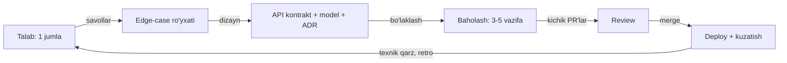

# 24. Soft skills va jarayon

> **Bir jumlada:** Middle bu topshiriqni "aytilganidek yozadigan" emas, "oxirigacha o'zi yetkazadigan" odam: noaniq talabni aniqlashtiradi, dizayn taklif qiladi, baholaydi, blocker'ni erta ko'taradi, review qiladi va qilinadi, qarorlarni yozib qoldiradi, junior'ga yo'l ko'rsatadi.
> **Nega Middle uchun:** Texnik bilim Junior'ni Middle qilmaydi; Middle va Senior o'rtasidagi farq ham asosan shu bobda. Suhbatda "o'zingiz hal qilgan muammoni ayting" savoli texnik savollardan ko'ra ko'proq hal qiladi.
> **O'qish vaqti:** ~40 daqiqa

## Mundarija

- [1. Muammo va yechim](#1-muammo-va-yechim)
- [2. Qanday ishlaydi](#2-qanday-ishlaydi)
- [3. Asosiy tushunchalar](#3-asosiy-tushunchalar)
- [4. Shablonlar](#4-shablonlar)
- [5. Tipik xatolar va anti-patternlar](#5-tipik-xatolar-va-anti-patternlar)
- [6. Best practices checklist](#6-best-practices-checklist)
- [7. Suhbat savollari va javoblar](#7-suhbat-savollari-va-javoblar)
- [8. Qo'shimcha manbalar](#8-qoshimcha-manbalar)

## 1. Muammo va yechim

Holat. Mahsulot menejeri Jira'da yozdi: "Mijoz buyurtmani bekor qila olsin". Dasturchi `DELETE /orders/{id}` qildi, buyurtmani bazadan o'chirdi, PR 2 kunda merge bo'ldi. Bir haftadan keyin:

- Buxgalteriya: "To'langan buyurtma yo'qolib qoldi, hisobot mos kelmayapti" (to'langanni bekor qilish qaytarish degani, o'chirish emas).
- Ombor: "Rezerv qilingan tovar qaytmadi" (bekor qilish rezervni bo'shatishi kerak edi).
- Yetkazib berish: "Kuryer yo'lda, mijoz bekor qildi, hech kim bilmadi" (jo'natilgan buyurtmani bekor qilib bo'lmaydi yoki boshqa jarayon).
- Support: "Mijoz 'tasodifan bosib qo'ydim' deyapti, qaytarib bo'lmaydi" (o'chirish qaytarilmas).

Kod to'g'ri ishladi. Talab noto'g'ri tushunildi, chunki hech kim savol bermadi. Bu bobdagi hamma narsa shu holatning oldini olish haqida: talabni modelga aylantirish (savollar bilan), qarorni yozib qoldirish (ADR), kichik PR va review (ikkinchi ko'z), baholash va blocker (kutilmagan narsa erta ko'rinadi), mentorlik (jamoa o'sadi).

## 2. Qanday ishlaydi

Middle'ning ish jarayoni bitta zanjir, har bo'g'inda chiqish artefakti bor:



Har bo'g'inda "nima noma'lum" degan savol beriladi va noma'lum narsa yashirilmaydi, ochiq aytiladi. Junior noma'lumni taxmin bilan to'ldiradi (yuqoridagi `DELETE`), Senior noma'lumni tizimli yo'qotadi. Middle ikkalasining orasida: taxmin qilmaydi, savol beradi, lekin savolni kimga va qanday berishni o'rganmoqda.

Vaqt taqsimoti (tipik Middle haftasi): 50-60% kod va test, 15-20% review va muhokama, 10% dizayn va hujjat, 10% junior'ga yordam va uchrashuvlar. Agar 90% kod bo'lsa, bu hali Junior ish tartibi; agar kod 30% bo'lsa, bu Senior/Lead.

## 3. Asosiy tushunchalar

### 3.1 Talabdan API kontrakti va modelga

- Ta'rif: biznes jumlani (1) aktyorlar va holatlar, (2) edge-case ro'yxati, (3) endpoint va model, (4) ochiq savollar ro'yxatiga aylantirish.
- Nega kerak: 1-bo'limdagi barcha muammolar "bekor qilish" so'zi ortidagi 6 ta holatni ko'rmaslikdan.

Misol: "Mijoz buyurtmani bekor qila olsin".

Savollar (menejerga, 10 daqiqalik suhbat yoki Jira kommenti):
1. Qaysi holatdagi buyurtmani? `Created`, `Confirmed`, `Paid`, `Shipped`, `Delivered` har biri uchun alohida javob.
2. To'langan bo'lsa pul qaytadimi? Avtomatikmi, qo'lda? To'liqmi, komissiya ushlanadimi?
3. Rezerv qilingan tovar? Darhol bo'shatiladimi?
4. Kim bekor qila oladi: mijozning o'zi, operator, ikkalasi? Operator sabab yozishi kerakmi?
5. Vaqt chegarasi bormi (tasdiqlangandan keyin 30 daqiqa)?
6. Bekor qilingan buyurtma ko'rinadimi (tarix) yoki yo'qoladimi?
7. Kim xabardor bo'ladi: ombor, kuryer, buxgalteriya?
8. Qayta tiklash kerakmi ("tasodifan bosdim")?

Edge-case ro'yxati (javoblardan keyin):

| Holat | Qaror |
|---|---|
| `Created`/`Confirmed`, to'lanmagan | Bekor: rezerv bo'shatiladi, status `Cancelled`, sabab ixtiyoriy |
| `Paid`, jo'natilmagan | Bekor + avtomatik qaytarish so'rovi (`Refund` yaratiladi, provayder orqali, asinxron) |
| `Shipped` | Mijoz bekor qila olmaydi (409 va tushuntirish); operator "qaytarish" jarayonini boshlaydi, bu boshqa feature |
| `Delivered`, `Cancelled` | 409, holat o'zgarmaydi |
| Ikki marta bekor qilish | Idempotent: ikkinchisi 200 (yoki 409), ikki marta refund yo'q |
| Boshqa tenant/mijoz buyurtmasi | 404 (mavjudligini oshkor qilmaymiz) |
| Refund provayderi xato bersa | Buyurtma `Cancelled`, refund `Pending`, retry, operator ko'radi |

Kontrakt:

```http
POST /orders/{id}/cancel
Authorization: Bearer ...
Content-Type: application/json

{ "reason": "changed_mind" }        # enum: changed_mind, found_cheaper, delivery_too_long, other; other bo'lsa comment majburiy

200 OK  { "id": "...", "status": "Cancelled", "refund": { "id": "...", "status": "Pending", "amount": 120000 } }
409 Conflict (ProblemDetails) { "type": ".../order-not-cancellable", "detail": "Shipped orders cannot be cancelled by customer", "status": "Shipped" }
404 Not Found
```

`DELETE` emas, `POST .../cancel`: bu holat o'tishi (state transition), resurs o'chirilmaydi, sabab va natija (refund) bor. Model: `Order.Cancel(reason, clock)` domen metodi holatni tekshiradi va `OrderCancelled` hodisasini chiqaradi; ombor va buxgalteriya hodisaga obuna. Ochiq savollar ADR yoki ticket'da: "Refund komissiyasi: moliya bilan kelishilmagan, hozircha to'liq".

- Tipik xato: savollarni "men o'zim hal qilaman" deb yopish. Javobsiz savol taxmin bo'ladi, taxmin esa production'da topiladi.

### 3.2 Git amaliyoti

- Ta'rif: feature branch (`feature/ORD-123-cancel-order`), kichik PR (200-400 qator diff), ma'noli commit, rebase (tarixni to'g'rilash) vs merge (tarixni saqlash), hotfix oqimi.
- Nega kerak: 2000 qatorli PR'ni hech kim sinchiklab o'qimaydi ("LGTM"), bitta commit'da "fix" deb yozilgan 15 o'zgarishni `git bisect` ajrata olmaydi, hotfix'ni `main`dan emas `develop`dan qilsangiz production'ga yarim tayyor kod ketadi.

Commit xabari (Conventional Commits uslubi, jamoa kelishuvi):

```
feat(orders): add customer-initiated cancellation

Customers can cancel orders in Created/Confirmed/Paid states.
Paid orders create a pending Refund processed by the worker.
Shipped orders return 409 with order-not-cancellable problem type.

Refs: ORD-123
```

Birinchi qator 50-72 belgi, buyruq maylida ("add", "added" emas), nima va qayerda; tana "nega" va "nima o'zgardi" (kod "qanday"ni ko'rsatadi).

Rebase vs merge:
- Feature branch'ni `main` bilan yangilash: `git rebase main` (chiziqli tarix, konflikt commit-commit hal bo'ladi). Branch'ni bitta odam ishlatganda.
- PR'ni `main`ga qo'shish: squash merge (bitta toza commit, PR raqami bilan) yoki merge commit (jamoa tarixni to'liq saqlashni xohlasa). Jamoada bitta qoida, aralash emas.
- Bo'lishilgan branch'ni rebase qilmang: boshqalar tarixi buziladi (`force push` ularning ishini yo'qotadi).

Kichik PR qanday qilinadi: vertikal bo'laklash. "Bekor qilish" feature'i: PR1 domen (`Order.Cancel`, testlar), PR2 endpoint + integration test, PR3 refund worker, PR4 ombor hodisasi. Har PR o'zi merge bo'la oladi (feature flag ostida yoki oxirgi PR'gacha endpoint yoqilmaydi).

Hotfix: `main`dan `hotfix/ORD-150-double-refund` branch, minimal o'zgarish + test, review (tezlashtirilgan, lekin bor), tag `v1.4.1`, deploy, keyin `main` `develop`ga (agar ikkalasi bo'lsa) qaytariladi. Hotfix'da "shu yerda yana ikkita narsani tuzatib qo'yay" yo'q.

### 3.3 Code review: nima qidirish va qanday yozish

- Ta'rif: PR'ni boshqa dasturchi o'qib, muammo va takliflarni yozadi; muallif javob beradi va tuzatadi.
- Nega kerak: ikkinchi ko'z 1-bo'limdagi `DELETE`ni ushlaydi ("to'langan buyurtmani o'chirsak hisobot-chi?"), bilim tarqaladi (bus factor), kod uslubi bir xil bo'ladi.

Nima qidirish, tartib bo'yicha (muhimdan kamroq muhimga):
1. **To'g'rilik**: talabga mos keladimi, edge-case'lar, holat o'tishlari, null, concurrency, tranzaksiya chegarasi.
2. **Xavfsizlik**: tenant filtri, ruxsat tekshiruvi, kiritilgan ma'lumot validatsiyasi, sirlar log'da, SQL injection (raw SQL bo'lsa), mass assignment.
3. **Ma'lumot va migration**: orqaga moslik, qulf, index, katta jadval.
4. **Performance**: N+1, `ToList` keyin filtr, sinxron I/O, cheksiz so'rov (pagination yo'q), keraksiz `Include`.
5. **Test**: edge-case'lar testda bormi, test haqiqiy xatti-harakatni tekshiradimi.
6. **O'qilishi va dizayn**: nom, metod hajmi, takrorlanish, qatlam qoidalari.
7. **Uslub**: formatlash. Bu analyzer/formatter ishi, odam vaqti emas; agar review'da uslub muhokamasi ko'p bo'lsa, `.editorconfig` va CI'da `dotnet format --verify-no-changes` yetishmayapti.

Qanday yozish: har komment (a) muammoni, (b) oqibatini, (c) taklifni aytadi; buyruq emas, savol yoki taklif; shaxsga emas, kodga; darajasi belgilangan (bloker / taklif / savol / nit).

Misol kommentlar:

```
[bloker] Bu so'rovda TenantId filtri yo'q: boshqa tenant buyurtmasini id bilan bekor qilish mumkin.
Taklif: db.Orders.Where(o => o.TenantId == tenant && o.Id == id), yoki global query filter bor bo'lsa
IgnoreQueryFilters() ishlatilmaganini tekshiraylik.

[bloker] Refund yaratish va Order.Cancel ikki alohida SaveChanges'da. Ikkinchisi yiqilsa buyurtma
Cancelled, refund yo'q. Bitta tranzaksiya yoki outbox orqali qilsak?

[taklif] `CancelOrderAsync` 80 qator: holat tekshiruvi, refund, hodisa. Holat tekshiruvini Order.Cancel()
domen metodiga ko'chirsak, unit test bazasiz bo'ladi va boshqa handler'lar (operator cancel) qayta ishlatadi.

[savol] Shipped holatda 409 qaytaramiz. Menejer bilan "operator bekor qila oladi" kelishilganmi? Agar ha,
bu PR'da emas, lekin ticket ochib qo'yaylik.

[nit] `var res` → `var response`, pastda `res` ham HttpResponse uchun ishlatilgan, chalkashadi.

[yaxshi] Idempotency: ikkinchi cancel 200 va refund takrorlanmaydi, test ham bor. Aynan shu kerak edi.
```

Review olganda: har kommentga javob (tuzatdim / rozi emasman, chunki... / alohida ticket), himoyalanish emas, muhokama; 3 marta fikr almashuvdan keyin hal bo'lmasa, 10 daqiqalik qo'ng'iroq.

- Tipik xato: "LGTM" 2 daqiqada 800 qatorga. Review qilmagan bo'lsangiz, "o'qimadim, faqat testlar o'tganini ko'rdim" deb yozing, bu halol va foydali.

### 3.4 Texnik qarzni qayd qilish

- Ta'rif: ongli ravishda qabul qilingan "hozir tez, keyin to'g'ri" qaror; qarz foiz bilan qaytariladi (har keyingi o'zgarish qimmatroq).
- Nega kerak: yozilmagan qarz unutiladi va 6 oydan keyin "nega bu shunday?" deb hech kim bilmaydi; yozilgan qarz rejalashtiriladi.

Qayd shakli (ticket yoki `TECH_DEBT.md`, har biri bitta satr emas, bitta blok):

```
TD-017: Refund provayder chaqiruvi CancelOrderHandler ichida sinxron
Qachon: 2026-10-20, ORD-123 PR #412
Nega qabul qilindi: Payme refund API sandbox'i yo'q edi, asinxron oqim uchun worker tayyor emas, release 3 kundan keyin
Ta'siri: Payme sekin bo'lsa cancel endpoint sekin (p99 4 s kuzatildi); Payme yotsa cancel 500
Qanday to'lanadi: Refund'ni outbox hodisasi + RefundWorker'ga ko'chirish, ~2 kun
Muddat/trigger: Payme xatolari haftasiga 5 dan oshsa yoki Q4 rejasida
```

Kodda `// TODO` o'rniga `// TODO TD-017: ...` (ticket raqami bilan), aks holda TODO abadiy qoladi. Sprint'ning 10-20% qarz to'lashga; "texnik qarz sprint'i" (hammasi birdaniga) odatda bo'lmaydi.

### 3.5 Baholash va blocker ko'tarish

- Ta'rif: vazifani bo'laklarga ajratib, har biriga vaqt va noaniqlik darajasini berish; blocker (to'siq) bu sizga bog'liq bo'lmagan va ishni to'xtatgan narsa.
- Nega kerak: "2 kun" deb aytilgan va 2 hafta davom etgan vazifa ishonchni yo'qotadi; blocker 3 kun kutilgandan keyin aytilsa, 3 kun yo'qolgan.

Baholash usuli:
1. Vazifani 0.5-2 kunlik bo'laklarga ajrating. Bo'lak 2 kundan katta bo'lsa, u hali tushunilmagan, yana ajrating.
2. Har bo'lakka: optimistik / realistik / pessimistik. Jami realistik + noaniq bo'laklar uchun zaxira.
3. Noaniqlikni aytib bering: "5 kun, lekin refund API hujjati yo'q, u 1-4 kun o'rtasida; ertaga sandbox olsam aniq aytaman".
4. Baholashga review, test, deploy, hujjat kiradi. "Kod 2 kun" degani vazifa 2 kun degani emas.

Misol (bekor qilish feature'i):

| Bo'lak | Baho | Noaniqlik |
|---|---|---|
| Domen: `Order.Cancel`, holat qoidalari, unit test | 1 kun | past |
| Endpoint + integration test + ProblemDetails | 1 kun | past |
| Refund: Payme API, worker, retry | 2 kun | yuqori (hujjat yo'q) |
| Ombor hodisasi: rezerv bo'shatish | 0.5 kun | past (mavjud mexanizm) |
| Review, tuzatish, deploy, kuzatish | 1 kun | o'rta |
| **Jami** | **5.5 kun, 5-8 oralig'i** | |

Blocker ko'tarish qoidasi: 2 soat o'zingiz urinib ko'rdingiz va siljish yo'q → jamoa chatiga yozing (nima qildingiz, nima kutyapsiz, kimdan). Boshqa jamoaga bog'liq bo'lsa → o'sha kuni, ertaga emas. Standup'da "ishlayapman" emas, "refund API kaliti kutilmoqda, 2 kundan beri, moliya bo'limidan, bu release'ni surishi mumkin".

Muddatga ulgurmaslik: bilgan zahotingiz, muddat kunida emas. Format: fakt + sabab + variantlar. "Juma'ga ulgurmaymiz. Sabab: refund API'da 3 kun kutilmagan ish chiqdi (hujjat noto'g'ri edi). Variantlar: (a) juma'da refund'siz cancel chiqaramiz, to'langan buyurtmalar uchun 'operatorga murojaat' ko'rsatamiz, refund keyingi hafta; (b) hammasi keyingi chorshanba; (c) kimdir refund'ni parallel oladi. Mening taklifim (a)."

### 3.6 ADR (Architecture Decision Record)

- Ta'rif: bitta arxitektura qarori uchun qisqa hujjat: kontekst, variantlar, qaror, oqibatlar. Repo ichida `docs/adr/NNNN-nom.md`, o'zgarmas (yangi qaror yangi ADR, eskisini "superseded" qiladi).
- Nega kerak: 6 oydan keyin "nega MediatR emas?" degan savolga javob git tarixida emas, ADR'da; yangi odam qarorlar mantiqini o'qiydi; muhokama bir marta bo'ladi, har sprint takrorlanmaydi.

To'liq misol 4-bo'limda.

### 3.7 README va API hujjati

- Ta'rif: README "qanday ishga tushirish va qayerga qarash", API hujjati "endpoint'lar nima qiladi" (OpenAPI avtomatik + qo'lda yozilgan qoidalar).
- Nega kerak: yangi dasturchi birinchi kuni `docker compose up` bilan ishlaydigan muhit olishi kerak, Slack'da 20 ta savol emas.

README minimal tarkibi: bir jumlali maqsad; talablar (SDK versiyasi, Docker); ishga tushirish (3-5 buyruq); loyihalar tuzilishi (qaysi papka nima); muhit o'zgaruvchilari jadvali; testlarni ishga tushirish; deploy qayerda (pipeline havolasi); ADR papkasiga havola; kimdan so'rash.

API hujjati: OpenAPI (`Microsoft.AspNetCore.OpenApi`, .NET 9+ o'rnatilgan) har endpoint uchun `WithSummary`, `WithDescription`, `Produces<T>(200)`, `ProducesProblem(409)`; qo'lda: autentifikatsiya qanday, pagination konventsiyasi, xato formati (ProblemDetails tiplari ro'yxati), idempotency, versiyalash, rate limit. Bu qo'lda qism ko'pincha yo'q va eng ko'p savol tug'diradi.

### 3.8 Mentorlik

- Ta'rif: junior'ga javobni emas, javobga yo'lni ko'rsatish; pair programming; review'da o'rgatish.
- Nega kerak: Middle'ning ta'siri o'z kodi bilan cheklanmaydi; junior 3 oyda mustaqil bo'lsa, jamoa tezligi oshadi. Senior'ga o'tishning asosiy mezonlaridan biri.

Amaliyot:
- Savol kelganda: "Nima urinib ko'rding? Nima kutding, nima bo'ldi?" Keyin yo'nalish: "EF log'ini yoqib qaysi SQL ketayotganini ko'r", javob emas.
- Vazifa berganda: natijani va chegarani aniq ayting ("endpoint 409 qaytarsin, test bilan, 2 kun, savol bo'lsa darhol"), qanday qilishni emas.
- Review'da: birinchi PR'larda ko'p komment, lekin har birida "nega" va havola (ADR, hujjat); 3-PR'dan keyin takrorlanadigan narsalar kamayishi kerak, aks holda sizning tushuntirishingiz ishlamayapti.
- Pair programming: 1-2 soat, junior klaviaturada, siz yo'naltirasiz; yangi modul yoki qiyin debugging'da.
- Xatoga munosabat: production incident'da "kim" emas, "nima va qanday oldini olamiz" (blameless postmortem).

## 4. Shablonlar

### 4.1 ADR to'liq misol

```markdown
# ADR-0007: Buyurtmani bekor qilishda refund asinxron, outbox orqali

Holat: Qabul qilindi (2026-10-22)
Muhokama: ORD-123, PR #412 review
Superseded by: yo'q

## Kontekst

Mijoz to'langan buyurtmani bekor qilganda pul qaytarilishi kerak (Payme refund API).
Birinchi implementatsiya (PR #412) refund'ni CancelOrderHandler ichida sinxron chaqiradi.
Kuzatilgan muammolar: cancel endpoint p99 4 s (Payme sekin), Payme yotganda cancel 500
(buyurtma bekor qilinmaydi, garchi refund keyin ham qilinishi mumkin), ikki marta bosilganda
ikki refund (idempotency kaliti yo'q edi).

Cheklovlar: Payme refund API idempotency kalitini qo'llab-quvvatlaydi (hujjat 4.2),
javob 1-10 s, kuniga ~200 refund, moliya bo'limi refund holatini ko'rishi kerak.

## Ko'rib chiqilgan variantlar

1. Sinxron chaqiruv, resilience (timeout 5 s, retry) bilan.
   + Oddiy, bitta oqim.
   - Payme yotsa cancel ishlamaydi; timeout'dan keyin refund holati noma'lum; p99 baribir sekin.

2. Outbox hodisasi (OrderCancelled) + RefundWorker, retry va DLQ bilan.
   + Cancel darhol (50 ms), Payme yotsa refund keyin; retry va dead-letter bor; holat jadvalda ko'rinadi.
   - Refund "Pending" holati UI'da ko'rsatilishi kerak; worker va Refund jadvali qo'shiladi (~2 kun).

3. Hangfire job.
   + Tayyor retry va dashboard.
   - Loyihada hali Hangfire yo'q, yangi bog'liqlik faqat shu uchun; outbox mexanizmi allaqachon bor.

## Qaror

2-variant. Order.Cancel() OrderCancelled hodisasini outbox'ga yozadi (buyurtma bilan bitta tranzaksiya).
RefundWorker hodisani o'qib Refund yozuvini (Pending) yaratadi va Payme'ga Idempotency-Key = refund-{orderId}
bilan so'rov yuboradi; 5 urinish eksponensial, keyin Refund.Failed va alert. API javobida refund holati qaytariladi.

## Oqibatlar

+ Cancel endpoint Payme'ga bog'liq emas; refund kuzatiladi va qayta uriniladi.
+ Idempotency: ikkinchi cancel yangi hodisa chiqarmaydi (Order allaqachon Cancelled), refund kaliti deterministik.
- Mijoz "pul qaytdi" ni darhol ko'rmaydi: UI "qaytarish 1-3 ish kuni ichida" ko'rsatadi (mahsulot bilan kelishildi).
- Refund jadvali va worker: qo'shimcha kuzatuv (refund_pending_count metrikasi, 1 soatdan eski Pending alert).
- TD-017 yopiladi.
```

### 4.2 PR tavsifi shabloni

```markdown
## Nima
Mijoz Created/Confirmed/Paid buyurtmani bekor qila oladi. Paid uchun refund asinxron (ADR-0007).

## Nega
ORD-123. Hozir mijoz support'ga yozadi, operator qo'lda bekor qiladi (kuniga ~40 so'rov).

## Qanday tekshirildi
- Unit: Order.Cancel holat jadvali (7 holat)
- Integration: POST /orders/{id}/cancel 200/409/404, ikki marta cancel, refund outbox yozuvi
- Lokal: Payme sandbox bilan refund oxirigacha, screenshot ticket'da

## Review'da e'tibor bering
- Order.Cancel'dagi holat o'tishlari to'g'rimi (Shipped → 409)
- Migration: refunds jadvali qo'shiladi, mavjud jadvalga tegmaydi

## Deploy
- Migration oldin (refunds jadvali), kod keyin; feature flag `Orders:CustomerCancel` o'chiq, keyin 10% tenant
- Rollback: flag o'chiriladi; jadval qoladi (zararsiz)
```

### 4.3 Postmortem (incident) shabloni

```markdown
# Incident 2026-10-15: to'lovlar 3 marta yozildi

Ta'sir: 14:02-14:40, 37 ta buyurtma, hisobotda 11.2 mln UZS ortiqcha; mijozlardan pul olinmagan (faqat yozuv).
Aniqlandi: 14:25 buxgalteriya hisobotdan; alert yo'q edi.
Sabab: Payme webhook tarmoq uzilishida 3 marta keldi; handler event id bo'yicha dublikatni tekshirmagan.
Nega oldin ko'rilmadi: integration test bitta webhook bilan edi; dublikat holati talabda yo'q edi.
Tuzatish: webhook_events.provider_event_id unique index + 200 on duplicate (PR #398), 37 yozuv qo'lda tuzatildi.
Oldini olish:
- [x] Dublikat testi (PR #398)
- [ ] Barcha webhook endpoint'lari uchun checklist (23-bob) review shabloniga (ORD-140)
- [ ] Hisobot va to'lov summasi farqi uchun kunlik alert (OPS-55)
Nima yaxshi ishladi: tuzatish 35 daqiqada, mijozga ta'sir yo'q.
```

### 4.4 STAR formatidagi hikoya skeletlari

STAR: Situation (vaziyat), Task (vazifa), Action (harakat), Result (natija, raqam bilan). Har hikoya 2-3 daqiqa; raqamlar va "men" (jamoa emas, sizning qismingiz) shart.

**1. Production'dagi jiddiy xato**
- S: Oy oxirida ombor hisoboti 11 mln UZS ortiqcha ko'rsatdi, buxgalteriya hisobot yopa olmadi.
- T: Sababni topish va 2 soat ichida tuzatish, chunki hisobot ertaga soliqqa ketadi.
- A: Log'da `TraceId` bo'yicha to'lov yozuvlarini ko'rdim, bitta buyurtmada 3 ta `Payment` bir xil provayder id bilan; webhook log'ida 3 ta so'rov 2 soniya oralig'ida. Dublikat himoyasi yo'q edi. Unique index + 200 on duplicate qildim, test yozdim, 37 yozuvni skript bilan tuzatdim (avval staging'da).
- R: 35 daqiqada tuzatildi, mijozga ta'sir yo'q, postmortem yozdim, webhook checklist'i review shabloniga kirdi, shundan keyin 0 takror.

**2. Sekin so'rovni tezlashtirish**
- S: Buyurtmalar ro'yxati 500 qator uchun 9 soniya, mijozlar shikoyat qildi.
- T: 500 ms dan pastga tushirish, sxemani o'zgartirmasdan.
- A: EF log va trace'dan N+1 ko'rdim (har buyurtma uchun mijoz va satrlar alohida so'rov, 1001 so'rov). `Select` bilan proyeksiya, `AsNoTracking`, keyset pagination, `(tenant_id, created_at)` index. `EXPLAIN ANALYZE` bilan tekshirdim.
- R: 9 s → 180 ms (p95), baza CPU 40% → 12%, yondashuvni jamoa wiki'siga yozdim, boshqa 3 ro'yxatga qo'llandi.

**3. Arxitektura qarorida kelishmovchilik**
- S: Tech lead refund'ni sinxron qilishni xohladi ("oddiy"), men asinxron (outbox).
- T: Jamoaga eng yaxshi qarorni qabul qildirish, "kim haq" emas.
- A: Ikkala variantni ADR'da yozdim: kontekst, cheklovlar (Payme p99 10 s, yotish holatlari), oqibatlar. Sinxron variantning "Payme yotsa cancel ishlamaydi" oqibatini mahsulot menejeri bilan tekshirdim: qabul qilib bo'lmas ekan. 30 daqiqalik muhokama ADR asosida.
- R: Asinxron qabul qilindi, lead "ADR formatini standart qilaylik" dedi; shu format bilan keyingi 5 qaror muhokamasi 1 kundan 1 soatga tushdi.

**4. Talab noaniq bo'lganda**
- S: "Mijoz buyurtmani bekor qila olsin", 1 jumla, deadline 1 hafta.
- T: Noto'g'ri narsani tez qilish o'rniga to'g'ri narsani vaqtida qilish.
- A: 8 ta savol ro'yxati (holatlar, refund, rezerv, kim, vaqt chegarasi) bilan menejerga 15 daqiqalik uchrashuv; natijada 7 qatorli edge-case jadvali va kontrakt; "Shipped" holati alohida feature deb kelishildi, scope kichraydi.
- R: 5.5 kunda chiqdi, ishga tushgandan keyin bitta ham "bu shunday bo'lishi kerak edi" qayta ishlash yo'q (oldingi feature'larda o'rtacha 2 ta); savollar ro'yxati jamoada "feature kickoff" shabloniga aylandi.

### 4.5 Middle va Senior kutilmalari

| Yo'nalish | Middle | Senior |
|---|---|---|
| Talab | Noaniqlikni ko'radi, savol beradi, edge-case ro'yxati tuzadi | Talabni biznes maqsadi bilan bog'laydi, "buni umuman qilish kerakmi" deb so'raydi, muqobil taklif qiladi |
| Dizayn | Bitta servis/modul ichida to'g'ri dizayn; ma'lum pattern'larni to'g'ri qo'llaydi | Servislar orasidagi chegaralar, ma'lumot oqimi, ishdan chiqish rejimlari; pattern qachon kerak emasligini biladi |
| Kod | Mustaqil, toza, testlangan; review'siz production'ga chiqishi mumkin | Kam kod yozadi, lekin eng qiyin qismlarni; boshqalar kodini standartga keltiradi |
| Debugging | Log, trace, metrika bilan o'z servisida sababni topadi | Tizim bo'ylab, noma'lum kodda, infratuzilma darajasida; incident'ni boshqaradi |
| Baholash | O'z vazifasini bo'laklab, oralig'i bilan baholaydi | Jamoa/loyiha darajasida, risklar bilan, "nima qilmaymiz" ni aytadi |
| Review | Mazmunli review beradi va oladi | Review madaniyatini belgilaydi, arxitektura muammolarini PR'dan oldin (dizayn bosqichida) ushlaydi |
| Ta'sir doirasi | O'z vazifalari + 1-2 junior | Jamoa, qo'shni jamoalar, texnik yo'nalish |
| Hujjat | PR tavsifi, README, ADR'da ishtirok | ADR'larni boshlaydi, texnik strategiya yozadi |
| Kommunikatsiya | Blocker va kechikishni erta aytadi; menejer bilan to'g'ridan-to'g'ri gaplashadi | Texnik qarorlarni biznes tilida tushuntiradi; "yo'q" deya oladi va sabab beradi |
| O'sish | O'z bo'shliqlarini biladi va yopadi | Boshqalarni o'stiradi; jamoadan ketsa bilim qoladi (hujjat, mentorlik) |

Middle'dan Senior'ga o'tish belgisi: sizga "nima qilish" aytilmaydi, "qaysi muammo" aytiladi, va siz nima qilishni (yoki qilmaslikni) taklif qilasiz.

## 5. Tipik xatolar va anti-patternlar

### 5.1 Taxmin bilan ishlash

❌ "Bekor qilish = DELETE, aniq-ku". Oqibat: 1-bo'lim, 4 ta bo'lim shikoyati, qayta ishlash 1 hafta.
✅ 8 savol, 15 daqiqa, edge-case jadvali; noaniq qolgan narsa ticket'da ochiq.

### 5.2 Katta PR

❌ 1 800 qator, 23 fayl, "cancel feature". Oqibat: review 2 kun kutadi, "LGTM" sifatsiz, konflikt ko'p, rollback butun feature.
✅ 4 ta PR (domen, endpoint, worker, hodisa), har biri 200-400 qator, flag ostida.

### 5.3 Review'da shaxsga o'tish yoki buyruq

❌ "Bu noto'g'ri. Qayta yoz." / "Siz har doim tranzaksiyani unutasiz". Oqibat: himoyalanish, muhokama o'rniga bahs, junior review'dan qo'rqadi.
✅ "[bloker] Ikki SaveChanges orasida yiqilsa buyurtma Cancelled, refund yo'q. Bitta tranzaksiya qilsak?" Kod haqida, oqibat bilan, taklif bilan.

### 5.4 Blocker'ni yashirish

❌ Standup'da 3 kun "refund ustida ishlayapman", aslida API kaliti yo'q. Oqibat: release suriladi, menejer oxirgi kuni biladi, ishonch yo'qoladi.
✅ Birinchi kuni: "Kalit moliya bo'limidan kutilmoqda, so'rov yubordim, javob bo'lmasa ertaga eskalatsiya qilaman; bu orada endpoint qismini qilaman."

### 5.5 Texnik qarz og'zaki

❌ "Keyin to'g'rilaymiz" (chatda). Oqibat: 6 oydan keyin hech kim eslamaydi, yangi odam "nega bunday" deb hayron.
✅ TD-017 formatida ticket: nega, ta'siri, qanday to'lanadi, trigger. Kodda `TODO TD-017`.

### 5.6 Baholashda faqat kod

❌ "2 kun" (kod yozish). Oqibat: review, test, migration, deploy, kutilmagan narsa yo'q; 2 kun 6 kun bo'ladi.
✅ Bo'laklar jadvali, review/deploy kiritilgan, oraliq (5-8 kun) va noaniq bo'lak belgilangan.

### 5.7 Mentorlikda javobni berish

❌ Junior: "N+1 nima?" Siz: "Mana, shunday yoz" (kodni yozib berasiz). Oqibat: keyingi safar yana so'raydi, o'rganmaydi.
✅ "EF log'ini yoq, so'rovlarni sana, nega 1001 ta?" 10 daqiqadan keyin o'zi topadi, keyin 21-bob havolasi.

### 5.8 ADR'siz katta qaror

❌ Chatda 2 soat bahs, qaror "kelishdik", 3 oydan keyin yana bahs. Oqibat: vaqt, bir xil muhokama qayta-qayta, yangi odam kontekstsiz.
✅ ADR: variantlar, qaror, oqibatlar, 1 sahifa, repo'da. Keyingi bahs: "ADR-0007'da yozilgan, yangi fakt bormi?"

## 6. Best practices checklist

- [ ] Har talab uchun savollar ro'yxati va edge-case jadvali kod yozishdan oldin: taxmin production'da topilmaydi.
- [ ] Holat o'tishi `POST /resurs/{id}/harakat`, `DELETE` emas; 409 ProblemDetails bilan sabab: kontrakt biznesni aks ettiradi.
- [ ] Ochiq savollar ticket'da yozilgan, "o'zim hal qildim" emas: kim nima qaror qilgani aniq.
- [ ] PR 200-400 qator, vertikal bo'laklar, flag ostida: review sifatli, rollback kichik.
- [ ] Commit xabari: nima + qayerda + nega, ticket raqami: `git log` va `bisect` foydali.
- [ ] Review kommenti: muammo + oqibat + taklif + daraja (bloker/taklif/savol/nit): harakat qilsa bo'ladigan.
- [ ] Review tartibi: to'g'rilik, xavfsizlik, migration, performance, test, dizayn, uslub (oxirgisi asbobga): odam vaqti muhim narsaga.
- [ ] Texnik qarz ticket'da (nega, ta'sir, to'lash yo'li, trigger), kodda `TODO TD-NNN`: unutilmaydi.
- [ ] Baholash bo'laklab, oraliq bilan, review/test/deploy kiritilgan, noaniq bo'lak belgilangan: "2 kun" 6 kun bo'lmaydi.
- [ ] Blocker 2 soatdan keyin jamoaga, boshqa jamoaga bog'liq bo'lsa o'sha kuni: kutish vaqti yo'qolmaydi.
- [ ] Kechikish bilgan zahoti, fakt + sabab + variantlar + taklif bilan: menejer qaror qila oladi.
- [ ] Har arxitektura qarori ADR'da (kontekst, variantlar, qaror, oqibatlar): bahs bir marta.
- [ ] README bilan yangi odam birinchi kuni ishlaydigan muhit oladi: Slack'da 20 savol yo'q.
- [ ] Junior'ga savol bilan javob, pair programming, review'da "nega" va havola: 3 oyda mustaqil.
- [ ] Incident'dan keyin blameless postmortem va oldini olish ro'yxati: xato takrorlanmaydi.

## 7. Suhbat savollari va javoblar

**1. PR'da katta muammo ko'rsangiz, lekin muddat tig'iz bo'lsa?**
Muammoning turiga qarab. Agar bu to'g'rilik yoki xavfsizlik (tenant filtri yo'q, ikki marta refund) bo'lsa, bloker: muddat tig'izligi production'da noto'g'ri ma'lumotni oqlamaydi, tuzatish odatda 1-2 soat, muhokama bilan birga. Agar dizayn muammosi bo'lsa (handler 80 qator, qatlam buzilgan), merge qilamiz, lekin texnik qarz ticket'i ochiladi, PR'da havola, keyingi sprint'da. Muhimi: qarorni ochiq aytish ("bu blokerni hozir tuzatamiz, qolganini TD-018 ga"), muallif bilan 5 daqiqalik qo'ng'iroq, va menejerga "muddat 2 soatga suriladi, sabab" deb aytish. Tuzoq: "muddat" deb blokerni o'tkazib yuborish, keyin incident.

**2. Senior qaroriga qo'shilmasangiz nima qilasiz?**
Avval tushunishga harakat qilaman: u qaysi kontekstni ko'ryapti, men ko'rmayotgan (eski incident, biznes cheklovi). Keyin o'z fikrimni fakt bilan: "Payme p99 10 s, sinxron bo'lsa cancel p99 ham 10 s, bu SLO'ga zid". Eng yaxshisi ADR formatida ikkala variantni oqibatlari bilan yozish, muhokama "fikrlar" emas "oqibatlar" haqida bo'ladi. Agar u baribir o'z qarorida qolsa va bu xavfsizlik/to'g'rilik emas, dizayn masalasi bo'lsa, qabul qilaman va to'liq qo'llayman (disagree and commit), ADR'da "ko'rib chiqilgan variant" sifatida mening taklifim qoladi. Agar to'g'rilik masalasi bo'lsa (ma'lumot buzilishi), eskalatsiya qilaman, lekin odamga emas, muammoga qaratib.

**3. Deadline'ga ulgurmasligingizni qachon va qanday aytasiz?**
Bilgan zahotim, odatda ishning 30-40%ida kutilmagan narsa chiqqanda; deadline kunida emas. Format: fakt (ulgurmaymiz), sabab (refund API hujjati noto'g'ri, 3 kun qo'shimcha), ta'sir (juma o'rniga chorshanba), variantlar (scope qisqartirish, muddat surish, yordam), mening taklifim. Menejerga qaror qilish uchun variantlar kerak, uzr emas. Ulgurish uchun sifatni (test, review) qisqartirmayman, scope'ni qisqartiraman. Tuzoq: "balki ulguraman" umidida jim turish, bu eng yomon variant, chunki menejer rejalashtira olmaydi.

**4. Talab noaniq bo'lsa nima qilasiz? Misol bering.**
4.4-dagi 4-hikoya: "mijoz buyurtmani bekor qila olsin". Avval savollar ro'yxati tuzaman (holatlar, refund, rezerv, kim, vaqt, xabar, tiklash), 15 daqiqalik uchrashuv so'rayman, chatda emas (chatda 8 savol 2 kun cho'ziladi). Javoblardan edge-case jadvali va kontrakt, menejerga qaytarib tasdiqlataman ("shunday tushundim, to'g'rimi?"). Javob bo'lmagan savollar ticket'da "ochiq" bo'limda, taxmin bo'lsa taxmin deb yozilgan. Scope kichraysa (Shipped alohida feature), buni yutuq deb hisoblayman. Tuzoq: savol bermaslikni "mustaqillik" deb o'ylash.

**5. Code review'da nimaga e'tibor berasiz?**
Tartib bilan: to'g'rilik (talab, edge-case, holat o'tishi, tranzaksiya chegarasi, concurrency), xavfsizlik (tenant, ruxsat, validatsiya, sirlar log'da), migration (orqaga moslik, qulf), performance (N+1, pagination, sinxron I/O), test (edge-case'lar bormi, haqiqiy xatti-harakatni tekshiradimi), dizayn (nom, hajm, qatlam), uslub oxirida va asosan asbobga. Kommentlarni daraja bilan yozaman (bloker/taklif/savol/nit), har birida oqibat va taklif. Yaxshi narsani ham aytaman. 800 qatorni 2 daqiqada "LGTM" qilmayman; o'qiy olmasam, shuni aytaman.

**6. Texnik qarz nima va uni qanday boshqarasiz?**
Ongli "hozir tez, keyin to'g'ri" qarori; foizi har keyingi o'zgarishning qimmatlashuvi. Boshqaruv: har qarz ticket'da (nega qabul qilindi, ta'siri raqam bilan, qanday to'lanadi, trigger), kodda ticket raqami bilan TODO, sprint'ning 10-20% qarzga, trigger ishlasa (Payme xatolari haftasiga 5 dan oshdi) prioritet oshadi. Menejerga qarzni biznes tilida tushuntiraman: "bu modulda har o'zgarish 2 barobar uzoq, chunki...". Tuzoq: hamma narsani qarz deb atash; qarz faqat ongli va yozilgan bo'lsa qarz, qolgani shunchaki muammo.

**7. Baholashni qanday qilasiz va nega ko'pincha noto'g'ri chiqadi?**
Bo'laklab (0.5-2 kun), har bo'lakka oraliq, noaniq bo'laklar belgilangan, review/test/deploy/hujjat kiritilgan, jami oraliq bilan ("5-8 kun, 5.5 realistik"). Noto'g'ri chiqish sabablari: faqat kod hisoblanadi, noaniqlik yashiriladi (bitta raqam), kutilmagan bog'liqlik (API hujjati noto'g'ri), scope o'sadi. Shuning uchun baholashni yangilayman: 30-40%da haqiqiy tezlikni ko'rib qayta aytaman. Tuzoq: "aniq qancha?" degan bosimga bitta raqam berish; oraliq va shartlar bilan javob beraman.

**8. Junior sizga sekin so'rov haqida keldi. Qanday yordam berasiz?**
Javobni emas, yo'lni: "Qaysi so'rov? EF log'ini yoqding? Nechta SQL ketyapti? Trace'da qayerda vaqt?" 10 daqiqa pair: u klaviaturada, men savol beraman. N+1 ni o'zi ko'rsa, esida qoladi. Keyin havola (21-bob, EF performance) va "shu modulda yana shunga o'xshash joy bormi, qara" degan keyingi qadam. Review'da o'sha PR'ga "nega" bilan komment. Bir oydan keyin u boshqa junior'ga shuni tushuntirsa, mentorlik ishladi. Tuzoq: tezroq bo'lsin deb o'zim yozib berish.

**9. Production incident paytida nima qilasiz?**
Tartib: (1) ta'sirni to'xtatish (rollback, flag o'chirish, trafikni cheklash), sababni topish emas; (2) kommunikatsiya: kanalda "nima, kimga ta'sir, kim ishlayapti, keyingi yangilanish 15 daqiqada"; (3) sabab: trace, log, metrika, oxirgi deploy; (4) tuzatish, test, deploy; (5) ma'lumotni tuzatish (skript, staging'da avval); (6) blameless postmortem 1-2 kun ichida: timeline, sabab, nega ko'rilmadi, oldini olish ro'yxati egalari bilan. "Kim aybdor" emas, "jarayonda nima yetishmadi". Tuzoq: sababni topguncha ta'sirni to'xtatmaslik.

**10. Middle va Senior farqi nimada deb o'ylaysiz?**
Middle vazifani oxirigacha mustaqil yetkazadi: talabni aniqlashtiradi, dizayn qiladi, baholaydi, review beradi va oladi, deploy qiladi, kuzatadi; ta'siri o'z vazifalari va 1-2 junior. Senior muammoni oladi, vazifani emas: "buni umuman qilish kerakmi", servislar orasidagi chegaralar, ishdan chiqish rejimlari, jamoa darajasida baholash va risk, texnik yo'nalish, boshqalarni o'stirish; ta'siri jamoa va qo'shni jamoalar. Men hozir Middle'man, chunki o'z servisimda mustaqilman; Senior tomon o'sish uchun qo'shni jamoalar bilan dizayn va incident boshqaruvida ko'proq ishtirok etyapman.

**11. Git'da rebase va merge'ni qachon ishlatasiz?**
Feature branch'ni `main` bilan yangilash uchun rebase: chiziqli tarix, PR diff toza, konfliktlar commit-commit hal bo'ladi. PR'ni `main`ga qo'shish uchun jamoa kelishuvi: squash (bitta commit, PR raqami, `bisect` oson) yoki merge commit (to'liq tarix). Bo'lishilgan branch'ni hech qachon rebase qilmayman (force push boshqalar ishini buzadi). Hotfix `main`dan, tag bilan, keyin `develop`ga qaytariladi. Tuzoq: "rebase har doim yaxshi" yoki "merge har doim yaxshi"; ikkalasi asbob, kontekstga qarab.

**12. README va ADR'ni kim yozishi kerak va qachon?**
ADR'ni qarorni taklif qilgan odam, qaror qabul qilinishidan oldin (muhokama ADR ustida bo'ladi, keyin "Qabul qilindi" belgilanadi). README'ni loyihani ishga tushirishni biladigan odam, va har yangi odam birinchi kunida uni sinab, yetishmagan narsani qo'shadi (bu uning birinchi PR'i). API hujjati endpoint bilan birga PR'da (`WithSummary`, `ProducesProblem`), qo'lda qism (auth, xato formati, pagination) bir marta va o'zgarganda. Hujjat "keyin" yozilmaydi, chunki "keyin" kelmaydi. Tuzoq: hujjatni Confluence'da kod'dan alohida saqlash, u eskiradi; repo ichida bo'lsa PR bilan birga o'zgaradi.

## 8. Qo'shimcha manbalar

- ADR tushunchasi va misollar (Michael Nygard): https://cognitect.com/blog/2011/11/15/documenting-architecture-decisions
- ADR GitHub tashkiloti (shablonlar, asboblar): https://adr.github.io/
- Conventional Commits: https://www.conventionalcommits.org/
- Google Engineering Practices: Code Review (reviewer va muallif uchun): https://google.github.io/eng-practices/review/
- Conventional Comments (komment darajalari): https://conventionalcomments.org/
- Technical debt (Martin Fowler): https://martinfowler.com/bliki/TechnicalDebt.html
- Blameless postmortem (Google SRE kitobi, 15-bob): https://sre.google/sre-book/postmortem-culture/
- ProblemDetails (RFC 9457): https://www.rfc-editor.org/rfc/rfc9457
- OpenAPI in ASP.NET Core: https://learn.microsoft.com/aspnet/core/fundamentals/openapi/aspnetcore-openapi
- The Staff Engineer's Path (Tanya Reilly), Middle → Senior → Staff kutilmalari haqida: https://www.oreilly.com/library/view/the-staff-engineers/9781098118723/
- STAR usuli (suhbat javoblari): https://www.themuse.com/advice/star-interview-method
