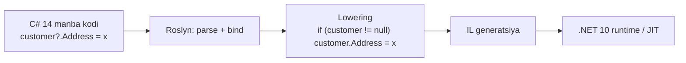

# 25. C# 14 (.NET 10 bilan)

> **Bir jumlada:** C# 14 .NET 10 SDK bilan keladi va sakkizta til yangiligini qo'shadi: `field` kalit so'zi, extension members, null-conditional assignment, `nameof` uchun unbound generic, Span uchun implicit konversiyalar, lambda parametrlarida modifier, partial constructor/event va user-defined compound assignment.
> **Nega Middle uchun:** Suhbatda "oxirgi versiyada nima yangi?" deb so'ralganda kamida ikkita xususiyatni kod bilan ko'rsata olish kerak. Eng muhimi, yangi sintaksis kompilyator tomonidan eski kodga qanday "lowering" qilinishini tushunish: shunda yangilik sehr emas, qisqartma ekani ko'rinadi.
> **O'qish vaqti:** ~30 daqiqa

## Mundarija

1. [Muammo va yechim](#1-muammo-va-yechim)
2. [Qanday ishlaydi](#2-qanday-ishlaydi)
3. [Asosiy tushunchalar](#3-asosiy-tushunchalar)
4. [Amaliy misol](#4-amaliy-misol)
5. [Tipik xatolar va anti-patternlar](#5-tipik-xatolar-va-anti-patternlar)
6. [Best practices checklist](#6-best-practices-checklist)
7. [Suhbat savollari va javoblar](#7-suhbat-savollari-va-javoblar)
8. [Qo'shimcha manbalar](#8-qoshimcha-manbalar)

## 1. Muammo va yechim

Enterprise kod bazasida bir xil "shovqin" qayta-qayta uchraydi:

- Har bir validatsiya qiladigan property uchun alohida `_name` backing field yoziladi. 40 ta property bo'lgan DTO'da 40 ta qo'shimcha qator.
- `string` uchun 30 ta extension method bor, lekin ularning hammasi `IsBlank()` kabi "property bo'lishi kerak bo'lgan" narsalar. Extension property yozib bo'lmasdi.
- `if (order is not null) order.Status = x;` naqshi yuzlab joyda.
- `Span<T>` bilan ishlaydigan kod massivni qabul qilganda generic type inference ishlamay, ortiqcha `.AsSpan()` kerak bo'lardi.

C# 14 bu holatlarning har biriga sintaksis beradi. Hech biri runtime'ni o'zgartirmaydi: hammasi kompilyator ichida eski IL'ga aylanadi. Shuning uchun C# 14 kodini .NET 10 runtime'da ishlatish mumkin, lekin kutubxona .NET 8 ni target qilsa ham ko'p xususiyatlar ishlaydi (`LangVersion` 14 bo'lsa). Faqat `extension` bloklari va Span konversiyalari uchun ba'zi runtime API'lar kerak.

Versiya holati (2026-oktabr): C# 14 barqaror, .NET 10 LTS bilan 2025-noyabrda chiqqan. C# 15 .NET 11 RC2 bilan birga, GA 2026-noyabr (30-faylga qarang).

## 2. Qanday ishlaydi

Til xususiyatlari ikki toifaga bo'linadi:

| Toifa | Ma'nosi | C# 14 misollari |
|---|---|---|
| Lowering (sintaktik shakar) | Kompilyator yangi sintaksisni mavjud IL konstruksiyalariga aylantiradi. Runtime hech narsani sezmaydi. | `field`, null-conditional assignment, `nameof(List<>)`, lambda modifier, partial constructor/event |
| Yangi metadata yoki runtime tayanchi | Kompilyator yangi attribute yoki maxsus nomlangan metodlar generatsiya qiladi; eski kompilyator ularni tushunmaydi. | extension members (static class ichida maxsus nomlangan metodlar + marker tiplar), compound assignment operatorlari (instance operator metodlari) |



Amaliy xulosa: yangi sintaksisni ko'rganda "bu nimaga lowering bo'ladi?" deb so'rang. Javob kodning narxini (allocation, chaqiruv soni) aniq aytadi.

## 3. Asosiy tushunchalar

### 3.1 `field` kalit so'zi

- **Ta'rif.** Property accessor ichida `field` kompilyator yaratgan backing field'ga ishora qiladi. Siz `_x` e'lon qilmaysiz.
- **Nega kerak.** Auto-property'dan "biroz logika bor property"ga o'tishda butun property'ni qayta yozish shart emas. Backing field'ga klassning boshqa joyidan tasodifan murojaat qilib bo'lmaydi, bu inkapsulyatsiyani kuchaytiradi.
- **Lowering.** Kompilyator `<Name>k__BackingField` nomli private field yaratadi, xuddi auto-property'dagidek. `field` shu field'ga aylanadi.

```csharp
// C# 13 va oldin
private string _customerCode = "";
public string CustomerCode
{
    get => _customerCode;
    set => _customerCode = value?.Trim().ToUpperInvariant() ?? throw new ArgumentNullException(nameof(value));
}

// C# 14
public string CustomerCode
{
    get;
    set => field = value?.Trim().ToUpperInvariant() ?? throw new ArgumentNullException(nameof(value));
}

// Lazy initialization
public IReadOnlyList<OrderLine> Lines => field ??= LoadLines();

// INotifyPropertyChanged
public decimal Total
{
    get;
    set
    {
        if (field == value) return;
        field = value;
        OnPropertyChanged();
    }
}
```

- **Tipik xato.** Klassda allaqachon `field` nomli o'zgaruvchi yoki parametr bo'lsa, property ichida `field` endi kalit so'z deb o'qiladi. Kompilyator ogohlantiradi. Yechim: eski identifikatorni `@field` yoki `this.field` deb yozing, yoki nomini o'zgartiring.

### 3.2 Extension members (`extension` bloki)

- **Ta'rif.** `static class` ichida `extension(ReceiverType name) { ... }` bloki ochiladi va uning ichida oddiy member sintaksisida extension method, extension property, static extension method, static property va operator yoziladi.
- **Nega kerak.** Eski `this`-parametrli extension method faqat instance method bo'la olardi. Endi `order.IsOverdue` (property), `Money.Zero` (static), `a + b` (operator) kabi narsalarni ham tashqaridan qo'shish mumkin.
- **Lowering.** Kompilyator har bir extension member uchun static class ichida oddiy static metod generatsiya qiladi (receiver birinchi parametr sifatida), va bloklarni metadata'da belgilash uchun maxsus nomlangan nested tip yaratadi. Eski `this` extension method'lar bilan to'liq mos: ikkalasini aralashtirib ishlatish mumkin.

```csharp
public static class OrderExtensions
{
    // Instance receiver: order
    extension(Order order)
    {
        public bool IsOverdue => order.DueDate < DateOnly.FromDateTime(DateTime.UtcNow) && order.Status != OrderStatus.Paid;

        public decimal TotalWithVat(decimal vatRate) => order.Lines.Sum(l => l.Price * l.Qty) * (1 + vatRate);
    }

    // Faqat tip (receiver nomi yo'q): static member'lar
    extension(Order)
    {
        public static Order Draft(int customerId) => new() { CustomerId = customerId, Status = OrderStatus.Draft };
    }
}

// Generic receiver
public static class EnumerableExtensions
{
    extension<T>(IEnumerable<T> source)
    {
        public bool IsEmpty => !source.Any();
    }
}

// Ishlatish
if (order.IsOverdue) Notify(order);
var draft = Order.Draft(customerId: 42);
if (lines.IsEmpty) throw new DomainException("Bo'sh buyurtma");
```

- **Tipik xato.** Extension property'da state saqlab bo'lmaydi (field yo'q). `extension` ichida `field` kalit so'zi ishlamaydi. Property faqat receiver'dan hisoblanadigan qiymat bo'lishi kerak.

### 3.3 Null-conditional assignment

- **Ta'rif.** `?.` va `?[]` endi tenglikning chap tomonida turishi mumkin: `customer?.Address = x;`.
- **Nega kerak.** `if (x is not null) x.Prop = ...;` naqshini bir qatorga tushiradi va, muhimi, o'ng tomon faqat chap tomon null bo'lmaganda hisoblanadi.
- **Lowering.** `if (customer != null) customer.Address = GetAddress();` ga aylanadi. `GetAddress()` null holatda chaqirilmaydi.

```csharp
// Oldin
if (order is not null)
{
    order.ShippedAt = DateTime.UtcNow;
}

// C# 14
order?.ShippedAt = DateTime.UtcNow;

// Compound assignment ham ishlaydi
stats?.ProcessedCount += batch.Count;

// Indexer bilan
cache?[key] = value;
```

- **Tipik xato.** `++` va `--` ruxsat etilmaydi (`counter?.Value++` kompilyatsiya bo'lmaydi). Shuningdek, bu ifoda qiymat qaytarmaydi, `var r = (a?.B = c);` yozib bo'lmaydi.

### 3.4 `nameof` unbound generic tiplar bilan

- **Ta'rif.** `nameof(List<>)` endi `"List"` qaytaradi. Oldin faqat `nameof(List<int>)` kabi yopiq tip ruxsat etilardi.
- **Nega kerak.** Logging, analyzer va source generator kodida generic tip nomini tip argumentiga bog'lamasdan olish.

```csharp
log.LogWarning("{Handler} uchun registratsiya topilmadi", nameof(ICommandHandler<,>)); // "ICommandHandler"
```

### 3.5 Span uchun implicit konversiyalar

- **Ta'rif.** `T[]` → `Span<T>` → `ReadOnlySpan<T>` konversiyalari tilda birinchi darajali bo'ldi. Span tiplari extension method receiver bo'la oladi va generic type inference'da qatnashadi.
- **Nega kerak.** Oldin `ReadOnlySpan<T>` qabul qiladigan extension method'ni massivda chaqirish uchun `.AsSpan()` kerak edi, yoki overload resolution kutilmagan tanlov qilardi.

```csharp
static int CountPositive(ReadOnlySpan<int> values)
{
    int n = 0;
    foreach (var v in values) if (v > 0) n++;
    return n;
}

int[] data = [1, -2, 3];
CountPositive(data);          // C# 14: to'g'ridan-to'g'ri, allocation yo'q
```

- **Tipik xato.** Overload resolution o'zgargan: `Span` va massiv overload'lari bir vaqtda bo'lsa, C# 14 da boshqa overload tanlanishi mumkin. Kutubxona yangilanganda testlar bilan tekshiring. Bu C# 14 breaking change ro'yxatida bor.

### 3.6 Lambda parametrlarida modifier (tipsiz)

- **Ta'rif.** `ref`, `in`, `out`, `scoped`, `ref readonly` modifier'larini lambda parametrida tip yozmasdan ishlatish mumkin.

```csharp
delegate bool TryParse<T>(string text, out T result);

// Oldin: tiplar majburiy edi
TryParse<int> p1 = (string text, out int result) => int.TryParse(text, out result);

// C# 14
TryParse<int> p2 = (text, out result) => int.TryParse(text, out result);
```

- **Tipik xato.** `params` modifier'i hali ham to'liq tipli parametr ro'yxatini talab qiladi.

### 3.7 Partial constructor va partial event

- **Ta'rif.** C# 13 partial property qo'shgan edi; C# 14 partial instance constructor va partial event qo'shadi. Bitta "defining" va bitta "implementing" deklaratsiya bo'lishi shart.
- **Nega kerak.** Source generator'lar uchun. Masalan, generator DI constructor'ini yoki `INotifyPropertyChanged` event'ini generatsiya qiladi, siz esa faqat e'lonni yozasiz.

```csharp
public partial class OrderService
{
    public partial OrderService(IOrderRepository repo, ILogger<OrderService> log);   // defining
}

// Generator yozadi:
public partial class OrderService
{
    public partial OrderService(IOrderRepository repo, ILogger<OrderService> log)
    {
        _repo = repo; _log = log;
    }
}
```

### 3.8 User-defined compound assignment operatorlari

- **Ta'rif.** `+=`, `-=`, `*=` va shu kabi operatorlarni tip ichida alohida, instance metod sifatida aniqlash mumkin. Shuningdek `++` va `--` uchun ham instance variantlar.
- **Nega kerak.** Katta struct yoki matritsa tiplarida `a += b` oldin `a = a + b` ga aylanib, har safar yangi nusxa yaratardi. Endi `+=` joyida (in-place) o'zgartirish qiladi.

```csharp
public struct Vector3
{
    public float X, Y, Z;

    public static Vector3 operator +(Vector3 a, Vector3 b) => new() { X = a.X + b.X, Y = a.Y + b.Y, Z = a.Z + b.Z };

    // C# 14: in-place compound assignment, yangi nusxa yo'q
    public void operator +=(Vector3 other)
    {
        X += other.X; Y += other.Y; Z += other.Z;
    }
}
```

- **Tipik xato.** Agar compound operator aniqlanmagan bo'lsa, kompilyator avvalgidek `a = a + b` ga tushadi. Ikkalasi bir xil natija berishi sizning mas'uliyatingiz.

### 3.9 C# 13 dan eslatma (ko'pchilik hali ko'rmagan)

- `params` endi `ReadOnlySpan<T>`, `IEnumerable<T>` va boshqa kolleksiyalarni qabul qiladi: `void Log(params ReadOnlySpan<string> parts)` allocation'siz.
- `System.Threading.Lock` tipi: `lock (_lock)` endi `Monitor` emas, `Lock.EnterScope()` ga lowering bo'ladi, tezroq.
- Partial property, `\e` escape, implicit index access (`arr[^1] = x` initializer'da).

## 4. Amaliy misol

Ombor tizimidagi `StockItem` domain modeli: C# 14 xususiyatlari real kodda qanday birlashadi.

```csharp
namespace Warehouse.Domain;

public enum StockStatus { Active, Blocked, Archived }

public sealed class StockItem
{
    // field: SKU doim katta harf va bo'sh bo'lmasligi kafolatlanadi,
    // alohida _sku yozilmaydi, klassning boshqa joyi backing field'ni ko'rmaydi
    public string Sku
    {
        get;
        init => field = string.IsNullOrWhiteSpace(value)
            ? throw new ArgumentException("SKU bo'sh bo'lishi mumkin emas", nameof(value))
            : value.Trim().ToUpperInvariant();
    }

    public int Quantity
    {
        get;
        private set => field = value < 0 ? throw new DomainException($"Manfiy qoldiq: {Sku}") : value;
    }

    public StockStatus Status { get; private set; } = StockStatus.Active;
    public DateTime? LastMovementAt { get; private set; }

    // Lazy: tarix faqat so'ralganda yuklanadi
    private readonly Func<IReadOnlyList<StockMovement>> _historyLoader;
    public IReadOnlyList<StockMovement> History => field ??= _historyLoader();

    public StockItem(string sku, int quantity, Func<IReadOnlyList<StockMovement>> historyLoader)
    {
        Sku = sku;
        Quantity = quantity;
        _historyLoader = historyLoader;
    }

    public void Receive(int qty)
    {
        if (qty <= 0) throw new DomainException("Kirim musbat bo'lsin");
        Quantity += qty;
        LastMovementAt = DateTime.UtcNow;
    }

    public void Issue(int qty)
    {
        if (Status != StockStatus.Active) throw new DomainException($"{Sku} bloklangan");
        Quantity -= qty;   // setter manfiylikni tekshiradi
        LastMovementAt = DateTime.UtcNow;
    }
}

public sealed record StockMovement(DateTime At, int Delta, string Reason);

// Extension members: domain modelni "to'ldirish" (masalan, hisobot qatlamidan)
public static class StockItemExtensions
{
    extension(StockItem item)
    {
        // Property kabi o'qiladi, lekin state saqlamaydi
        public bool IsLow => item.Quantity < 10 && item.Status == StockStatus.Active;

        public bool IsStale(TimeSpan threshold) =>
            item.LastMovementAt is { } last && DateTime.UtcNow - last > threshold;

        // Span-based: allocation'siz kiritish
        public int NetDelta(ReadOnlySpan<StockMovement> movements)
        {
            int total = 0;
            foreach (var m in movements) total += m.Delta;
            return total;
        }
    }

    extension(StockItem)
    {
        public static StockItem Empty(string sku) => new(sku, 0, static () => []);
    }
}

// Ishlatish (application layer)
public sealed class StockReportService(IStockRepository repo)
{
    public async Task<StockSummary> BuildAsync(CancellationToken ct)
    {
        var items = await repo.GetAllAsync(ct);
        StockSummary? summary = null;

        foreach (var item in items)
        {
            summary ??= new StockSummary();
            summary.Total += item.Quantity;

            // Null-conditional assignment: summary null bo'lsa hech narsa bo'lmaydi
            summary?.LowCount += item.IsLow ? 1 : 0;

            // Massiv to'g'ridan-to'g'ri ReadOnlySpan'ga o'tadi (C# 14 implicit conversion)
            StockMovement[] recent = item.History.TakeLast(5).ToArray();
            summary.RecentDelta += item.NetDelta(recent);
        }

        return summary ?? new StockSummary();
    }
}

public sealed class StockSummary
{
    public int Total { get; set; }
    public int LowCount { get; set; }
    public int RecentDelta { get; set; }
}
```

Nima uchun shunday:

- `Sku` va `Quantity` setter'lari invariantni property ichida ushlaydi, `_sku` field'i tashqaridan ko'rinmaydi.
- `History` lazy: hisobot hamma item uchun tarixni so'ramaydi, faqat `NetDelta` chaqirilganda yuklanadi.
- `IsLow` va `Empty` extension member sifatida domain klassini hisobot talablaridan toza saqlaydi.
- `NetDelta` massivni `ReadOnlySpan` sifatida oladi: `ToArray()` dan boshqa allocation yo'q.

## 5. Tipik xatolar va anti-patternlar

**❌ `field` bilan setter ichida yana property'ga murojaat qilish**

```csharp
public int Qty { get; set => Qty = Math.Max(0, value); }   // StackOverflow: setter o'zini chaqiradi
```

Nega yomon: `Qty = ...` yana setter'ni chaqiradi. Oqibati: rekursiya, process yiqiladi.

**✅**

```csharp
public int Qty { get; set => field = Math.Max(0, value); }
```

**❌ Extension property'da "state" saqlashga urinish**

```csharp
extension(Order order)
{
    public int CallCount => ++_count;   // kompilyatsiya xatosi: extension blokda field yo'q
}
```

Nega yomon: extension member bu static metod, receiver'dan tashqari holati yo'q. Oqibati: kompilyatsiya bo'lmaydi yoki `ConditionalWeakTable` bilan sun'iy yechim paydo bo'ladi.

**✅** State kerak bo'lsa, bu extension emas, klassning o'z member'i yoki alohida servis.

**❌ Null-conditional assignment bilan null holatni "yutib yuborish"**

```csharp
order?.Status = OrderStatus.Paid;   // order null bo'lsa jimgina hech narsa bo'lmaydi
await repo.SaveAsync(order!);       // keyin NullReferenceException yoki yo'qolgan yangilanish
```

Nega yomon: null bu yerda biznes xatosi (buyurtma topilmadi), uni yashirish noto'g'ri. Oqibati: to'lov qabul qilindi, lekin status o'zgarmadi.

**✅**

```csharp
var order = await repo.FindAsync(id, ct) ?? throw new NotFoundException(nameof(Order), id);
order.Status = OrderStatus.Paid;
```

`?.=` ni faqat null haqiqatan "hech narsa qilma" degan ma'noni bildirganda ishlating (ixtiyoriy callback, ixtiyoriy statistik hisoblagich).

**❌ Span overload'larini tekshirmasdan kutubxonani C# 14 ga ko'chirish**

Nega yomon: C# 14 da `T[]` argument uchun `ReadOnlySpan<T>` overload'i oldin tanlanmagan joyda tanlanishi mumkin. Oqibati: semantika o'zgarishi (masalan, `IEnumerable<T>` overload'i deferred edi, Span overload'i eager).

**✅** `LangVersion` ko'tarilganda testlar to'liq o'tsin; breaking changes hujjatini o'qing.

**❌ Compound operator aniqlab, oddiy `+` bilan nomuvofiq natija**

Nega yomon: `a += b` va `a = a + b` turli natija bersa, kod o'qiydigan odam aldanadi.

**✅** Compound operator faqat optimallashtirish, semantika `+` bilan aynan bir xil bo'lsin; unit test bilan ikkalasini solishtiring.

## 6. Best practices checklist

- [ ] Validatsiya yoki lazy-init bor property'larda `field` ishlating; qo'lda `_x` field faqat klassning boshqa joyi unga murojaat qilganda qolsin. Sabab: kamroq kod, kuchliroq inkapsulyatsiya.
- [ ] `field` ni ishlatishdan oldin klassda `field` nomli identifikator yo'qligini tekshiring. Sabab: ma'no o'zgaradi, kompilyator faqat ogohlantiradi.
- [ ] Extension property faqat receiver'dan hisoblanadigan, arzon va yon ta'sirsiz qiymat uchun. Sabab: o'quvchi `x.IsLow` ni field o'qish deb qabul qiladi.
- [ ] Qimmat hisob-kitob extension property emas, method bo'lsin (`ComputeTotal()`). Sabab: property "arzon" degan kelishuv.
- [ ] Static extension member'larni factory (`Order.Draft(...)`) uchun ishlating, domain klassini DTO/hisobot talablaridan toza saqlang.
- [ ] `?.=` faqat "null bo'lsa hech narsa qilmaslik to'g'ri" bo'lgan joyda. Sabab: null ko'pincha xato, uni yashirish bug.
- [ ] `LangVersion` ni ko'targanda breaking changes ro'yxatini o'qing (Span overload resolution, `field` identifikatori).
- [ ] Partial constructor/event faqat source generator bilan birga. Sabab: qo'lda ikki joyga bo'lish o'qishni qiyinlashtiradi.
- [ ] Compound assignment operatorini faqat profiler allocation ko'rsatganda qo'shing. Sabab: ortiqcha API, test yuki.
- [ ] Jamoa `.editorconfig` da yangi sintaksis bo'yicha qoida kelishsin (masalan, `IDE0xxx` field-backed property taklifi). Sabab: aralash uslub review'ni sekinlashtiradi.
- [ ] Kutubxona `netstandard2.0` ni target qilsa, `field` va `?.=` ishlaydi, lekin extension members uchun kompilyator generatsiya qiladigan attribute'lar polyfill talab qilishi mumkin; CI'da tekshiring.

## 7. Suhbat savollari va javoblar

1. **`field` kalit so'zi qaysi muammoni hal qiladi va u qanday lowering bo'ladi?**
   Auto-property'ga ozgina logika (validatsiya, trim, lazy-init) qo'shish uchun oldin butun property'ni backing field bilan qayta yozish kerak edi. `field` kompilyator yaratgan `<Name>k__BackingField` ga ishora qiladi, siz uni e'lon qilmaysiz va klassning boshqa joyidan unga murojaat qilolmaysiz. Natija: kamroq kod va kuchliroq inkapsulyatsiya. Tuzoq: klassda `field` nomli identifikator bo'lsa, ma'no o'zgaradi.

2. **Extension members eski extension method'dan nimasi bilan farq qiladi?**
   Eski usul faqat instance method bera olardi (`this T x` parametr). `extension(T x) { }` bloki instance property, static method, static property va operatorlarni ham beradi. Ichida hammasi oddiy member sintaksisida yoziladi. Lowering: har biri static class ichida static metodga aylanadi, shuning uchun eski extension method'lar bilan to'liq mos va reflection'da static metod sifatida ko'rinadi.

3. **Extension property ichida qiymatni cache qilish mumkinmi?**
   Yo'q. Extension blokda field yo'q, chunki u static metod. Receiver'ning o'zida state bo'lmasa, cache qilib bo'lmaydi. Agar cache kerak bo'lsa, bu klassning o'z property'si yoki `ConditionalWeakTable` bilan alohida servis bo'lishi kerak. Suhbatda "state saqlash mumkin" deb aytish xato.

4. **`customer?.Order = GetOrder();` da `GetOrder()` qachon chaqiriladi?**
   Faqat `customer` null bo'lmaganda. Kompilyator buni `if (customer != null) customer.Order = GetOrder();` ga aylantiradi. Bu `if` dan farqi yo'q, faqat qisqa. `++`/`--` bilan ishlamaydi, va ifoda qiymat qaytarmaydi.

5. **Span implicit konversiyalari nega breaking change bo'lishi mumkin?**
   Overload resolution qoidalari o'zgardi: massiv argument uchun endi `Span`/`ReadOnlySpan` overload'i tanlanishi mumkin, oldin `IEnumerable<T>` yoki `T[]` tanlanardi. Agar bu overload'lar turli semantikaga ega bo'lsa (masalan, deferred vs eager), xatti-harakat o'zgaradi. Shuning uchun `LangVersion` ko'tarilganda testlar muhim.

6. **`nameof(List<>)` nima qaytaradi va bu qayerda foydali?**
   `"List"`. Logging va diagnostika xabarlarida generic tip nomini tip argumentisiz olish uchun. Oldin `nameof(List<int>)` yozishga majbur edik, bu esa noto'g'ri taassurot berardi.

7. **Partial constructor nima uchun kerak, oddiy constructor yetmaydimi?**
   Source generator'lar uchun. Siz faqat imzoni e'lon qilasiz, generator tanani yozadi (masalan, DI field'larini to'ldirish). Bu `partial method` va C# 13 `partial property` bilan bir qatorda. Qo'lda ikki joyga bo'lish anti-pattern.

8. **User-defined compound assignment nima beradi?**
   `a += b` oldin har doim `a = a + b` ga lowering bo'lardi, bu esa katta struct uchun yangi nusxa yaratadi. Endi tip ichida `void operator +=(T other)` instance metodini yozib, in-place o'zgartirish qilish mumkin. Semantika `+` bilan bir xil bo'lishi sizning mas'uliyatingiz.

9. **C# 14 kodini .NET 8 loyihasida ishlatish mumkinmi?**
   Qisman. `LangVersion` ni 14 ga qo'yib .NET 10 SDK bilan build qilsangiz, lowering-only xususiyatlar (`field`, `?.=`, `nameof`, lambda modifier) ishlaydi. Extension members va ba'zi Span xususiyatlari uchun kompilyator yangi attribute'lar ishlatadi, ular runtime'da bo'lmasa polyfill kerak. Umumiy qoida: Microsoft faqat SDK bilan kelgan juftlikni qo'llab-quvvatlaydi (C# 14 + .NET 10).

10. **C# 13 dan qaysi xususiyat backend kodda eng ko'p ishlatiladi?**
    `params ReadOnlySpan<T>` (allocation'siz variadic metodlar) va `System.Threading.Lock` (`lock` statement endi `Monitor` emas, `Lock.EnterScope()` ishlatadi, tezroq va `Lock` tipini `object` sifatida ishlatish xatosini analyzer tutadi).

11. **Jamoa C# 14 ga o'tishda nimadan boshlashi kerak?**
    `global.json` da .NET 10 SDK, `Directory.Build.props` da `LangVersion` (default `net10.0` da 14), breaking changes ro'yxatini o'qish, CI'da to'liq test, keyin `.editorconfig` orqali yangi uslubni bosqichma-bosqich joriy qilish. Butun kod bazasini bir kunda qayta yozish shart emas.

## 8. Qo'shimcha manbalar

- [What's new in C# 14 (Microsoft Learn)](https://learn.microsoft.com/dotnet/csharp/whats-new/csharp-14)
- [Extension members: programming guide](https://learn.microsoft.com/dotnet/csharp/programming-guide/classes-and-structs/extension-methods)
- [`extension` keyword reference](https://learn.microsoft.com/dotnet/csharp/language-reference/keywords/extension)
- [Null-conditional operators](https://learn.microsoft.com/dotnet/csharp/language-reference/operators/member-access-operators#null-conditional-operators--and-)
- [C# 14 compiler breaking changes](https://learn.microsoft.com/dotnet/csharp/whats-new/breaking-changes/compiler%20breaking%20changes%20-%20dotnet%2010)
- [Introducing C# 14 (.NET Blog, 2025-noyabr)](https://devblogs.microsoft.com/dotnet/introducing-csharp-14/)
- [What's new in C# 13](https://learn.microsoft.com/dotnet/csharp/whats-new/csharp-13)
