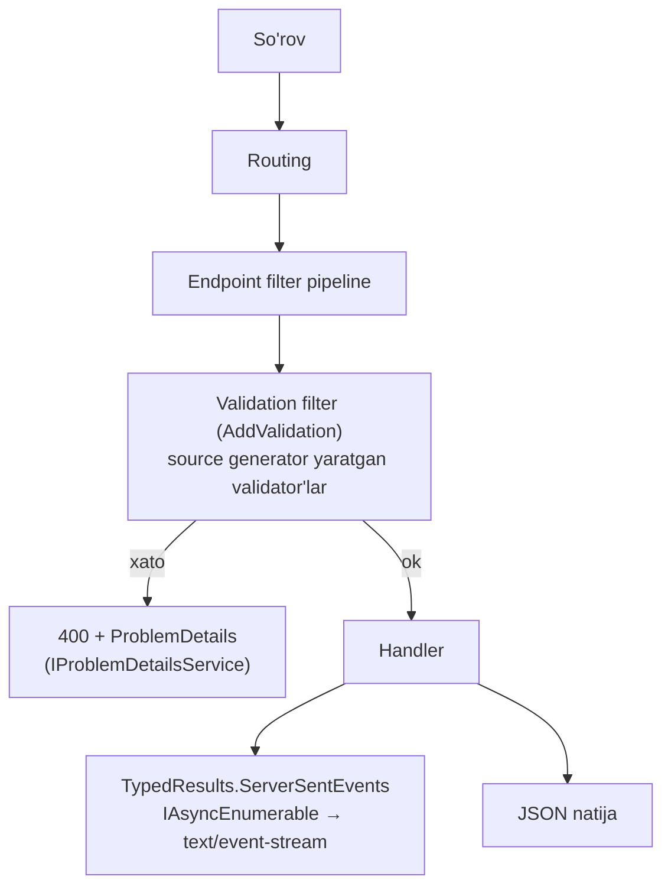

# 26. ASP.NET Core 10

> **Bir jumlada:** ASP.NET Core 10 backend uchun to'rtta katta narsa beradi: Minimal API'da built-in validatsiya, OpenAPI 3.1 default va YAML, Server-Sent Events uchun tayyor natija tipi, Identity'da passkey. Qolganlari diagnostika, xotira va JSON tezligi bo'yicha jim yaxshilanishlar.
> **Nega Middle uchun:** .NET 8 dan 10 ga migratsiya qilayotgan jamoalar ko'p. Qaysi yangilik mavjud kodni soddalashtiradi (validatsiya, OpenAPI) va qaysi biri breaking change (cookie auth 401, JSON PipeReader, OpenAPI tiplari) ekanini bilish kerak.
> **O'qish vaqti:** ~30 daqiqa

## Mundarija

1. [Muammo va yechim](#1-muammo-va-yechim)
2. [Qanday ishlaydi](#2-qanday-ishlaydi)
3. [Asosiy tushunchalar](#3-asosiy-tushunchalar)
4. [Amaliy misol](#4-amaliy-misol)
5. [Tipik xatolar va anti-patternlar](#5-tipik-xatolar-va-anti-patternlar)
6. [Best practices checklist](#6-best-practices-checklist)
7. [Suhbat savollari va javoblar](#7-suhbat-savollari-va-javoblar)
8. [Qo'shimcha manbalar](#8-qoshimcha-manbalar)

## 1. Muammo va yechim

.NET 8/9 da Minimal API bilan yozilgan enterprise API'da uchta takrorlanadigan og'riq bor edi:

1. **Validatsiya.** Controllers'da `[ApiController]` DataAnnotations'ni avtomatik tekshirardi, Minimal API'da esa yo'q. Jamoa yo endpoint filter yozardi, yo FluentValidation + filter, yo har handler'da qo'lda `if`.
2. **OpenAPI.** Swashbuckle .NET 9 da shablondan olib tashlandi, `Microsoft.AspNetCore.OpenApi` esa OpenAPI 3.0 chiqarardi va XML izohlarni o'qimasdi. Nullable tiplar sxemada noaniq edi.
3. **Real-time oddiy holatlar.** Progress bar yoki bildirishnoma uchun SignalR ortiqcha og'ir, oddiy SSE'ni esa qo'lda `Response.Body` ga yozish kerak edi.

ASP.NET Core 10 shu uchalasini framework ichiga oldi. Qo'shimcha: Kestrel va IIS endi bo'sh turgan xotira bloklarini qaytaradi (katta trafik cho'qqisidan keyin RSS kamayadi), JSON body endi `PipeReader` orqali o'qiladi (kamroq nusxalash), Identity passkey (parolsiz kirish) qo'llab-quvvatlaydi.

Holat (2026-oktabr): ASP.NET Core 10 barqaror, LTS, 2028-noyabrgacha. ASP.NET Core 11 RC2 (30-faylga qarang).

## 2. Qanday ishlaydi

Yangi xususiyatlarning aksariyati mavjud kengaytma nuqtalariga tayanadi:



- **Validatsiya** endpoint filter sifatida ishlaydi. `AddValidation()` chaqirilganda source generator compile vaqtida handler parametrlarining tiplarini topib, ular uchun reflection'siz validator kodi yaratadi. Shuning uchun NativeAOT bilan mos.
- **OpenAPI** hujjati `Microsoft.OpenApi` 2.0 kutubxonasi bilan quriladi; shuning uchun tiplar o'zgargan (`OpenApiAny` → `JsonNode`, `Nullable` property yo'q).
- **SSE** `SseItem<T>` elementlarini `IAsyncEnumerable` dan o'qib, `text/event-stream` formatida yozadi; ulanish `CancellationToken` orqali uziladi.
- **Memory pool eviction** Kestrel'ning `PinnedBlockMemoryPool` ichida: bloklar bir muddat ishlatilmasa, OS ga qaytariladi.

## 3. Asosiy tushunchalar

### 3.1 Minimal API built-in validation

- **Ta'rif.** `builder.Services.AddValidation()` bilan handler parametrlari (body, query, header) DataAnnotations va `IValidatableObject` bo'yicha avtomatik tekshiriladi. Paket va namespace: `Microsoft.Extensions.Validation`.
- **Nega kerak.** Controllers bilan paritet, har endpoint'da qo'lda validatsiya yo'q, 400 javob ProblemDetails formatida.

```csharp
builder.Services.AddValidation();
builder.Services.AddProblemDetails();

public record CreateOrderRequest(
    [property: Required, MaxLength(32)] string CustomerCode,
    [property: Range(1, 10_000)] int Quantity,
    [property: Required] ShippingAddress Address) : IValidatableObject
{
    public IEnumerable<ValidationResult> Validate(ValidationContext ctx)
    {
        if (Quantity > 1000 && Address.Country != "UZ")
            yield return new("1000 dan ortiq miqdor faqat O'zbekiston ichida", [nameof(Quantity)]);
    }
}

public record ShippingAddress([property: Required] string Country, [property: Required] string City);

app.MapPost("/orders", (CreateOrderRequest req, IOrderService svc, CancellationToken ct) => svc.CreateAsync(req, ct));

// Alohida endpoint uchun o'chirish
app.MapPost("/orders/import", ImportHandler).DisableValidation();
```

Xato javobi:

```json
{
  "type": "https://tools.ietf.org/html/rfc9110#section-15.5.1",
  "title": "One or more validation errors occurred.",
  "status": 400,
  "errors": {
    "CustomerCode": ["The CustomerCode field is required."],
    "Address.City": ["The City field is required."]
  }
}
```

- **FluentValidation bilan taqqoslash.**

| Mezon | Built-in (.NET 10) | FluentValidation |
|---|---|---|
| Sozlash | Bir qator | Paket + validator klasslar + filter |
| Qoidalar | Atributlar, `IValidatableObject` | Fluent, murakkab shartlar, DI'dan servis (bazaga murojaat) |
| Lokalizatsiya | .NET 11 da built-in | Mavjud |
| Async qoidalar | .NET 11 da `AsyncValidationAttribute` | `MustAsync` |
| NativeAOT | Ha (source generator) | Reflection |

Qoida: oddiy shakl validatsiyasi built-in, DI yoki bazaga murojaat talab qiladigan qoidalar FluentValidation yoki domain qatlami.

- **Tipik xato.** `record` positional parametrida atributni `[Required]` deb yozsangiz, u konstruktor parametriga tushadi, property'ga emas; validator ko'rmaydi. `[property: Required]` yozing. Boshqa assembly'dagi endpoint'lar uchun `AddValidation()` o'sha assembly'dan chaqirilishi kerak (generator per-assembly ishlaydi).

### 3.2 OpenAPI 3.1, YAML va XML izohlar

- **Ta'rif.** `AddOpenApi()` endi OpenAPI 3.1 chiqaradi (JSON Schema 2020-12 bilan to'liq mos). `.yaml` yo'l bilan YAML ham beriladi. `GenerateDocumentationFile` yoqilsa, XML `<summary>` izohlar hujjatga tushadi.

```xml
<PropertyGroup>
  <GenerateDocumentationFile>true</GenerateDocumentationFile>
</PropertyGroup>
```

```csharp
builder.Services.AddOpenApi(o =>
{
    // Eski mijozlar (ba'zi kod generatorlar) 3.0 talab qilsa:
    // o.OpenApiVersion = Microsoft.OpenApi.OpenApiSpecVersion.OpenApi3_0;
});

app.MapOpenApi();                                  // /openapi/v1.json
app.MapOpenApi("/openapi/{documentName}.yaml");    // YAML
app.MapScalarApiReference();                       // Scalar UI (Scalar.AspNetCore paketi)

/// <summary>Buyurtmani ID bo'yicha qaytaradi.</summary>
/// <param name="id">Buyurtma identifikatori.</param>
/// <response code="404">Topilmadi.</response>
static async Task<Results<Ok<OrderDto>, NotFound>> GetOrder(int id, IOrderQueries q, CancellationToken ct)
    => await q.GetAsync(id, ct) is { } o ? TypedResults.Ok(o) : TypedResults.NotFound();

app.MapGet("/orders/{id:int}", GetOrder)
   .WithName("GetOrder")
   .Produces<OrderDto>(200, description: "Buyurtma");
```

- **Breaking change'lar.** `Microsoft.OpenApi` 2.0: transformer kodida `OpenApiAny` o'rniga `JsonNode`, `OpenApiSchema.Nullable` yo'q (nullable tip `oneOf` + `null` tur bilan ifodalanadi). `IOpenApiDocumentProvider` orqali hujjatni HTTP'siz olish mumkin (masalan, testda snapshot).
- **Tipik xato.** Lambda handler'ga yozilgan XML izoh o'qilmaydi. Hujjat kerak bo'lgan endpoint'larni nomlangan metod qiling.

### 3.3 Server-Sent Events

- **Ta'rif.** `TypedResults.ServerSentEvents(IAsyncEnumerable<T>)` yoki `IAsyncEnumerable<SseItem<T>>` qaytarsangiz, framework `text/event-stream` javob yozadi.
- **Nega kerak.** Bir tomonlama oqim (progress, bildirishnoma, LLM javobi) uchun SignalR hub, backplane va JS kutubxonasi shart emas; brauzerda `EventSource` yetarli, reconnect avtomatik.

```csharp
app.MapGet("/orders/{id:int}/events", (int id, IOrderEvents events, CancellationToken ct) =>
{
    async IAsyncEnumerable<SseItem<OrderEvent>> Stream([EnumeratorCancellation] CancellationToken token)
    {
        await foreach (var e in events.SubscribeAsync(id, token))
            yield return new SseItem<OrderEvent>(e, eventType: e.Kind) { EventId = e.Sequence.ToString() };
    }
    return TypedResults.ServerSentEvents(Stream(ct));
}).RequireAuthorization();
```

`EventId` mijoz uzilib qayta ulanganda `Last-Event-ID` header bilan qaytadi; shunga qarab o'tkazib yuborilgan hodisalarni yuborish sizning kodingiz vazifasi. Batafsil: 19-mavzu.

### 3.4 Identity passkeys (WebAuthn)

- **Ta'rif.** ASP.NET Core Identity endi passkey (FIDO2/WebAuthn) bilan ro'yxatdan o'tish va kirishni qo'llab-quvvatlaydi. Blazor Web App shablonida tayyor UI bor.
- **Nega kerak.** Parolsiz, phishing'ga chidamli kirish; enterprise'da ichki portal uchun MFA'ning qulay varianti.
- **Oqim.** Server "creation options" (challenge) beradi → brauzer `navigator.credentials.create()` → server attestation'ni tekshirib, public key'ni `IdentityUserPasskey` sifatida saqlaydi. Kirishda: "request options" → `navigator.credentials.get()` → server assertion'ni tekshiradi. API nomlari 13-mavzuda.

### 3.5 Memory pool eviction

- **Ta'rif.** Kestrel, IIS va HTTP.sys xotira pool'i bo'sh bloklarni ma'lum vaqtdan keyin OS ga qaytaradi. Sozlash kerak emas. Metrikalar: `Microsoft.AspNetCore.MemoryPool` meter'i.
- **Nega muhim.** Oldin trafik cho'qqisida o'sgan pool hech qachon kichraymasdi; Kubernetes'da bu "xotira limitga yaqin turibdi" degan noto'g'ri alert'larga sabab bo'lardi.
- `IMemoryPoolFactory<byte>` inject qilib, o'z kodingizda ham eviction'li pool olishingiz mumkin.

### 3.6 JSON PipeReader bilan o'qish

- **Ta'rif.** MVC, Minimal API va `ReadFromJsonAsync` endi body'ni `Stream` emas, `PipeReader` orqali o'qiydi. Kamroq nusxalash, kamroq allocation.
- **Breaking change.** Custom `JsonConverter` yozgan bo'lsangiz, `Utf8JsonReader.HasValueSequence` holatini qayta ishlashi shart (ma'lumot bir nechta segmentda kelishi mumkin). Vaqtincha eski yo'lga qaytish: `Microsoft.AspNetCore.UseStreamBasedJsonParsing` AppContext switch'i `true`.

### 3.7 Auth va diagnostika yangiliklari

- **Cookie auth API endpoint'larda.** `[ApiController]`, JSON Minimal API, `TypedResults` va SignalR endpoint'lari endi login sahifasiga redirect qilmaydi, 401/403 qaytaradi. SPA + cookie ishlatadigan jamoalar uchun kutilgan xatti-harakat; eski redirect kerak bo'lsa `OnRedirectToLogin` event'ini qayta sozlang.
- **Metrikalar.** `Microsoft.AspNetCore.Authentication`, `...Authorization`, `...Identity` meter'lari: sign-in soni, challenge, forbid, parol tekshiruv urinishlari. Grafana'da "login xatolari keskin oshdi" alert'ini framework metrikasidan qurish mumkin.
- **`IExceptionHandler` logging.** Handler `true` qaytarsa, framework endi exception'ni o'zi log qilmaydi (ikki marta log yo'q). Eski xatti-harakat: `ExceptionHandlerOptions.SuppressDiagnosticsCallback = _ => false`.
- **`.localhost` TLD.** Kestrel `*.localhost` ni loopback'ga bog'laydi; `dotnet new web --localhost-tld` bilan `api.dev.localhost` kabi nomlar, cookie va CORS testlari uchun qulay.

### 3.8 OpenAPI va JSON Patch

- JSON Patch (`Microsoft.AspNetCore.JsonPatch.SystemTextJson`) endi System.Text.Json bilan ishlaydi, Newtonsoft.Json dependency shart emas. OpenAPI hujjatida JSON Patch body `application/json-patch+json` sifatida ko'rinadi.

## 4. Amaliy misol

.NET 10 ga ko'chirilgan "Orders" Minimal API: validatsiya, OpenAPI 3.1, SSE va ProblemDetails bir joyda.

```csharp
using System.ComponentModel.DataAnnotations;
using System.Runtime.CompilerServices;
using System.Net.ServerSentEvents;
using Microsoft.AspNetCore.Http.HttpResults;

var builder = WebApplication.CreateBuilder(args);

builder.Services.AddProblemDetails(o => o.CustomizeProblemDetails = ctx =>
{
    ctx.ProblemDetails.Extensions["traceId"] = ctx.HttpContext.TraceIdentifier;
});
builder.Services.AddValidation();                       // .NET 10
builder.Services.AddOpenApi();                          // 3.1 default
builder.Services.AddAuthentication().AddJwtBearer();
builder.Services.AddAuthorization();
builder.Services.AddSingleton<IOrderEvents, InMemoryOrderEvents>();
builder.Services.AddScoped<IOrderService, OrderService>();

var app = builder.Build();

app.UseExceptionHandler();
app.UseStatusCodePages();
app.UseAuthentication();
app.UseAuthorization();

if (app.Environment.IsDevelopment())
{
    app.MapOpenApi();
    app.MapOpenApi("/openapi/{documentName}.yaml");
}

var orders = app.MapGroup("/orders").RequireAuthorization().WithTags("Orders");

orders.MapPost("/", CreateOrder).WithName("CreateOrder");
orders.MapGet("/{id:int}", GetOrder).WithName("GetOrder");
orders.MapGet("/{id:int}/events", StreamOrderEvents).WithName("OrderEvents");

app.Run();

// ---- Handlers: nomlangan metodlar, XML izohlar OpenAPI'ga tushadi ----

/// <summary>Yangi buyurtma yaratadi.</summary>
/// <response code="201">Yaratildi.</response>
/// <response code="400">Validatsiya xatosi.</response>
static async Task<Results<Created<OrderDto>, ValidationProblem>> CreateOrder(
    CreateOrderRequest req, IOrderService svc, CancellationToken ct)
{
    // Shakl validatsiyasi allaqachon o'tgan (AddValidation). Bu yerda biznes qoida:
    var result = await svc.CreateAsync(req, ct);
    return result.IsSuccess
        ? TypedResults.Created($"/orders/{result.Value.Id}", result.Value)
        : TypedResults.ValidationProblem(result.Errors);
}

/// <summary>Buyurtmani qaytaradi.</summary>
static async Task<Results<Ok<OrderDto>, NotFound>> GetOrder(int id, IOrderService svc, CancellationToken ct)
    => await svc.GetAsync(id, ct) is { } o ? TypedResults.Ok(o) : TypedResults.NotFound();

/// <summary>Buyurtma holati o'zgarishlarini SSE orqali oqim qilib beradi.</summary>
static ServerSentEventsResult<OrderEvent> StreamOrderEvents(int id, IOrderEvents events, CancellationToken ct)
{
    async IAsyncEnumerable<SseItem<OrderEvent>> Stream([EnumeratorCancellation] CancellationToken token)
    {
        await foreach (var e in events.SubscribeAsync(id, token))
            yield return new SseItem<OrderEvent>(e, eventType: e.Kind) { EventId = e.Sequence.ToString() };
    }
    return TypedResults.ServerSentEvents(Stream(ct));
}

// ---- Kontraktlar ----

public record CreateOrderRequest(
    [property: Required, StringLength(32, MinimumLength = 3)] string CustomerCode,
    [property: Required, MinLength(1)] List<OrderLineRequest> Lines) : IValidatableObject
{
    public IEnumerable<ValidationResult> Validate(ValidationContext _)
    {
        if (Lines.Sum(l => l.Qty) > 10_000)
            yield return new("Bitta buyurtmada 10 000 donadan ko'p bo'lmasin", [nameof(Lines)]);
    }
}

public record OrderLineRequest(
    [property: Required] string Sku,
    [property: Range(1, 1000)] int Qty,
    [property: Range(0.01, 1_000_000)] decimal Price);

public record OrderDto(int Id, string CustomerCode, decimal Total, string Status);
public record OrderEvent(long Sequence, string Kind, string Status);
```

Nima uchun shunday:

- `AddValidation` shakl validatsiyasini handler'dan chiqaradi; handler faqat biznes qoida bilan shug'ullanadi va `ValidationProblem` qaytaradi, shunda mijoz ikkala xatoni bir formatda ko'radi.
- `Results<Created<...>, ValidationProblem>` tipi OpenAPI'da ikkala javobni avtomatik hujjatlaydi.
- SSE endpoint `EventId` beradi, mijoz uzilib qayta ulanganda `Last-Event-ID` yuboradi.
- `MapGroup` bilan auth va tag bir joyda.

## 5. Tipik xatolar va anti-patternlar

**❌ Positional record'da `[Required]` ni `property:` siz yozish**

```csharp
public record Req([Required] string Code);   // atribut konstruktor parametrida, validator ko'rmaydi
```

Nega yomon: bo'sh `Code` 200 bilan o'tadi. ✅ `[property: Required]`.

**❌ .NET 8 dan ko'chirib, cookie auth bilan SPA'da "login sahifasiga redirect" ni kutish**

Nega yomon: .NET 10 da API endpoint'lar 401 qaytaradi; frontend `fetch` natijasida HTML sahifa emas, 401 oladi. Aslida bu to'g'ri, lekin frontend 401 ni handle qilmasa, foydalanuvchi bo'sh ekran ko'radi. ✅ Frontend'da 401 → login yo'naltirish; serverni eski holatga qaytarmang.

**❌ Custom `JsonConverter` da `ValueSpan` ni to'g'ridan-to'g'ri o'qish**

```csharp
var s = Encoding.UTF8.GetString(reader.ValueSpan);   // HasValueSequence bo'lsa noto'g'ri
```

Nega yomon: PipeReader yo'li bilan ma'lumot segmentlarga bo'lingan bo'lishi mumkin. ✅ `reader.HasValueSequence ? reader.ValueSequence : reader.ValueSpan` yoki `reader.GetString()`.

**❌ OpenAPI transformer'da eski `OpenApiString`/`Nullable` API**

Nega yomon: `Microsoft.OpenApi` 2.0 da kompilyatsiya bo'lmaydi. ✅ `JsonNode` va `JsonSchemaType.Null` bilan ishlang.

**❌ SSE'ni reverse proxy buferlashini unutish**

Nega yomon: nginx default javobni buferlaydi, mijoz hodisalarni paketlab kech oladi. ✅ `proxy_buffering off;` yoki `X-Accel-Buffering: no` header.

**❌ `IExceptionHandler` ichida ham log, framework'dan ham log kutish**

Nega yomon: .NET 10 da handler `true` qaytarsa framework log qilmaydi; agar siz ham log qilmasangiz, xato izsiz yo'qoladi. ✅ Handler ichida o'zingiz log qiling (500 uchun `LogError`).

## 6. Best practices checklist

- [ ] Minimal API'da shakl validatsiyasi `AddValidation()` bilan; FluentValidation faqat DI/bazaga bog'liq qoidalarda. Sabab: kamroq kod, AOT mos.
- [ ] Positional record'larda `[property: ...]` prefiksi. Sabab: aks holda validatsiya ishlamaydi.
- [ ] Hujjat kerak endpoint'lar nomlangan metod + XML izoh + `GenerateDocumentationFile`. Sabab: lambda izohlari o'qilmaydi.
- [ ] OpenAPI 3.1 ni default qoldiring; faqat eski kod generator talab qilsa 3.0 ga tushiring. Sabab: nullable va JSON Schema aniqroq.
- [ ] `IOpenApiDocumentProvider` bilan OpenAPI snapshot testi qo'shing. Sabab: tasodifiy kontrakt o'zgarishi PR'da ko'rinadi.
- [ ] Bir tomonlama oqim uchun SSE, ikki tomonlama uchun SignalR. Sabab: SSE infratuzilma talab qilmaydi.
- [ ] SSE'da `EventId` bering va `Last-Event-ID` ni qayta ishlang. Sabab: reconnect'da hodisa yo'qolmasin.
- [ ] Reverse proxy'da SSE uchun buferlashni o'chiring.
- [ ] Custom `JsonConverter` larni `HasValueSequence` uchun tekshiring. Sabab: .NET 10 PipeReader yo'li.
- [ ] Auth metrikalarini (sign-in failure rate) dashboard'ga chiqaring. Sabab: brute-force va integratsiya buzilishi erta ko'rinadi.
- [ ] `IExceptionHandler` ichida 500 larni o'zingiz log qiling. Sabab: framework endi qilmaydi.
- [ ] Migratsiyadan oldin "Migrate from ASP.NET Core 8/9 to 10" hujjatini o'qing va breaking changes ro'yxatini jamoa bilan ko'rib chiqing.

## 7. Suhbat savollari va javoblar

1. **.NET 10 da Minimal API validatsiyasi qanday ishlaydi va FluentValidation'ni almashtiradimi?**
   `AddValidation()` source generator orqali handler parametr tiplari uchun validator kodi yaratadi va endpoint filter sifatida ishga tushiradi; DataAnnotations va `IValidatableObject` qo'llab-quvvatlanadi, xato 400 ProblemDetails bo'ladi. Oddiy shakl validatsiyasi uchun FluentValidation kerak emas. DI talab qiladigan (bazada mavjudligini tekshirish) yoki murakkab shartli qoidalar uchun FluentValidation yoki domain qatlami qoladi.

2. **OpenAPI 3.1 ga o'tish nimani buzadi?**
   Hujjat formati (nullable `oneOf` orqali, JSON Schema 2020-12) ba'zi eski kod generatorlar bilan mos kelmasligi mumkin; kerak bo'lsa `OpenApiVersion = OpenApi3_0`. Kodda `Microsoft.OpenApi` 2.0 tiplari o'zgargan: `OpenApiAny` → `JsonNode`, `Nullable` property yo'q. Transformer yozgan jamoalar kodni yangilaydi.

3. **SSE va SignalR o'rtasida qanday tanlaysiz?**
   SSE: bir tomonlama (server → mijoz), oddiy HTTP, brauzer `EventSource` avtomatik reconnect, infratuzilma yo'q. SignalR: ikki tomonlama, guruhlar, ko'p instansda backplane, transport fallback. Progress, bildirishnoma, LLM oqimi uchun SSE; chat, hamkorlikda tahrirlash uchun SignalR.

4. **Memory pool eviction qaysi muammoni hal qiladi?**
   Kestrel pool trafik cho'qqisida o'sib, keyin kichraymasdi; konteynerda RSS yuqori qolardi. Endi bo'sh bloklar bir muddatdan keyin OS ga qaytariladi, sozlash kerak emas. `Microsoft.AspNetCore.MemoryPool` metrikalari bilan kuzatish mumkin.

5. **Cookie auth bilan API endpoint .NET 10 da nega 401 qaytaradi?**
   Framework `IApiEndpointMetadata` bilan belgilangan endpoint'larni (ApiController, JSON Minimal API, TypedResults, SignalR) API deb tanib, HTML login sahifasiga redirect o'rniga 401/403 qaytaradi. SPA uchun bu to'g'ri xatti-harakat; eski redirect kerak bo'lsa `OnRedirectToLogin` event'ini sozlash mumkin.

6. **JSON PipeReader o'zgarishi mavjud kodga qanday ta'sir qiladi?**
   Framework kodi uchun shaffof. Custom `JsonConverter` da `Utf8JsonReader.HasValueSequence` holatini qayta ishlash kerak, aks holda segmentlangan ma'lumotda noto'g'ri natija. Vaqtinchalik `Microsoft.AspNetCore.UseStreamBasedJsonParsing` switch'i bor, lekin bu yechim emas, muhlat.

7. **Passkey nima va enterprise uchun nega qiziq?**
   WebAuthn/FIDO2 asosidagi parolsiz kirish: private key qurilmada, server faqat public key saqlaydi, phishing ishlamaydi. Identity .NET 10 da buni qo'llab-quvvatlaydi. Enterprise'da ichki portal uchun MFA sifatida yoki parol siyosatini soddalashtirish uchun.

8. **`IExceptionHandler` logging xatti-harakati nega o'zgardi?**
   Oldin handler xatoni qayta ishlagan bo'lsa ham framework uni log qilardi, natijada ikki marta log. .NET 10 da handler `true` qaytarsa, framework jim. Shuning uchun handler ichida 500 larni o'zingiz log qilishingiz shart.

9. **.NET 8 → 10 migratsiyada backend jamoasi nimalarni tekshirishi kerak?**
   `global.json`/SDK, `TargetFramework`, paket versiyalari (EF Core 10, OpenApi), Swashbuckle o'rniga built-in OpenAPI, cookie auth 401 xatti-harakati, custom JSON converter'lar, `Microsoft.OpenApi` 2.0 tiplari, validatsiya filter'larini `AddValidation` bilan almashtirish, integration testlar to'liq o'tishi.

10. **OpenAPI hujjatini CI'da qanday nazorat qilasiz?**
    `IOpenApiDocumentProvider` orqali hujjatni test ichida olib, snapshot (Verify) bilan solishtirish, yoki `Microsoft.Extensions.ApiDescription.Server` bilan build vaqtida fayl generatsiya qilib, git'dagi nusxa bilan diff. Kontrakt o'zgarishi PR'da ko'rinadi.

## 8. Qo'shimcha manbalar

- [What's new in ASP.NET Core 10.0 (Microsoft Learn)](https://learn.microsoft.com/aspnet/core/release-notes/aspnetcore-10.0)
- [Minimal API validation](https://learn.microsoft.com/aspnet/core/fundamentals/minimal-apis/validation)
- [OpenAPI document generation](https://learn.microsoft.com/aspnet/core/fundamentals/openapi/aspnetcore-openapi)
- [Server-Sent Events in ASP.NET Core](https://learn.microsoft.com/aspnet/core/fundamentals/minimal-apis/responses#server-sent-events-sse)
- [Passkeys in ASP.NET Core Identity](https://learn.microsoft.com/aspnet/core/security/authentication/passkeys)
- [Migrate from ASP.NET Core 9.0 to 10.0](https://learn.microsoft.com/aspnet/core/migration/90-to-100)
- [Breaking changes in .NET 10](https://learn.microsoft.com/dotnet/core/compatibility/10.0)
