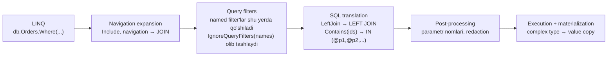

# 27. EF Core 10

> **Bir jumlada:** EF Core 10 (LTS, 2028-noyabrgacha) LINQ'da `LeftJoin`/`RightJoin`, named query filters, complex types'ning to'liq versiyasi (struct, optional, JSON, ExecuteUpdate), parametrli kolleksiyalar uchun yangi tarjima, `ExecuteUpdateAsync` ga oddiy lambda, SQL Server 2025 `vector`/`json` tiplari va xavfsizlik yaxshilanishlarini olib keldi.
> **Nega Middle uchun:** Bu yangiliklarning har biri enterprise kodda real og'riqni yopadi: soft delete + tenant filtri birga, LEFT JOIN uchun 3 operatorli konstruksiya, plan cache bloat, owned entity'larning identity muammolari. Suhbatda "EF 10 da nima o'zgardi" deb so'ralsa, kamida uchta xususiyatni SQL misoli bilan aytish kerak.
> **O'qish vaqti:** ~30 daqiqa

## Mundarija

1. [Muammo va yechim](#1-muammo-va-yechim)
2. [Qanday ishlaydi](#2-qanday-ishlaydi)
3. [Asosiy tushunchalar](#3-asosiy-tushunchalar)
4. [Amaliy misol](#4-amaliy-misol)
5. [Tipik xatolar va anti-patternlar](#5-tipik-xatolar-va-anti-patternlar)
6. [Best practices checklist](#6-best-practices-checklist)
7. [Suhbat savollari va javoblar](#7-suhbat-savollari-va-javoblar)
8. [Qo'shimcha manbalar](#8-qoshimcha-manbalar)

## 1. Muammo va yechim

EF Core 8/9 bilan ishlagan enterprise jamoalarning tipik shikoyatlari:

| Muammo | EF 10 yechimi |
|---|---|
| Entity'da bitta global filter bo'lishi mumkin edi; soft delete va tenant filtrini birlashtirish, keyin faqat bittasini o'chirish qiyin | Named query filters: `HasQueryFilter("SoftDelete", ...)`, `IgnoreQueryFilters(["SoftDelete"])` |
| LEFT JOIN uchun `GroupJoin` + `SelectMany` + `DefaultIfEmpty` | `LeftJoin` / `RightJoin` LINQ operatorlari (.NET 10 BCL'da ham) |
| `ids.Contains(x.Id)` uchun EF 8 `OPENJSON` ishlatardi, planner kardinallikni bilmasdi; EF 7 va oldin konstanta inline qilib plan cache'ni to'ldirardi | Yangi default: har qiymat alohida parametr + padding; global/per-query boshqaruv |
| Owned entity bilan JSON/table splitting: identity semantikasi, bir manzilni ikki joyga tayinlab bo'lmasdi, `ExecuteUpdate` ishlamasdi | Complex types: value semantika, optional, struct, `ToJson()`, `ExecuteUpdate` qo'llab-quvvatlaydi |
| `ExecuteUpdateAsync` setter'larini dinamik qurish expression tree bilan og'riqli | Oddiy lambda bloki, `if` bilan shartli `SetProperty` |
| Inline qilingan konstantalar log'ga PII bilan tushardi | Default redaction (`?`), `FromSqlRaw` konkatenatsiyasi uchun analyzer |

Holat (2026-oktabr): EF Core 10 barqaror (2025-noyabr). EF Core 11 RC (30-faylda).

## 2. Qanday ishlaydi

EF Core so'rov pipeline'i: LINQ expression tree → navigation expansion → query filters qo'llash → SQL translation → SQL post-processing → execution → materialization.



- **Named filters** filter bosqichida nom bo'yicha saqlanadi; `IgnoreQueryFilters` argumentsiz hammasini, nomlar bilan faqat ko'rsatilganlarni o'chiradi.
- **LeftJoin** .NET 10 `System.Linq` da yangi operator; EF uni bevosita `LEFT JOIN` ga tarjima qiladi. Eski uch operatorli shakl hali ham ishlaydi va xuddi shu SQL'ni beradi.
- **Parametrli kolleksiya** tarjimasi `ParameterTranslationMode` bilan boshqariladi: `MultipleParameters` (yangi default), `Parameter` (bitta JSON parametr, EF 8 usuli), `Constant` (inline).
- **Complex type** entity emas: identity yo'q, change tracker uni "qiymat" sifatida solishtiradi (property bo'yicha). Shuning uchun `customer.Billing = customer.Shipping` nusxalash bo'ladi, xato emas.

## 3. Asosiy tushunchalar

### 3.1 `LeftJoin` va `RightJoin`

- **Ta'rif.** `.NET 10` `Enumerable`/`Queryable` ga `LeftJoin(inner, outerKey, innerKey, resultSelector)` qo'shdi; EF 10 uni `LEFT JOIN` ga tarjima qiladi. `RightJoin` mos ravishda `RIGHT JOIN`.

```csharp
// EF 9 va oldin
var q = db.Customers
    .GroupJoin(db.Orders, c => c.Id, o => o.CustomerId, (c, orders) => new { c, orders })
    .SelectMany(x => x.orders.DefaultIfEmpty(), (x, o) => new { x.c.Name, Total = o != null ? o.Total : 0 });

// EF 10
var q = db.Customers
    .LeftJoin(db.Orders, c => c.Id, o => o.CustomerId,
              (c, o) => new { c.Name, Total = o != null ? o.Total : 0 });
```

SQL (ikkalasi uchun bir xil):

```sql
SELECT c.Name, COALESCE(o.Total, 0) AS Total
FROM Customers AS c
LEFT JOIN Orders AS o ON c.Id = o.CustomerId
```

- **Tipik xato.** Query syntax (`from ... join ... into`) hali `LeftJoin` ni qo'llab-quvvatlamaydi; method syntax ishlating. Navigation property bo'lsa (`c.Orders`), odatda `Select` projection bilan `LEFT JOIN` ni EF o'zi quradi, `LeftJoin` ad-hoc bog'lanishlar uchun.

### 3.2 Named query filters

- **Ta'rif.** Bitta entity'ga bir nechta nomlangan global filter; so'rovda ayrimlarini o'chirish mumkin.

```csharp
modelBuilder.Entity<Order>()
    .HasQueryFilter("SoftDelete", o => !o.IsDeleted)
    .HasQueryFilter("Tenant", o => o.TenantId == _tenant.Id);

// Faqat soft-delete filtrini o'chirish (admin "o'chirilganlar" sahifasi), tenant filtri qoladi
var deleted = await db.Orders.IgnoreQueryFilters(["SoftDelete"]).Where(o => o.IsDeleted).ToListAsync(ct);

// Hammasini o'chirish (ehtiyot bilan: tenant izolyatsiyasi yo'qoladi)
var all = await db.Orders.IgnoreQueryFilters().ToListAsync(ct);
```

- **Nega muhim.** Multi-tenant tizimda "tenant" filtrini tasodifan o'chirish xavfsizlik hodisasi. Nomlangan filtrlar bilan faqat kerakli filtr o'chadi.
- **Tipik xato.** Filtr ichida `_tenant.Id` kabi DbContext field'ini ishlatish shart (parametr bo'ladi); static qiymat bo'lsa, model cache'ga qotib qoladi.

### 3.3 Complex types: struct, optional, JSON, ExecuteUpdate

- **Ta'rif.** Complex type identity'siz, konteyner entity ichida yashaydigan tip. EF 8 da kiritilgan, EF 10 da to'liq: `struct` bo'lishi mumkin, optional (`Address?`) bo'lishi mumkin, `ToJson()` bilan bitta JSON ustuniga map qilinadi, `ExecuteUpdateAsync` ichida ishlatiladi.

```csharp
public readonly record struct Money(decimal Amount, string Currency);

public sealed class Order
{
    public int Id { get; set; }
    public required Address Shipping { get; set; }
    public Address? Billing { get; set; }            // EF 10: optional complex type
    public Money Total { get; set; }                  // struct complex type
}

public sealed class Address
{
    public required string Country { get; set; }
    public required string City { get; set; }
    public string? Street { get; set; }
}

modelBuilder.Entity<Order>(b =>
{
    b.ComplexProperty(o => o.Shipping);                     // table splitting: Shipping_Country, Shipping_City...
    b.ComplexProperty(o => o.Billing, c => c.ToJson());     // bitta JSON ustun
    b.ComplexProperty(o => o.Total);
});

// Value semantika: nusxalash, xato emas (owned entity'da xato edi)
order.Billing = order.Shipping;

// Bulk update JSON ichidagi property
await db.Orders.Where(o => o.Billing != null && o.Billing.Country == "UZ")
    .ExecuteUpdateAsync(s => s.SetProperty(o => o.Billing!.City, "Toshkent"), ct);
```

- **Owned vs complex.** Owned entity aslida entity (identity, reference semantika), shuning uchun bir manzilni ikki property'ga tayinlab bo'lmasdi, LINQ'da taqqoslash identity bo'yicha edi, `ExecuteUpdate` yo'q edi. EF jamoasi JSON va table splitting uchun complex type'ga o'tishni tavsiya qiladi.
- **Cheklov.** Struct kolleksiyalari qo'llab-quvvatlanmaydi; optional complex type'da kamida bitta required property bo'lishi kerak.

### 3.4 Parametrli kolleksiyalar tarjimasi

- **Ta'rif.** `ids.Contains(o.Id)` uchun EF 10 har qiymatni alohida parametrga aylantiradi va parametr sonini "padding" qiladi (8 ta qiymat → 10 ta parametr, oxirgilari takrorlanadi) shunda plan cache'da kam variant bo'ladi.

```sql
-- EF 10 default
WHERE o.Id IN (@ids1, @ids2, @ids3, @ids4, @ids5)
```

```csharp
// Global: EF 8 usuli (bitta JSON parametr, OPENJSON)
options.UseSqlServer(cs, o => o.UseParameterizedCollectionMode(ParameterTranslationMode.Parameter));

// Per-query: inline konstanta (planner aniq qiymatlarni ko'radi; kam o'zgaradigan ro'yxatlar uchun)
db.Users.Where(u => EF.Constant(roles).Contains(u.Role));

// Per-query: har qiymat alohida parametr
db.Orders.Where(o => EF.Parameter(ids).Contains(o.Id));
```

- **Nega muhim.** Plan cache bloat (har xil uzunlikdagi ro'yxat → yangi plan) va kardinallik taxmini xatosi (OPENJSON uchun planner elementlar sonini bilmaydi) ikkalasi ham production'da sekinlashuv sababi. Qaysi rejim yaxshiligi ma'lumotga bog'liq, shuning uchun EF uchala rejimni ham ochiq qoldirgan.

### 3.5 `ExecuteUpdateAsync` oddiy lambda bilan

```csharp
await db.Orders.Where(o => o.Id == id).ExecuteUpdateAsync(s =>
{
    s.SetProperty(o => o.Status, OrderStatus.Shipped);
    s.SetProperty(o => o.ShippedAt, DateTime.UtcNow);
    if (trackingNumber is not null)
        s.SetProperty(o => o.TrackingNumber, trackingNumber);
}, ct);
```

Oldin `Expression<Func<SetPropertyCalls<T>, SetPropertyCalls<T>>>` edi va shartli setter uchun expression tree'ni qo'lda qurish kerak edi. Endi oddiy `Action<UpdateSettersBuilder<T>>`. Bu low-impact breaking change: eski expression shakl ham ishlaydi.

### 3.6 SQL Server 2025: `vector` va `json` tiplari

```csharp
public sealed class Product
{
    public int Id { get; set; }
    public string Name { get; set; } = "";
    [Column(TypeName = "vector(1536)")]
    public SqlVector<float> Embedding { get; set; }
}

// Semantik qidiruv (29-mavzu bilan bog'lanadi)
var similar = await db.Products
    .OrderBy(p => EF.Functions.VectorDistance("cosine", p.Embedding, queryVector))
    .Take(5).ToListAsync(ct);
```

- Compatibility level 170+ (SQL Server 2025) yoki `UseAzureSql()` bo'lsa, primitive collection va JSON complex type'lar `json` tipida yaratiladi, so'rovlar `JSON_VALUE(... RETURNING int)` ishlatadi. Mavjud `nvarchar(max)` JSON ustunlari keyingi migration'da `json` ga o'zgaradi; buni xohlamasangiz ustun tipini qo'lda belgilang.
- `HasDefaultValueSql("GETDATE()", "DF_Order_Created")` bilan default constraint nomi; `UseNamedDefaultConstraints()` hammasini EF nomlaydi (keyingi migration barcha constraint'larni qayta nomlaydi, ehtiyot bo'ling).

### 3.7 Xavfsizlik: redaction va analyzer

- Inline qilingan konstantalar (masalan `EF.Constant(roles)`) endi log'da `?` bilan almashtiriladi; `EnableSensitiveDataLogging()` bilan ochiladi.
- `FromSqlRaw("... " + userInput)` kabi string konkatenatsiyasi uchun analyzer ogohlantiradi. `FromSql($"...")` interpolated shakl har doim parametrlaydi.

### 3.8 Boshqa foydali o'zgarishlar

- Split query'larda `ORDER BY` endi barcha so'rovlarda bir xil (`Id` qo'shiladi), oldin nodeterministik natija bo'lishi mumkin edi.
- Parametr nomlari sodda: `@__city_0` → `@city`.
- Migration'lar endi bitta umumiy tranzaksiyada emas (EF 9 dagi o'zgarish qaytarildi), har migration o'z tranzaksiyasida.
- Yangi tarjimalar: `DateOnly.ToDateTime`, `DateOnly.DayNumber`, `COALESCE` → `ISNULL` (SQL Server), `MIN/MAX` over `DISTINCT`.
- Cosmos DB: full-text search, hybrid search (`Rrf`), vector search barqaror.

EF Core 8/9 dan eslatma: primitive collections (`List<int>` ustun), complex types kiritilishi (EF 8), `HierarchyId`, EF 9 da `__EFMigrationsLock` jadvali (parallel migration'ga qarshi), `PendingModelChangesWarning`, `ExecuteUpdate` complex type'lar bilan boshlanishi.

## 4. Amaliy misol

Multi-tenant ombor tizimi: named filters, complex type JSON, LeftJoin va parametrli kolleksiya bir joyda.

```csharp
public sealed class WarehouseDbContext(DbContextOptions<WarehouseDbContext> options, ITenantContext tenant)
    : DbContext(options)
{
    private readonly ITenantContext _tenant = tenant;

    public DbSet<StockItem> StockItems => Set<StockItem>();
    public DbSet<Supplier> Suppliers => Set<Supplier>();
    public DbSet<StockMovement> Movements => Set<StockMovement>();

    protected override void OnModelCreating(ModelBuilder b)
    {
        b.Entity<StockItem>(e =>
        {
            e.HasQueryFilter("Tenant", s => s.TenantId == _tenant.Id);
            e.HasQueryFilter("SoftDelete", s => !s.IsDeleted);
            e.ComplexProperty(s => s.Dimensions, c => c.ToJson());     // {"Length":..,"Width":..,"Height":..}
            e.ComplexProperty(s => s.Cost);                            // Cost_Amount, Cost_Currency
            e.HasIndex(s => new { s.TenantId, s.Sku }).IsUnique();
        });

        b.Entity<Supplier>().HasQueryFilter("Tenant", s => s.TenantId == _tenant.Id);
        b.Entity<StockMovement>().HasQueryFilter("Tenant", m => m.TenantId == _tenant.Id);
    }
}

public sealed class StockItem
{
    public int Id { get; set; }
    public int TenantId { get; set; }
    public required string Sku { get; set; }
    public int Quantity { get; set; }
    public int? SupplierId { get; set; }
    public bool IsDeleted { get; set; }
    public required Dimensions Dimensions { get; set; }
    public Money Cost { get; set; }
}

public sealed class Dimensions { public decimal Length { get; set; } public decimal Width { get; set; } public decimal Height { get; set; } }
public readonly record struct Money(decimal Amount, string Currency);
public sealed class Supplier { public int Id { get; set; } public int TenantId { get; set; } public required string Name { get; set; } }
public sealed class StockMovement { public long Id { get; set; } public int TenantId { get; set; } public int StockItemId { get; set; } public int Delta { get; set; } }

public sealed class StockQueries(WarehouseDbContext db)
{
    // Hisobot: har item yetkazib beruvchisi bilan, yetkazib beruvchisi yo'qlar ham kiradi (LEFT JOIN)
    public Task<List<StockRow>> ReportAsync(int[] skuFilterIds, CancellationToken ct) =>
        db.StockItems
            .Where(s => skuFilterIds.Length == 0 || skuFilterIds.Contains(s.Id))   // EF 10: IN (@p1,@p2,...) + padding
            .LeftJoin(db.Suppliers, s => s.SupplierId, sup => sup.Id,
                (s, sup) => new StockRow(s.Sku, s.Quantity, sup != null ? sup.Name : "(yo'q)", s.Cost.Amount, s.Dimensions.Length))
            .AsNoTracking()
            .ToListAsync(ct);

    // Admin: o'chirilgan item'lar, lekin tenant chegarasi saqlanadi
    public Task<List<StockItem>> DeletedAsync(CancellationToken ct) =>
        db.StockItems.IgnoreQueryFilters(["SoftDelete"]).Where(s => s.IsDeleted).AsNoTracking().ToListAsync(ct);

    // Bulk: valyutani almashtirish, shartli setter (EF 10 oddiy lambda)
    public Task<int> RepriceAsync(decimal rate, string newCurrency, bool roundUp, CancellationToken ct) =>
        db.StockItems.Where(s => s.Cost.Currency != newCurrency).ExecuteUpdateAsync(s =>
        {
            s.SetProperty(x => x.Cost.Currency, newCurrency);
            s.SetProperty(x => x.Cost.Amount, x => roundUp ? Math.Ceiling(x.Cost.Amount * rate) : x.Cost.Amount * rate);
        }, ct);

    // JSON ichidagi qiymatni bulk yangilash (complex type ToJson)
    public Task<int> NormalizeHeightAsync(CancellationToken ct) =>
        db.StockItems.Where(s => s.Dimensions.Height == 0)
            .ExecuteUpdateAsync(s => s.SetProperty(x => x.Dimensions.Height, 1m), ct);
}

public sealed record StockRow(string Sku, int Quantity, string Supplier, decimal Cost, decimal Length);
```

Nima uchun shunday:

- Tenant filtri hamma entity'da nomlangan; `DeletedAsync` faqat `SoftDelete` ni o'chiradi, tenant izolyatsiyasi buzilmaydi.
- `Dimensions` JSON'da: alohida jadval va JOIN yo'q, lekin `ExecuteUpdate` va LINQ filter ishlaydi.
- `Cost` struct complex type table splitting bilan: ikki ustun, value semantika.
- `LeftJoin` o'rniga navigation bo'lsa ham, ad-hoc hisobotda `LeftJoin` o'qilishi oson va SQL bir xil.
- `skuFilterIds.Contains` EF 10 da alohida parametrlar; ro'yxat uzunligi har xil bo'lsa ham plan cache to'lib ketmaydi.

## 5. Tipik xatolar va anti-patternlar

**❌ `IgnoreQueryFilters()` ni argumentsiz "faqat soft delete'ni o'chirish" uchun ishlatish**

Nega yomon: tenant filtri ham o'chadi, boshqa tenant ma'lumoti chiqadi. ✅ `IgnoreQueryFilters(["SoftDelete"])`.

**❌ JSON/table splitting uchun hali ham owned entity ishlatish**

Nega yomon: identity semantikasi (bir manzilni ikki joyga tayinlab bo'lmaydi), `ExecuteUpdate` yo'q, taqqoslash identity bo'yicha. ✅ Complex type (`ComplexProperty`), EF jamoasi tavsiyasi.

**❌ SQL Server 2025 ga o'tganda JSON ustunlarining `json` tipiga avtomatik o'zgarishini kutmaslik**

Nega yomon: keyingi migration katta jadvalda ustun tipini o'zgartiradi, uzoq lock. ✅ Migration'ni staging'da o'qing; kerak bo'lsa `HasColumnType("nvarchar(max)")` yoki compatibility level 160 qoldiring.

**❌ `UseNamedDefaultConstraints()` ni mavjud loyihada shunchaki yoqish**

Nega yomon: keyingi migration barcha default constraint'larni qayta nomlaydi. ✅ Yangi loyihada yoqing, eskida faqat yangi ustunlar uchun `HasDefaultValueSql(sql, name)`.

**❌ `EF.Constant(list)` ni foydalanuvchi kiritgan ro'yxat uchun ishlatish**

Nega yomon: har xil ro'yxat → yangi SQL → plan cache bloat; EF 10 log'da redaction qiladi, lekin SQL Server plan cache baribir to'ladi. ✅ Default (`MultipleParameters`) yoki `EF.Parameter`. `EF.Constant` faqat kam sonli, barqaror ro'yxatlar (rollar) uchun.

**❌ `FromSqlRaw("SELECT ... WHERE col = '" + value + "'")`**

Nega yomon: SQL injection; EF 10 analyzer ogohlantiradi. ✅ `FromSql($"... WHERE col = {value}")` yoki `FromSqlRaw` + `DbParameter`.

## 6. Best practices checklist

- [ ] Har global filtrga nom bering (`Tenant`, `SoftDelete`). Sabab: tanlab o'chirish va audit.
- [ ] `IgnoreQueryFilters()` argumentsiz chaqiruvini code review'da alohida tekshiring. Sabab: tenant izolyatsiyasi.
- [ ] JSON va table splitting uchun complex type; owned entity faqat haqiqiy identity kerak bo'lganda. Sabab: value semantika, ExecuteUpdate.
- [ ] Ad-hoc LEFT JOIN uchun `LeftJoin`; navigation bor joyda projection. Sabab: o'qilishi, bir xil SQL.
- [ ] Parametrli kolleksiya rejimini default qoldiring; muammo bo'lsa so'rov darajasida `EF.Constant`/`EF.Parameter`. Sabab: plan cache va kardinallik muvozanati.
- [ ] `ExecuteUpdateAsync` shartli setter'lar uchun oddiy lambda. Sabab: expression tree qurish xatoga moyil.
- [ ] SQL Server 2025/Azure SQL'ga o'tishda JSON ustun tipi o'zgarishini migration script'da ko'rib chiqing.
- [ ] Vector ustunlari uchun `SqlVector<float>` + `vector(n)` tipi; 11 da vector index va `VectorSearch` keladi.
- [ ] `EnableSensitiveDataLogging` faqat development. Sabab: EF 10 default redaction'ni bekor qiladi.
- [ ] `FromSqlRaw` analyzer ogohlantirishini suppress qilishdan oldin kirish ma'lumoti ishonchli ekanini isbotlang.
- [ ] Split query ishlatgan joylarda EF 10 ga o'tgach natija tartibini tekshiring. Sabab: `ORDER BY` o'zgardi (to'g'rilandi).
- [ ] Migration'lar endi alohida tranzaksiyada: har migration o'zi idempotent va kichik bo'lsin.

## 7. Suhbat savollari va javoblar

1. **Named query filters qaysi real muammoni hal qiladi?**
   Oldin entity'da bitta filter bo'lardi; soft delete va tenant filtrini `&&` bilan birlashtirsangiz, "o'chirilganlarni ko'rsat" sahifasida `IgnoreQueryFilters()` tenant filtrini ham o'chirardi. Endi `HasQueryFilter("SoftDelete", ...)` va `IgnoreQueryFilters(["SoftDelete"])` bilan faqat bittasi o'chadi, tenant izolyatsiyasi saqlanadi.

2. **`LeftJoin` qanday SQL beradi va eski usuldan farqi bormi?**
   `LEFT JOIN`, eski `GroupJoin + SelectMany + DefaultIfEmpty` bilan aynan bir xil SQL. Farq faqat o'qilishi va xato qilish ehtimoli. Query syntax hali qo'llab-quvvatlamaydi, method syntax kerak.

3. **Complex type va owned entity farqi nima, nega EF 10 complex type'ni tavsiya qiladi?**
   Owned entity aslida entity: identity, reference semantika, change tracker'da alohida entry. Shuning uchun bir obyektni ikki property'ga tayinlab bo'lmaydi, LINQ'da taqqoslash identity bo'yicha, `ExecuteUpdate` yo'q. Complex type identity'siz qiymat: nusxalash, property bo'yicha taqqoslash, `ExecuteUpdate` ishlaydi, struct va optional bo'la oladi, `ToJson()` bilan JSON ustun. Cheklov: struct kolleksiyasi yo'q.

4. **EF 10 `ids.Contains(x.Id)` ni qanday tarjima qiladi va nega o'zgardi?**
   Har qiymat alohida parametr (`IN (@ids1, @ids2, ...)`) va parametr soni "padding" qilinadi. EF 7 va oldin konstanta inline (plan cache bloat), EF 8 bitta JSON parametr + `OPENJSON` (planner kardinallikni bilmaydi). Yangi rejim ikkala muammoni yumshatadi, lekin ma'lumotga qarab `ParameterTranslationMode` bilan global yoki `EF.Constant`/`EF.Parameter` bilan per-query o'zgartirish mumkin.

5. **`ExecuteUpdateAsync` da nima o'zgardi?**
   Setter'lar endi oddiy lambda bloki, shartli `SetProperty` uchun `if` yozish mumkin; oldin expression tree qo'lda qurilardi. Bundan tashqari JSON complex type ichidagi property'larni ham bulk yangilash mumkin (SQL Server 2025 da `.modify()` orqali).

6. **SQL Server 2025 bilan EF 10 da JSON va vector qanday ishlaydi?**
   Compatibility level 170+ da primitive collection va JSON complex type `json` tipida saqlanadi, so'rov `JSON_VALUE(... RETURNING)` ishlatadi; mavjud `nvarchar(max)` ustunlar keyingi migration'da o'zgaradi (opt-out mumkin). Vector: `SqlVector<float>` property + `vector(1536)` tipi, `EF.Functions.VectorDistance("cosine", ...)` bilan aniq qidiruv; approximate `VectorSearch` EF 11 da.

7. **EF 10 qaysi xavfsizlik yaxshilanishlarini keltirdi?**
   Inline konstantalar log'da `?` bilan redaction qilinadi (PII oqmasligi uchun), `FromSqlRaw` ichida string konkatenatsiyasi uchun analyzer ogohlantirishi. `FromSql($"...")` har doim parametrlaydi.

8. **Split query'da EF 10 nimani tuzatdi?**
   Oldin ikkinchi so'rovning subquery'sida `ORDER BY` ga `Id` qo'shilmasdi, `Take` bilan nodeterministik natija bo'lishi mumkin edi. Endi barcha so'rovlarda bir xil tartib.

9. **Jamoa EF 9 dan 10 ga o'tishda nimani tekshirishi kerak?**
   Breaking changes: `ExecuteUpdateAsync` imzosi (odatda shaffof), complex type ustun nomlari uniquification, Sqlite `DateTimeOffset` xatti-harakati, migration'lar alohida tranzaksiyada, SQL Server 2025 bo'lsa JSON ustun tipi. Integration testlar real baza bilan (Testcontainers) to'liq o'tsin.

10. **`EF.Constant` qachon to'g'ri tanlov?**
    Ro'yxat kam sonli barqaror qiymatlardan iborat bo'lsa (masalan, 3 ta rol) va siz planner aynan shu qiymatlar uchun alohida plan qurishini xohlasangiz. Foydalanuvchi kiritgan o'zgaruvchan ro'yxat uchun emas: plan cache to'ladi.

## 8. Qo'shimcha manbalar

- [What's New in EF Core 10 (Microsoft Learn)](https://learn.microsoft.com/ef/core/what-is-new/ef-core-10.0/whatsnew)
- [EF Core 10 breaking changes](https://learn.microsoft.com/ef/core/what-is-new/ef-core-10.0/breaking-changes)
- [Complex types](https://learn.microsoft.com/ef/core/modeling/complex-types)
- [Global query filters](https://learn.microsoft.com/ef/core/querying/filters)
- [SQL Server vector search](https://learn.microsoft.com/ef/core/providers/sql-server/vector-search)
- [SQL queries and parameters](https://learn.microsoft.com/ef/core/querying/sql-queries#passing-parameters)
- [What's New in EF Core 9](https://learn.microsoft.com/ef/core/what-is-new/ef-core-9.0/whatsnew)
