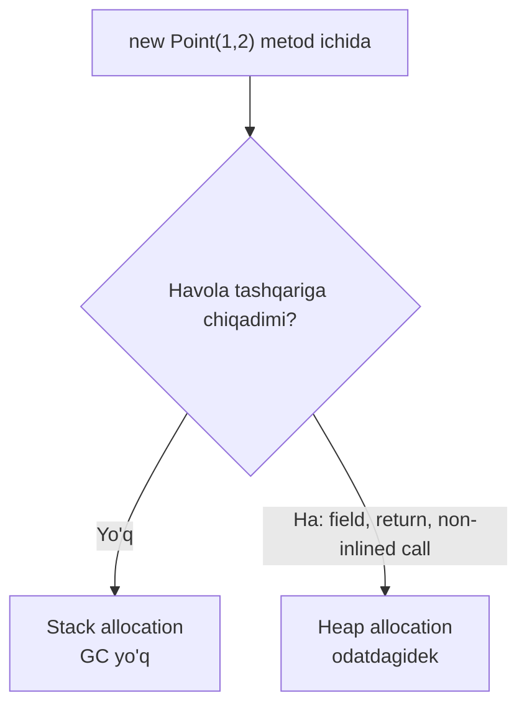

# 28. Runtime va SDK 10

> **Bir jumlada:** .NET 10 runtime JIT'ni sezilarli kuchaytirdi (escape analysis bilan stack allocation, devirtualization, loop inversion, AVX10.2), kutubxonalarga post-quantum kriptografiya, JSON va ZIP yaxshilanishlari, `WebSocketStream` qo'shdi; SDK esa file-based apps (`dotnet run app.cs`), `dotnet test` uchun Microsoft.Testing.Platform, `dotnet tool exec`/`dnx`, konteyner va tab-completion yangiliklarini keltirdi.
> **Nega Middle uchun:** Runtime yangiliklari "kodni o'zgartirmasdan tezroq" degan va'dani beradi, lekin qachon va qancha ekanini tushunish kerak. SDK yangiliklari esa kundalik ish oqimini (skript, test, konteyner) o'zgartiradi.
> **O'qish vaqti:** ~25 daqiqa

## Mundarija

1. [Muammo va yechim](#1-muammo-va-yechim)
2. [Qanday ishlaydi](#2-qanday-ishlaydi)
3. [Asosiy tushunchalar](#3-asosiy-tushunchalar)
4. [Amaliy misol](#4-amaliy-misol)
5. [Tipik xatolar va anti-patternlar](#5-tipik-xatolar-va-anti-patternlar)
6. [Best practices checklist](#6-best-practices-checklist)
7. [Suhbat savollari va javoblar](#7-suhbat-savollari-va-javoblar)
8. [Qo'shimcha manbalar](#8-qoshimcha-manbalar)

## 1. Muammo va yechim

| Og'riq | .NET 10 javobi |
|---|---|
| Kichik vaqtinchalik obyektlar (closure, iterator, kichik massiv) heap'ga tushib Gen0 GC'ni band qilardi | JIT escape analysis: obyekt metoddan "qochmasa", stack'da joylashadi |
| Interface orqali chaqiruvlar inline bo'lmasdi | Kengaytirilgan devirtualization (shu jumladan massiv interface metodlari) + PGO |
| Bir martalik skript uchun `.csproj` yaratish | File-based apps: `dotnet run app.cs`, `#:package` direktivasi |
| `dotnet test` VSTest'ga bog'langan, sekin va cheklangan | Microsoft.Testing.Platform (MTP) qo'llab-quvvatlanadi |
| Bir martalik tool uchun global install | `dotnet tool exec` va `dnx` |
| Kvant kompyuterga chidamli imzo/kalit almashinuvi kerak (uzoq muddatli hujjatlar) | ML-KEM, ML-DSA, SLH-DSA, Composite ML-DSA API'lari |
| JSON'da dublikat property yoki bo'sh maydonlar jim o'tardi | `AllowDuplicateProperties = false`, `JsonSerializerOptions.Strict` |

## 2. Qanday ishlaydi

### JIT: escape analysis va stack allocation

JIT metodni kompilyatsiya qilganda har bir `new` uchun "bu obyektga havola metoddan tashqariga chiqadimi?" deb tahlil qiladi. Chiqmasa (field'ga yozilmaydi, qaytarilmaydi, boshqa metodga uzatilmaydi yoki uzatilgan metod inline bo'lgan), obyekt heap o'rniga stack frame'da joylashadi: allocation yo'q, GC bosimi yo'q. .NET 10 buni kichik fixed-size massivlarga va delegate'larga (closure obyektlari) ham kengaytirdi.



Bu Tier1 (optimallashtirilgan) kodda ishlaydi, shuning uchun tiered compilation va Dynamic PGO yoqilgan bo'lishi kerak (default).

### Tiered compilation va PGO

Metod avval Tier0 (tez, sifatsiz) kompilyatsiya qilinadi, 30 chaqiruvdan keyin instrumentatsiya bilan qayta, keyin yig'ilgan profil (qaysi tip ko'p uchraydi, qaysi branch issiq) asosida Tier1. .NET 10 devirtualization'ni shu profilga tayanib yanada ko'p joyda qo'llaydi.

### File-based apps

`dotnet run app.cs` SDK ichida vaqtinchalik loyiha yaratadi, `#:package`, `#:sdk`, `#:property` direktivalarini `.csproj` ga aylantiradi, build qiladi va ishga tushiradi. Natija kesh'lanadi, ikkinchi ishga tushirish tez. `dotnet publish app.cs` ham ishlaydi (NativeAOT bilan).

## 3. Asosiy tushunchalar

### 3.1 File-based apps

```csharp
#!/usr/bin/env dotnet
#:package Dapper@2.1.66
#:package Npgsql@9.0.3
#:property PublishAot=true

using Dapper;
using Npgsql;

// Ombordagi manfiy qoldiqlarni tekshiradigan bir martalik skript
var cs = Environment.GetEnvironmentVariable("WAREHOUSE_DB") ?? throw new("WAREHOUSE_DB yo'q");
await using var conn = new NpgsqlConnection(cs);
var rows = await conn.QueryAsync<(string Sku, int Qty)>("SELECT sku, quantity FROM stock_items WHERE quantity < 0");
foreach (var (sku, qty) in rows) Console.WriteLine($"{sku}: {qty}");
```

```bash
dotnet run check-stock.cs
dotnet publish check-stock.cs -o out     # NativeAOT bo'lsa bitta binar
dotnet project convert check-stock.cs    # to'liq loyihaga aylantirish
```

- **Nega kerak.** Ops skriptlari, migratsiya tekshiruvlari, kichik utilitalar uchun bash/python o'rniga C#.
- **Tipik xato.** Unix'da `#!` shebang bilan ishga tushirish uchun faylga exec huquqi va SDK PATH'da bo'lishi kerak. Katta loyiha uchun file-based app emas, oddiy loyiha.

### 3.2 JIT yaxshilanishlari va amaliy ma'nosi

- **Escape analysis / stack allocation.** Kichik struct bo'lmagan obyektlar, closure'lar, kichik massivlar. Amaliy: LINQ lambda'lar va `Span` ustidagi kichik yordamchi obyektlar arzonroq. Kodni o'zgartirish shart emas, lekin "obyektni field'ga saqlash" uni heap'ga qaytaradi.
- **Devirtualization.** Interface orqali chaqiruvlar (shu jumladan `IEnumerable<T>` massivda, `IList<T>`) ko'p hollarda to'g'ridan-to'g'ri chaqiruv va inline bo'ladi. Amaliy: abstraksiya narxi kamaydi, "performance uchun interface'dan qochish" argumenti zaiflashdi.
- **Loop inversion, bounds check elimination, struct argumentlari uchun yaxshi kod.** Hisoblash og'ir kodda (hisobot, agregatsiya) foyda.
- **AVX10.2, Arm64 yaxshilanishlari.** `Vector512`, `System.Numerics.Tensors` bilan ishlaydigan kod tezroq.

Qancha? Microsoft benchmark'larida ko'p ish yuklarida bir xonali foiz, allocation-og'ir kodda ko'proq. O'z loyihangizda BenchmarkDotNet bilan o'lchang, "umumiy raqam" yo'q.

### 3.3 NativeAOT

- .NET 10 da AOT yanada ko'p kutubxona bilan mos (OpenAPI shablon, file-based apps, ASP.NET Core Minimal API).
- Enterprise backend uchun qoida: uzoq ishlaydigan API server uchun JIT + PGO odatda tezroq (runtime profil), AOT esa CLI, serverless, sidecar, tez start kerak joyda.

### 3.4 Post-quantum kriptografiya

- `System.Security.Cryptography` da `MLKem` (kalit kapsulyatsiya, FIPS 203), `MLDsa` (imzo, FIPS 204), `SlhDsa` (imzo, FIPS 205), Composite ML-DSA, HashML-DSA. Windows CNG va OpenSSL 3.5+ tayanchi.
- **Qachon kerak.** Uzoq muddat (10+ yil) sir qolishi kerak ma'lumot va imzolar: hujjat arxivi, firmware imzosi, uzoq muddatli shartnoma. Oddiy TLS uchun hozircha kutubxona/OS darajasida hal bo'ladi.

```csharp
using System.Security.Cryptography;

using var signer = MLDsa.GenerateKey(MLDsaAlgorithm.MLDsa65);
byte[] data = File.ReadAllBytes("contract.pdf");
byte[] signature = signer.SignData(data);
bool ok = signer.VerifyData(data, signature);
byte[] publicKey = signer.ExportSubjectPublicKeyInfo();   // saqlash/uzatish uchun
```

### 3.5 Kutubxona yangiliklari (backend uchun muhimlari)

- **JSON.** `JsonSerializerOptions.AllowDuplicateProperties = false` (dublikat kalit → xato), `JsonSerializerOptions.Strict` preset, `PipeReader` bilan deserializatsiya (ASP.NET Core shu orqali tezlashdi), `JsonIgnoreCondition.WhenWritingNull` bilan yaxshilanishlar.
- **Networking.** `WebSocketStream`: WebSocket'ni `Stream` sifatida ishlatish (JSON/protobuf serializer'ni to'g'ridan-to'g'ri ulash). macOS'da TLS 1.3 client.
- **ZIP.** `ZipArchive` da kamroq xotira va tezroq yozish, async API'lar.
- **Diagnostika.** `Activity` va `Meter` uchun yangi API'lar, `Process` Windows process group.
- **Numerics.** `Tensor<T>` va `System.Numerics.Tensors` barqaror: embedding va ML oldindan qayta ishlash uchun.
- **Kriptografiya.** AES KeyWrap with padding, `X509Certificate` yaxshilanishlari.

### 3.6 SDK: test, tool, konteyner, CLI

- **`dotnet test` + MTP.** `global.json` yoki `dotnet.config` da `"test": { "runner": "Microsoft.Testing.Platform" }` bilan yangi runner; xUnit v3, TUnit, NUnit MTP qo'llab-quvvatlaydi. Tezroq start, filtrlash, hisobot formatlari.
- **`dotnet tool exec` / `dnx`.** Bir martalik tool ishga tushirish, install'siz: `dnx dotnet-ef migrations list`. Platform-specific tool'lar va `any` RID.
- **Konteyner.** Console app ham `PublishContainer` bilan image yaratadi; `ContainerImageFormat` bilan OCI/Docker format tanlanadi.
- **CLI.** Buyruq tartibi standartlashdi (`dotnet package add` kabi noun-first shakl, eski `dotnet add package` ham ishlaydi), `dotnet completions script zsh` native tab-completion, `--cli-schema` introspeksiya.

## 4. Amaliy misol

Ops jamoasi uchun "release sanity check" skripti: file-based app, `#:package`, MTP bilan test va konteyner publish.

```csharp
#:package Microsoft.Extensions.Http.Resilience@10.0.0
#:package Microsoft.Extensions.Hosting@10.0.0
#:property PublishAot=true

using System.Net.Http.Json;
using Microsoft.Extensions.DependencyInjection;
using Microsoft.Extensions.Hosting;
using Microsoft.Extensions.Http.Resilience;

// Deploy'dan keyin barcha servislarning /health/ready ni tekshiradi, bittasi yiqilsa exit 1
var builder = Host.CreateApplicationBuilder(args);
builder.Services.AddHttpClient("probe").AddStandardResilienceHandler(o =>
{
    o.Retry.MaxRetryAttempts = 3;
    o.AttemptTimeout.Timeout = TimeSpan.FromSeconds(5);
});
using var host = builder.Build();

string[] services = args.Length > 0 ? args : ["https://orders.internal", "https://stock.internal", "https://payments.internal"];
var factory = host.Services.GetRequiredService<IHttpClientFactory>();
var client = factory.CreateClient("probe");

int failed = 0;
await Parallel.ForEachAsync(services, async (url, ct) =>
{
    try
    {
        var res = await client.GetAsync($"{url}/health/ready", ct);
        var body = await res.Content.ReadFromJsonAsync<HealthReport>(ct);
        var status = body?.Status ?? res.StatusCode.ToString();
        Console.WriteLine($"{url,-32} {status}");
        if (!res.IsSuccessStatusCode) Interlocked.Increment(ref failed);
    }
    catch (Exception ex)
    {
        Console.WriteLine($"{url,-32} XATO: {ex.Message}");
        Interlocked.Increment(ref failed);
    }
});

return failed == 0 ? 0 : 1;

record HealthReport(string Status);
```

```bash
# Lokal
dotnet run probe.cs -- https://orders.staging https://stock.staging

# CI'da bitta binar sifatida (NativeAOT, tez start)
dotnet publish probe.cs -o ./out -r linux-x64

# Test loyihasida MTP (dotnet.config loyiha ildizida)
# [dotnet.test.runner]
# name = "Microsoft.Testing.Platform"
dotnet test --filter "Category=Smoke"
```

Nima uchun shunday: skript `.csproj`siz, lekin to'liq DI, resilience va AOT bilan; CI'da `dotnet publish` bitta binar beradi, runtime o'rnatish shart emas; `Parallel.ForEachAsync` tekshiruvlarni parallel qiladi, `Interlocked` hisoblagichni thread-safe saqlaydi.

## 5. Tipik xatolar va anti-patternlar

**❌ "Escape analysis bor, endi allocation haqida o'ylamasa ham bo'ladi"**

Nega yomon: faqat metoddan chiqmaydigan obyektlar stack'ga tushadi; field'ga yozilgan, qaytarilgan, non-inlined metodga uzatilgan obyekt heap'da qoladi. Oqibati: profiler'siz "tezlashdi" degan taxmin. ✅ BenchmarkDotNet `[MemoryDiagnoser]` bilan o'lchang.

**❌ Production API'ni "tezroq" deb NativeAOT'ga ko'chirish**

Nega yomon: AOT'da Dynamic PGO yo'q, uzoq ishlaydigan serverda JIT ko'pincha tezroq; reflection-based kutubxonalar (eski serializer, ba'zi mapper'lar) ishlamaydi. ✅ AOT faqat start vaqti muhim joyda (CLI, serverless, sidecar).

**❌ File-based app'ni katta loyihaga aylantirib yuborish**

Nega yomon: bitta faylda 2000 qator, test yo'q, review qiyin. ✅ 200 qatordan oshsa `dotnet project convert`.

**❌ Post-quantum imzoni "xavfsizroq" deb hamma joyga qo'yish**

Nega yomon: kalit va imzo hajmi katta (ML-DSA-65 imzosi ~3.3 KB), tezlik past, ekotizim (HSM, sertifikat) hali to'liq emas. ✅ Faqat uzoq muddatli sir/imzo talab qiladigan joyda, gibrid yondashuv bilan.

**❌ `dotnet test` ni MTP'ga o'tkazib, CI'dagi `--logger trx` flag'larini qoldirish**

Nega yomon: MTP'da flag'lar boshqa (`--report-trx`), CI hisobot topa olmaydi. ✅ Runner o'zgarganda CI skriptini ham yangilang.

## 6. Best practices checklist

- [ ] Tiered compilation va Dynamic PGO default yoqiq qoldiring (`TieredPGO` ni o'chirmang). Sabab: .NET 10 JIT yutuqlari shunga tayanadi.
- [ ] Konteynerda `DOTNET_GCHeapHardLimit` yoki K8s memory limit bilan GC'ni xabardor qiling; Server GC + DATAS default. Sabab: limitdan oshsa OOMKilled.
- [ ] Ops skriptlari uchun file-based apps, 200 qatordan oshsa loyihaga konvertatsiya.
- [ ] `#:package` versiyasini doim qotiring. Sabab: skript bir yil keyin ham build bo'lsin.
- [ ] Yangi test loyihalarida MTP (xUnit v3). Sabab: tezroq va kelajak yo'nalishi; CI flag'larini moslang.
- [ ] Bir martalik tool uchun `dnx`/`dotnet tool exec`, global install'ni kamaytiring.
- [ ] `JsonSerializerOptions.Strict` yoki `AllowDuplicateProperties=false` ni tashqi API'dan keladigan JSON uchun yoqing. Sabab: dublikat kalit hujumlari.
- [ ] JSON converter'larni `HasValueSequence` uchun tekshiring (PipeReader yo'li).
- [ ] Uzoq muddat sir qoladigan ma'lumot uchun post-quantum rejani hujjatlashtiring (hozir shart emas, lekin "qachon" savoliga javob bo'lsin).
- [ ] Performance da'vosini BenchmarkDotNet yoki production metrikasi bilan tasdiqlang. Sabab: "yangi runtime tezroq" umumiy gap.
- [ ] `dotnet publish /t:PublishContainer` bilan Dockerfile'siz image qurishni sinang; CI oddiylashadi.

## 7. Suhbat savollari va javoblar

1. **.NET 10 JIT'dagi escape analysis nima va qachon ishlaydi?**
   JIT `new` qilingan obyektga havola metoddan tashqariga chiqmasligini isbotlasa, obyektni heap o'rniga stack'da joylaydi; GC bosimi kamayadi. Closure obyektlari va kichik massivlar ham kiradi. Faqat Tier1 optimallashtirilgan kodda; obyekt field'ga yozilsa, qaytarilsa yoki inline bo'lmagan metodga uzatilsa, heap'da qoladi.

2. **Devirtualization yaxshilanishi arxitektura qaroriga qanday ta'sir qiladi?**
   Interface orqali chaqiruv narxi kamaydi, PGO ko'p hollarda to'g'ridan-to'g'ri chaqiruv va inline qiladi. "Performance uchun interface ishlatmaymiz" degan argument ko'p joyda asossiz; abstraksiyani dizayn sababi bilan tanlang, mikro-optimizatsiya uchun emas. Issiq yo'llarda baribir o'lchang.

3. **File-based apps nima va enterprise'da qayerda foydali?**
   `dotnet run app.cs`: `.csproj`siz bitta fayl, `#:package` bilan NuGet, `#:property` bilan MSBuild sozlama, `dotnet publish` (AOT ham). Ops skriptlari, migratsiya tekshiruvi, bir martalik ma'lumot tuzatish, prototip. Katta kod uchun `dotnet project convert`.

4. **NativeAOT'ni qachon tanlaysiz, qachon yo'q?**
   Tez start va kichik xotira muhim bo'lganda: CLI, serverless, sidecar, qisqa umrli job. Uzoq ishlaydigan API uchun JIT + Dynamic PGO odatda tezroq, va reflection'ga tayanadigan kutubxonalar AOT'da ishlamasligi mumkin. Qaror: profil + kutubxona mosligi.

5. **Post-quantum kriptografiya .NET 10 da qanday ko'rinadi va hozir ishlatish kerakmi?**
   `MLKem`, `MLDsa`, `SlhDsa`, Composite ML-DSA sinflari `System.Security.Cryptography` da, OS (CNG, OpenSSL 3.5) tayanchi bilan. Hozir faqat uzoq muddatli maxfiylik yoki imzo kerak joyda (arxiv, firmware); TLS uchun OS/kutubxona darajasida keladi. Kalit va imzo hajmi katta, gibrid sxema tavsiya qilinadi.

6. **Microsoft.Testing.Platform VSTest'dan nimasi bilan farq qiladi?**
   Test loyihasi o'zi executable (runner ichida), VSTest host'i yo'q: tezroq start, oddiyroq CLI, AOT mos, yangi hisobot/filtrlash. `dotnet test` .NET 10 da MTP'ni qo'llab-quvvatlaydi (`dotnet.config` yoki `global.json` sozlamasi). Flag nomlari boshqa, CI'ni moslash kerak.

7. **`dotnet tool exec` va `dnx` nima uchun?**
   Tool'ni global/local install qilmasdan bir marta ishga tushirish (npx kabi). CI'da `dotnet-ef`, `dotnet-format` kabi tool'lar uchun qulay, versiya aniq ko'rsatiladi.

8. **`WebSocketStream` qaysi muammoni hal qiladi?**
   WebSocket'ni `Stream` sifatida ko'rsatadi, shuning uchun `JsonSerializer.DeserializeAsync(stream)` yoki protobuf parser'ni to'g'ridan-to'g'ri ulash mumkin; oldin `ReceiveAsync` bufer boshqaruvini qo'lda yozish kerak edi.

9. **JSON `Strict` rejimi nimani o'zgartiradi?**
   Dublikat property xato, noma'lum property xato, case-sensitive, raqamni string'dan o'qish yo'q. Tashqi API'dan keladigan ma'lumot uchun xavfsizroq (dublikat kalit orqali validatsiyani aylanib o'tish hujumlariga qarshi).

10. **Konteynerda .NET 10 GC qanday sozlanadi?**
    Server GC + DATAS (Dynamic Adaptation To Application Sizes) default: heap yuklamaga qarab o'sadi/kichrayadi. K8s memory limit'ni runtime o'qiydi (`DOTNET_GCHeapHardLimitPercent` bilan nozik sozlash). Thread pool ham CPU limitga qaraydi. Kuzatish: `dotnet-counters` yoki OpenTelemetry runtime metrikalari.

## 8. Qo'shimcha manbalar

- [What's new in .NET 10 (overview)](https://learn.microsoft.com/dotnet/core/whats-new/dotnet-10/overview)
- [What's new in the .NET 10 runtime](https://learn.microsoft.com/dotnet/core/whats-new/dotnet-10/runtime)
- [What's new in the .NET 10 libraries](https://learn.microsoft.com/dotnet/core/whats-new/dotnet-10/libraries)
- [What's new in the SDK for .NET 10](https://learn.microsoft.com/dotnet/core/whats-new/dotnet-10/sdk)
- [File-based apps](https://learn.microsoft.com/dotnet/core/sdk/file-based-programs)
- [Microsoft.Testing.Platform](https://learn.microsoft.com/dotnet/core/testing/microsoft-testing-platform-intro)
- [Performance Improvements in .NET 10 (Stephen Toub, .NET Blog)](https://devblogs.microsoft.com/dotnet/performance-improvements-in-net-10/)
- [.NET support policy](https://dotnet.microsoft.com/platform/support/policy/dotnet-core)
